写学习笔记时，一段文字可以解释概念，一张图则能把步骤、关系和时间顺序放在同一个视野里。Mermaid 让这些图保留为可版本管理的纯文本：修改节点、调整关系，然后让渲染器完成排版。

本文所有图都由站点的 Mermaid 组件实际渲染。每张图下方展开“查看与复制源码”，即可复制其中的文本，放入 `mermaid` 代码围栏。所有计划、评分和统计数值均为演示数据。

## 在 Fumadocs 中怎么写

在 MDX 中写一个以 `mermaid` 为语言标记的代码围栏即可：

````md

````

本站已通过 `remarkMdxMermaid` 和全局 `Mermaid` 组件接入渲染，无需逐篇导入组件。展开的源码使用普通文本高亮，以便展示原始 Mermaid，而不会再次渲染成图。

截至 2026-10-23，npm 的 `latest` 和[官方发布记录](https://github.com/mermaid-js/mermaid/releases/tag/mermaid%4012.2.0)均为 **12.2.0**。两个 Fumadocs 项目均已从 11.17.2 升级并固定这一版本。

Mermaid 12 默认使用 ELK 布局和 neo 外观。本站为延续已有文档的排版，显式使用 `layout: dagre`、`look: classic`，主题继续跟随站点深浅模式；单张图仍可通过 Mermaid frontmatter 覆盖配置。构建环境要求 Node.js 22.12 或以上，浏览器基线提升到 ES2024 / Safari 17.4；详见 [12.0 迁移说明](https://github.com/mermaid-js/mermaid/releases/tag/mermaid%4012.0.0)。

## 先选对图

| 想表达的内容 | 推荐图表 |
| --- | --- |
| 步骤、分支、循环 | 流程图 |
| 多方调用与响应顺序 | 时序图 |
| 对象与接口、表与关系 | 类图、实体关系图 |
| 生命周期与事件触发 | 状态图 |
| 工期依赖、事件先后 | 甘特图、时间线 |
| 章节提纲、体验步骤 | 思维导图、用户旅程图 |
| 比例、趋势、流量、多维比较 | 饼图、XY 图、桑基图、雷达图、矩形树图 |
| 系统组成、位字段、任务状态 | 块图、架构图、数据包图、看板图 |
| 分支历史、优先级、需求追踪 | Git 分支图、象限图、需求图 |

## 01 · 流程图：发布一篇学习笔记

适合算法步骤、条件分支和业务流程。`TD` 表示从上到下，`LR` 表示从左到右；菱形表示判断，边上的文字说明分支条件。

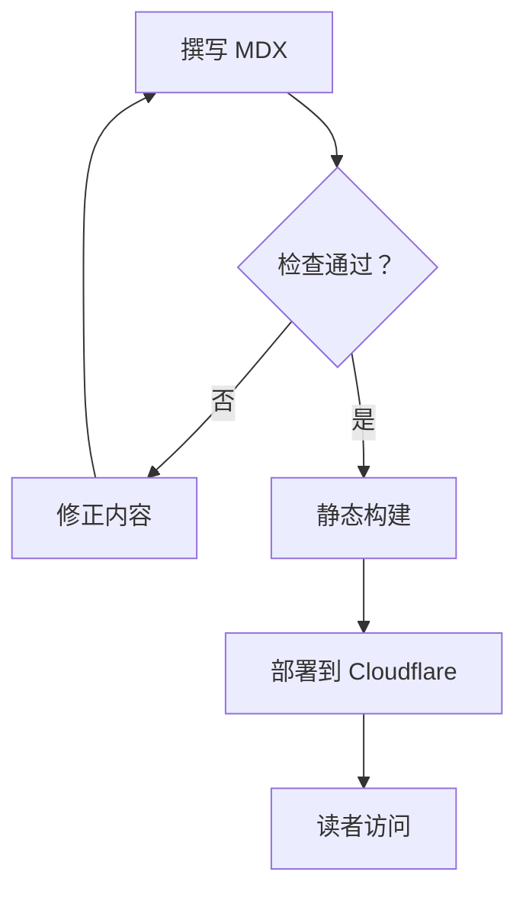

<details>
<summary>查看与复制源码 · flowchart</summary>

```text title="Mermaid 源码"
flowchart TD
  Draft[撰写 MDX] --> Check{检查通过？}
  Check -->|否| Fix[修正内容]
  Fix --> Draft
  Check -->|是| Build[静态构建]
  Build --> Deploy[部署到 Cloudflare]
  Deploy --> Read[读者访问]
```

</details>

## 02 · 时序图：一次文档请求

适合解释谁先调用谁，以及请求、响应和异常分支。`->>` 是消息，`-->>` 是返回，`alt` / `else` 描述两条互斥路径。

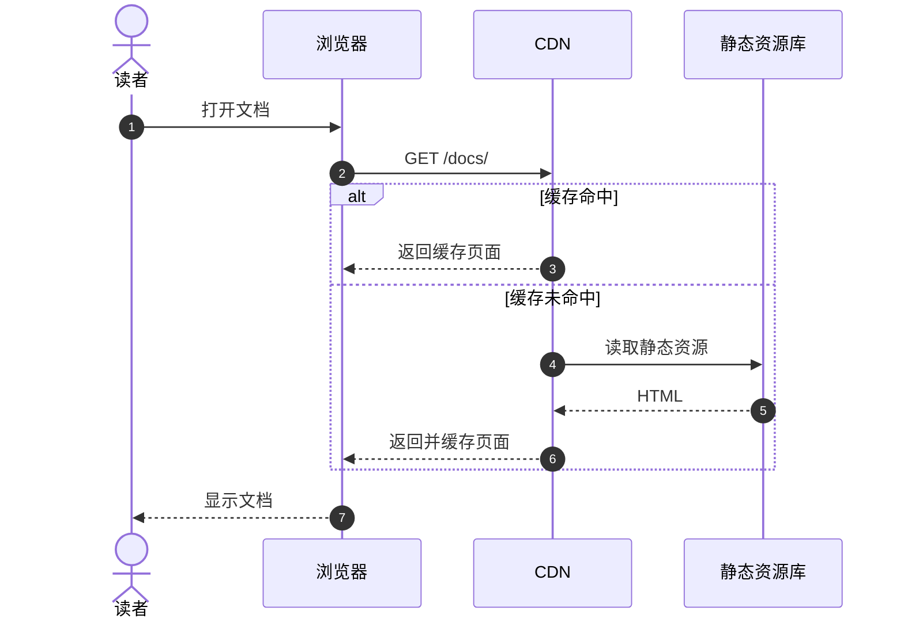

<details>
<summary>查看与复制源码 · sequenceDiagram</summary>

```text title="Mermaid 源码"
sequenceDiagram
  autonumber
  actor Reader as 读者
  participant Browser as 浏览器
  participant CDN as CDN
  participant Origin as 静态资源库
  Reader->>Browser: 打开文档
  Browser->>CDN: GET /docs/
  alt 缓存命中
    CDN-->>Browser: 返回缓存页面
  else 缓存未命中
    CDN->>Origin: 读取静态资源
    Origin-->>CDN: HTML
    CDN-->>Browser: 返回并缓存页面
  end
  Browser-->>Reader: 显示文档
```

</details>

## 03 · 类图：文章与作者

适合对象模型、接口和继承关系。`+` 表示公开成员，`*--` 表示组合关系，端点上的数字表示数量约束。

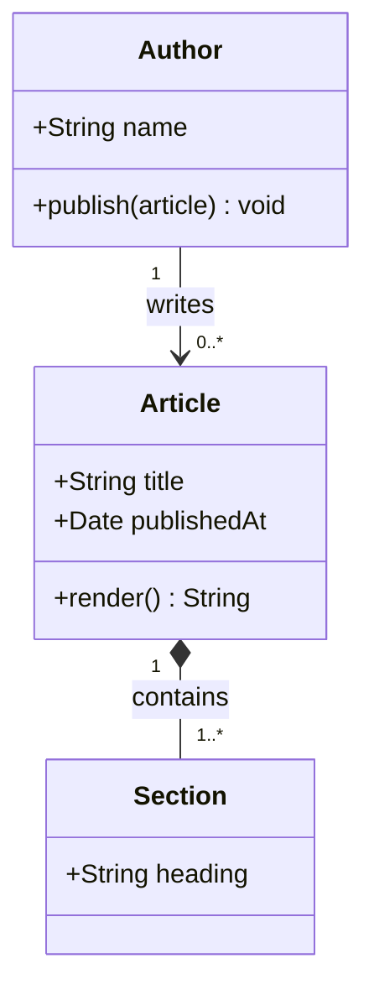

<details>
<summary>查看与复制源码 · classDiagram</summary>

```text title="Mermaid 源码"
classDiagram
  class Author {
    +String name
    +publish(article) void
  }
  class Article {
    +String title
    +Date publishedAt
    +render() String
  }
  class Section {
    +String heading
  }
  Author "1" --> "0..*" Article : writes
  Article "1" *-- "1..*" Section : contains
```

</details>

## 04 · 状态图：学习任务的生命周期

适合任务状态、协议状态机和 UI 状态转换。`[*]` 表示起点或终点，冒号后面写触发事件。

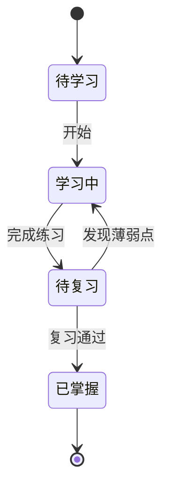

<details>
<summary>查看与复制源码 · stateDiagram-v2</summary>

```text title="Mermaid 源码"
stateDiagram-v2
  [*] --> Planned
  state "待学习" as Planned
  state "学习中" as Learning
  state "待复习" as Reviewing
  state "已掌握" as Mastered
  Planned --> Learning : 开始
  Learning --> Reviewing : 完成练习
  Reviewing --> Learning : 发现薄弱点
  Reviewing --> Mastered : 复习通过
  Mastered --> [*]
```

</details>

## 05 · 实体关系图：课程、笔记与标签

适合讨论数据结构和表之间的关系。`||` 表示恰好一个，`o{` 表示零个或多个；示例通过关联实体表达笔记与标签的多对多关系。

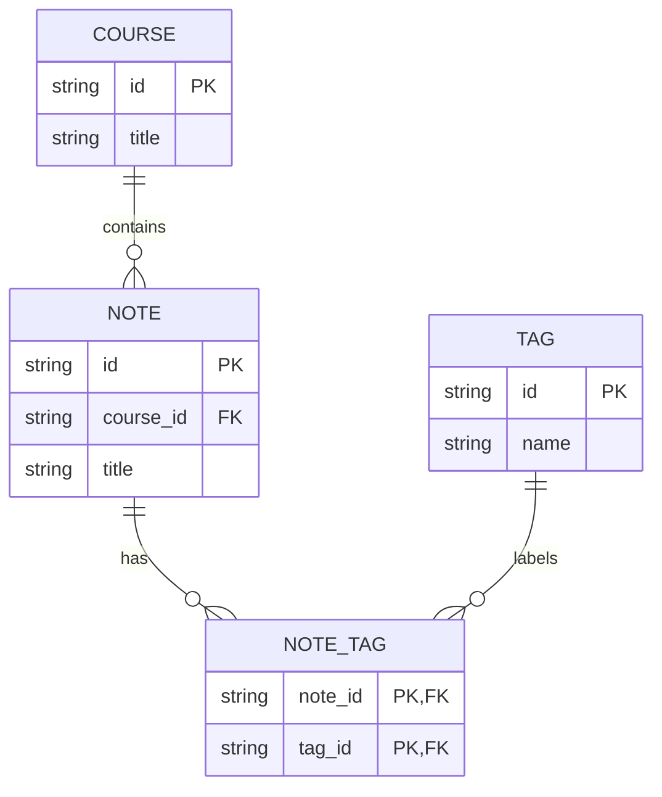

<details>
<summary>查看与复制源码 · erDiagram</summary>

```text title="Mermaid 源码"
erDiagram
  COURSE ||--o{ NOTE : contains
  NOTE ||--o{ NOTE_TAG : has
  TAG ||--o{ NOTE_TAG : labels
  COURSE {
    string id PK
    string title
  }
  NOTE {
    string id PK
    string course_id FK
    string title
  }
  TAG {
    string id PK
    string name
  }
  NOTE_TAG {
    string note_id PK, FK
    string tag_id PK, FK
  }
```

</details>

## 06 · 甘特图：一周复习计划

适合带日期、工期和依赖的计划。`after` 建立依赖，`milestone` 表示里程碑；这里使用固定日期，方便以后阅读时保持一致。

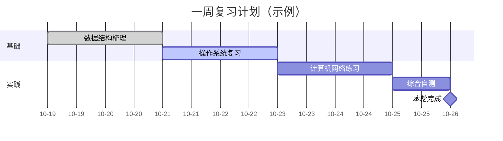

<details>
<summary>查看与复制源码 · gantt</summary>

```text title="Mermaid 源码"
gantt
  title 一周复习计划（示例）
  dateFormat YYYY-MM-DD
  axisFormat %m-%d
  section 基础
    数据结构梳理 :done, ds, 2026-10-19, 2d
    操作系统复习 :active, os, after ds, 2d
  section 实践
    计算机网络练习 :net, after os, 2d
    综合自测 :test, after net, 1d
    本轮完成 :milestone, finish, after test, 0d
```

</details>

## 07 · 时间线：知识库的演进

适合版本历史、学习阶段和事件回顾。只有先后关系时用时间线；需要精确工期与依赖时用甘特图。

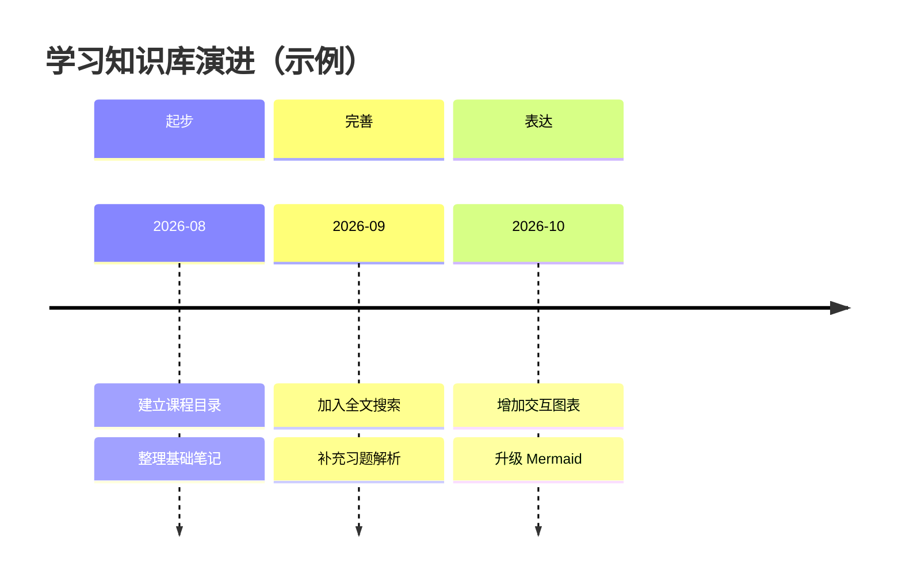

<details>
<summary>查看与复制源码 · timeline</summary>

```text title="Mermaid 源码"
timeline
  title 学习知识库演进（示例）
  section 起步
    2026-08 : 建立课程目录 : 整理基础笔记
  section 完善
    2026-09 : 加入全文搜索 : 补充习题解析
  section 表达
    2026-10 : 增加交互图表 : 升级 Mermaid
```

</details>

## 08 · Git 分支图：一次功能合并

适合解释分支、提交、合并与发布标签。它描述提交拓扑，不会读取当前仓库的真实历史。

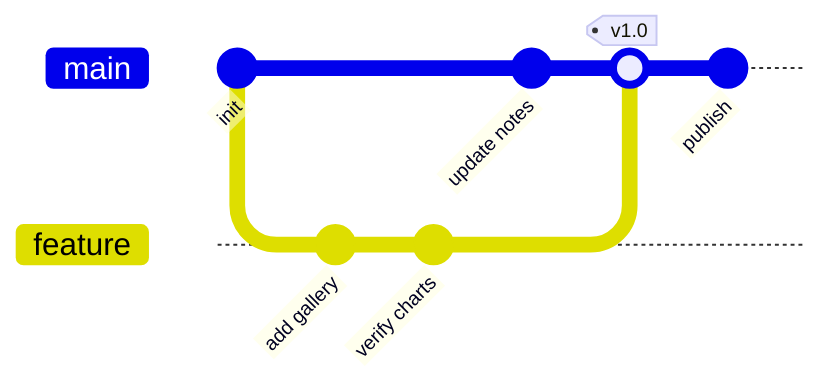

<details>
<summary>查看与复制源码 · gitGraph</summary>

```text title="Mermaid 源码"
gitGraph
  commit id: "init"
  branch feature
  checkout feature
  commit id: "add gallery"
  commit id: "verify charts"
  checkout main
  commit id: "update notes"
  merge feature tag: "v1.0"
  commit id: "publish"
```

</details>

## 09 · 思维导图：组织知识点

适合章节提纲和知识分类，缩进决定父子关系。这里使用 `mermaid` 围栏里的原生 `mindmap`，区别于站内独立 `mindmap` 围栏提供的 Markmap。示例启用 12.2 的按深度配色。

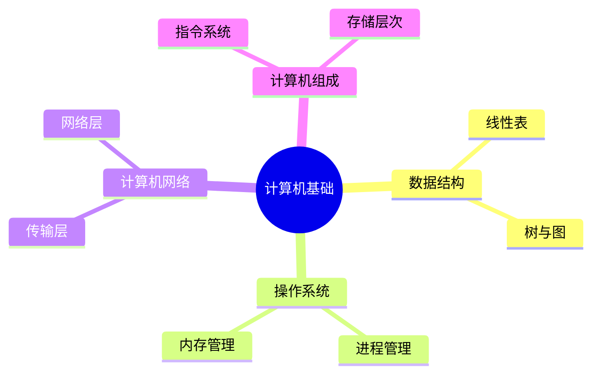

<details>
<summary>查看与复制源码 · mindmap</summary>

```text title="Mermaid 源码"
---
config:
  mindmap:
    colorBy: depth
---
mindmap
  root((计算机基础))
    数据结构
      线性表
      树与图
    操作系统
      进程管理
      内存管理
    计算机网络
      传输层
      网络层
    计算机组成
      指令系统
      存储层次
```

</details>

## 10 · 用户旅程图：从查找到掌握

适合描述体验步骤、参与角色和主观感受。每个任务后的分数用 1–5 表示，数值越高代表体验越好；这里全部是演示评分。

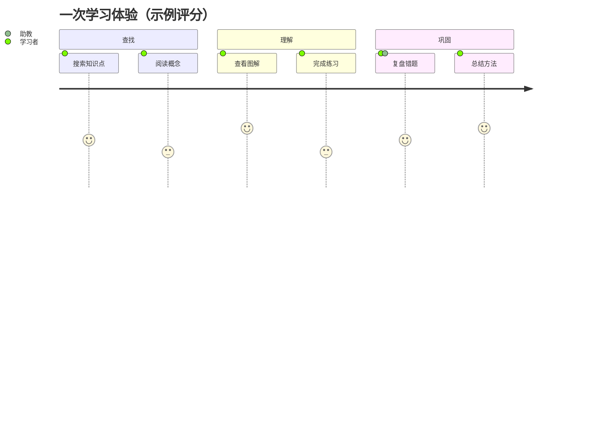

<details>
<summary>查看与复制源码 · journey</summary>

```text title="Mermaid 源码"
journey
  title 一次学习体验（示例评分）
  section 查找
    搜索知识点: 4: 学习者
    阅读概念: 3: 学习者
  section 理解
    查看图解: 5: 学习者
    完成练习: 3: 学习者
  section 巩固
    复盘错题: 4: 学习者, 助教
    总结方法: 5: 学习者
```

</details>

## 11 · 饼图：学习时间占比

适合少量类别的整体占比。数值会按总和换算成比例；类别很多或数值接近时，柱状图更容易比较。

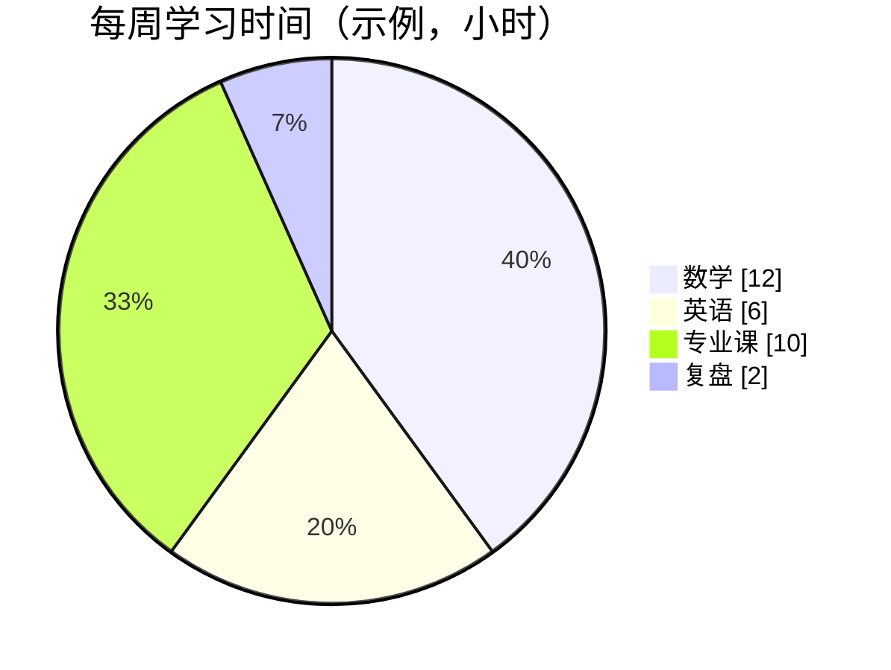

<details>
<summary>查看与复制源码 · pie</summary>

```text title="Mermaid 源码"
pie showData
  title 每周学习时间（示例，小时）
  "数学" : 12
  "英语" : 6
  "专业课" : 10
  "复盘" : 2
```

</details>

## 12 · XY 图：练习量与正确率

适合简单的柱状图和折线图。下面在同一坐标系中比较两轮练习的正确率，两组数据使用相同单位，避免把题量和百分比混在一根轴上。

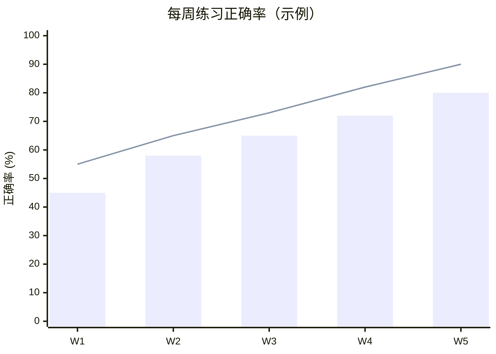

<details>
<summary>查看与复制源码 · xychart-beta</summary>

```text title="Mermaid 源码"
xychart-beta
  title "每周练习正确率（示例）"
  x-axis [W1, W2, W3, W4, W5]
  y-axis "正确率 (%)" 0 --> 100
  bar [45, 58, 65, 72, 80]
  line [55, 65, 73, 82, 90]
```

</details>

## 13 · 象限图：安排学习优先级

适合用两个维度进行相对比较。坐标范围是 0–1；这里的“收益”和“投入”均为假设评分，不能当作客观测量。

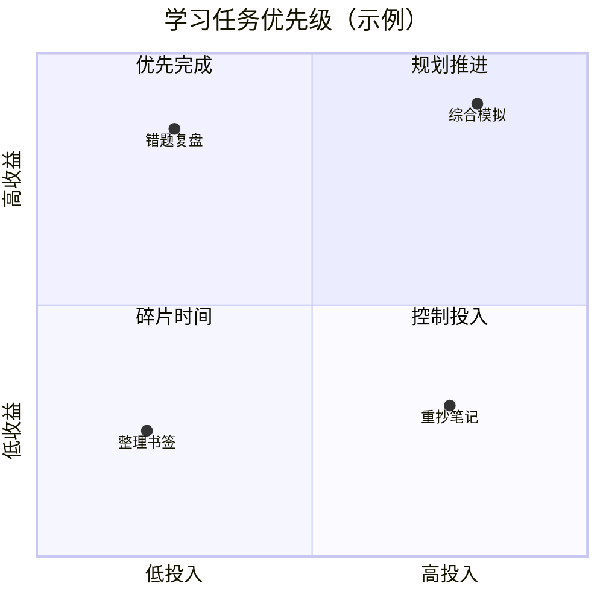

<details>
<summary>查看与复制源码 · quadrantChart</summary>

```text title="Mermaid 源码"
quadrantChart
  title 学习任务优先级（示例）
  x-axis 低投入 --> 高投入
  y-axis 低收益 --> 高收益
  quadrant-1 规划推进
  quadrant-2 优先完成
  quadrant-3 碎片时间
  quadrant-4 控制投入
  错题复盘: [0.25, 0.85]
  综合模拟: [0.80, 0.90]
  整理书签: [0.20, 0.25]
  重抄笔记: [0.75, 0.30]
```

</details>

## 14 · 桑基图：时间流向哪里

适合表示从来源到去向的流量。数据行的三列分别是来源、去向、数值；中间节点的流入与流出应保持一致。此处 30 小时最终分配为新知 16、复习 14。当前桑基图解析器对非 ASCII 标签有限制，因此 CSV 使用英文标签：Total 为总时间，New 为新知，Review 为复习。

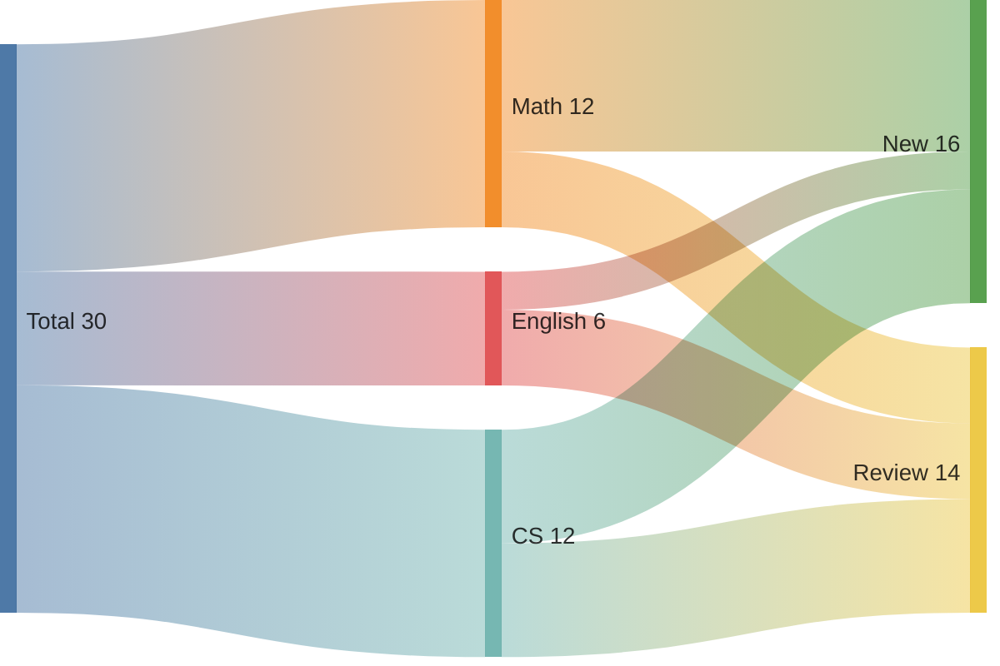

<details>
<summary>查看与复制源码 · sankey-beta</summary>

```text title="Mermaid 源码"
sankey-beta
Total,Math,12
Total,English,6
Total,CS,12
Math,New,8
Math,Review,4
English,New,2
English,Review,4
CS,New,6
CS,Review,6
```

</details>

## 15 · 雷达图：比较多个能力维度

适合少量对象在相同量表上的多维比较。各维度均采用 0–100 的示例评分，曲线的数值顺序与轴的声明顺序一致。

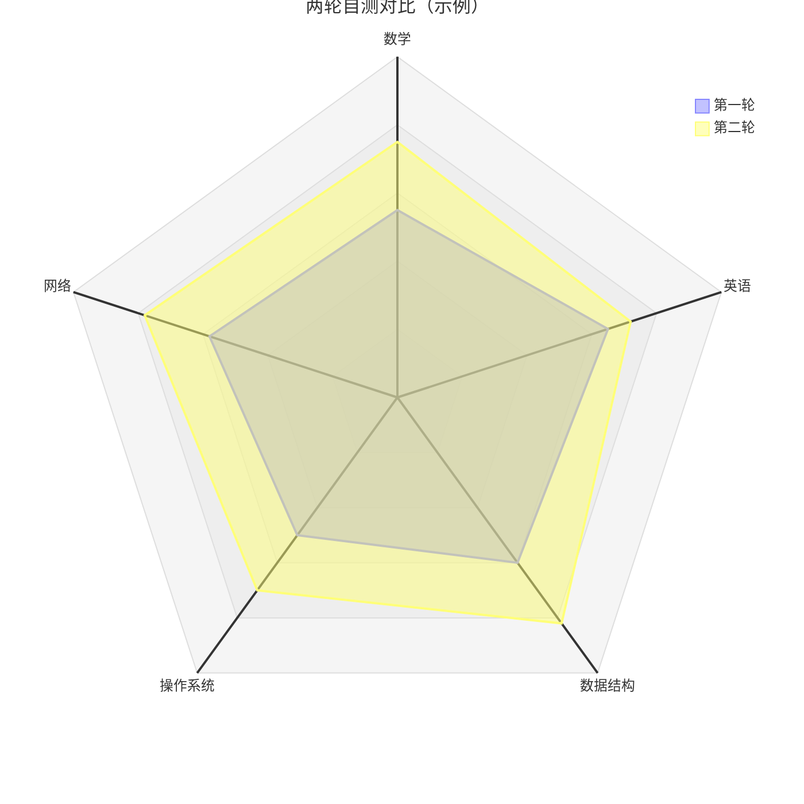

<details>
<summary>查看与复制源码 · radar-beta</summary>

```text title="Mermaid 源码"
radar-beta
  title 两轮自测对比（示例）
  axis math["数学"], english["英语"], ds["数据结构"], os["操作系统"], net["网络"]
  curve first["第一轮"]{55, 65, 60, 50, 58}
  curve second["第二轮"]{75, 72, 82, 70, 78}
  min 0
  max 100
  graticule polygon
  showLegend true
```

</details>

## 16 · 矩形树图：分层查看时间分配

适合同时展示层级和占比。父节点由缩进形成，叶子节点提供数值；矩形面积与小时数成比例。

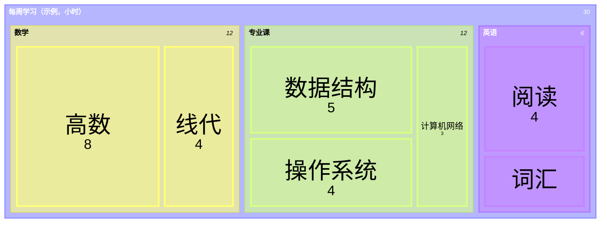

<details>
<summary>查看与复制源码 · treemap-beta</summary>

```text title="Mermaid 源码"
treemap-beta
  "每周学习（示例，小时）"
    "数学"
      "高数": 8
      "线代": 4
    "专业课"
      "数据结构": 5
      "操作系统": 4
      "计算机网络": 3
    "英语"
      "阅读": 4
      "词汇": 2
```

</details>

## 17 · 块图：页面由哪些部分组成

适合需要明确控制行列和模块位置的结构示意。`columns` 设置列数，`:3` 表示跨三列；相比流程图，更适合描述静态布局。

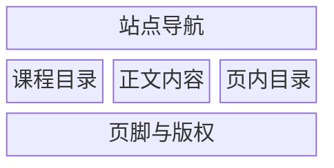

<details>
<summary>查看与复制源码 · block-beta</summary>

```text title="Mermaid 源码"
block-beta
  columns 3
  header["站点导航"]:3
  sidebar["课程目录"] article["正文内容"] toc["页内目录"]
  footer["页脚与版权"]:3
```

</details>

## 18 · 数据包图：画出一个 32 位格式

适合讲解协议头、寄存器和位字段。区间两端都包含在内，`0-3` 占 4 位；这是一份自定义演示格式，不是实际网络协议。

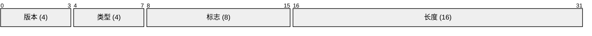

<details>
<summary>查看与复制源码 · packet-beta</summary>

```text title="Mermaid 源码"
packet-beta
  0-3: "版本 (4)"
  4-7: "类型 (4)"
  8-15: "标志 (8)"
  16-31: "长度 (16)"
```

</details>

## 19 · 架构图：静态站点的组成

适合描述服务、资源和连接。`L`、`R`、`T`、`B` 指定连接端点；示例使用内置图标，不依赖外部图标注册。

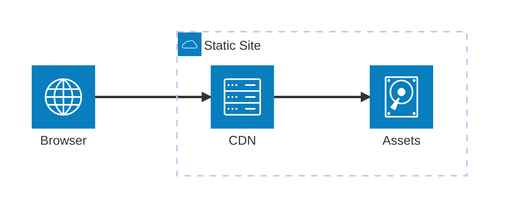

<details>
<summary>查看与复制源码 · architecture-beta</summary>

```text title="Mermaid 源码"
architecture-beta
  group site(cloud)[Static Site]
  service browser(internet)[Browser]
  service cdn(server)[CDN] in site
  service assets(disk)[Assets] in site
  browser:R --> L:cdn
  cdn:R --> L:assets
```

</details>

## 20 · 看板图：追踪文章进度

适合按列展示任务所处阶段。列 ID 与任务 ID 都应唯一；这是一张静态图，不会拖拽写回任务系统。

```mermaid
kanban
  todo[待开始]
    research[查阅文档]
    outline[列出提纲]
  doing[进行中]
    examples[编写图表示例]
  review[待检查]
    mobile[检查移动端]
  done[已完成]
    upgrade[升级 Mermaid]
```

<details>
<summary>查看与复制源码 · kanban</summary>

```text title="Mermaid 源码"
kanban
  todo[待开始]
    research[查阅文档]
    outline[列出提纲]
  doing[进行中]
    examples[编写图表示例]
  review[待检查]
    mobile[检查移动端]
  done[已完成]
    upgrade[升级 Mermaid]
```

</details>

## 21 · 需求图：把要求与验证连起来

适合把需求、设计元素和验证关系放在一张图里。需求中的 `verifymethod` 指定验证方式，`satisfies` 把实现关联到需求。

```mermaid
requirementDiagram
  requirement diagram_support {
    id: REQ_01
    text: Render Mermaid diagrams in MDX
    risk: low
    verifymethod: test
  }
  element mdx_renderer {
    type: component
    docref: components/mdx/mermaid.tsx
  }
  mdx_renderer - satisfies -> diagram_support
```

<details>
<summary>查看与复制源码 · requirementDiagram</summary>

```text title="Mermaid 源码"
requirementDiagram
  requirement diagram_support {
    id: REQ_01
    text: Render Mermaid diagrams in MDX
    risk: low
    verifymethod: test
  }
  element mdx_renderer {
    type: component
    docref: components/mdx/mermaid.tsx
  }
  mdx_renderer - satisfies -> diagram_support
```

</details>

## 写图时的几个习惯

- 节点使用简短、唯一的英文 ID，把中文放进标签；复杂标签加引号，避免标点被解析成语法。
- 一张图只回答一个问题。节点过多时拆图，流程过宽时试试 `TD`；横向图可在图内滚动。
- 保留图旁的文字说明。颜色用于辅助区分，状态、方向与关系仍应通过标签和线型表达。
- 雷达图、XY 图等必须明确单位与量表；示例数据与实际统计要分清。
- `*-beta` 是部分图表当前使用的语法关键字，不代表本文安装的是预发布版本。新图类型的语法可能继续变化，升级时应重新验证。
- 原生 Mermaid 思维导图要放在 `mermaid` 围栏里；单独的 `mindmap` 围栏在本站使用另一套 Markmap 渲染器。

完整语法可查阅 [Mermaid 图表目录](https://mermaid.js.org/intro/syntax-reference.html)。本文只使用包内图表与内置图标，复制到其他 Markdown 平台时，需要确认对方也支持相应 Mermaid 版本和图表类型。
