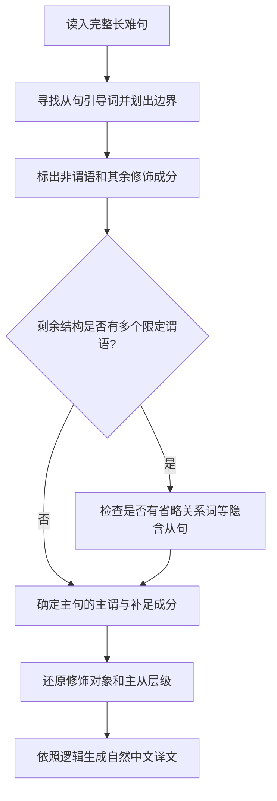
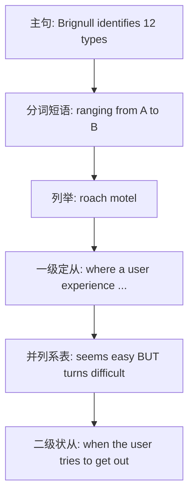
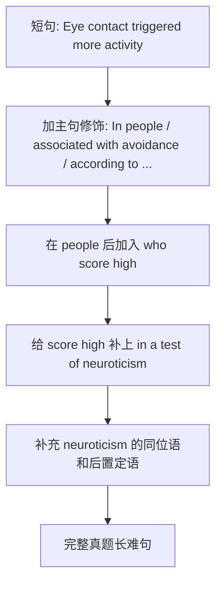

## 一、本阶段要学会什么

<Cards>
  <Card title="第一目标｜先找主干">
    不被长句长度干扰，能够识别真正的主语、谓语以及宾语或表语。
  </Card>
  <Card title="第二目标｜识别枝叶">
    识别介词短语、定语从句、非谓语短语、同位语等，知道它们修饰谁。
  </Card>
  <Card title="第三目标｜分清从句层级">
    判断一级从句依附于主句、二级从句依附于一级从句，而非把所有谓语都当成主句谓语。
  </Card>
  <Card title="第四目标｜按逻辑翻译">
    先理解主干，再补足限制、条件、补充说明和信息来源，最后调整为自然的中文语序。
  </Card>
</Cards>

<Callout type="idea" title="核心思路：扩句和拆句是同一过程的两个方向">

**扩句**：简单句主干 → 添加主句修饰语 → 嵌入从句 → 为从句再添加修饰语。

**拆句**：完整长难句 → 识别各层从句和修饰语 → 找到主句主干 → 恢复修饰关系 → 理解与翻译。

学习时采用“**先拆结构，后还原语义**”的顺序。所谓“删除枝叶”，只是分析语法时暂时忽略，**不是翻译时丢掉信息**。

</Callout>

## 二、全书知识路线：本阶段先建立地图

以下是依据原书目录梳理的学习路线；各专题的具体分析见后文章节。

| 板块 | 核心内容 | 阅读时要解决的问题 |
| --- | --- | --- |
| 介词短语的五大功能 | 状语、后置定语、表语、插入语、补足语 | 这个介词短语修饰什么，承担什么功能？ |
| 六大从句 | 定语从句、状语从句、宾语从句、同位语从句、表语从句、主语从句 | 从句的边界在哪儿？在上一级句中充当什么成分？ |
| 长难句六大结构 | 并列、分隔、嵌套、比较、否定、独立主格 | 句内有哪些逻辑关系，主干是否被隔开？ |
| 三大非谓语动词短语 | 不定式、分词、动名词 | 这个动词形式是不是独立的限定谓语？ |
| 三大语法现象 | 省略、虚拟语气、替代 | 是否有省去的成分，或需要根据上下文恢复的含义？ |
| 三大特殊句式 | 倒装、强调、There be 结构 | 词序或句型是否改变了主干的常规位置？ |
| 五大标点符号 | 逗号、分号、破折号、冒号、括号 | 标点提示的是并列、插入、解释还是补充？ |

<MindMap
  title="考研长难句学习路线"
  height={470}
  initialExpandLevel={2}
  markdown={String.raw`
# 考研长难句
## 分析核心
### 找主句主干
### 标出修饰成分
### 确认从句层级
### 还原逻辑与翻译
## 七个高频考向
### 介词短语
### 六类从句
### 六类复杂结构
### 非谓语动词
### 省略·虚拟·替代
### 倒装·强调·There be
### 标点作用
## 巩固方向
### 看结构图
### 复述拆句步骤
### 精读真题例句
### 自测与错因复盘
`}
/>

## 三、基础概念：为什么一句英语会变长？

英语长难句通常并不是一个“巨大而无法分割的句型”，而是**一个主句的核心骨架承载了多层补充信息**。这些信息可能说明人、事、地点、时间、原因、范围、评价或研究来源。

### 1. 五种基本句型：识别主干的终点

| 句型 | 结构 | 简单示例 | 识别要点 |
| --- | --- | --- | --- |
| S + V | 主语 + 不及物谓语 | `The child smiled.` | 谓语之后不必带宾语。 |
| S + V + O | 主语 + 及物谓语 + 宾语 | `Eye contact triggered activity.` | 谓语作用于什么对象？ |
| S + V + C | 主语 + 系动词 + 表语 | `The process seems easy.` | `easy` 描述主语的状态。 |
| S + V + O + O | 主语 + 谓语 + 间接宾语 + 直接宾语 | `She gave him a book.` | `him` 是接受者，`a book` 是给予物。 |
| S + V + O + C | 主语 + 谓语 + 宾语 + 宾补 | `The news made him anxious.` | `anxious` 说明宾语 `him` 的状态。 |

> 这些简单句示例为便于复习而编写；教材中的真题原句在后面的“实例精讲”单独呈现。

### 2. “主干”与“完整含义”是两个不同目标

例如：

- **主干**：`Eye contact triggered more activity.`
- **后置定语**：`associated with avoidance`，限定 `activity` 的性质。
- **定语从句**：`who score high ...`，限定 `people` 是哪类人。
- **同位语**：`a personality dimension ...`，解释 `neuroticism` 是什么。
- **信息来源**：`according to ...`，说明观点由谁提出。

先找主干是为了看清句法；恢复其余成分，才能获得完整语义。**不能把修饰语一概当成可有可无的信息。**

## 四、主干拆解法：六步完成一次长难句分析

以下流程整合了原书“寻找主句主干”和“厘清关系”的方法，并将图中的判断条件改写为适合直接操作的步骤。

<Steps>
  <Step>

    ### 第一步：扫描从句标志词，圈出从句的范围

    优先关注 `who`、`which`、`that`、`where`、`when`、`because`、`if`、`although` 等线索，确定每个从句的起点和可能的终点。

    **先判断功能，再决定是否暂时剥离**：作修饰的定语从句、状语从句，可以在“寻找更高一级主干”时先放到一旁；若从句本身充当主语、宾语或表语，就必须保留它所占的句法位置。

  </Step>
  <Step>

    ### 第二步：辨认非谓语结构

    找出 `to do`、`doing`、`done` 等形式，结合上下文区分它们是非谓语短语，还是限定谓语的一部分。

    例如 `associated with avoidance` 是过去分词短语作后置定语；而 `is associated with ...` 中的 `is associated` 可以构成完整的被动谓语。**不能只见到 `-ed` 就删除，也不能只见到 `-ing` 就判定为非谓语。**

  </Step>
  <Step>

    ### 第三步：暂时抽离其余修饰语

    找出不构成核心论元的介词短语、插入语、同位语等，并记下它们的依附对象。

    例如 `according to the Finnish researcher ...` 提示信息来源；它不会取代主句的谓语 `triggered`。

  </Step>
  <Step>

    ### 第四步：排除“伪主干谓语”

    如果剥离明显的从句后，句中看起来仍有多个限定谓语，就考虑是否存在**省略从句引导词**的结构。

    例如 `The report (that) the team published was influential.` 中，`published` 属于省略了关系词 `that` 的定语从句；真正的主句谓语是 `was`。

  </Step>
  <Step>

    ### 第五步：确定主句主干

    将剩余核心结构还原到五种基本句型之一，明确“谁做了什么 / 什么是什么状态”。不要因为句中某个动词靠前，就断定它是主句谓语。

  </Step>
  <Step>

    ### 第六步：回填枝叶，画出关系并翻译

    逐个回答：这个修饰语修饰谁？这一级从句依附谁？句子是并列、转折、因果，还是限定说明？最后按照中文习惯重排语序。

  </Step>
</Steps>

<Callout type="warn" title="一个常见误区：从句标志词并不总是出现">

关系代词在某些限定性定语从句中可以省略，尤其是在关系代词作宾语时，例如 `the book (that) I bought`。因此，**“看不到引导词”不等于“没有从句”**。

还需注意：并列谓语可能共用同一主语（如 `seems ... but turns ...`），不应机械地把每个谓语拆成一个独立主句。

</Callout>

### 句子层级怎么标？

| 层级 | 含义 | 例句中的表现 |
| --- | --- | --- |
| 主句 | 整句最外层的核心陈述 | `Brignull identifies 12 types ...` |
| 一级从句 | 依附主句中的成分 | `where a user experience seems ... but turns ...` |
| 二级从句 | 依附一级从句中的成分 | `when the user tries to get out` |

注意：“一级 / 二级”只表示**依附层次**，不表示从句重要性的高低，也不表示一个句子只能有一个一级从句。

## 五、真题精讲 A：2022 年英语（二）Text 3

### 1. 原句与语境

> Brignull identifies 12 types of common dark patterns, ranging from misdirection and hidden costs to “roach motel,” where a user experience seems easy and intuitive at the start, but turns difficult when the user tries to get out.

**整体含义**：Brignull 归纳了 12 种常见的“暗黑设计模式”，从误导性设计、隐藏费用，到所谓“蟑螂旅馆”式设计。其中，“蟑螂旅馆”指一种“进入容易、退出困难”的体验：用户起初觉得操作简单直观，但试图退出时却遭遇困难。

<Tabs items={['分层拆句', '翻译思路', '重点辨析']} defaultIndex={0}>
  <Tab value="分层拆句">

    **第 0 层｜主句主干**

    `Brignull / identifies / 12 types of common dark patterns`

    - 主语：`Brignull`
    - 谓语：`identifies`
    - 宾语：`12 types of common dark patterns`
    - 基本句型：**S + V + O**。

    **修饰宾语的补充说明**

    `ranging from misdirection and hidden costs to “roach motel”`

    - 现在分词短语提供这些设计模式的范围和举例。
    - `range from A to B` 表示“从 A 到 B，范围包括……”。

    **第 1 层｜`where` 引导的定语从句**

    `where a user experience seems easy and intuitive at the start, but turns difficult ...`

    - `where` 在这里相当于 `in which`，指向前面的“roach motel”这一设计情境。
    - 从句主语：`a user experience`。
    - **并列系表结构**：`seems easy and intuitive` **but** `turns difficult`。
    - `seems` 与 `turns` 都是系动词，各自带形容词表语。转折发生在同一个 `where` 从句内部。

    **第 2 层｜`when` 引导的时间状语从句**

    `when the user tries to get out`

    - 说明何时“变得困难”。
    - `when` 从句嵌套在 `where` 从句中，属于**二级从句**，并不直接修饰 `identifies`。

  </Tab>
  <Tab value="翻译思路">

    <Steps>
      <Step>

        ### 第 1 步：主句

        `Brignull identifies 12 types of common dark patterns.`

        **Brignull 归纳出 12 种常见的暗黑设计模式。**

      </Step>
      <Step>

        ### 第 2 步：列举范围

        `ranging from misdirection and hidden costs to “roach motel”`

        **包括误导性设计、隐藏费用，以及“蟑螂旅馆”式设计等。**

      </Step>
      <Step>

        ### 第 3 步：解释设计类型

        `where a user experience seems easy and intuitive at the start, but turns difficult ...`

        **在这种设计中，用户最初觉得操作简单直观，但后来却变得困难。**

      </Step>
      <Step>

        ### 第 4 步：还原变化的时间

        `when the user tries to get out`

        **当用户试图退出时，操作却变得困难。**

      </Step>
    </Steps>

    把英语的一句话拆成两句中文，可以避免定语从句后置造成的生硬语序；但举例、转折和时间条件都必须保留。

  </Tab>
  <Tab value="重点辨析">

    | 表达 | 语法作用 | 易错之处 |
    | --- | --- | --- |
    | `dark patterns` | 误导用户的界面设计模式 | 不要直译成“黑暗的图案”。 |
    | `ranging from ... to ...` | 现在分词短语，补充举例范围 | `ranging` 不是主句谓语。 |
    | `where ...` | 引导说明设计情境的定语从句 | 不是独立主句，也不必指真实地点。 |
    | `seems ... but turns ...` | 一个从句内的并列系表结构 | 不等于两个不同层级的主句。 |
    | `when the user tries to get out` | 时间状语从句 | 不是直接修饰 `identifies`。 |
    | `roach motel` | “容易进入、难以退出”的比喻 | 不能只按字面译为真实旅馆。 |

  </Tab>
</Tabs>

## 六、真题精讲 B：2020 年英语（一）新题型

### 1. 完整原句

> In people who score high in a test of neuroticism, a personality dimension associated with self-consciousness and anxiety, eye contact triggered more activity associated with avoidance, according to the Finnish researcher Jari Hietanen and colleagues.

**通顺译文**：据芬兰研究人员贾里·希塔宁及其同事的研究，在神经质测试中得分较高的人群中，眼神接触引发了更多与回避相关的活动；这里的“神经质”是一种与自我意识及焦虑有关的人格维度。

<Callout type="info" title="语义精度提示">

此处 `activity` 的具体测量对象需要结合原文上下文确定。单凭这一句，译为“活动”或“活动反应”更稳妥；不应未经核实就把它限定为某一种具体的生理指标。

</Callout>

### 2. 先还原最简单的句子

**Eye contact triggered more activity.**

| 成分 | 英文 | 中文 |
| --- | --- | --- |
| 主语（S） | `Eye contact` | 眼神接触 |
| 谓语（V） | `triggered` | 引发了 |
| 宾语（O） | `more activity` | 更多活动（反应） |

主句是典型的 **S + V + O**。剩余内容对主干及其成分作限定与补充。

### 3. 逐层扩句：怎样从简单句长成真题长句？

<Steps>
  <Step>

    ### 第 1 层：加入主句修饰

    - 句首添加：`In people`，限定研究人群。
    - 宾语之后添加：`associated with avoidance`，说明 `more activity` 的性质。
    - 句末添加：`according to the Finnish researcher Jari Hietanen and colleagues`，交代信息来源。

  </Step>
  <Step>

    ### 第 2 层：在 `people` 后嵌入定语从句

    `who score high ...`

    - `who` 指代 `people`，在从句中作主语。
    - `score high` 表示“得分高”。
    - 从句修饰主句中的 `people`，所以是**一级定语从句**。

  </Step>
  <Step>

    ### 第 3 层：扩展定语从句内部

    `in a test of neuroticism`

    - `in a test ...` 修饰 `score high`，说明“在什么测试中得分高”。
    - `of neuroticism` 说明测试所考察的是“神经质”。

  </Step>
  <Step>

    ### 第 4 层：解释术语 `neuroticism`

    `a personality dimension associated with self-consciousness and anxiety`

    - `a personality dimension` 与 `neuroticism` 构成同位关系，解释其含义。
    - `associated with self-consciousness and anxiety` 是过去分词短语，后置修饰 `a personality dimension`。
    - 这部分不是第二个独立的主句，而是嵌在句中的补充说明。

  </Step>
</Steps>

### 4. 反向拆句：考试时按什么次序识别？

| 发现的成分 | 原文片段 | 归属关系 | 中文中的处理 |
| --- | --- | --- | --- |
| 句首介词短语 | `In people ...` | 限定整句描述的研究人群 | “在……的人群中” |
| 一级定语从句 | `who score high ...` | 修饰 `people` | “在……中得分较高的” |
| 从句内部状语 | `in a test of neuroticism` | 修饰 `score high` | “在神经质测试中” |
| 同位语 | `a personality dimension ...` | 解释 `neuroticism` | 可用括号或独立短句呈现 |
| 同位语内部后置定语 | `associated with self-consciousness and anxiety` | 修饰 `a personality dimension` | “与自我意识及焦虑有关的” |
| 主句主干 | `eye contact triggered more activity` | 整句的核心陈述 | “眼神接触引发了更多活动” |
| 宾语后置定语 | `associated with avoidance` | 修饰 `more activity` | “与回避相关的活动” |
| 句末信息来源 | `according to ... and colleagues` | 对整句的来源作说明 | 中文中通常前置 |

**特别留意两个 `associated with`**：它们形式相同，却分别修饰 **`a personality dimension`** 和 **`more activity`**。判断修饰对象，要看所在层级和语义，而不能只因重复结构就当作同一个成分。

### 5. 为什么翻译时要调整语序？

<Tabs items={['英文结构顺序', '中文翻译顺序']} defaultIndex={0}>
  <Tab value="英文结构顺序">

    1. `In people`：限定人群。
    2. `who score high ...`：紧接着嵌入定语从句。
    3. `a personality dimension ...`：插入同位说明。
    4. `eye contact triggered ...`：主句主干出现。
    5. `associated with avoidance`：宾语后置修饰。
    6. `according to ...`：来源说明置于句末。

    **观察**：一个核心陈述被多层修饰分隔，但主句仍只有一个主干。

  </Tab>
  <Tab value="中文翻译顺序">

    1. **先交代来源**：“据芬兰研究人员……的研究”。
    2. **再限定对象**：“在神经质测试中得分较高的人群中”。
    3. **再说核心事实**：“眼神接触引发了更多……活动”。
    4. **补上宾语性质**：“与回避相关的”。
    5. **独立解释术语**：“神经质是一种与……有关的人格维度”。

    **观察**：不要机械照搬英语顺序，适当拆分同位说明即可读得更自然。

  </Tab>
</Tabs>

## 七、精讲例句词汇：单词与短语卡

这些卡片来自本单元两则真题例句。**不编造考频统计**；此处的标签只表示本阶段的学习用途。

<WordCardModeToggle />

<WordCards
  words={[
    {
      word: 'identify',
      label: '核心动词',
      meanings: [{ pos: 'v.', text: '识别；确定；归纳出', key: true }],
    },
    {
      word: 'range from ... to ...',
      label: '范围表达',
      meanings: [{ text: '范围从……到……；包括从……到……', phrase: true, key: true, grammar: 'range from A to B' }],
    },
    {
      word: 'intuitive',
      label: '形容词',
      meanings: [{ pos: 'adj.', text: '直观的；容易凭直觉理解的', key: true }],
    },
    {
      word: 'dark patterns',
      label: '语境词汇',
      meanings: [{ text: '暗黑设计模式；误导用户的界面设计', phrase: true, key: true }],
    },
    {
      word: 'roach motel',
      label: '隐喻表达',
      meanings: [{ text: '“易进难出”的设计陷阱', phrase: true, key: true }],
    },
    {
      word: 'trigger',
      label: '核心动词',
      meanings: [{ pos: 'v.', text: '引发；触发', key: true }],
    },
    {
      word: 'avoidance',
      label: '抽象名词',
      meanings: [{ pos: 'n.', text: '回避；避免', key: true }],
    },
    {
      word: 'be associated with',
      label: '常用搭配',
      meanings: [{ text: '与……有关；与……相联系', phrase: true, key: true, grammar: 'be associated with sth.' }],
    },
    {
      word: 'score high',
      label: '考试表达',
      meanings: [{ text: '得分较高', phrase: true, key: true, grammar: 'score high in/on a test' }],
    },
    {
      word: 'neuroticism',
      label: '学术词汇',
      meanings: [{ pos: 'n.', text: '神经质；神经质倾向（人格特质）', key: true }],
    },
    {
      word: 'self-consciousness',
      label: '抽象名词',
      meanings: [{ pos: 'n.', text: '自我意识；自我关注', key: true }],
    },
    {
      word: 'according to',
      label: '来源标记',
      meanings: [{ text: '根据……；据……所述', phrase: true, key: true }],
    },
  ]}
/>

## 八、原书图解标注法：学会读结构图

原书用线型和括号表示句子成分。为了让笔记可检索、可复制，以下保留其**符号含义**，但核心分析已转换成文字层级图，不再依赖扫描图片。

| 原书标记 | 含义 | 应怎样理解 |
| --- | --- | --- |
| 双下划线 | 主语 | 找到“谁 / 什么”。 |
| 单下划线 | 系动词或谓语 | 判断真正的限定谓语。 |
| 波浪线 | 宾语或表语 | 找到动作对象或主语状态。 |
| `〈 〉` | 前置定语 | 先找被限定的名词。 |
| `『 』` | 后置定语 | 回看其修饰的名词。 |
| `「 」` | 状语 | 看时间、地点、方式、范围或条件。 |
| 虚线 | 补充说明成分 | 留意插入语、同位语。 |
| 方框 | 省略成分 | 检查能否由上下文补全。 |
| 删除线 | 强调句型分析中的还原标记 | 后续学习强调句型时再结合实例理解。 |

## 九、阶段自测：三题检查是否真正理解

<Accordions>
  <Accordion title="自测 1｜Brignull 例句的主句谓语是哪一个？">

    **答案：**`identifies`。

    **解析：**`seems` 与 `turns` 位于 `where` 引导的一级非限定性定语从句中；`tries` 又属于内部 `when` 引导的二级时间状语从句。三个词都是各自分句的谓语，但都不是最外层主句谓语。

  </Accordion>
  <Accordion title="自测 2｜两个 associated with 分别修饰谁？">

    **答案：**

    - `associated with self-consciousness and anxiety` → `a personality dimension`。
    - `associated with avoidance` → `more activity`。

    **解析：**&#x2060;形式相同的过去分词短语可能出现在不同层次。先确定名词中心语，再判断修饰关系。

  </Accordion>
  <Accordion title="自测 3｜没有关系词时，怎样避免误认主句谓语？">

    **练习句**：`The report the team published was influential.`

    **答案：**&#x2060;主干为 `The report was influential.`；`the team published` 是省略了宾语关系词 `that/which` 的定语从句，修饰 `report`。

    **解析：**&#x2060;不要把从左至右遇到的第一个动词直接当作主句谓语。先判断它是否与邻近名词构成一个省略关系词的修饰性从句。

  </Accordion>
</Accordions>

## 十、复习时只记这一套操作法

<Callout type="success" title="五个动作读懂长难句">

**识别谓语 → 划分层级 → 提取主干 → 找准修饰对象 → 重组自然中文。**

- **识别**：哪些是限定谓语，哪些是非谓语？
- **分层**：哪一部分是主句，哪一部分依附于其他分句？
- **提取**：主句的主谓宾或主系表是什么？
- **归属**：每个短语、从句或同位语修饰谁？
- **重组**：适当提前状语、拆开插入成分，但绝不遗漏限定、转折及时间条件。

</Callout>

---

**阶段一整理说明**：第 001—010 页，覆盖方法总论与两则真题长难句精讲。后接阶段二（011—020 页），保留便于逐轮核查的页码断点。
