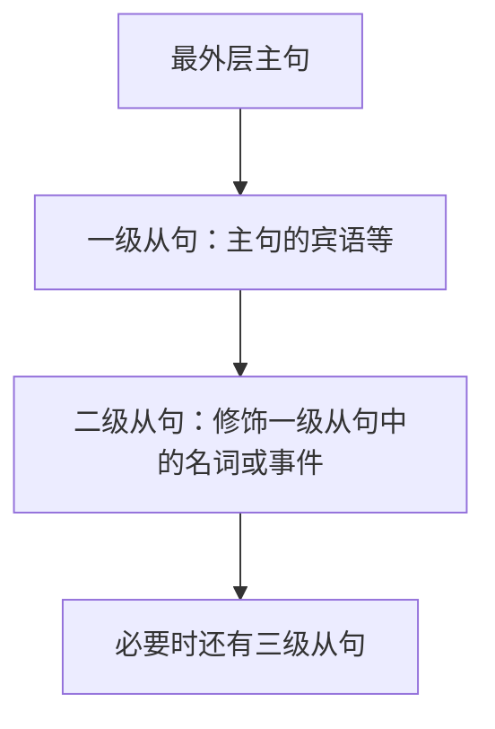
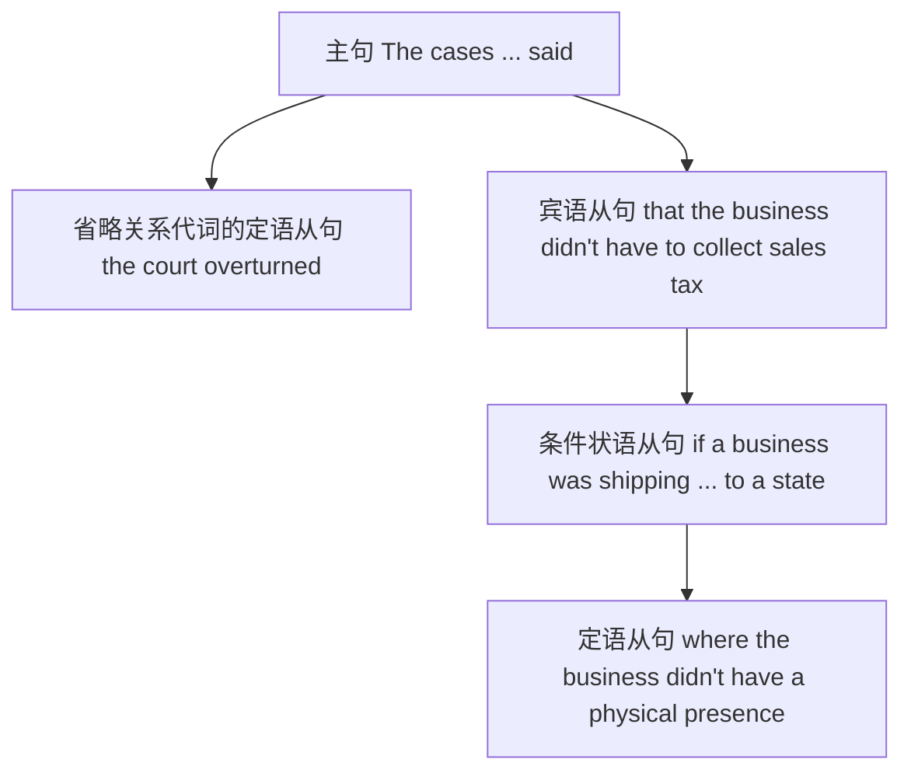

## 二十五、考向 3：分隔结构（续）——相关成分为什么被拉开（原书第 031 页）

### 25.1 修饰性分隔：主语之后的插入信息不改变主谓关系

英语中，主语和谓语之间可以放入定语从句、同位语等。**找到主句限定谓语**是识别分隔的核心：先临时略去中间的说明，再将说明放回原位。

| 真题 | 临时还原的主干 | 被分隔的部分 | 作用 |
| --- | --- | --- | --- |
| 英二 2023 Text 1 | `A Twitter account already has more than 20,000 followers.` | `which claims to “cut through the greenwash” of artificial grass` | 非限制性定语从句，补充账号的定位 |
| 英二 2023 Text 4 | `The teenagers were also more likely to help others.` | `who were more rebellious` | 限制性定语从句，限定哪一类青少年 |
| 英二 2023 新题型 | `John Kelly believes prices will eventually come down.` | `a construction lawyer at Freeths law firm` | 同位语名词短语，补充身份 |

**例 1｜定语从句插在主谓之间**（英二 2023 Text 1）

> A Twitter account, which claims to “cut through the greenwash” of artificial grass, already has more than 20,000 followers.

- **主干：**`A Twitter account has more than 20,000 followers`；`already` 修饰 `has`。
- **从句：**`which claims ...` 修饰 `A Twitter account`，`which` 在从句中作主语。
- **表达：**`cut through` 此处表示“识破、揭穿”；`greenwash` 是“漂绿（用环保包装掩盖问题）”，不应逐词译成“洗绿”。
- **参考译文：**&#x2060;一个声称要揭穿人造草坪“漂绿”宣传的推特账号，已经拥有两万多名关注者。

**例 2｜不要将比较级误译为“越……越……”**（英二 2023 Text 4）

> The teenagers who were more rebellious were also more likely to help others.

- **主干：**`The teenagers were also more likely to help others.`
- **定语从句：**`who were more rebellious` 限定 `teenagers`。
- **辨析：**&#x2060;句子只有 `more rebellious` 和 `more likely` 两处比较级，并没有标准的 `the + 比较级 ..., the + 比较级 ...` 关联格式。
- **译文：**&#x2060;那些更叛逆的青少年，也更有可能帮助他人。

**例 3｜插入同位语，别把名词当第二个主语**（英二 2023 新题型）

> John Kelly, a construction lawyer at Freeths law firm, believes prices will eventually come down.

- `John Kelly` 是主句主语；`believes` 是主句谓语。
- `a construction lawyer at Freeths law firm` 是对 `John Kelly` 的同位语说明，内部 `at ...` 又作后置修饰。
- `prices will eventually come down` 是 `believes` 后省略连接词 `that` 的宾语从句。
- **译文：**&#x2060;Freeths 律师事务所的建筑法律师约翰·凯利认为，价格最终会下降。

### 25.2 前置性分隔：动词与宾语之间插入“身份/结果”说明

**例｜`select A as B` 的顺序变化**（英一 2015 完形）

> Most people do not even know their fourth cousins but somehow manage to select as friends the people who resemble our kin.

- **先恢复正常顺序：**`select the people who resemble our kin as friends`。
- 原句将 `as friends` 提前，读作 `select [as friends] [the people who resemble our kin]`：宾语仍是后面的 `the people ...`。
- `who resemble our kin` 是修饰 `people` 的定语从句；`somehow` 表“以某种难以解释的方式”。
- **译文：**&#x2060;大多数人甚至不认识自己的远房表亲，却不知怎么地，会选择那些与自己亲属相似的人作为朋友。

<Callout type="warn" title="分隔句的做题误区">

- **不要**将“最近的名词”机械当作谓语的主语；先看主谓一致及从句边界。
- **不要**把逗号夹住的说明全部当作无关信息：它在阅读题中可能承担指代、态度或人物身份线索。
- **不要**把 `select as friends the people ...` 误读成 `friends` 是宾语；`the people ...` 才是被选择的对象。

</Callout>

## 二十六、考向 3：嵌套结构总览与定语从句嵌套（原书第 031—032 页）

### 26.1 判断“嵌套”的必要条件

**从句嵌套**不等于“句子中出现两个从句”。只有当内层从句依附于外层从句的某个成分，或者修饰外层从句中的内容时，才构成真正的嵌套。分析时要区别三个问题：

1. 最外层主句是什么？它的限定谓语在哪里？
2. 一级从句担任主句中的什么成分？
3. 二级从句依附于一级从句中的哪个动词、名词或逻辑关系？

<Tabs items={['树形标注', '方括号标注']} defaultIndex={0}>
  <Tab value="树形标注">



  </Tab>
  <Tab value="方括号标注">

```text
主句 [一级宾语从句 ... [二级定语从句 ...] ... ]
主句 [一级目的状语从句 ... [二级定语从句 ...] ... ]
主句 [一级定语从句 ... [二级时间状语从句 ...] ... ]
```

  </Tab>
</Tabs>

### 26.2 定语从句嵌套在宾语从句中

**例｜同一句两个 `that`，职责不同**（英一 2022 新题型）

> But I believe that well-run zoos, and the heroic animals that suffer their captivity, do serve a higher purpose.

**分层结构：**

```text
主句：I believe
└─ 宾语从句 that [well-run zoos and the heroic animals ... do serve a higher purpose]
   └─ 限制性定语从句 that [suffer their captivity]
      └─ 先行词：the heroic animals
```

- 第一个 `that` 连接宾语从句，**不**在宾语从句内部充当主语或宾语。
- 第二个 `that` 引导定语从句，指代 `animals` 并在从句中作主语。
- `well-run zoos` 与 `the heroic animals ...` 并列作宾语从句的主语；`do serve` 为强调谓语，`do` 并不是第二个实义动词。
- **译文：**&#x2060;但我相信，经营良好的动物园以及在圈禁中承受痛苦的那些动物，确实服务于某种更崇高的目的。

### 26.3 定语从句嵌套在定语从句中

**例｜`who` 的从句里又出现 `that`**（英二 2022 Text 1）

> “I’m excited about our progress,” says Brown, who is adding more cover crops that draw worms and crickets for the chickens to eat.

- **外部主干：**`Brown says ...`（原句采用引语后的倒装式引述语：`says Brown`）。
- `who is adding more cover crops ...` 是对 `Brown` 的**非限制性**定语从句。
- `that draw worms and crickets ...` 是修饰 `cover crops` 的**限制性**定语从句，其所在位置嵌套在 `who` 从句内。
- `for the chickens to eat` 是不定式相关结构：蠕虫和蟋蟀是鸡可以吃的东西；不要把 `chickens` 当作 `draw` 的宾语。
- **译文：**“我对我们的进展很兴奋，”布朗说。他正在增加种植更多覆盖作物，以吸引蠕虫和蟋蟀供鸡取食。

### 26.4 定语从句嵌套在目的状语从句中

**例｜省略关系代词，`we really want to do` 不是另一个主句**（英二 2022 完形）

> That means prioritising our activities so that we spend most time on the things we really want to do.

- **主句：**`That means prioritising our activities`。
- **一级：**`so that we spend most time ...` 为目的状语从句。
- **二级：**`(that/which) we really want to do` 为省略宾语关系代词的限制性定语从句，修饰 `the things`。
- `spend time on sth.` 与 `want to do sth.` 是理解句意的两组搭配。
- **译文：**&#x2060;这意味着要给活动安排优先次序，以便把大部分时间花在真正想做的事情上。

### 26.5 定语从句嵌套在表语从句中

**例｜`why` 是上层入口，`that` 是下层入口**（英一 2021 Text 4）

> That’s why there has been such a strong demand for rules that would prevent broadband providers from picking winners and losers online.

- **主句：**`That is ...`。
- **一级：**`why there has been such a strong demand for rules ...` 为表语从句，说明“这就是为什么……”。
- **二级：**`that would prevent broadband providers ...` 是限制性定语从句，修饰 `rules`。
- **搭配：**`prevent sb. from doing sth.`：阻止某人做某事；`pick winners and losers` 在该语境中指“选择性优待或区别对待网络参与方”。
- **译文：**&#x2060;这就是人们强烈要求出台规则的原因：这些规则将阻止宽带运营商在线上偏袒某些参与方、打压另一些参与方。

<Callout type="idea" title="一眼识别定语从句的嵌套位置">

先定位 **被修饰名词**，再追问该名词属于哪个从句。例如 `rules` 在 `why ...` 表语从句内，所以修饰 `rules` 的 `that ...` 定语从句就嵌套在表语从句里。**判断依附，优先于背诵关系词。**

</Callout>

## 二十七、考向 3：状语从句嵌套——先判修饰哪个事件（原书第 032—033 页）

### 27.1 条件从句嵌套在宾语从句中

**例｜`believe that [if ..., ...]`**（英二 2022 完形）

> Harlan Coben believes that if you’re a writer, you’ll find the time.

```text
Harlan Coben believes
└─ 宾语从句 that [you'll find the time]
   └─ 条件状语从句 if [you're a writer]
```

**译文：**&#x2060;哈伦·科本认为，如果你是一名作家，就一定能挤出时间来写作。这里的 `if` 并不直接限制主句 `believes`，而是限制其所相信的内容。

### 27.2 时间从句嵌套在定语从句中

**例｜`with which ... when ...`**（英二 2022 翻译）

> In fact, creative problem-solving skills are incredibly useful in daily life, with which you’re more likely to be able to find a solution when a problem arises.

- **主干：**`creative problem-solving skills are incredibly useful in daily life`。
- **一级：**`with which you're more likely to be able to find a solution ...` 是 `介词 + which` 引导的非限制性定语从句，`which` 指代前面的技能。
- **二级：**`when a problem arises` 是时间状语从句，限制“找到解决办法”这一动作。
- **语义：**`with which` 表“凭借这些技能”；不是问“和谁一起”。
- **译文：**&#x2060;事实上，创造性解决问题的能力在日常生活中极为有用；凭借这些能力，你更有可能在问题出现时找到解决方法。

### 27.3 时间从句嵌套在目的从句中

**例｜`so that ... even when ...`**（英一 2021 Text 1）

> The Government has pledged to change the law to introduce a minimum service requirement so that, even when strikes occur, services can continue to operate.

- **主句：**`The Government has pledged to change the law`。
- `to introduce a minimum service requirement` 是修饰 `change the law` 的目的性不定式短语。
- **一级：**`so that services can continue to operate` 为目的状语从句。
- **二级：**`even when strikes occur` 在目的从句内部提供让步意味的时间背景：“即使在罢工发生时”。
- **译文：**&#x2060;政府已承诺修改法律，引入最低服务保障要求，从而使服务即便在发生罢工时仍能继续运行。

<Callout type="info" title="时间从句前的 even 会改变侧重点">

`when strikes occur` 表“罢工发生时”；加上 `even` 后，突出“即使遇到这种情况也……”，产生让步色彩。结构上仍可视为带有强调色彩的时间从句，而不必强行改成纯条件从句。

</Callout>

### 27.4 时间从句嵌套在表语从句中

**例｜`what happened when ...`**（英一 2020 Text 3）

> That is exactly what happened when Norway adopted a nationwide corporate gender quota.

- **主句：**`That is ...`，`exactly` 强化“正是”。
- **一级：**`what happened ...` 作表语，指“所发生的事”，此处也可按**融合关系结构**（`the thing that happened`）帮助理解。
- **二级：**`when Norway adopted ...` 表事情发生的时间。
- **译文：**&#x2060;挪威在全国推行公司性别配额制度时，发生的正是这种情况。

### 27.5 迁移练习：区分“并列从句”和“真正嵌套”

`I left when it rained, and he stayed because he had work.` 有时间、原因两类状语从句，但它们分别依附于各自的分句，**不一定**是相互嵌套。只有像 `She said that she left when it rained`，`when ...` 修饰 `that` 宾语从句内的 `left`，才体现明显的上下级关系。

## 二十八、考向 3：宾语从句嵌套——找谁“说/认为/解释”了什么（原书第 033 页）

### 28.1 宾语从句嵌套在时间状语从句中

**例｜`after Microsoft said (that) ...`**（英二 2021 Text 3）

> Both apps, however, were later scrapped after Microsoft said it had used their best features in its own products.

- 主句：`Both apps were later scrapped`，`scrap` 在此表示“废弃、取消”，是被动语态。
- 一级从句：`after Microsoft said ...`，交代废弃发生的时间/背景。
- 二级从句：`(that) it had used their best features in its own products` 作 `said` 的宾语；`that` 可以省略。
- **译文：**&#x2060;不过，在微软表示已将这两款应用最出色的功能用于自家产品之后，两款应用最终还是被弃用了。

### 28.2 宾语从句嵌套在定语从句中

**例｜`a situation where ... explaining what ...`**（英一 2019 Text 3）

> We are just in a situation where there are no good theories explaining what consciousness actually is.

- 主句：`We are just in a situation`。
- 一级：`where there are no good theories ...` 定语从句，修饰 `situation`，描述“这样一种处境”。
- `explaining ...` 为现在分词短语，后置修饰 `theories`，并非另一个有独立时态的谓语。
- 二级：`what consciousness actually is` 作 `explaining` 的宾语，属于间接疑问从句，**必须用陈述语序** `consciousness actually is`，而非 `is consciousness`。
- **译文：**&#x2060;我们正处于这样一种境地：没有令人信服的理论能够解释意识究竟是什么。

### 28.3 宾语从句嵌套在宾语从句中

**例｜说了什么？说的话里又包含一个 `that`**（英二 2022 完形）

> He has compared it with plumbing, pointing out that a plumber doesn’t wake up and say that he can’t work with pipes today.

```text
He has compared it with plumbing
└─ 现在分词短语 pointing out
   └─ 宾语从句① that [a plumber doesn't wake up and say ...]
      └─ 宾语从句② that [he can't work with pipes today]
```

- `pointing out` 作补充说明性状语；第一个 `that` 作其内容宾语的连接词。
- `wake up` 与 `say` 由 `and` 并列，受 `doesn't` 的否定范围影响。
- 第二个 `that` 是 `say` 的宾语从句连接词；里面的 `he` 指管道工。
- **译文：**&#x2060;他曾把写作比作管道维修，并指出：管道工不会某天早晨醒来就说自己今天没法跟管道打交道。

<Callout type="warn" title="连接词 that 与代词 that 并不相同">

`that a plumber doesn't ...` 的 `that` 只是连接词，不在从句中充当成分；修饰 `animals` 的 `that suffer ...` 则是关系代词，**在从句里充当主语**。不能只看 `that` 前面是什么词就给它贴标签。

</Callout>

## 二十九、考向 3：主语、表语、同位语及多从句嵌套（原书第 033—034 页）

### 29.1 主语从句嵌套在宾语从句里

**例｜`mean that [what ... may not ...]`**（英二 2022 翻译）

> Changes in the light, the limitations of your painting materials, and the lack of experience and technique mean that what you start out trying to achieve may not come to life.

- **主句主语：**`Changes in the light, the limitations ..., and the lack ...`，是三个并列名词短语；谓语 `mean`。
- **一级宾语从句：**`that what you start out trying to achieve may not come to life`。
- **二级主语从句：**`what you start out trying to achieve` 整体作一级从句里 `may not come to life` 的主语。
- `what` 在内部充当 `achieve` 的宾语，可译为“最初想要实现的东西”；`come to life` 语境中意为“变得栩栩如生、呈现出来”。
- **译文：**&#x2060;光线的变化、绘画材料的局限，以及经验和技巧的欠缺，可能让你一开始想表现出的效果难以真正呈现出来。

### 29.2 `feel like + 从句` 的争议与正确掌握方式

**例｜条件状语从句里出现并列感受**（英二 2024 完形）

> If you feel like you’re always doing something and there is never any space in your calendar for downtime, you could suffer social burnout or social fatigue.

- **主句：**`you could suffer social burnout or social fatigue`。
- **一级：**`If ...` 为条件状语从句。
- `feel like you're always doing something` 中的 `like` 在口语性表达里连接内容从句，意义接近 `feel as if`；**不宜不加解释就称它引导“表语从句”**。也可以按 `feel like + 情况/感受` 这一谓语补足结构整体理解。
- `and there is never any space ...` 与前面的“总在做事”共同描述条件：持续忙碌、没有休息余地。
- **译文：**&#x2060;如果你感觉自己总是忙个不停，日程里完全挤不出放松的时间，就可能陷入社交倦怠或社交疲劳。

<Callout type="warn" title="原文语法标签校正：like ≠ 普通表语从句引导词">

此句的核心考点是 `if` 条件关系及 `feel like ...` 表达感受的习惯用法。与 `The fact is that ...` 这类典型表语从句不同，**这里的 `like` 不能被当作 `be` 后的标准表语从句连接词背诵**。做题时优先保留稳妥的结构和意义判断。

</Callout>

### 29.3 同位语从句嵌套在宾语从句里

**例｜同位语从句解释 `recognition` 的内容**（英二 2019 Text 1）

> “There has been a kind of revival or a rethinking about what guilt is and what role guilt can serve,” says Amrisha Vaish, a psychology researcher at the University of Virginia, adding that this revival is part of a larger recognition that emotions aren’t binary.

把这句分成两层读：

- 引语内部：`There has been a kind of revival or a rethinking ...`；`what guilt is` 与 `what role guilt can serve` 是 `about` 后并列的名词性问句内容。
- 引述语主干：`Amrisha Vaish says ...`；`a psychology researcher ...` 是人物身份同位语。
- `adding that this revival is part of a larger recognition ...` 是现在分词补充说明，其中第一个 `that` 引导 `adding` 的宾语从句。
- `that emotions aren't binary` 解释 `a larger recognition` **究竟认知了什么**，为同位语内容从句，而非“哪一种认知”的普通限定性定语从句。

**译文：**&#x2060;弗吉尼亚大学心理学研究人员阿姆丽莎·瓦伊什指出，人们正在重新关注、思考内疚感究竟是什么，以及它能够发挥怎样的作用；她还补充说，这种重新审视源于更广泛的一种认识——情绪并非简单的非此即彼。

### 29.4 多从句平行嵌套在同一宾语从句内

**例｜`argued that [when ..., ... anxiety that ...]`**（英二 2021 翻译）

> The researchers also argued that when we shy away from casual interactions with strangers, it is often due to a misplaced anxiety that they might not want to talk to us.

**一级宾语：**`that it is often due to a misplaced anxiety ...`，是研究人员提出的观点。

**一级内部的两条分支：**

- `when we shy away from casual interactions with strangers`：时间/情境状语，从时间上限定“这种情况何时出现”。
- `that they might not want to talk to us`：同位语从句，解释 `a misplaced anxiety` 的内容——“担心陌生人不想和我们交谈”。

**译文：**&#x2060;研究者还指出，我们之所以会回避与陌生人的随意交谈，往往是因为一种不必要的焦虑：害怕对方不愿意与我们交谈。

### 29.5 三级嵌套：名词性内容 → 条件 → 地点限定

**例｜电商跨州征税条款**（英一 2019 Text 4）

> The cases the court overturned said that if a business was shipping a customer’s purchase to a state where the business didn’t have a physical presence such as a warehouse or office, the business didn’t have to collect sales tax for the state.



**逐层复原：**

1. `The cases ... said ...`：法庭裁决指出某项税收规则。
2. `the court overturned`：省略了宾语关系代词 `(that/which)` 的定语从句，修饰 `cases`；**此处原书多从句分析容易忽略这一层**。
3. `said that ...`：`that` 宾语从句承载裁决内容。
4. `if a business was shipping ... to a state ...`：宾语从句内部的条件。
5. `where the business didn't have a physical presence ...`：修饰 `state` 的定语从句，`where` 在从句里表示地点。

**译文：**&#x2060;法院后来推翻的那些裁决曾认定：如果企业把顾客购买的商品运到某个州，而该企业在该州没有仓库、办公室等实体经营场所，那么企业无须代该州收取销售税。

<Callout type="idea" title="一张图总结七种嵌套">

这十页的七种常见类型可以统一记为：**先确定上层从句，再判断下层从句作它的宾语、主语、表语、同位语，还是修饰它内部的名词/事件。** 类型多只是组合方式多，基础判定方法没有变化。

</Callout>

## 三十、考向 3：比较结构——确定比较对象、程度与省略（原书第 034—035 页）

### 30.1 考场先问三个问题

1. **谁与谁比？** 比较项可能是名词、事件、动作、整个从句。
2. **比什么性质？** 比较的是 `smart / useful / important / effective`，还是比较动作的程度与频率？
3. **有没有省略？** `reading did` 中 `did` 替代前文谓语，`than others` 中常省略重复信息。

| 形式 | 典型意义 | 读题提醒 |
| --- | --- | --- |
| `-er / more + adj./adv. + than` | 比……更…… | 找准两个比较项 |
| `less + adj./adv. + than` | 比……较不…… | 不代表“完全没有” |
| `not as / so + adj./adv. + as` | 不像……那样…… | 检查否定范围 |
| `the most / -est + ...` | 范围内最…… | 需要弄清比较范围 |
| `the + 比较级 ..., the + 比较级 ...` | 越……，越…… | 两个比较级联动，不是一般定冠词 |
| `not so much A as / but B` | 与其说 A，不如说 B | 语义重心通常在 B |

### 30.2 优等比较：从短句到长句

**例 1｜直接比较**（英二 2021 Text 4）

> Sometimes the heart is smarter than the head.

`heart` 在此偏“内心/直觉”，`head` 偏“理性/思考”；译为“有时，直觉比理性判断更敏锐”。

**例 2｜复杂主语 + 省略比较项**（英二 2023 Text 3）

> And surfing the web exercised the brain more than reading did among computer-savvy older adults in a 2008 study involving 24 participants at the Semel Institute for Neuroscience and Human Behavior at the University of California, Los Angeles.

- **主干：**`surfing the web exercised the brain more than reading did`。
- **比较主体：**`surfing the web` 与 `reading`，都是动名词短语。
- **程度比较：**`more than reading did`，`did` 替代 `exercised the brain`，即“上网比阅读更能锻炼大脑”。
- `among computer-savvy older adults` 限定研究对象；`in a 2008 study ...` 交代证据来自哪项研究。
- **译文：**&#x2060;2008 年加州大学洛杉矶分校的一项 24 人研究发现，在熟悉电脑操作的老年人中，上网对大脑的锻炼作用强于阅读。

**例 3｜`than` 后接 `whether` 从句**（英一 2024 新题型）

> The context of any exhibit is more important to me than whether the object being displayed is 2,000 years old or 2 months old.

- 比较的是“展品所处的背景语境”与“展品究竟有多古老”这两项**价值标准**。
- `whether ... or ...` 为 `than` 后的名词性内容；`being displayed` 是修饰 `object` 的现在分词被动结构。
- **译文：**&#x2060;对我而言，任何展品所处的背景语境，都比它究竟是两千年前还是两个月前的物件更加重要。

**例 4｜最高级修饰长名词短语**（英一 2023 Text 3）

> After all, many of the most interesting books in recent years have come from small publishers.

- **主干：**`many ... have come from small publishers`。
- `the most interesting books` 表“最有意思的一批书”；`in recent years` 可按语义联系到这段时间的书籍。
- **译文：**&#x2060;毕竟，近年来不少最有意思的图书都出自小型出版商。

### 30.3 劣等比较：低一档，不等于全盘否定

**例 1｜`less ... than` + 前句的部分否定**（英二 2014 翻译）

> He reminds himself that not every lecture can be a Nobel winner; some will be less effective than others.

- `not every lecture` 表“不是每一场讲座都……”，**部分否定**。
- `some will be less effective than others`：只是一些讲座效果不如另一些，不是都无效。
- **译文：**&#x2060;他提醒自己，不是每场讲座都能达到获诺贝尔奖作品般的水准；有些讲座的效果本来就会逊于其他讲座。

**例 2｜最高级后接定语从句**（英二 2018 新题型）

> Just think: what is the worst that could happen?

`the worst [thing] that could happen` 可理解为“可能发生的最糟糕的事情”；`that could happen` 修饰 `the worst [thing]`。译为“想一想：最糟糕能发生什么？”

### 30.4 两组重点固定结构

**例 1｜`the + 比较级 ..., the + 比较级 ...`**（英二 2022 完形）

> The older you get, the quicker it seems to go.

- 两个 `the` 是程度关联标记，而不是简单的定冠词“这个”。
- `it` 结合上下文指时间；`go` 表时间流逝。
- **译文：**&#x2060;年纪越大，时间似乎流逝得越快。

**例 2｜`not so much A but B`**（英二 2018 Text 3）

> It may be that the value of Whole Foods to Amazon is not so much the 460 shops it owns, but the records of which customers have purchased what.

- **主干：**`It may be that the value ... is not so much A, but B`：形式主语 `it` 引出对价值所在的判断。
- **A：**`the 460 shops it owns`，`it owns` 是省略关系代词的定语从句。
- **B：**`the records of which customers have purchased what`，其中 `which customers have purchased what` 是嵌入的问句内容，说明哪些顾客买过哪些商品。
- **含义：**&#x2060;价值的重心不在实体门店的数量，而在顾客购买记录。
- **译文：**&#x2060;或许，对于亚马逊而言，全食超市的价值与其说在于它拥有的 460 家店铺，不如说在于它积累的顾客购买记录。

<Callout type="warn" title="常见错误：见 more / less 就判断“优越/低劣”">

比较级只是表达**相对程度**。`more important` 不必表示某一方在道德或价值判断上“更优秀”；`less effective` 是“效果较弱”，也不意味着“一点用都没有”。`not so much A as/but B` 属于重心转移，不能直接按字面读成“没有多少 A”。

</Callout>

## 三十一、考向 3：否定结构——先界定否定的作用范围（原书第 035—037 页）

### 31.1 否定结构速查

| 类型 | 常见线索 | 必须读出的含义 | 容易误译为 |
| --- | --- | --- | --- |
| 全部否定 | `never / none / neither / nothing / nobody` | 从不、没有一个、两者都不 | 有一些不是 |
| 部分否定 | `not all / not everyone / not always / not every` | 并非全部、并非人人、并非总是 | 全都不、人人不 |
| 双重否定 | `not impossible / not ... without` | 否定中的肯定，强弱看语境 | 等同强肯定 always |
| 近乎否定 | `rarely / seldom / hardly / little / few` | 很少、几乎不 | 严格等于 never |
| 否定转移 | `I don't think (that) ...` | 通常否定所想的情况 | “我没有思考过” |

### 31.2 全部否定：`never / none / neither`

**例 1｜`never` 的强否定**（英一 2022 Text 2）

> Their sons or daughters would never say such a thing; it’s as if they already know that their degree won’t define them in the same way.

- `would never say`：绝不会这样说。
- `as if ...`：仿佛……；其中 `that their degree won't define them ...` 是 `know` 的宾语从句。
- **译文：**&#x2060;他们的子女绝不会说出这样的话；他们似乎早已明白，学位不会再以同样的方式定义他们。

**例 2｜`none` 指上一句的全部事项**（英一 2019 新题型）

> None of this will be easy, but you can start even if others refuse to.

- `none of this`：这些事没有哪一件会轻松。
- `even if`：即使；`refuse to` 后省略了 `start / do so` 的语义，靠上下文恢复。
- **译文：**&#x2060;这些事都不会容易；但即使其他人不愿意开始，你也能先行动起来。

**例 3｜`neither` 指两个人都没有**（英二 2016 Text 4）

> Looking back, he is struck that his parents could provide a comfortable life for their children even though neither had completed college when he was young.

- `neither` 代指父母两人，译成“两人都没有”。
- `that ...` 说明他回首往事时惊讶的内容；`even though` 表让步，`when ...` 限定时间。
- **译文：**&#x2060;回首往事，他惊讶地发现：在自己年幼时，虽然父母两人都没有完成大学学业，却仍能为孩子们提供舒适的生活。

### 31.3 部分否定：范围往往只否定“一部分”

**例 1｜`not all`**（英二 2021 Text 1）

> As of May, those rates had spiked up to 13.3 per cent and 13.7 per cent, and although many worker shortages had disappeared, not all had done so.

- `although` 引导让步从句；`not all had done so` 中 `all` 指前述劳动力短缺问题。
- **关键：**“许多短缺已消失”与“并非所有短缺都消失”可以同时成立。
- **译文：**&#x2060;截至五月，相关比率已飙升至 13.3% 和 13.7%；尽管不少用工短缺问题已经缓解，但并非全部如此。

**例 2｜`not everyone`**（英二 2014 Text 1）

> Not everyone will agree with the authors’ policy ideas, which range from mandating more holiday time to reducing tax incentives for American homebuyers.

- 主干：`Not everyone will agree with the authors' policy ideas`。
- `which range from ... to ...` 补充描述政策主张覆盖的范围。
- **译文：**&#x2060;并非所有人都赞同作者的政策主张；这些主张从强制增加休假时间，到减少对美国购房者的税收优惠，不一而足。

**例 3｜`not always`**（英一 2017 Text 2）

> They did not always prioritize the protection of Mauna Kea’s fragile ecosystems or its holiness to the islands’ inhabitants.

- `not always prioritize`：并非始终将其列为优先事项，**不等于**“从未重视”。
- `its holiness to the islands' inhabitants`：这座山在当地居民心中的神圣意义。
- **译文：**&#x2060;他们并未始终把保护冒纳凯阿火山脆弱的生态系统及其在岛上居民心中的神圣地位放在首位。

**例 4｜`not absolutely` 是否属于经典部分否定？**（英一 2016 Text 3）

> But even if you accept Friedman’s premise and regard corporate social responsibility (CSR) policies as a waste of shareholders’ money, things may not be absolutely clear-cut.

- `even if ...` 引导让步/假设结构；`accept ... and regard ...` 为并列谓语。
- `may not be absolutely clear-cut` 主要是**程度否定与谨慎判断**：“事情未必完全黑白分明”。
- **译文：**&#x2060;但即使你接受弗里德曼的前提，把企业社会责任政策视为浪费股东的钱，事情也未必能绝对清楚地划出是非界限。

<Callout type="warn" title="范围校正：not absolutely ≠ not all 的标准模板">

`not all` 直接作用于全称量词，典型地表示部分否定；`not absolutely clear-cut` 否定的是“绝对明确”这一**程度**。两者都可能避免极端断言，但语法机制并不完全相同。

</Callout>

### 31.4 双重否定与近乎否定：肯定程度要保留

**例 1｜否定 + 否定形容词**（英二 2022 完形）

> But it’s not impossible.

译为“但这并非不可能”，通常暗示“还是有可能的”；不要一定强化为“这肯定会发生”。

**例 2｜`almost impossible ... without doing`**（英二 2020 翻译）

> It’s almost impossible to go through life without experiencing some kind of failure.

- `without experiencing ...` 表“不经历任何失败”；`almost impossible ... without` 形成近乎肯定的推断。
- **译文：**&#x2060;一个人一生中几乎不可能完全不经历某种失败。
- **含义：**&#x2060;人几乎总会遭遇某种失败，但 `almost` 使判断并非严格的“绝无例外”。

**例 3｜`little comfort`**（英一 2018 Text 1）

> Technology will improve society in ways big and small over the next few years, yet this will be little comfort to those who find their lives and careers upended by automation.

- `yet` 表转折；`little comfort`：几乎没有什么安慰。
- `who find ... upended ...` 是定语从句；`find + 宾语 + 过去分词` 表“发现……被改变/打乱”。
- **译文：**&#x2060;未来几年，技术将在各方面改善社会；然而，对那些发现生活与职业被自动化彻底打乱的人而言，这几乎算不上安慰。

**例 4｜`rarely`**（英一 2015 翻译）

> Many of the ships were lost in storms, many passengers died of disease, and infants rarely survived the journey.

三个分句并列，`rarely survived` = 很少能活着完成旅程。译为“许多船只在风暴中沉没，许多乘客死于疾病，而婴儿几乎无法挺过航程”。

**例 5｜`seldom` 与原因从句**（英二 2015 Text 2）

> Because US colleges and universities seldom acknowledge how social class can affect students’ educational experiences, many first-generation students lack insight about why they are struggling and do not understand how students “like them” can improve.

**分层：**

- **原因：**`Because ... seldom acknowledge ...`，`seldom` 修饰“承认”这一行为的频度。
- **宾语从句 ①：**`how social class can affect students' educational experiences` 作 `acknowledge` 的宾语。
- **主句并列谓语：**`lack insight ... and do not understand ...`。
- **名词性内容 ②：**`why they are struggling` 说明 `insight about` 的内容。
- **宾语从句 ③：**`how students “like them” can improve` 作 `understand` 的宾语。

**译文：**&#x2060;由于美国高校很少正视社会阶层会怎样影响学生的教育经历，许多家中第一代大学生既不清楚自己为何举步维艰，也不明白和自己背景相似的人怎样才能改善处境。

### 31.5 否定转移：`I don't think ...`

**例｜否定落在 think 上，语义落在判断上**（英二 2016 Text 4）

> I don’t think people are capable of that anymore.

- **形式：**`I do not think (that) people are capable ...`。
- **常见理解：**“我认为人们如今已经做不到那样了”，而非强调“我不进行思考”。
- 与 `I think people aren't capable of that anymore` 意义接近，但语气、焦点可能略有不同。

<Callout type="idea" title="否定题三步法">

**找否定词 → 确认作用对象 → 把量词、频率词和程度词一起译出。** 看到 `not every` 不要译作“每个都不”，看到 `not always` 不要译作“从来不”，看到 `rarely` 不要武断等同 `never`。

</Callout>

## 三十二、考向 3：独立主格与 with 复合结构（原书第 037—038 页）

### 32.1 先从形式识别，不把所有 V-ing 都叫独立主格

**独立主格结构**通常有自身的逻辑主语，但不形成带独立时态的完整限定分句；常为主句补充背景、原因、状态或伴随情况。`with + 名词 + 补足成分` 常称 **with 复合结构**，广义上与独立主格关系紧密；学习时分开标注更清楚。

| 结构 | 核心关系 | 例子提示 |
| --- | --- | --- |
| `名词/代词 + V-ing` | 主动、进行或一般伴随 | `one calling for ...` |
| `名词/代词 + V-ed` | 常为被动/结果状态 | `its alliance ... established` |
| `with + 名词 + V-ing` | 自身名词是动作执行者 | `with roots going back ...` |
| `with + 名词 + V-ed` | 自身名词是动作承受者/处于完成状态 | `with the content ... secured ...` |
| `with + 名词 + 介词短语` | 描述名词的状态、背景 | `with a job in mind` |

### 32.2 `one calling ... and another calling ...`：补充说明两份请愿书

**例｜主动现在分词**（英二 2023 Text 1）

> It is trying to encourage people to sign two petitions, one calling for a ban on the sale of plastic grass and another calling for an “ecological damage” tax on such lawns.

- **主干：**`It is trying to encourage people to sign two petitions`。
- `encourage sb. to do sth.`：鼓励某人做某事。
- `one calling for ... and another calling for ...`：两个并列的 `名词/代词 + V-ing` 补充短语；它们分别指**两份请愿书**。教材归入现在分词独立主格式结构；从篇章功能看也很接近对 `two petitions` 的补充性同位说明。
- 第一个呼吁禁售人造塑料草坪；第二个呼吁对其征收“生态损害税”。
- **译文：**&#x2060;这个账号正鼓励公众签署两份请愿书：一份要求禁止销售塑料人造草坪，另一份要求对这类草坪征收“生态损害税”。

<Callout type="info" title="为何不直接把 calling 看成主句谓语？">

`one calling ...` 没有独立的限定动词时态；整句真正的主句谓语是 `is trying`。`calling` 是分词，用来说明 `one` 和 `another` 具体呼吁什么。

</Callout>

### 32.3 过去分词独立主格：背景结果状态

**例｜`its alliance ... established`**（英一 2018 翻译）

> A native literary drama had been created, its alliance with the public playhouses established, and at least some of its great traditions had been begun.

- **并列的限定谓语：**`had been created` 与 `had been begun`。
- **插入补充：**`its alliance with the public playhouses established`，`its alliance` 是逻辑主语，`established` 描述已建立的状态。
- **译文：**&#x2060;本土文学戏剧已经形成，它与公众剧院之间的联系也已确立，而且其中至少一些重要传统已开始萌芽。

### 32.4 `with + N + V-ing`：补充背景

**例｜科学史也有文化渊源**（英一 2017 Text 2）

> Yet science has a cultural history, too, with roots going back to the dawn of civilization.

- **主干：**`science has a cultural history`。
- **with 结构：**`with roots going back to the dawn of civilization`；`roots` 是 `going back` 的逻辑主语，`go back to` 表“追溯至”。
- **译文：**&#x2060;然而，科学也有自己的文化史，其根源可追溯至文明初期。

### 32.5 `with + N + V-ed`：被动/既成状态构成原因

**例｜论文内容既已免费获得**（英一 2020 Text 2）

> With the content of papers secured for free, the publisher needs only to find a market for its journal.

- **背景/原因：**`With the content of papers secured for free`，`secured` 与 `content` 是被动意义的关系。
- **主干：**`the publisher needs only to find a market`；`for its journal` 修饰 `market`。
- **译文：**&#x2060;既然论文内容可以免费获取，出版商便只需为自己的期刊找到市场。

### 32.6 `with + N + 介词短语`：没有分词，仍能表达伴随状态

**例 1｜获得多数票支持**（英一 2023 新题型）

> The bill proved largely popular and sailed through Congress with large majorities in favor.

- `proved ... and sailed ...` 为主语 `the bill` 的并列谓语。
- `with large majorities in favor`：`large majorities` 与 `in favor` 构成“多数人支持”的补充背景。
- `sail through` 此处为“顺利通过”，不是“航行经过”。
- **译文：**&#x2060;事实证明，这项法案广受欢迎，并在多数人的支持下顺利获得国会通过。

**例 2｜带着工作目标选择专业**（英二 2020 Text 4）

> One survey from Accenture found that 88 percent of graduating seniors this year chose their major with a job in mind.

- `that ... chose their major ...` 是 `found` 的宾语从句。
- `with a job in mind` 是“心里考虑着就业”的状态；`a job` 是 `with` 结构内部的逻辑中心，不是 `chose` 的宾语。
- **译文：**&#x2060;埃森哲的一项调查发现，当年 88% 的应届毕业生在选择专业时都把未来就业放在了心上。

<Callout type="warn" title="三种结构不要混用">

1. **现在分词作后置定语：**`theories explaining ...` 中 `explaining` 直接修饰前面的 `theories`。
2. **独立主格/补充短语：**`its alliance ... established` 自带逻辑主语，补充整句背景。
3. **with 复合结构：**`with a job in mind` 是 `with + 名词 + 介词短语`，与 `with roots going back ...` 的结构相近，但补足语类型不同。

**记住：先找非谓语的逻辑主语，再判断结构与语义。**

</Callout>

## 三十三、考向 4：不定式短语前六种句法功能（原书第 039—040 页）

### 33.1 总表：看到 `to do`，先看它服务于哪个中心词

| 功能 | 识别问题 | 真题入口 |
| --- | --- | --- |
| 状语 | 为什么做？结果怎样？因何有此感受？ | `to promote ...`、`too ... to ...` |
| 后置定语 | 修饰哪个名词？它与该名词是主谓还是动宾关系？ | `publisher ... to place` |
| 主语 | “做某事”本身是不是主语？`it` 是否为形式主语？ | `To lead ... requires ...` |
| 宾语 | 动词后接的目的/计划/需要是什么？有无形式宾语 `it`？ | `need to adjust ...` |
| 表语 | 主语的内容、目标是什么？ | `goal is to get back ...` |
| 补足语 | 说明谁去做某事？主动/被动后如何对应？ | `was asked to remember` |

<Callout type="info" title="术语边界">

`to do` 没有独立时态，并不自动组成一个从句。`to promote` 可以表目的；`to remember` 可以补充说明受动者；`to track` 可以作真正的主语。**同一个词形可承担多种句法功能。**

</Callout>

### 33.2 不定式作状语：目的、原因、结果

#### A. 目的状语：回答“为了什么”

**例 1｜数字产品的设计目的**（英二 2017 Text 2）

> Digital products are there to promote maximal engagement.

- `to promote maximal engagement` 说明数字产品被设置/存在的目的。
- **译文：**&#x2060;数字产品的存在，是为了尽可能提高用户参与程度。

**例 2｜句首目的状语**（英二 2021 Text 2）

> To become much more self-sufficient, the UK would need to drastically reduce its consumption of animal foods.

- 句首 `To become much more self-sufficient` 是目的；主句 `the UK would need to reduce ...` 说为达此目标要采取什么行动。
- `to drastically reduce` 中 `drastically` 修饰 `reduce`，不是把 `to` 与动词完全切断为另一个结构；这种**分裂不定式**在现代英语可接受。
- **译文：**&#x2060;为了大幅提高自给自足能力，英国就需要显著减少动物性食品的消费。

#### B. 原因状语：解释情感为什么产生

**例｜`be flattered to receive ...`**（英二 2021 翻译）

> As it turns out, many people are actually perfectly willing to talk—and may even be flattered to receive your attention.

- `As it turns out`：事实证明/结果发现。
- `be willing to talk` 的不定式是 `willing` 的内容补足，描述愿意做什么；`be flattered to receive your attention` 中的不定式说明产生“受宠若惊”这种情绪的原因。
- **译文：**&#x2060;事实证明，许多人其实很愿意交谈，甚至可能会因为得到你的关注而感到受宠若惊。

#### C. 结果状语：程度高到出现某种结果

**例｜`too ... to ...`**（英二 2022 新题型）

> If you’re breathing too hard to talk in complete sentences, back off.

- `too hard to talk ...` 中 `to talk ...` 描述过度喘息带来的结果：不能完整地说出句子。
- `back off` 根据上下文为“放慢、减轻运动强度”，不宜译成生硬的“后退”。
- **译文：**&#x2060;如果你喘得连完整的句子都说不出来，就该降低运动强度。

### 33.3 不定式作后置定语：修饰前面的名词

**例 1｜`publisher ... to place ...`**（英一 2023 Text 3）

> Waterstones are currently operating with reduced credit terms from PRH, the only publisher in the UK to place any limitations on our ability to trade.

- `the only publisher in the UK ...` 是对 `PRH` 的同位说明。
- `to place any limitations on our ability to trade` 是修饰 `the only publisher in the UK` 的不定式后置定语；`the only / the first / the last` 等常与后置不定式配合。
- `place limitations on ...`：对……施加限制；`credit terms`：赊购/商业信用结算条件。
- **译文：**&#x2060;水石书店目前是在企鹅兰登书屋（PRH）收紧信用结算条件的情况下经营的，而 PRH 是英国唯一一家限制我们交易能力的出版商。

**例 2｜被动不定式后置定语**（英二 2023 新题型）

> Brian Berry says the measures will require new materials, testing methods, products and systems to be installed.

- `says (that) ...` 内部的并列名词：`materials, testing methods, products and systems`。
- 原书将 `to be installed` 直接视为修饰 `systems` 的后置定语，这在邻近附着关系上说得通；**具体语义覆盖范围**需依上下文判断，不能仅因为位置最近就认定所有前面的名词都与“安装”无关。
- **安全译法：**&#x2060;布赖恩·贝里表示，这些措施将需要新材料、新的检测方法、新产品，以及需要安装的新系统。

### 33.4 不定式作主语：直接前置与形式主语 `it`

**例 1｜直接主语**（英二 2020 Text 2）

> To lead in that system requires knowledge that is fairly mind-boggling.

- 真正主语：`To lead in that system`，整段不定式表达“在那一体系中担任领导者”。
- 谓语：`requires`（单数）；宾语：`knowledge`。
- `that is fairly mind-boggling` 为修饰 `knowledge` 的定语从句。
- **译文：**&#x2060;要在那套体系中发挥领导作用，所需掌握的知识之复杂，令人难以想象。

**例 2｜形式主语 `it`**（英二 2019 完形）

> Since weight loss is not my goal, it is less important for me to track my weight each week.

- `Since ...`：原因状语从句。
- `it`：形式主语，避免让 `to track my weight each week` 占据句首过长的位置。
- **还原：**`To track my weight each week is less important for me.`
- **译文：**&#x2060;既然减肥不是我的目标，对我来说，每周记录体重就没那么重要。

### 33.5 不定式作宾语：普通宾语与形式宾语

**例 1｜`need to do`**（英二 2019 完形）

> That tells me whether I need to adjust my training program.

- `whether I need to adjust my training program` 是 `tells` 后承载信息内容的间接问句，可与 `me` 形成双宾语关系的理解。
- `to adjust my training program` 是 `need` 的宾语/不定式补足内容。
- **译文：**&#x2060;这能让我判断自己是否需要调整训练计划。

**例 2｜`make it + adj. + to do`：形式宾语**（英二 2022 Text 4）

> Because employment protection laws make it costlier to fire an employee, employers are more cautious about hiring new staff.

- 原因从句主干：`employment protection laws make it costlier to fire an employee`。
- `it` 形式宾语，`costlier` 宾语补足语；`to fire an employee` 是语义上被评价“成本更高”的事件。
- 主句：`employers are more cautious about hiring new staff`。
- **译文：**&#x2060;由于劳动就业保护法提高了解雇员工的成本，雇主在招聘新员工时也更加谨慎。

### 33.6 不定式作表语：表达目标是什么

**例｜目标是恢复某项活动**（英二 2022 新题型）

> Although it can be a workout on its own, if your goal is to get back to Zumba classes, tennis, cycling, or any other activity, walking is also a great first step.

- **主句：**`walking is also a great first step`。
- **让步：**`Although it can be a workout on its own`，`it` 指步行。
- **条件：**`if your goal is to get back ...`。
- `to get back to ...` 在条件从句内作 `your goal is` 的表语，说明具体目标；`walking` 是主句的动名词主语。
- **译文：**&#x2060;虽然步行本身也能成为一种锻炼，但如果你的目标是重新开始跳尊巴、打网球、骑车或其他运动，那么步行同样是很好的第一步。

### 33.7 不定式作补足语：谁是动作的执行者

**例 1｜被动语态中的主语补足语**（英二 2023 Text 3）

> In the same study, a group was asked to remember both the information and the folders it was stored in.

- `a group was asked to remember ...`：从主动结构 `asked a group to remember ...` 转换而来。
- `to remember ...` 在被动句中补充说明主语 `a group` 被要求做什么；逻辑执行者仍是 `a group`。
- `it was stored in` 是省略宾语关系代词的定语从句，修饰 `the folders`；`it` 指信息。
- **译文：**&#x2060;在同一项研究中，一组受试者被要求同时记住信息本身，以及这些信息存放在哪些文件夹中。

**例 2｜两个不同宾语分别执行两个不定式动作**（英二 2019 Text 1）

> And guilt, by prompting us to think more deeply about our goodness, can encourage humans to make up for errors and fix relationships.

- **主语/谓语：**`guilt can encourage`。
- **方式：**`by prompting us to think more deeply ...`，`us` 是 `to think` 的逻辑主语。
- **宾语补足：**`encourage humans to make up for errors and (to) fix relationships`，`humans` 是 `to make up ...` 和 `(to) fix ...` 的逻辑主语。
- **译文：**&#x2060;内疚感会促使我们更深入地审视自身的善意，并由此推动人们弥补错误、修复关系。

<Callout type="warn" title="章节衔接：后续功能见下一节">

第 039—040 页仅展开不定式短语作 **状语、定语、主语、宾语、表语、补足语**。其余功能及分词、动名词的后续论述见以下各节。

</Callout>

## 三十四、原书第 031—040 页：高频难点对照与实战拆句

### 34.1 一张表辨认最容易误判的七组结构

| 表面长相 | 正确判断 | 辨认依据 |
| --- | --- | --- |
| `who ...` 插在主谓间 | 修饰性分隔 | 删去后主谓仍完整 |
| `believe that ... that ...` | 宾语从句内嵌定语从句 | 内层 `that` 在从句中作主语/宾语 |
| `if ...` 在 `that ...` 内 | 条件从句嵌套 | 条件限制的是被表达的内容 |
| `what ... may not ...` | 名词性主语从句 | 整块是内部谓语的主语 |
| `feel like + 完整句` | 习惯性内容补足/非正式连接表达 | 不直接当典型表语从句背 |
| `not all` vs. `none` | 部分否定 vs. 全部否定 | 否定的量词对象不同 |
| `with N V-ed` vs. `N V-ing` | with 复合结构 vs. 分词补充结构 | 是否有 `with`，分词与逻辑主语关系 |

### 34.2 三道综合句：照着“主句—一级—二级”拆

<Steps>
  <Step>

  ### 第一步：锁定主句的一个限定谓语

  对 `The researchers also argued that when we shy away ... it is often due to ...`，先只保留 `The researchers argued [a claim]`。然后认定 `argued` 后面的大块内容是宾语从句。

  </Step>
  <Step>

  ### 第二步：在宾语从句内部找骨架

  该例内部的主干是 `it is often due to a misplaced anxiety`；`when ...` 是内部情境，`that they might not want ...` 解释 `anxiety` 的内容。

  </Step>
  <Step>

  ### 第三步：核对非谓语、比较或否定的附着

  对 `With the content ... secured ...`，先看 `secured` 和 `content` 是被动关系；对 `not all had done so`，先确认 `all` 指代什么。翻译时不能把非限定成分直接丢弃。

  </Step>
  <Step>

  ### 第四步：按汉语语序重组

  先译交代背景的条件/时间，再译主张；还原代词指代；最后恢复程度词、让步和补充说明。原则是 **信息完整、逻辑清楚、自然中文**，而不是逐词倒排。

  </Step>
</Steps>

### 34.3 本单元复盘思维导图

<MindMap
  title="第 031—040 页：嵌套、比较、否定、独立主格与不定式"
  height={610}
  initialExpandLevel={2}
  markdown={String.raw`
# 第 031—040 页长难句
## 分隔结构
### 修饰性分隔
- 定语从句插入主谓之间
- 同位语插入主谓之间
### 前置性分隔
- select as friends the people ...
## 七类嵌套
### 定语从句嵌套
- 在宾语从句内
- 在定语从句内
- 在目的状语从句内
- 在表语从句内
### 状语从句嵌套
- 在宾语从句内
- 在定语从句内
- 在目的或表语从句内
### 宾语从句嵌套
- 在时间状语从句内
- 在定语从句内
- 在另一宾语从句内
### 主语从句嵌套
### 表语内容嵌套
### 同位语从句嵌套
### 三级与多分支嵌套
## 比较结构
### more ... than
### less ... than
### 最高级
### 越...越...
### not so much A as/but B
## 否定结构
### 全部否定
- none neither never
### 部分否定
- not all not everyone not always
### 双重否定
- not impossible
### 近乎否定
- rarely seldom little
### 否定转移
- I don't think ...
## 独立主格与 with
### N 加现在分词
### N 加过去分词
### with N 加现在分词
### with N 加过去分词
### with N 加介词短语
## 不定式 to do
### 状语
- 目的 原因 结果
### 后置定语
### 主语及形式主语
### 宾语及形式宾语
### 表语
### 主宾语补足语
`}
/>

### 34.4 专项自测：先回忆，再展开答案

<Accordions>
  <Accordion title="1｜The teenagers who were more rebellious were also more likely ...：谁才是主句谓语？">

  **答：**&#x2060;主句 `were also more likely`；`who were more rebellious` 是定语从句，内部的 `were` 不属于主句谓语。`more ... more ...` 在此不必译成典型“越……越……”。

  </Accordion>
  <Accordion title="2｜I believe that ... animals that suffer ...：两个 that 有什么区别？">

  **答：**&#x2060;第一个为宾语从句连接词，第二个是定语从句关系代词，在修饰 `animals` 的从句中作主语。

  </Accordion>
  <Accordion title="3｜That is exactly what happened when Norway ...：共有几层？">

  **答：**&#x2060;主句 `That is ...`，一级 `what happened ...` 作表语，内层 `when Norway adopted ...` 作时间状语。`what` 在本例可按融合关系结构理解。

  </Accordion>
  <Accordion title="4｜The cases the court overturned said that if ... where ...：还有哪个从句常被漏掉？">

  **答：**`(that/which) the court overturned`，它是修饰 `the cases` 的省略关系代词的定语从句，位于主句主语内部。

  </Accordion>
  <Accordion title="5｜not everyone / none / rarely 的否定力度分别是什么？">

  **答：**`not everyone` = 并非人人（部分否定）；`none` = 一个也没有（全部否定）；`rarely` = 很少（近乎否定，通常不是绝对零次）。

  </Accordion>
  <Accordion title="6｜almost impossible ... without experiencing failure 能译成“人人必遭失败”吗？">

  **答：**&#x2060;不宜武断译成必然。“几乎不可能不经历失败”同时保留 `almost` 的弱化以及双重否定的语义。

  </Accordion>
  <Accordion title="7｜with the content of papers secured ... 中 secured 的逻辑主语是谁？">

  **答：**`the content of papers`，它与 `secured` 是被动/既成状态的关系，而不是出版社 `publisher` 做 `secured` 的主语。

  </Accordion>
  <Accordion title="8｜to fire an employee 在 make it costlier to fire ... 中是状语吗？">

  **答：**&#x2060;更适合分析为真正宾语/后置不定式内容；`it` 为形式宾语，`costlier` 为宾语补足语。该句评价的是“解雇员工这件事”的成本。

  </Accordion>
  <Accordion title="9｜a group was asked to remember ... 中 to remember 的逻辑执行者是谁？">

  **答：**`a group`，尽管句子是被动语态，要求被执行的是这组人去记忆。

  </Accordion>
  <Accordion title="10｜The older you get, the quicker ... 与 more rebellious ... more likely ... 的根本差别？">

  **答：**&#x2060;前者有固定的 **`the + 比较级 ..., the + 比较级 ...`** 关联结构；后者只是两处比较级出现在主句与定语从句中，不能机械当成相同句型。

  </Accordion>
</Accordions>

## 三十五、本单元高频词汇与熟词僻义卡（原书第 031—040 页）

<WordCardModeToggle />

<WordCards
  words={[
    {
      word: 'greenwash',
      label: '环保话题｜2023 英二',
      meanings: [{ pos: 'n./v.', text: '漂绿；以环保包装掩盖问题', key: true }],
      senses: [{ gloss: '不实或误导性的环保宣传', count: 1, examples: [{ text: 'The account claims to cut through the greenwash of artificial grass.', translation: '这个账号声称要揭穿人造草坪的“漂绿”宣传。' }] }],
    },
    {
      word: 'come down',
      label: '经济语境｜2023 英二',
      meanings: [{ text: '（价格、数量等）下降', phrase: true, key: true }],
      senses: [{ gloss: '减少；下跌', count: 1, examples: [{ text: 'Prices will eventually come down.', translation: '价格最终会下降。' }] }],
    },
    {
      word: 'be more likely to',
      label: '概率表达｜2023 英二',
      meanings: [{ text: '更有可能……', phrase: true, key: true, grammar: 'be more likely to do sth.' }],
      senses: [{ gloss: '表达相对概率，不表必然', count: 1, examples: [{ text: 'The teenagers were more likely to help others.', translation: '那些青少年更有可能帮助他人。' }] }],
    },
    {
      word: 'pick winners and losers',
      label: '政策语境｜2021 英一',
      meanings: [{ text: '区别对待市场参与者；挑选扶持对象', phrase: true, key: true }],
      senses: [{ gloss: '不公平地选择谁得到有利待遇', count: 1, examples: [{ text: 'Rules would prevent providers from picking winners and losers.', translation: '规则将阻止运营商区别对待不同参与方。' }] }],
    },
    {
      word: 'be scrapped',
      label: '商业科技｜2021 英二',
      meanings: [{ pos: 'v.', text: '被废弃；被取消；遭终止', key: true, grammar: 'scrap a plan / project / app' }],
      senses: [{ gloss: '不再继续开展或使用', count: 1, examples: [{ text: 'Both apps were later scrapped.', translation: '这两款应用后来都被弃用了。' }] }],
    },
    {
      word: 'come to life',
      label: '艺术语境｜2022 英二',
      meanings: [{ text: '变得生动；栩栩如生；真正呈现', phrase: true, key: true }],
      senses: [{ gloss: '从构想变为生动现实', count: 1, examples: [{ text: 'What you try to achieve may not come to life.', translation: '你试图呈现的效果未必能够生动地展现出来。' }] }],
    },
    {
      word: 'shy away from',
      label: '行为心理｜2021 英二',
      meanings: [{ text: '回避；躲避；不敢面对', phrase: true, key: true, grammar: 'shy away from sth. / doing sth.' }],
      senses: [{ gloss: '因害怕、缺乏自信等不愿接触', count: 1, examples: [{ text: 'We shy away from casual interactions with strangers.', translation: '我们会回避与陌生人的随意交谈。' }] }],
    },
    {
      word: 'misplaced anxiety',
      label: '行为心理｜2021 英二',
      meanings: [{ text: '没有必要的焦虑；担忧错了对象', phrase: true, key: true }],
      senses: [{ gloss: '基于错误判断而产生的担心', count: 1, examples: [{ text: 'It is often due to a misplaced anxiety.', translation: '这往往源于一种没有必要的焦虑。' }] }],
    },
    {
      word: 'physical presence',
      label: '税法商业｜2019 英一',
      meanings: [{ text: '实体经营存在；实体营业场所', phrase: true, key: true }],
      senses: [{ gloss: '企业在某地具有仓库、办公室等实体存在', count: 1, examples: [{ text: 'The business did not have a physical presence in the state.', translation: '企业在该州没有实体营业场所。' }] }],
    },
    {
      word: 'computer-savvy',
      label: '科技话题｜2023 英二',
      meanings: [{ pos: 'adj.', text: '熟悉电脑技术的；精通计算机操作的', key: true }],
      senses: [{ gloss: '在电脑技术运用方面有经验', count: 1, examples: [{ text: 'The study focused on computer-savvy older adults.', translation: '这项研究关注熟悉电脑操作的老年人。' }] }],
    },
    {
      word: 'clear-cut',
      label: '论证语气｜2016 英一',
      meanings: [{ pos: 'adj.', text: '清楚明确的；界限分明的', key: true }],
      senses: [{ gloss: '判断或界限毫不模糊', count: 1, examples: [{ text: 'Things may not be absolutely clear-cut.', translation: '事情未必绝对黑白分明。' }] }],
    },
    {
      word: 'upend',
      label: '自动化话题｜2018 英一',
      meanings: [{ pos: 'v.', text: '颠覆；彻底打乱', key: true }],
      senses: [{ gloss: '让原有生活或秩序发生剧变', count: 1, examples: [{ text: 'Their lives and careers were upended by automation.', translation: '他们的生活和事业被自动化彻底打乱。' }] }],
    },
    {
      word: 'call for',
      label: '公共政策｜2023 英二',
      meanings: [{ text: '呼吁；要求', phrase: true, key: true, grammar: 'call for a ban / tax / reform' }],
      senses: [{ gloss: '公开主张采取措施', count: 1, examples: [{ text: 'One petition called for a ban on plastic grass.', translation: '其中一份请愿书呼吁禁售塑料草坪。' }] }],
    },
    {
      word: 'for free',
      label: '出版经济｜2020 英一',
      meanings: [{ text: '免费地；无须付费', phrase: true, key: true }],
      senses: [{ gloss: 'without paying', count: 1, examples: [{ text: 'The content of papers was secured for free.', translation: '论文内容是免费获取的。' }] }],
    },
    {
      word: 'with a job in mind',
      label: '求职教育｜2020 英二',
      meanings: [{ text: '心里考虑着就业；以未来工作为着眼点', phrase: true, key: true }],
      senses: [{ gloss: '做决定时顾及就业前景', count: 1, examples: [{ text: 'They chose their major with a job in mind.', translation: '他们在选择专业时考虑了未来就业。' }] }],
    },
    {
      word: 'be flattered to',
      label: '社交情绪｜2021 英二',
      meanings: [{ text: '因……而受宠若惊/感到荣幸', phrase: true, key: true, grammar: 'be flattered to do sth.' }],
      senses: [{ gloss: '受到关注或赞美而高兴', count: 1, examples: [{ text: 'They may be flattered to receive your attention.', translation: '他们可能会因受到你的关注而感到受宠若惊。' }] }],
    },
    {
      word: 'back off',
      label: '运动建议｜2022 英二',
      meanings: [{ text: '后退；放缓；减轻强度', phrase: true, key: true }],
      senses: [{ gloss: '在运动情境中减少力度', count: 1, examples: [{ text: 'If you are breathing too hard to talk, back off.', translation: '如果你喘得说不出话，就降低运动强度。' }] }],
    },
    {
      word: 'make up for',
      label: '伦理心理｜2019 英二',
      meanings: [{ text: '弥补；补偿', phrase: true, key: true, grammar: 'make up for a mistake / loss' }],
      senses: [{ gloss: '通过行动弥补过错', count: 1, examples: [{ text: 'Guilt can encourage humans to make up for errors.', translation: '内疚感可以促使人们弥补错误。' }] }],
    },
  ]}
/>

<Callout type="success" title="本阶段复习任务：记住结构，不止记住术语">

- **分隔：**&#x2060;恢复被插入说明拉开的主语与谓语。
- **嵌套：**&#x2060;能画出一级、二级从句之间的依附关系；三级句不要遗漏外层名词内部的省略定语从句。
- **比较：**&#x2060;在 `than` 两边圈出比较项，恢复 `did` 等替代的动作。
- **否定：**&#x2060;指出否定词实际覆盖的范围，保留 `almost / rarely / not always` 的强弱差异。
- **独立主格：**&#x2060;标记每个非谓语的逻辑主语；区分 `N + 分词` 和 `with + N + 补足成分`。
- **不定式：**&#x2060;能够将 `to do` 判为目的、原因、结果、定语、主语、宾语、表语或补足语。

</Callout>

---

**上一阶段记录：**&#x2060;第 031—040 页已整理，涉及分隔、嵌套、比较、否定、独立主格与不定式；原书的装饰图片不影响语法内容。后文衔接第 041—050 页。
