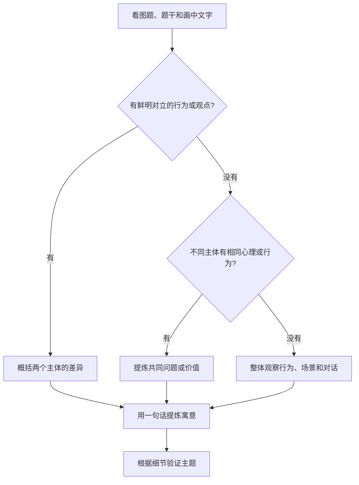

## 九十六、写作 B 节总览：短文写作究竟考什么？（原书第 103 页）

### 96.1 考试结构与能力要求

原书引用的是 **2025 版考研英语（一）考试大纲**；以下要求应作为该版本的学习依据，而**非未经核实的以后每年最新规定**。

| 项目 | 写作 B 节 |
| --- | --- |
| 位置 | Section III · Part B |
| 题号 | 52 |
| 题量 | 1 篇短文 |
| 分值 | **20 分** |
| 词数 | **160—200 词**（依原书所引 2025 版规定） |
| 提示材料 | 文字、图画、图表或其组合 |
| 文体功能 | 描述、叙述、说明、论述等，具体取决于任务指令 |

**大作文不是“写得复杂就高分”。** 考查的是能否通过准确而有组织的英文完成交际任务。原书的五项要求可整理为下表：

| 评分维度 | 可操作的检查问题 |
| --- | --- |
| 切题与任务完成 | 是否按题干要求描述、解释并评论？有没有遗漏图表数据或图画信息？ |
| 语言资源 | 是否根据需要使用恰当词汇和句式，而非重复同一句型？ |
| 准确性 | 主谓一致、时态、冠词、介词、拼写和标点是否正确？ |
| 结构与连贯 | 三段各自承担什么功能？段间有没有清楚的论证关系？ |
| 文体与语体 | 是否保持书面、客观、自然的议论风格？ |

<Callout type="idea" title="四句话抓住大作文得分核心">

**内容切题、观点明确、逻辑清楚、表达准确。** 复杂句和高级词只能在准确表达意义时加分；如果造成搭配错误、冗余或逻辑混乱，就得不偿失。

</Callout>

### 96.2 图画与图表的不同读法

<Cards>
<Card title="图画作文：图中行为 → 隐含价值">

先说明**谁、在做什么、说了什么**，再指出这些细节共同说明的社会现象或价值判断。例如“是否听跨专业讲座”可以讨论开放学习态度，而不是仅重述两名学生正在聊天。

</Card>
<Card title="图表作文：指标与数据 → 趋势解读">

先确认图题、单位、时间范围、数值与图例，再提炼“增长／下降／波动／占比”，最后就可能的含义作适度分析。**数据只能证明数据本身，不能自动证明因果关系。**

</Card>
<Card title="图画＋图表：两个证据共同支持一个主题">

2024 年例题同时给出健身场景与公园数量柱状图：图画体现*使用体验*，图表呈现*建设数量变化*，两者可以统一为“公共绿地与城市生活品质”。

</Card>
</Cards>

---

## 九十七、写作 B 节评分标准：怎样从及格写到高分？（原书第 103—104 页）

### 97.1 六档评分框架（忠实保留区间，压缩重复措辞）

| 档次 | 分数 | 关键特征 | 最明显的问题或优势 |
| --- | ---: | --- | --- |
| 第五档 | **17—20** | 所有要点得到有效展开；词句丰富且准确；多种衔接手段自然，行文流畅；文体语体贴切 | **内容完整且表达充分**，几乎没有妨碍理解的错误 |
| 第四档 | **13—16** | 包含全部要点；表达较充分；语言基本准确、连贯清晰 | 少数论述或复杂表达不够好，但总体完成任务 |
| 第三档 | **9—12** | 多数要点齐全；词句基本够用；简单连接，基本能看懂 | 要点阐述不足，语言错误存在但一般不妨碍理解 |
| 第二档 | **5—8** | 一些要点遗漏或偏题；词汇语法有限；组织松散 | **错误已影响信息传递**，衔接和文体不理想 |
| 第一档 | **1—4** | 主要要点缺失，大量无关内容；语言错误严重 | 难以理解，缺乏组织与写作任务意识 |
| 零档 | **0** | 内容极少、与要求无关，或无法辨认 | 无法有效评价或未能传递任务要求的信息 |

### 97.2 阅卷关注点与备考含义

1. **内容先行**：评分重点是任务覆盖、阐述质量、文章组织、语言丰富程度与准确度；只靠背诵漂亮的开头不能弥补少写一个任务。
2. **词数须服从题目**：原书注明 160—200 词；不能刻意写远超或远少于要求的文章。练习时宜预留一定余地，不必硬卡上下限。
3. **题干可以借词，不能整段照搬**：可使用提示中的关键词；把题目指令抄进正文充数没有意义。
4. **拼写和标点同样影响理解**：英式和美式用法均可，但注意搭配和全文一致性。
5. **书写必须清晰**：字迹差到影响识读可能导致降档；不要以赶字数为由牺牲可读性。
6. **并非“越难越好”**：准确自然的常用句，比堆砌生僻词的病句更容易展示语言能力。

<Accordions>
<Accordion title="为什么内容完整却可能拿不到 17 分以上？" id="ky-method-p104-rubric1">

因为“列到所有要点”和“有效阐述要点”有差异。比如写“公园很好、很重要、我很支持”虽然表达态度，但缺乏对**作用机制、具体例证、现实建议**的展开。另外，重复句型、语言错误和缺乏逻辑连接也会制约档次。

</Accordion>
<Accordion title="为什么不是越多连接词越好？" id="ky-method-p104-rubric2">

`firstly`、`moreover`、`therefore` 的作用是标记真实存在的关系。没有因果却写 `therefore`，或每句话都另起一个 `in addition`，反而会让文章机械。先组织好逻辑，再选少量必要的衔接词。

</Accordion>
<Accordion title="写到 200 词以上就一定被扣很多分吗？" id="ky-method-p104-rubric3">

原书用语是“长度不符合要求的，酌情扣分”，**没有给出固定扣分公式**。备考中以题干限定词数为准最稳妥，不应编造超一个词扣多少分的规则。

</Accordion>
</Accordions>

---

## 九十八、2006—2025 年写作 B 节命题规律（原书第 105 页）

### 98.1 二十年历史回顾：图画作文占主导，但图表已出现

下表完整保留原书按 **2006—2025 年共 20 次**试题所做的**归纳性分类**。此分类是教材的分析框架，不是考试主管部门规定的题型名称。

| 原书归类 | 次数 | 年份 |
| --- | ---: | --- |
| 图画：人生哲理提炼 | 8 | 2007、2008、2012、2016、2017、2019、2020、2021 |
| 图画：社会问题与解决 | 3 | 2011、2013、2024 |
| 图画：正向价值弘扬 | 3 | 2010、2014、2023 |
| 图画：对立观点与选择 | 2 | 2018、2022 |
| 图画：利弊综合分析 | 2 | 2006、2009 |
| 图画：负面现象批判 | 1 | 2015 |
| **图画及图画＋图表合计** | **19** | **2006—2024** |
| 图表：社会现象分析 | **1** | **2025** |
| **合计** | **20** | **2006—2025** |

<Callout type="warn" title="统计口径注意：2024 年并非只有图画">

原书将 **2024 年“公园健身图画＋公园数量柱状图”**&#x2060;归到图画作文大类，因此它的“19 次图画、1 次图表”是*粗分类*。如果按“试题中是否出现图表”计算，**2024 年就已经出现图表元素**；2025 年是原书所述的图表独立考查案例。不能据此断言 2024 年之前从未出现图表。

</Callout>

### 98.2 学习重点：不押题，练两套可迁移能力

| 能力 | 图画作文 | 图表作文 |
| --- | --- | --- |
| 提取信息 | 人物、动作、表情、语言、对比、标题或注释 | 图题、图例、单位、时间、数值、大小、变化 |
| 解读主题 | 具体行为折射何种态度、社会现象或价值 | 数据反映何种规模、比例、趋势或差异 |
| 发表看法 | 为什么值得肯定／警惕，有何建议 | 变化可能意味着什么，有何影响或建议 |
| 主要易错 | 空泛说教，忽略画中文字，观点脱离画面 | 漏写单位、颠倒增减趋势、混淆相关与因果 |

**复习安排**：两类都练。图画题训练“描述—立意—论证”，图表题训练“取数—概括—解释”。复合型题目（如 2024）要求把两种证据**统一到一个主题**，而不是写两篇相互无关的短文。

---

## 九十九、写作 B 节五步法：审题—构思—创作—优化—检查（原书第 105—106 页）

<Steps>
<Step>

### 一、审题：先把指令转成任务清单

在题目上划出 `describe`、`interpret`、`comment`，确认词数、体裁和素材类型。如果是图表，记录图题、**单位、时间起点和终点、关键数字**；如果是图画，找出主体、言语、行为和可能存在的对比。

**落笔前结论**：我需要描述什么？它表达了什么？我要评价什么？

</Step>
<Step>

### 二、构思：用三段分工确定逻辑

- 第一段：准确描述可见事实；图画＋图表题两种材料都要点到。
- 第二段：提出主旨，分析原因、影响或意义；每个论点最好有一句具体解释。
- 第三段：给出判断或可执行的建议，避免只重复第二段。

</Step>
<Step>

### 三、创作：先写清楚，再求变化

用自己能稳妥掌握的时态和词组写出来。图画中的人物动作可用一般现在时或现在进行时；跨年份的已发生数据变化常用一般过去时。注意单复数、冠词、逻辑连接和代词指代。

</Step>
<Step>

### 四、优化：只升级真正影响表达的句子

删掉重复表达，纠正搭配，必要时合并过短句。优化的优先顺序应为**内容准确 → 逻辑清楚 → 词语贴切 → 句式适度变化**，而不是强行套被动语态、强调句或罕见词。

</Step>
<Step>

### 五、检查：一次内容检查＋一次语言检查

内容：是否完成每项指令，是否看错图表数据，词数是否符合要求？语言：动词形式、主谓一致、冠词、介词、标点和拼写是否正确？

</Step>
</Steps>

<Callout type="idea" title="真正有效的“升级”是一种取舍">

`show → illustrate`、`have an effect on → improve` 之类替换只有在语义匹配时才更好。对基础一般的考生，能把每句话写得**准确、清楚且有实际信息**，比堆砌“高级模板”更可靠。

</Callout>

---

## 一百、2024 年英语（一）真题：公园建设图画＋柱状图（原书第 106—107 页）

### 100.1 题目要求与原图证据

**题号**：52，**分值**：20 分。原题要求依据图画与图表写一篇 **160—200 词**短文，完成三项任务：

1. `describe the picture and the chart briefly`：简要描述图画与图表；
2. `interpret the implied meaning`：解释材料的隐含意义；
3. `give your comments`：发表自己的评论。

下面保留两张与审题直接相关的原图，图片位于项目 `public/images/kaoyan-methods/`。

**图画事实**：居民在新建的社区小公园运动、散步，一名年轻人称赞家门口的小公园很不错。注意这是**对生活便利性的体验**，不是关于全国所有公园的抽样调查。

**图表事实**：某市近三年公园数量如下（单位：座）：

| 年份 | 公园数量 | 与上年相比 |
| --- | ---: | ---: |
| 2020 | **406** | — |
| 2021 | **532** | **+126** |
| 2022 | **670** | **+138** |

- 2020—2022 年总体增加 **264 座**，呈逐年增长趋势。
- **不要漏写 2021 年的 532 座**：文字讲解集中使用首尾数字，原柱状图还明确给出了中间年份。
- 不能写成“居民健康水平提高了 65%”或“所有城市公园数量均增长”，因为图表只统计**某市公园数量**。

### 100.2 三层立意：事实、推论和评论分清楚

| 证据层次 | 应写什么 | 错误拓展 |
| --- | --- | --- |
| **客观描述** | 公园健身的场景；某市公园数 406 → 532 → 670 | 擅自写入题中没有的全国数据和使用者满意率 |
| **合理解读** | 新增社区绿地有助于居民就近活动、放松休闲 | 断言“公园建设已完全解决缺乏运动的问题” |
| **个人评论** | 建议继续建设、维护公共绿地，改善可达性与公平使用 | 不加论证地提出“公园越多就必然越幸福” |

### 100.3 五步中的“构思”：三段提纲

| 段落 | 写作任务 | 建议顺序 |
| --- | --- | --- |
| 第一段 | 描述双材料 | 公园活动场景 → 2020、2021、2022 数量 → 总体趋势 |
| 第二段 | 提炼寓意并论证 | 主题：增加可达公共绿地 → 作用一：就近活动 → 作用二：休憩与社区交往 → 必须重视管理 |
| 第三段 | 发表评论 | 继续投入并加强维护 → 重视所有居民的可及性 |

<Callout type="warn" title="2024 原书审题表有列错位问题">

源文第 106 页从复杂表格转成文本时，**“内容要求／写作体裁／写作话题／题型标签”出现列错位**。正确的归位是：词数 160—200；要求是*描述、解释、评论*；话题是*公园建设与居民生活*。不要把“议论文”错记成内容要求、把“公园建设”错记成体裁，也不要将教材自拟的“社会问题解决型”当作官方题干的要求。

</Callout>

### 100.4 一篇经过语言校正的示范作文（174 词）

<Tabs items={['英文范文（174词）','完整中文译文','逐段拆解']} defaultIndex={0}>
<Tab value="英文范文（174词）">

The cartoon shows residents exercising in a newly built neighborhood park. One young man exclaims, "What a wonderful little park right on our doorstep!" The accompanying bar chart reports that the number of parks in a city rose from 406 in 2020 to 532 in 2021 and 670 in 2022.

Together, the two visuals highlight how investment in accessible green spaces can improve urban life. More parks offer nearby places where people can walk, exercise and meet their neighbors. This is especially valuable for residents who have little time to travel to distant sports facilities. In addition, trees and open spaces can provide opportunities to relax and may help ease the stress associated with busy city life. However, building parks is only the beginning: good maintenance, safe facilities and equal access are also essential.

In my view, local governments should continue to develop and maintain public green spaces while listening to residents' needs. When parks are within easy reach and well managed, a growing number of them can translate into tangible benefits for communities.

</Tab>
<Tab value="完整中文译文">

这幅图画展现了居民在一个新建社区公园里运动的场景。一位年轻人赞叹道：“家门口就有这么好的小公园！”旁边的柱状图显示，某市公园数量从 2020 年的 406 座增至 2021 年的 532 座，又增至 2022 年的 670 座。

两幅材料共同说明，建设交通便利、容易到达的公共绿地有助于改善城市生活。更多公园意味着人们可以在家附近散步、锻炼并与邻里交流。对那些没有多少时间前往远处体育设施的居民来说，这一点尤为重要。此外，树木与开阔空间为居民提供放松的机会，也有助于缓解繁忙城市生活带来的压力。不过，建设公园仅仅是第一步：完善的维护、安全的设施以及公平的使用机会同样不可缺少。

在我看来，地方政府应倾听居民的需求，继续开发并维护公共绿地。当公园容易到达、管理得当时，公园数量的增加才能转化为社区可以感受到的实际好处。

</Tab>
<Tab value="逐段拆解">

**第一段（描述）：** `The cartoon shows ...` 直接切入场景；`The accompanying bar chart reports ...` 准确引入第二份材料；`rose from ... to ... and ...` 给出数据趋势，不添入未经证明的统计量。

**第二段（解释）：** 用 `Together, the two visuals highlight ...` 汇合材料，后文通过邻近性、运动、放松和社区交流展开论证。使用 `can`、`may` 体现适度判断，避免把好处说成必然。末句加入公园维护的条件，论证更有层次。

**第三段（评论）：** `In my view ... should ...` 明确自己的建议；`translate into tangible benefits` 表示将投入转化为可感知的实际效果。

**词汇与句式要点：** `within easy reach`（容易到达）、`accessible green spaces`（可达的公共绿地）、`ease stress`（缓解压力）、`equal access`（公平使用机会）、`while listening to ...`（同时听取……）。

</Tab>
</Tabs>

> 这是一篇**根据原题重新写作的示范范文**，不是原书范文的逐句复印，也不代表官方唯一参考答案。词数按常规空格分词计为 174 词，满足原书所列范围。

---

## 一百零一、“词汇升级”和“句式升级”怎么做到不失真？（原书第 108—109 页）

原书将 2024 年例文逐句从“初级范文”改为“升级范文”。其教学价值是提醒考生积累表达方式；但部分替换**只增加复杂度，没有实际提升准确性或自然度**。高质量整理应同时展示“原书思路”和“更稳妥的表达”。

### 101.1 八处常见的升级陷阱

| 源书做法或句子 | 问题在哪里 | 更自然的改法 |
| --- | --- | --- |
| `a young man ... compliments, "..."` | *compliment* 通常表示称赞某人／某物，不能这样直接引出一句感叹 | `a young man remarks, "..."` / `exclaims, "..."` |
| `the residents' life` | 泛指多个居民的生活，通常用复数 | `residents' lives` / `urban life` |
| `there are manifold reasons ...` | *manifold* 偏书面且陈旧，“原因很多”也未必得到材料支持 | `Several factors may explain this trend.`，或直接解释具体作用 |
| `collectively mirror the positive impact ...` | *mirror* 并不比 *show* 更准确，且叠加副词易显做作 | `Together, the two visuals highlight ...` |
| `effectively tackles the problems of shortage of fitness sites and their long distance ...` | 名词堆叠，搭配别扭，还暗示问题已被彻底解决 | `provide more convenient places for exercise` |
| `it is the park construction that expands ...` | 强调句并非不能用，但用于客观解释时过重且不自然 | `Building more parks increases urban green space ...` |
| `exerts a highly significant influence on people's livelihood` | 一长串抽象名词模糊了具体作用 | `improves residents' quality of life` |
| `we eagerly expect ... could augment the commitment ...` | *expect ... could* 配合别扭，`augment the commitment` 生硬，副词堆砌 | `We hope more cities will invest in public parks.` |

### 101.2 句式变化的正确打开方式

<Accordions>
<Accordion title="① 定语从句：什么时候应该使用 where？" id="ky-method-p108-relative">

**可以用**：`The picture shows a park where local residents are exercising.`

这里 `where` 修饰地点 *park*，使场景描写更紧凑。**但不要把过多动作、人物、台词全部塞进同一个定语从句**。一旦超过读者容易理解的程度，拆分成两句更好。

</Accordion>
<Accordion title="② As is shown ... 是什么句法？" id="ky-method-p108-as">

`As is shown in the chart, the number of parks increased ...` 中，`As is shown ...` 可以视为 **as 引导的非限制性定语从句**，表示“正如图表所显示的”。

更简洁也完全正确的表达是：`The chart shows that the number of parks increased ...`。二者不必争论谁一定更“高级”，选择清晰好用的即可。

</Accordion>
<Accordion title="③ 强调句 It is ... that ... 何时需要？" id="ky-method-p108-cleft">

强调句适合凸显对比或纠正误解，如 `It is access, rather than the number of parks alone, that matters most.`（真正重要的是公园的可及性，而非仅仅是数量。）

如果仅仅是介绍“增加绿地”，直接写 `Building parks adds more green space to a city.` 通常更加自然。

</Accordion>
<Accordion title="④ It can be concluded that ... 比 We can conclude that ... 高级吗？" id="ky-method-p109-passive">

两者都可以，但后者短而直接。不要认为**被动语态自动使文章更加正式或更容易拿高分**。还可以直接陈述结论：`Public parks can improve daily life in cities.`

</Accordion>
</Accordions>

### 101.3 “升级前 → 升级后”的可复用训练

<Tabs items={['描写图画','描述数据','推论与建议']} defaultIndex={0}>
<Tab value="描写图画">

**不自然：** `The picture presents a vibrant scene where several people are engaging in different kinds of physical exercise ... and a young man ... compliments ...`

**更清楚：** `The picture shows several residents exercising in a neighborhood park. A young man praises the newly built park nearby.`

**迁移规则：** 如果一句话包含两个不同主语、多个动作及直接引语，**优先分句**；图画描写不以句子长短定高下。

</Tab>
<Tab value="描述数据">

**可用：** `The bar chart shows a steady increase in the number of parks from 406 in 2020 to 670 in 2022.`

**更完整：** `The number of parks rose from 406 in 2020 to 532 in 2021 and 670 in 2022.`

**迁移规则：** 趋势用 `rise / increase / decline / remain stable / fluctuate`；数据引用须确保**指标、单位、时间**齐全。若写成 `a 264-percentage-point increase` 就错了：这里的 264 是公园座数变化，不是百分比变化。

</Tab>
<Tab value="推论与建议">

**太绝对：** `The increase in parks has solved residents' fitness problems.`

**更谨慎：** `More neighborhood parks can make regular exercise easier for residents.`

**空泛：** `We eagerly expect cities to augment their commitments.`

**更具体：** `Local governments should invest in accessible parks and keep existing facilities in good condition.`

**迁移规则：** 因果未被直接证实时用 `can / may / help`；建议最好包含**主体＋行动＋目标**。

</Tab>
</Tabs>

---

## 一百零二、第五步检查：写完后究竟查什么？（原书第 110 页）

<Steps>
<Step>

### 任务完整性检查

在 2024 年题目中，作文必须回应 **picture + chart + implied meaning + comments**。如果只谈环保的重要性，忘了柱状图，属于内容遗漏。

</Step>
<Step>

### 事实与数据检查

核对图中的主体、人物说的话、数字和单位。2024 年为**公园数量：406、532、670 座**，不是公园面积或绿化率。

</Step>
<Step>

### 逻辑与语气检查

每段是否有明确功能？是否存在无证据的因果断言？是否重复表达同一层意思？建议与前面的论证是否呼应？

</Step>
<Step>

### 语言与形式检查

检查拼写、词数、主谓一致、时态、冠词、搭配、标点。图表数据已结束的历史时间段通常用过去时；常识与一般性评价可用现在时。

</Step>
</Steps>

| 重点错误 | 错误写法 | 修正 |
| --- | --- | --- |
| 主谓一致 | `The number of parks have increased.` | `The number of parks has increased.` |
| 数量结构 | `There has many parks.` | `There are many parks.` |
| 可数名词 | `Many resident use parks.` | `Many residents use parks.` |
| 时态 | `The number rises to 670 in 2022.`（单纯叙述过去统计） | `The number rose to 670 in 2022.` |
| 词义 | `Public parks rise people's happiness.` | `Public parks can improve people's well-being.` |
| 因果 | `More parks prove that everyone is healthier.` | `More parks may encourage regular exercise.` |

<Callout type="success" title="考场最优的检查顺序">

**优先修重大错误，再修表面表达。** 先检查遗漏任务、错误趋势、语法病句，再检查标点、拼写和词数；如果时间有限，不要为了换一个“高级词”把已经准确的句子改错。

</Callout>

---

## 一百零三、审图技巧：对比、共性与整体观察（原书第 110 页）

原书在第 110 页开始讲解图画作文**技巧一：审题**，并展示三幅历年图画。它们不能用同一种方法机械套用：有的要找差异，有的要找共性，有的要看人物之间的对话与行动。

### 103.1 三种观察路径与代表真题

<Cards>
<Card title="① 2022 年：观察观点对比">

两名女生面对一场非本专业讲座，持有不同态度：一人认为没有多少用处，另一人愿意去听听。**立意线索**：开放学习、打破专业边界，不应简单把人物个数当作文主题。

</Card>
<Card title="② 2007 年：观察角色的共同心理">

足球运动员和守门员分别把对手想得格外强大，形成双向心理夸大。**立意线索**：低估自身、高估困难，对照“自信与心态”。这里两个角色不是意见分歧，而有相似的心理倾向。

</Card>
<Card title="③ 2021 年：观察言语与行动的整体关系">

孩子因同伴不喜欢戏曲而产生动摇，父亲鼓励他继续做自己喜欢的事。**立意线索**：独立判断、坚持兴趣与热爱。不能因为存在父子两个人就强行寻找双方的“共性”。

</Card>
</Cards>

**三幅原图（教材所引用的真题插图）**：

### 103.2 实战时的判断流程

| 观察路径 | 首先抓取 | 不应犯的错误 |
| --- | --- | --- |
| **差异** | 两方说法、行动、态度的不同 | 只罗列对立双方，没有提出统一主题 |
| **共性** | 不同人物的共同心理机制 | 看见两人就生硬比较谁对谁错 |
| **整体** | 主体动作、语言、处境以及旁人反应 | 无视文字提示，凭图画表象任意升华 |

### 103.3 三个立意微练习

<Accordions>
<Accordion title="2022：如果我只写“大学生应该多听讲座”，够准确吗？" id="ky-method-p110-check-2022">

方向基本合理，但缺乏区别度。更贴近画面的是**是否愿意接触专业以外的知识**：面对暂时看似“不相关”的内容，应保持开放、主动学习的态度。可写 `An open mind can help students learn beyond their majors.`

</Accordion>
<Accordion title="2007：为什么不能只谈足球技巧？" id="ky-method-p110-check-2007">

图画重心不是比赛技战术，而是**双方对自身和对手能力的心理判断**。可以提炼为 `Confidence can shape how we respond to challenges.` 但也不要绝对化为“自信即可保证成功”。

</Accordion>
<Accordion title="2021：如何避免跑题成“戏曲文化传承”？" id="ky-method-p110-check-2021">

戏曲是画面中的具体爱好，父亲鼓励孩子**坚持自己真正喜爱的事物**才是主要线索。可以适度联系艺术学习，但主题应围绕独立选择、热爱和坚持，不能凭空将整篇写成戏曲发展史。

</Accordion>
</Accordions>

### 103.4 第 110 页末的章节衔接

本页最后引出&#x2060;**“技巧二：创作技巧”**，指出短文可采用起始段、中间段、结尾段的组织方式。原文的详细分段创作技巧**已在下一节（第 111—112 页）接续整理**。

<MindMap
  title="考研英语一·第 101—110 页：应用文句式收尾与写作 B 节核心框架"
  height={600}
  initialExpandLevel={2}
  maxWidth={300}
  markdown={String.raw`
# 方法篇 P101—110
## 应用文句式收尾 P101—102
### 辞职信
- 决定和岗位
- 题干允许的原因
- 感谢支持
- 交接与祝愿
### 通知
- 发布主体
- 活动名称与目的
- 时间地点
- 报名方式
- 咨询与落款
## 写作 B 节 P103—104
### 考纲所引要求
- 160—200 词
- 20 分
- 描述／解释／评论
### 六档标准
- 17—20
- 13—16
- 9—12
- 5—8
- 1—4
- 0
### 高分关键
- 切题
- 论证充分
- 语言准确
- 逻辑连贯
## 命题回顾 P105
### 2006—2025
- 图画及复合形式 19 次
- 2025 图表类 1 次
### 重要提醒
- 2024 已含柱状图
- 分类是教材归纳
## 五步写作法 P105—110
### 审题
- 核对指令
- 读图中文字
- 读图表数值与单位
### 构思
- 描述
- 寓意与论证
- 评论
### 创作
- 简洁准确
- 适度展开
### 优化
- 搭配自然
- 不强求生僻词
- 不滥用被动语态
### 检查
- 任务完整
- 数据正确
- 句法通顺
- 词数合适
## 2024 综合图画＋图表
### 公园数量
- 2020：406
- 2021：532
- 2022：670
### 立意
- 就近锻炼
- 公共绿地
- 改善城市生活
- 建设与维护并重
## 审图三法 P110
### 2022 观点对比
- 跨专业讲座
- 开放心态
### 2007 共同心理
- 足球比赛
- 自信与挑战
### 2021 全图观察
- 父子对话
- 坚持兴趣
`}
/>

### 103.5 复习自测：是否真正学会本章方法？

<Accordions>
<Accordion title="① 2024 年图表从 406 增加到 670，增长了 264 个百分点，对吗？" id="ky-method-p101-110-review1">

不对。**264 是公园座数净增量**，单位为“座”，不是“百分点”。若要表述相对增幅，应另行计算且注明分母，不可混用数量增量和比例增量。

</Accordion>
<Accordion title="② 2024 年有柱状图，为什么原书还把它算作图画作文？" id="ky-method-p101-110-review2">

这是**教材的归类口径**：以图画为主要表现形式的混合材料仍归在图画大类。若按“是否出现图表”统计，2024 年当然属于含图表的题目。

</Accordion>
<Accordion title="③ 评价绿地好处时，哪些情态动词值得掌握？" id="ky-method-p101-110-review3">

推荐 `can`、`may` 和 `help`。例如 `Public parks can encourage people to exercise.`。它们有助于表达合理的可能作用，不把未经证实的效果写成普遍必然的因果结论。

</Accordion>
<Accordion title="④ 写作升级最值得先修改哪种句子？" id="ky-method-p101-110-review4">

先修正**错词、病句、逻辑不通或信息缺失**的句子；其次清除累赘；最后才考虑替换普通词、增加定语从句等形式。不要为了“看起来高级”破坏原本正确的表达。

</Accordion>
<Accordion title="⑤ 2022／2007／2021 三幅画应该如何分别审题？" id="ky-method-p101-110-review5">

2022 年：找**态度对比**；2007 年：找**双方共同的认知偏差**；2021 年：结合**父子对话与行为**整体推断寓意。所有立意都应回到画面细节核验。

</Accordion>
</Accordions>

---

## 一百零四、写作 B 节创作技巧：三段如何各司其职？（原书第 111—112 页）

这一部分承接上一轮的“审图”训练，进入**真正落笔**的阶段。原书把写作分为 **起始段—中间段—结尾段**，重点并非死记固定句子，而是明确每一段必须完成的任务：

| 段落 | 必须回答的问题 | 典型内容 | 需要避免的错误 |
| --- | --- | --- | --- |
| 开头（图画描述） | 画中有什么、谁在做什么？ | 主体、动作、对话或文字、对比关系 | 猜测人物心理，堆砌未在画面出现的事实 |
| 中间（寓意与论证） | 图画批评或赞扬什么？为什么？ | 点题、给原因或影响、举一个恰当例子 | 空喊“重要”，例子与中心无关 |
| 结尾（评论） | 作者主张什么？ | 建议、行动或有分寸的总结 | 重复前两段、夸大“必然成功” |

### 104.1 起始段的三种审图路径

<Cards>
<Card title="路径一｜观点相反的多主体">
    先找**对比点**，用 `while` / `whereas` / `however` 描写差异，再概括不同态度；典型真题：**2022 年讲座选择**。
</Card>
<Card title="路径二｜境遇或心理相似的多主体">
    先找**共同点**，描写双方如何表现同一种心理；典型真题：**2007 年足球守门员与射门者**。
</Card>
<Card title="路径三｜一个中心事件或对话场景">
    按**人物—行动—语言—寓意**组织；典型真题：**2021 年父亲鼓励孩子坚持戏曲爱好**。
</Card>
</Cards>

<Tabs items={['2022：态度对比','2007：共同心理','2021：人物对话']} defaultIndex={0}>
<Tab value="2022：态度对比">

**原书图画（2022 年写作 B 节）**：

**准确描述**：

> In the drawing, two students express different views on a campus lecture. One doubts its value because the topic is unrelated to her major, while the other believes that attending it may still be worthwhile.

**译文**：图中，两名学生对校园讲座持不同看法。一人因为讲座内容与自己的专业无关而怀疑其价值；另一人则认为参加讲座仍可能有所收获。

**解题依据**：图中两人讨论的是**是否应当参加专业外的讲座**。主题可升华为开放心态、跨学科学习；不应脱离画面写成“所有课程都必须选”。

</Tab>
<Tab value="2007：共同心理">

**原书图画（2007 年写作 B 节）**：

**准确描述**：

> The cartoon shows a goalkeeper imagining an enormous goal, while the striker imagines a huge goalkeeper. Both seem intimidated by a challenge they have exaggerated in their minds.

**译文**：漫画中，守门员想象球门无比巨大，射门者则把对方守门员想象得高大无比。两人似乎都被自己夸大的困难吓住了。

**解题依据**：两幅心理想象共同指向**过度放大困难、低估自己**。不要把图理解成真实的球门或人物尺寸发生变化。

</Tab>
<Tab value="2021：人物对话">

**原书图画（2021 年写作 B 节）**：

**准确描述**：

> In the picture, a boy dressed as the Monkey King feels discouraged because his classmates consider learning opera boring. His father encourages him to pursue what he genuinely enjoys.

**译文**：图中，一个扮演美猴王的男孩感到沮丧，因为同学认为学戏曲很无趣；父亲鼓励他坚持自己真正喜欢的事。

**解题依据**：既要读懂孩子的抱怨，也要抓住父亲的**鼓励**。中心是“尊重兴趣、坚持选择”，而不是展开京剧起源史。

</Tab>
</Tabs>

<Callout type="warn" title="原书审图方法的适用边界">

“先找对比／共性／由左到右描述”是**组织信息的路径**，不是所有图画必须套用的顺序。最优先的是辨认图片中的实际信息；对气泡文字看不清的部分，不应自行编造台词。

</Callout>

### 104.2 中间段：先分类，再决定论证方向

<Steps>
<Step>

### 第一步：给主题归类

- **积极主题 / 人生哲理**：说明其价值，解释为何值得坚持，并给例子。
- **消极现象**：指出问题，论述可能造成的损害，再分析原因。
- **有利有弊**：两方面都要考虑，最后说明如何扬长避短。

</Step>
<Step>

### 第二步：选用最能说明问题的两项论据

可在“原因、结果、对比、具体例子”中选取，不必把原书列举的**引用、比喻、排比**全部塞进一段。真实、贴切、可解释的论据优于无关的名人名言。

</Step>
<Step>

### 第三步：每项论据写完整的逻辑

推荐微结构：**观点 → 理由 → 具体表现／例子 → 回扣主题**。例如：

> Pursuing an interest can strengthen motivation. When learners care about a subject, they are more willing to practise and overcome setbacks. Therefore, personal interest can support long-term learning.

这段没有夸称“兴趣必然带来成功”，因果更严谨。

</Step>
</Steps>

原书的三幅中间段示例分别是：**2021 年坚持兴趣（积极）、2015 年手机聚会（消极）、2009 年互联网连接（利弊兼有）**。讲解时要避免把不同类型混用成“所有作文都先批判再提措施”。

### 104.3 结尾段：总结与建议，控制篇幅

**原书 2024 年公园建设作文的结尾**，重点是肯定公园对城市生活的积极作用，呼吁继续完善公共绿地。将冗长表达 `augment the commitment to park construction` 调整为更自然的：

> In short, public parks can improve residents' daily lives. Cities should continue to develop and maintain accessible green spaces so that more people can benefit from them.

**译文**：总之，公共公园有助于改善居民日常生活。城市应继续建设并维护便利可达的绿地，让更多人从中受益。

- 正面话题：`We should encourage ...` / `It is worthwhile to ...`
- 问题话题：`Schools and families can help by ...`
- 利弊话题：`We can make better use of ... while reducing ...`

<Callout type="idea" title="高分结尾的标准不是“万能名句”">

能**回扣文章论证并提出合理评论**的两句简洁表达，比 `Based on the above analysis, it can be safely concluded that ...` 等空泛套语更有价值。

</Callout>

---

## 一百零五、六类图画作文模板：怎样用而不被模板限制？（原书第 112—120 页）

原书把图画作文常见写作思路归为六类。它们是**备考组织框架，不是官方公布的六种固定题型**。同一幅画可能同时体现正面价值与社会问题；判断时首先服从题干要求和画面核心信息。

| 类型 | 核心任务 | 中间段最合适的写法 | 本轮对应真题 |
| --- | --- | --- | --- |
| 人生哲理提炼 | 把具体人物行为上升为可推广的道理 | 意义 + 具体事例 | 2021 坚持兴趣 |
| 对立观点选择 | 比较两种态度并明确自己的立场 | 选择 + 两条理由 | 2018 选课 |
| 负面现象批判 | 揭示问题与不利影响 | 问题 + 后果 + 改善措施 | 2015 手机时代的聚会 |
| 积极价值弘扬 | 肯定值得践行的行为或美德 | 价值 + 体现 + 倡议 | 2014 相携 |
| 社会问题解决 | 分析现实问题并提供可行措施 | 问题 + 原因／危害 + 对策 | 2011 旅程之“余” |
| 利弊参半分析 | 客观看待同一事物的正负作用 | 正面 + 负面 + 平衡使用 | 2009 网络的“近”与“远” |

**通用句子不必生搬硬套**。例如 `What a thought-provoking picture it is!` 句法成立，但连续在各篇使用会显得机械；`The picture illustrates ...` 往往已经足够。涉及两幅图时注意 `picture/pictures` 以及 `shows/show` 的主谓一致。

### 105.1 面对考场题目，优先确定这四件事

<Steps>
<Step>

### 题干动作

区分 `describe`（简述图面）与 `interpret`（解释寓意）、`comment`（给出评价）。通常三项都要完成。

</Step>
<Step>

### 主题极性

画面是在**鼓励**一种行为、**批评**一种现象，还是强调两种态度／利弊？

</Step>
<Step>

### 论证材料

从画面能确认的事实出发，选择两条清楚的理由或一个简短的例子。不要添加无来源的调查数据。

</Step>
<Step>

### 字数与语言

根据原书所列真题要求，以下英语（一）写作 B 节示例均以 **160—200 词**为目标训练范围；优先做到内容完整、表达准确、段落连贯。

</Step>
</Steps>

---

## 一百零六、人生哲理类：2021 年“坚持自己的兴趣”（原书第 112—114 页）

### 106.1 画面、题目与原模板

原书以“扮演美猴王的孩子—同学的负面看法—父亲的鼓励”为材料，应用“**描述图画 → 提炼道理并论证 → 重申主张**”的三段框架。第 113 页的模板中出现多处不通顺的识别文本，如 `a his classmate takes ...`，已按语义重新组织，不保留错误拼接。

**2021 年真题写作任务**：根据图画写一篇 160—200 词的短文，简述图片内容、解释寓意并发表看法（20 分）。图画参见上文 2021 年案例。

| 原书模板功能 | 可直接迁移的自然表达 | 中文提示 |
| --- | --- | --- |
| 描述孩子的遭遇 | `The boy feels discouraged by his classmates' remarks.` | 不要漏写同学的负面评价 |
| 介绍父亲的鼓励 | `His father encourages him to keep pursuing his interest.` | 父亲的话构成转折与中心 |
| 点明寓意 | `The drawing highlights the value of independent judgment and persistence.` | 不是说“永远不要听别人的意见” |
| 解释理由 | `Genuine interest often makes sustained effort easier.` | 说出兴趣和行动间的联系 |
| 重申观点 | `It is important to listen to advice without abandoning our own goals too easily.` | 保留合理听取建议的空间 |

### 106.2 优化后完整参考范文

> **参考范文｜2021 考研英语（一）写作 B 节｜原创改写，基于原题**

In the drawing, a boy dressed as the Monkey King looks disappointed. Some of his classmates regard learning Chinese opera as boring, but his father encourages him to continue doing what he loves. Their conversation highlights an important lesson: we should think independently and remain committed to worthwhile interests.

This message matters especially to young people, who are often influenced by the opinions of those around them. Advice can be helpful, yet it should not automatically determine our choices. When we are genuinely interested in an activity, we are more likely to devote time to it, learn from mistakes and make steady progress. For instance, a student who enjoys traditional music may continue practising even when friends prefer other hobbies. Over time, such effort can build both skill and confidence. Of course, persistence also requires reflection and a willingness to adjust unrealistic plans.

In my view, we should respect different preferences while taking responsibility for our own decisions. By combining enthusiasm with thoughtful effort, we can grow without simply following the crowd.

**内容逻辑**：①图画事实与核心冲突；②为何不能盲从、坚持的意义、举例与适度限定；③尊重差异并坚持理性选择。

<Accordions>
<Accordion title="原书 2021 年范文有哪些值得修正的地方？" id="ky-method-p111-120-2021-corrections">

1. **语法识别错误**：`a his classmate takes ...` 不成句，应写 `some of his classmates consider ...`。
2. **表达生硬**：`secure the enlightenment`、`cut herself loose from others' views` 在此语境过度书面化，换成 `learn from the picture`、`make independent choices` 更自然。
3. **逻辑绝对化**：`people know themselves best` 不能推出“总应拒绝他人建议”。正确的主题是独立判断与持续努力，而不是抗拒所有批评。
4. **论据核实**：原书使用邓亚萍的例子。考场不必依赖人物生平细节；普通但贴切的学习经历同样能充分论证。
5. **译文跨页**：第 113 页末和第 114 页初属于同一篇范文，整理时已按三段合并，而不是误当作两篇作文。

</Accordion>
</Accordions>

---

## 一百零七、观点选择类：2018 年“选课进行时”（原书第 114—115 页）

### 107.1 审题：两门课到底差在哪里？

**原书图画（2018 年写作 B 节）**：

一名大学生在选课时犹豫：**一门注重知识更新、有创新性但较难；另一门更容易通过、给分较高、作业较少**。题干仍要求描述图画、解释含义并作评论（160—200 词，20 分）。

<Callout type="warn" title="2018 题最容易犯的推理错误">

图画**不等于证明“难课一定有价值，易课一定无用”**。原书范文把容易的课程推断为“肤浅、不实用”，超出了画面证据。可以根据学习目标倾向于更有挑战性的课程，但必须承认课程难度并非唯一质量标准。

</Callout>

### 107.2 三段论证表

| 段落 | 必须写出的信息 | 推荐证据 |
| --- | --- | --- |
| 开头 | 展示两个选择，指出选择标准差异 | 挑战／知识创新 vs. 易通过／高分／少作业 |
| 中间 | 明确个人倾向，并解释理由 | 适度挑战促进学习、培养解决问题能力；兼顾课程安排 |
| 结尾 | 提供更有普适性的择课原则 | 结合兴趣、能力、学业目标，不只看分数 |

### 107.3 优化后完整参考范文

> **参考范文｜2018 考研英语（一）写作 B 节｜原创改写，基于原题**

The cartoon portrays a student facing a difficult choice during online course registration. One course promises new knowledge and creative thinking but appears demanding. The other seems easier, with fewer assignments and a better chance of receiving high marks. The drawing raises a question about what students should value most when choosing courses.

I would generally prefer a challenging course that matches my interests and academic goals. First, studying unfamiliar material can broaden our understanding and encourage us to solve problems independently. Although the process may be demanding, the knowledge and skills gained can remain useful long after the examination. Second, focusing only on grades may cause us to miss valuable learning opportunities. This does not mean that easy courses are worthless or that difficulty always guarantees quality. Students should also consider teaching standards, available time and their own needs before making a decision.

Ultimately, course selection should serve long-term learning rather than short-term convenience alone. A thoughtful balance between challenge and practicality will help us make better use of university education.

### 107.4 可替换的功能句

- **比较选项**：`The two options differ in both difficulty and expected rewards.`（两个选项在难度和预期回报方面不同。）
- **表达倾向**：`I would lean towards the former, provided that it suits my goals.`（若符合目标，我会倾向前者。）
- **避免偏激**：`Difficulty alone is not a reliable measure of a course's quality.`（难度本身不是衡量课程质量的可靠指标。）

原书使用 `the jewel in the crown of one subject`、`the cream of one subject` 等表达来夸大“难课优势”，这些说法在本题里不贴切；`less assignment` 也应视语境改成 `less homework` 或 `fewer assignments`。

---

## 一百零八、负面现象批判类：2015 年“手机时代的聚会”（原书第 115—116 页）

### 108.1 图画事实与寓意

**原书图画（2015 年写作 B 节）**：

几个人围桌聚餐，虽然面对面相聚，却各自低头看手机。考生应描述这一鲜明反差，指出**过度使用手机可能减少面对面交流**，再评论如何合理使用技术。

| 结构 | 原书模板的意图 | 更可执行的写法 |
| --- | --- | --- |
| 开头 | 画面 + 负面现象 | `Although the friends sit together, they barely talk to one another.` |
| 中间 | 危害 + 原因 | `Constant notifications may distract us from people nearby.` |
| 结尾 | 行为改善 + 希望结果 | `Putting phones away during meals can encourage genuine conversation.` |

<Callout type="warn" title="不能把原书的“53% 调查”当作确定事实">

第 116 页的示例范文提到 **53% 的手机用户在无法使用设备时感到焦虑**，但本轮所见原书页面**没有交代调查机构、样本或出处**。因此整理后的范文不使用该具体百分比，也不编造“研究证明”。考场论证完全可以用可观察的场景与合理推断。

</Callout>

### 108.2 优化后完整参考范文

> **参考范文｜2015 考研英语（一）写作 B 节｜原创改写，基于原题**

The cartoon shows several friends sitting around a dinner table. Instead of talking to one another, they are all looking at their smartphones. The caption, “A Gathering in the Age of Mobile Phones,” draws attention to a familiar problem: digital communication can sometimes come at the expense of face-to-face interaction.

Smartphones make our lives convenient. We can contact distant friends, find information and deal with urgent matters almost anywhere. However, excessive use of these devices may distract us from the people sitting beside us. At a family meal or a gathering with friends, repeated checks of messages can interrupt conversations and make others feel ignored. Over time, such habits may weaken the quality of personal relationships. The issue is not the technology itself but our inability to use it appropriately.

I believe we should establish healthier phone habits, especially during meals and important conversations. By putting our devices aside when possible and paying attention to those around us, we can enjoy the benefits of technology without losing the warmth of real-life communication.

### 108.3 句式纠错

| 原书表达 | 建议调整 | 原因 |
| --- | --- | --- |
| `a couple of friends`（描述四人） | `several friends` | `a couple of` 通常指两个或少数几个人，用 `several` 更清楚 |
| `with their devices unavailable` | `when they cannot use their phones` | 后者更明白易懂 |
| `raise an awareness of cherishing` | `become more aware of the need to value ...` | `raise awareness of` 更适合用作倡议动作；原搭配别扭 |
| `The party is totally dominated by mobile phones` | `Everyone appears absorbed in a phone.` | 客观描述，避免强烈抽象化 |

**思路迁移**：不要只会批评手机。负面主题作文常用的写法是“**肯定工具的合理作用 + 批评失度使用 + 给出可实行的措施**”。

---

## 一百零九、正面价值弘扬类：2014 年“相携”（原书第 117—118 页）

### 109.1 两幅画体现的时间变化

**原书图画（2014 年写作 B 节）**：

左图是约三十年前，母亲牵着年幼的女儿；右图是如今，长大的女儿搀扶年迈的母亲。图注“**相携**”点明两代人之间的关爱与扶持。

<Callout type="idea" title="先辨清画面，再写抽象价值">

本题最关键的不是宽泛地写“传统文化伟大”，而是提炼具体的 **mutual care and support within the family**（家庭中的相互关爱和扶持）。描述要有**时间对照**：`Years ago, the mother ...; now, the daughter ...`。

</Callout>

### 109.2 优化后完整参考范文

> **参考范文｜2014 考研英语（一）写作 B 节｜原创改写，基于原题**

The two drawings present a touching contrast across time. Thirty years ago, a mother held her young daughter's hand as they walked together. In the present scene, the daughter has grown up and is supporting her elderly mother. The pictures, entitled “Mutual Support,” remind us that care within a family should be returned and passed on.

The message is meaningful because family relationships depend not only on affection but also on everyday actions. Parents usually devote considerable time and energy to raising their children. As the years pass, older family members may need emotional support, practical help and companionship in return. A phone call, a shared meal or assistance with daily tasks can make a real difference. These simple acts express gratitude and strengthen family bonds. More importantly, when young people witness mutual respect at home, they may be more willing to care for others in society.

In my opinion, we should not take our relatives' love for granted. By offering support when it is needed and showing appreciation in ordinary life, we can keep this tradition alive.

### 109.3 对比分析与词汇整理

| 推荐表达 | 含义 | 使用语境 |
| --- | --- | --- |
| `mutual support` | 相互扶持 | 对应图片题名 |
| `return someone's care` | 回报某人的关爱 | 从母爱转向子女的照顾 |
| `take ... for granted` | 认为……理所当然 | 提醒不要忽视亲人的付出 |
| `show appreciation` | 表示感激 | 适合结尾建议 |
| `family bonds` | 家庭纽带、亲情联系 | 中间段说明积极意义 |

原书将花木兰从军作为论据，这是一种**文学和文化例证**，但不必在所有“亲情”作文中固定套用。更贴合题目的写法，是解释老人所需要的陪伴与子女能够采取的行动；同时避免说成“所有家庭都必然如此”。

---

## 一百一十、社会问题解决类：2011 年“旅程之‘余’”（原书第 118—119 页）

### 110.1 画面观察：游客留下了什么？

**原书图画（2011 年写作 B 节）**：

一艘游船驶过，水面却留下大量包装物、食物残渣等垃圾。标题中的“**余**”既可指旅途留下的东西，也暗示不文明旅游行为留下的污染。

**三层论证链**：

1. **现象**：Some tourists leave rubbish behind in scenic areas.（游客在景区遗留垃圾。）
2. **原因与影响**：Poor awareness of public responsibility can damage the environment and increase cleaning costs.（公共责任意识不足可能损害环境、增加清理成本。）
3. **对策**：Provide bins and guidance; enforce reasonable rules; encourage visitors to take their litter away.（完善设施、落实规则、倡导垃圾随身带走。）

### 110.2 优化后完整参考范文

> **参考范文｜2011 考研英语（一）写作 B 节｜原创改写，基于原题**

In the cartoon, a boat carrying tourists moves along a river, leaving rubbish floating on the water behind it. Food containers and other waste spoil the beautiful scenery. The title, which refers to what remains after a journey, draws attention to the damage caused by irresponsible tourism.

This problem deserves our concern. Some visitors focus on their own enjoyment and neglect the impact of their behaviour on shared spaces. When rubbish is thrown into rivers or left on the ground, it can harm wildlife, pollute water and increase the cost of maintaining public attractions. If such actions become common, both the local environment and future visitors will suffer. Preventing this problem requires more than criticism. Tourist sites should provide enough waste bins, clear signs and convenient recycling facilities, while visitors should follow environmental rules and dispose of rubbish properly.

A pleasant journey should leave good memories, not waste. With better public facilities and a stronger sense of responsibility, we can protect beautiful places for everyone to enjoy.

### 110.3 具体问题应匹配具体措施

| 发现的问题 | 可落地的措施 | 写作示例 |
| --- | --- | --- |
| 游客随手丢弃垃圾 | 设置足量分类垃圾桶 | `Scenic areas should provide clearly marked bins.` |
| 不熟悉景区规范 | 入口标识、简短提醒 | `Clear signs can remind visitors to keep the area clean.` |
| 缺少责任意识 | 宣传教育与日常劝导 | `Public education can encourage responsible behaviour.` |
| 对故意违规缺乏管理 | 按现行规定开展管理 | `Existing rules should be enforced fairly.` |

<Callout type="warn" title="原书 2011 年范文存在“问题与后果不匹配”">

原书从**游客往河道扔垃圾**直接推导出“**越来越多的土地被占用**”，论证跳跃。这个问题应更直接讨论**水体污染、生态损害与清理成本**，除非另有垃圾填埋相关证据。`after the travel` 也不是本题最自然的英文标题译法；直接描述 `rubbish left behind after a trip` 更准确。

</Callout>

---

## 一百一十一、利弊参半类：2009 年“网络的‘近’与‘远’”（原书第 120—121 页）

### 111.1 图画寓意：技术连接与现实疏离

**原书图画（2009 年写作 B 节）**：

图画把互联网画成巨大的网：人们**在网上彼此连接**，却也**被电脑和隔间分隔**。这形成“网络距离更近／现实距离可能更远”的张力。

原书第 120 页给出“**描述现象 → 分析积极与消极影响 → 给出使用建议**”的框架和范文第一段，第 121 页续上分析与结尾。两页已合并核对。

### 111.2 真题要求与画面描述段

**2009 年真题任务**：根据图画写一篇 160—200 词文章，简述图画、解释含义并给出评论（20 分）。

**根据第 120 页图画和原书首段优化的开头**：

> The cartoon shows people connected by a vast web, symbolising the Internet. Although they can communicate across long distances, each person appears isolated in a separate space. The drawing illustrates a paradox of modern communication: technology can bring us closer online while keeping us apart in everyday life.

**译文**：漫画描绘了人们被象征互联网的巨网连接在一起。尽管他们能够远距离交流，但每个人似乎都独处于自己的空间中。这幅画揭示了现代沟通的矛盾：技术拉近了线上距离，也可能使人在日常生活中疏离。

### 111.3 本页模板精炼：别把“双刃剑”写成非黑即白

| 论证方向 | 关键内容 | 可复用表达 |
| --- | --- | --- |
| 积极方面 | 远距离沟通、资讯与学习机会 | `The Internet allows people to communicate across great distances.` |
| 消极方面 | 网络使用过度可能减少线下交流 | `Excessive screen time may reduce opportunities for face-to-face interaction.` |
| 平衡建议 | 有目的地使用网络，保留真实交流 | `We should use digital tools thoughtfully while making time for people around us.` |

<Callout type="warn" title="用词精准：不要把“可能风险”写成“必然伤害”">

`The Internet is a double-edged sword.` 可以用来引入双面分析，但不要把所有网友描述为孤独，也不要把网络沟通一律等同于关系疏远。画面表达的是一种**值得反思的风险**，不是精确的社会调查结果。

</Callout>

第 121 页提供了这篇范文的中间段与结尾段；下面给出**核对两页后重新写成的完整参考范文**，与原书的逐字文本明确区分。

### 111.4 跨页补全：2009 年网络主题作文（第 120—121 页）

**原书后两段的核心内容（第 121 页）**：互联网方便获取信息、购物和远距离交流；若过度使用，可能减少现实中的面对面沟通；建议合理管理上网时间，主动维系真实的人际关系。

<Callout type="warn" title="教材原文与参考范文必须区分">

原书使用 `make people asocial or even insensitive` 以及 `it will ...` 等偏绝对的措辞，还以“网购几天送达”作为普遍结论。下列范文根据真题画面与原书结构**原创改写**，保留原意但降低不必要的因果断言；**不是教材范文逐字转录**。

</Callout>

**完整参考范文｜2009 考研英语（一）写作 B 节｜173 词**

In the cartoon, several people are connected by a huge web that represents the Internet. Yet each person sits alone in a separate space, facing a computer. The contrast between online closeness and physical distance suggests that technological connections do not always lead to meaningful relationships.

The Internet has undoubtedly made communication faster and more convenient. People can exchange ideas, study together and stay in touch with friends who live far away. It also offers access to information and services that would otherwise be difficult to obtain. However, problems can arise when online activities take up most of our free time. Some people may gradually spend less time talking with family members or meeting friends in person. Online messages are useful, but they cannot fully replace the attention and warmth of face-to-face conversation.

In my view, the key is to use the Internet with purpose and moderation. We should enjoy its benefits while setting aside time for real conversations and shared experiences. Technology should strengthen human relationships rather than dominate them.

<Accordions>
<Accordion title="逐段译文与思路" id="ky-method-final-2009-bilingual">

**第一段｜描述与寓意**：漫画中，几个人通过象征互联网的巨网相互连接。然而，他们各自坐在独立的空间里，面前摆着电脑。线上亲近与现实距离之间的反差表明，技术上的连接并不总能带来有深度的人际关系。

**第二段｜正反分析**：互联网无疑使交流更加快速便利，人们可以交换想法、共同学习，并与远方的朋友保持联系。它也让获取信息和服务更加容易。但如果网络活动占据大部分闲暇时间，就可能产生问题：人们或许逐渐减少与家人交谈或与朋友见面的时间。线上消息虽有用，却无法完全替代面对面交谈中的关注与温暖。

**第三段｜评论与建议**：在我看来，关键是有目的、适度地使用互联网。我们可以享受它的便利，同时为现实交谈和共同活动留出时间。科技应当增进人际关系，而不是支配人际关系。

</Accordion>
<Accordion title="结构解析：为什么这样写更符合画面？" id="ky-method-final-2009-logic">

- **开头**用 `Yet` 对应网络“近”与现实“远”的视觉矛盾；没有把图片当成真实统计。
- **中间**先列举沟通、学习、资讯等收益，再用 `However` 表达**过度使用这一条件**下的风险。
- **结尾**提出适度使用与保留线下交流，能够回应两方面论证。
- **语言**用 `may`、`some people`、`cannot fully replace` 代替断言式措辞，保持逻辑审慎。

</Accordion>
</Accordions>

---

## 一百一十二、六类主题的写作骨架速查（第 111—120 页复盘）

<Tabs items={['六类开头','中间段论证','结尾段评论']} defaultIndex={0}>
<Tab value="六类开头">

| 主题 | 更自然的开头任务句 |
| --- | --- |
| 人生哲理 | `The picture highlights the importance of ...` |
| 对立选择 | `The drawing presents two different attitudes towards ...` |
| 消极现象 | `The cartoon draws attention to the problem of ...` |
| 正面价值 | `The two scenes illustrate the lasting value of ...` |
| 社会问题 | `The cartoon shows how ... can damage ...` |
| 利弊兼有 | `The drawing presents both the benefits and risks of ...` |

</Tab>
<Tab value="中间段论证">

| 主题 | 适用的思路 |
| --- | --- |
| 人生哲理 | `why it matters → example → qualification` |
| 对立选择 | `preferred option → reason 1 → reason 2 → caveat` |
| 消极现象 | `problem → consequence 1 → consequence 2` |
| 正面价值 | `value → practical acts → positive effects` |
| 社会问题 | `cause → harm → feasible solutions` |
| 利弊兼有 | `benefit → risk → how to balance them` |

</Tab>
<Tab value="结尾段评论">

| 主题 | 适用的评论方式 |
| --- | --- |
| 人生哲理 | 在考虑现实条件的基础上坚持目标 |
| 对立选择 | 给出决策原则，而非贬低另一方 |
| 消极现象 | 提出改善习惯的可行办法 |
| 正面价值 | 倡导可实践的善意行为 |
| 社会问题 | 明确个人与机构各自能够做什么 |
| 利弊兼有 | 扬长避短并指出具体边界 |

</Tab>
</Tabs>

<MindMap
  title="考研英语写作 B 节：第 111—120 页三段写法与六类图画主题"
  height={660}
  initialExpandLevel={2}
  maxWidth={320}
  markdown={String.raw`
# 图画作文 P111—120
## 创作结构
### 起始段
- 对比主体：2022 校园讲座
- 共性心理：2007 足球挑战
- 对话场景：2021 坚持兴趣
### 中间段
- 主题＋理由
- 具体例证
- 正反论证适度
### 结尾段
- 回扣中心
- 切实建议
- 避免夸大
## 六大主题框架
### 人生哲理 P112—114
- 2021 京剧兴趣
- 独立判断
- 理性坚持
### 观点选择 P114—115
- 2018 课程选择
- 匹配目标
- 不以难易判质量
### 负面批判 P115—116
- 2015 手机聚会
- 过度使用
- 线下交流
### 价值弘扬 P117—118
- 2014 相携
- 相互扶持
- 家庭关爱
### 社会问题 P118—119
- 2011 游客乱扔垃圾
- 环保意识
- 设施和规则
### 利弊分析 P120
- 2009 网络近与远
- 线上联系
- 线下疏离风险
## 审稿纠偏
### 语言
- 自然搭配
- 主谓一致
- 词数控制
### 内容
- 图画证据优先
- 不用无出处数字
- 不把推论写成事实
`}
/>

### 112.1 自测：能否在考场上独立迁移？

<Accordions>
<Accordion title="① 2018 年选课图画，能否断言‘简单课程都没有价值’？" id="ky-method-p111-120-check-2018">

不能。画面只提供两种课程的**不同特征与选课偏好**，没有证明所有简单课程都是低质量课程。比较时应结合学习目标、时间安排与课程质量进行评价。

</Accordion>
<Accordion title="② 2015 年手机主题能否引用书中 53% 的调查数字？" id="ky-method-p111-120-check-2015">

不建议把它当成已核实事实。原书本轮页面未标明调查来源。用**聚会时低头看手机、互动减少**等画面证据说明观点更稳妥。

</Accordion>
<Accordion title="③ 2014 年‘相携’最重要的视觉信息是什么？" id="ky-method-p111-120-check-2014">

是**时间变化与照顾关系的反转**：幼时母亲牵着女儿，长大后女儿扶着母亲。由此可以提炼两代人之间的相互关爱、陪伴与责任。

</Accordion>
<Accordion title="④ 2011 年环保作文怎样使对策不空泛？" id="ky-method-p111-120-check-2011">

针对“旅游垃圾污染”，可以写增设分类垃圾桶、清楚的引导标识、宣传劝导和落实现有管理规则；对策要能直接回应发现的问题。

</Accordion>
<Accordion title="⑤ 2009 年范文的后两段位于哪一页？" id="ky-method-p111-120-check-2009">

**第 121 页**。第 120 页是开头和题目，第 121 页包含后续正反分析及结尾。完整的经优化示范范文见本章 **111.4**。

</Accordion>
</Accordions>

---
