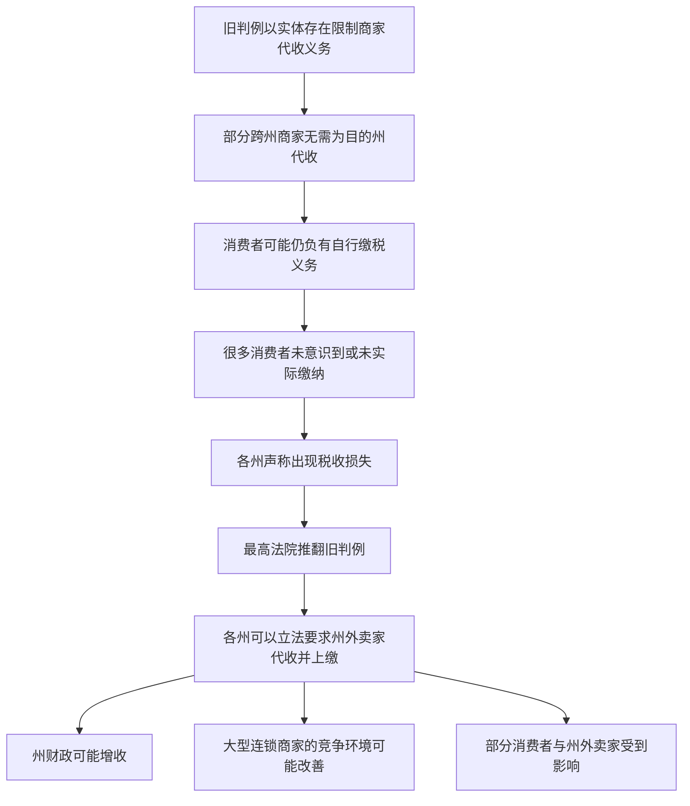
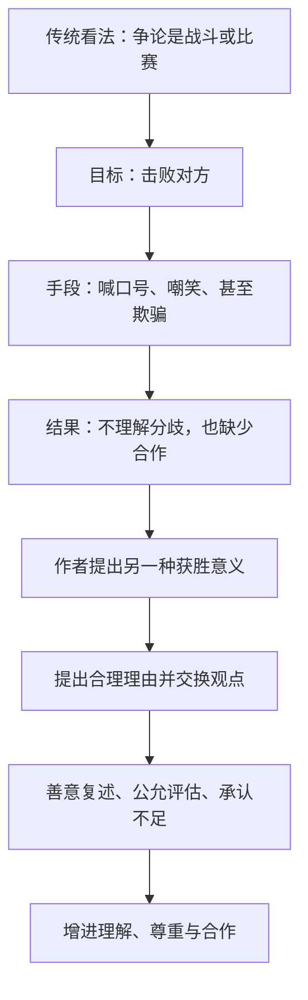

<Callout type="info" title="使用说明">
本页为根据原始资料整理的**考研英语（一）精读学习笔记**，按试卷题型顺序组织。原稿未完整提供选项的题目不会被虚构为官方答案；文中的原创巩固题与正式真题题目应予区分。
</Callout>

## Section I Use of English：野外迷路与辨向方法

### 阅读思路：没有导航设备时如何寻找方向

文章以手机地图的便利和电池可能耗尽构成反差，依次介绍沿地势寻找水源、辨认熟悉地标、登高观察、寻找人类活动痕迹等方法。作为**英语学习材料**，应重点把握条件句、祈使句、地点线索和跨句指代；文中的经验性建议不应被当作适用于任何野外环境的安全规则。

<Cards>
  <Card title="情境变化">
    GPS、手机导航虽普及，但电池会耗尽，迷路者需要借助周围环境判断方向。
</Card>
  <Card title="地形与水源">
    根据地势低处、溪流和生活用水等线索，寻找人类居住迹象。
</Card>
  <Card title="地标与远望">
    熟悉的树木、岩石、道路切口、铁轨和夜间人工光源都可能提供判断线索。
</Card>
  <Card title="人类活动痕迹">
    道路标记、轮胎印等可作为文章提出的辅助识别方式。
</Card>
</Cards>

### 第一段：导航便利与设备局限

**① Today, we live in a world where GPS systems, digital maps, and other navigation apps are all available on our smartphones.**

译：如今，我们生活在这样一个世界：全球定位系统、数字地图和其他导航应用都可以通过智能手机使用。

- **主干：** `we / live / in a world`。
- **定语：** `where GPS systems, digital maps, and other navigation apps are all available ...` 修饰 `world`；关系副词 `where` 在从句中作地点状语，近似 `in which`。
- **搭配：** `be available on ...` = “可以在……上使用／获取”；`navigation` = “导航”。

**② Few of us just walk straight into the woods without a phone.**

译：我们很少有人会不带手机就直接走进树林。

- `few of us` 是带否定倾向的数量主语，表示“我们当中很少有人”。
- `walk into the woods` = “走进树林”；`without a phone` 为伴随情况，不是否定谓语。

**③ But phones run on batteries, and batteries can die faster than we realize.**

译：不过，手机依赖电池运行，而电池耗尽的速度可能比我们意识到的更快。

- `run on batteries` 表示“由电池供电”；`die` 在这里指“电池耗尽电量”，不是“死亡”。
- `faster than we realize` 为比较结构，`than` 后接从句，不应错译为“我们更快地意识到”。

**④ If you get lost without a phone or a compass, and you literally can't find north, a few tricks may help you navigate back to civilization, one of which is to follow the land.**

译：如果没有手机和指南针时迷了路，连北方都辨不出来，那么一些小技巧或许能帮助你重新找到通往有人居住地区的方向，其中一种就是顺着地形寻找线索。

<Accordions>
  <Accordion title="长难句｜并列条件 + 情态动词 + one of which">

  **条件：** `If you get lost without a phone or a compass, and you literally can't find north`，两个情况由 `and` 连接，整体构成 `if` 条件从句。

  **主句：** `a few tricks / may help / you (to) navigate back to civilization`。`help sb. (to) do sth.` 是固定结构，`may` 只表示可能，不保证有效。

  **非限定定语从句：** `one of which is to follow the land` 中 `which` 指前面的 `a few tricks`；`one` 表示“其中一个技巧”。

  **词义：** `civilization` 此处按语境可译为“有人居住、具备生活设施的区域”；`follow the land` 强调顺着地形，而不是字面上的“跟随土地”。

</Accordion>
</Accordions>

### 第二段：沿地势和水源寻找线索

**① When you find yourself off a trail, but not in a completely unfamiliar area of land, you have to answer two questions: Which way is downhill, in this particular area?**

译：如果你发现自己偏离了小路，但所在区域又并不完全陌生，就需要思考两个问题：在这一带，哪个方向是下坡？

- `find yourself + 介词短语` 表示“发现自己处于某种情形”；`off a trail` = “偏离步道”。
- `but not in a completely unfamiliar area` 与 `off a trail` 对照：偏离道路不等于进入完全陌生的地带。
- `Which way is downhill?` 是第一个直接引语式问题；冒号后在下一句继续列出第二个问题。

**② And where is the nearest water source?**

译：最近的水源又在哪里？

- `water source` 可指溪流、河流、水源地等；`nearest` 为最高级形式。

**③ Humans overwhelmingly live in valleys, and on supplies of fresh water.**

译：人类居住地大多分布在山谷等地势较低处，而且日常生活依赖淡水资源。

- `overwhelmingly` 修饰整体陈述，表示“在绝大多数情况下、主要地”。
- `live in valleys` 与 `live on supplies of fresh water` 的介词不同：前者表示地点，后者的 `live on` 表示依赖某种资源维持生活。原稿中混入的异文字形已统一修正。

**④ So, if you head downhill, and follow any H₂O you find, you should eventually see signs of people.**

译：因此，文章认为，如果朝下坡方向前进，并沿着找到的水流寻找线索，最终就可能见到有人活动的迹象。

- `So` 承接上一句的人类聚居及淡水依赖，是**根据背景提出行动推论**，不能忽略。
- `if you head downhill, and follow any H₂O you find` 包含两个并列动作；`you find` 为省略了 `that/which` 的限制性定语从句，修饰 `H₂O`。
- `H₂O` 是水的化学式；`eventually` 是“最终”，`signs of people` 是“有人活动的迹象”。

<Callout type="warn" title="阅读理解与现实安全要分开">

以上是原文提出的辨向思路，旨在分析行文逻辑。现实中下坡、沿水行进或追随灯光可能遇到悬崖、急流或其他危险，不能仅凭课文中的推论决定野外行动。

</Callout>

### 第三段：借助熟悉的自然地标

**① If you've explored the area before, keep an eye out for familiar sights—you may be surprised how quickly identifying a distinctive rock or tree can restore your bearings.**

译：如果你以前探索过这片区域，就要留心熟悉的景物。你可能会惊讶地发现，认出一块特别的岩石或一棵有辨识度的树，竟能如此迅速地帮你重新辨明方向。

<Accordions>
  <Accordion title="重点｜条件句 + 祈使句 + how 程度从句">

  **条件句：** `If you've explored the area before`，现在完成时表明此前有过相关经历。

  **祈使句：** `keep an eye out for familiar sights`。省略主语 `you`，动词原形 `keep` 开头，意为“留心、警惕寻找”。

  **破折号后：** `you may be surprised ...` 引出结果或补充解释。

  **内容从句：** `how quickly identifying a distinctive rock or tree can restore your bearings`，其中 `identifying a distinctive rock or tree` 是动名词短语作主语，`can restore` 作谓语，`your bearings` 作宾语，`how quickly` 为程度状语。

  **词义：** `bearings` 在 `get/lose/restore one's bearings` 中指“方位感、方向判断”，不是“轴承”。

</Accordion>
</Accordions>

### 第四段：登高观察与人工光源

**① Another option: Climb high and look for signs of human habitation.**

译：另一种办法是登上高处，寻找人类居住的迹象。

- `Another option` 为省略句式，后面的两个祈使动词 `Climb` 和 `look for` 说明具体行动；不必强行从原文中找出不存在的 `There is`。

**② For example, even in dense forest, you should be able to spot gaps in the tree line due to roads, train tracks, and other paths people carve through the woods.**

译：例如，即使身处茂密森林，你也可能看到树木连成的林线中出现的缺口；这些缺口可能由道路、铁路轨道以及人们在林间开辟的其他小路造成。

- `even in dense forest` 是让步意味的地点状语；`should be able to spot` 表示理论上的判断或可能性。
- `gaps in the tree line` = “树木排列或林线中的缺口”。
- `due to ...` 说明缺口产生的原因。
- `people carve through the woods` 是省略关系代词的定语从句，紧接 `other paths`；`carve` 在此是“开辟道路”，不是“雕刻”。

**③ Head toward these breaks to find a way out.**

译：朝着这些缺口的方向寻找，就可能找到离开树林的通路。

- 祈使动词 `Head` + 方向介词 `toward`；`to find a way out` 是目的状语。
- `breaks` 回指上一句的 `gaps`，属于重要的篇章同义替换。

**④ At night, scan the horizon for artificial light sources, such as fires and streetlights, then walk toward the glow of light pollution.**

译：到了夜间，可观察远处地平线有无人造光源，例如火光和街灯，再根据人工灯光形成的光晕判断可能的方向。

- **并列祈使动作：** `scan ...` 与 `then walk ...`。
- `scan ... for ...` = “仔细扫视……以寻找……”；`such as` 后列举例子。
- `glow of light pollution` 特指人造光照亮夜空形成的光亮，不宜直译为“污染正在发光”。

### 第五段：寻找人类活动留下的痕迹

**① Finally, assuming you're lost in an area humans tend to frequent, look for the marks we leave on the landscape.**

译：最后，如果你是在一个人们经常出入的区域迷路，就寻找人类在地面环境中留下的痕迹。

<Accordions>
  <Accordion title="重点｜assuming 条件结构 + 两层省略关系词的定语从句">

  **条件部分：** `assuming you're lost in an area ...` 表示“假如你在某地迷路”。在本句中 `assuming (that)` 引导条件性从句。

  **第一定语从句：** `humans tend to frequent` 修饰 `an area`，前面省略了作宾语的 `that/which`。

  **主句：** `look for the marks ...` 为祈使句。

  **第二定语从句：** `we leave on the landscape` 修饰 `the marks`，也省略作宾语的关系代词。

  **特别重要：** `frequent` 在这里发音对应动词 *frequent*，含义是“经常去某地”，**不是**形容词“频繁的”。

</Accordion>
</Accordions>

**② Trail blazes, tire tracks, and other features can lead you to civilization.**

译：步道上的标记、轮胎印迹和其他人类活动痕迹，都可能帮助你判断通往有人居住地区的方向。

- `Trail blazes` 可指树干上的步道刻痕或涂漆标记；`tire tracks` 为轮胎印。
- `lead sb. to ...` = “将某人引向……”；`feature` 在这里是“可辨识的地物特征”。

### 完形填空 · 语义线索与重点词汇

| 词汇 / 词组 | 词义 | 常见搭配或辨析 |
| --- | --- | --- |
| `available` | 可用、可获取 | `be available on smartphones` |
| `run on` | 依靠……运转 | `phones run on batteries` |
| `literally` | 确实地、按字面地 | 用来加强“找不到北”的描述 |
| `compass` | 指南针 | `without a compass` |
| `trail` | 小路、步道 | `off a trail` = 偏离步道 |
| `downhill` | 下坡的；向下坡 | `head downhill` |
| `overwhelmingly` | 绝大多数情况下 | 修饰陈述整体的程度 |
| `eventually` | 最终 | 不能与 `occasionally`（偶尔）混淆 |
| `distinctive` | 有辨识度的 | `a distinctive rock or tree` |
| `restore one's bearings` | 重新辨明方向 | `bearings` 不作机械部件理解 |
| `habitation` | 居住；居住地 | `signs of human habitation` |
| `spot` | 发现、注意到 | 与 `look for`（主动寻找）区别 |
| `artificial` | 人造的 | `artificial light sources` |
| `frequent`（动词） | 经常去、光顾 | `an area humans frequent` |
| `blaze` | 步道标记 | 不要机械理解为“大火” |

<Callout type="idea" title="完形填空的三个抓手">

1. **结构：** 识别 `if / when / assuming` 条件与时间关系，判断空格需要连词、介词还是动词。
2. **衔接：** 观察 `But` 表对照，`So` 表结果，`For example` 表例证，`Finally` 表段落收束。
3. **复现：** `gaps` → `breaks`、`signs of people` → `signs of human habitation` → `marks ... on the landscape`，属于意义相近的跨句线索。

</Callout>

<Question id="english-2019-navigation-review-001" type="single" tags="2019 英语一, 原创巩固, 完形">

在 `assuming you're lost in an area humans tend to frequent` 中，`frequent` 的词性和含义应为（ ）。

<Option>形容词：频繁的</Option>
<Option>名词：常客</Option>
<Option correct>动词：经常前往某地</Option>
<Option>副词：时常</Option>

<Solution>

**答案：**&#x2060;第三项。

**解析：**&#x2060;省略关系代词的定语从句为 `(that/which) humans tend to frequent`，其中 `humans` 是主语，`tend to frequent` 是谓语结构，省略的关系代词作 `frequent` 的宾语，指代 `an area`。

</Solution>
</Question>

## Reading Text 1：金融监管与企业短期主义

### 主题与论证线索

文章从英国金融监管机构的奖金延期规定切入，介绍追回奖励（*clawback*）与责任追究的制度目标，继而扩展到企业普遍存在的 **short-termism（短期主义）**：追逐近期财务业绩，可能削弱长期研发和客户关系建设。当前材料对应的是文章开篇及论证展开部分，后续将按原文顺序继续整理。

<EnglishReading>
  <ExamArticle title="Clawback Rules and Corporate Short-Termism" titleTranslation="奖金追回制度与企业短期主义" source="2019 年考研英语（一）Reading Text 1 · 原文节选">
    <Paragraph>
      
Financial regulators in Britain have imposed a rather unusual rule on the bosses of big banks. Starting next year, any guaranteed bonus of top executives could be delayed 10 years if the banks are under investigation for wrongdoing. <Evidence for="english-2019-banking-originalreview-001">The main purpose of this “clawback” rule is to hold bankers accountable for harmful risk-taking and to restore public trust in financial institutions.</Evidence> Yet officials also hope for a much larger benefit: more long-term decision-making, not only by banks but by all corporations, to build a stronger economy for future generations.

      <Translation>英国金融监管机构对大型银行高管推出了一项颇不寻常的规定。从次年开始，如果银行因不当行为接受调查，高级管理人员按约定获得的奖金可能被推迟长达十年发放。这一奖金追回制度旨在让银行家对有害的冒险决策承担责任，并恢复公众对金融机构的信任。不过，官员们还希望它产生更广泛的积极作用：促使银行乃至所有企业更加注重长期决策，以便为后代建设更强健的经济。</Translation>
</Paragraph>
    <Paragraph>
      
“Short-termism,” or the desire for quick profits, has worsened in publicly traded companies, says the Bank of England’s top economist, Andrew Haldane. He quotes a giant of classical economics, Alfred Marshall, in describing this financial impatience as acting like “children who pick the plums out of their pudding to eat them at once” rather than putting them aside to be eaten last.

      <Translation>英格兰银行首席经济学家安德鲁·霍尔丹认为，上市公司的“短期主义”，即对迅速获利的追逐，已经加剧。他借用经济学家阿尔弗雷德·马歇尔的比喻，将这种急于获取收益的心态形容为：孩子们立刻挑出布丁里的李子先吃掉，而不愿把它们留到最后。</Translation>
</Paragraph>
    <Paragraph>
      
The average time for holding a stock in both the United States and Britain, he notes, has dropped from seven years to seven months in recent decades. <Evidence for="english-2019-banking-originalreview-002">Transient investors, who demand high quarterly profits from companies, can hinder a firm's efforts to invest in long-term research or to build up customer loyalty.</Evidence> This has been dubbed “quarterly capitalism.”

      <Translation>他指出，近几十年来，美国和英国投资者持有一只股票的平均时间已从七年下降至七个月。追求高额季度利润的短期投资者，可能妨碍企业开展长期研发和培养客户忠诚度。这种现象被称为“季度资本主义”。</Translation>
</Paragraph>
    <Paragraph>
      
In addition, new digital technologies have allowed more rapid trading of equities, quicker use of information, and thus shorter attention spans in financial markets.

      <Translation>此外，新的数字技术使股票交易更加迅速、信息利用更加及时，也使金融市场参与者的注意力更趋短期化。</Translation>
</Paragraph>
</ExamArticle>

  <Question id="english-2019-banking-originalreview-001" type="single" tags="2019 英语一, 原创巩固, 主旨细节">

    
What is one stated purpose of the new banking rule?

    <Option>To abolish all bonuses in banks.</Option>
    <Option correct>To make bankers answerable for risky decisions.</Option>
    <Option>To guarantee higher quarterly earnings.</Option>
    <Option>To shorten the period for stock ownership.</Option>

    <Solution>

    **答案：**&#x2060;第二项。

    **解析：**&#x2060;定位首段 `The main purpose ... hold bankers accountable for harmful risk-taking`。`make ... answerable for` 是 `hold ... accountable for` 的同义表达。原文仅说奖金“可能延期”，并未提出一律取消奖金。

</Solution>
</Question>

  <Question id="english-2019-banking-originalreview-002" type="single" tags="2019 英语一, 原创巩固, 推断">

    
What concern does the author associate with transient investors?

    <Option>They always refuse to trade stocks electronically.</Option>
    <Option>They encourage firms to invest more in long-term research.</Option>
    <Option correct>They may discourage investments whose benefits take time to emerge.</Option>
    <Option>They force companies to keep all investors for seven years.</Option>

    <Solution>

    **答案：**&#x2060;第三项。

    **解析：**&#x2060;原文指出 `can hinder a firm's efforts to invest in long-term research or to build up customer loyalty`，意味着短期获利压力可能妨碍回报周期较长的投入；`can` 表示“可能”，不可夸大成“必然”。

</Solution>
</Question>
</EnglishReading>

### 第一段：监管规则及其双重目标

**① Financial regulators in Britain have imposed a rather unusual rule on the bosses of big banks.**

译：英国金融监管机构已针对大型银行的高管实行一项相当特别的规定。

- **主干：** `Financial regulators / have imposed / a rather unusual rule`。
- **修饰：** `in Britain` 修饰监管机构；`on the bosses of big banks` 说明规定的适用对象。
- **搭配：** `impose a rule on sb.` = “对某人施加／实行规定”。

**② Starting next year, any guaranteed bonus of top executives could be delayed 10 years if the banks are under investigation for wrongdoing.**

译：从次年开始，如果银行因不当行为受到调查，给高级管理人员承诺的奖金可能被延期十年发放。

- **时间：** `Starting next year` 以文章写作时点为基准，不能直接理解为阅读当下的“明年”。
- **主干：** `any guaranteed bonus / could be delayed / 10 years`；`could be delayed` 是情态动词加被动语态。
- **条件：** `if the banks are under investigation for wrongdoing`；`be under investigation` = “正在接受调查”。
- **准确性：** `could` 不等于 `will`。**“奖金可被延期”不等于“奖金必然被没收”**。

**③ The main purpose of this “clawback” rule is to hold bankers accountable for harmful risk-taking and to restore public trust in financial institutions.**

译：这一奖金追回规定的主要目的，是追究银行家对有害冒险行为的责任，并重建公众对金融机构的信任。

- **主干：** `The main purpose / is / to hold ... and to restore ...`。
- **并列目的：** `to hold bankers accountable for ...` 与 `to restore public trust ...`。
- **搭配：** `hold sb. accountable for sth.` = “要求某人对某事负责”；`restore trust in ...` = “恢复对……的信任”。

**④ Yet officials also hope for a much larger benefit: more long-term decision-making, not only by banks but by all corporations, to build a stronger economy for future generations.**

译：然而，官员们还期待这一规定带来更广泛的好处：不仅是银行，所有企业都能更加注重长期决策，从而为后代营造更稳健的经济。

<Accordions>
  <Accordion title="重点｜冒号解释 + not only ... but ... + 不定式目的状语">

  **主干：** `officials / hope for / a much larger benefit`。

  **冒号后：** `more long-term decision-making` 对 `benefit` 具体解释。

  **实施主体：** `not only by banks but by all corporations` 补充决策应由哪些企业作出；`not only ... but ...` 表示从银行扩展到所有公司。

  **长远目的：** `to build a stronger economy for future generations` 是目的不定式，回答“为什么要做更多长期决策”。

  **逻辑区分：** 追究银行家责任、恢复公众信任是直接监管目的；推动所有企业长期投资是官员期待的更广泛影响，不是已证实结果。

</Accordion>
</Accordions>

### 第二段：短期主义与经济学比喻

**① “Short-termism,” or the desire for quick profits, has worsened in publicly traded companies, says the Bank of England’s top economist, Andrew Haldane.**

译：英格兰银行首席经济学家安德鲁·霍尔丹表示，上市公司中的“短期主义”——即对快速利润的追逐——日益严重。

- **被插入语分隔的主干：** `Short-termism / has worsened / in publicly traded companies`。
- `or the desire for quick profits` 是同位解释，不是在列举两个互不相关的现象。
- `says ... Andrew Haldane` 是倒置的引述标记；人名与职务为同位关系。

**② He quotes a giant of classical economics, Alfred Marshall, in describing this financial impatience as acting like “children who pick the plums out of their pudding to eat them at once” rather than putting them aside to be eaten last.**

译：为描述这种急功近利的金融心态，他引用古典经济学大家阿尔弗雷德·马歇尔的比喻：这种行为就像孩子们先把布丁里的李子挑出来立刻吃掉，而不是留到最后再吃。

<Accordions>
  <Accordion title="长难句｜引述比喻与 rather than 对照">

  - **主干：** `He / quotes / a giant of classical economics, Alfred Marshall`。
  - `in describing ...` 表示“在描述……时”；`describe A as B` = “把 A 描述为 B”。
  - 比喻核心是 `children who pick the plums out of their pudding`，其中 `who` 引导定语从句。
  - `to eat them at once` 说明先挑出李子的意图；`rather than putting them aside ...` 与“立刻吃掉”对照。
  - `to be eaten last` 为被动不定式，说明“留到最后被吃”；可解释为目的或预定结果，不必把它独立当作完整谓语。

  **观点：** 李子代表可快速获得的回报；把它们留到最后暗示为了更长期的收益而延迟满足。文学比喻是论证工具，不是发生在金融市场中的字面事件。

</Accordion>
</Accordions>

### 第三段：股票持有期缩短与长期投资受阻

**① The average time for holding a stock in both the United States and Britain, he notes, has dropped from seven years to seven months in recent decades.**

译：他指出，近几十年美国和英国投资者的平均持股时间已从七年缩短至七个月。

- **主干：** `The average time ... / has dropped / from seven years to seven months`。
- **插入语：** `he notes` 表示数据是霍尔丹的引述。
- **修饰：** `for holding a stock` 指持股期限；`in both the United States and Britain` 界定地点与市场范围。
- **数字：** 核对 “7 年 → 7 个月”；不能错写成“7 年 → 7 年零 7 个月”，也不能扩大为所有国家的情况。

**② Transient investors, who demand high quarterly profits from companies, can hinder a firm's efforts to invest in long-term research or to build up customer loyalty.**

译：追求高额季度利润的短期投资者，可能妨碍企业投资长期研究以及建立客户忠诚度的努力。

<Accordions>
  <Accordion title="重点｜主谓分隔 + 两个并列的不定式后置定语">

  **主干：** `Transient investors / can hinder / a firm's efforts`。

  **插入定语从句：** `who demand high quarterly profits from companies` 修饰 `Transient investors`，是非限制性定语从句，用于补充说明这种投资者的特征。

  **两项长期努力：** `to invest in long-term research` 与 `to build up customer loyalty` 并列修饰 `efforts`，表示企业努力的具体方向。

  **态度判断：** `can hinder` 是可能性判断，不等于“所有短期投资者都会阻止所有研发”。

</Accordion>
</Accordions>

**③ This has been dubbed “quarterly capitalism.”**

译：这种现象被称为“季度资本主义”。

- `This` 回指公司和投资者片面重视季度收益的现象，而非单指“研究投入”。
- `has been dubbed` 为现在完成时被动形式，`dub` = “称作、戏称为”。

### 第四段：数字技术与注意力周期

**① In addition, new digital technologies have allowed more rapid trading of equities, quicker use of information, and thus shorter attention spans in financial markets.**

译：此外，新数字技术带来了更迅速的股票交易、更快捷的信息利用，并由此使金融市场的关注周期进一步缩短。

- **主干：** `new digital technologies / have allowed / A, B, and thus C`，三个并列宾语依次是 `more rapid trading`、`quicker use` 和 `shorter attention spans`。
- **逻辑：** `and thus` = “并因此”；第三项不是与前两项完全无因果关系的平行事实。
- **词义：** `equities` 此处为“股票”；`attention spans` 在金融语境下指关注某项投资的时间长度，不能机械翻译成“注意广度”。

### Text 1 · 财经阅读高频词汇与论证关系

| 词汇 / 表达 | 释义 | 典型搭配 |
| --- | --- | --- |
| `regulator` | 监管机构／人员 | `financial regulators` |
| `impose` | 施加、强制推行 | `impose a rule on` |
| `guaranteed bonus` | 保证性／事先承诺的奖金 | 与 `could be delayed` 联系理解 |
| `wrongdoing` | 不当或违法行为 | `investigation for wrongdoing` |
| `clawback` | 奖励、款项的追回机制 | `clawback rule` |
| `be accountable for` | 对……承担责任 | `hold bankers accountable for` |
| `risk-taking` | 冒险行为 | `harmful risk-taking` |
| `short-termism` | 短期主义 | `the desire for quick profits` |
| `publicly traded company` | 上市公司 | 与所有公司并不完全等同 |
| `livelihood` | 生计、谋生手段 | 与前一篇的剧团职业化呼应 |
| `transient investor` | 短期投资者 | 与 `long-term research` 对立 |
| `quarterly` | 每季度的 | `quarterly profits` |
| `hinder` | 妨碍、阻挠 | `hinder a firm's efforts to ...` |
| `customer loyalty` | 客户忠诚度 | 企业长期培育的资源 |
| `equities` | 股票 | 金融语境中常用复数 |

<Cards>
  <Card title="监管的直接目标">
    通过奖金追回和责任追究，减少有害冒险行为并恢复金融机构信誉。
</Card>
  <Card title="政策希望带来的外溢效果">
    从银行扩展到所有企业，鼓励更长远的公司决策；属于政策期待，不等于已有证据。
</Card>
  <Card title="短期主义的形成因素">
    快速利润压力、持股时间缩短、即时交易技术发展；注意区分引述、事实和作者推论。
</Card>
  <Card title="长期投资受到的影响">
    研发与客户忠诚度通常需要较长周期，季度业绩压力可能使这些投入处于不利地位。
</Card>
</Cards>

<Callout type="warn" title="推断题避免偷换概念">

- `could be delayed` ≠ 奖金一定被取消。
- `can hinder` ≠ 所有短期投资者必然妨碍长期投资。
- `officials hope` ≠ 监管目标已经实现。
- `The average time ... in the United States and Britain` ≠ 全球所有市场都如此。

</Callout>

### 跨文章复盘：历史说明文与财经议论文

<Tabs items={['建筑与戏剧史', '野外导航', '财经短期主义']} defaultIndex={0}>
  <Tab value="建筑与戏剧史">

  重点抓住 **年代、历史背景、先后顺序与机构／人物名称**。同一名称可能在不同时段改变用途；译文要用自然语言重构长定语，而不丢失人物、数字与事件之间的对应。

</Tab>
  <Tab value="野外导航">

  重点抓住 **条件 → 行动 → 可能结果**。`if`、`assuming`、`may`、`should` 等在论证中的限定作用尤其关键；完形空格中的连接词往往服务于这一逻辑链条。

</Tab>
  <Tab value="财经短期主义">

  重点区分 **监管直接目的 → 官员希望带来的长期收益 → 经济学家的观察与比喻 → 公司面临的投入困境**。态度题常在 `Yet`、`rather than`、`and thus` 等转折和因果结构附近设点。

</Tab>
</Tabs>

## Reading Text 1（续）：从短期收益转向长期治理

### 第四段结尾：监管者对短期主义的评价

**原文**

> “There seems to be a predominance of short-term thinking at the expense of long-term investing,” said Commissioner Daniel Gallagher of the US Securities and Exchange Commission in a speech this week.

**译文：**&#x2060;美国证券交易委员会委员丹尼尔·加拉格尔在本周的一次演讲中表示：“短期思维似乎占据了主导地位，而长期投资却为此付出了代价。”

<Accordions>
  <Accordion title="句法精讲｜引语后置、there be 与 at the expense of">

  - **引语的完整陈述句：**`There seems to be a predominance of short-term thinking at the expense of long-term investing.`
  - `There seems to be ...` 是存在句式，`seems` 表示说话者的判断，而非已被证明的必然结论。
  - `a predominance of A` 表示“A 占优势／占主导”。
  - `at the expense of B` 表示“以牺牲 B 为代价”，把“短期思维”与“长期投入”明确对照。
  - 引语后面的 `said Commissioner Daniel Gallagher` 为引述动词在前、主语在后的语序；`of the US Securities and Exchange Commission` 补充其任职机构。

  **逻辑：**&#x2060;这句话是监管者的评价，不能直接当作所有投资者行为的无条件事实。

</Accordion>
</Accordions>

### 第五段：推迟绩效奖金并把薪酬与业绩挂钩

**① In the US, the Sarbanes-Oxley Act of 2002 has pushed most public companies to defer performance bonuses for senior executives by about a year, slightly helping reduce “short-termism.”**

**译文：**&#x2060;在美国，《2002 年萨班斯—奥克斯利法案》促使大多数上市公司将高管的绩效奖金延后约一年发放，从而在一定程度上抑制了“短期主义”。

- **主干：**`the Sarbanes-Oxley Act of 2002 / has pushed / most public companies / to defer ...`。
- **核心句型：**`push sb. to do sth.` = 促使某人做某事；`defer sth. by about a year` = 把某事推迟约一年。
- **分词补充：**`slightly helping reduce ...` 表示前面做法所产生的轻微效果，不能译成“彻底解决短期主义”。
- **限定范围：**`most public companies` 是“大多数上市公司”，不是“所有美国公司”；`senior executives` 是“高级管理人员”。

**② In its latest survey of CEO pay, The Wall Street Journal finds that “a substantial part” of executive pay is now tied to performance.**

**译文：**《华尔街日报》在最新的首席执行官薪酬调查中发现，如今高管薪酬中“相当大的一部分”与业绩表现挂钩。

- **主干：**`The Wall Street Journal / finds / that ...`。
- **宾语从句：**`that a substantial part of executive pay is now tied to performance`。
- **固定搭配：**`be tied to` = 与……挂钩／密切相关；`substantial` = 相当大的，而非“真实的”。

<Callout type="warn" title="注意：奖金递延 ≠ 奖金扣除">

`defer a bonus` 指延后支付；`tie pay to performance` 指建立薪酬与业绩的联系；`claw back a bonus` 指事后追回奖金。三个政策工具不能混为一谈。

</Callout>

### 第六段：推动长期投资的其他政策选择

**① Much more could be done to encourage “long-termism,” such as changes in the tax code and quicker disclosure of stock acquisitions.**

**译文：**&#x2060;要鼓励“长期主义”，还可以采取更多措施，例如修改税法，以及更及时地披露股票收购信息。

- **主干：**`Much more / could be done`；情态动词 `could` 表示还有政策空间。
- **目的：**`to encourage long-termism` 是不定式目的状语。
- **举例：**`such as` 后并列 `changes in the tax code` 和 `quicker disclosure of stock acquisitions` 两项措施。
- **词义：**`tax code` 是“税法／税收法规”，不是计算机代码；`disclosure` 是“披露”。

**② In France, shareholders who hold onto a company investment for at least two years can sometimes earn more voting rights in a company.**

**译文：**&#x2060;在法国，连续持有某家公司投资至少两年的股东，有时可以在该公司获得更多表决权。

- **主干：**`shareholders / can sometimes earn / more voting rights`。
- **定语从句：**`who hold onto a company investment for at least two years`，限定获得这一待遇的持有人。
- **时间门槛：**`for at least two years` = “至少两年”，而不是“两年以内”。
- **限定语气：**`sometimes` 表示部分情况下可行，不能改成所有长期股东必然获得额外表决权。

### 第七段：企业激励设计与社会长期利益

**① Within companies, the right compensation design can provide incentives for executives to think beyond their own time at the company and on behalf of all stakeholders.**

**译文：**&#x2060;在企业内部，合理的薪酬设计可以激励高管跳出个人任职期限的局限，从所有利益相关方的立场考虑问题。

<Accordions>
  <Accordion title="长难句｜不定式复合结构与利益相关方">

  **句子主干：**`the right compensation design / can provide / incentives`。

  **目的／内容：**`for executives to think ...` 说明激励的对象和希望产生的行为；`executives` 是 `to think` 的逻辑主语。

  **并列介词短语：**

  - `beyond their own time at the company`：超越自己在公司的任职时段，考虑任期以后的影响。
  - `on behalf of all stakeholders`：代表或兼顾各利益相关方。

  **重要纠错：**`stakeholder` 是**利益相关方**，可包括员工、客户、投资者及社会等；`shareholder` 才专指**股东**。原稿把两者混为一谈，容易误判本文对企业责任的论证范围。

</Accordion>
</Accordions>

**② Britain's new rule is a reminder to bankers that society has an interest in their performance, not just for the short term but for the long term.**

**译文：**&#x2060;英国的新规提醒银行从业者：社会与他们的表现有着切身利害关系，这种关系不仅存在于短期，也存在于长期。

- **主干：**`Britain's new rule / is / a reminder to bankers`。
- **同位语从句：**`that society has an interest in their performance` 说明“提醒”的具体内容，`that` 在从句中不作成分。
- **对照结构：**`not just for the short term but for the long term`，不是否认短期效应，而是强调长期责任同样重要。
- **语境义：**`have an interest in` = “与……有利害关系／关切……”，不是单纯“对……感兴趣”。

### Text 1 · 结构总结与重点词组

<Steps>
  <Step>

  ### 指出问题

  投资者追求短期回报、股票持有周期缩短，企业难以坚持研发和客户关系等长期投入。

</Step>
  <Step>

  ### 引入制度约束

  通过奖金递延、薪酬与绩效挂钩等设计，减轻只看眼前收益的激励。

</Step>
  <Step>

  ### 提出进一步改革

  税制调整、持股信息披露、长期持股表决权，以及面向全体利益相关方的高管激励。

</Step>
  <Step>

  ### 回到作者主旨

  政策不应只纠正眼前的错误，更应使企业决策与社会的长期福祉相一致。

</Step>
</Steps>

| 高频表达 | 准确含义 | 例句及语境提示 |
| --- | --- | --- |
| predominance | 优势地位；主导地位 | `predominance of short-term thinking` |
| at the expense of | 以牺牲……为代价 | `at the expense of long-term investing` |
| defer | 延期、延后 | `defer performance bonuses` |
| substantial | 大量的；相当可观的 | `a substantial part of pay` |
| be tied to | 与……挂钩 | `pay is tied to performance` |
| tax code | 税法、税收法规 | `changes in the tax code` |
| disclosure | 披露、公开 | `disclosure of stock acquisitions` |
| hold onto | 持有而不卖出 | `hold onto an investment` |
| voting rights | 表决权 | 与股东持有期限相联系 |
| compensation design | 薪酬方案设计 | 激励高管考虑长期后果 |
| incentive | 激励；激励因素 | `provide incentives for ... to ...` |
| stakeholder | 利益相关方 | 不等于 `shareholder` |

<Question id="zz2019t1-review03" type="single" tags="2019英语一,阅读理解,原创建议题,词义辨析">

文中 `all stakeholders` 的最准确含义是（ ）。

<Option>仅指持有公司股票的投资者</Option>
<Option correct>包括股东及其他受到企业活动影响的利益相关方</Option>
<Option>只指企业中领取奖金的高级管理者</Option>
<Option>只指批准公司税收政策的政府部门</Option>

<Solution>

**答案：B。** `stakeholder` 的范围比 `shareholder` 更广。A 把“利益相关方”缩窄成“股东”，与作者讨论长期社会责任的逻辑不一致。

</Solution>
</Question>

---

## Reading Text 2：成绩宽恕政策与高校的双重动机

### 文章框架：分数上涨背后的学生利益与学校利益

<Cards>
  <Card title="现象：Grade inflation">
    平均绩点长期上升，传统解释之一是高校越来越把学生当作消费者。
</Card>
  <Card title="制度：Grade forgiveness">
    允许学生重修低分课程，并按校规以新分数或最高分计入总 GPA。
</Card>
  <Card title="学校的公开理由">
    降低重修成本，鼓励掌握课程内容并及时毕业。
</Card>
  <Card title="学校的自身利益">
    毕业率与学生留存率可能关系到拨款；较高绩点也会提升学生对学费价值的感受。
</Card>
</Cards>

<Callout type="info" title="先弄清两个核心概念">

**Grade inflation（成绩膨胀）**：群体平均成绩或平均绩点上升的现象；**Grade forgiveness（成绩宽恕／低分替换制度）**：符合规则的重修成绩可替换或覆盖先前较低的成绩。两者有关联，却不能直接视为同义词。不同学校对“最近一次成绩”“最高成绩”的使用方式可能不同。

</Callout>

### 第一段：从成绩膨胀引入隐蔽的制度因素

**① Grade inflation—the gradual increase in average GPAs (grade-point averages) over the past few decades—is often considered a product of a consumer era in higher education, in which students are treated like customers to be pleased.**

**译文：**“成绩膨胀”指过去几十年平均绩点逐渐上升的现象；人们常把它视为高等教育消费化时代的产物。在这样的环境中，学生被当作需要取悦的顾客。

<Accordions>
  <Accordion title="拆句｜破折号插入解释 + in which 定语从句">

  **主干：**`Grade inflation / is often considered / a product ...`，被动形式对应 `consider A (to be) B`。

  **双破折号：**`the gradual increase in average GPAs ...` 是对主语 `Grade inflation` 的解释性插入语。

  **后置定语：**`in which students are treated like customers to be pleased` 修饰 `a consumer era in higher education`；`in which` 相当于“在这个时代／环境中”。

  **后置不定式：**`to be pleased` 修饰 `customers`，是“有待被取悦的顾客”，不是“乐意的顾客”。

  **理解重点：**`is often considered` 是常见看法，并不是作者已经证明的单一因果解释。

</Accordion>
</Accordions>

**② But another, related force—a policy often buried deep in course catalogs called “grade forgiveness”—is helping raise GPAs.**

**译文：**&#x2060;但还有另一种与之相关的推动因素：一项常被埋没在课程手册深处、名为“成绩宽恕”的政策，正在助推平均绩点上升。

- **主干：**`another, related force / is helping raise / GPAs`。
- **插入语：**&#x2060;两道破折号之间的 `a policy ...` 与 `another, related force` 构成同位解释。
- **过去分词：**`buried deep in course catalogs`、`called grade forgiveness` 均说明这项政策，省略了 `that is`。
- **转折：**`But another ...` 标志文章将从泛泛的“消费化”转向更具体的制度机制。

### 第二段：制度如何运作

**Grade forgiveness allows students to retake a course in which they received a low grade, and the most recent grade or the highest grade is the only one that counts in calculating a student's overall GPA.**

**译文：**&#x2060;成绩宽恕制度允许学生重修曾经得分较低的课程；在计算学生总绩点时，只计入最近一次成绩或最高成绩，具体规则依学校而定。

<Accordions>
  <Accordion title="长难句｜并列句、in which 与 that counts">

  **第一分句：**`Grade forgiveness / allows / students / to retake a course ...`，即 `allow sb. to do sth.`。

  **定语从句 A：**`in which they received a low grade` 修饰 `a course`，还原为 `they received a low grade in the course`。

  **第二分句：**`the most recent grade or the highest grade / is / the only one ...`。

  **定语从句 B：**`that counts in calculating ...` 修饰 `the only one`；此处 `count` = “被计入／有影响”，而非“数数”。

  **`or` 的真实含义：**&#x2060;说明制度可能选择“最近一次”或“最高分”的计入规则，并非说一所学校必然同时采用两套计算方法。

</Accordion>
</Accordions>

### 第三段：从照顾大一新生扩展到更多学生

**① The use of this little-known practice has accelerated in recent years, as colleges continue to do their utmost to keep students in school (and paying tuition) and improve their graduation rates.**

**译文：**&#x2060;近年来，随着高校持续竭尽所能地留住学生（让他们继续缴纳学费）并提高毕业率，这项鲜为人知的政策得到越来越广泛的采用。

- **主干：**`The use of this little-known practice / has accelerated`。
- **原因／背景状语从句：**`as colleges continue to do their utmost ...`，在语境中说明政策推广的动因。
- **并列目的：**`to keep students in school ... and improve their graduation rates`；其中 `paying tuition` 与留校就读并列补充。
- **作者暗示：**&#x2060;学校既关心毕业成功，也会考虑学费收入与绩效指标。

**② When this practice first started decades ago, it was usually limited to freshmen, to give them a second chance to take a class in their first year if they struggled in their transition to college-level courses.**

**译文：**&#x2060;数十年前，这项政策刚出现时通常只适用于大一新生；如果他们在适应大学课程的过程中遇到困难，就可以获得一次在第一学年重修课程的机会。

- `When ...` 引导时间状语从句；`it was usually limited to freshmen` 是主句。
- `to give them a second chance` 表目的；`to take a class` 修饰 `a second chance`。
- `if they struggled ...` 是条件状语从句；`transition to college-level courses` = “向大学课程过渡”。
- **因果线索：**&#x2060;从“帮助初入大学的学生适应”过渡到“适用人群扩大”。

**③ But now most colleges, save for many selective campuses, allow all undergraduates, and even graduate students, to get their low grades forgiven.**

**译文：**&#x2060;但如今，除了许多录取筛选较严格的院校之外，大多数高校都允许全体本科生、甚至研究生通过该制度处理此前的低分。

- **主干：**`most colleges / allow / all undergraduates, and even graduate students / to get their low grades forgiven`。
- **插入表达：**`save for` = “除……之外”；不是动词 `save` 的“挽救”义。
- **使役结构：**`get + 宾语 + 过去分词`：`get their low grades forgiven` = “使以前的低分得到豁免／替换”。
- **信息升级：**`and even graduate students` 中的 `even` 强调受益人群已从大一新生扩展到研究生。

### 第四段：高校提出的正面理由

**① College officials tend to emphasize that the goal of grade forgiveness is less about the grade itself and more about encouraging students to retake courses critical to their degree program and graduation without incurring a big penalty.**

**译文：**&#x2060;高校管理人员往往强调，成绩宽恕的目的与其说是改变分数本身，不如说是鼓励学生在不承担沉重成绩代价的前提下，重修对获得学位和顺利毕业至关重要的课程。

<Accordions>
  <Accordion title="长难句｜less about A and more about B">

  **主句：**`College officials / tend to emphasize / that ...`。

  **宾语从句主干：**`the goal of grade forgiveness / is / less about A and more about B`。

  **对照结构：**`less about the grade itself / and more about encouraging students ...` 可译为“与其说关注 A，不如说更重视 B”，并非 A 完全不重要。

  **定语：**`critical to their degree program and graduation` 修饰 `courses`，可还原为 `courses that are critical to ...`。

  **方式／伴随：**`without incurring a big penalty` 说明重修课程时不必付出过大的分数代价；原转写称其为“结果状语”，不如按 `without + -ing` 的方式条件来理解。

</Accordion>
</Accordions>

**② “Ultimately,” said Jack Miner, Ohio State University’s registrar, “we see students achieve more success because they retake a course and do better in subsequent courses or master the content that allows them to graduate on time.”**

**译文：**&#x2060;俄亥俄州立大学教务注册主管杰克·迈纳说：“归根结底，我们看到学生取得了更大的进步，因为他们重修课程后，在后续课程中表现得更好，或掌握了帮助他们按时毕业的知识内容。”

- **引语框架：**`said Jack Miner` 是引述倒装；`Ohio State University's registrar` 是人物身份同位语。
- **引语主干：**`we / see / students / achieve more success`；`see sb. do sth.` 是“感知动词 + 宾语 + 原形动词”。
- **原因：**`because they retake ... and do better ... or master ...`。
- **从句：**`that allows them to graduate on time` 修饰 `the content`，主语 `that` 指代知识内容，不是 `students`。
- **词义：**`registrar` 在大学语境中指教务注册管理负责人，不宜机械译为“登记员”。

### 第五段：被学生收益掩盖的学校收益

**① That said, there is a way in which grade forgiveness satisfies colleges' own needs as well.**

**译文：**&#x2060;话虽如此，成绩宽恕政策也在某种程度上满足了高校自身的需求。

- `That said` = “尽管如此／话虽如此”，承认前段的积极理由后转入另一面。
- `in which grade forgiveness satisfies ...` 修饰 `a way`，对应“以这种方式”。
- `as well` 指“高校同样获益”，是理解作者态度的关键。

**② For public institutions, state funds are sometimes tied partly to their success on metrics such as graduation rates and student retention—so better grades can, by boosting figures like those, mean more money.**

**译文：**&#x2060;对公立高校来说，州政府拨款有时部分取决于其毕业率、学生留存率等考核指标。因此，如果较高成绩改善了这类数据，学校就可能得到更多资金。

<Accordions>
  <Accordion title="长难句｜州拨款、考核指标与插入分词结构">

  **事实描述：**`state funds / are sometimes tied partly to / their success on metrics ...`。

  **举例：**`such as graduation rates and student retention`，即“毕业率”和“学生留存率”；`student retention` 不能译成“保存学生”。

  **结论：**`better grades / can mean / more money`。

  **插入成分：**`by boosting figures like those` 解释“更高分数如何可能带来更多资金”，是 `by + -ing` 的方式表达。

  **语气与逻辑：**`sometimes`、`partly`、`can` 都在限定范围；作者没有宣称所有学校的拨款只由 GPA 决定，也没有宣称高分必然带来拨款。

</Accordion>
</Accordions>

**③ And anything that raises GPAs will likely make students—who, at the end of the day, are paying the bill—feel they've gotten a better value for their tuition dollars, which is another big concern for colleges.**

**译文：**&#x2060;而任何能提高绩点的措施，都可能让最终承担学费的学生觉得这笔钱花得更值；这也是高校十分关心的问题。

- **主干：**`anything ... / will likely make / students / feel ...`，其中 `make sb. feel` 为使役结构。
- **限制性定语从句：**`that raises GPAs` 修饰 `anything`。
- **插入的非限制性定语从句：**`who, at the end of the day, are paying the bill` 修饰 `students`。
- **`feel` 的宾语从句：**`(that) they've gotten a better value for their tuition dollars`，指出学生的主观感受。
- **末尾 `which`：**`which is another big concern for colleges` 回指前面“学生感受到更高性价比”这一整体情况。
- **易错：**`at the end of the day` 是“归根结底”；`pay the bill` 可指“承担费用”，不能译成“支付账单那一天”。

### 第六段：学校与学生的动机为何可能一致

**① Indeed, grade forgiveness is just another way that universities are responding to consumers' expectations for higher education.**

**译文：**&#x2060;事实上，成绩宽恕只是大学回应高等教育消费者期待的又一种方式。

- `another way (that) ...` = “另一种……的方式”，`that` 在这里可理解为修饰 `way` 的关系词。
- `respond to expectations` = “回应期待”；`consumers` 在本文指以消费关系看待教育的学生及其家庭。

**② Since students and parents expect a college degree to lead to a job, it is in the best interest of a school to turn out graduates who are as qualified as possible—or at least appear to be.**

**译文：**&#x2060;既然学生和家长都期待大学学历能帮助找到工作，那么培养尽可能合格、或者至少看起来合格的毕业生，就符合学校的最大利益。

<Accordions>
  <Accordion title="长难句｜since 原因 + it 形式主语 + 省略">

  **原因状语从句：**`Since students and parents expect a college degree to lead to a job`。

  **主句骨架：**`it / is / in the best interest of a school / to turn out graduates ...`，`it` 为形式主语，真正主语是 `to turn out ...`。

  **定语从句：**`who are as qualified as possible` 修饰 `graduates`；`as + 形容词 + as possible` 表“尽可能……”。

  **插入的保留态度：**`or at least appear to be` 中省略 `qualified`；“看上去合格”与“实际上合格”不同。这个转折暗示，学校改善绩点也可能是在改善毕业生的外在形象。

  **重点搭配：**`in the best interest of ...` = “最符合……的利益”；`turn out graduates` = “培养／输送毕业生”，不是“把毕业生关掉”。

</Accordion>
</Accordions>

**③ On this, students' and colleges' incentives seem to be aligned.**

**译文：**&#x2060;在这一点上，学生与高校的激励方向似乎是一致的。

- `On this` 指前文所说提高毕业生就业竞争力（或其表现形式）的目标。
- `seem to be aligned` = “似乎相一致”，作者仍然保留判断余地。
- **中心结论：**&#x2060;政策既可能帮助学生，也符合高校在毕业率、拨款及市场竞争中的利益；不要将“两者有共同动机”读成“两者所有利益完全相同”。

### Text 2 · 阅读出题点与词汇清单

| 词语 | 核心义 | 考场识别 |
| --- | --- | --- |
| grade inflation | 成绩膨胀 | 平均绩点上升的现象 |
| grade forgiveness | 成绩宽恕／低分替换政策 | 政策工具而非直接的高分行为 |
| GPA | 平均绩点 | grade-point average |
| course catalog | 课程手册／课程目录 | 制度信息的出处 |
| retake a course | 重修一门课程 | 低分后再修 |
| graduation rate | 毕业率 | 学校考核指标 |
| student retention | 学生留存率 | 与退学／离校情况相关 |
| selective campus | 录取筛选较严格的院校 | 不是“可选择的校区” |
| incur a penalty | 招致处罚／付出代价 | `without incurring ...` |
| subsequent | 随后的、后续的 | `subsequent courses` |
| be tied to | 与……相关／挂钩 | 考核与拨款关联 |
| metric | 衡量指标 | `performance metrics` |
| tuition dollars | 学费支出 | `value for one's tuition dollars` |
| at the end of the day | 归根结底 | 习惯用语，不指具体日期 |
| turn out graduates | 培养毕业生 | 这里的 `turn out` 不等于“关灯” |
| be aligned | 一致、趋于同向 | `interests/incentives are aligned` |

<Callout type="warn" title="阅读理解高频陷阱">

- **适用范围：**&#x2060;过去主要面向新生，后来扩展到本科生甚至研究生，不能倒置时间线。
- **制度效果：**&#x2060;较高 GPA 可能帮助改善学校指标，不能推断“所有大学一定得到更多州拨款”。
- **官方说法 vs. 作者分析：**&#x2060;校方强调学生顺利毕业；作者进一步揭示学校自身的财政和招生利益。
- **`appear to be`：**&#x2060;指出表面上的合格程度，不等于学生必然没有真实能力。

</Callout>

<Question id="zz2019t2-review01" type="single" tags="2019英语一,阅读理解,原创巩固题,主旨">

关于 `grade forgiveness`，最符合文章的表述是（ ）。

<Option>要求高校把所有不合格课程直接删除</Option>
<Option>只适用于首次参加大学考试的学生</Option>
<Option correct>通过重修和特定的绩点计算规则减轻低分的影响</Option>
<Option>保证每名重修学生都能获得最高分</Option>

<Solution>

**答案：C。** 文章定义包括重修及按学校规则计入最近一次或最高成绩。B 只适合这一政策刚开始的部分情况；A、D 都将原文的限定范围绝对化。

</Solution>
</Question>

<Question id="zz2019t2-review02" type="single" tags="2019英语一,阅读理解,原创巩固题,推理">

高校推行成绩宽恕政策，除了帮助学生外，还可能期待什么效果？

<Option>取消所有学生的学费负担</Option>
<Option correct>改善留存、毕业等指标并提升学生对教育价值的感受</Option>
<Option>使毕业生不再需要找工作</Option>
<Option>让全部学校摆脱外部绩效评估</Option>

<Solution>

**答案：B。** 第五段从州拨款、毕业率、学生留存率及学生的学费价值感受说明了高校的自身利益。其余选项没有原文依据。

</Solution>
</Question>

---

## Reading Text 3：从《弗兰肯斯坦》到人工智能伦理

### 文章主线：技术能力与价值约束必须同时推进

<Cards>
  <Card title="文学切入：Frankenstein">
    借玛丽·雪莱小说引出早已存在的“技术能否失控”问题。
</Card>
  <Card title="技术困境：AGI">
    人类思维、意识仍难解释，更难在机器上完整复现。
</Card>
  <Card title="迫切问题：自动驾驶">
    即使尚未实现通用人工智能，现实系统已经面临复杂的伦理选择。
</Card>
  <Card title="治理方向：价值与透明度">
    政府、企业制定规范；让系统决策尽可能可解释、透明、公平。
</Card>
</Cards>

<Callout type="info" title="阅读中的历史时间指代">

文中 `This year` 与《弗兰肯斯坦》出版“两百周年”相联系，其历史背景是小说于 **1818 年**出版、相关纪念发生于 **2018 年**。理解真题时，应以原文章写作时的时间背景为准，不能按阅读笔记的当前日期解释 `this year`。

</Callout>

### 第一段：小说预言了技术伦理难题

**① This year marks exactly two centuries since the publication of *Frankenstein; or, The Modern Prometheus*, by Mary Shelley.**

**译文：**&#x2060;今年恰逢玛丽·雪莱的《弗兰肯斯坦；或现代普罗米修斯》出版两百周年。

- **主干：**`This year / marks / exactly two centuries`。
- **时间表达：**`since the publication of ...` 指“自……出版以来”；`two centuries` = 两百年。
- **书名结构：**`Frankenstein; or, The Modern Prometheus` 是原书正副标题；`by Mary Shelley` 说明作者。
- **词义辨析：**&#x2060;此处 `mark` 是“标志着／恰逢”，不是“打分”；`publication` 是名词“出版”。

**② Even before the invention of the electric light bulb, the author produced a remarkable work of speculative fiction that would foreshadow many ethical questions to be raised by technologies yet to come.**

**译文：**&#x2060;甚至在电灯泡发明之前，这位作家就创作了一部卓越的思辨小说，预示了后来技术发展将引发的诸多伦理问题。

<Accordions>
  <Accordion title="长难句｜作品定语从句 + 被动不定式 + yet to come">

  **主干：**`the author / produced / a remarkable work of speculative fiction`。

  **时间状语：**`Even before the invention of the electric light bulb`，通过跨时代对照凸显小说的前瞻性。

  **作品的定语从句：**`that would foreshadow many ethical questions ...`，`that` 指代作品，`foreshadow` = “预示”。

  **问题的后置修饰：**`to be raised by technologies yet to come` 修饰 `many ethical questions`。

  **技术的后置修饰：**`yet to come` 修饰 `technologies`，表示“尚未出现的技术”；`by technologies` 是被动不定式 `to be raised` 的施事成分。

  **译法：**&#x2060;从末尾开始理解：“未来的技术 → 引发伦理问题 → 作品预示这些问题”。

</Accordion>
</Accordions>

### 第二段：人工智能重新提出“人是什么”的问题

**① Today the rapid growth of artificial intelligence (AI) raises fundamental questions: “What is intelligence, identity, or consciousness?**

**译文：**&#x2060;如今，人工智能（AI）的快速发展引出了根本性问题：“什么是智能、身份认同或意识？

- **主干：**`the rapid growth of AI / raises / fundamental questions`。
- **冒号：**&#x2060;后面的疑问句直接展开 `fundamental questions` 的内容。
- **术语：**`identity` 在人的本质与 AI 讨论中，除“身份”外还可指“自我同一性／身份认同”；不要硬套“身份证明”。

**② What makes humans humans?”**

**译文：**&#x2060;究竟是什么让人成其为人？”

- **句型：**`What / makes / humans / humans` = 主语 + 使役动词 + 宾语 + 宾补。
- **辨析：**&#x2060;两个 `humans` 的语法角色不同：第一个是被影响的对象，第二个说明最终身份／性质。
- **作用：**&#x2060;与上句一道，构成小说与 AI 伦理之间的主题过渡。

### 第三段：完整模仿人类思维仍然困难

**① What is being called artificial general intelligence, machines that would imitate the way humans think, continues to evade scientists.**

**译文：**&#x2060;所谓“通用人工智能”——即能够模仿人类思维方式的机器——仍然是科学家尚未攻克的难题。

<Accordions>
  <Accordion title="长难句｜What 主语从句 + 同位解释 + 多层定语">

  **主句骨架：**`What is being called artificial general intelligence / continues to evade / scientists`。

  **主语从句：**`What is being called artificial general intelligence` 可理解为“当前被称为通用人工智能的事物”；注意整个 `What ...` 作主语，不能把 `what` 单独当作主语与外面的谓语割裂。

  **同位解释：**`machines that would imitate the way humans think` 补充解释通用人工智能的目标形态。

  **机器的定语从句：**`that would imitate the way humans think`。

  **方式的省略定语从句：**`the way (that/in which) humans think`，表示“人类思考的方式”。

  **语义：**`evade scientists` 指“令科学家难以实现／攻克”，并非机器主动“躲避科学家”。

</Accordion>
</Accordions>

**② Yet humans remain fascinated by the idea of robots that would look, move, and respond like humans, similar to those recently depicted on popular sci-fi TV series such as *Westworld* and *Humans*.**

**译文：**&#x2060;然而，人们仍对这样一种机器人充满兴趣：它们在外观、动作和反应上都像人类，就如热门科幻剧《西部世界》和《真实的人类》中描绘的那些机器人。

- **主干：**`humans / remain fascinated / by the idea of robots ...`。
- **定语从句：**`that would look, move, and respond like humans` 修饰 `robots`；三个动词共享主语。
- **比较说明：**`similar to those recently depicted ...`，`those` 指机器人，`depicted` 为过去分词作后置定语。
- **逻辑转折：**`Yet` 表示“尽管 AGI 难以实现，人类仍然向往逼真的机器人”。

### 第四段：未知的意识机制与科学家观点

**① Just how people think is still far too complex to be understood, let alone reproduced, says David Eagleman, a Stanford University neuroscientist.**

**译文：**&#x2060;斯坦福大学神经科学家戴维·伊格尔曼表示：“人类究竟如何思考，这本身仍极其复杂，尚难理解，更不用说加以复制了。”

<Accordions>
  <Accordion title="长难句｜how 主语从句、too ... to ... 与 let alone">

  **真正的主语：**`Just how people think`；`how people think` 是嵌入的主语从句，`Just` 增强语气，可译为“究竟”。

  **谓语与表语：**`is still far too complex`，`far` 在这里加强 `too` 的程度。

  **结果性表达：**`too complex to be understood` = “复杂到难以被理解”，`to be understood` 不定式被动结构。

  **递进：**`let alone reproduced` = “更不用说被复制”；省略了前面共用的 `to be`。

  **引述部分：**`says David Eagleman` 为句末引述语，不属于 `how` 从句；其后同位语交代身份。

</Accordion>
</Accordions>

**② “We are just in a situation where there are no good theories explaining what consciousness actually is and how you could ever build a machine to get there.”**

**译文：**“我们如今正处于这样一种境地：还没有可靠的理论解释意识究竟是什么，也无法说明怎样才能制造出真正具备这种意识的机器。”

- **主干：**`We / are / in a situation`。
- **关系副词：**`where there are no good theories ...` 修饰 `a situation`。
- **理论的后置定语：**`explaining ...` 修饰 `theories`。
- **并列宾语从句：**`what consciousness actually is` 与 `how you could ever build a machine ...`，都作 `explaining` 的宾语。
- **目的表达：**`to get there` 说明机器要达到前述“具备意识”的目标，是“达到这一境界”，并非字面的“到那里”。
- **态度：**`no good theories` 描述作者引述的专家判断，而不是宣称关于意识绝对不存在任何研究理论。

### 第五段：问题已经到来，自动驾驶是实例

**① But that doesn't mean crucial ethical issues involving AI aren't at hand.**

**译文：**&#x2060;但这并不意味着涉及人工智能的重要伦理问题尚未迫近。

- **主干：**`that / doesn't mean / (that) ...`；此处 `that` 是指代前文“AGI 尚未实现”的代词。
- **宾语从句：**`crucial ethical issues involving AI aren't at hand`。
- **逻辑纠错：**`doesn't mean ... aren't at hand` 有两层否定：**不能因为 AGI 尚难实现，就断言伦理问题遥不可及**。
- **词义：**`at hand` = “近在眼前／亟待面对”。

**② The coming use of autonomous vehicles, for example, poses thorny ethical questions.**

**译文：**&#x2060;例如，即将投入使用的自动驾驶汽车就提出了一些棘手的伦理问题。

- **主干：**`The coming use ... / poses / thorny ethical questions`。
- `of autonomous vehicles` 修饰 `use`；`for example` 是举例插入语。
- `pose questions` = “提出／引发问题”；不是“摆姿势”。

**③ Human drivers sometimes must make split-second decisions.**

**译文：**&#x2060;人类司机有时必须在瞬息之间作出决定。

- `split-second decisions` 指需要几乎立即作出的判断。
- **论证作用：**&#x2060;先说明现实驾驶的复杂性，再引出算法决策更难的问题。

**④ Their reactions may be a complex combination of instant reflexes, input from past driving experiences, and what their eyes and ears tell them in that moment.**

**译文：**&#x2060;司机的反应可能是多种因素的复杂结合：即时的本能反射、过去驾驶经验提供的信息，以及眼睛和耳朵在当时传递给他们的感知信息。

<Accordions>
  <Accordion title="重点｜三个并列项 + what 名词性从句">

  **主干：**`Their reactions / may be / a complex combination of A, B, and C`。

  **A：**`instant reflexes`（即时反射）；**B：**`input from past driving experiences`（过往经验形成的信息）；**C：**`what their eyes and ears tell them in that moment`（当下感官反馈）。

  **语法纠错：**&#x2060;最后的 `what ...` 处于介词 `of` 所引出的并列成分中，可称作**介词宾语位置的名词性从句**；不应因为它有 `what` 就误判为定语从句。

  **作者目的：**&#x2060;强调人类驾驶判断整合多种即时和既往信息，机器模仿困难。

</Accordion>
</Accordions>

**⑤ AI “vision” today is not nearly as sophisticated as that of humans.**

**译文：**&#x2060;当时的人工智能“视觉”远没有人类视觉那么精细复杂。

- **比较：**`not nearly as ... as ...` = “远远不及……”，`not nearly` 大幅拉开差距。
- **指代：**`that of humans` 中 `that` 指 `vision`，防止把机器视觉与人类整体进行不平行比较。
- **时间定位：**`today` 在原文中是写作时的技术水平，不应直接当作当前 AI 能力的最新结论。

**⑥ And to anticipate every imaginable driving situation is a difficult programming problem.**

**译文：**&#x2060;而要事先预判每一种可以想象到的驾驶情境，本身就是一道艰难的编程难题。

- **主语：**`to anticipate every imaginable driving situation`（不定式短语作主语）。
- **谓语：**`is`；**表语：**`a difficult programming problem`。
- `every imaginable` 表强调性的全面覆盖，指出复杂度而不是断言所有情况事实上已经可以枚举。

### 第六段：各国开始建立 AI 伦理规则

**① Whenever decisions are based on masses of data, “you quickly get into a lot of ethical questions,” notes Tan Kiat How, chief executive of a Singapore-based agency that is helping the government develop a voluntary code for the ethical use of AI.**

**译文：**&#x2060;新加坡一家正在协助政府制定人工智能伦理自愿准则的机构，其首席执行官陈杰豪指出：“每当决策依赖海量数据时，往往很快就会遇到大量伦理问题。”

<Accordions>
  <Accordion title="长难句｜Whenever 时间从句、引述倒装与定语从句">

  **时间从句：**`Whenever decisions are based on masses of data`，表示“每当决策基于大量数据”。

  **引语主干：**`you / quickly get into / a lot of ethical questions`；这里 `get into` 是“涉及／陷入”某类问题。

  **引语外框：**`notes Tan Kiat How` 为引述倒装，后接同位解释 `chief executive of a Singapore-based agency ...`。

  **机构的定语从句：**`that is helping the government develop a voluntary code for the ethical use of AI`，修饰 `agency`。

  **重点搭配：**`be based on`（以……为基础）、`voluntary code`（自愿遵守的行为准则）、`ethical use of AI`（合乎伦理的 AI 使用）。

</Accordion>
</Accordions>

**② Along with Singapore, other governments and mega-corporations are beginning to establish their own guidelines.**

**译文：**&#x2060;除新加坡外，其他国家的政府与大型跨国企业也开始制定各自的指导原则。

- **主干：**`other governments and mega-corporations / are beginning / to establish their own guidelines`。
- `Along with Singapore` 在本语境中是“与新加坡一样／除新加坡之外还有”。
- `mega-corporation` 是规模极大的公司，不必一定译成“跨国公司”，是否跨国取决于实际情况。

**③ Britain is setting up a data ethics center.**

**译文：**&#x2060;英国正在设立一个数据伦理中心。

**④ India released its AI ethics strategy this spring.**

**译文：**&#x2060;印度在当年春季发布了人工智能伦理战略。

- **时间指代：**`this spring` 指文章写作时的春天；两个例子用于说明国际层面的治理探索。

### 第七段：企业承诺与国际原则

**① On June 7 Google pledged not to “design or deploy AI” that would cause “overall harm,” or to develop AI-directed weapons or use AI for surveillance that would violate international norms.**

**译文：**&#x2060;6 月 7 日，谷歌承诺不设计或部署会造成“整体性伤害”的 AI，不开发由 AI 指挥的武器，也不利用 AI 从事违反国际规范的监视活动。

<Accordions>
  <Accordion title="长难句｜pledge + 三组并列禁止事项">

  **主干：**`Google / pledged / not to do A, or (not) to do B, or (not) to do C`。

  **A：**`design or deploy AI that would cause overall harm`。

  **B：**`develop AI-directed weapons`。

  **C：**`use AI for surveillance that would violate international norms`。

  **从句归属：**&#x2060;第一个 `that would cause ...` 修饰 `AI`；第二个 `that would violate ...` 修饰 `surveillance`。

  **否定并列：**`not` 在自然理解中管辖后面的禁止事项；不能误译为“承诺不设计有害 AI，但承诺开发武器”。

</Accordion>
</Accordions>

**② It also pledged not to deploy AI whose use would violate international laws or human rights.**

**译文：**&#x2060;谷歌还承诺，不会部署其用途会违反国际法或侵犯人权的人工智能系统。

- **主干：**`It / also pledged / not to deploy AI`，`It` 回指 `Google`。
- **所属关系：**`whose use would violate ...` 是修饰 AI 的定语从句；`whose` 表示“其用途／其使用”。
- **并列宾语：**`international laws or human rights`，按语境译为“违反国际法或侵犯人权”。

### 第八段：原则虽不完美，仍是起点

**① While the statement is vague, it represents one starting point.**

**译文：**&#x2060;尽管这份声明还不够具体，但它至少提供了一个起点。

- `While` 在这里引导**让步状语从句**，不表示“与此同时”。
- `vague` = “模糊的、不明确的”；`represents` = “代表／构成”。
- **作者态度：**&#x2060;肯定原则的开端价值，同时承认内容仍不够明确；并非完全赞同或完全否定。

**② So does the idea that decisions made by AI systems should be explainable, transparent, and fair.**

**译文：**“人工智能系统作出的决定应当可解释、透明且公平”这一理念，同样可以成为一个起点。

<Accordions>
  <Accordion title="重点｜So + 助动词 + 主语，及 that 同位语从句">

  **倒装骨架：**`So does the idea ...` = “这一理念也是如此”；`does` 代替前句 `represents one starting point` 的谓语意义。

  **同位语从句：**`that decisions made by AI systems should be explainable, transparent, and fair` 解释 `the idea` 的内容。这里 `that` 不在从句中充当主语或宾语。

  **后置修饰：**`made by AI systems` 修饰 `decisions`，表示“由 AI 系统作出的决定”。

  **三个并列要求：**`explainable`（可说明理由／可解释）、`transparent`（透明／可审视）、`fair`（公平）；`transparent` 不宜仅译为“容易懂”，否则会丢失治理中的可审查性。

</Accordion>
</Accordions>

### 第九段：让智能机器体现人类价值

**① To put it another way: How can we make sure that the thinking of intelligent machines reflects humanity's highest values?**

**译文：**&#x2060;换句话说：我们怎样才能确保智能机器的思考与决策体现人类最重要的价值原则？

- `To put it another way` = “换句话说”，是话语标记。
- **疑问句主干：**`How can we make sure ...?`。
- **宾语从句：**`that the thinking of intelligent machines reflects humanity's highest values`。
- **核心论点：**&#x2060;技术伦理的最终问题不是“机器能否思考”，而是“机器怎样遵循人类的价值规范”。

**② Only then will they be useful servants and not Frankenstein's out-of-control monster.**

**译文：**&#x2060;只有到那时，智能机器才会成为有用的助手，而不会沦为《弗兰肯斯坦》中那种失控的怪物。

<Accordions>
  <Accordion title="句法精讲｜Only + 状语位于句首 → 部分倒装">

  **正常语序：**`They will be useful servants ... only then.`

  **强调语序：**`Only then will they be useful servants ...`，将 `will` 提至主语 `they` 之前。

  **并列对照：**`useful servants and not ... monster`；`not` 对后半部分作否定，突出受控的有益技术与失控风险之间的鲜明对比。

  **全文收束：**&#x2060;回扣小说开头形成首尾呼应，强烈暗示 AI 治理应服务于人的价值与利益。

</Accordion>
</Accordions>

### Text 3 · 高频词汇、结构与易错点

| 词组 | 含义 | 记忆线索 |
| --- | --- | --- |
| speculative fiction | 思辨／推想小说 | 对未来科学的文学设想 |
| foreshadow | 预示 | `foreshadow ethical questions` |
| yet to come | 尚未到来的 | 作名词后置定语 |
| artificial general intelligence | 通用人工智能 | AGI；与一般任务专用 AI 有别 |
| consciousness | 意识 | 哲学与神经科学关键词 |
| evade | 使难以解决；未能攻克 | `evade scientists` |
| be fascinated by | 对……着迷 | `remain fascinated by` |
| let alone | 更不用说 | 递进，后项更难实现 |
| at hand | 近在眼前、亟待处理 | 不是“手头有钱” |
| autonomous vehicle | 自动驾驶车辆 | 自动驾驶伦理案例 |
| split-second | 瞬间发生的 | `split-second decision` |
| reflex | 本能反射 | `instant reflexes` |
| sophisticated | 精密复杂的；高级的 | 技术比较结构 |
| anticipate | 预见、预判 | `anticipate driving situations` |
| pledge | 正式承诺 | `pledge not to ...` |
| deploy | 部署、投入使用 | `deploy AI systems` |
| surveillance | 监视、监控 | 常与 `privacy` 同现 |
| violate | 违反、侵犯 | `violate laws or human rights` |
| vague | 模糊、不明确的 | `vague statement` |
| explainable | 可解释的 | 可说明系统为何作出决定 |
| transparent | 透明的、可审查的 | 强调决策过程开放清楚 |
| out-of-control | 失控的 | 文章末句呼应小说 |

<Callout type="warn" title="三处常见推断错误">

1. **“AGI 难以实现”不等于“AI 伦理问题尚不重要”**；第五段用了 `doesn't mean ... aren't at hand` 反驳这种推断。
2. **“2018 年机器视觉不及人类”不等于“现在技术水平仍完全相同”**；原文中的 `today` 具有历史语境。
3. **“谷歌声明含糊”不等于“作者认为治理规范毫无价值”**；`While ... vague, it represents ...` 明确承认其起点作用。

</Callout>

<Question id="zz2019t3-review01" type="single" tags="2019英语一,阅读理解,原创巩固题,逻辑">

作者为什么在讨论通用人工智能尚未实现之后，紧接着谈到自动驾驶？

<Option>为了证明机器已经具备完整的人类意识</Option>
<Option correct>为了说明即使技术尚未达到 AGI，具体伦理问题也已经出现</Option>
<Option>为了说明自动驾驶不需要处理复杂的决策问题</Option>
<Option>为了证明全部伦理困境都只能通过禁止汽车来解决</Option>

<Solution>

**答案：B。** 关键过渡句是 `But that doesn't mean crucial ethical issues involving AI aren't at hand.`，后面自动驾驶是现实案例，用于论证 AI 伦理问题已经迫近。

</Solution>
</Question>

<Question id="zz2019t3-review02" type="single" tags="2019英语一,阅读理解,原创巩固题,作者态度">

“While the statement is vague, it represents one starting point” 表达的态度是（ ）。

<Option>完全否定，因为声明不够具体</Option>
<Option>完全赞同，因为声明已经解决全部问题</Option>
<Option correct>承认局限，同时肯定它作为治理开端的价值</Option>
<Option>拒绝评价，因为作者不关心人工智能监管</Option>

<Solution>

**答案：C。** `While` 引导让步，后面的 `represents one starting point` 是作者的实质评价；要兼顾局限与积极意义。

</Solution>
</Question>

---

## Reading Text 4：美国最高法院网购销售税裁决

### 文章导读：改变的是什么纳税规则？

<Cards>
  <Card title="旧规则：实体存在原则">旧判例限制各州要求缺乏当地实体业务的跨州卖家代收销售税的能力。</Card>
  <Card title="新裁决：改变代收门槛">最高法院推翻此前判例，各州可在新裁决框架下对州外卖家提出代收要求。</Card>
  <Card title="受益群体：州政府与大连锁店">州政府可能增加收入；已有本地实体店、早就代收税款的大型连锁商获得更公平的竞争环境。</Card>
  <Card title="受影响群体：跨州小卖家与顾客">此前未被要求代收税款的部分线上卖家可能承担新义务，消费者也可能更直接感受到税费。</Card>
</Cards>

<Callout type="warn" title="准确理解历史法律材料">

这是一篇以当时美国最高法院裁决为背景的英语阅读文章，不是关于现行州销售税制度的实时法律指南。**征税义务**、**商家代收义务**与**实际税款缴纳**是三个不同概念。原文重点讨论商家是否需要向消费者代收并向州政府上缴，不能笼统说“以前在网上买东西一律免税”。

</Callout>

### 第一段：判决给消费者与州政府带来相反影响

**States will be able to force more people to pay sales tax when they make online purchases under a Supreme Court decision Thursday that will leave shoppers with lighter wallets but is a big financial win for states.**

**译文：**&#x2060;根据美国最高法院在周四作出的裁决，各州将能要求更多网购消费者缴纳销售税。这项裁决可能增加消费者的支出，却会给州政府带来重大的财政收益。

<Accordions>
  <Accordion title="长难句｜force sb. to do、when 与并列谓语">

  - **主干：**`States / will be able to force / more people / to pay sales tax`。
  - **时间从句：**`when they make online purchases`，`they` 回指购物者。
  - **依据：**`under a Supreme Court decision Thursday`；`Thursday` 在这里标明裁决时间。
  - **定语从句：**`that will leave shoppers with lighter wallets but is a big financial win for states`，`that` 指裁决；`will leave ...` 和 `is ...` 为 `but` 连接的两个谓语。
  - **比喻：**`leave shoppers with lighter wallets` = “使消费者钱包缩水／支出增加”，非字面意义。

</Accordion>
</Accordions>

### 第二段：旧判例为什么引发税收争议

**① The Supreme Court's opinion Thursday overruled a pair of decades-old decisions that states said cost them billions of dollars in lost revenue annually.**

**译文：**&#x2060;最高法院周四发表的裁决推翻了两项已有数十年历史的判例。各州此前表示，这些判例造成其每年损失数十亿美元税收收入。

- **主干：**`The Supreme Court's opinion / overruled / a pair of decades-old decisions`。
- **定语从句：**`that states said cost them billions of dollars in lost revenue annually` 修饰 `decisions`。
- **报道语：**`states said` 表明“这是各州的说法”，不能省略消息来源而把损失额当作无争议的法院认定。
- **词义：**`opinion` 此处为“裁决意见”；`overrule` = “推翻此前司法判例”。

**② The decisions made it more difficult for states to collect sales tax on certain online purchases.**

**译文：**&#x2060;此前的判例使各州更难对某些网络购物交易征收销售税。

<Accordions>
  <Accordion title="高频句型｜make it + 形容词 + for sb. to do sth.">

  **主干：**`The decisions / made / it / more difficult / for states to collect ...`。

  **形式宾语：**`it` 暂代后面真正的语义宾语 `for states to collect sales tax ...`；`more difficult` 为宾语补足语。

  **范围：**`certain online purchases` = “某些网购交易”，不是所有交易。

</Accordion>
</Accordions>

### 第三段：实体存在原则与消费者自行申报

**① The cases the court overturned said that if a business was shipping a customer's purchase to a state where the business didn't have a physical presence such as a warehouse or office, the business didn't have to collect sales tax for the state.**

**译文：**&#x2060;法院推翻的旧判例认为，如果一家企业向某州发货，但在该州没有仓库、办公室等实体存在，那么它通常不必为该州代收销售税。

<Accordions>
  <Accordion title="长难句｜省略关系词的定语从句 + if 条件 + where 定语从句">

  **主干：**`The cases ... / said / that ...`。

  **第一层：**`(that/which) the court overturned` 修饰 `The cases`，省略作宾语的关系代词。

  **第二层：**`said that ...` 后是内容很长的宾语从句。

  **第三层：**`if a business was shipping a customer's purchase to a state ...` 引导条件从句，其结果是 `the business didn't have to collect sales tax for the state`。

  **第四层：**`where the business didn't have a physical presence` 修饰 `a state`；`such as a warehouse or office` 举例解释何为“实体存在”。

  **核心辨析：**&#x2060;法律旧规则主要限制**州要求商家代收的权限**，而不必然意味着消费者本人没有任何纳税义务。

</Accordion>
</Accordions>

**② Customers were generally responsible for paying the sales tax to the state themselves if they weren't charged it, but most didn't realize they owed it and few paid.**

**译文：**&#x2060;如果商家没有代收销售税，消费者通常仍须自行向州政府缴税；但大多数人没有意识到自己尚欠税款，真正缴纳的人也很少。

- **第一个分句：**`Customers / were generally responsible for / paying the sales tax ... themselves`。
- **条件从句：**`if they weren't charged it`，意为“如果没有向他们收取这笔税”。
- **转折部分：**`but most didn't realize (that) they owed it and few paid`；`most` 和 `few` 分别指多数消费者与极少数消费者。
- **词义：**`owe` = “欠缴／负有支付义务”，`be responsible for` = “对……负责”。
- **论证意义：**&#x2060;个人应主动缴纳但实际上很少缴纳，这解释了州政府为什么把代收义务转向商家。

### 第四段：法院如何解释新裁决

**① Justice Anthony Kennedy wrote that the previous decisions were flawed.**

**译文：**&#x2060;安东尼·肯尼迪大法官写道，此前的判例存在缺陷。

- **主干：**`Justice Anthony Kennedy / wrote / that ...`，`that` 引导宾语从句。
- **判断：**`the previous decisions were flawed` 中 `flawed` = “有缺陷的”，说明大法官对旧先例的态度。

**② “Each year the physical presence rule becomes further removed from economic reality and results in significant revenue losses to the states,” he wrote in an opinion joined by four other justices.**

**译文：**&#x2060;他在一份另外四名大法官也表示赞同的裁决意见中写道：“实体存在原则一年比一年更脱离经济现实，并给各州造成重大的税收损失。”

<Accordions>
  <Accordion title="长难句｜并列谓语、抽象表达及裁判文书措辞">

  - **引语主语：**`the physical presence rule`。
  - **并列谓语：**`becomes further removed from economic reality` 和 `results in significant revenue losses to the states`。
  - `be removed from` 此处是“与……相脱离”；`further` 表示“愈发”，不是“在更远处搬迁”。
  - **报道语：**`he wrote in an opinion ...`；`joined by four other justices` 修饰 `opinion`，通常指其他四名法官支持或加入该意见，不必将其误说成“五位法官共同起草文字”。

</Accordion>
</Accordions>

**③ Kennedy wrote that the rule “limited states' ability to seek long-term prosperity and has prevented market participants from competing on an even playing field.”**

**译文：**&#x2060;肯尼迪指出，这一规则“限制了各州追求长期繁荣的能力，并阻碍市场参与者在公平的竞争环境中开展竞争”。

- **引述框架：**`Kennedy / wrote / that the rule ...`。
- **两个并列谓语：**`limited states' ability ...` 与 `has prevented market participants ...`。
- **搭配：**`limit one's ability to do sth.` = 限制做某事的能力。
- **搭配：**`prevent sb. from doing sth.` = 阻止某人做某事。
- **习语：**`on an even playing field` = “在公平的竞争条件下”。
- **推理：**&#x2060;法院不仅谈税收损失，也谈到实体零售商与不必代收税款的线上卖家之间的竞争公平。

### 第五段：哪些商家可能受益？

**① The ruling is a victory for big chains with a presence in many states, since they usually collect sales tax on online purchases already.**

**译文：**&#x2060;对在许多州设有实体业务的大型连锁企业来说，这项裁决是一个胜利，因为它们此前通常就已经对网购订单代收销售税。

- **主干：**`The ruling / is / a victory for big chains`。
- **限定：**`with a presence in many states` 修饰 `big chains`。
- **原因：**`since they usually collect sales tax ... already` 中 `since` 引导原因从句。
- **竞争逻辑：**&#x2060;对已有代收义务的大型连锁企业，新规则可能缩小它们与其他竞争对手的税收成本差别。

**② Now, rivals will be charging sales tax where they hadn't before.**

**译文：**&#x2060;如今，其竞争对手也将在过去没有代收销售税的地区开始代收。

- **主干：**`rivals / will be charging / sales tax`。
- **地点从句：**`where they hadn't before` = “在过去它们没有收取这笔税的地方”；从句中省略了 `charged sales tax`。

**③ Big chains have been collecting sales tax nationwide because they typically have physical stores in whatever state a purchase is being shipped to.**

**译文：**&#x2060;大型连锁企业一直在全国范围内代收销售税，因为商品无论被运送到哪个州，它们通常在该州都设有实体门店。

<Accordions>
  <Accordion title="重点｜whatever state 与介词宾语结构">

  **主干：**`Big chains / have been collecting / sales tax nationwide`。

  **原因：**`because they typically have physical stores in ...`。

  **介词宾语：**`whatever state a purchase is being shipped to` = “商品被运往的任何一个州”；整个 `whatever ...` 结构受介词 `in` 支配。

  **尾部 `to`：**&#x2060;这是 `ship ... to ...` 所要求的介词，不应看成无意义冗余。

  **语义限定：**`typically` 表明这是大型连锁企业的通常情况，不是每家连锁商在每州都必有门店。

</Accordion>
</Accordions>

**④ Amazon.com, with its network of warehouses, also collects sales tax in every state that charges it, though third-party sellers who use the site don't have to.**

**译文：**&#x2060;亚马逊凭借其仓库网络，也在每个征收销售税的州代收税款；不过，当时使用该平台的第三方卖家并不一定负有同样的代收义务。

- **主干：**`Amazon.com / also collects / sales tax`。
- **补充：**`with its network of warehouses` 说明亚马逊拥有的实体设施。
- **限定性定语从句：**`that charges it` 修饰 `every state`；`it` = 销售税。
- **让步／对比：**`though third-party sellers who use the site don't have to`；`who use the site` 修饰 `third-party sellers`。
- **省略：**`don't have to` 后省略 `collect sales tax`；不能译成“第三方卖家不必经营业务”。
- **历史语境：**&#x2060;该句描述的是旧规则背景下的当时做法，而非所有时代的亚马逊平台政策。

### 第六段：州外卖家如何受到新规则影响

**① Until now, many sellers that have a physical presence in only a single state or a few states have been able to avoid charging sales taxes when they ship to addresses outside those states.**

**译文：**&#x2060;此前，许多只在一两个州或少数几个州拥有实体业务的卖家，在向这些州以外的地址发货时，都可以不负责代收销售税。

- **主干：**`many sellers ... / have been able to avoid / charging sales taxes`。
- **限定性定语从句：**`that have a physical presence in only a single state or a few states` 修饰 `sellers`。
- **时间条件：**`when they ship to addresses outside those states`，交代“不代收”发生在发往其实体业务所在州以外的情形。
- **重要纠错：**`avoid charging sales taxes` 是“避免／无需代收销售税”，不等于“消费者免于承担税款”。

**② Sellers that use eBay and Etsy, which provide platforms for smaller sellers, also haven't been collecting sales tax nationwide.**

**译文：**&#x2060;使用 eBay 与 Etsy 的卖家，当时也普遍没有在全国范围内代收销售税；这两个网站为规模较小的商家提供交易平台。

<Accordions>
  <Accordion title="句法精讲｜嵌套定语从句、限定与补充说明">

  **主干：**`Sellers ... / also haven't been collecting / sales tax nationwide`。

  **第一层限定性定语从句：**`that use eBay and Etsy` 修饰 `Sellers`，确定哪类卖家。

  **第二层非限制性定语从句：**`which provide platforms for smaller sellers` 补充说明 `eBay and Etsy`，`which` 指代这两个平台，不是指代卖家。

  **限定：**`nationwide` 是“在全国范围内”；原文说并未“全国普遍代收”，并不是说任何交易、任何地区都完全不收税。

</Accordion>
</Accordions>

**③ Under the ruling Thursday, states can pass laws requiring out-of-state sellers to collect the state's sales tax from customers and send it to the state.**

**译文：**&#x2060;根据周四的裁决，各州可以通过法律，要求州外卖家向消费者代收该州的销售税，再将税款上缴州政府。

<Accordions>
  <Accordion title="长难句｜分词后置定语与两个并列不定式">

  **主干：**`states / can pass / laws`。

  **后置定语：**`requiring out-of-state sellers ...` 说明法律将要求什么，修饰 `laws`。

  **要求的内容：**`to collect the state's sales tax from customers` 和 `(to) send it to the state`，两个动作并列，均以 `out-of-state sellers` 为执行主体。

  **三个角色：**`out-of-state sellers`（州外商家）负责代收，`customers`（消费者）承担税费，`the state`（州政府）收到上缴税款。

  **动词搭配：**`pass laws` = “通过法律”；`collect ... from ...` = “向……收取”；`send ... to ...` = “把……送交”。

</Accordion>
</Accordions>

### Text 4 · 税收与法律语境常考词

| 词汇或短语 | 语境义 | 易错之处 |
| --- | --- | --- |
| sales tax | 销售税 | 不等同所得税 `income tax` |
| Supreme Court | 最高法院 | 美国司法机构 |
| ruling / opinion | 裁决；司法意见 | `opinion` 非普通“个人喜好” |
| overrule / overturn | 推翻先例／裁定 | 不是行政机关撤销普通决定 |
| revenue | 税收、收入 | 这里指州财政收入 |
| collect tax | 代收／征收税款 | 与消费者最终是否纳税需区分 |
| physical presence | 实体存在／实体业务据点 | 如仓库、办公室或门店 |
| be responsible for | 负有……责任 | `responsible for paying tax` |
| owe | 欠缴、应付 | `owe sales tax` |
| flawed | 有缺陷的 | 法官对旧先例的评价 |
| be removed from | 脱离、远离 | `removed from economic reality` |
| result in | 导致 | `result in revenue losses` |
| market participant | 市场参与者 | 涵盖不同类型零售商 |
| even playing field | 公平竞争环境 | `compete on an even playing field` |
| big chains | 大型连锁店／企业 | `chain` 是连锁商家 |
| nationwide | 遍及全国地 | 不能扩大为“每个州均必然” |
| third-party seller | 第三方卖家 | 与平台自营业务不同 |
| out-of-state | 州外的 | `out-of-state sellers` |
| pass laws | 通过法律 | `pass` 非“经过” |

### Text 4 · 因果论证图谱

<Callout type="warn" title="阅读解题边界">

- **旧规则不是“网购免税令”**：它限制特定条件下商家的代收义务。
- **州政府损失金额是文中援引各州的估计**：`states said` 不可省略。
- **“大连锁店获胜”是相对竞争优势**：不是因为法律免除了它们的税款。
- **新的裁决“允许各州立法”并不等于每个州即时、无条件实行相同规则。**

</Callout>

<Question id="zz2019t4-review01" type="single" tags="2019英语一,阅读理解,原创巩固题,细节">

为什么旧的“实体存在原则”被认为可能造成州税收损失？

<Option>因为它要求所有消费者永远不缴纳任何税款</Option>
<Option correct>因为部分外州卖家不必代收税款，而消费者又常常没有自行缴纳</Option>
<Option>因为大型连锁店完全不缴纳销售税</Option>
<Option>因为互联网平台一律禁止商家设置仓库</Option>

<Solution>

**答案：B。** 文中明确区分商家代收义务与消费者自行缴税义务；多数人没有意识到欠缴税款或没有实际缴纳，是州政府税收受损的原因之一。

</Solution>
</Question>

<Question id="zz2019t4-review02" type="single" tags="2019英语一,阅读理解,原创巩固题,推理">

为什么新裁决可被视为大型连锁商家的胜利？

<Option>因为大连锁企业从此完全不需要代收销售税</Option>
<Option>因为大连锁店在新规则下会自动获得州政府补贴</Option>
<Option correct>因为一些过去不代收税款的竞争对手可能必须承担类似义务</Option>
<Option>因为新裁决取消了所有小型零售商的经营资格</Option>

<Solution>

**答案：C。** 大型连锁商家此前因在许多州拥有实体存在，通常已代收销售税；新裁决可能缩小其与部分州外卖家之间的规则差异。

</Solution>
</Question>

### 本组综合复习：四篇文章的论证线索

<Tabs items={['金融长期主义', '教育成绩政策', 'AI 伦理', '网购销售税']} defaultIndex={0}>
  <Tab value="金融长期主义">

  **问题**：追逐季度利润。**原因**：高频交易、短期业绩压力。**对策**：奖金递延、长线激励、表决权等。阅读时区分官员观点、数据观察与作者建议。

</Tab>
  <Tab value="教育成绩政策">

  **现象**：GPA 上涨。**手段**：成绩宽恕与重修。**双重动机**：改善学生毕业机会，同时也关乎高校的留存、拨款与市场竞争。尤其注意 `That said` 的态度转折。

</Tab>
  <Tab value="AI 伦理">

  **悬念**：人工智能能否模仿人的思维。**现实**：自动驾驶已经带来伦理难题。**回应**：企业声明、政府治理、可解释性与公平。注意 `doesn't mean ... aren't` 的双重否定。

</Tab>
  <Tab value="网购销售税">

  **旧条件**：实体存在原则限制部分商家代收义务。**困境**：消费者往往没有主动上缴。**变化**：裁决为州立法扩大代收要求提供依据。一定区分 `collect`、`owe` 与 `pay`。

</Tab>
</Tabs>

<Callout type="idea" title="长难句复盘方法">

精读时按 **定位主干 → 找引导词 → 划定从句边界 → 判断修饰对象 → 还原省略／倒装 → 用自然汉语表达逻辑** 的顺序分析。尤其重视 `that` 的定语与同位语区别、`which` 的指代范围、`not ... but ...` 的转折，以及 `can / could / sometimes / seem` 所保留的不确定性。

</Callout>

---

## Reading Text 4（续）：新裁决的得失

### 第七段：公平竞争与小型电商的合规成本

**① Retail trade groups praised the ruling, saying it levels the playing field for local and online businesses.**

**译文：**&#x2060;零售业贸易团体称赞这一裁决，表示它让实体零售企业和网上商家拥有了更公平的竞争环境。

- **主干**：`Retail trade groups praised the ruling`。
- **伴随说明**：`saying ...` 是现在分词短语，说明贸易团体称赞裁决时所表达的理由；`it` 指 **the ruling**。
- **词义**：`level the playing field` 是“创造公平竞争环境”，不能逐词译成“整平运动场”。

**② The losers, said retail analyst Neil Saunders, are online-only retailers, especially smaller ones.**

**译文：**&#x2060;零售业分析师尼尔·桑德斯表示，利益受损的是纯线上零售商，尤其是规模较小的商家。

- **主干还原**：`The losers are online-only retailers`。
- `said retail analyst Neil Saunders` 是插入式引述，不改变主干；`especially smaller ones` 进一步限定受影响最明显的群体。
- **辨析**：`online-only` 强调“只经营线上业务”，而非“偶尔网上售货的企业”。

**③ Those retailers may face headaches complying with various state sales tax laws.**

**译文：**&#x2060;这些零售商在遵守各州不同的销售税规定时，可能会面临不少棘手问题。

- **主干**：`Those retailers may face headaches`。
- `complying with ...` 说明“令人头痛的事情”具体来自哪里，也可理解为与遵守各州规定有关的困难；不必机械套用单一的“后置定语”标签。
- `may` 表可能性，**并非断言每家小商家必然受损**。

**④ The Small Business & Entrepreneurship Council advocacy group said in a statement, “Small businesses and internet entrepreneurs are not well served at all by this decision.”**

**译文：**&#x2060;小企业与创业委员会这一倡议组织在声明中指出：“这一裁决丝毫没有照顾到小企业和互联网创业者的利益。”

- **主干**：`The ... advocacy group said in a statement ...`。
- **引语结构**：`Small businesses and internet entrepreneurs`（主语）+ `are not well served at all`（被动结构）+ `by this decision`（施事来源）。
- `not ... at all` 强烈否定；这里的 `serve` 是“符合／维护利益”，不是“提供餐饮服务”。

<Callout type="idea" title="同一司法裁决，为什么不同群体态度相反？">

既有实体门店的大型零售商通常已经承担跨州代收税款的相关义务，因此支持缩小线上线下的规则差距；一些纯线上、尤其是小型卖家则担心多州税法增加合规成本。**作者依次呈现不同主体的判断，并不意味着这两种利益评估可以被简单合并为单一结论。**

</Callout>

| 表达 | 精准含义 | 备考提醒 |
| --- | --- | --- |
| `retail trade group` | 零售业行业团体 | `trade` 在此不是单笔“交易” |
| `retail analyst` | 零售业分析师 | 区分“作者结论”与“分析师引语” |
| `online-only retailer` | 纯线上零售商 | 与拥有实体网点的零售商相对 |
| `face headaches` | 面临棘手问题 | `headache` 为比喻义 |
| `comply with` | 遵守（法规、要求） | 固定搭配，不能写 `comply to` |
| `advocacy group` | 倡议组织／游说倡导团体 | 观点属于组织声明 |
| `not ... at all` | 完全不、丝毫不 | 强调否定程度 |

---

## 阅读理解 Part B：重新理解争论的意义

### 文章主旨与论证路线

卡内基主张回避争论，作者则指出：如果把争论看成拳击或网球比赛，双方确实容易陷入胜负对立；**但争论的真正价值应当是交换理由、检验论据、增进理解与合作**。这是一篇由“旧观点 → 反驳 → 举例 → 提出方法 → 重释成功”展开的论说文。

<Cards>
  <Card title="误区：把争论当战斗">
    只想击败对方时，甚至可能使用诡辩、嘲笑和欺骗，无法理解问题本身。
</Card>
  <Card title="转变：交换合理理由">
    用最低工资的对立立场举例：双方提出依据，才可能看到共同关切。
</Card>
  <Card title="方法：公平检验论证">
    善意复述对方观点，检验论据，承认对方合理之处，同时反省自己的弱点。
</Card>
  <Card title="结论：重新定义“赢”">
    争论成功并非让对方认输，而是增进理解、相互尊重并找到合作的可能。
</Card>
</Cards>

### 第一段：先引用卡内基，再指出其前提有问题

**① In his 1936 work *How to Win Friends and Influence People*, Dale Carnegie wrote: “There is only one way ... to get the best of an argument—and that is to avoid it.”**

**译文：**&#x2060;戴尔·卡内基在 1936 年出版的《人性的弱点》中写道：“在争论中获胜只有一种方法——那就是避开争论。”

- **主干**：`Dale Carnegie wrote ...`；句首 `In his 1936 work ...` 为背景状语，书名作 `work` 的同位语。
- **引语**：`There is only one way` 为存在句；`to get the best of an argument` 修饰 `way`，说明“用来在争论中取胜的方法”。
- `that is to avoid it` 中 `that` 指唯一方法，`it` 指争论；`get the best of` 意为“胜过／占上风”。

**② This aversion to arguments is common, but it depends on a mistaken view of arguments that causes profound problems for our personal and social lives—and in many ways misses the point of arguing in the first place.**

**译文：**&#x2060;这种对争论的厌恶相当普遍，但它源自对争论的一种错误认识；这种认识不仅会严重损害我们的个人生活和社会交往，还在许多方面从一开始就误解了争论的真正意义。

- **并列主干**：`This aversion ... is common`，**but** `it depends on a mistaken view ...`。
- `that causes profound problems ... and ... misses the point`：关系代词 `that` 引导定语从句，修饰 `a mistaken view of arguments`。两个谓语 `causes` 与 `misses` 并列，共享该从句主语。
- **关键指代**：`it` 表面上回指“对争论的厌恶”，而后面的 `that` 直接解释“错误认识”所带来的问题；不要把 `that` 误指到整个人类社会。
- **词义**：`miss the point` 是“没抓住核心”，`in the first place` 在此为“从一开始／根本上”。

### 第二段：为什么“打斗式”和“竞赛式”争论会使人回避讨论？

**① Carnegie would be right if arguments were fights, which is how we often think of them.**

**译文：**&#x2060;如果争论真的像打斗一样——我们也确实经常这么看待争论——那么卡内基的说法便有道理。

- **主干**：`Carnegie would be right`。
- **虚拟条件**：`if arguments were fights` 把争论假设成打斗，并非宣称争论本质上就是打斗。
- **补充解释**：`which is how we often think of them` 说明这种“把争论视为打斗”的想法很常见；`how we often think of them` 作 `is` 的表语，`them` 指争论。

**② Like physical fights, verbal fights can leave both sides bloodied.**

**译文：**&#x2060;和肢体冲突一样，言语交锋也可能让双方都伤痕累累。

- **主干**：`verbal fights can leave both sides bloodied`。
- `leave + 宾语 + 宾补`：`bloodied` 是宾语补足语，表示双方处于受伤状态；这里的“伤痕累累”可理解为心理或关系上的损害。

**③ Even when you win, you end up no better off.**

**译文：**&#x2060;即使你赢了争论，最终也不会因此处境更好。

- `Even when` 引导带有**让步意味**的时间状语从句，译为“即使……的时候”。
- `end up + 形容词／形容词短语`：最终处于某种状态；`no better off` 是“并没有更好”。

**④ Your prospects would be almost as dismal if arguments were even just competitions—like, say, tennis games.**

**译文：**&#x2060;即便争论只是网球赛之类的竞赛，你的前景仍可能同样令人沮丧。

- **主干**：`Your prospects would be almost as dismal`。
- `if ... were ...` 与上文一致，属于假设性的类比；`like, say, tennis games` 是举例，`say` 为插入语“比如说”。

**⑤ Pairs of opponents hit the ball back and forth until one winner emerges from all who entered.**

**译文：**&#x2060;双方选手来回击球，直到所有参赛者中决出一个获胜者。

- **主干**：`Pairs of opponents hit the ball back and forth`。
- **时间状语**：`until one winner emerges ...`；`who entered` 为定语从句，修饰 `all`（所有参赛者）。
- **词组**：`back and forth` 来回地；`emerge from` 从……中脱颖而出。

**⑥ Everybody else loses.**

**译文：**&#x2060;其余的人全都输了。

**⑦ This kind of thinking is why so many people try to avoid arguments, especially about politics and religion.**

**译文：**&#x2060;正因为这样理解争论，许多人尤其会回避政治、宗教等话题的争执。

- **主干**：`This kind of thinking is ...`。
- **表语从句**：`why so many people try to avoid arguments ...` 解释“为什么会回避争论”。
- **推理**：作者的论证针对的是&#x2060;**“争论只能有输家和赢家”这一思维模型**，并非鼓励人们不加选择地争吵。

### 第三段：求胜心态怎样腐蚀理性？

**① These views of arguments also undermine reason.**

**译文：**&#x2060;这些对争论的看法同样会侵蚀理性。

- **主干**：`These views ... undermine reason`；`undermine` 含“逐渐削弱、从根基上侵蚀”之意。

**② If you see a conversation as a fight or competition, you can win by cheating as long as you don't get caught.**

**译文：**&#x2060;如果你把谈话视为打斗或比赛，那么只要不被抓到，就可以靠欺骗取胜。

- **双条件结构**：`If you see ... as ...` 规定思维前提；`as long as you don't get caught` 表示“只要不被发现”。
- `see A as B` 把 A 看作 B；`by cheating` 表示手段。
- **作者态度**：这是对错误求胜观的批评，不是正面倡导作弊。

**③ You will be happy to convince people with bad arguments.**

**译文：**&#x2060;你甚至会乐于用站不住脚的论据说服别人。

- `be happy to do sth.` 在此是“乐于……”，`with bad arguments` 是说服的工具和方式。

**④ You can call their views stupid, or joke about how ignorant they are.**

**译文：**&#x2060;你可以骂对方的观点愚蠢，或嘲笑他们有多么无知。

- **并列谓语**：`call` 与 `joke about` 并列。
- `call their views stupid`：`stupid` 是宾补；`how ignorant they are` 是 `about` 的宾语从句。

**⑤ None of these tricks will help you understand them, their positions or the issues that divide you, but they can help you win—in one way.**

**译文：**&#x2060;这些伎俩都不能帮助你理解对方、对方的立场或你们产生分歧的问题；但从某一种狭隘意义上说，它们或许能让你“获胜”。

- **转折**：`None of these tricks ... but they can ...`。
- **定语从句**：`that divide you` 修饰 `the issues`，即“使你们产生分歧的问题”。
- `in one way` 为下文重新界定“获胜”埋下伏笔。

<Callout type="warn" title="四个容易错判的语法点">

1. `if arguments were fights` 是假设而非对事实的描述。
2. `which is how ...` 的 `which` 补充前一判断，并非只修饰单独的 `fights`。
3. `Even when you win` 具有明显让步意味，不能机械译作普通的“当……时”。
4. `call their views stupid` 为“宾语 + 宾补”，不是把 `stupid` 当作动词。

</Callout>

### 第四段：最低工资争议——论证不等于喊口号

**① There is a better way to win arguments.**

**译文：**&#x2060;其实，争论还可以有一种更好的取胜方式。

- **主干**：`There is a better way`；`to win arguments` 修饰 `way`。

**② Imagine that you favor increasing the minimum wage in our state, and I do not.**

**译文：**&#x2060;假设你赞成提高我们州的最低工资标准，而我不赞成。

- `Imagine (that) ...` 的宾语内容由两个并列分句构成：`you favor ...` 与 `I do not`。
- `I do not` 省略 `favor increasing the minimum wage`，依靠上下文补足意义。
- `favor doing sth.` 支持做某事；`minimum wage` 最低工资标准。

**③ If you yell, “Yes,” and I yell, “No,” neither of us learns anything.**

**译文：**&#x2060;如果你大喊“赞成”，我大喊“反对”，那么我们谁也学不到什么。

- **条件状语**：`If you yell “Yes,” and I yell “No”`，其中两个喊话动作并列。
- **主句**：`neither of us learns anything`；`neither` 作为主语中心词，谓语通常用单数 `learns`。

**④ We neither understand nor respect each other, and we have no basis for compromise or cooperation.**

**译文：**&#x2060;我们既无法相互理解，也谈不上相互尊重，更没有妥协或合作的基础。

- `neither ... nor ...` 连接 `understand` 和 `respect` 两个谓语动词；后半句用 `and` 推出后果。
- `basis for` ……的基础；`compromise` 妥协；`cooperation` 合作。

**⑤ In contrast, suppose you give a reasonable argument: that full-time workers should not have to live in poverty.**

**译文：**&#x2060;相反，假设你提出一条合理的论据：全职工作的人不应被迫生活在贫困之中。

- **主句**：省略主语 `you` 的祈使句 `suppose ...`。
- **宾语内容**：`(that) you give a reasonable argument`；冒号后的 `that ...` 进一步解释这条论据的具体内容，可视为同位语性质的内容从句。
- `should not have to` 表示“不应该不得不”，自然译作“不应被迫”。

**⑥ Then I counter with another reasonable argument: that a higher minimum wage will force businesses to employ fewer people for less time.**

**译文：**&#x2060;然后我用另一条有理有据的观点回应：最低工资上涨可能迫使企业减少雇员人数，并缩短雇员工时。

- `counter with ...` 用……进行反驳；冒号后的 `that` 从句具体说明 `another reasonable argument`。
- `force businesses to employ ...`：`force + 宾语 + to do`；`fewer people` 与 `for less time` 分别指雇佣人数和工作时间。
- **论证立场**：这里只是在呈现反方论据，**并非作者断言提高最低工资必然导致裁员**。

**⑦ Now we can understand each other's positions and recognize our shared values, since we both care about needy workers.**

**译文：**&#x2060;这样，我们便能理解彼此的立场，并认识到双方其实有共同的价值关切，因为我们都关心经济困难的劳动者。

- **主干**：`we can understand ... and recognize ...` 两个谓语并列。
- **原因从句**：`since we both care about needy workers` 表示理由。
- **作者论点**：观点仍不一致，但双方开始看到相同的道德关切，因而出现合作空间。

### 第五段：如何公允地评价观点？

**① Of course, many discussions are not so successful.**

**译文：**&#x2060;当然，并非所有讨论都能如此成功。

**② Still, we need to be careful not to accuse opponents of bad arguments too quickly.**

**译文：**&#x2060;即便如此，我们也应谨慎，不要过早指责对方的论据有问题。

- `be careful not to do` 注意不要做某事。
- **搭配**：`accuse sb. of sth.` 指责某人做了某事；这里 `of bad arguments` 说明指责内容，不能当作“原因状语”后便忽略它与 `accuse` 的固定搭配。

**③ We need to learn how to evaluate them properly.**

**译文：**&#x2060;我们需要学习如何恰当地评价这些论据。

- `how to evaluate them properly` 为“疑问词 + 不定式”结构，整体作 `learn` 的宾语。
- `them` 应结合最近的语义指向**对方的论据**，不是说“评价对方这个人好不好”。

**④ A large part of evaluation is calling out bad arguments, but we also need to admit good arguments by opponents and to apply the same critical standards to ourselves.**

**译文：**&#x2060;评价论证的重要一环，是明确指出站不住脚的论据；但我们也必须承认对手提出的合理论据，并用同样严格的标准审视自己。

- `A large part of evaluation` 为主语；`calling out bad arguments` 是动名词短语作表语。
- `need to admit ... and to apply ...` 是并列的不定式宾语补足成分。
- `call out` 在此为“明确指出／公开批评”，不是简单的“大声喊叫”；`apply ... to ...` 把……运用于……。

**⑤ Humility requires you to recognize weaknesses in your own arguments and sometimes also to accept reasons on the opposite side.**

**译文：**&#x2060;谦逊意味着你要认清自己论点的缺陷，有时还要接受对立立场中的合理理由。

- **主干**：`Humility requires you to recognize ... and ... to accept ...`。
- `in your own arguments` 修饰 `weaknesses`；`on the opposite side` 修饰 `reasons`。
- **中心概念**：`humility`（谦逊）不是“放弃观点”，而是承认自身也可能出错。

### 第六段：从抽象主张转向可执行的方法

**① None of this will be easy, but you can start even if others refuse to.**

**译文：**&#x2060;做到这些并不容易，但即使别人不愿这样做，你也可以先行动起来。

- **并列主干**：`None of this will be easy` **but** `you can start`。
- **让步状语从句**：`even if others refuse to`；`to` 后省略了前文能推出的动作，如 `start`。

**② Next time you state your position, formulate an argument for what you claim and honestly ask yourself whether your argument is any good.**

**译文：**&#x2060;下次表明立场时，先为自己的主张组织出一套论据，再诚实地问问自己：它到底有没有说服力？

- **时间状语**：`Next time you state your position`。
- **两个祈使谓语**：`formulate ...` 和 `ask ...` 并列。
- `for what you claim` 中，`what you claim` 是介词 `for` 的宾语从句；`whether your argument is any good` 是 `ask yourself` 的宾语内容。
- **翻译技巧**：`any good` 不必逐词译作“任何好”，在此为“究竟好不好／有没有道理”。

**③ Next time you talk with someone who takes a stand, ask them to give you a reason for their view.**

**译文：**&#x2060;下次和立场鲜明的人交谈时，请他们说说自己持有该观点的理由。

- `who takes a stand` 是定语从句，修饰 `someone`。
- `ask sb. to do sth.` 请某人做某事；`give ... a reason for ...` 提供支持……的理由。

**④ Spell out their argument fully and charitably.**

**译文：**&#x2060;以完整、善意且公允的方式清楚复述对方的论证。

- `spell out` 表示“把话说明白／清楚阐述”，**不是“理解”本身**。
- `charitably` 在论证语境中是“以善意方式、公允地解释他人的立场”，并非“慷慨捐赠地／毫不吝啬地”。

**⑤ Assess its strength impartially.**

**译文：**&#x2060;不带偏见地评估这套论证的说服力。

- `its` 指对方的 `argument`；`impartially` 无偏见地。

**⑥ Raise objections and listen carefully to their replies.**

**译文：**&#x2060;提出异议，并认真倾听对方如何回应。

- `raise objections` 提出反对意见；`listen to` 听取，而不是简单的 `hear`（听见）。

<Steps>
  <Step>

  ### 先陈述自己的理由

  不以口号替代论据，主动检验“我是否真的有依据”。

</Step>
  <Step>

  ### 准确复述对方观点

  尽量按对方认可的方式解释其主张，避免树立“稻草人”。

</Step>
  <Step>

  ### 双向使用同一评价标准

  指出问题，也承认合理之处；不对自己和对方采用两套标准。

</Step>
  <Step>

  ### 提出异议并认真倾听

  目标不是立刻获胜，而是让彼此都更接近对问题的理解。

</Step>
</Steps>

### 第七段：重新定义“赢得争论”

**① These tools can help you win every argument—not in the unhelpful sense of beating your opponents but in the better sense of learning about the issues that divide people, learning why they disagree with us and learning to talk and work together with them.**

**译文：**&#x2060;这些方法可以帮助你“赢得”每场争论——不是在击败对手这种无益的意义上，而是在更好的意义上：了解让人们产生分歧的问题，弄清他们为什么不同意我们的看法，并学会与他们交流和合作。

- **主干**：`These tools can help you win every argument`。
- **对比结构**：`not in the unhelpful sense of ... but in the better sense of ...`，突出作者重新定义“获胜”。
- **三个并列动名词短语**：`learning about the issues ...`、`learning why they disagree with us`、`learning to talk and work together with them`。
- `that divide people` 为定语从句，修饰 `the issues`；`why they disagree with us` 为 `learning` 的宾语从句。

**② If we readjust our view of arguments—from a verbal fight or tennis game to a reasoned exchange through which we all gain mutual respect and understanding—then we change the very nature of what it means to “win” an argument.**

**译文：**&#x2060;如果我们重新调整对争论的理解，不再把它看作语言冲突或网球比赛，而是视为一种能让所有参与者增进相互尊重与理解的理性交流，那么我们也就从根本上改变了“赢得争论”的含义。

- **条件主干**：`If we readjust our view of arguments, then we change the very nature ...`。
- **破折号中的转换**：`from A to B` 把对争论的理解从“对抗”调整为“理性交换”。
- **介词 + 关系代词**：`through which we all gain mutual respect and understanding` 修饰 `a reasoned exchange`；`through which` 即“通过这种交流”。
- `what it means to “win” an argument` 是介词 `of` 的宾语从句；其中 `it` 可视为形式主语，真正的意义核心是不定式 `to “win” an argument`。

### Part B · 高频词汇与语法总表

| 词汇或结构 | 含义 | 阅读时的注意点 |
| --- | --- | --- |
| `aversion to` | 对……的厌恶 | `to` 是介词，后接名词／动名词 |
| `get the best of` | 占上风；胜过 | 不逐字译为“得到最好的部分” |
| `profound` | 深刻的；重大的 | 修饰 `problems` 表严重程度 |
| `verbal` | 言语的 | `verbal fight` 言语冲突 |
| `no better off` | 处境并未改善 | `better off` 表处境、状况 |
| `undermine reason` | 侵蚀理性 | 负面评价 |
| `convince sb. with ...` | 用……说服某人 | 注意“论据好坏”的作者评价 |
| `take a stand` | 表明立场 | `stand` 此处是名词 |
| `reasonable argument` | 有道理的论据 | 与真实结论是否必然成立不同 |
| `counter with` | 用……进行反驳 | `counter` 作动词 |
| `needy workers` | 经济困难的劳动者 | `needy` 不仅是“有需求” |
| `call out` | 明确指出／批评 | 不要简单译作“喊叫” |
| `apply ... to ...` | 把……运用于…… | 与 `apply for` 申请区分 |
| `humility` | 谦逊 | 强调开放地承认不足 |
| `formulate` | 构想并清晰表达 | 指组织论据和表述 |
| `spell out` | 详细说明、清楚解释 | 不是单纯“理解” |
| `charitably` | 善意地、公允地 | 论证语境特定含义 |
| `impartially` | 公正地 | `partial` 可表示偏袒 |
| `raise objections` | 提出异议 | 常接 `to` 表反对的对象 |
| `reasoned exchange` | 理性、有理有据的交流 | 作者理想的争论模式 |
| `mutual respect` | 相互尊重 | 文章结论核心 |

<Question id="zz2019partb-review01" type="single" tags="2019英语一,Part B,原创巩固,主旨">

作者引用卡内基关于“回避争论”的观点，主要是为了做什么？

<Option>证明争论在任何情况下都没有意义</Option>
<Option correct>引出普遍的求胜式争论观，并质疑它忽视了争论的真正价值</Option>
<Option>说明宗教和政治议题永远不应该讨论</Option>
<Option>鼓励论辩中使用欺骗手段</Option>

<Solution>

**答案：B。** 引语展示典型的回避态度，后文以“搏斗／比赛”的类比解释其成因，再提出用论据交流来取代对抗。

</Solution>
</Question>

<Question id="zz2019partb-review02" type="single" tags="2019英语一,Part B,原创巩固,词义">

文中 `Spell out their argument fully and charitably` 最贴切的意思是：

<Option>尽可能多地捐钱支持对方的论点</Option>
<Option>把对方观点拼写成单词</Option>
<Option correct>完整且善意地把对方的论据讲清楚</Option>
<Option>无视对方的解释并迅速反击</Option>

<Solution>

**答案：C。** `spell out` 是“详细说明”，`charitably` 在此指善意、公允地理解和阐述对方的想法。

</Solution>
</Question>

---

## 翻译 Part C：科研评价制度为何助长低质量论文？

### 文章总论点与翻译任务

本文从医学论文中的夸大结论切入，讨论&#x2060;**“以发表数量与引用次数衡量科研表现”可能产生的激励扭曲**。全文的论证从发现问题，逐步推进到解释制度根源、分析常用量化指标的缺陷，最后呼吁改革科研评价方式。

| 逻辑层级 | 论证内容 | 考点 |
| --- | --- | --- |
| 现象 | 部分劣质医学研究被发表和广泛传播 | 强调句、限定性定语从句 |
| 原因 | 晋升制度优先奖励论文发表 | `not merely ... but ...` |
| 制度机制 | 发表数量“通胀”，引用量被当成质量指标 | 比较、独立主格结构 |
| 反作用 | 自引和相互引用可能操纵指标 | 虚拟条件、同位语从句 |
| 对策 | 研究机构应奖励有意义、可重复的科学成果 | 双层宾语从句、条件句 |

### 第一段：怎样识别“看起来像科学”的劣质论文？

**① It was only after I started to write a weekly column about the medical journals, and began to read scientific papers from beginning to end, that I realised just how bad much of the medical literature frequently was.**

**译文：**&#x2060;直到我开始撰写一档介绍医学期刊的每周专栏，并开始从头到尾通读科研论文之后，我才意识到，医学文献中有相当多的内容经常质量低劣。

- **强调句框架**：`It was only after ... that I realised ...`；被强调的是 `only after` 引导的时间背景。
- **时间结构**：`after I started to write ... and began to read ...`；`started` 和 `began` 并列，不能因原稿跨行而误读为单独的 `a began`。
- **宾语从句**：`how bad much of the medical literature frequently was` 作 `realised` 的宾语；感叹性质的 `how bad` 前置，但仍采用从句语序。
- **翻译关键**：`only after ...` 常译作“直到……才……”，不按英语次序生硬译成“仅仅在……之后”。

**② I came to recognise various signs of a bad paper: the kind of paper that purports to show that people who eat more than one kilo of broccoli a week were 1.17 times more likely than those who eat less to suffer late in life from pernicious anaemia.**

**译文：**&#x2060;我逐渐学会辨认劣质论文的各种迹象：比如，有些论文声称，每周吃超过一千克西蓝花的人，到晚年患恶性贫血的可能性是吃得较少者的 1.17 倍。

- **主干**：`I came to recognise various signs ...`；冒号后的 `the kind of paper ...` 举例说明。
- **多层从句**：`that purports to show ...` 修饰 `paper`；`that people ... were ...` 是 `show` 的宾语从句；`who eat ...` 修饰 `people`；`who eat less` 修饰 `those`。
- **比较结构**：`1.17 times more likely than those who eat less`，比较两组人发生某种结果的可能性。
- **限定认识**：这句话是在**举例说明作者批评的论文表述方式**，不能作为西蓝花与贫血存在实际因果关系的医学证据。`1.17 倍` 也不等于绝对风险增加了 `17` 个百分点。

**③【翻译重点 46】There is a great deal of this kind of nonsense in the medical journals which, when taken up by broadcasters and the lay press, generates both health scares and short-lived dietary enthusiasms.**

**推荐译文：**&#x2060;医学期刊中充斥着大量这样的荒谬言论；一旦这些说法被广播电视媒体和非专业报刊采用，就会同时引发公众对健康风险的恐慌，以及转瞬即逝的饮食风潮。

<Accordions>
  <Accordion title="句法拆解：which、when 和 both ... and ... 三层结构">

  1. **主干**：`There is a great deal of this kind of nonsense in the medical journals`。先译为“医学期刊中有大量这样的无稽之谈”。
  2. **定语从句**：`which ... generates ...` 补充说明前述大量荒谬信息产生的后果，谓语为单数 `generates`，依照语义回指前述 `a great deal of this kind of nonsense` 所指的现象。
  3. **省略状语**：`when taken up by broadcasters and the lay press` = `when it is taken up ...`，省略了与先行内容对应的主语及 `be` 动词。
  4. **两个并列结果**：`both health scares and short-lived dietary enthusiasms`，前者是健康恐慌，后者是短时饮食热潮。

  **翻译顺序**：先说“存在问题”，再说“经媒体传播后的社会反应”。

</Accordion>
</Accordions>

**词义辨析**：`take up` 在此是“采用、选作报道题材”；`lay press` 指**面向普通公众的非专业媒体**，不是“躺着的报刊”。

### 第二段：发表压力如何影响科研行为？

**① Why is so much bad science published?**

**译文：**&#x2060;为什么有这么多质量差的科研成果能够发表？

- **问句作用**：从“劣质研究的表现”切换到“导致其持续发表的原因”。

**② A recent paper, titled “The Natural Selection of Bad Science”, published on the Royal Society's open science website, attempts to answer this intriguing and important question.**

**译文：**&#x2060;近日，一篇题为《劣质科学的自然选择》、发表在英国皇家学会开放科学网站上的论文，试图回答这个既有趣又重要的问题。

- **主干**：`A recent paper attempts to answer ...`。
- **两个后置修饰语**：`titled ...` 与 `published ...` 均说明 `paper`；不要误把文章标题或网站名当主语。

**③ It says that the problem is not merely that people do bad science, but that our current system of career advancement positively encourages it.**

**译文：**&#x2060;文章指出，问题不仅仅在于有人做低质量的研究，更在于我们现行的职业晋升体系实际上还在鼓励这种行为。

- **主干**：`It says ...`，`It` 指上述论文。
- **宾语从句**：`that the problem is ...`。
- **两个并列表语从句**：`not merely that people do bad science, but that our current system ... encourages it`。
- `positively` 在这里加强语气，可译为“确实／实际上”，**不是“积极正面地”赞扬制度**。

**④ What is important is not truth, but publication, which has become almost an end in itself.**

**译文：**&#x2060;在这种评价逻辑下，被看重的不是真相本身，而是论文能否发表；发表几乎已成为一种目的本身。

- `What is important` 为**主语从句**；`not truth, but publication` 为并列表语。
- `which has become almost an end in itself` 为非限定性定语从句，修饰 `publication`。
- `an end in itself` 指“本身就被当作目的的事情”，不是“事情的终结”。

**⑤【翻译重点 47】There has been a kind of inflationary process at work: nowadays anyone applying for a research post has to have published twice the number of papers that would have been required for the same post only 10 years ago.**

**推荐译文：**&#x2060;这里出现了一种类似通货膨胀的现象：如今，申请科研岗位的人必须拿出比仅仅十年前申请同一岗位所要求的数量多一倍的已发表论文。

<Accordions>
  <Accordion title="句法拆解：长主语、数量比较和定语从句">

  1. **总述**：`There has been a kind of inflationary process at work`——“某种数量膨胀机制已经在发挥作用”。
  2. **冒号后的主句**：`anyone ... has to have published twice the number of papers ...`。注意 `has to have published` 不是“现在必须去发表”，而是“到应聘时须已经发表过”。
  3. **后置定语**：`applying for a research post` 修饰 `anyone`，意为“申请研究岗位的人”。
  4. **数量比较**：`twice the number of papers` 是“论文数量达到两倍”；通俗说法为“比过去多一倍”。
  5. **定语从句**：`that would have been required for the same post only 10 years ago` 修饰 `papers`，构成对历史岗位要求的回溯性比较。

  **关键语气**：`inflationary process` 在此是“论文数量要求越来越高”的比喻，不是在分析货币通胀。

</Accordion>
</Accordions>

**⑥ Never mind the quality, then, count the number.**

**译文：**&#x2060;于是，质量先放在一边，只管数论文篇数。

- **祈使式讽刺**：`Never mind A, count B` 并非作者自己的学术建议，而是对唯数量论的批评。
- `never mind` 在此为“不用管／别理会”。

### 第三段：引用次数能否解决“只看数量”的问题？

**①【翻译重点 48】Attempts have been made to curb this tendency, for example, by trying to incorporate some measure of quality as well as quantity into the assessment of an applicant's papers.**

**推荐译文：**&#x2060;人们已经尝试遏制这一趋势，例如，在评估申请者的论文时，不只计算数量，也设法把某些衡量质量的指标纳入其中。

<Accordions>
  <Accordion title="句法拆解：被动谓语、目的与方式">

  - **真正谓语是被动式**：`Attempts have been made`，不是原识别稿中的 `Attempts have made`。
  - **目的**：`to curb this tendency` 说明尝试的目标是抑制数量至上的趋势。
  - **方式**：`by trying to incorporate ... into ...` 说明所采用的手段。
  - `some measure of quality as well as quantity` 强调评估时不只看数量，也看某种质量指标。
  - `the assessment of an applicant's papers` 是“对求职者论文的评估”，`of an applicant's papers` 修饰 `assessment`。

  **翻译关键**：按“已经进行尝试 → 为了限制什么 → 例如怎样做”的顺序重组。

</Accordion>
</Accordions>

**② This is the famed citation index, that is to say the number of times a paper has been quoted elsewhere in the scientific literature, the assumption being that an important paper will be cited more often than one of small account.**

**译文：**&#x2060;这就是著名的引用指标，即一篇论文被其他科学文献引用的次数。其背后的假设是：重要论文应当比无足轻重的论文得到更多引用。

- **主干**：`This is the famed citation index`。
- **同位解释**：`that is to say ...` 等于“也就是说”；`the number of times a paper has been quoted ...` 进一步定义指标。
- **独立主格结构**：`the assumption being that ...` 用来补充说明该指标依赖的前提，并非另一个完整主句。
- **表语从句**：`that an important paper will be cited more often ...` 解释 `assumption`。
- `one of small account` 中 `one` 代指一篇论文，`of small account` 为“不太重要”。

**③【翻译重点 49】This would be reasonable if it were not for the fact that scientists can easily arrange to cite themselves in their future publications, or get associates to do so for them in return for similar favours.**

**推荐译文：**&#x2060;如果不是因为科研人员可以轻易安排在今后的论文中引用自己的成果，或者让同行替自己引用、再以同样方式回报对方，那么这种评价办法本来是合理的。

<Accordions>
  <Accordion title="句法拆解：与事实相反的条件 + 同位语从句 + 互惠行为">

  1. **主句**：`This would be reasonable`——“这样做本来是合理的”。
  2. **虚拟条件**：`if it were not for the fact ...`——“如果不是因为……这一事实”；`were` 体现对实际存在的问题作反事实假设。
  3. **同位语从句**：`that scientists can easily arrange to cite themselves ... or get associates to do so ...`，具体解释 `the fact`。
  4. **并列动词结构**：`arrange to cite themselves ...` **or** `get associates to do so ...`。
  5. **互惠表达**：`in return for similar favours` 指以类似的引用行为作为回报。

  `cite themselves` 在学术语境中指**引用自己先前的论文或成果（自引）**，而非把研究人员本人写成文献条目。

</Accordion>
</Accordions>

### 第四段：为什么科研制度需要奖励真正可重复的研究？

**① Boiling down an individual's output to simple metrics, such as number of publications or journal impacts, entails considerable savings in time, energy and ambiguity.**

**译文：**&#x2060;把研究者的成果简化为论文篇数、期刊影响力等少数指标，的确能节省大量时间和精力，并减少评价中的模糊性。

- **主语**：`Boiling down an individual's output to simple metrics ...` 是动名词短语。
- **谓语**：`entails` 意为“带来／意味着”。
- `boil down ... to ...` 把复杂事物归结为简单成分；`savings in ... ambiguity` 可理解为评价标准更简单、争议更少，不能直译“节约歧义”。
- **论证策略**：作者**先承认**量化评估的效率优势，再提出长期代价，这是典型的让步论证。

**② Unfortunately, the long-term costs of using simple quantitative metrics to assess researcher merit are likely to be quite great.**

**译文：**&#x2060;然而遗憾的是，长期依靠简单的量化指标评估科研人员的水平，所付出的代价可能相当高。

- **主干**：`the long-term costs ... are likely to be quite great`。
- `of using ...` 修饰 `costs`，`to assess researcher merit` 说明量化指标的用途。
- `be likely to` 是对可能性的判断，注意保留语气。

**③【翻译重点 50】If we are serious about ensuring that our science is both meaningful and reproducible, we must ensure that our institutions encourage that kind of science.**

**推荐译文：**&#x2060;如果我们真想确保科学研究既有意义又能够被重复验证，就必须保证科研机构的制度确实鼓励这样的研究。

<Accordions>
  <Accordion title="句法拆解：同一个 ensure 引出两个不同层级的宾语从句">

  - **第一层条件状语**：`If we are serious about ensuring ...`——“如果我们认真致力于确保……”。
  - **条件内部宾语从句**：`that our science is both meaningful and reproducible` 作 `ensuring` 的宾语；`both ... and ...` 连接两个表语。
  - **主句**：`we must ensure ...`。
  - **主句宾语从句**：`that our institutions encourage that kind of science`，解释“必须确保的制度条件”。

  **全文落点**：科学价值不能仅靠“多发论文”来保证，应该通过制度设计奖励有意义且可重复验证的成果。

</Accordion>
</Accordions>

### Part C · 翻译方法归纳

<Tabs items={['强调与时间', '数量与倍数', '反事实条件', '制度批评']} defaultIndex={0}>
  <Tab value="强调与时间">

  遇到 `It was only after ... that ...`，优先译成“直到……才……”。先找强调框架，再还原时间状语中的并列动作。

</Tab>
  <Tab value="数量与倍数">

  `twice the number of ...` = “……数量的两倍”。对比基准要读到修饰语结尾，别漏掉 `for the same post only 10 years ago`。

</Tab>
  <Tab value="反事实条件">

  `This would ... if it were not for ...` 译作“如果不是因为……，本来就会……”，并在后文找出作者指出的真实障碍。

</Tab>
  <Tab value="制度批评">

  `not merely ... but ...` 不只指出个人行为，还深入解释制度激励；`meaningful and reproducible` 是作者提出的替代目标。

</Tab>
</Tabs>

| 核心表达 | 推荐释义 | 常见误解 |
| --- | --- | --- |
| `medical literature` | 医学研究文献 | 不是“医学文学作品” |
| `purport to` | 声称、标榜 | 不代表论点已获证实 |
| `pernicious anaemia` | 恶性贫血 | 医学术语，切勿误读为普通“有害贫血” |
| `health scare` | 健康恐慌 | `scare` 是公众反应 |
| `lay press` | 面向公众的非专业媒体 | `lay` = 非专业的 |
| `intriguing` | 引人好奇的 | 文章评价问题的重要性 |
| `career advancement` | 职业晋升 | 制度激励的关键 |
| `an end in itself` | 本身就成了目的 | 与原本应追求的科研真理相对 |
| `citation index` | 引用指标 | 用被引用次数衡量研究表现 |
| `assumption` | 假设、前提 | 可能被自引行为破坏 |
| `in return for` | 作为对……的回报 | 互惠交换 |
| `boil down ... to ...` | 将……简化为…… | 省略复杂信息 |
| `quantitative metrics` | 量化指标 | 数字化不等于高质量 |
| `reproducible` | 可重复验证的 | 科研方法的可靠性 |

<Question id="zz2019partc-review01" type="single" tags="2019英语一,Part C,原创巩固,结构判断">

`It says that the problem is not merely that people do bad science, but that our current system ... encourages it.` 一句的核心论证逻辑是什么？

<Option>错误只源于个别科研人员的道德缺陷</Option>
<Option correct>不只要考察个人行为，还要追问制度如何奖励这种行为</Option>
<Option>论文引用次数越高，研究质量就必然越高</Option>
<Option>只要不再发表论文，科研质量就会提升</Option>

<Solution>

**答案：B。** `not merely ... but ...` 从个人行为推进到制度激励，是本篇文章的重要逻辑跃迁。

</Solution>
</Question>

<Question id="zz2019partc-review02" type="single" tags="2019英语一,Part C,原创巩固,语法">

在 `This would be reasonable if it were not for the fact that ...` 中，`if it were not for ...` 的作用是：

<Option>陈述完全已被证实的未来结果</Option>
<Option>说明一件已经发生且无法改变的动作顺序</Option>
<Option correct>假设不存在某个实际障碍，以此突出该障碍对判断的影响</Option>
<Option>把 `reasonable` 修饰为比较级</Option>

<Solution>

**答案：C。** 句式意为“如果不是因为……，本来是合理的”，作者借此指出引用量指标易被人为操纵的缺陷。

</Solution>
</Question>

---
