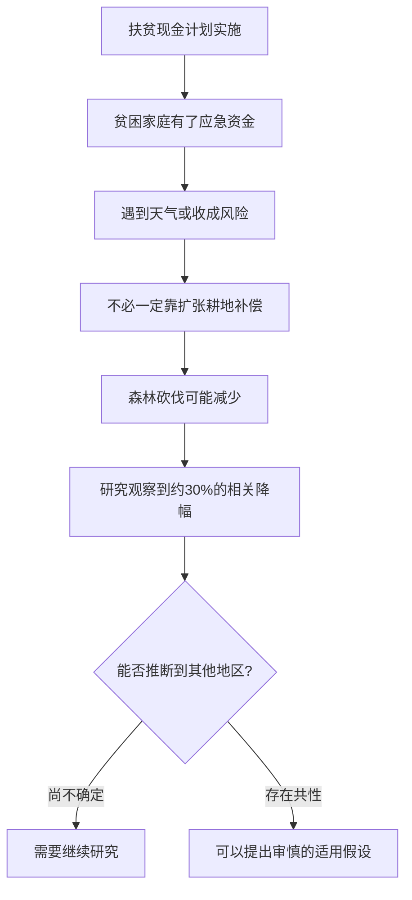
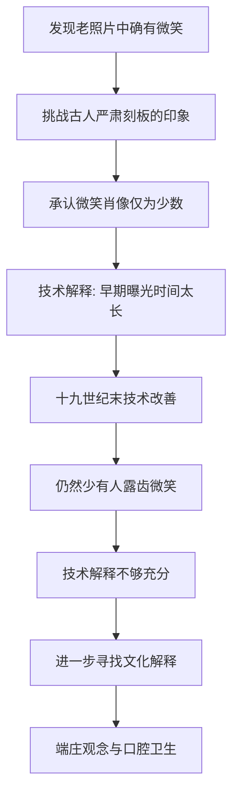
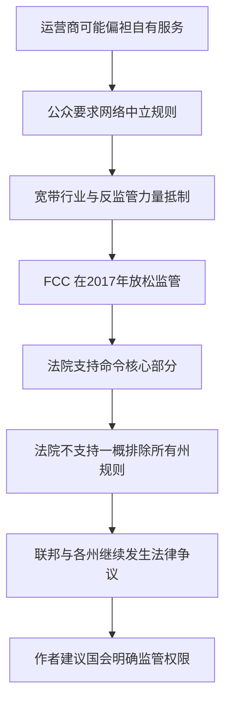
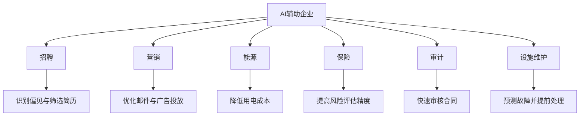
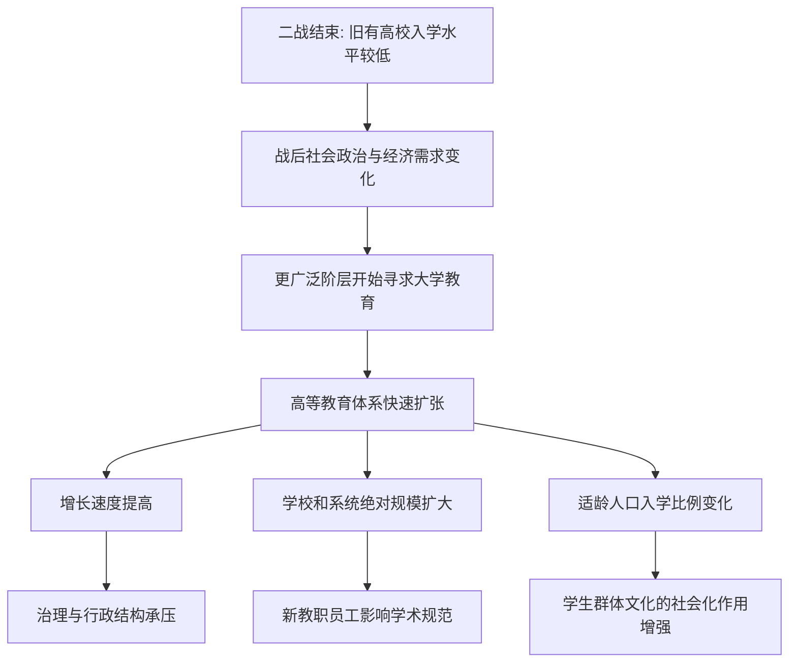

<Callout type="info" title="使用说明">
本页为根据原始资料整理的**考研英语（一）精读学习笔记**，按试卷题型顺序组织。原稿未完整提供选项的题目不会被虚构为官方答案；文中的原创巩固题与正式真题题目应予区分。
</Callout>

## Section I Use of English：流体智力（开篇）

### 主题导读

新的完形填空篇章从心理学概念“流体智力”切入，交代其与快速推理、新问题解决及年龄变化的关系。下文将进一步讨论随着年龄增长，智力相关能力是否都注定衰退。后续小节将进一步展开相关研究和实验结论；无法由原文确认的完形答案不作猜测。

**①** `Fluid intelligence is the type of intelligence that has to do with short-term memory and the ability to think quickly, logically, and abstractly in order to solve new problems.`

**译文：**&#x2060;流体智力是一种与短期记忆、以及为解决新问题而快速、合乎逻辑和抽象地思考的能力有关的智力。

- **主干：**`Fluid intelligence is the type of intelligence`。
- **定语从句：**`that has to do with ...` 修饰 `type of intelligence`；`have to do with` = 与……有关，不能理解为“必须去做”。
- **并列宾语：**`short-term memory and the ability to think ...`；`quickly / logically / abstractly` 为并列方式副词。
- **目的：**`in order to solve new problems` 说明思考的目的。

**②** `It peaks in young adulthood, levels out for a period of time, and then generally starts to slowly decline as we age.`

**译文：**&#x2060;流体智力通常在青年成年期达到峰值，随后保持一段时间相对稳定，再随着年龄增长而逐渐开始缓慢下降。

- 三个顺序并列谓语：`peaks → levels out → starts to decline`。
- `as we age` = 随着年龄增长；`generally` 保留“通常、一般而言”的限定。
- `level out` = 趋于平稳，不能译为“水平升高”。

**③** `But while aging is inevitable, scientists are finding out that certain changes in brain function may not be.`

**译文：**&#x2060;然而，尽管衰老不可避免，科学家正在发现：大脑功能的某些变化却未必不可避免。

<Accordions>
  <Accordion title="省略恢复：may not be 后面省了什么？">

  **让步从句：**`while aging is inevitable`，`while` 表“尽管”。

  **主句：**`scientists are finding out ...`。

  **宾语从句：**`that certain changes in brain function may not be [inevitable]`，省略了上文出现的形容词 `inevitable`，意思是“大脑功能的某些变化不一定无法避免”。

  **转折逻辑：**`But` + `while` + `may not` 共同引出作者进一步解释的方向，不能将 `may not be` 解读为“这些变化完全不存在”。

</Accordion>
</Accordions>

### 词汇归纳与时间逻辑

| 词汇 | 释义 | 搭配与辨析 |
| --- | --- | --- |
| `fluid intelligence` | 流体智力 | 偏向新问题处理与灵活推理 |
| `short-term memory` | 短期记忆 | 与 `long-term memory` 对照 |
| `abstractly` | 抽象地 | 副词，修饰 `think` |
| `peak` | 达到顶峰 | 动词而非这里的山峰名词 |
| `level out` | 趋于平稳 | 不等于完全不变化 |
| `decline` | 下降；减弱 | 本文讨论年龄相关变化 |
| `inevitable` | 不可避免的 | 后句省略复现此词 |
| `brain function` | 大脑功能 | 与智力具体维度相关 |

<Callout type="idea" title="完形填空的预判方法">

看到 `But while ... may not be`，先锁定转折：作者不是简单重复“年龄增长导致下降”，而准备说明**某些变化可能可以干预**。具体方法或证据须以后续原文为准，不凭常识提前填写答案。

</Callout>

### 本阶段复盘：精读时优先判定的五类关系

| 材料 | 最容易混淆的问题 | 处理方法 |
| --- | --- | --- |
| 数字服务税 | 已调查、拟生效、可能制裁 | 逐一识别 `has ...`、`could`、`likely` |
| 目光接触 | 友好信号与对抗信号 | 对照情境，再判断研究结论适用范围 |
| 脑部实验 | 研究者观察与受试者自述 | 区分 `found`、`indicate` 与 `reported` |
| 文艺复兴翻译 | 从句、强调、倒装与结果状语 | 先还原主干，再按中文因果与时间顺序重组 |
| 流体智力 | `may not be` 的省略 | 回指前文 `inevitable`，利用转折预判下文 |
## Section I Use of English（续）：流体智力、体脂与生活方式

### 文章主线：从年龄变化转向可干预因素

文章先指出流体智力在成年早期达到高峰，此后可能随年龄增长而衰退，随即以 `But while aging is inevitable, ... certain changes in brain function may not be` 转折：**衰老不可避免，不代表相关认知变化毫无改善空间**。接下来按“观察到相关性 → 分组分析 → 推测可能机制 → 给出生活方式建议”的路线展开。研究结果只说明统计联系，不能直接证明腹部脂肪导致智力下降，更不能据此承诺特定锻炼能够治愈认知障碍。

<Cards>
  <Card title="研究对象与指标">
    研究者对照了 **4,000 多名中老年人**的肌肉、腹部脂肪测量数据与**六年间**报告的流体智力变化。
</Card>
  <Card title="主要发现">
    腹部脂肪水平较高的中年人，在随后的流体智力测量中表现较差；男女之间的可能机制并不相同。
</Card>
  <Card title="实际建议">
    维持肌肉、减少腹部脂肪，重点提及有氧运动与以膳食纤维为特色的地中海式饮食。
</Card>
</Cards>

### 研究关联：肌肉流失、脂肪积累与认知变化

**①** One study found that muscle loss and the accumulation of body fat around the abdomen are associated with a decline in fluid intelligence.

**译文：**&#x2060;一项研究发现，肌肉流失和腹部脂肪堆积与流体智力下降存在关联。

- **主干：**`One study found + that 宾语从句`。
- **从句主语：**`muscle loss and the accumulation of body fat around the abdomen`，两个并列名词短语。
- **核心搭配：**`be associated with` 表示“与……相关”，不是“直接造成”。
- **修饰关系：**`around the abdomen` 修饰 `body fat`，描述脂肪堆积的位置。

**②** This suggests the possibility that lifestyle factors might help prevent or delay this type of decline.

**译文：**&#x2060;这提示了一种可能性：生活方式因素也许有助于预防或延缓这类衰退。

<Accordions>
  <Accordion title="语法精讲：possibility 后的 that 是什么从句？">

  - **主干：**`This suggests the possibility`。
  - **同位语从句：**`that lifestyle factors might help prevent or delay this type of decline`，说明“可能性”的具体内容，而非限制 `possibility` 的范围。
  - **并列谓语：**`prevent or delay` 共用 `might help`；`help (to) do` 中的不定式标记可省略。
  - **语气：**`suggests`、`possibility`、`might` 三级保留不确定性，不能擅自翻成“已经证实可以预防”。

</Accordion>
</Accordions>

**③** The researchers looked at data that included measurements of lean muscle and abdominal fat from more than 4,000 middle-to-older-aged men and women and compared that data to reported changes in fluid intelligence over a six-year period.

**译文：**&#x2060;研究人员查看了来自四千多名中老年男女的瘦肌肉组织与腹部脂肪测量数据，并将其与这些人在六年间报告的流体智力变化相比较。

<Accordions>
  <Accordion title="长难句拆解：两个并列动作与一个定语从句">

  **第一层主干：**`The researchers looked at data and compared that data to reported changes ...`。

  **第二层定语：**`that included measurements of lean muscle and abdominal fat from more than 4,000 ... men and women` 修饰第一次出现的 `data`，不是修饰 `researchers`。

  **第三层范围：**`over a six-year period` 说明变化的观察区间；`reported changes` 指报告或记录的变化，不宜译成“研究人员已经证明的变化”。

  **阅读技巧：**&#x2060;先连起 `looked at ... and compared ... to ...`，再把长定语嵌回第一个宾语。

</Accordion>
</Accordions>

**④** They found that middle-aged people with higher measures of abdominal fat scored worse on measures of fluid intelligence as the years went by.

**译文：**&#x2060;他们发现，随着时间推移，腹部脂肪指标较高的中年人在流体智力测评中的表现较差。

- `with higher measures of abdominal fat` 是修饰 `people` 的后置介词短语；`measures` 此处为“测量值／指标”，而非“措施”。
- `scored worse on measures of ...` = 在……测评中得分更差。
- `as the years went by` 是时间状语从句，`as` 表“随着”，不是“因为”。

### 性别差异：可能的免疫机制

**⑤** For women, the association may be attributable to changes in immunity that resulted from excess abdominal fat; in men, the immune system did not appear to be involved.

**译文：**&#x2060;对女性而言，这种关联可能与过多腹部脂肪引起的免疫功能变化有关；对男性而言，免疫系统似乎并未参与这一关联机制。

<Accordions>
  <Accordion title="对照解析：may be attributable to 与 did not appear to">

  **女性分句：**`the association may be attributable to changes in immunity`；`that resulted from excess abdominal fat` 修饰 `changes in immunity`。

  **男性分句：**`the immune system did not appear to be involved`，其中 `appear to` 为“似乎”，并非确定的否定证据。

  **两处保留：**`may` 和 `did not appear to` 都是审慎的科学表述。不能改成“女性必然由免疫变化引起，男性与免疫绝对无关”。分号并列表示两组对比。

</Accordion>
</Accordions>

**⑥** It is hoped that future studies could explain these differences and perhaps lead to different treatments for men and women.

**译文：**&#x2060;研究者希望，未来的研究能够解释这些性别差异，并有望为男女提供不同的干预或治疗方案。

- `It` 为形式主语，真正主语是 `that future studies could explain ... and perhaps lead to ...`。
- `explain` 与 `lead to` 为并列谓语，均由 `future studies` 发出。
- `could`、`perhaps` 表可能性；相关方案属于未来展望，不是现有临床结论。

### 生活方式建议：从科学发现到实践

**⑦** Meanwhile, there are steps you can take to help reduce abdominal fat and maintain lean muscle mass as you age in order to protect both your physical and mental well-being.

**译文：**&#x2060;与此同时，你也可以在年龄增长过程中采取一些措施，帮助减少腹部脂肪并维持瘦肌肉量，从而维护身心健康。

<Accordions>
  <Accordion title="句法拆解：there be + 省略关系词的定语从句 + 目的状语">

  - **存在句：**`there are steps`。
  - **定语从句：**`(that/which) you can take` 修饰 `steps`；关系词在从句中作 `take` 的宾语，所以可省略。
  - **措施目的：**`to help reduce abdominal fat and maintain lean muscle mass`；这里 `reduce` 和 `maintain` 并列。
  - **时间背景：**`as you age` 表“随着年龄增长”。
  - **最终目的：**`in order to protect both your physical and mental well-being`，`both ... and ...` 强调身体与精神两方面。

</Accordion>
</Accordions>

**⑧** The two highly recommended lifestyle approaches are maintaining or increasing your level of aerobic exercise and following a Mediterranean-style diet that is high in fiber and eliminates highly processed foods.

**译文：**&#x2060;强烈推荐的两种生活方式是：保持或增加有氧运动量，以及采用富含膳食纤维、避免高度加工食品的地中海式饮食。

- **系表结构：**`The two ... approaches are A and B`，其中 `A = maintaining or increasing ...`，`B = following a ... diet`，两项都是动名词短语。
- **定语从句：**`that is high in fiber and eliminates highly processed foods` 只修饰 `a Mediterranean-style diet`。
- **层级辨析：**`maintaining or increasing` 是方法 A 内部的选择关系；`and following` 连接 A、B 两种主要方法。
- **语义修正：**`highly processed foods` 指高度加工食品，不宜笼统译为“全部加工食品”；`lean muscle mass` 指瘦体重中的肌肉成分，不是“精瘦的肉”。

### 核心词汇与固定搭配

| 词汇／搭配 | 含义 | 用法辨析 |
| --- | --- | --- |
| `fluid intelligence` | 流体智力 | 与新问题解决、推理等能力有关 |
| `muscle loss` | 肌肉流失 | `loss` 表数量减少 |
| `accumulation` | 积累；堆积 | `accumulation of body fat` 脂肪积聚 |
| `abdomen / abdominal` | 腹部／腹部的 | 名词与形容词对应 |
| `lean muscle` | 瘦肌肉组织 | 此处 `lean` = 脂肪含量低的 |
| `measurement / measure` | 测量；指标 | `measures` 在统计场景可指测评分数或指标 |
| `be associated with` | 与……有关 | 不能自动推出因果 |
| `be attributable to` | 可归因于 | 常与 `may` 连用，表谨慎推断 |
| `immunity / immune system` | 免疫功能／免疫系统 | 注意研究中的性别差异 |
| `maintain` | 维持 | `maintain muscle mass` |
| `aerobic exercise` | 有氧运动 | `level of aerobic exercise` 指运动量／水平 |
| `Mediterranean-style diet` | 地中海式饮食 | `high in fiber` 富含纤维 |
| `well-being` | 健康与幸福状态 | `physical and mental well-being` 身心健康 |

<Callout type="warn" title="研究题最常见的两类误读">

1. 看到 `associated with`、`correlated with`，只判定**统计关联**，不要自己改为 `cause`。
2. 看到 `may`、`might`、`could`、`perhaps`、`appear to`，中文必须保留“可能／或许／似乎”的限定；未来研究方向不能当成已经验证的结论。

</Callout>

<Question id="zz2021u-review01" type="single" tags="2021英语一,完形填空,原创巩固,语义辨析">

`muscle loss and the accumulation of body fat ... are associated with a decline` 最稳妥的理解是：

<Option>肌肉流失一定直接导致认知能力下降</Option>
<Option correct>肌肉流失、腹部脂肪积累与相关能力下降存在关联</Option>
<Option>研究已确定了唯一的生物学机制</Option>
<Option>只有男性可能受到腹部脂肪影响</Option>

<Solution>

**答案：B。**`be associated with` 表统计联系，不等同于因果证据；性别机制本身也只是初步推测。

</Solution>
</Question>

<Question id="zz2021u-review02" type="single" tags="2021英语一,完形填空,原创巩固,同位语从句">

`the possibility that lifestyle factors might help ...` 中的 `that` 从句主要作用是：

<Option>充当原因状语</Option>
<Option>修饰 `factors` 的限制性定语</Option>
<Option correct>解释 `possibility` 的具体内容</Option>
<Option>引导条件状语从句</Option>

<Solution>

**答案：C。**`that` 后内容完整，说明“可能性是什么”，属于同位语从句。

</Solution>
</Question>

## Reading Text 1：英国铁路票价、服务质量与国有化争议

### 文章主线：为什么涨价问题最终变成了服务治理问题？

作者先质疑铁路票价年年上涨，随后介绍政府长期采用的**使用者付费**理由，再从地区差异、铁路罢工、服务质量和改革方案层层推进。结论不是简单主张“所有铁路都应立即国有化”，而是提醒：**倘若乘客付出的费用与实际服务持续不相称，国有化的政治压力就会重新出现。**

<Steps>
  <Step>

  ### 票价上涨引发质疑

  平均涨幅高于消费价格指数（CPI）所衡量的通胀率，通勤群体承担额外负担。

</Step>
  <Step>

  ### 使用者付费的辩护

  历届政府认为铁路投资、运营成本应主要由乘车人承担，而不是由一般纳税人承担。

</Step>
  <Step>

  ### 服务质量削弱正当性

  罢工、拥挤、不可靠和维护管理不善，使乘客对涨价产生不满。

</Step>
  <Step>

  ### 政策回应与政治后果

  政府考虑最低服务要求，但必须连同结构性改进一起推进，否则国有化议题可能再度升温。

</Step>
</Steps>

### 第一段：持续涨价及其社会成本

**①** How can Britain's train operators possibly justify yet another increase to rail passenger fares?

**译文：**&#x2060;英国铁路运营商究竟如何为铁路客运票价再次上涨提供合理解释？

- 反问句 `How can ... possibly justify ...?` 表达作者的质疑。
- `yet another increase` = “又一次涨价”，`yet another` 带有不满的语气。
- `justify` = 证明……有正当理由，而不是“执行”。

**②** It has become a grimly reliable annual ritual: every January the cost of travelling by train rises, imposing a significant extra burden on those who have no option but to use the rail network to get to work or otherwise.

**译文：**&#x2060;这已成了令人无奈却年年准时上演的惯例：每到一月，火车出行成本便会上升，使那些无论是上班还是出于其他目的都不得不依靠铁路的人承担明显的额外负担。

<Accordions>
  <Accordion title="长难句拆解：冒号说明 + 分词结果状语 + 定语从句">

  1. `It has become a grimly reliable annual ritual` 是概括；冒号后的具体事实解释什么是这种“惯例”。
  2. `every January the cost of travelling by train rises` 是解释部分的主干。
  3. `imposing a significant extra burden on those ...` 为现在分词短语，表示票价上涨造成的结果。
  4. `who have no option but to use ...` 修饰 `those`；`have no option but to do` = “别无选择，只能做……”。
  5. `to get to work or otherwise`：`otherwise` 概括上班以外的其他出行目的，不能译成“否则”。

</Accordion>
</Accordions>

**③** This year's rise, an average of 2.7 per cent, may be a fraction lower than last year's, but it is still well above the official Consumer Price Index (CPI) measure of inflation.

**译文：**&#x2060;今年的票价平均上涨 2.7%，虽可能比去年的涨幅略低，但仍明显超过官方消费者价格指数（CPI）所衡量的通货膨胀率。

- `an average of 2.7 per cent` 是 `This year's rise` 的同位语，补充说明平均涨幅。
- `last year's` 省略了可由前文补出的 `rise`；`a fraction lower` = 略低，`well above` = 远高于／明显高于。
- `may` 保留“可能”；`but` 突出作者更看重“高于通胀率”这一事实。

### 第二段：使用者付费理由与地区差异

**④** Successive governments have permitted such increases on the grounds that the cost of investing in and running the rail network should be borne by those who use it, rather than the general taxpayer.

**译文：**&#x2060;历届政府之所以允许这样的涨价，是因为它们认为，铁路网的投资与运营成本应由铁路使用者承担，而不是转嫁给一般纳税人。

<Accordions>
  <Accordion title="句型拆解：on the grounds that、并列动名词与 rather than">

  - **主干：**`Successive governments have permitted such increases`。
  - **理由：**`on the grounds that ...` = “理由是……／鉴于……”，后接陈述理由的完整从句。
  - **主语：**`the cost of investing in and running the rail network`；`investing in` 和 `running` 是 `of` 后并列的动名词结构。
  - **谓语：**`should be borne by` 为被动结构，“应由……承担”。
  - **范围对比：**`those who use it, rather than the general taxpayer` 是费用承担主体的对照。`those who ...` 中 `who` 引导定语从句。

</Accordion>
</Accordions>

**⑤** Why, the argument goes, should a car-driving pensioner from Lincolnshire have to subsidise the daily commute of a stockbroker from Surrey?

**译文：**&#x2060;按这一论点，为什么林肯郡一位开车出行的退休者，要为萨里郡一位股票经纪人的日常铁路通勤出钱补贴呢？

- `the argument goes` 是插入的消息来源，意为“该论点认为”，**不是作者直接断言**。
- `car-driving pensioner` 与 `stockbroker` 形成“不乘车的普通纳税人—乘车的高收入者”的对比，以支持使用者付费的立场。
- `subsidise` = 补贴；`commute` = 上下班通勤。

**⑥** Equally, there is a sense that the travails of commuters in the South East, many of whom will face among the biggest rises, have received too much attention compared to those who must endure the relatively poor infrastructure of the Midlands and the North.

**译文：**&#x2060;同样，有人觉得，东南部通勤者所受的种种困扰已受到过多关注——尽管他们中不少人将面临最大的几档涨幅；与之相比，中部和北部地区的乘客却不得不忍受相对落后的铁路基础设施。

<Accordions>
  <Accordion title="长难句拆解：内容从句 + 非限制性定语从句 + 比较结构">

  **外层：**`there is a sense that ...` 表示“存在这样一种看法”；这里 `that` 引出“看法”的具体内容。

  **内容主干：**`the travails of commuters in the South East have received too much attention`。

  **插入定语：**`many of whom will face among the biggest rises`，`whom` 指代东南部通勤者；`among the biggest rises` 是“属于涨幅最大的情况之一”。

  **比较对象：**`compared to those who must endure the relatively poor infrastructure of the Midlands and the North`；`those who ...` 指其他地区的乘客。

  **态度归属：**`there is a sense` 不是“事实证明”，是转述另一种评价。答题时要识别这种观点与作者后面的反驳如何衔接。

</Accordion>
</Accordions>

### 第三段：罢工使消费者更有理由要求服务

**⑦** However, over the past 12 months, those commuters have also experienced some of the worst rail strikes in years.

**译文：**&#x2060;然而，在过去十二个月里，这些东南部通勤者也经历了多年来最严重的几次铁路罢工。

- `those commuters` 回指上文东南部通勤者。
- `However` 把讨论从“票价由谁承担”转向“乘客获得何种服务”。

**⑧** It is all very well train operators trumpeting the improvements they are making to the network, but passengers should be able to expect a basic level of service for the substantial sums they are now paying to travel.

**译文：**&#x2060;铁路运营商宣扬自己正在改善铁路网，当然说得过去；但既然乘客如今为出行支付了大笔费用，他们理应获得起码的服务保障。

<Accordions>
  <Accordion title="高频结构：It is all very well ... but ...">

  - `It is all very well ... but ...` 是典型的**先让步、后指出真正问题**的表达；核心立场落在 `but` 后。
  - `train operators trumpeting ...` 是名词短语加现在分词的结构，作前半句所评论的行为。可以整体理解为“运营商大肆宣传……”；不宜机械套用普通 `It is ... that` 强调句。
  - `they are making to the network` 修饰 `the improvements`，省略关系代词 `(that/which)`。
  - `they are now paying to travel` 修饰 `the substantial sums`，同样省略关系代词。
  - `for the substantial sums` 指“考虑到乘客支付了这么多钱”，不表示“为了这些钱”。

</Accordion>
</Accordions>

**⑨** The responsibility for the latest wave of strikes rests on the unions.

**译文：**&#x2060;最近这一轮罢工的责任在工会一方。

- `rest on` 在此为“责任归于／落在……身上”，不是“休息于”。
- 作者承认工会应承担罢工责任，但这并不抹去受影响乘客的权利。

**⑩** However, there is a strong case that those who have been worst affected by industrial action should receive compensation for the disruption they have suffered.

**译文：**&#x2060;然而，有充分理由主张，对受劳资行动影响最严重、生活受到严重干扰的乘客应给予赔偿。

- `there is a strong case that ...` = 有充分理由认为……；`case` 在此非“案件”，而是论证依据。
- `those who have been worst affected ...` = 受影响最严重的人；`who` 定语从句修饰 `those`。
- `the disruption (that) they have suffered` = 他们遭遇的干扰；关系词被省略。
- `industrial action` 在这里指罢工等劳资行动；`compensation` = 赔偿。

### 第四段：政策承诺与国有化的政治压力

**⑪** The Government has pledged to change the law to introduce a minimum service requirement so that, even when strikes occur, services can continue to operate.

**译文：**&#x2060;政府已承诺修法，引入最低服务要求，使铁路即便在发生罢工时也能维持一定程度的运营。

- `pledge to do` = 正式承诺做某事。
- `to introduce a minimum service requirement` 表示修法的目的；`so that ...` 再说明政策希望达到的效果。
- `even when strikes occur` 是嵌在目的从句中的让步意味很强的时间从句；`can continue to operate` 才是最终目标。

**⑫** This should form part of a wider package of measures to address the long-running problems on Britain's railways.

**译文：**&#x2060;这一举措应当成为一整套更广泛措施的一部分，以解决英国铁路长期存在的问题。

- `form part of` = 构成……的一部分；`package of measures` = 一揽子措施。
- `to address the long-running problems` 修饰 `measures`，说明这些措施的用途。
- `address` 在政策语境为“着手解决”，不是“致辞”或“地址”。

**⑬** Yes, more investment is needed, but passengers will not be willing to pay more indefinitely if they must also endure cramped, unreliable services, interrupted by regular chaos when timetables are changed, or planned maintenance is managed incompetently.

**译文：**&#x2060;诚然，铁路需要更多投资；但如果乘客还得忍受拥挤、不可靠的服务，而且时刻表变动或计划中的维护工作管理不善又不断造成混乱与中断，他们就不愿意无限期地支付更高票价。

<Accordions>
  <Accordion title="结构拆解：承认必要性 → 条件限制 → 乘客不满">

  **让步与转折：**`Yes, more investment is needed, but passengers will not be willing ...`，承认投资需求，重点提出乘客承受能力与服务质量的关系。

  **条件句：**`if they must also endure cramped, unreliable services`。

  **后置修饰：**`interrupted by regular chaos` 修饰 `services`；`when timetables are changed, or planned maintenance is managed incompetently` 说明混乱出现的情境。

  **重要词义：**`indefinitely` = 无限期地；`cramped` = 拥挤局促的；`managed incompetently` = 管理不善。

</Accordion>
</Accordions>

**⑭** The threat of nationalisation may have been seen off for now, but it will return with a vengeance if the justified anger of passengers is not addressed in short order.

**译文：**&#x2060;国有化的威胁眼下或许已被暂时挡住；但若乘客的合理愤怒不能迅速得到回应，这一诉求必将更猛烈地卷土重来。

<Accordions>
  <Accordion title="情态完成式 + 短语动词 + 条件预测">

  - `may have been seen off` = **可能已被暂时击退／化解**，属于“情态动词 + 完成式被动”，不是“已经永久消失”。
  - `for now` = 眼下、暂时。
  - `it will return` 中 `it` 回指 `the threat of nationalisation`。
  - `with a vengeance` = 更猛烈地、更强势地；不是“带着复仇”。
  - `if ... is not addressed in short order` = 若乘客怒火不能尽快得到处理。`justified` 修饰 `anger`，体现作者认为不满有充分理由。

</Accordion>
</Accordions>

### 重点词汇与观点定位

| 词汇／表达 | 语境义 | 考试辨析 |
| --- | --- | --- |
| `justify` | 为……辩护；证明其合理 | 常出现在作者质疑中 |
| `grimly reliable` | 令人沮丧却一贯如此 | 带有讽刺评价 |
| `annual ritual` | 年复一年的惯例 | 隐喻而非宗教仪式 |
| `impose a burden on` | 给……增添负担 | 注意 `on` 后的承受者 |
| `a fraction lower` | 略低一些 | `fraction` 可表微小程度 |
| `well above` | 明显高于 | 不应只译成“高于”而丢失程度 |
| `on the grounds that` | 理由是…… | 观点依据，不代表作者同意 |
| `subsidise` | 补贴 | 需要识别出钱者与受益者 |
| `travails` | 艰难经历；困境 | 常用于负面处境 |
| `infrastructure` | 基础设施 | 区分地区服务差异 |
| `trumpet` | 高调宣扬 | 非乐器名词用法 |
| `rest on` | 责任在于 | `responsibility rests on ...` |
| `compensation` | 赔偿 | `receive compensation for ...` |
| `disruption` | 扰乱；中断 | 不等于完全停止运营 |
| `pledge` | 正式承诺 | 政策尚未等于落地实施 |
| `indefinitely` | 无限期地 | 与继续加价相连 |
| `nationalisation` | 国有化 | 作为政治争论的潜在后果 |
| `see off` | 挡住；击退 | 需联系被动完成式 |
| `with a vengeance` | 变本加厉地；更强烈地 | 非字面“复仇” |
| `in short order` | 迅速；尽快 | 时间要求很紧迫 |

<Callout type="idea" title="观点题速解：谁提出了什么理由？">

`Successive governments ... on the grounds that` 是政府过去的辩护；`the argument goes` 是支持使用者付费的论点；`there is a sense that` 是关于地区不平等的看法。**作者的核心评价**在 `but passengers should ...` 与 `if ... anger ... is not addressed` 两处更突出。不要把转述的任何一方观点直接当成作者结论。

</Callout>

<Question id="zz2021r1-review01" type="single" tags="2021英语一,阅读Text1,原创巩固,作者态度">

作者最认可下面哪项判断？

<Option>铁路涨价本身已证明全面国有化是唯一选择</Option>
<Option>只要铁路需要投资，乘客就必须无限期接受涨价</Option>
<Option correct>铁路票价与最低服务保障应相匹配，否则政治压力会持续</Option>
<Option>铁路罢工只会影响北部与中部地区</Option>

<Solution>

**答案：C。**&#x2060;全文将使用者付费理由与乘客的服务权利进行对照，结尾警告若不尽快改善服务，国有化议题将再度升温。

</Solution>
</Question>

<Question id="zz2021r1-review02" type="single" tags="2021英语一,阅读Text1,原创巩固,词义">

`nationalisation may have been seen off for now` 的准确含义是：

<Option>铁路运营商已完成国有化</Option>
<Option correct>国有化压力可能暂时得到缓解</Option>
<Option>国有化已永久失去政治吸引力</Option>
<Option>政府计划取消全部火车票收费</Option>

<Solution>

**答案：B。**`may have been` 表对过去状态的推测，`see off` 表暂时击退，`for now` 又限定了时间范围。

</Solution>
</Question>

## Reading Text 2：有条件现金转移与森林保护

### 主题导读：减贫政策能否同时减少森林砍伐？

这篇文章围绕印度尼西亚的**有条件现金转移计划（Conditional Cash Transfers，CCTs）**&#x2060;展开。一般观点认为，提高收入可能刺激土地开发，减贫和环境保护难以同时实现；研究者却在一项具体计划中观察到了森林砍伐减少的现象。文章最终从“统计发现—可能的机制—研究适用范围—政策价值”层层推进。

<Cards>
  <Card title="政策目标：减轻贫困">
    为贫困家庭提供有条件的现金支持，条件包括子女在校和定期医疗检查等。
</Card>
  <Card title="研究问题：环境外溢效应">
    扶贫资金是否可能改变家庭砍伐森林、应对天气风险的行为？
</Card>
  <Card title="谨慎结论：兼顾两种利益">
    研究发现该计划与森林砍伐减少约 30% 相关，但仍需考察因果机制与地区适用性。
</Card>
</Cards>

### 第一段：森林砍伐放缓，扶贫计划成为解释线索

**①** Last year marked the third year in a row that Indonesia's bleak rate of deforestation has slowed in pace.

**译文：**&#x2060;就在文章所述的上一年，印度尼西亚森林砍伐速度已连续第三年放缓，尽管总体形势仍不乐观。

- `Last year marked ...` 中 `marked` = 标志着。
- `the third year in a row` = 连续第三年，`in a row` 表“连续”。
- `that Indonesia's ... rate ... has slowed in pace` 修饰 `year`，说明这一年发生的变化。
- `bleak` = 前景不乐观的；`rate has slowed` = 速度下降，**不等于森林砍伐已停止**。

**②** One reason for the turnaround may be the country's antipoverty program.

**译文：**&#x2060;出现这一好转的原因之一，可能是该国实施的扶贫计划。

- `turnaround` 在这里指情势好转，不是“转身”。
- `One reason ... may be ...` 同时表明**原因不止一个**、**判断尚不确定**。

### 第二段：有条件现金转移计划如何运作？

**③** In 2007, Indonesia started phasing in a program that gives money to its poorest residents under certain conditions, such as requiring people to keep kids in school or get regular medical care.

**译文：**&#x2060;2007 年，印度尼西亚开始逐步推行一项计划：在满足一定条件的前提下向最贫困的居民发放现金，例如要求家长让孩子继续上学，或按规定接受定期医疗保健。

<Accordions>
  <Accordion title="长难句拆解：phase in → that 定语从句 → such as 举例">

  **主干：**`Indonesia started phasing in a program`。

  **定语从句：**`that gives money to its poorest residents under certain conditions` 修饰 `program`。

  **条件举例：**`such as requiring people to keep kids in school or get regular medical care` 说明条件的具体形式。

  **语法细节：**`require people to ...` 的宾语是 `people`，后接宾补不定式；并列项 `keep kids in school` 与 `get regular medical care` 共享上文 `to` 的统领语境。不要误认为“政府支付的是食物，而不是现金”，这里明确是 `gives money`。

</Accordion>
</Accordions>

**④** Called conditional cash transfers or CCTs, these social assistance programs are designed to reduce inequality and break the cycle of poverty.

**译文：**&#x2060;这类社会援助计划被称为“有条件现金转移”（CCTs），旨在减少不平等并打破贫困的代际循环或恶性循环。

- `Called conditional cash transfers or CCTs` 是过去分词短语，表示被动命名，修饰句子主语 `these social assistance programs`。
- `be designed to do` = 旨在做……，强调**政策目的**，不能直接译为“已经成功做到了”。
- `reduce inequality and break the cycle of poverty` 为两个并列目的。

**⑤** They're already used in dozens of countries worldwide.

**译文：**&#x2060;世界上已有几十个国家实施这类计划。

- `They` 回指有条件现金转移计划，而不是“刚才列出的条件”。
- `be used in` 表已得到应用。

**⑥** In Indonesia, the program has provided enough food and medicine to substantially reduce severe growth problems among children.

**译文：**&#x2060;在印度尼西亚，这项计划已帮助提供足够的食物和药品，从而明显减少儿童严重的生长发育问题。

- `enough ... to ...` 是数量与结果／效果的联系；`substantially` 修饰 `reduce`，表示“大幅度地”。
- `severe growth problems among children` = 儿童群体中的严重生长发育问题，`growth` 此处不是“经济增长”。
- 注意区分上一句的**政策目标**与本句陈述的**已报告效果**。

### 第三、四段：减贫与环境保护真的冲突吗？

**⑦** But CCT programs don't generally consider effects on the environment.

**译文：**&#x2060;但有条件现金转移计划通常不会把对环境的影响纳入主要考量。

- `generally` = 一般情况下，不等于“所有计划无一例外”。
- `effects on the environment` 是环境方面的影响，可能有利也可能不利；单凭此句不可定性。

**⑧** In fact, poverty alleviation and environmental protection are often viewed as conflicting goals, says Paul Ferraro, an economist at Johns Hopkins University.

**译文：**&#x2060;约翰斯·霍普金斯大学经济学家保罗·费拉罗指出，实际上，减贫与环境保护往往被看成彼此冲突的目标。

- `poverty alleviation` = 缓解贫困；`environmental protection` = 环境保护。
- `be viewed as` = 被视为；强调**人们如何看待**，而非客观上永远对立。
- `says Paul Ferraro` 是引语后的主谓倒装，不是“贫困缓解表示……”。
- `an economist at Johns Hopkins University` 为 `Paul Ferraro` 的同位语。

**⑨** That's because economic growth can be correlated with environmental degradation, while protecting the environment is sometimes correlated with greater poverty.

**译文：**&#x2060;原因在于，经济增长可能与环境恶化相伴，而环境保护有时又与贫困程度加深呈现相关关系。

<Accordions>
  <Accordion title="双相关结构：为什么 while 不是单纯表示时间？">

  **第一层：**`That's because ...`；`because` 引出原因说明。

  **第二层对照：**

  - `economic growth can be correlated with environmental degradation`：经济增长 ↔ 环境恶化；
  - `while protecting the environment is sometimes correlated with greater poverty`：环境保护 ↔ 贫困加重。

  这里 `while` 连接两个对照的判断，可译“而”，不是“当……的时候”。`protecting the environment` 是动名词短语，整体充当第二分句主语。

  **限定词：**`can be`、`sometimes` 说明上述联系并非普遍必然。

</Accordion>
</Accordions>

**⑩** However, those correlations don't prove cause and effect.

**译文：**&#x2060;然而，这些相关关系并不能证明二者之间存在因果关系。

<Callout type="warn" title="本篇最重要的判断：correlation ≠ causation">

“经济增长与环境恶化同时出现”可能有第三因素参与，不能因此直接得出“经济增长一定造成环境恶化”；同样，看到扶贫政策与毁林减少并行，也不能仅凭并行就宣称已证明唯一原因。研究往往还要通过对照、时间顺序和其他证据进一步检验。

</Callout>

**⑪** The only previous study analyzing causality, based on an area in Mexico that had instituted CCTs, supported the traditional view.

**译文：**&#x2060;此前唯一一项探究因果关系的研究以墨西哥某个已经实施有条件现金转移计划的地区为基础，其结果支持了传统看法。

- **主干：**`The only previous study supported the traditional view`。
- `analyzing causality` 为现在分词短语修饰 `study`；`based on an area in Mexico ...` 为插入的过去分词短语。
- `that had instituted CCTs` 修饰 `an area in Mexico`；过去完成时说明实施计划先于被讨论的研究。
- `traditional view` 回指前文减贫与环保可能存在冲突的传统看法，而不是作者必然认可该看法。

**⑫** There, as people got more money, some of them may have more cleared land for cattle to raise for meat, Ferraro says.

**译文：**&#x2060;费拉罗指出，在那里，随着一部分居民获得更多资金，他们可能拥有更多用于饲养肉牛的已开垦土地。

- `There` 指墨西哥研究地区，不能误指随后讨论的印度尼西亚。
- `as people got more money` 表“随着人们得到更多钱”。
- 原资料写作 `may have more cleared land`，可按“拥有更多已被开垦的土地”理解；它与 `may have cleared more land`（可能开垦了更多土地）**不是完全相同的语法结构**。没有看到可校验的原刊印本之前，不把后者擅自当成原文。
- `for cattle to raise for meat` 说明土地用途：饲养供肉用的牛。

### 第五、六段：用卫星数据检验环境影响

**⑬** Such programs do not have to negatively affect the environment, though.

**译文：**&#x2060;不过，这类计划未必一定会对环境造成负面影响。

- `do not have to` = “不一定／不必”，**不是** `must not`“禁止”。
- 句末 `though` 表轻微转折，是文章提出反例的信号。

**⑭** Ferraro wanted to see if Indonesia's poverty-alleviation program was affecting deforestation.

**译文：**&#x2060;费拉罗想弄清楚，印度尼西亚的扶贫计划是否正在影响森林砍伐情况。

- `if` 引导宾语从句，相当于 `whether`，是“是否”，不是“如果”。
- `was affecting` 强调研究者考察实施期间的影响。

**⑮** Indonesia has the third-largest area of tropical forest in the world and one of the highest deforestation rates.

**译文：**&#x2060;印度尼西亚拥有世界第三大的热带森林面积，同时也是森林砍伐率最高的国家之一。

- `has A and B` 共用谓语 `has`；`the third-largest`、`one of the highest` 的范围分别不同。
- 应区分“森林存量面积大”与“森林减少速度快”，二者可以同时成立。

**⑯** Ferraro analyzed satellite data showing annual forest loss from 2008 to 2012—including during Indonesia's phase-in of the antipoverty program—in 7,468 forested villages across 15 provinces.

**译文：**&#x2060;费拉罗分析了来自印度尼西亚 15 个省、7,468 个有森林覆盖的村庄的卫星数据，数据记录了 2008 至 2012 年间每年的森林损失情况，其间包括扶贫计划逐步推行的阶段。

<Accordions>
  <Accordion title="数字密集长句：拆出研究对象、时间与空间范围">

  **主干：**`Ferraro analyzed satellite data`。

  **数据内容：**`showing annual forest loss` 为现在分词短语，修饰 `satellite data`。

  **时间：**`from 2008 to 2012`；破折号中的 `including during Indonesia's phase-in of the antipoverty program` 补充说明这一时间跨度包含计划逐步实施期间。

  **空间：**`in 7,468 forested villages across 15 provinces`。

  **精读原则：**&#x2060;数值不能随意四舍五入或改动；这里 `7,468` 修饰村庄，`15` 修饰省，`2008—2012` 表观察区间，并不是“计划恰好只实施这些年”。

</Accordion>
</Accordions>

**⑰** “We see that the program is associated with a 30 percent reduction in deforestation,” Ferraro says.

**译文：**&#x2060;费拉罗说：“我们观察到，这项计划与森林砍伐减少 30% 的现象存在关联。”

- `We see that ...` 引出研究者的观察与解释。
- `a 30 percent reduction in deforestation` 指森林砍伐量或速度下降约 30%，不是“森林覆盖率提高 30%”。
- `is associated with` 再次出现，保留关联语气，避免把观察写成实验已证明的绝对因果。

### 第七段：为什么现金支持可能让家庭少砍树？

**⑱** That's likely because the rural poor are using the money as makeshift insurance policies against inclement weather, Ferraro says.

**译文：**&#x2060;费拉罗认为，这很可能是因为农村贫困家庭把这笔补助金当成一种应对恶劣天气的临时保险。

- `That's likely because ...` 是研究者提出的**可能机制**，而不是唯一确定原因。
- `the rural poor` 为“农村贫困人口”，`the + 形容词` 可指一类人。
- `makeshift` = 临时凑合的、权宜性的；`inclement weather` = 恶劣天气。

**⑲** Typically, if rains are delayed, people may clear land to plant more rice to supplement their harvests.

**译文：**&#x2060;通常，如果降雨推迟，人们可能开垦更多土地种植水稻，以弥补原有收成的不足。

<Accordions>
  <Accordion title="两个 to do 并不重复：一个是行动目的，一个是最终目的">

  - **条件：**`if rains are delayed`，若降雨推迟。
  - **主句：**`people may clear land`，人们可能开垦土地。
  - **第一目的：**`to plant more rice`，为了种更多水稻。
  - **第二目的：**`to supplement their harvests`，为了补充收成。
  - **推理：**&#x2060;气候冲击 → 收成风险 → 扩大耕地 → 可能导致更多毁林。`may` 仍表示可能。

</Accordion>
</Accordions>

**⑳** With the CCTs, individuals instead can use the money to supplement their harvests.

**译文：**&#x2060;而得到这类现金补助后，人们可以改用补助金来弥补收成不足。

- `instead` 直接对照上一句的“开垦更多土地”；**有现金缓冲，未必需要增加砍伐**。
- `supplement their harvests` 不是“让水稻产量自动增长”，而是通过经济资源补上收成短缺造成的缺口。

### 第八段：可推广性与政策价值

**㉑** Whether this research translates elsewhere is anybody's guess.

**译文：**&#x2060;这项研究的结论能否适用于其他地区，目前谁也说不准。

- `Whether this research translates elsewhere` 为主语从句；`whether` 不能用作“无论”直接翻译这里的句法。
- `translate` 不是翻译语言，而是“转化到／适用于另一情境”；`anybody's guess` = 尚无定论。

**㉒** Ferraro suggests the results may transfer to other parts of Asia, due to commonalities such as the importance of growing rice and market access.

**译文：**&#x2060;费拉罗认为，由于亚洲其他地区在水稻种植的重要性和市场可达性等方面存在相似之处，这一研究结果也许能够适用于亚洲其他地方。

- `suggests (that) ...` 的宾语从句省略 `that`。
- `may transfer` = 可能适用，不能翻成“一定能复制”。
- `due to commonalities` 说明推测依据；`market access` 指进入市场、获得交易渠道的条件。

**㉓** And regardless of transferability, the study shows that what's good for people may also be good for the environment.

**译文：**&#x2060;而且，无论这一发现能否推广，该研究至少说明：对人有益的事，也可能对环境有益。

<Accordions>
  <Accordion title="嵌套结构：that 宾语从句里还有一个 what 主语从句">

  **主干：**`the study shows + that 从句`。

  **that 从句：**`what's good for people may also be good for the environment`。

  **内部主语：**`what's good for people`，`what` 引导的融合关系从句，意为“对人有好处的事物／做法”。

  `regardless of transferability` 为让步背景，“不管可推广性如何”。`may also` 不是“必然同时”。

</Accordion>
</Accordions>

**㉔** Even if this program didn't reduce poverty, Ferraro says, “the value of the avoided deforestation just for carbon dioxide emissions alone is more than the program costs.”

**译文：**&#x2060;费拉罗说：“即便这项计划没有实现减贫，仅按避免砍伐森林所带来的二氧化碳排放效益计算，其价值就已超过项目成本。”

<Accordions>
  <Accordion title="翻译精讲：Even if 假设让步 + alone 限定 + 比较句">

  - **让步：**`Even if this program didn't reduce poverty` = “即便减贫目标没有实现”，属于**假设情境**，不能据此说项目事实上没有减贫。
  - **插入：**`Ferraro says` 标明观点来源。
  - **主句：**`the value of the avoided deforestation ... is more than the program costs`，比较“环境效益价值”与“计划成本”。
  - **范围：**`just for carbon dioxide emissions alone` 强调“仅从二氧化碳排放这一项效益来算”；并非价值仅限于二氧化碳。
  - **术语：**`avoided deforestation` = 避免发生的森林砍伐（与基准情形相比）；不要译成“此前已被砍伐的森林”。

</Accordion>
</Accordions>

### 论证结构与科学表达辨析

| 高频表达 | 正确理解 | 易错译法 |
| --- | --- | --- |
| `deforestation` | 砍伐森林；森林减少 | “砍树人” |
| `turnaround` | 形势好转 | “转弯” |
| `phase in` | 逐步引入、分阶段实施 | “逐步淘汰”（那是 `phase out`） |
| `conditional cash transfers` | 有条件现金转移／补助 | 无条件直接发放 |
| `alleviation` | 缓解；减轻 | 完全消除 |
| `be viewed as` | 被认为是 | 已被证明是 |
| `correlate with` | 与……相关 | 直接导致 |
| `causality` | 因果关系 | 时间先后关系 |
| `institute a program` | 实施一项计划 | 研究所（名词义） |
| `clear land` | 开垦土地；清除植被 | 清理室内场地 |
| `forest loss` | 森林面积或植被损失 | 单纯经济损失 |
| `makeshift` | 临时的；权宜的 | 专门设计的永久方案 |
| `inclement weather` | 恶劣天气 | 温和天气 |
| `supplement` | 补充；弥补 | 完全取代 |
| `transferability` | 可推广性；可移植性 | 资金转账 |
| `anybody's guess` | 谁也说不准 | 人人都知道 |
| `avoided deforestation` | 避免发生的毁林 | 已经完成的砍伐 |

<Callout type="info" title="数据与结论的限定">

文章中的 `30 percent` 是研究者报告的**与该计划相关联**的森林砍伐减少幅度；`7,468` 和 `15` 是卫星数据研究覆盖的村庄与省份数量。政策价值的比较包含研究者提出的假设与经济估值，不能将其写成全球所有扶贫计划都有同等效果。

</Callout>

<Question id="zz2021r2-review01" type="single" tags="2021英语一,阅读Text2,原创巩固,研究方法">

文章为何特别强调 `those correlations don't prove cause and effect`？

<Option>研究者认为森林砍伐率从未下降</Option>
<Option>经济发展与环境变化之间绝不存在关系</Option>
<Option correct>两种现象同时变化，不足以单独证明其中一种造成另一种</Option>
<Option>此前的研究完全没有分析过因果关系</Option>

<Solution>

**答案：C。**&#x2060;相关不等于因果；研究需要排除其他因素、核实机制与观察背景。

</Solution>
</Question>

<Question id="zz2021r2-review02" type="single" tags="2021英语一,阅读Text2,原创巩固,细节推断">

根据文章，CCT 计划可能减少砍伐的机制是：

<Option>补助资金让所有人停止种植水稻</Option>
<Option correct>为受天气冲击的家庭提供经济缓冲，降低开垦新土地的压力</Option>
<Option>政府已禁止全部农村家庭伐木</Option>
<Option>研究认为森林保护从此不需要预算</Option>

<Solution>

**答案：B。**&#x2060;关键衔接是 `makeshift insurance` 和 `instead can use the money to supplement their harvests`。

</Solution>
</Question>

<Question id="zz2021r2-review03" type="single" tags="2021英语一,阅读Text2,原创巩固,让步语气">

`Even if this program didn't reduce poverty` 应如何理解？

<Option>项目已被证实完全没有减贫效果</Option>
<Option correct>为了说明环境收益足够大，作者引入一个假设的让步条件</Option>
<Option>政府即将终止这项计划</Option>
<Option>只讨论未来尚未出现的研究地区</Option>

<Solution>

**答案：B。**`Even if` 是假设让步，不能据此认定条件在现实中已经发生。

</Solution>
</Question>

## Reading Text 3：为什么维多利亚时代的人很少在照片中微笑？

### 文章主线：从历史刻板印象到多层次解释

历史学者收集了维多利亚时代人物微笑的老照片，借此挑战“十九世纪人都拘谨严肃”的刻板印象。但作者同时承认：微笑照片只占当时大量肖像的一小部分。接下来文章先给出摄影曝光时间过长这一**技术解释**，再以摄影技术改善后的事实对其提出质疑，转向**社会审美、体面观念及口腔卫生**等文化解释。

<Cards>
  <Card title="现象：笑容罕见但并非不存在">
    微笑肖像可以让读者重新认识古人，但它们不是十九世纪摄影的主流。
</Card>
  <Card title="第一种解释：技术限制">
    早期曝光时间长，被拍摄者很难长时间保持自然笑容，因而多采用固定表情。
</Card>
  <Card title="进一步追问：文化限制">
    曝光时间显著缩短后，严肃表情仍很普遍，说明仅凭技术无法解释全部现象。
</Card>
</Cards>

### 第一段：笑容照片为何会让现代人吃惊？

**①** As a historian who's always searching for the text or the image that makes us re-evaluate the past, I've become preoccupied with looking for photographs that show our Victorian ancestors smiling (what better way to shatter the image of 19th-century prudery?).

**译文：**&#x2060;作为一名一直在寻找能够促使我们重新评价历史的文字和图像的历史学者，我如今十分着迷于搜寻那些记录维多利亚时代先辈笑容的照片——还有什么比这更能打破人们对十九世纪拘谨刻板形象的印象呢？

<Accordions>
  <Accordion title="多层修饰句：As a historian + who + that + 主句 + that">

  **身份背景：**`As a historian` = “作为一名历史学者”，这里 `as` 是介词意义的“作为”，不是表示时间的从句连词。

  **身份定语：**`who's always searching for the text or the image ...` 修饰 `historian`。

  **内嵌定语：**`that makes us re-evaluate the past` 修饰 `the text or the image`；`make + 宾语 + do` 表“促使……做”。

  **主句：**`I've become preoccupied with looking for photographs ...`，`become preoccupied with` = 沉浸于／专注于。

  **照片定语：**`that show our Victorian ancestors smiling` 修饰 `photographs`；`show + 宾语 + doing` 描写照片里正在呈现的状态。

  **括号反问：**`what better way to shatter ...?` 省略了 `could there be` 一类可恢复成分，表示“还有什么更好的办法……？”并非寻求实际答案。

</Accordion>
</Accordions>

**②** I've found quite a few, and—since I started posting them on Twitter—they have been causing quite a stir.

**译文：**&#x2060;我已经找到了不少这类照片；自从把它们陆续发布到推特上，它们就一直引发广泛关注和讨论。

- `quite a few` = 相当多，省略的名词是上文的微笑照片，不是“很少”。
- 破折号之间 `since I started posting them on Twitter` 是时间状语从句；`since` 指“自从”，不是“因为”。
- `have been causing` 是现在完成进行时，强调从过去延续至今的反响。
- `cause a stir` = 引起轰动／引发热议；不能逐字译为“搅拌”。

**③** People have been surprised to see evidence that Victorians had fun and could, and did, laugh.

**译文：**&#x2060;人们惊讶地发现，原来维多利亚时代的人也有乐趣，也能够笑，而且确实笑过。

<Accordions>
  <Accordion title="语法精讲：evidence that ... 与 could, and did, laugh">

  **主干：**`People have been surprised to see evidence ...`，`to see` 说明产生惊讶的原因。

  **同位语从句：**`that Victorians had fun and could, and did, laugh`，解释 `evidence` 的内容。

  **强调并列：**`could, and did, laugh` 可还原为 `could laugh and did laugh`。前者强调“有能力笑”，后者强调“事实上笑过”。两个助动词共用后面的 `laugh`。

  **避免误读：**`did` 不是另一个实义动作“做”，也不是过去完成时标记，而是加强动作已发生的事实。

</Accordion>
</Accordions>

**④** They are noting that the Victorians suddenly seem to become more human as the hundred-or-so years that separate us fade away through our common experience of laughter.

**译文：**&#x2060;人们开始注意到，当彼此相隔约一百多年的距离因共有的欢笑体验而仿佛逐渐消融时，维多利亚时代的人突然显得更加鲜活，也更像我们身边的人。

<Accordions>
  <Accordion title="三层从句：that 宾语从句 → as 时间从句 → that 定语从句">

  **第一层：**`They are noting that ...`，`They` 指看到老照片的现代人。

  **第二层：**`the Victorians suddenly seem to become more human`，`more human` 在此表示“更亲切、更有人情味”，不是说历史人物以前不具备人类身份。

  **第三层：**`as the hundred-or-so years ... fade away`，表示“随着……逐渐消融”；其中 `that separate us` 修饰 `the hundred-or-so years`。

  **方式：**`through our common experience of laughter` 表示人们因共通的笑而建立情感连接，`fade away` 是心理距离的隐喻，不是历史时间真的缩短。

</Accordion>
</Accordions>

### 第二段：作者承认样本不具有代表性

**⑤** Of course, I need to concede that my collection of “Smiling Victorians” makes up only a tiny percentage of the vast catalogue of photographic portraiture created between 1840 and 1900, the majority of which show sitters posing miserably and stiffly in front of painted backdrops, or staring absently into the middle distance.

**译文：**&#x2060;当然，我必须承认，我收集的“微笑的维多利亚人”照片，在 1840 至 1900 年间拍摄的庞大肖像摄影作品中只占极小一部分。绝大多数照片中的人物不是在绘制的背景幕布前痛苦而僵硬地摆姿势，就是心不在焉地望向不远处。

<Accordions>
  <Accordion title="超长句如何处理：先切开非限制性定语从句">

  **主句：**`I need to concede`。

  **宾语从句：**`that my collection of “Smiling Victorians” makes up only a tiny percentage of the vast catalogue ...`。

  **过去分词后置定语：**`created between 1840 and 1900` 修饰 `photographic portraiture`／作品整体。

  **非限制性定语从句：**`the majority of which show ...`，`which` 回指庞大的摄影肖像作品集合，`the majority of which` = 其中大部分作品。

  **并列画面：**`show sitters posing ... or staring ...`；`posing` 与 `staring` 是 `show + 宾语 + doing` 结构里的并列动作。

  **考试难点：**`the majority of which` 不是新的独立主句，翻译时可自然拆成“其中大多数照片……”，但不可误以为大部分照片都在微笑。

</Accordion>
</Accordions>

**⑥** How do we explain this trend?

**译文：**&#x2060;我们该如何解释这种普遍不露笑容的倾向？

- 简短设问承上启下；`this trend` 回指肖像摄影中**多数人神情严肃**，不是回指社交媒体上的讨论热潮。
- 这是一道典型的段落功能识别题：**提出问题，预告解释**。

### 第三段：最直观的解释——早期曝光时间过长

**⑦** During the 1840s and 1850s, in the early days of photography, exposure times were notoriously long: the daguerreotype photographic method (producing an image on a silvered copper plate) could take several minutes to complete, resulting in blurred images as sitters shifted position or adjusted their limbs.

**译文：**&#x2060;在十九世纪四五十年代，也就是摄影技术发展的早期，拍照所需的曝光时间长得出了名：达盖尔银版摄影法（利用镀银铜板成像）可能需要几分钟才能完成拍摄；只要被拍摄者改变姿势或挪动四肢，照片就可能模糊。

<Accordions>
  <Accordion title="四层逻辑：时间背景 → 技术事实 → 结果 → 发生条件">

  1. **时间：**`During the 1840s and 1850s, in the early days of photography`。
  2. **总述：**`exposure times were notoriously long`，`notoriously` 表“出了名地”，这里凸显缺点。
  3. **例证：**&#x2060;冒号后的 `the daguerreotype photographic method ... could take several minutes to complete`，具体解释曝光长在哪里。
  4. **结果：**`resulting in blurred images`，现在分词结果状语；`as sitters shifted position or adjusted their limbs`，`as` 表动作发生时的情境。

  **括号：**`producing an image on a silvered copper plate` 描述达盖尔摄影法的成像方式，不是另一项独立的动作。

  **易错词：**`sitter` 在肖像摄影中是“被拍摄者／模特”，不是“坐着的人”；`limb` 是肢体；`blurred` 是影像模糊。

</Accordion>
</Accordions>

**⑧** The thought of holding a fixed grin as the camera performed its magical duties was too much to contemplate, and so a non-committal blank stare became the norm.

**译文：**&#x2060;想到要在相机完成那套仿佛带有魔法的拍摄过程时始终维持露齿笑容，人们就觉得难以忍受；于是，态度不明、面无表情地直视镜头成了常态。

- **主语：**`The thought of holding a fixed grin ...` 是一个较长的名词短语。
- **谓语：**`was too much to contemplate` = 难以接受／难以想象长期保持这种姿态。
- **嵌入的时间从句：**`as the camera performed its magical duties`。
- **结果分句：**`and so a non-committal blank stare became the norm`；`a non-committal blank stare` 指不表露明确情绪的茫然表情。
- **句间关系：**&#x2060;长时间保持微笑不现实 → 表情趋向中性。这是作者提出的第一种解释。

### 第四段：摄影技术改进，为什么还不微笑？

**⑨** But exposure times were much quicker by the 1880s, and the introduction of the Box Brownie and other portable cameras meant that, though slow by today's digital standards, the exposure was almost instantaneous.

**译文：**&#x2060;但到十九世纪八十年代，曝光时间已经大幅缩短；随着布朗尼盒式相机及其他便携式相机出现，摄影曝光已接近瞬间完成，尽管以今天的数码摄影标准衡量仍显得缓慢。

<Accordions>
  <Accordion title="嵌套让步：though slow 的省略与 by 的不同含义">

  **第一个并列分句：**`exposure times were much quicker by the 1880s`，`by` 在此表示“到……时为止”。

  **第二个并列分句：**`the introduction ... meant that ...`，`that` 引出 `meant` 的宾语从句。

  **省略让步：**`though slow by today's digital standards` 可理解为 `though [it was] slow by today's digital standards`；这里的 `by` = “按照……标准”。

  **重点比较：**`almost instantaneous` 在当时技术背景下是相对描述，不能理解为完全等同今天的瞬时拍摄。

  **时间理解：**&#x2060;本句把十九世纪八十年代的技术改善与便携相机的出现并列叙述，不能单凭这一句就认定所提到的每一种机型都在八十年代推出。

</Accordion>
</Accordions>

**⑩** Spontaneous smiles were relatively easy to capture by the 1890s, so we must look elsewhere for an explanation of why Victorians still hesitated to smile.

**译文：**&#x2060;到了十九世纪九十年代，捕捉自然流露的笑容已经相对容易，因此，维多利亚时代的人仍不愿对镜头微笑，就必须从其他方面寻找解释。

<Accordions>
  <Accordion title="决定文章走向的 so：排除“纯技术原因”">

  - **前提：**`Spontaneous smiles were relatively easy to capture by the 1890s`。
  - **结论：**`so we must look elsewhere for an explanation`。
  - **解释内容：**`of why Victorians still hesitated to smile`；`why ...` 是介词 `of` 后的名词性从句，用来解释 `explanation` 的具体对象。不能简单标作 `look` 的宾语从句。
  - **推理：**&#x2060;设备改善后严肃表情仍多见 → 技术因素不充分 → 转向社会文化解释。

</Accordion>
</Accordions>

### 第五段：体面观念与牙齿状况

**⑪** One explanation might be the loss of dignity displayed through a cheesy grin.

**译文：**&#x2060;一种解释是：刻意挤出的露齿笑容可能被认为有损庄重与体面。

- `might be` 保留推测语气。
- `loss of dignity` = 失去庄重／有失体面；`cheesy grin` = 做作、夸张的咧嘴笑。
- `displayed through a cheesy grin` 是过去分词短语，后置修饰 `the loss of dignity`，表“通过……表现出来”。

**⑫** “Nature gave us lips to conceal our teeth,” ran one popular Victorian saying, alluding to the fact that before the birth of proper dentistry, mouths were often in a shocking state of hygiene.

**译文：**&#x2060;维多利亚时代有一句流行的话：“大自然给我们嘴唇，是为了遮住牙齿。”这句话暗示，在现代牙科医疗尚未普及以前，人们的口腔卫生状况常常十分糟糕。

<Accordions>
  <Accordion title="倒装及同位语从句：ran one popular Victorian saying ...">

  - **直接引语：**`Nature gave us lips to conceal our teeth`；`to conceal` 是目的状语。
  - **引语后倒装：**`ran one popular Victorian saying` 采用新闻／叙事表达的引语倒装，意为“维多利亚时代有一句流行说法是……”；不应把 `ran` 译成“奔跑”。
  - **分词短语：**`alluding to the fact ...` 对整句所揭示的意思作补充，`allude to` = 暗指、影射。
  - **内容从句：**`that before the birth of proper dentistry, mouths were often in a shocking state of hygiene` 解释 `the fact` 的内容。
  - **介词搭配：**`in a shocking state of hygiene` 表卫生状况糟糕，而非“卫生条件令人震惊地很好”。

</Accordion>
</Accordions>

<Callout type="info" title="史实与原文的表述边界">

作者并非认为维多利亚时代的人“不会笑”，而是在解释**为什么正式肖像中较少出现露齿微笑**。摄影技术、庄重观念与口腔卫生构成相互补充的候选解释。`might be` 等表达保留了不确定性，不能把文化解释写成对所有人的定论。

</Callout>

### 重点词汇与常考句型

| 表达 | 语境义 | 重点 |
| --- | --- | --- |
| `re-evaluate the past` | 重新审视过去 | `make sb. do` 的宾补结构 |
| `preoccupied with` | 全神贯注于…… | 后接名词或动名词 |
| `shatter an image` | 打破固有形象 | `image` 为印象，不一定是照片 |
| `prudery` | 过度拘谨；故作端庄 | 与 `dignity` 的语义不同 |
| `cause a stir` | 引起热议；轰动 | 固定搭配 |
| `could, and did, laugh` | 能笑，而且确实笑过 | 共用实义动词的助动词并列 |
| `fade away` | 逐渐淡化、消失 | 此处指心理距离 |
| `concede` | 承认（不利事实） | 让步论证信号 |
| `make up a percentage of` | 占……的百分比 | `make up` 表构成 |
| `portraiture` | 肖像摄影／肖像作品 | 与绘画肖像概念相近 |
| `sitter` | 肖像模特；被摄者 | 非简单“坐着的人” |
| `backdrop` | 拍摄背景幕布 | 也可引申为背景 |
| `daguerreotype` | 达盖尔银版摄影法 | 摄影史术语 |
| `exposure time` | 曝光时间 | 技术背景的重要变量 |
| `blurred image` | 模糊影像 | 长曝光导致移动模糊 |
| `fixed grin` | 固定不变的露齿笑 | `grin` 通常露出牙齿 |
| `non-committal` | 不表露态度的 | 不是“不承担法律责任” |
| `instantaneous` | 瞬间的 | `almost` 表接近而非完全 |
| `spontaneous` | 自然流露的；自发的 | 对应刻意摆拍的笑容 |
| `hesitate to do` | 犹豫／不愿做…… | 语境中强调不愿露齿 |
| `dignity` | 尊严；庄重 | 历史社会规范 |
| `cheesy grin` | 做作的咧嘴笑 | `cheesy` 此处非“奶酪味” |
| `conceal` | 遮住；隐藏 | `conceal one's teeth` |
| `hygiene` | 卫生 | `oral hygiene` 口腔卫生 |
| `pearly whites` | 洁白的牙齿 | 非正式、形象说法 |

### 文章因果链与段落作用

<Question id="zz2021r3-review01" type="single" tags="2021英语一,阅读Text3,原创巩固,句法">

`Victorians had fun and could, and did, laugh` 中 `did` 的作用是：

<Option>作为 `fun` 的定语</Option>
<Option correct>强调维多利亚时代的人事实上笑过，与 `could` 形成递进</Option>
<Option>表示过去完成时</Option>
<Option>表示不愿微笑的原因</Option>

<Solution>

**答案：B。**&#x2060;还原为 `could laugh and did laugh`，分别说“能笑”与“确实笑过”。

</Solution>
</Question>

<Question id="zz2021r3-review02" type="single" tags="2021英语一,阅读Text3,原创巩固,篇章逻辑">

为什么作者在谈到十九世纪末的摄影进步后使用 `we must look elsewhere for an explanation`？

<Option>因为微笑照片到十九世纪末已经彻底消失</Option>
<Option>因为摄影设备变得比早期更慢</Option>
<Option correct>因为曝光不再十分困难，技术原因不足以解释人们依旧不爱微笑的现象</Option>
<Option>因为所有维多利亚时代的人都患有严重牙病</Option>

<Solution>

**答案：C。**&#x2060;技术限制已经减轻，但严肃肖像仍普遍存在，文章因此转入文化与卫生层面的解释。

</Solution>
</Question>

<Question id="zz2021r3-review03" type="single" tags="2021英语一,阅读Text3,原创巩固,词义">

`pearly whites` 在这篇文章中指的是：

<Option>珍珠饰品</Option>
<Option>摄影用白色背景幕布</Option>
<Option correct>洁白的牙齿</Option>
<Option>古老的银版照片</Option>

<Solution>

**答案：C。**&#x2060;它是对整齐洁白牙齿的形象化表达，与前文 `conceal our teeth`、`dentistry` 和 `hygiene` 相衔接。

</Solution>
</Question>

### 本阶段复盘：从句类型与论证逻辑对照

| 重点句型 | 典型用法 | 优先识别的逻辑 |
| --- | --- | --- |
| `the possibility that ...` | 同位语从句 | “可能性”的具体内容 |
| `may be attributable to ...` | 审慎归因 | 假说不等于确定机制 |
| `It is all very well ... but ...` | 让步转折 | 作者真正强调后半句 |
| `on the grounds that ...` | 转述理由 | 政府论证与作者立场分开 |
| `may have been seen off` | 情态完成式被动 | 暂时缓解而非永久消失 |
| `correlated with ...` | 相关关系 | 不能自行推出因果 |
| `regardless of ...` | 让步介词短语 | 结果可推广性有边界 |
| `Even if ...` | 假设让步 | 假设条件不等于事实 |
| `the majority of which ...` | 介词 + 关系代词 | 指向前文整体集合 |
| `could, and did, laugh` | 助动词并列与强调 | 实际发生与可能性区分 |
| `though slow by ... standards` | 省略让步从句 | 当时技术与今日标准比较 |
| `ran one ... saying` | 引语倒装 | 还原主语为 `saying` |

<Callout type="idea" title="做完形与阅读时的统一方法">

**先找主干，再标从句，最后判断态度与限定词。**&#x2060;研究类文本特别注意 `may / might / could / likely / correlated`；社论类文本区分政府、反对者与作者；历史解释类文本观察 `But / so / one explanation` 如何逐步修正前一假说。不要把词汇释义与原文论证割裂。

</Callout>
---

## Reading Text 3（收束）：肖像摄影中的笑容与社会规范

### 第五段结尾：好牙齿为何是一种阶层资源？

**① A flashing set of healthy and clean, regular “pearly whites” was a rare sight in Victorian society, the preserve of the super-rich (and even then, dental hygiene was not guaranteed).**

**译文：**&#x2060;在维多利亚时代的社会，一口健康、洁净、整齐、笑时露出的洁白牙齿十分罕见，几乎是极富裕阶层的专属；即便对他们来说，良好的口腔卫生也未必有保障。

- **主干：**`A flashing set ... was a rare sight ...`，主语中心词是单数 `set`，所以用 `was`。
- **同位语：**`the preserve of the super-rich` 补充说明这种状态几乎是富人的专属领域；`preserve` 在这里不是动词“保护”。
- **插入补充：**`and even then` = “即便如此”，紧接着用被动结构 `dental hygiene was not guaranteed` 限定前面的断言：**财富并不保证口腔健康**。
- **语义衔接：**&#x2060;本句对上一部分“人们不愿露齿”的文化与卫生解释提供了社会背景，不能简单理解成“维多利亚人天生不喜欢笑”。

### 第六段：露齿笑为何被认为“不体面”？

**② A toothy grin (especially when there were gaps or blackened teeth) lacked class: drunks, tramps and music hall performers might gurn and grin with a smile as wide as Lewis Carroll's gum-exposing Cheshire Cat, but it was not a becoming look for properly bred persons.**

**译文：**&#x2060;露齿而笑——尤其在牙齿有缺口或发黑时——被认为有失体面：醉汉、流浪汉和音乐厅表演者或许会像刘易斯·卡罗尔笔下露着牙龈的柴郡猫一样挤眉弄眼、咧嘴大笑，但对受过良好教养的人而言，这样的神情并不合宜。

<Accordions>
  <Accordion title="长难句拆解：冒号解释 + but 转折 + 比较结构">

  **第一层：**`A toothy grin ... lacked class`，`lack` 为及物动词，宾语为 `class`（此处“体面、格调”）。

  **第二层：**&#x2060;冒号引出社会印象的例证，`drunks, tramps and music hall performers` 共同作主语，`might gurn and grin` 是谓语。

  **第三层：**`with a smile as wide as ... Cheshire Cat` 描写夸张的笑容，`as ... as ...` 是同级比较；`gum-exposing` 是复合形容词，意为“露出牙龈的”。

  **第四层：**`but it was not a becoming look for properly bred persons` 转折，`becoming` 是形容词“得体的”，不能译成“正在变成”；`properly bred` 意为“教养良好的”。

</Accordion>
</Accordions>

**③ Even Mark Twain, a man who enjoyed a hearty laugh, said that when it came to photographic portraits there could be “nothing more damning than a silly, foolish smile fixed forever”.**

**译文：**&#x2060;就连喜欢开怀大笑的马克·吐温也说过：说到摄影肖像，再没有什么比将一个傻气、愚蠢的笑容永久定格在照片里更糟糕的了。

- **核心骨架：**`Even Mark Twain ... said that ...`。
- **同位语与定语从句：**`a man who enjoyed a hearty laugh` 说明吐温爱笑，与后面不愿留存笑脸的态度构成反差。
- **时间／话题结构：**`when it came to photographic portraits` 表示“谈到摄影肖像时”，这里重在限定**话题**，不必机械理解为具体的时间点。
- **否定比较：**`nothing more damning than ...` = “没有什么比……更令人不堪”。`fixed forever` 是过去分词短语，修饰 `a silly, foolish smile`，强调“被永久定格”。

<Callout type="idea" title="这一篇真正的推理链">

摄影技术进步只能解释“为什么早期难以拍出自然的笑容”，却无法充分解释“为什么后期仍少见露齿笑”。作者进一步借助**体面观念、口腔卫生与阶层认知**作出解释；吐温的态度说明“私下爱笑”与“正式肖像如何呈现”是两回事。

</Callout>

| 词语 | 精确语境义 | 易错点 |
| --- | --- | --- |
| `the preserve of` | ……的专属领域 | `preserve` 是名词 |
| `guarantee` | 保证、确保 | 被动式 `was not guaranteed` |
| `toothy grin` | 露齿大笑 | 不仅是普通 `smile` |
| `lack class` | 缺乏格调、不够体面 | `class` 非“班级” |
| `gurn` | 做夸张鬼脸 | 英式英语用法 |
| `becoming` | 得体的；适宜的 | 形容词，不是动词进行式 |
| `properly bred` | 有良好教养的 | 不能机械译为“培育良好” |
| `a hearty laugh` | 开怀大笑 | `hearty` 表真挚、痛快 |
| `damning` | 极其不堪的、令人难堪的 | 依语境理解，不硬译“诅咒” |

<Question id="zz2021r3-review04" type="single" tags="2021英语一,Text3,原创巩固,主旨">

文章提到马克·吐温，主要是为了说明什么？

<Option>他反对使用摄影技术记录人物</Option>
<Option correct>即使平时喜欢笑的人，也可能反对在正式肖像中永久保留夸张笑容</Option>
<Option>只有极富裕的人才能负担摄影</Option>
<Option>他认为早期曝光时间已经非常短</Option>

<Solution>

**答案：B。**`Even` 表明作者举出一个与读者直觉相反的例子，突出了**个人爱笑与正式肖像规范之间的差异**。

</Solution>
</Question>

---

## Reading Text 4：网络中立性、FCC 与监管权之争

### 文章导读：争议的关键不是“有没有网络”，而是谁能制定规则

“网络中立性”（net neutrality）讨论的是宽带服务商是否可以按照网站、应用或服务的归属，区别对待互联网流量。文章沿着**偏袒风险 → 监管规则 → FCC 政策逆转 → 法院审查 → 州级监管冲突 → 呼吁国会立法**的线索推进。准确辨别 FCC、联邦上诉法院、州政府、最高法院和作者各自的立场，是理解设题句的前提。

<Cards>
  <Card title="FCC · 联邦通信委员会">
    美国联邦监管机构。文中其 2017 年命令放宽了宽带监管，并试图限制州级规定。
</Card>
  <Card title="联邦上诉法院">
    审查该命令的合法性：支持其中放松监管的核心部分，但未全盘接受对州级规则的封锁。
</Card>
  <Card title="州政府与国会">
    州政府试图填补监管空白；作者希望国会授予 FCC 明确权限，建立全国性制度。
</Card>
</Cards>

### 第一段：宽带服务商为什么可能偏袒自己的网站？

**① From the early days of broadband, advocates for consumers and web-based companies worried that the cable and phone companies selling broadband connections had the power and incentive to favor affiliated websites over their rivals'.**

**译文：**&#x2060;早在宽带发展初期，消费者和互联网企业的权益倡导者就担心：销售宽带接入服务的有线电视及电话公司既有能力，也有动机优待关联网站，而非竞争对手的网站。

- **主干：**`advocates ... worried that ...`；`worried` 后接宾语从句。
- **主语修饰：**`for consumers and web-based companies` 说明倡导者代表谁。
- **从句主干：**`the cable and phone companies ... had the power and incentive ...`。
- **后置分词定语：**`selling broadband connections` 修饰 `companies`，相当于 `that sold broadband connections`。
- **动作目的：**`to favor affiliated websites over their rivals'` 修饰 `power and incentive`；`their rivals'` 后省略 `websites`，不能译成“优待竞争对手”。

**② That's why there has been such a strong demand for rules that would prevent broadband providers from picking winners and losers online, preserving the freedom and innovation that have been the lifeblood of the internet.**

**译文：**&#x2060;正因为如此，人们才强烈要求制定规则，阻止宽带运营商自行决定哪些网络服务得利、哪些受损，从而维护互联网赖以发展的自由与创新。

<Accordions>
  <Accordion title="四层结构：表语从句中嵌套两层定语从句">

  - `That's why ...`：`why` 引导表语从句，回答“为什么存在强烈的监管诉求”。
  - `there has been such a strong demand for rules`：存在句的核心。
  - `rules that would prevent ...`：`that` 定语从句修饰 `rules`，说明规则目的。
  - `prevent A from doing B`：阻止 A 做 B；`picking winners and losers online` 是形象比喻，不是“网上挑选比赛获胜者”。
  - `preserving ...`：现在分词短语，表达前述规则所带来的维护效果／目的。
  - `freedom and innovation that have been the lifeblood of the internet`：第二个 `that` 定语从句修饰 `freedom and innovation`，`lifeblood` 意为“命脉、生命力的源泉”。

</Accordion>
</Accordions>

### 第二段：法院为什么没有平息争议？

**③ Yet that demand has been almost impossible to fill—in part because of pushback from broadband providers, anti-regulatory conservatives and the courts.**

**译文：**&#x2060;然而，这项监管诉求一直几乎无法实现，部分原因在于宽带服务商、反对监管的保守派以及法院的阻力。

- `Yet` 逆转前段“强烈需求”的预期；`almost impossible` 不等于绝对不可能。
- `in part because of` 明确这是**部分原因**，不是穷尽解释。
- `pushback` 是阻力、抵制，不是推动。

**④ A federal appeals court weighed in again Tuesday, but instead of providing a badly needed resolution, it only prolonged the fight.**

**译文：**&#x2060;某个星期二，一家联邦上诉法院再次介入争论，却没有带来迫切需要的解决办法，反而使争端延续。

**句法：**`A federal appeals court weighed in` 与 `it only prolonged the fight` 由 `but` 连接；`instead of providing ...` 为介词短语，表达“没有……反而……”。**作者评价是：裁决未能彻底解决政策争议。**

**⑤ At issue before the US Court of Appeals for the District of Columbia Circuit was the latest take of the Federal Communications Commission (FCC) on net neutrality, adopted on a party-line vote in 2017.**

**译文：**&#x2060;摆在美国哥伦比亚特区巡回上诉法院面前的争议焦点，是联邦通信委员会于 2017 年按党派立场表决通过的最新网络中立性政策。

- **倒装：**&#x2060;表语 `At issue ...` 前置，主语 `the latest take ...` 位于 `was` 后；还原为 `The latest take ... was at issue before ...`。
- **`take on sth.`：**&#x2060;对某事的看法／政策立场，此处不是“拿走”。
- **`adopted ...`：**&#x2060;过去分词短语说明该政策获得通过的方式与时间。
- **`party-line vote`：**&#x2060;沿党派立场投票，不是泛泛的“政党路线”。

**⑥ The Republican-penned order not only eliminated the strict net neutrality rules the FCC had adopted when it had a Democratic majority in 2015, but rejected the commission's authority to require broadband providers to do much of anything.**

**译文：**&#x2060;这份由共和党方面起草的命令，不仅废除了 FCC 在 2015 年由民主党占多数时采纳的严格网络中立性规则，还否定了该委员会要求宽带服务商承担大多数具体监管义务的权限。

<Accordions>
  <Accordion title="重点句：not only ... but (also) ... 与定语从句省略">

  **并列谓语：**`not only eliminated ... but rejected ...`，两项动作同属主语 `The ... order`。

  **省略关系词：**`rules [that] the FCC had adopted` 中 `that` 作宾语，可以省去；`when it had a Democratic majority in 2015` 是时间状语从句，不能误判为修饰 `rules` 的定语从句。

  **关键不定式：**`authority to require broadband providers to do ...`：第一个 `to require` 说明 `authority` 的内容；第二个 `to do` 为 `require + 宾语 + to do` 中的宾补。

  **语义：**`much of anything` 在这里强调监管要求范围之广；整句说**FCC 否定自己对宽带服务商施加广泛监管要求的权限**。

</Accordion>
</Accordions>

**⑦ The order also declared that state and local governments couldn't regulate broadband providers either.**

**译文：**&#x2060;该命令还宣称，州政府和地方政府同样不能监管宽带运营商。

<Callout type="warn" title="识别错误纠正：否定词决定政策含义">

源稿在跨段处把 `couldn't regulate` 拆断成了 `could` 与 `regulate`，但后续句法标注清楚显示否定形式。这里必须保留 `couldn't`。`either` 常与否定句呼应：**“也不能监管”**，而非“也能够监管”。

</Callout>

### 第三段：声称由其他机构反垄断，却撤销相关调查

**⑧ The commission argued that other agencies would protect against anti-competitive behavior, such as a broadband-providing conglomerate like AT&T favoring its own video-streaming service at the expense of Netflix and Apple TV.**

**译文：**&#x2060;FCC 辩称，其他机构能够防范反竞争行为，例如像 AT&T 这样的宽带业务集团偏袒自家视频流媒体服务，损害 Netflix、Apple TV 等竞争服务的利益。

- **作者在转述 FCC 的论点**，并非认可这种制度安排足够有效。
- `other agencies would protect against ...`：`protect against` 表示“防止、防范”，这里不含特定受保护对象。
- `a ... conglomerate ... favoring ...`：以名词＋动名词／分词形式列举一种行为；不应将 `AT&T` 直接当成句子的主语。
- `at the expense of`：以损害……为代价，是理解利益冲突的重要信号。

**⑨ Yet the FCC also ended the investigations of broadband providers that imposed data caps on their rivals' streaming services but not their own.**

**译文：**&#x2060;但 FCC 同时终止了对某些宽带服务商的调查：这些运营商限制竞争对手流媒体服务的数据使用量，却不对自家服务施加同样的限制。

- `investigations of broadband providers`：调查对象是宽带服务商。
- `that imposed data caps ...` 修饰 `providers`，不能误连到 `investigations`。
- `but not their own` 省略 `streaming services`；`data caps` 是“流量／数据用量上限”。
- `Yet` 表明作者指出前述“其他机构能防止反竞争行为”与实际执法退缩之间的张力。

### 第四段：裁决支持松绑，但法官提出现实性警告

**⑩ On Tuesday, the appeals court unanimously upheld the 2017 order deregulating broadband providers, citing a Supreme Court ruling from 2005 that upheld a similarly deregulatory move.**

**译文：**&#x2060;周二，上诉法院一致维持了 2017 年放松宽带服务商监管的命令，并援引最高法院在 2005 年作出的一项裁决；该裁决曾支持类似的放松监管举措。

- **主干：**`the appeals court ... upheld the 2017 order`。
- `deregulating ...` 后置修饰 `order`；`citing ...` 作原因／依据说明；`that upheld ...` 修饰 `a Supreme Court ruling`。
- **逻辑区别：**`unanimously upheld` 说明法院对该部分裁决的一致性，不等于法官认为该政策在现实中完全合理。

**⑪ But Judge Patricia Millett rightly argued in a concurring opinion that “the result is unhinged from the realities of modern broadband service,” and said Congress or the Supreme Court could intervene to “avoid trapping internet regulation in technological anachronism.”**

**译文：**&#x2060;不过，帕特里夏·米利特法官在一份协同意见中提出了作者认为中肯的批评：这一结果脱离了现代宽带服务的现实；她还表示，国会或最高法院可以介入，以免互联网监管陷入技术已变、法律仍停留在旧时代的困境。

- **两个并列谓语：**`argued ... and said ...`，主语均为 `Judge Patricia Millett`。
- **两个宾语从句：**&#x2060;第一个显式 `that`，第二个 `Congress ... could intervene` 省略 `that`。
- `rightly` 是**文章作者对法官观点的评价**，并非法官自己在引语中的表述。
- `concurring opinion`：协同意见，法官可以同意裁判结果而提出不同理由或保留意见。
- `unhinged from ...`：与……脱节；`technological anachronism`：技术时代错置、以过时的框架处理新技术。

### 第五段：州级监管权限为何仍会引发诉讼？

**⑫ In the meantime, the court threw out the FCC's attempt to block all state rules on net neutrality, while preserving the commission's power to preempt individual state laws that undermine its order.**

**译文：**&#x2060;与此同时，法院驳回了 FCC 试图一概阻止各州制定网络中立性规则的做法，却仍保留 FCC 对具体且与其命令相冲突的州法律主张优先效力的权力。

<Accordions>
  <Accordion title="精读：为什么“否定全面封锁”不等于“允许一切州规”？">

  **主干：**`the court threw out the FCC's attempt ...`；`to block all state rules` 说明被驳回的尝试是什么。

  **伴随／对比：**`while preserving the commission's power ...` 是省略主语的 `while` 结构，主语逻辑上仍指法院，不宜断言只能作纯时间从句。

  **限定范围：**`to preempt individual state laws that undermine its order`；`individual` 与 `all` 构成鲜明对照。法院不支持“一刀切”，但允许对**个别冲突规则**提出优先效力主张。

  **考试思路：**&#x2060;出现 `all`、`individual`、`some` 时应特别敏感；把局部权力概括为全面否决，是典型范围扩大错误。

</Accordion>
</Accordions>

**⑬ That means more battles like the one now going on between the Justice Department and California, which enacted a tough net neutrality law in the wake of the FCC's abdication.**

**译文：**&#x2060;这意味着还会出现更多类似司法部与加利福尼亚州之间的法律争端；后者在 FCC 放弃有关监管职责后，颁布了严格的网络中立性法规。

- `like the one`：`the one` 代替前面的 `battle`；`now going on ...` 进一步修饰这一争端。
- `which enacted ...`：非限定性定语从句补充说明 **California**，不是说司法部制定了州法。
- `abdication`：放弃本应承担的职责；这里带有作者的批评意味。

### 第六段：作者的解决方案——要求国会立法

**⑭ The endless legal battles and back-and-forth at the FCC cry out for Congress to act.**

**译文：**&#x2060;无休止的法律争执，加之 FCC 政策立场的反复摇摆，都迫切要求国会采取行动。

**主干：**&#x2060;并列主语 `The endless legal battles and back-and-forth at the FCC` ＋ 谓语 `cry out for` ＋ 宾语内容 `Congress to act`。`cry out for` 表“迫切需要”，不是“呼喊出”。

**⑮ It needs to give the commission explicit authority once and for all to bar broadband providers from meddling in the traffic on their network and to create clear rules protecting openness and innovation online.**

**译文：**&#x2060;国会需要一劳永逸地明确授予 FCC 权限，使其能够禁止宽带运营商干预自己网络上的流量，并建立清晰规则，保护互联网的开放性与创新活力。

- **代词回指：**`It` 指上句 `Congress`，不是 FCC 或上诉法院。
- **主干：**`It needs to give the commission explicit authority ... and to create clear rules ...`；前后两个不定式在语义上分别指“授予权限”与“制定规则”。
- **嵌套：**`authority ... to bar providers from meddling ...` 说明权限内容；`bar sb. from doing` = 禁止某人做某事。
- `protecting openness and innovation online`：现在分词短语修饰 `rules`；`traffic` 此处是**网络数据流量**，不是道路交通。

### 论证全景与应试抓手

| 词汇／搭配 | 阅读语境义 | 设题价值 |
| --- | --- | --- |
| `net neutrality` | 网络中立性 | 核心议题 |
| `affiliated` | 关联的；隶属的 | 利益冲突主体 |
| `incentive to do` | 做某事的动机 | 原因推断 |
| `pick winners and losers` | 人为决定利益得失 | 形象论证 |
| `pushback` | 抵制、反对 | 转折原因 |
| `weigh in` | 参与争论、发表意见 | 法院行为 |
| `prolong the fight` | 延续争端 | 作者评价 |
| `party-line vote` | 按党派立场投票 | 政策背景 |
| `deregulate` | 放松／解除监管 | 政策性质 |
| `anti-competitive` | 反竞争的 | 商业行为评价 |
| `at the expense of` | 以损害……为代价 | 利益比较 |
| `data cap` | 数据流量上限 | 差别待遇 |
| `uphold a ruling` | 维持／支持裁决 | 法院决定 |
| `concurring opinion` | 协同意见 | 法律文书 |
| `preempt` | 依法优先适用、排除冲突规范 | 非“事先随意禁止” |
| `in the wake of` | 在……之后，随之而来 | 时间因果 |
| `abdication` | 放弃职责 | 作者批评用词 |
| `once and for all` | 一劳永逸地 | 建议力度 |
| `bar ... from doing` | 禁止……做某事 | 高频搭配 |

<Question id="zz2021r4-review01" type="single" tags="2021英语一,Text4,原创巩固,细节">

2017 年 FCC 命令对州及地方政府的监管权限持何种态度？

<Option>要求所有州加强对宽带商的检查</Option>
<Option correct>宣称州和地方政府也不能监管宽带商</Option>
<Option>只禁止州政府监管电视台</Option>
<Option>立即要求国会对州政府拨款</Option>

<Solution>

**答案：B。**&#x2060;抓住 `couldn't regulate ... either`，尤其注意源文跨段后丢失的否定词。

</Solution>
</Question>

<Question id="zz2021r4-review02" type="single" tags="2021英语一,Text4,原创巩固,观点">

作者对联邦上诉法院裁决的整体判断更接近：

<Option>这一裁决已经彻底结束所有监管诉讼</Option>
<Option>裁决完全取消了 FCC 的一切监管权限</Option>
<Option correct>裁决未能根本解决争端，有必要由国会明确制度安排</Option>
<Option>加利福尼亚州从未制定相关法律</Option>

<Solution>

**答案：C。**`only prolonged the fight` 和 `cry out for Congress to act` 分别给出裁决的局限与作者的对策。

</Solution>
</Question>

<Question id="zz2021r4-review03" type="single" tags="2021英语一,Text4,原创巩固,指代">

最后一段 `It needs to give the commission explicit authority` 中 `It` 最可能指：

<Option>宽带运营商</Option>
<Option>联邦通信委员会</Option>
<Option correct>美国国会</Option>
<Option>加利福尼亚州政府</Option>

<Solution>

**答案：C。**&#x2060;前句明确提出 `Congress to act`，下一句继续说明国会应该采取的行动。

</Solution>
</Question>

---

## 阅读理解 Part B：人工智能如何辅助企业，而非简单替代员工

### 文章主线：从失业焦虑转向实际商业应用

文章以大众对 AI 的“失业与自动化恐惧”切入，随后用**招聘、营销、能源、保险、审计和设备维护**六类案例说明：AI 在企业中的重要作用还包括帮助人类更好地利用数据、降低风险、提高效率。注意原文介绍的部分收益来自企业宣传或专家引语，不能把它们一律改写成独立验证的普遍规律。

<Callout type="info" title="Part B 的精读重点">

这部分是关于 **AI 商业用途**的阅读材料。原书在若干句旁标注 Q41—Q45，但这些标记仅用于提示考点；下文所设练习均为额外编写的训练题，不替代正式试卷的匹配题与答案。

</Callout>

### 第一段：为什么大众总把 AI 与失业联系起来？

**① In the movies and on television, artificial intelligence (AI) is typically depicted as something sinister that will upend our way of life.**

**译文：**&#x2060;在电影和电视剧里，人工智能通常被描绘成一种可能颠覆我们生活方式的可怕力量。

- **主干：**`artificial intelligence is typically depicted as something sinister`。
- **被动结构：**`depict A as B` → `A is depicted as B`，“把 A 描绘成 B”。
- **定语从句：**`that will upend our way of life` 修饰 `something sinister`；`upend` 在这里是“颠覆”，不是“倒着放”。
- **立场定位：**&#x2060;句子描述的是**影视叙事**，不是作者认为现实中 AI 必然邪恶。

**② When it comes to AI in business, we often hear about it in relation to automation and the impending loss of jobs, but in what ways is AI changing companies and the larger economy that don't involve doom-and-gloom mass unemployment predictions?**

**译文：**&#x2060;谈到商业领域的人工智能，人们经常把它与自动化和即将出现的岗位流失联系起来；但 AI 还有哪些正在改变企业乃至整个经济、却不涉及大规模失业悲观预测的方式呢？

<Accordions>
  <Accordion title="句法重点：but 后是直接疑问，that 实际修饰 ways">

  **前半：**`When it comes to AI in business` 是固定话题引入语；`we often hear about it ...` 为主句，`in relation to ...` 表“与……相关”。

  **后半：**`but in what ways is AI changing ... ?` 是特殊疑问句，正常陈述顺序为 `AI is changing companies ... in certain ways`。

  **定语从句：**`that don't involve ... predictions` 从语义和数的一致性看，修饰 `ways`（复数），而不是单数 `the larger economy`；原稿按邻近原则把它挂到“经济”上容易误导。

  **表达：**`doom-and-gloom` = “满是悲观论调的”，`mass unemployment predictions` = “大规模失业的预测”。

</Accordion>
</Accordions>

### 第二段：调查发现 AI 更多用于机器间的活动

**③ A recent survey of manufacturing and service industries from Tata Consultancy Services found that companies currently use AI more often in computer-to-computer activities than in automating human activities.**

**译文：**&#x2060;塔塔咨询服务公司近期一项针对制造业和服务业的调查发现：企业目前更常把 AI 用于计算机之间的交互活动，而不是用于让人类工作自动化。

- **主干：**`A recent survey ... found that ...`；主句主语为 `survey`，并非塔塔公司本身直接充当主语。
- **宾语从句：**`companies currently use AI ...`。
- **比较：**`more often in A than in B`，比较的是**使用频率及场景**，不是断言 AI 完全不会替代人工。

**④ Here are a few ways AI is aiding companies without replacing employees:**

**译文：**&#x2060;下面列出 AI 在不取代员工的情况下帮助企业的几种方式。

**句法：**`Here are ...` 是地点／呈现成分前置的倒装，实际主语为 `a few ways`；`AI is aiding companies` 是省略关系副词 `in which` 的定语从句，修饰 `ways`；`without replacing employees` 是介词＋动名词短语。

<Cards>
  <Card title="招聘">
    识别潜在偏见、辅助筛选简历。
</Card>
  <Card title="营销">
    优化邮件主题、调整广告投放。
</Card>
  <Card title="能源与保险">
    节省用电、辅助风险评估与定价。
</Card>
  <Card title="审计与设施维护">
    加快合同核查、预测设备故障。
</Card>
</Cards>

### 第三段：招聘——用数据辅助识别偏见

**⑤ Companies are using artificial intelligence to remove some of the unconscious bias from hiring decisions.**

**译文：**&#x2060;企业正在利用人工智能，试图减少招聘决策中的部分无意识偏见。

- **目的状语：**`to remove ... from ...` 表目的；`remove bias from hiring decisions` = 减少招聘决策中的偏见。
- **限定：**`some of` 只说“部分”，不意味着 AI 能消除全部偏见。

**⑥ “There are experiments that show that, naturally, the results of interviews are much more biased than what AI does,” says Pedro Domingos, author of *The Master Algorithm: How the Quest for the Ultimate Learning Machine Will Remake Our World* and a computer science professor at the University of Washington.**

**译文：**《终极算法》的作者、华盛顿大学计算机科学教授佩德罗·多明戈斯说：“有实验表明，面试得出的结果存在的偏见，通常比 AI 所作判断更严重。”

<Accordions>
  <Accordion title="嵌套结构 + 引语后置说话人 + 比较从句">

  - **报道结构：**`“...,” says Pedro Domingos`，说话人后置；`author of ... and a computer science professor ...` 是介绍身份的同位语结构。
  - **第一层：**`There are experiments [that show ...]`，`that show ...` 为定语从句。
  - **第二层：**`show [that the results ... are more biased ...]`，第二个 `that` 引导宾语从句。
  - **比较：**`more biased than what AI does`；`what AI does` 是名词性结构，概指 AI 所作的判断／处理方式。
  - **阅读警惕：**&#x2060;这是一位专家对实验结果的介绍，不能由此推出“AI 永远不存在偏见”。

</Accordion>
</Accordions>

**⑦ In addition, “AI looks at résumés in greater numbers than humans would be able to, and selects the more promising candidates.”**

**译文：**&#x2060;此外，“AI 能查看远多于人类可处理数量的简历，并从中选出更有潜力的应聘者”。

- **并列谓语：**`looks at ... and selects ...`。
- **比较省略：**`than humans would be able to` 的 `to` 后省略 `look at` 相应动作；比较的是**简历处理数量**。
- **`promising`：**&#x2060;有前景、有潜力，不是“已作出承诺的”。

**⑧ One company that's doing this is called Blendoor.**

**译文：**&#x2060;Blendoor 就是一家应用这种方法的公司。

**⑨ It uses analytics to help identify where there may be bias in the hiring process.**

**译文：**&#x2060;它利用数据分析，帮助识别招聘流程中可能出现偏见的环节。

- `to help identify` 是目的状语。
- `where there may be bias ...` 是 `identify` 的宾语从句，指“偏见可能出现在何处”。
- `may` 明确不确定性；工具识别的是**潜在问题**，不是给所有人贴确定标签。

### 第四段：营销——提高邮件打开率与广告效率

**⑩ Some AI software can analyze and optimize marketing email subject lines to increase open rates.**

**译文：**&#x2060;一些 AI 软件能够分析并优化营销邮件的主题行，以提高邮件打开率。

- **主干：**`Some AI software can analyze and optimize ...`，`analyze` 与 `optimize` 并列。
- **目的：**`to increase open rates`。
- `subject lines` 在这里是**邮件主题行**，不是“学科的一行”；`open rate` 是“打开率”。

**⑪ One company in the UK, Phrasee, claims their software can outperform humans by up to 10 percent when it comes to email open rates.**

**译文：**&#x2060;英国公司 Phrasee 声称，就营销邮件打开率而言，其软件的表现最高可比人工操作高约 10%。

<Callout type="warn" title="数字翻译：10% 不可直接改成 10 个百分点">

`by up to 10 percent` 表述的是**至多 10% 的差异／提升幅度**，原文没有明确将其定义为“10 个百分点”。百分比相对增幅与百分点的绝对差值是不同概念。作者这里只是在转述 Phrasee 公司的**自我宣称**，不等于独立证实了这一效果。

</Callout>

**⑫ This can mean millions more in revenue.**

**译文：**&#x2060;这可能意味着多出数百万的营业收入。

- `can` 表可能性；`millions more` 未明确币种，不擅自补充“美元”或“英镑”。
- `revenue` 是营业收入，不等于净利润（profit）。

**⑬ There are also companies like Acquisio, which analyzes advertising performance across multiple channels like Adwords, Bing and social media and makes adjustments or suggestions about where advertising funds will yield best results.**

**译文：**&#x2060;还有 Acquisio 这样的公司：它分析广告在 Google AdWords、Bing 及社交媒体等多个渠道的投放效果，并对广告预算应该投向何处才能获得最佳回报提出调整措施或建议。

<Accordions>
  <Accordion title="定语从句里再嵌宾语从句：先找四个动词">

  1. **主句：**`There are also companies like Acquisio`。
  2. **非限定性定语从句：**`which analyzes ... and makes ...`；`which` 指 **Acquisio 公司**，因此原句使用单数谓语 `analyzes`、`makes`。这是介绍 Acquisio 的实际工作，不是描述所有公司的统一做法。
  3. **并列谓语：**`analyzes advertising performance ... and makes adjustments or suggestions ...`。
  4. **介词宾语从句：**`about where advertising funds will yield best results`；`where` 引导名词性从句，指广告投入在哪些渠道最有效。`yield` = 产生（效果、收益）。

</Accordion>
</Accordions>

**⑭ These are “tools that help people use data, not a replacement for people,” says Patrick H. Winston, a professor of artificial intelligence and computer science at MIT.**

**译文：**&#x2060;麻省理工学院人工智能与计算机科学教授帕特里克·H.温斯顿说：“这些是帮助人们使用数据的工具，而不是用来替代人的东西。”

- **核心对比：**`tools` 对 `replacement`；这句紧扣全文中心。
- `that help people use data` 修饰 `tools`；`help sb. (to) do` 均可，原句省略不定式符号 `to`。
- 专家观点不能误写成“所有企业已完全停止裁员”。

### 第五段：能源管理与保险风险评估

**⑮ Energy companies can use AI to help customers reduce their electricity bills, saving them money while helping the environment.**

**译文：**&#x2060;能源企业能够利用 AI 帮助用户降低电费，在为用户省钱的同时，也有助于环境保护。

- **主干：**`Energy companies can use AI`；`to help ...` 是目的。
- `help customers reduce ...`：`reduce` 作宾补，省略 `to`。
- `saving ... while helping ...`：两个分词结构解释相应结果和同步效益。

**⑯ Companies can also optimize their own energy use and cut down on the cost of electricity.**

**译文：**&#x2060;企业还可以优化自身能源使用方式，降低用电成本。

`optimize` 与 `cut down on` 并列；`cut down on` = 减少、削减，与砍树的字面意义无关。

**⑰ Insurance companies, meanwhile, can base their premiums on AI models that more accurately assess risk.**

**译文：**&#x2060;与此同时，保险公司可以根据更准确评估风险的 AI 模型来确定保费。

- **搭配：**`base A on B` = 以 B 为依据确定 A。
- **定语从句：**`that more accurately assess risk` 修饰 `AI models`。
- **术语：**`premiums` = 保险费，不是商品溢价；`assess risk` = 评估风险。

**⑱ Domingos says, “Before, they might not insure the ones who felt like a high risk or charge them too much, or they would charge them too little and then it would cost the company money.”**

**译文：**&#x2060;多明戈斯解释说：“过去，保险公司对那些看起来风险很高的人，可能干脆拒保，也可能收取过高保费；反过来，若收得太低，公司就可能蒙受损失。”

- `the ones who felt like a high risk`：关系从句修饰被保险对象；`felt like` 在此侧重“看上去属于高风险”，不是当事人的主观感受。
- **并列分支：**`might not insure ... or charge ... too much` 与 `or ... charge ... too little` 对照，说明传统定价可能出现**过高、过低或拒保**。
- `cost the company money`：`cost + 人／机构 + 钱`，导致公司损失资金。

### 第六段：统计能力帮助审计员工，而不是替代他们

**⑲ “Machine learning often provides a more reliable form of statistics, which makes data more valuable,” says Winston.**

**译文：**&#x2060;温斯顿说：“机器学习通常提供了一种更可靠的统计分析方式，从而使数据更有价值。”

- `which makes data more valuable` 是非限定性定语从句，可理解为指代前述统计方式带来的结果。
- `make + 宾语 + 形容词宾补`：`makes data more valuable`。

**⑳ It “helps people make smarter decisions.”**

**译文：**&#x2060;它“帮助人们作出更明智的决定”。

`It` 承接机器学习／其统计分析能力；`make` 是 `help people (to) make` 的宾补动词。

**㉑ One accounting firm, EY, uses an AI system that helps review contracts during an audit.**

**译文：**&#x2060;安永（EY）这家会计师事务所采用一套 AI 系统，在审计过程中辅助审查合同。

- `EY` 同位语，解释 `One accounting firm`。
- `that helps review ...` 定语从句修饰 `an AI system`。
- `during an audit` 是审计期间，不是合同生效期间。

**㉒ This process, along with employees reviewing the contracts, is faster and more accurate.**

**译文：**&#x2060;这一流程再配合员工进行合同复核，效率更高，结果也更准确。

**句法要点：**&#x2060;主语为单数 `This process`，`along with employees reviewing the contracts` 是插入补充而非并列主语，因此谓语为 **`is`**，不是 `are`；`reviewing` 说明员工进行的动作。

### 第七段：预测性维护——在故障发生之前行动

**㉓ A number of companies, particularly in energy and transportation, use AI image processing technology to inspect infrastructure and prevent equipment failure or leaks before they happen.**

**译文：**&#x2060;许多企业，特别是能源与交通运输企业，使用 AI 图像处理技术检查基础设施，以便在设备故障或泄漏发生前就采取预防措施。

- **主干：**`A number of companies ... use AI image processing technology`。
- **两个并列目的：**`to inspect ... and [to] prevent ...`。
- **时间状语从句：**`before they happen` 中 `they` 指 `equipment failure or leaks` 两类事故。
- `particularly in energy and transportation` 补充行业范围。

**㉔ “If they fail first and then you fix them, it’s very expensive,” says Domingos.**

**译文：**&#x2060;多明戈斯说：“如果等设备先出了故障再去修理，成本会非常高。”

- **条件状语从句：**`If they fail first and then you fix them`；`then` 明示先后顺序。
- **主句：**`it's very expensive`，其中 `it` 概括这种事后修理的情形。

**㉕ “You want to predict if something needs attention now and point to where it's useful for employees to go to.”**

**译文：**“你希望能预测眼下哪些地方需要处理，并指出让员工前往哪里最有效。”

<Accordions>
  <Accordion title="两类 if 的区分：这里的 if 不是条件状语从句">

  **主干：**`You want to predict ... and point to ...`，两个动词 `predict` 与 `point` 由 `and` 连接。

  **第一处名词性从句：**`if something needs attention now`，`if` = “是否”，作 `predict` 的宾语，**不是“如果……”**。

  **第二处名词性从句：**`where it's useful for employees to go to`，`where` 引出“员工去哪里有用”，作 `point to` 的补足性内容。原句末尾还带 `to`，属于口语中可见的介词保留式，转成自然中文时不必照译两次“去”。

  **形式主语：**`it` 代替后置的不定式结构 `for employees to go ...`，重点在“派员工到合适地点”。

</Accordion>
</Accordions>

### 六类应用的统一复盘

| 高频词汇 | 本文语境 | 常见搭配／陷阱 |
| --- | --- | --- |
| `depict ... as ...` | 将……描绘成…… | 被动 `be depicted as` |
| `sinister` | 可怕的；邪恶的 | 描述影视刻板形象 |
| `upend` | 颠覆 | `upend a way of life` |
| `doom and gloom` | 悲观与黯淡前景 | 非技术术语 |
| `impending` | 即将发生的 | `impending loss of jobs` |
| `unconscious bias` | 无意识偏见 | 招聘情境 |
| `résumé` | 简历 | 注意美式英语词义 |
| `candidate` | 应聘者；候选人 | 按语境选择 |
| `analytics` | 数据分析 | 不等于“分析文章” |
| `optimize` | 优化 | `optimize subject lines` |
| `open rate` | 邮件打开率 | 非点击率 `click-through rate` |
| `outperform` | 表现优于 | `outperform ... by ...` |
| `yield` | 产生、带来 | `yield best results` |
| `cut down on` | 减少 | 后接成本／消耗 |
| `premium` | 保险费 | 区别保费与溢价 |
| `base A on B` | 以 B 为依据制定 A | 保险定价 |
| `audit` | 审计 | `during an audit` |
| `along with` | 连同、以及 | 不改变前面主语的数 |
| `infrastructure` | 基础设施 | 交通、能源企业 |
| `leak` | 泄漏 | 不仅指信息泄露 |
| `predictive maintenance` | 预测性维护 | 全文最后一例的概念总结 |

<Question id="zz2021pb-ai-review01" type="single" tags="2021英语一,PartB,原创巩固,主旨">

下列哪项最符合文章对于企业应用 AI 的主要论点？

<Option>AI 的唯一用途是让所有员工失业</Option>
<Option>AI 在招聘时绝不会形成任何偏见</Option>
<Option correct>AI 能在多种具体业务中辅助人的判断与工作</Option>
<Option>AI 无法参与涉及保险和审计的工作</Option>

<Solution>

**答案：C。**&#x2060;举例结构贯穿全文，温斯顿的 `tools ... not a replacement for people` 凝练了作者呈现的核心视角。

</Solution>
</Question>

<Question id="zz2021pb-ai-review02" type="single" tags="2021英语一,PartB,原创巩固,语法">

`This process, along with employees reviewing the contracts, is faster` 中使用 `is` 的主要原因是：

<Option>`employees` 本身是单数名词</Option>
<Option correct>主语中心词为单数 `process`，`along with ...` 不是并列主语</Option>
<Option>`reviewing` 是谓语动词</Option>
<Option>句子采用了虚拟语气</Option>

<Solution>

**答案：B。**`along with` 在此引出伴随信息，不像 `and` 那样构成新的并列主语。

</Solution>
</Question>

<Question id="zz2021pb-ai-review03" type="single" tags="2021英语一,PartB,原创巩固,语义">

`predict if something needs attention now` 中 `if` 应如何理解？

<Option>如果（引导条件）</Option>
<Option correct>是否（引导宾语从句）</Option>
<Option>尽管（引导让步）</Option>
<Option>为了（引导目的）</Option>

<Solution>

**答案：B。**`predict` 后的 `if` 用来提出一个尚不确定的问题：“是否有设备／位置需要立即处理”。

</Solution>
</Question>

---

## 翻译 Part C：战后高等教育扩张与大学治理（前段）

### 语篇总览：从“战后需求增加”到“规模扩张的治理代价”

文章讨论二战以后西方高等教育如何从少数人的机会转向更广泛的社会需求，以及快速扩张怎样改变大学的学生规模、组织结构和学术文化。作者并不是说“教育普及不好”，而是在分析**扩张具有多种表现，每种表现又会产生不同问题**。

<Cards>
  <Card title="社会背景">
    二战之后，经济与社会政治环境变化，推动更多受过高等教育的人才需求。
</Card>
  <Card title="扩张的三项指标">
    增长速度、学校及系统的绝对规模、适龄人口中的入学比例。
</Card>
  <Card title="制度与文化挑战">
    高增长对行政管理、师生关系及新研究生的学术社会化形成压力。
</Card>
</Cards>

### 第一段：二战成为高等教育发展的分水岭

**① World War II was the watershed event for higher education in modern Western societies.**

**译文：**&#x2060;第二次世界大战是现代西方社会高等教育发展的一大分水岭。

- `watershed event`：重大转折事件，不是具体的河流分水线。
- `for higher education` 说明这一转折主要作用于什么领域。
- **篇章功能：**&#x2060;开篇总领，引出战前与战后的对比。

### 翻译重点句 Q46：战后仍带着战前的低入学率水平

**② Those societies came out of the war with levels of enrollment that had been roughly constant at 3%—5% of the relevant age groups during the decades before the war.**

**参考译文：**&#x2060;战争结束时，这些西方社会的高等教育入学率仍处于战前几十年间大致维持的水平，即相应年龄群体的 3%—5%。

<Accordions>
  <Accordion title="Q46 精讲：with 伴随结构 + that 定语从句 + 过去完成时">

  **第一步，抓主句：**`Those societies came out of the war ...`，意思是“这些社会走出了战争／在战后进入新阶段”。

  **第二步，理解伴随：**`with levels of enrollment ...` 修饰主句整体，交代社会在战后处于怎样的入学水平；此处的 `with` 不是工具“用”。

  **第三步，寻找先行词：**`that had been roughly constant ...` 修饰 `levels of enrollment`，`had been` 表明这种状态持续于战前时段。

  **第四步，拆数字：**`at 3%—5% of the relevant age groups`，分母是“相应年龄群体”，**不是全部人口，也不是说学校数量只占 3%—5%**。

  **第五步，处理时间：**`during the decades before the war` 限定“战前几十年”这一稳定状态。

  **译法策略：**&#x2060;先译背景“战后”，再交代“入学水平”，最后用同位解释方式自然放置比例和战前时段。

</Accordion>
</Accordions>

### 战后社会变化带来新的学历需求

**③ But after the war, great social and political changes arising out of the successful war against Fascism created a growing demand in European and American economies for increasing numbers of graduates with more than a secondary school education.**

**译文：**&#x2060;然而，战后反法西斯战争的胜利所引发的重大社会和政治变革，使欧美经济体对拥有中学以上学历的毕业生形成了日益增长的需求。

- **主干：**`great social and political changes ... created a growing demand ...`。
- **后置定语：**`arising out of the successful war against Fascism` 修饰 `changes`，说明这些变化如何产生；`arise out of` = 源于、产生于。
- **介词修饰链：**`a growing demand in European and American economies for increasing numbers of graduates ...`，其中 `in ... economies` 交代需求出现的经济范围，`for ... graduates` 指需求对象。
- `with more than a secondary school education` 修饰 `graduates`，指学历超过中等教育阶段的毕业生。

### 翻译重点句 Q47：高等教育需求扩展到更多社会阶层

**④ And the demand that rose in those societies for entry to higher education extended to groups and social classes that had not thought of attending a university before the war.**

**参考译文：**&#x2060;而在这些社会中，对接受高等教育的需求不断增长，并扩展到了那些在战前从未想过上大学的群体和社会阶层。

<Accordions>
  <Accordion title="Q47 精讲：两个 that 都是定语从句，不是同位语从句">

  **主句主干：**`the demand ... extended to groups and social classes ...`，`extend to` = 扩展至。

  **第一个 `that`：**`that rose in those societies for entry to higher education` 修饰 `the demand`，表明“怎样的需求”。它包含动词 `rose`，是限定性**定语从句**，不是解释 `demand` 具体内容的同位语从句。

  **第二个 `that`：**`that had not thought of attending a university before the war` 修饰 `groups and social classes`。

  **动词搭配：**`think of doing sth.` = 想到／考虑做某事；`attend a university` = 上大学。

  **否定与时间：**`had not thought of ... before the war` 使用过去完成时，把“不曾考虑大学教育”放在战前作背景；作者强调**新需求的覆盖面扩大**。

  **译法策略：**&#x2060;中文无需保留两次冗长的“……的”结构，可把第一个从句提前译作“需求不断增长”，把第二个从句压缩成“战前从未考虑上大学的……”。

</Accordion>
</Accordions>

**⑤ These demands resulted in a very rapid expansion of the systems of higher education, beginning in the 1960s and developing very rapidly (though unevenly) during the 1970s and 1980s.**

**译文：**&#x2060;这些需求促使高等教育体系迅速扩张：扩张始于二十世纪六十年代，并在七十年代和八十年代快速发展，尽管各地的发展并不均衡。

- **主干：**`These demands resulted in ... expansion`；`result in` = 导致，区别 `result from` = 由……造成。
- **时间线：**`beginning ...`、`developing ...` 为并列分词短语，补充说明 `expansion` 的历程。
- **让步插入语：**`though unevenly` = 尽管并非均衡地；不能误译成“发展一直都很一致”。

### 第二段：高等教育的增长有哪三个不同维度？

**⑥ The growth of higher education manifests itself in at least three quite different ways, and these in turn have given rise to different sets of problems.**

**译文：**&#x2060;高等教育的发展至少表现为三个明显不同的方面，而这些变化又依次带来了不同类型的问题。

- `manifest itself in ...`：表现为……。
- `these` 回指前面的不同增长表现。
- `in turn` = 继而、反过来；`give rise to` = 引起、导致。
- **结构功能：**&#x2060;这是本段的**总分结构主题句**，后面将用 `first / second / third` 展开。

### 翻译重点句 Q48：速度增长与倍增时间

**⑦ There was first the rate of growth: in many countries of Western Europe, the numbers of students in higher education doubled within five-year periods during the 1960s and doubled again in seven, eight, or 10 years by the middle of the 1970s.**

**参考译文：**&#x2060;首先是增长速度：二十世纪六十年代，许多西欧国家的高等教育学生人数每隔五年左右便翻一番；到七十年代中期，人数又在七年、八年或十年的周期内翻了一番。

<Accordions>
  <Accordion title="Q48 精讲：冒号后的例证 + 两个 doubled + 时间范围">

  **结构总览：**`There was first the rate of growth:` 冒号之前提出第一项指标；冒号之后用学生人数倍增说明增长速度。

  **主语：**`the numbers of students in higher education`，中心是复数 `numbers`，对应 `doubled`（过去式，数的不同不影响词形）。

  **并列谓语：**`doubled ... and doubled again ...`，分别对应六十年代以及截至七十年代中期的发展阶段。

  **两个时间窗口：**`within five-year periods during the 1960s` 与 `in seven, eight, or 10 years by the middle of the 1970s`。它们说明的是**人数翻番所用的时间**，并不是人数增长“5%／7%／8%／10%”。

  **表达修正：**`by the middle of the 1970s` 应理解为“到七十年代中期”，`by` 在这里不是“依靠”。

</Accordion>
</Accordions>

**⑧ Second, growth obviously affected the absolute size both of systems and individual institutions.**

**译文：**&#x2060;第二，高等教育增长显然影响了整个教育系统以及单个院校的绝对规模。

- `both of systems and individual institutions` 对应两个层级：**体系整体**和**具体院校**。
- `absolute size` = 绝对规模，不等同于增长率 `rate of growth`。

**⑨ And third, growth was reflected in changes in the proportion of the relevant age group enrolled in institutions of higher education.**

**译文：**&#x2060;第三，增长还体现在相应年龄群体中进入高等教育机构学习的人所占比例的变化上。

- **主干：**`growth was reflected in changes ...`。
- **层层修饰：**`changes in the proportion [of the relevant age group [enrolled in institutions of higher education]]`。
- **过去分词：**`enrolled in ...` 后置修饰 `the relevant age group` 中的相关成员，在中文中更自然的表达是“这一年龄群体中的高校在读者所占比例”。

<Callout type="idea" title="三种增长指标不要混淆">

**增长率（rate）**&#x2060;回答“变化有多快”；**绝对规模（absolute size）**&#x2060;回答“体系或学校有多大”；**入学比例（proportion）**&#x2060;回答“有多大比例的适龄人群进入高校”。三项可以同时变化，但含义和潜在政策问题不同。

</Callout>

### 第三段：为什么增长会改变学术组织与文化？

**⑩ Each of these manifestations of growth carried its own peculiar problems in its wake.**

**译文：**&#x2060;高等教育增长的每一种表现形式，都伴随着其独特的问题。

`carry ... in its wake` = “随之带来……”。`peculiar` 在这里意为“特有的、独特的”，不是一律带贬义的“古怪”。

**⑪ For example, a high growth rate placed great strains on the existing structures of governance, of administration, and above all of socialization.**

**译文：**&#x2060;例如，快速增长给现有的治理、行政管理，尤其是学术共同体内部的社会化机制带来了巨大的压力。

- **主干：**`a high growth rate placed great strains on ...`，`place strain on` = 对……施加压力。
- **并列：**`of governance, of administration, and above all of socialization` 三个平行修饰成分。
- `above all` 突出第三项。此处 `socialization` 的重点是新成员如何学习共同体规范、融入学术文化，并非一般意义的“社交活动”。

### 翻译重点句 Q49：院系迅速扩张，谁来塑造学术规范？

**⑫ When a faculty or department grows from, say, five to 20 members within three or four years, and when the new staff are predominantly young men and women fresh from postgraduate study, they largely define the norms of academic life in that faculty.**

**参考译文：**&#x2060;如果一个学院或系的成员人数在三四年里从比如说五人增长到二十人，而新增教职人员又主要是刚完成研究生阶段学习的年轻男女，那么该院系的学术生活规范在很大程度上就会由这些新成员来塑造。

<Accordions>
  <Accordion title="Q49 精讲：两个 when 引导的并列从句 + they 指代">

  **第一部分：**`When a faculty or department grows from, say, five to 20 members within three or four years`，`from ... to ...` 为数量变化结构；`say` 是插入语，表示“比如说”，不是 `say five` 这个谓语结构。

  **第二部分：**`and when the new staff are predominantly young men and women fresh from postgraduate study`，与第一部分并列的时间／情境从句；`fresh from ...` 是后置形容词短语，意思是“刚从……毕业／结束学业”。

  **第三部分：**`they largely define the norms of academic life in that faculty` 是主句；`they` 依语境回指**占据大部分人数的新教职员工**，不是所有学生。

  **推理：**&#x2060;新加入的成员大量增加，使原来少数资深教师主导的学术文化可能被新群体重新塑造；这是组织结构变化的例子，不能简单评价为“年轻教师水平更差”。

</Accordion>
</Accordions>

**⑬ And if the postgraduate student population also grows rapidly and there is loss of a close apprenticeship relationship between faculty members and students, the student culture becomes the chief socializing force for new postgraduate students, with consequences for the intellectual and academic life of the institution—this was seen in America as well as in France, Italy, West Germany, and Japan.**

**译文：**&#x2060;而如果研究生人数也快速增加，教师与学生之间紧密的师徒式培养关系逐渐流失，那么学生群体内部的文化便会成为新研究生融入学术共同体的主要力量，并对大学的思想生活和学术生活产生影响。这种现象在美国以及法国、意大利、当时的西德和日本都曾出现。

<Accordions>
  <Accordion title="难句拆分：条件中的两个分句 + 结果主句 + 补充陈述">

  **条件一：**`if the postgraduate student population also grows rapidly`，研究生规模扩大。

  **条件二：**`and there is loss of a close apprenticeship relationship between faculty members and students`，师徒式的紧密联系弱化。`there is loss of ...` 为存在结构，`apprenticeship relationship` 强调导师与学生间的传承培养。

  **结果主句：**`the student culture becomes the chief socializing force for new postgraduate students`。`student culture` 在这里是“学生内部群体文化”，不等于学校官方课程。

  **结果补充：**`with consequences for the intellectual and academic life of the institution`，说明变化对思想与学术生活产生影响，原文**没有明言所有影响都是负面**。

  **破折号之后：**`this was seen in America as well as in France, Italy, West Germany, and Japan`，`this` 指前述现象；`as well as` 引出其他案例国家。`West Germany` 在这一历史语境中是“西德”，不应现代化改写为“德国西部”。

</Accordion>
</Accordions>

### 高等教育扩张：完整的已见论证链

### 翻译必背词组与用法

| 表达 | 准确译法 | 典型用法 |
| --- | --- | --- |
| `watershed event` | 分水岭式事件 | 时代背景 |
| `come out of the war` | 从战争中走出 | 战后状态 |
| `levels of enrollment` | 入学水平／入学率 | 数量指标 |
| `roughly constant` | 大体保持稳定 | 数字比较 |
| `relevant age group` | 相应年龄群体 | 百分比的分母 |
| `arise out of` | 产生于、源于 | 分词后置定语 |
| `Fascism` | 法西斯主义 | 历史背景 |
| `secondary school education` | 中等教育 | 学历层级 |
| `a growing demand for` | 对……日益增长的需求 | demand 后接 for |
| `extend to` | 延伸至、扩展到 | 覆盖范围变化 |
| `think of doing` | 考虑做某事 | 后接动名词 |
| `result in` | 导致 | 区别 `result from` |
| `manifest itself in` | 表现在……方面 | 主题句 |
| `give rise to` | 导致、产生 | 因果逻辑 |
| `rate of growth` | 增长率／增长速度 | 区别绝对规模 |
| `double` | 翻一番 | 非“增加两倍” |
| `absolute size` | 绝对规模 | 区别比例 |
| `be reflected in` | 体现在……之中 | 被动表达 |
| `manifestation` | 表现形式 | 多维度列举 |
| `in one's wake` | 随之而来 | 伴随结果 |
| `strain on` | 对……造成的压力 | 结构负担 |
| `governance` | 治理 | 区别普通行政 `administration` |
| `socialization` | 社会化；融入共同体 | 高校组织语境 |
| `faculty` | 院系；教师群体 | 依上下文判断 |
| `fresh from` | 刚结束／刚从……毕业 | 年轻教职员工 |
| `predominantly` | 主要地、大部分是 | 表示比例倾向 |
| `apprenticeship relationship` | 师徒式培养关系 | 学术传承 |
| `as well as` | 以及 | 并列比较 |

### 翻译题的可迁移步骤

<Steps>
  <Step>

  ### 找清真正的主句

  把 `when / if / that` 等从句先圈出，提取 `societies came out`、`demand extended`、`numbers doubled`、`they define` 这样的核心结构。

</Step>
  <Step>

  ### 按结构放置修饰语

  区分后置定语、插入语、伴随结构与条件状语，不逐词把所有英语介词结构堆进一个中文长定语。

</Step>
  <Step>

  ### 核对数值、范围和时态

  `3%—5%` 是适龄人口入学比例；`five-year periods` 是人数翻倍所需的时间；`had been` 连接战前状态。

</Step>
  <Step>

  ### 调整为自然的中文因果顺序

  常见排列是“历史背景／条件 → 现象 → 影响”。必要时把冒号、破折号后的解释拆为新句，而不是牺牲准确性追求一字对应。

</Step>
</Steps>

<Question id="zz2021pc-edu-review01" type="single" tags="2021英语一,PartC,原创巩固,翻译">

`levels of enrollment ... at 3%—5% of the relevant age groups` 应理解为：

<Option>高校数量占所有学校的 3%—5%</Option>
<Option correct>相关年龄群体中高等教育入学者大致占 3%—5%</Option>
<Option>全部人口中中学毕业生占 3%—5%</Option>
<Option>战后大学教师薪资上涨 3%—5%</Option>

<Solution>

**答案：B。**&#x2060;先确认指标 `enrollment` 和分母 `relevant age groups`，再翻译数字。

</Solution>
</Question>

<Question id="zz2021pc-edu-review02" type="single" tags="2021英语一,PartC,原创巩固,语法">

`the demand that rose in those societies` 中的 `that` 是：

<Option>指示代词，与 `demand` 同位</Option>
<Option>同位语从句引导词，解释需求具体内容</Option>
<Option correct>定语从句关系代词，在从句中作主语</Option>
<Option>宾语从句引导词，作 `rose` 的宾语</Option>

<Solution>

**答案：C。**`that rose ...` 说明“那种不断增长的需求”，`that` 在从句中充当 `rose` 的主语。

</Solution>
</Question>

<Question id="zz2021pc-edu-review03" type="single" tags="2021英语一,PartC,原创巩固,细节">

高等教育增长在第二段被分成哪三个方面？

<Option>教师工资、教材数量、学校排名</Option>
<Option>国家数量、大学名称、入学考试难度</Option>
<Option correct>增长速度、体系及机构的绝对规模、适龄人口入学比例</Option>
<Option>课程长度、考试人数、互联网使用率</Option>

<Solution>

**答案：C。**&#x2060;作者用 `first / second / third` 明确并列三项指标，之后第三段说明这些变化带来的问题。

</Solution>
</Question>

<Question id="zz2021pc-edu-review04" type="single" tags="2021英语一,PartC,原创巩固,观点">

当研究生人数迅速增长、师徒式联系减弱时，文章认为哪种力量可能更重要？

<Option>大学校园建筑的面积</Option>
<Option correct>学生群体内部文化对新研究生的社会化作用</Option>
<Option>中等教育课程的考试频率</Option>
<Option>所有教授共同决定的统一工资制度</Option>

<Solution>

**答案：B。**&#x2060;核心定位为 `the student culture becomes the chief socializing force`，`chief` = “主要的”。

</Solution>
</Question>

### 综合学习内容复盘

| 文章 | 最需要抓住的逻辑 | 常见错译或误判 |
| --- | --- | --- |
| 维多利亚肖像 | 技术解释不足 → 文化及卫生解释 | 将 `becoming` 误作动词 |
| 网络中立性 | 运营商利益冲突 → 法规争议 → 国会立法建议 | 丢掉 `couldn't`；混淆“所有州法”和“个别冲突州法” |
| AI 商业应用 | 技术辅助招聘、营销与管理 → 帮助人的判断 | `10 percent` 误作“10 个百分点”；`if` 一律理解为“如果” |
| 高等教育发展 | 战后需求 → 三维扩张 → 组织与文化后果 | 分不清 `rate`、`absolute size`、`proportion`，把定语从句误当同位语从句 |

<Callout type="idea" title="跨篇共用的考研英语解题习惯">

- **把事实、引语、作者评价分开：**&#x2060;企业 `claims` 不等于作者认定；法官意见中 `rightly` 带有作者态度。
- **关注强弱词与限定范围：**`some`、`might`、`up to`、`individual`、`in part` 经常决定选项能否成立。
- **从谓语入手识别句子层次：**&#x2060;先找到主句动词，再看 `that / which / when / if` 究竟属于哪一层，最后用自然中文重组。
- **对数字和指代做二次核对：**&#x2060;尤其注意百分比与百分点、增长率与绝对规模、`it / they / which` 的先行对象。

</Callout>
---

## Part C 收束：学术创新、成员融入与大学治理

### 前文衔接：快速扩张同时意味着机会与压力

上一部分已经区分高等教育扩张的三个维度：**增长速度**、**机构绝对规模**和**适龄人口入学比例**。在组织快速壮大的情境下，新进教职员工与研究生不仅增加人数，还会改变原有的学术规范与培养方式。结尾两句进一步指出：高增长既促进创新，也削弱稳定时期的成员融入机制，并促使欧洲大学调整治理结构。

### 翻译重点句 Q50：创新收益与制度代价并存

**① High growth rates increased the chances for academic innovation; they also weakened the forms and processes by which teachers and students are admitted into a community of scholars during periods of stability or slow growth.**

**参考译文：**&#x2060;高速增长提高了学术创新的可能性；与此同时，它也削弱了那些在发展稳定或增长缓慢的时期，教师和学生赖以融入学术共同体的既有方式与程序。

<Accordions>
  <Accordion title="Q50 精讲：分号连接并列分句 + 介词前置的定语从句">

  **先看主干：**

  - 分句一：`High growth rates increased the chances for academic innovation`。
  - 分句二：`they also weakened the forms and processes ...`。
  - 分号不是因果连词，表达并列的两面影响：**增加创新机会**与**削弱既有融入机制**。

  **再看难点：**`by which teachers and students are admitted into a community of scholars` 修饰先行词 `the forms and processes`。其中 `by which` 可理解为 `by these forms and processes`，即“通过这些方式与程序”；不能把 `which` 当作修饰 `scholars` 的关系词。

  **被动语态：**`teachers and students are admitted into a community of scholars` = 教师和学生**被接纳进入**学者共同体。`admit ... into ...` 在此是“准许加入、接纳”，不是“承认自己犯错”。

  **时间修饰：**`during periods of stability or slow growth` 限定这些方式与程序通常发挥作用的情境，不应只译成“学生在稳定时期学习”。

  **翻译顺序：**&#x2060;先译两个结果，再把 `by which` 领起的长定语提前为“赖以……的”，避免“方式和程序，通过这些……”的生硬表达。

</Accordion>
</Accordions>

**② In the 1960s and 1970s, European universities saw marked changes in their governance arrangements, with the empowerment of junior faculty and to some degree of students as well.**

**译文：**&#x2060;二十世纪六七十年代，欧洲大学的治理安排发生了显著变化：初级教职人员获得了更多参与治理的权力，学生也在一定程度上得到赋权。

- **核心：**`European universities saw marked changes`；`see` 在这里表示“经历、见证”，不是用眼睛“看到”。
- **变化领域：**`in their governance arrangements` = 在治理安排方面；`governance` 着重规则与决策权的分配，不能一概等同于日常行政事务。
- **伴随说明：**`with the empowerment of junior faculty and to some degree of students as well`，`with + 名词结构` 补充解释治理变化体现在哪些人群身上。
- **平行省略：**`of junior faculty` 与 `of students` 都依附于 `empowerment`；`to some degree` 只限定后面的学生赋权范围，不代表两类人获得了同等权力。

<Callout type="idea" title="翻译考点收束">

看到 `by which`，先找“介词 + 关系代词”的先行词；看到 `with the empowerment of ...`，优先当作**伴随情况或具体表现**，不要硬译成“用……”。理解全段时，牢记作者没有把高等教育扩张简单评价为纯粹利好或弊端，而是展示其**双重后果**。

</Callout>

| 高频表达 | 语境义 | 易混辨析 |
| --- | --- | --- |
| `high growth rates` | 高增长率 | 区别学校绝对规模 |
| `the chances for innovation` | 创新的机会／可能性 | `chance` 此处不是偶然事件 |
| `be admitted into` | 被接纳进入 | 不是“坦白、承认” |
| `a community of scholars` | 学术共同体 | `community` 不一定是地理社区 |
| `marked changes` | 显著变化 | `marked` 为形容词 |
| `governance arrangements` | 治理机制／安排 | 区别 `administration` |
| `empowerment` | 赋权，增加参与权 | 不等于完全接管治理 |
| `to some degree` | 在一定程度上 | 保留限定，不扩大结论 |

<Question id="zz2021pc-edu-review05" type="single" tags="2021英语一,PartC,原创巩固,语法">

`the forms and processes by which teachers and students are admitted ...` 中的 `by which` 表示什么？

<Option>教师和学生在何时进入大学</Option>
<Option correct>教师和学生通过哪些方式与程序进入学术共同体</Option>
<Option>学者群体依据什么理由被解散</Option>
<Option>大学增长率由什么数字决定</Option>

<Solution>

**答案：B。**&#x2060;介词 `by` 表示途径或手段，`which` 指代 `forms and processes`，整段是修饰前面名词的定语从句。

</Solution>
</Question>

---
