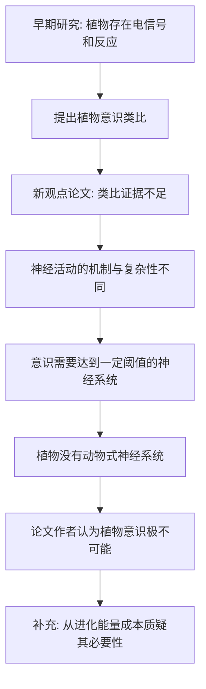
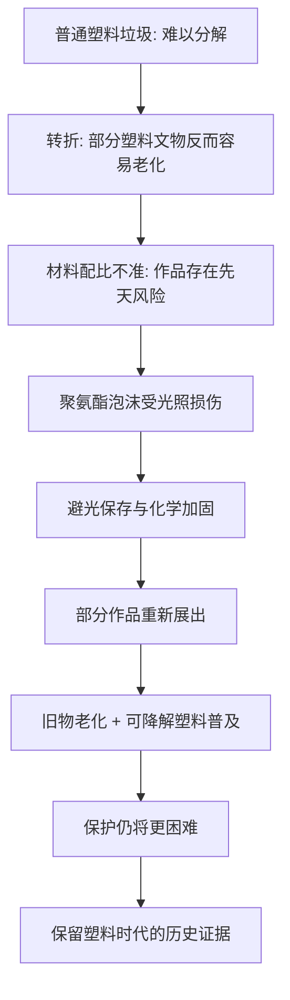
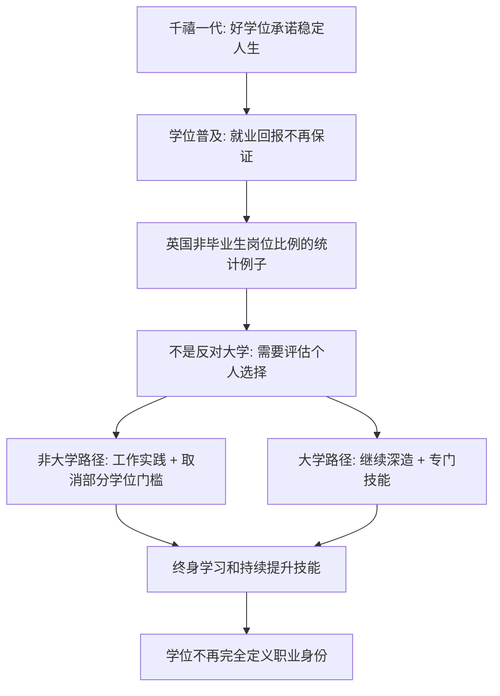
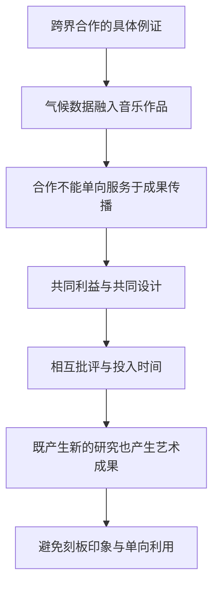
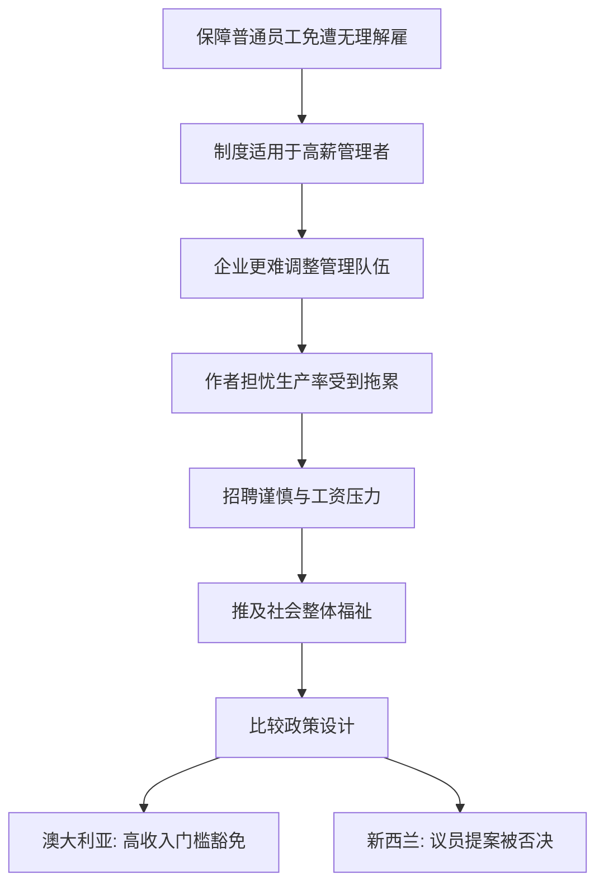
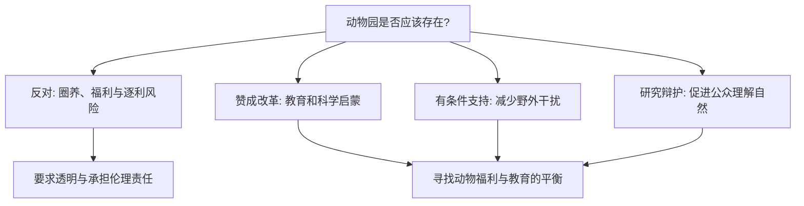

<Callout type="info" title="使用说明">
本页为根据原始资料整理的**考研英语（一）精读学习笔记**，按试卷题型顺序组织。原稿未完整提供选项的题目不会被虚构为官方答案；文中的原创巩固题与正式真题题目应予区分。
</Callout>

## Section I Use of English：植物是否具有意识？

### 篇章主题与观点归属

这篇科普议论文讨论“植物意识论”（plant consciousness）的争议。文章首先交代这一观点为何兴起，再介绍反对者对类比推理的质疑：**植物会产生电信号，并不等于它拥有动物式神经系统，更不能仅凭这一点推导出意识。**&#x2060;最后从意识形成所需的生理条件以及进化成本展开反驳。

<Cards>
  <Card title="早期主张 · 提出可能性">
    一些研究者将植物电信号、细胞反应与动物的智能作类比，提出“植物神经生物学”等概念。
</Card>
  <Card title="批评文章 · 质疑证据">
    论文作者认为植物与动物生物学机制差异巨大，现有类比不足以证明植物拥有意识。
</Card>
  <Card title="关键阅读方法">
    留意 `reported`、`claimed`、`argued`、`according to` 等归属词，严格区分**被报道的学说**和**文章引述的反对意见**。
</Card>
</Cards>

### 第一段：为什么有人提出“植物意识论”？

**① The idea that plants have some degree of consciousness first took root in the early 2000s.**

**译文：**“植物在一定程度上具有意识”这一观点最早在二十一世纪初开始扎根并传播开来。

- **主干：**`The idea ... first took root ...`。
- **同位语从句：**`that plants have some degree of consciousness` 说明 `idea` 的具体内容，不是以 `that` 代替 `plants` 的定语从句。
- `take root` 在此用比喻义“扎根、逐渐确立”，不应译为植物真的“长根”；`some degree of` 保留“某种程度”，不是“完全拥有”。

**② The term “plant neurobiology” was coined around the notion that some aspects of plant behavior could be compared to intelligence in animals.**

**译文：**“植物神经生物学”这一术语，是围绕一种观点创造出来的：植物行为的某些方面可以拿来与动物的智能表现相比较。

<Accordions>
  <Accordion title="长难句拆解：被动主句 + 同位语从句 + 比较">

  **主句：**`The term ... was coined around the notion ...`。`coin` 作动词意为“创造新词”，`was coined` 是**一般过去时的被动语态**。

  **名词解释：**`that some aspects of plant behavior could be compared to intelligence in animals` 解释 `the notion` 是什么，故更宜归为**同位语／内容从句**。

  **比较对象：**`some aspects of plant behavior` 对比 `intelligence in animals`。作者是在转述早期观点，**不是证实植物具有动物一样的大脑**。

  **翻译建议：**&#x2060;将较长的 `notion that ...` 用冒号展开，可避免名词前堆积多重“……的”。

</Accordion>
</Accordions>

**③ Though plants lack brains, the firing of electrical signals in their stems and leaves nonetheless triggered responses that hinted at consciousness, researchers previously reported.**

**译文：**&#x2060;此前有研究者报告称，尽管植物没有大脑，但它们茎叶中的电信号活动仍会引发某些反应，而这些反应似乎暗示植物具有意识。

- **让步：**`Though plants lack brains`，`Though` 与 `nonetheless` 共同强化转折。
- **主干：**`the firing of electrical signals ... triggered responses`；主语中心是 `the firing`（电信号的发放／传导活动）。
- **定语：**`that hinted at consciousness` 修饰 `responses`，意思是“似乎提示意识存在的反应”。
- **消息来源：**`researchers previously reported` 为报道归属语，不能把“研究者声称”改写为“科学已经证实”。

### 第二段：新论文反驳了什么？

**④ But such an idea is untrue, according to a new opinion article.**

**译文：**&#x2060;然而，一篇新的观点性论文认为，这种看法并不正确。

**定位作用：**&#x2060;句首 `But` 是全篇最大的观点转折。`according to` 明确这是**论文作者的判断**；`opinion article` 是观点文章，不等于实验已给出终局性的证据。

**⑤ Plant biology is complex and fascinating, but it differs so greatly from that of animals that so-called evidence of plants’ intelligence is inconclusive, the authors wrote.**

**译文：**&#x2060;该论文作者写道：植物的生物学机制复杂而迷人，但它与动物的生物学机制差异如此巨大，以至于那些所谓能证明植物具有智能的证据并不能得出确定结论。

<Accordions>
  <Accordion title="精讲：but 转折 + so ... that 结果状语从句 + that 的替代作用">

  1. **并列主句：**`Plant biology is complex and fascinating`，转折接 `but it differs ...`，认可复杂性不等于承认“植物有意识”。
  2. **比较代词：**`that of animals` 中 `that` **代指前面的 `biology`**，即“动物的生物学机制”，不是引导从句。
  3. **程度与结果：**`so greatly ... that so-called evidence ... is inconclusive` 是 `so ... that ...` 结果结构。
  4. **证据评价：**`inconclusive` = “尚不足以得出定论、非决定性的”，不要过度译成“全部被彻底证伪”。
  5. **态度线索：**`so-called evidence` 带有怀疑或疏离的语气。

</Accordion>
</Accordions>

### 第三段：支持者当时如何类比植物和动物？

**⑥ Beginning in 2006, some scientists have argued that plants possess neuron-like cells that interact with hormones and neurotransmitters, forming “a plant nervous system, analogous to that in animals,” said lead study author Lincoln Taiz.**

**译文：**&#x2060;该研究的主要作者林肯·泰兹说，自 2006 年起，一些科学家便主张：植物拥有能够与激素和神经递质相互作用的类神经元细胞，从而构成一种“类似于动物神经系统的植物神经系统”。

<Accordions>
  <Accordion title="精讲：三层从句与分词，尤其注意‘观点由谁提出’">

  **话语框架：**`said lead study author Lincoln Taiz` 是位于句尾的引语归属表达；泰兹在**转述一些科学家的早期主张**，而不是无条件认可这一观点。

  **谓语：**`some scientists have argued that ...`；现在完成时表达从过去开始的一项持续争论。

  **第一层宾语从句：**`that plants possess neuron-like cells ...`，作 `argued` 的内容。

  **第二层定语从句：**`that interact with hormones and neurotransmitters`，修饰 `neuron-like cells`；**这个 `that` 与前一个 `that` 的语法功能不同**。

  **分词结构：**`forming “a plant nervous system ...”` 交代前述细胞及相互作用被认为形成的系统，可以译为“从而形成”。

  **形容词后置：**`analogous to that in animals` 修饰 `a plant nervous system`，其中 `that` 代替 `nervous system`。

</Accordion>
</Accordions>

**⑦ “They even claimed that plants have ‘brain-like command centers’ at their root tips.”**

**译文：**“他们甚至声称，植物的根尖处存在‘类似大脑的指挥中心’。”

- `They` 回指早期提出主张的科学家；`even` 强化其推论程度。
- `claimed that ...` 为“声称……”，其中 `that` 引导宾语从句。
- `brain-like` 表“类似大脑的”，不能据此认定植物根尖真的有大脑。

### 第四段：电信号相似，不等于意识相同

**⑧ This perspective makes sense if you simplify the workings of a complex brain, reducing it to an array of electrical pulses; cells in plants also communicate through electrical signals.**

**译文：**&#x2060;如果把复杂大脑的运作过度简化成一连串电脉冲，这一观点似乎就说得通了；毕竟植物细胞之间也确实通过电信号交流。

- **条件：**`if you simplify ...` 限定“这一观点看似成立”的前提，不能拿掉 `if` 直接说“观点成立”。
- **分词：**`reducing it to an array of electrical pulses` 补充说明 `simplify` 的具体做法；`it` 指 `a complex brain` 的运作机制。
- **分号：**&#x2060;后半句 `cells in plants also communicate ...` 提供早期类比的出发点。**“存在电信号”与“存在意识”之间仍缺关键论证。**

**⑨ However, the signaling in a plant is only superficially similar to the firing in a complex animal brain, which is more than “a mass of cells that communicate by electricity,” Taiz said.**

**译文：**&#x2060;但泰兹指出，植物体内的信号传递与复杂动物大脑中的神经放电只是在表面上相似，而动物的大脑绝不只是“一堆通过电信号交流的细胞”。

<Accordions>
  <Accordion title="精讲：only superficially + 非限定性定语从句中的再嵌套">

  **核心判断：**`the signaling in a plant is only superficially similar to the firing in a complex animal brain`。`only` 限制相似程度，`superficially` = “表面上地”，不是“全面地”。

  **非限定性定语从句：**`which is more than ...` 补充说明前述 `a complex animal brain`。

  **嵌套定语从句：**`that communicate by electricity` 修饰 `cells`。

  **翻译策略：**&#x2060;先译“表面相似”，再译“复杂动物大脑不只是……”，让句子中的批评逻辑清晰显露。

</Accordion>
</Accordions>

### 第五段：意识的形成需要什么条件？

**⑩ “For consciousness to evolve, a brain with a threshold level of complexity and capacity is required,” he added.**

**译文：**&#x2060;他补充道：“要使意识得以演化，需要一个复杂程度和能力达到一定阈值的大脑。”

- **目的／条件表达：**`For consciousness to evolve` 是**for + 名词 + to-infinitive 不定式结构**，不能仅称为普通介词短语。
- **被动谓语：**`a brain ... is required`，`is required` 是被动表达“需要”，不是普通“系动词 + 形容词”。
- `a threshold level of complexity and capacity` = “复杂程度与功能能力达到一定临界水平”；`capacity` 在这里不是容器的物理容积。

**⑪ “Since plants don’t have nervous systems, the chances that they have consciousness are effectively zero.”**

**译文：**“鉴于植物没有神经系统，它们具有意识的可能性实际上为零。”

- `Since` 在这里表**原因**，不是“自从”。
- `the chances ... are effectively zero` 主干表达强烈否定；`effectively` = “实际上、近乎等于”，不是“有效地”。
- `that they have consciousness` 说明 `chances` 关涉的具体情况，可理解为 `chances` 的内容补足；这不是修饰 `plants` 的定语从句。
- **评价边界：**&#x2060;这是文中受访作者的强判断，不要把它误写成课本对意识问题的终极裁定。

### 第六段：从进化收益提出质疑

**⑫ And what’s so great about consciousness, anyway?**

**译文：**&#x2060;再说了，意识究竟有什么特别值得拥有的呢？

**作用：**&#x2060;反问句转向成本—收益论证。`anyway` 增加“话说回来／再说了”的口吻；作者不是在询问意识的定义。

**⑬ Plants can’t run away from danger, so investing energy in a body system which recognizes a threat and can feel pain would be a very poor evolutionary strategy, according to the article.**

**译文：**&#x2060;文章认为，植物无法遇险逃离，因此若投入能量去建立一套既能识别威胁又能感受到疼痛的身体系统，从进化策略上看很不划算。

<Accordions>
  <Accordion title="精讲：so 因果 + 动名词主语 + which 引导并列谓语">

  - **原因：**`Plants can’t run away from danger`，植物缺乏通过移动逃脱威胁的能力。
  - **结果：**`investing energy in a body system ... would be a very poor evolutionary strategy`，动名词短语 `investing ...` 整体作主语。
  - **从句：**`which recognizes a threat and can feel pain` 修饰 `a body system`，其中 `recognizes` 与 `can feel` 是并列谓语。
  - **情态：**`would be` 表示在所讨论条件下的推断，不应改成现在时的无条件事实。
  - **结论：**&#x2060;此论证强调“可能不具进化收益”，不等于已由一个句子证明“植物不存在任何反应能力”。

</Accordion>
</Accordions>

### 完形填空语境词与逻辑词总整理

以下用词均出现在本篇已经出现的原句中，可用来练习“空前后语义如何约束词性与搭配”，不是补写缺失的原卷选项。

| 关键词／表达 | 准确语境义 | 解题线索 |
| --- | --- | --- |
| `take root` | 扎根、逐渐被接受 | 与 `idea` 搭配，是比喻 |
| `coin a term` | 创造术语 | 常见被动 `was coined` |
| `be compared to` | 与……比较 | 后接比较对象 |
| `though / nonetheless` | 虽然／但仍然 | 前后转折呼应 |
| `hint at` | 暗示 | 只表示迹象，并非证实 |
| `differ from` | 与……不同 | `so greatly ... that ...` 结果结构 |
| `evidence / inconclusive` | 证据／不能定论的 | 语气要忠实，不拔高 |
| `argue / claim` | 主张／声称 | 注意归属与立场 |
| `form / analogous to` | 形成／类似于 | 与神经系统的类比 |
| `make sense` | 讲得通 | 受 `if` 条件限定 |
| `reduce A to B` | 把 A 简化成 B | `reducing ... to ...` |
| `however / superficially` | 然而／表面上地 | 反驳机械类比 |
| `threshold / capacity` | 阈值／能力 | 意识形成的条件 |
| `the chances that ...` | ……的可能性 | 概率表达 |
| `danger / recognize / poor` | 危险／识别／糟糕的 | 与进化成本推理呼应 |

<Callout type="warn" title="高频陷阱：观点归属与类比逻辑">

文中反复出现 `argued`、`claimed`、`researchers previously reported`、`according to the article`。做态度题必须标注谁在说话。植物能传递电信号是讨论的**观察基础**，植物是否拥有意识是**进一步的解释性主张**；两者不能直接画等号。

</Callout>

<Question id="zz2022cloze-review01" type="single" tags="2022英语一,完形填空,原创巩固,篇章逻辑">

新观点论文为什么质疑早期的“植物意识论”？

<Option>因为植物没有任何电信号活动</Option>
<Option correct>因为电信号层面的相似不足以证明植物具备复杂动物大脑那样的意识机制</Option>
<Option>因为所有植物都能够主动逃离危险</Option>
<Option>因为动物与植物的生物学机制完全相同</Option>

<Solution>

**答案：B。**&#x2060;联系 `only superficially similar` 和 `a brain with a threshold level ... is required`。原文承认植物存在电信号，但反对把它直接类比成动物式意识。

</Solution>
</Question>

<Question id="zz2022cloze-review02" type="single" tags="2022英语一,完形填空,原创巩固,从句">

`that of animals` 在 `it differs so greatly from that of animals` 中，`that` 的作用是：

<Option>引导原因状语从句</Option>
<Option>引导宾语从句</Option>
<Option correct>代替前面的不可数名词 `biology`</Option>
<Option>指代 `scientists` 这一群人</Option>

<Solution>

**答案：C。**`Plant biology` 与 `that [= biology] of animals` 构成同一范畴的比较；不能把替代代词 `that` 当成所有从句通用的引导词。

</Solution>
</Question>

<Question id="zz2022cloze-review03" type="single" tags="2022英语一,完形填空,原创巩固,语法">

`For consciousness to evolve, a brain ... is required` 中哪一项分析正确？

<Option>`For consciousness to evolve` 是定语从句</Option>
<Option>`is required` 是一般现在时主动谓语</Option>
<Option correct>`For consciousness to evolve` 是带逻辑主语的不定式结构，`is required` 为被动表达</Option>
<Option>`consciousness` 是主句的主语</Option>

<Solution>

**答案：C。**&#x2060;真正的主句主语是 `a brain`，谓语是 `is required`；句首 `for ... to ...` 给出目的／必要条件。

</Solution>
</Question>

---

## Reading Text 1：塑料文物为什么反而难以保存？

### 文章导读：塑料“难分解”与塑料藏品“容易坏”的表面矛盾

普通环境话题经常强调塑料废弃物过于耐久，本文却将场景切换到博物馆：**并非所有塑料材料的性能都稳定；某些艺术品使用的配方随时间、光照和化学反应持续劣化**。文章从材料问题写到保存尝试，最后提出历史文化价值——今天保护什么，将影响后人如何理解这个时代。

<Cards>
  <Card title="Q21 对应 · 保护对象多样">
    从收音机、雕塑、动画赛璐珞片到早期人造心脏，塑料材质遗存范围很广，存在不同的老化风险。
</Card>
  <Card title="Q22—Q23 对应 · 配方和光照">
    早期艺术家未必掌握准确的聚合物配比；吉拉迪的聚氨酯泡沫作品因光照而开裂，博物馆采取避光保存。
</Card>
  <Card title="Q24—Q25 对应 · 保存难度与历史意义">
    既有修复案例成功，不代表未来不困难；保护塑料时代的实物，是保留后世解读现代社会的材料证据。
</Card>
</Cards>

### 第一段：塑料为何令保存机构头疼？

**① People often complain that plastics are too durable.**

**译文：**&#x2060;人们常常抱怨塑料制品太耐用、难以降解。

- `complain that ...`：`that` 引导宾语从句；`durable` 原义为“耐用的”，在垃圾污染语境中成了负面评价。

**② Water bottles, shopping bags, and other trash litter the planet, from Mount Everest to the Mariana Trench, because plastics are everywhere and don’t break down easily.**

**译文：**&#x2060;从珠穆朗玛峰到马里亚纳海沟，水瓶、购物袋和其他废弃物遍布地球各处，令环境杂乱不堪，因为塑料无处不在，又不容易分解。

- **主干：**`Water bottles, shopping bags, and other trash litter the planet`。`litter` 是及物动词“使……散布垃圾”，不只是名词“垃圾”。
- `from Mount Everest to the Mariana Trench` 用两个极端地理地点凸显覆盖之广，不是真的限定污染只发生在这两处。
- **原因状语：**`because plastics are everywhere and don’t break down easily`；`break down` 表“分解”。

**③ But some plastic materials change over time.**

**译文：**&#x2060;然而，有些塑料材料会随着时间的推移发生变化。

**④ They crack and frizzle.**

**译文：**&#x2060;它们会开裂、蜷曲变形。

**⑤ They “weep” out additives.**

**译文：**&#x2060;它们还会“渗出”内部的添加剂。

**⑥ They melt into sludge.**

**译文：**&#x2060;它们甚至会逐渐分解成黏稠的泥状物。

<Accordions>
  <Accordion title="短句连读：为什么要连续使用四个 They？">

  从 **`But`** 开始，文章由“难以分解的废弃物”转向“会迅速劣化的收藏品”；接连出现的 `They` 均指前文 `some plastic materials`。

  - `crack` = 开裂；`frizzle` 在这里指扭曲、卷曲变形，不宜把它直译成烹饪场景的“烫卷头发”。
  - `“weep” out additives` 使用带引号的形象说法，“像流泪一样渗出添加剂”；`weep out` 后面直接接渗出物 `additives`，无需凭空增加“宾补”。
  - `melt into sludge` 描写最终质地劣化为泥状物；`sludge` 在这里不仅指自然水底的淤泥，关键是**黏稠、难以保存的状态**。

  **篇章功能：**&#x2060;几个短句使材质衰变的过程具体可见，为博物馆“维护困难”的结论铺垫。

</Accordion>
</Accordions>

**⑦ All of which creates huge headaches for institutions, such as museums, trying to preserve culturally important objects.**

**译文：**&#x2060;这些变化全都给博物馆等努力保存重要文化藏品的机构带来了巨大的难题。

- **跨句指代：**`All of which` 回指之前提到的各种劣化现象。虽然形式上单独成句，但实际依附前文，是**承接前面一系列事实的非限定性关系结构**；不能单独把它理解为全新的物品名单。
- **核心表达：**`create huge headaches for ...` = “给……制造很大的麻烦”。
- **举例和修饰：**`such as museums` 举例说明 `institutions`；`trying to preserve ...` 修饰这些机构。

**⑧ The variety of plastic objects at risk is dizzying: early radios, avant-garde sculptures, celluloid animation stills from Disney films, the first artificial heart.**

**译文：**&#x2060;面临损坏风险的塑料藏品种类多得令人眼花缭乱：早期收音机、前卫派雕塑、迪士尼电影的赛璐珞动画单帧画面，以及最早的人造心脏。

- `the variety of ...` 整体指“多样性”；此处谓语用 `is`。
- `at risk` 后置修饰 `plastic objects`，意思是处于受损风险之中。
- 冒号后是**具体列举**，从大众日用品扩展到美术、电影和医学技术史。`still` 在 `animation stills` 中是名词“静帧画面”，不是副词“仍然”。

### 第二段：早期塑料艺术为什么先天脆弱？

**⑨ Certain artifacts are especially vulnerable because some pioneers in plastic art didn’t always know how to mix ingredients properly, says Thea van Oosten, a polymer chemist who, until retiring a few years ago, worked for decades at the Cultural Heritage Agency of the Netherlands.**

**译文：**&#x2060;聚合物化学家西娅·范·欧斯汀指出，某些艺术品特别脆弱，因为早期塑料艺术的开拓者并不总能掌握各种材料的正确混合比例。她曾在荷兰文化遗产局工作数十年，直到几年前退休。

<Accordions>
  <Accordion title="Q22 精讲：引语插入 + because 原因从句 + who 定语从句">

  **主句：**`Certain artifacts are especially vulnerable`；`vulnerable` = “容易受损的”。

  **原因：**`because some pioneers in plastic art didn’t always know how to mix ingredients properly`；`didn't always` 表**并非总是**，不等于“任何人都完全不会”。

  **说话者：**`says Thea van Oosten` 倒置的信息归属语；`a polymer chemist` 是其身份的同位语。

  **人物经历：**`who ... worked for decades at the Cultural Heritage Agency of the Netherlands` 修饰 `a polymer chemist`，而 `until retiring a few years ago` 插入交代退休时间。

  **翻译技巧：**&#x2060;此类“专业人士 + 超长职业介绍”宜**前置说话者或分成两句**，不必硬保留原英语的倒装位置。

</Accordion>
</Accordions>

**⑩ “It’s like baking a cake: If you don’t have exact amounts, it goes wrong,” she says.**

**译文：**&#x2060;她说：“这就像烤蛋糕：如果各项材料的用量不精确，成品就会出问题。”

- `If ... , it goes wrong` 是条件与后果，`go wrong` = “出差错”。
- 烘焙是**类比说明配方的重要性**，不是说这些雕塑真的由食材制成。

**⑪ “The object you make is already a time bomb.”**

**译文：**“如此制成的物件，从一开始就相当于一颗定时炸弹。”

- `you make` 是省略 `that/which` 的定语从句，修饰 `The object`。
- `time bomb` 是材料日后劣化风险的比喻，不意味着作品会物理爆炸。

### 第三段：艺术家的意图与材料的实际寿命

**⑫ And sometimes, it’s not the artist’s fault.**

**译文：**&#x2060;而有时候，这也不能归咎于艺术家。

**⑬ In the 1960s, the Italian artist Piero Gilardi began to create hundreds of bright, colorful foam pieces.**

**译文：**&#x2060;二十世纪六十年代，意大利艺术家皮耶罗·吉拉迪开始创作数百件色彩鲜艳的泡沫塑料艺术品。

- `began to create` 描述创作行为开始；`foam pieces` 是泡沫材质作品，不是普通“泡沫碎屑”。

**⑭ Those pieces included small beds of roses and other items as well as a few dozen “nature carpets”—large rectangles decorated with foam pumpkins, cabbages, and watermelons.**

**译文：**&#x2060;这些作品包括小型玫瑰花圃等造型，还有数十件“自然地毯”——那是用泡沫塑料南瓜、卷心菜和西瓜形象装饰的大块长方形作品。

- `as well as` 连接并列展品；`a few dozen` = 数十件。
- 破折号解释 `nature carpets` 的具体形态；`decorated with ...` 为过去分词后置定语，修饰 `large rectangles`。
- `beds of roses` 中的 `beds` 是“花坛／花圃”，不是睡觉的床。

**⑮ He wanted viewers to walk around on the carpets—which meant they had to be durable.**

**译文：**&#x2060;他希望观众能在这些“地毯”上走动——这就意味着作品必须经久耐用。

<Accordions>
  <Accordion title="长难句精讲：want + 宾语 + to do 与破折号关系结构">

  **主干：**`He wanted viewers to walk around on the carpets`，是 `want sb. to do sth.`，`viewers` 为宾语，`to walk ...` 为宾语补足语。

  **补充说明：**`which meant they had to be durable` 中 `which` 指代前面“允许观众在上面行走”这一安排，`meant` 后省略连接词 `that`。

  **指代：**`they` 回指 `the carpets`，并非观众。作品的预期功能与实际材质之间存在反差。

</Accordion>
</Accordions>

### 第四段：聚氨酯泡沫与光照损伤

**⑯ Unfortunately, the polyurethane foam he used is inherently unstable.**

**译文：**&#x2060;遗憾的是，他所使用的聚氨酯泡沫本身就不稳定。

- `he used` 是省略关系代词的定语从句，修饰 `the polyurethane foam`。
- `inherently` = “内在地、本质上”，强调问题源于材料性质，不能全部推给展陈操作失误。

**⑰ It’s especially vulnerable to light damage, and by the mid-1990s, Gilardi’s pumpkins, roses, and other figures were splitting and crumbling.**

**译文：**&#x2060;这种泡沫尤其容易受光照损害；到二十世纪九十年代中期，吉拉迪制作的南瓜、玫瑰等造型已经开始裂开、碎裂。

- `It` 指聚氨酯泡沫；`be vulnerable to` = “容易受到……影响”。
- `by the mid-1990s` 表“到九十年代中期为止／届时”，不是“在九十年代中期以前某个确切日期”。
- `were splitting and crumbling` 是过去进行时，强调变坏**正在发生**。`crumble` = “碎裂、崩解”，不是“轰然坍塌一整座建筑”。

**⑱ Museums locked some of them away in the dark.**

**译文：**&#x2060;博物馆于是把其中一些作品收进避光的存放空间。

- **Q23 因果：**&#x2060;避光保存是为了降低进一步的光照损伤风险，并不等于馆方认为艺术作品价值不高或危及观众安全。

### 第五段：能否用化学方法延长作品寿命？

**⑲ So van Oosten and her colleagues worked to preserve Gilardi’s sculptures.**

**译文：**&#x2060;因此，范·欧斯汀和同事们着手保护吉拉迪的雕塑作品。

**⑳ They infused some with stabilizing and consolidating chemicals.**

**译文：**&#x2060;他们向部分作品中注入能够稳定并加固材料的化学制剂。

- `infuse A with B` = “向 A 注入 B”。这里的 `some` 代指部分**雕塑作品**，不是部分化学药剂。
- `stabilizing and consolidating` 修饰 `chemicals`，表示药剂的作用。

**㉑ Van Oosten calls those chemicals “sunscreens” because their goal was to prevent further light damage and rebuild worn polymer fibers.**

**译文：**&#x2060;范·欧斯汀把这些化学制剂称为“防晒霜”，因为它们旨在防止光照继续损害作品，并修复已经磨损的聚合物纤维结构。

- `call A B` 是**宾语 + 宾语补足语**结构，`those chemicals` 为 A，`“sunscreens”` 为 B。
- `because their goal was to ...` 为原因从句；`prevent` 与 `rebuild` 并列，都是这类修复材料试图达到的目标。
- “防晒霜”是比喻用途，不表示真的把人体护肤品涂抹到所有藏品上。

**㉒ She is proud that several sculptures have even gone on display again, albeit sometimes beneath protective cases.**

**译文：**&#x2060;令她欣慰的是，有几件雕塑甚至已经重新展出，尽管有时仍需置于保护罩之下。

<Accordions>
  <Accordion title="精讲：proud that 内容从句 + albeit 省略式让步">

  **内容从句：**`that several sculptures have even gone on display again` 对 `proud` 的原因作补充；`go on display` = “展出”，不是简单“放在显示器上”。

  **让步：**`albeit sometimes beneath protective cases` 可理解为 `although sometimes [displayed] beneath protective cases`。现代英语里 `albeit` 是连接让步性补充成分的词，**无需把它拆成 `all be it` 再解释为某种虚拟语气倒装**。

  **逻辑：**“已经重新展出”是成功，但“仍需保护罩”意味着保存与展示之间需要权衡；`albeit` 保留这一限制。

</Accordion>
</Accordions>

### 第六段：为什么保存难度还会加大？

**㉓ Despite success stories like van Oosten’s, preservation of plastics will likely get harder.**

**译文：**&#x2060;尽管有范·欧斯汀这样的成功案例，但保存塑料制品的工作今后很可能更加艰难。

- `Despite ...` 是**让步介词短语**，后接名词结构；不应把它视作完整的 `although` 从句。
- `will likely get harder` = “可能会变得更难”，不能改写为“注定无法保存”。

**㉔ Old objects continue to deteriorate.**

**译文：**&#x2060;老旧物件还在持续老化、劣化。

**㉕ Worse, biodegradable plastics, designed to disintegrate, are increasingly common.**

**译文：**&#x2060;更糟的是，越来越多的塑料制品本来就被设计成可生物降解、能够分解的材料。

- `designed to disintegrate` 是过去分词短语，补充说明 `biodegradable plastics` 的设计目的。
- **关键反差：**&#x2060;环保产品的“可降解”对环境可能有利，但对于希望长久收藏的文物机构而言，材料主动分解会使保存更具挑战。

### 第七段：塑料藏品的意义不止一件物品

**㉖ And more is at stake here than individual objects.**

**译文：**&#x2060;而且，如今处于利害攸关境地的，远不止一件件藏品本身。

- `more ... than ...` 表比较；`at stake` = “存在风险、关系重大”。
- **段落功能：**&#x2060;从前面的技术维护上升到“历史资料的选择性保存”这一文化层面。

**㉗ Joana Lia Ferreira, an assistant professor of conservation and restoration at the NOVA School of Science and Technology, notes that archaeologists first defined the great material ages of human history—Stone Age, Iron Age, and so on—after examining artifacts in museums.**

**译文：**&#x2060;新里斯本大学科技学院的保护与修复学助理教授约安娜·利娅·费雷拉指出，考古学家最初正是在考察博物馆藏品之后，才把人类历史划分为石器时代、铁器时代等主要物质时代。

<Accordions>
  <Accordion title="Q25 精讲：人物同位语 + that 宾语从句 + after 分词短语">

  **主句：**`Joana Lia Ferreira ... notes that ...`。

  **人物说明：**`an assistant professor of conservation and restoration ...` 是同位语，可压缩到中文句首，避免主谓之间过长。

  **宾语从句：**`that archaeologists first defined the great material ages of human history ...`。

  **破折号列举：**`Stone Age, Iron Age, and so on` 举出“材料时代”的例子，不是在同位语内部形成新的谓语结构。

  **时间／依据：**`after examining artifacts in museums` 说明这套划分建立在对保存实物的考察之上。

  **深层论证：**&#x2060;历史学依赖后人能够接触的材料证据；因此**当代物件是否被保存**关乎后人如何研究和定义我们的时代。

</Accordion>
</Accordions>

**㉘ We now live in an age of plastic, she says, “and what we decide to collect today, what we decide to preserve ... will have a strong impact on how in the future we’ll be seen.”**

**译文：**&#x2060;她说：“我们如今生活在塑料时代，而我们今天决定收藏什么、保存什么……将深刻影响未来的人们如何看待我们。”

<Accordions>
  <Accordion title="并列 what 主语从句 + how 宾语从句 + 将来时被动">

  **第一分句：**`We now live in an age of plastic`。

  **第二分句主语：**`what we decide to collect today, what we decide to preserve ...`，两个 `what` 从句并列，表示“我们今天选择收藏与保护的东西”。

  **谓语及宾语：**`will have a strong impact`。

  **介词宾语：**`on how in the future we’ll be seen`，`how ...` 是 `on` 后的名词性从句，可译为“未来我们将如何被看待”。

  **时态与语态：**`we’ll be seen` 是将来时被动；`we` 指今天生活在塑料时代的人，而不是仅仅指修复人员。

  **主旨上升：**&#x2060;真正的核心不是“某件塑料作品能不能修好”，而是**我们留下怎样的实物证据，塑造后人怎样的历史认知**。

</Accordion>
</Accordions>

### 文章论证链与做题定位

| 原书设题位置 | 文章依据 | 需要避免的误判 |
| --- | --- | --- |
| Q21 | 部分塑料制品开裂、渗出添加剂、化为泥状物 | 将所有塑料都视为永不变化 |
| Q22 | 配方不准确使早期某些作品先天脆弱 | 把原因硬说成外观造型错误 |
| Q23 | 聚氨酯材料对光照敏感，博物馆避光保存 | 以为藏品被撤展是因为危险或失去价值 |
| Q24 | 成功修复与将来保存更难同时成立 | 用单个成功案例否定长远困难 |
| Q25 | 保存实物关系到后世对历史时代的认识 | 只看个人藏品、不看史料价值 |

### 重点词汇与熟词僻义

| 单词／词组 | 译法 | 记忆提示 |
| --- | --- | --- |
| `durable` / `deteriorate` | 耐久的／老化恶化 | 文章的主要对照 |
| `litter the planet` | 遍布地球、污染环境 | `litter` 可作动词 |
| `break down` / `disintegrate` | 分解／碎裂、解体 | 材料变化过程 |
| `crack / frizzle / crumble` | 开裂／卷曲变形／碎裂 | 按具体物理状态区分 |
| `weep out additives` | 渗出添加剂 | 引号标明修辞用法 |
| `sludge` | 泥状物、淤泥 | 材料劣化语境 |
| `artifact` | 人工制品、文物 | 不等于工艺品仅供装饰 |
| `vulnerable to` | 易受……损害 | 常与 `damage` 搭配 |
| `polymer / polyurethane` | 聚合物／聚氨酯 | 保存科学词汇 |
| `ingredient / exact amounts` | 成分／准确用量 | 配方类比 |
| `a time bomb` | 定时炸弹、潜在隐患 | 隐喻 |
| `celluloid animation still` | 赛璐珞动画单帧画面 | `still` 是名词 |
| `infuse A with B` | 向 A 注入 B | 固定搭配 |
| `consolidating chemicals` | 加固材料用的化学制剂 | 收藏品修复 |
| `go on display` | 展出 | `on` 不表“继续” |
| `albeit` | 虽然、尽管 | 正式语体让步连接词 |
| `biodegradable` | 可生物降解的 | 环境语境不等于易收藏 |
| `at stake` | 关系重大、处于风险中 | 常见抽象表达 |
| `have an impact on` | 对……产生影响 | 后接名词或从句 |

<Question id="zz2022r1-review01" type="single" tags="2022英语一,Text1,原创巩固,对比">

开头为何先写“人们嫌塑料太耐用”？

<Option>为了证明博物馆没有必要收藏塑料作品</Option>
<Option correct>为了与后文某些塑料藏品容易劣化形成反差，引出保护难题</Option>
<Option>为了说明所有塑料物件都具备相同的化学稳定性</Option>
<Option>为了断言塑料是唯一造成海洋污染的材料</Option>

<Solution>

**答案：B。**&#x2060;首句的 `too durable` 与后文 `crack`、`weep`、`crumble` 等词构成反差，服务于文章的主题转换。

</Solution>
</Question>

<Question id="zz2022r1-review02" type="single" tags="2022英语一,Text1,原创巩固,细节">

博物馆为何曾把吉拉迪的部分作品置于避光环境？

<Option>作品设计本来只允许在黑暗中参观</Option>
<Option>为了避免观众误将作品当作食物</Option>
<Option correct>聚氨酯泡沫对光照损伤敏感，避光可减少进一步劣化</Option>
<Option>因为化学制剂还未被命名为“防晒霜”</Option>

<Solution>

**答案：C。**&#x2060;定位 `vulnerable to light damage` 与 `Museums locked some of them away in the dark`；前后是“风险—应对”的因果关系。

</Solution>
</Question>

<Question id="zz2022r1-review03" type="single" tags="2022英语一,Text1,原创巩固,语法">

`albeit sometimes beneath protective cases` 中的 `albeit` 最恰当的理解是：

<Option>与条件句 `if` 完全同义</Option>
<Option correct>补充带有让步色彩的限制：虽然有时仍需放在保护罩内</Option>
<Option>引导与主句相反的过去虚拟条件</Option>
<Option>表示保护罩是展览重新开放的唯一原因</Option>

<Solution>

**答案：B。**`albeit` 在这里引出省略式让步成分，限制“重新展出”的乐观评价。无须把它复杂化成所谓独立的虚拟语气倒装句。

</Solution>
</Question>

<Question id="zz2022r1-review04" type="single" tags="2022英语一,Text1,原创巩固,主旨">

文章以“塑料时代”收尾，重点想表达什么？

<Option>未来历史学不再研究石器时代和铁器时代</Option>
<Option>塑料艺术品的价格一定会持续上涨</Option>
<Option correct>当代保存哪些实物，会影响后人对这个时代的理解</Option>
<Option>博物馆应该只收藏由聚氨酯泡沫制成的作品</Option>

<Solution>

**答案：C。**`what we decide to collect ... what we decide to preserve ... will have a strong impact ...` 将材料保存提升为历史文化问题。

</Solution>
</Question>

---

## Reading Text 2：学位贬值、教育选择与终身学习

### 篇章导读：大学并非唯一道路，但学习不会停止

这篇议论文并不是劝所有学生放弃大学，而是要求 Z 世代重新衡量学位的**意义、成本、就业回报与替代选择**。作者一方面指出大学学位日益普及，已不再自动保证阶层上升；另一方面又强调，持续学习、掌握专门技能及必要时接受研究生教育，仍然具有重要价值。中心观点可概括为：**不必把一次大学选择等同于整个职业生涯，但必须长期保持学习能力。**

<Cards>
  <Card title="千禧一代的预期与落差">
    曾经普遍相信“读好书、拿好学位就能一生无忧”，但学位普及削弱了它作为就业和社会流动保障的力量。
</Card>
  <Card title="Z 世代需要重新选择">
    学位并非人人必需；一些雇主认可中学毕业生的潜力，也开始取消特定岗位的学位门槛。
</Card>
  <Card title="教育需要覆盖整个职业生涯">
    若选择大学，也可能继续深造或转换技能；技术变化、职业多样化使持续学习成为核心竞争力。
</Card>
</Cards>

### 第一段：从填报大学申请谈起

**① As the latest crop of students pen their undergraduate application form and weigh up their options, it may be worth considering just how the point, purpose and value of a degree has changed and what Generation Z need to consider as they start the third stage of their educational journey.**

**译文：**&#x2060;当又一批学生填写本科申请表、权衡各项选择时，我们或许应该认真思考：大学学位的意义、目的和价值究竟发生了怎样的变化？而 Z 世代在进入求学的第三个阶段时，又需要考虑哪些因素？

<Accordions>
  <Accordion title="长难句精讲：as 时间状语从句 + 形式主语 it + 两个并列疑问从句">

  **第一层背景：**`As the latest crop of students pen ... and weigh up ...`。`as` 表“当……时”，两个并列动作是 `pen their undergraduate application form` 和 `weigh up their options`；`pen` 为动词“填写、写下”。

  **主句：**`it may be worth considering ...`，这里的 `it` 是形式主语式的表达；`be worth doing` 是固定结构，其中 `considering` 为动名词。

  **第一个思考问题：**`how the point, purpose and value of a degree has changed`。

  **第二个思考问题：**`what Generation Z need to consider as they start the third stage ...`。

  **语法纠错：**`how ... has changed` 与 `what ... need to consider` 是 `considering` 的**宾语内容／疑问从句**，不宜像原识别稿那样都简单标成“主语从句”。`as they start ...` 则嵌在第二个问题中，为时间状语从句。

  **选词细节：**`crop of students` = “一届／一批学生”；`weigh up` = “仔细权衡”。不要把 `crop` 误译成农作物，也不要把 `point` 机械译成“分数”。

</Accordion>
</Accordions>

### 第二段：过去关于学位的承诺是否仍可信？

**② Millennials were told that if you did well in school, got a decent degree, you would be set up for life.**

**译文：**&#x2060;千禧一代曾被告知：只要在学校表现出色，取得一个像样的学位，人生就有了可靠的保障。

- **主句：**`Millennials were told that ...`，被动谓语 `were told`。
- **嵌套条件：**`if you did well in school, got a decent degree` 是 `that` 宾语从句内部的条件，从句中 `did` 与 `got` 并列。
- `would be set up for life` 是所承诺的结果，指经济或职业起步似乎会有长期保障；不是“已经预定了一生的工作”。

**③ But that promise has been found wanting.**

**译文：**&#x2060;但事实表明，这项承诺并未达到人们原先的期待。

- `find something wanting` = “发现某事物有不足／不如预期”；`has been found wanting` 为现在完成时被动结构，`wanting` 是补足说明“有缺陷、不足”的形容词，不应理解成“承诺想要什么”。

**④ As degrees became universal, they became devalued.**

**译文：**&#x2060;随着大学学位越来越普遍，其相对价值也逐渐下降。

- `As ...` 表伴随变化；`degrees` 的普及与“学历含金量下降”相连，但不能推导成每个学历都变得毫无价值。
- `devalued` 原可指货币“贬值”，这里比喻学历的劳动力市场区分力变弱。

**⑤ Education was no longer a secure route of social mobility.**

**译文：**&#x2060;教育不再是一条能够稳妥保证社会阶层上升的道路。

- `no longer` = 不再；`secure route` 不是“完全无风险”的现实保证。
- `social mobility` = 社会流动／阶层流动，不是“社会活动能力”。

**⑥ Today, 28 per cent of graduates in the UK are in non-graduate roles, a percentage which is double the average among OECD countries.**

**译文：**&#x2060;如今，英国约有 28% 的大学毕业生从事并不要求大学学历的工作，这一比例约为经济合作与发展组织（OECD）成员国平均水平的两倍。

<Accordions>
  <Accordion title="Q27 精讲：数字作证据，a percentage 作同位补充">

  **核心数据：**`28 per cent of graduates in the UK are in non-graduate roles`；`non-graduate roles` 指通常**不要求毕业生学历的岗位**，并不自动表示失业或低收入。

  **补充解释：**`a percentage which is double the average among OECD countries` 是与前面的 28% 对应的同位性名词短语，其中 `which ...` 修饰 `a percentage`。

  **比较基准：**`the average among OECD countries` 是经合组织成员国的平均比例，不是“所有欧洲国家的平均工资”。

  **数字陷阱：**`double the average` = “是平均值的两倍”，不能译成“比平均值高两倍”；后者通常对应平均值的三倍，容易造成数量关系错误。

  **论证功能：**&#x2060;数据被用来支持“学位不再必然通向需要高等教育的职位”，不能凭该数字断言“72% 的毕业生一定更幸福”。

</Accordion>
</Accordions>

### 第三段：作者不是反对大学，而是反对“大学必须是唯一答案”

**⑦ This is not to say that there is no point in getting a degree, but rather stress that a degree is not for everyone, that the switch from classroom to lecture hall is not an inevitable one and that other options are available.**

**译文：**&#x2060;这并不是说取得学位毫无意义；作者真正想强调的是：大学学位并不适合所有人，从中学课堂走进大学讲堂并非每个人都必须经历的道路，而且还有其他选择。

<Accordions>
  <Accordion title="重难句精讲：not ... but rather ... 与三个并列 that">

  **主句逻辑：**`This is not to say ... but rather [to] stress ...`。`not ... but rather ...` 先否定一种极端理解，再提出真正主张；`stress` 前可补足并列省略的 `to`，不代表原文缺少重要信息。

  **否定内容：**`that there is no point in getting a degree`，`there is no point in doing sth.` = “做某事没有意义”。作者说“**这并不意味着**读大学没有意义”，所以不能把其观点答反。

  **真正强调的三项：**

  1. `that a degree is not for everyone`：学位并非人人适合。
  2. `that the switch from classroom to lecture hall is not an inevitable one`：由中学进入大学不是不可避免的固定路径。
  3. `that other options are available`：确实存在其他路径。

  **容易忽视的否定：**&#x2060;句首 `not to say` 与第二个从句 `not an inevitable one` 是两个不同层次的否定，答题时必须保留。

  **译法：**&#x2060;用分号或冒号把“否定误解—真正主张”清楚分开，往往比逐词翻译更有逻辑。

</Accordion>
</Accordions>

### 第四段：Z 世代和雇主正出现怎样的变化？

**⑧ Thankfully, there are signs that this is already happening, with Generation Z seeking to learn from their millennial predecessors, even if parents and teachers tend to be still set in the degree mindset.**

**译文：**&#x2060;可喜的是，已经有迹象表明，这种重新思考升学选择的趋势正在出现：Z 世代开始试图从千禧一代的经历中吸取教训，尽管父母和教师仍常常固守“必须有学位”的观念。

<Accordions>
  <Accordion title="精讲：signs that 内容从句 + with 复合结构 + even if 让步">

  **主句：**`there are signs ...`，为存在句。

  **内容说明：**`that this is already happening` 解释 `signs` 所指的迹象是什么，此处可称为同位语／内容从句。

  **伴随结构：**`with Generation Z seeking to learn from their millennial predecessors`，`with + 名词 + -ing`，`Generation Z` 是 `seeking` 的逻辑主语；**不是**独立出来的完整新主句。

  **让步：**`even if parents and teachers tend to be still set in the degree mindset` = “即使父母和老师仍倾向于坚持传统学位观”。

  **指代：**`this` 指上文重新评估大学的必要性与其他可行选择，而不是泛指“大学正在消失”。

</Accordion>
</Accordions>

**⑨ Employers have long seen the advantages of hiring school leavers who often prove themselves to be more committed and loyal employees than graduates.**

**译文：**&#x2060;雇主早已看到雇用中学毕业生的优势：这些员工往往证明自己比大学毕业生更投入工作、更忠诚。

- `the advantages of hiring ...`：`of hiring` 说明“什么优势”。
- `who often prove themselves ...` 修饰 `school leavers`，不能错认修饰 `employers`。
- `prove themselves to be ...` = “以实际表现证明自己是……”。
- **限定：**`often` 表“经常”，不是所有非大学毕业者都必然胜过大学毕业生。

**⑩ Many too are seeing the advantages of scrapping a degree requirement for certain roles.**

**译文：**&#x2060;许多雇主也正在认识到：取消某些岗位的学位要求具有实际益处。

- `Many` 承接上一句 `Employers`，省略了重复名词。
- `scrap a requirement` = “取消某项要求”；`for certain roles` 限定**部分职位**，不是“所有工作均废除学历门槛”。

### 第五段：选择读大学的人又应考虑什么？

**⑪ For those for whom a degree is the desired route, consider that this may well be the first of many.**

**译文：**&#x2060;对于那些仍希望通过取得学位来发展的人，也要想到：这很可能只是此后多个学位中的第一个。

- `those for whom a degree is the desired route` 中 `for whom` 为**介词 + 关系代词**，修饰 `those`。
- `consider that ...` 为祈使句，省略主语 `you`；`may well` = “很可能”，不是“也许很好”。
- `the first of many` 根据上下文指可能取得的**多个学位或进一步的学习资格**，不能断章取义为“第一个孩子”。

**⑫ In this age of generalists, it pays to have specific knowledge or skills.**

**译文：**&#x2060;在这个越来越重视通才的时代，拥有某个领域的专门知识或技能仍然很划算。

- `it pays to do sth.` = “做某事值得、会有回报”，不能译为“它付款”；`it` 是形式主语式用法。
- `generalist` = 通才；`specific knowledge or skills` = 专门知识或技能，两者不是绝对对立。

**⑬ Postgraduates now earn 40 per cent more than graduates.**

**译文：**&#x2060;文章指出，当时研究生学历者的收入比一般大学毕业生高 40%。

- **比较：**`earn 40 per cent more than ...` = 收入高出 40%，不是“多 40 个百分点”。
- **数据边界：**&#x2060;这是作者引用的概括性统计陈述，不等于承诺每个人“读研后工资必涨 40%”。

**⑭ When more and more of us have a degree, it makes sense to have two.**

**译文：**&#x2060;当拥有一个学位的人越来越多时，再拥有第二个学位就可能更有竞争价值。

- `When ...` 交代背景；`it makes sense to ...` = “做……是合理的”。
- **与第三段并不矛盾：**&#x2060;对适合大学教育的人，进一步学习可能有回报；对另一些人，直接进入工作并提高技能也可能更合理。作者强调**因人选择**，不是要求人人读两个学位。

### 第六段：Z 世代为什么需要终身学习？

**⑮ It is unlikely that Generation Z will be done with education at 18 or 21; they will need to be constantly up-skilling throughout their career to stay employable.**

**译文：**&#x2060;Z 世代不太可能在十八岁或二十一岁就彻底结束学习；为了在整个职业生涯中持续保持就业竞争力，他们需要不断更新和提升技能。

<Accordions>
  <Accordion title="精讲：It is unlikely that ... + 分号并列句 + 目的不定式">

  **形式主语：**`It is unlikely that ...`，`that Generation Z will be done with education ...` 是真正表达判断对象的从句。

  **第二并列句：**`they will need to be constantly up-skilling ...`，主语 `they` 指 Z 世代。

  **时间范围：**`throughout their career` = 贯穿职业生涯；`to stay employable` 是目的不定式。

  **词汇：**`up-skill` = “提升、更新技能”；`employable` = “有受雇能力／就业竞争力”，并不是“已经被录用”。

  **篇章关系：**“学位不是唯一道路”不等于“毕业后就无需学习”；这里强调职业技能与持续教育可能比某一次教育凭证更长久地影响工作。

</Accordion>
</Accordions>

**⑯ It has been estimated that this generation, due to the pressures of technology, the wish for personal fulfilment and desire for diversity, will work for 17 different employers over the course of their working life and have five different careers.**

**译文：**&#x2060;据估计，受技术变化带来的压力、个人成就感需求以及追求多元经历的愿望影响，这一代人在整个职业生涯中可能为十七个不同的雇主工作，并经历五种不同的职业道路。

<Accordions>
  <Accordion title="分隔结构精讲：形式主语 + 多个并列原因 + 两个将来谓语">

  **主句框架：**`It has been estimated that ...` = “据估计……”，`that` 引出估计内容；其中 `it` 为形式主语。

  **估计内容主语：**`this generation`。主语与谓语 `will work ... and have ...` 被一大段原因插入语隔开。

  **并列原因：**`due to the pressures of technology, the wish for personal fulfilment and desire for diversity`。`due to` 为介词短语，概括职业转换的推动因素。

  **两个谓语：**`will work for 17 different employers` 和 `[will] have five different careers`，注意后一个谓语共用 `will`。

  **数字性质：**&#x2060;原文是 `has been estimated`，属于**预测或估计**，并非 Z 世代每个人必定要换十七次雇主、拥有五份工作。`career` 更偏“职业领域／发展道路”，不宜与一次短期岗位等同。

</Accordion>
</Accordions>

**⑰ Education, and not just knowledge gained on campus, will be a core part of Generation Z’s career trajectory.**

**译文：**&#x2060;教育——而且不只是校园里获取的知识——将成为 Z 世代职业发展轨迹的核心组成部分。

- **主干：**`Education ... will be a core part of ...`。
- **插入强调：**`and not just knowledge gained on campus`，其中 `gained on campus` 是过去分词后置定语。
- **结论：**&#x2060;教育不等于一张文凭，也不局限于大学校园；它将贯穿职业转换与技能更新。

### 第七段：学位为何不再决定一个人的身份？

**⑱ Older generations often talk about their degree in the present and personal tense: “I am a geographer” or “I am a classicist.”**

**译文：**&#x2060;老一辈人常用现在时、以个人身份来谈自己的专业学位：“我是一名地理学家”，或“我是一名古典学研究者”。

- `in the present and personal tense` 用语言表达方式说明身份认同：把受教育专业直接当作“我是谁”。
- `geographer` = 地理学家；`classicist` = 古典学研究者。原识别稿写成 `classist`，与后面中文义不符；此处已核对并恢复为 **`classicist`**。
- 冒号引出两个实例，是作者对**代际身份表达差异**的示范。

**⑲ Their sons or daughters would never say such a thing; it’s as if they already know that their degree won’t define them in the same way.**

**译文：**&#x2060;而他们的子女可能根本不会用这种方式自我介绍；这就好像他们已经明白，大学学位不会再以同样的方式决定自己的身份。

<Accordions>
  <Accordion title="精讲：分号 + as if 比喻性从句 + that 宾语从句">

  **分句一：**`Their sons or daughters would never say such a thing`，`such a thing` 回指“把专业学位当成一生身份标签”的表达。

  **分句二：**`it’s as if they already know that ...`，`as if` = “仿佛、好像”，不要求其后必须使用过去完成时虚拟语气。

  **嵌套宾语从句：**`that their degree won’t define them in the same way` 作 `know` 的宾语。

  **文章落点：**&#x2060;青年一代可能把学位视作**职业发展的某一个阶段**，而非固定一生身份和工作的标签。

</Accordion>
</Accordions>

### 主旨、论据与作者立场总览

| 重点表达 | 语境义 | 考点 |
| --- | --- | --- |
| `the latest crop of students` | 新一届学生 | `crop` 熟词僻义 |
| `pen an application` | 填写申请 | `pen` 作动词 |
| `weigh up options` | 权衡选择 | 固定搭配 |
| `be worth considering` | 值得考虑 | 后接动名词 |
| `be set up for life` | 一生有保障／有好的起步 | 不要机械译“设置” |
| `be found wanting` | 被证明有不足 | `wanting` 形容词 |
| `devalued` | 价值减弱 | 比喻词义 |
| `social mobility` | 社会阶层流动 | 社会话题核心词 |
| `non-graduate roles` | 不要求大学学历的岗位 | 并非“失业” |
| `there is no point in doing` | 做某事没有意义 | 注意外层否定 |
| `inevitable` | 不可避免的 | 与 `not` 构成否定 |
| `predecessors` | 前辈 | 代际比较 |
| `scrap a requirement` | 废除要求 | 限定 `certain roles` |
| `generalist` | 通才 | 与特定技能结合 |
| `it pays to do` | 做某事值得 | `pay` 熟词僻义 |
| `up-skill / employable` | 提升技能／具备就业竞争力 | 终身学习 |
| `fulfilment / diversity` | 成就感／多样性 | 职业更替原因 |
| `career trajectory` | 职业发展轨迹 | `trajectory` 引申义 |
| `define someone` | 决定／界定某人身份 | 身份认同话题 |

<Callout type="warn" title="主旨题不要走极端">

作者**没有**说“所有大学学位都不值得获得”，也**没有**说“只要读研究生就必定高薪”。文章希望 Z 世代重新思考大学教育对**自己**的必要性，并把持续学习视为职业发展的长期要求。对 28%、40%、17 和 5 等数字，必须分别辨认其是事实性统计还是预测，不能混用。

</Callout>

<Question id="zz2022r2-review01" type="single" tags="2022英语一,Text2,原创巩固,主旨">

作者最可能赞同哪一种看法？

<Option>大学教育没有任何价值，应被完全废除</Option>
<Option>所有人应该在二十一岁之前取得两个学位</Option>
<Option correct>应根据个人需求重新评价大学教育的必要性，并在职业生涯中持续学习</Option>
<Option>学位仍能完全决定每个人的一生职业身份</Option>

<Solution>

**答案：C。**&#x2060;抓 `not ... but rather stress ...` 和 `Education ... will be a core part ...` 两处中心句。前者反对“唯学位”，后者提倡终身学习。

</Solution>
</Question>

<Question id="zz2022r2-review02" type="single" tags="2022英语一,Text2,原创巩固,数字">

`28 per cent ... a percentage which is double the average` 在本文中主要用来说明：

<Option>英国有 28% 的大学生尚未毕业</Option>
<Option correct>不少大学毕业生从事无需大学学历的岗位，学位的就业区分力受到挑战</Option>
<Option>英国研究生的收入比本科生多 28%</Option>
<Option>所有 OECD 成员国的相关比例都是 28%</Option>

<Solution>

**答案：B。**&#x2060;先看统计对象 `graduates in non-graduate roles`，再辨认比较基准 `the average among OECD countries`。数字不能脱离其分母和定义。

</Solution>
</Question>

<Question id="zz2022r2-review03" type="single" tags="2022英语一,Text2,原创巩固,长难句">

`it may be worth considering ... how ... and what ...` 中的 `how` 和 `what` 从句主要是什么作用？

<Option>两个并列的主句</Option>
<Option>都修饰 `application form` 的定语从句</Option>
<Option correct>分别说明值得考虑的两个问题，充当 `considering` 的宾语内容</Option>
<Option>分别表示让步和结果</Option>

<Solution>

**答案：C。**`it may be worth considering ...` 是外层框架，两个疑问词从句提供实际需要思考的内容，不能仅因看到 `it` 就把所有从句都叫作主语从句。

</Solution>
</Question>

<Question id="zz2022r2-review04" type="single" tags="2022英语一,Text2,原创巩固,观点归属">

`It has been estimated that ...` 后提到十七个雇主和五种职业，应怎样理解？

<Option>这是已经对每名 Z 世代工作者核实的实际经历</Option>
<Option>这是作者要求每个人达到的职业切换指标</Option>
<Option correct>这是对职业生涯多样化趋势作出的估计，而非对每个人的保证</Option>
<Option>这说明学校一定会在一个人十八岁后完全停止教育</Option>

<Solution>

**答案：C。**`has been estimated` 是信息限定词，防止将预测表达绝对化。

</Solution>
</Question>

---

## Reading Text 3（开篇）：艺术与科学为何需要合作？

### 语篇导读：研究者开始借助艺术突破交流边界

文章开头引用《自然》（*Nature*）杂志读者对艺术与科研合作的感受，再用一项调查说明这种合作具有吸引力；随后指出，科学家希望借助视觉艺术，更有效地向非专业受众解释研究成果，并与受众建立情感联系。文章的第一层逻辑是**调查中的积极反馈 → 科学传播的实际需要**。后续尚未出现的论述不在此补写。

### 第一段：读者如何描述艺术—科学合作？

**① Enlightening, challenging, stimulating, fun.**

**译文：**&#x2060;富有启发性、充满挑战、令人振奋，而且很有趣。

- **句式特点：**&#x2060;四个形容词并列，属于省略式的**描述性短语**，并非标准的主谓完整句。
- **篇章功能：**&#x2060;先呈现参与者的评价词，再用下一句交代这些词来自何处，具有开篇吸引注意力的作用。
- **词义辨析：**`enlightening` 偏“增长见识、带来启发”；`stimulating` 偏“激发思考和兴趣”；`challenging` 不一定是“负面困难”。

**② These were some of the words that Nature readers used to describe their experiences of art-science collaborations in a series of articles on partnerships between artists and researchers.**

**译文：**《自然》杂志的一些读者在一组讨论艺术家与研究人员合作的文章中，用这些词来形容自己参与艺术与科学合作的经历。

<Accordions>
  <Accordion title="精讲：定语从句 + describe ... as ... 的实际搭配 + 多重后置修饰">

  **主干：**`These were some of the words ...`，`These` 回指上一句列出的形容词。

  **定语从句：**`that Nature readers used to describe ...` 修饰 `the words`；`that` 在从句中作 `used` 的宾语所关联的成分，表达“读者用来描述经历的词语”。

  **描述对象：**`their experiences of art-science collaborations` = “参与艺术与科学合作的经历”，而不是“科学家单方面研究艺术品”。

  **文章背景：**`in a series of articles on partnerships between artists and researchers` = “在一组关于艺术家和科研人员合作关系的文章中”。

  **修饰层次：**`on partnerships ...` 修饰 `articles`，`between artists and researchers` 修饰 `partnerships`；逐层找中心词才能避免误读为“文章是在两个人之间写出的”。

</Accordion>
</Accordions>

**③ Nearly 40% of the roughly 350 people who responded to an accompanying poll said they had collaborated with artists; and almost all said they would consider doing so in future.**

**译文：**&#x2060;在参与配套调查的约三百五十名受访者中，近四成表示自己曾与艺术家合作；几乎所有受访者都说，将来愿意考虑开展这样的合作。

<Accordions>
  <Accordion title="精讲：数字范围 + who 定语从句 + said 后省略 that + doing so 指代">

  **第一并列分句：**`Nearly 40% of the roughly 350 people ... said ...`，主语中心是“约 350 名受访者中的近 40%”。

  **定语从句：**`who responded to an accompanying poll` 修饰 `people`，不是修饰 `40%`。

  **第一个宾语从句：**`[that] they had collaborated with artists`，用过去完成时交代**在受访时此前已经有过**合作经历。

  **第二并列分句：**`and almost all said ...`，`almost all` 承接前面的受访者群体。

  **第二个宾语从句：**`[that] they would consider doing so in future`；`doing so` 替代 `collaborating with artists`，不是“再去填写调查问卷”。

  **数据警惕：**`nearly 40%` 是**有过合作经验的人**，`almost all` 是**愿意未来考虑合作的人**；两组比例的含义不同。`roughly 350` 也是约数，不要把它写成一个精确样本量。

</Accordion>
</Accordions>

### 第二段：视觉艺术如何帮助科学传播？

**④ Such an encouraging result is not surprising.**

**译文：**&#x2060;如此令人鼓舞的调查结果并不让人意外。

- `Such ... result` 指上一段的调查结果；`encouraging` 表示积极信号，不等于问卷已经证明合作必然提高科研质量。
- **逻辑功能：**&#x2060;从“调查事实”转向“解释这种积极态度出现的原因”。

**⑤ Scientists are increasingly seeking out visual artists to help them communicate their work to new audiences.**

**译文：**&#x2060;科学家正越来越多地主动寻找视觉艺术家，希望借助他们把研究成果传达给新的受众群体。

<Accordions>
  <Accordion title="精讲：seek out + 目的不定式 + help sb. (to) do sth.">

  **主干：**`Scientists are increasingly seeking out visual artists`。`seek out` = “主动寻找、物色”，比一般 `find` 更强调积极搜寻。

  **目的：**`to help them communicate their work to new audiences`。不定式整体说明科学家寻求艺术家的目的。

  **内部结构：**`help them [to] communicate ...`，`help sb. (to) do sth.` 中的 `to` 可省略。`them` 指科学家；`their work` 是他们的**科研工作／研究成果**，不宜仅译成日常“工作岗位”。

  **受众：**`new audiences` 指过去不易接触科研信息的新群体，并不一定意味着科学家的研究课题本身发生变化。

</Accordion>
</Accordions>

**⑥ “Artists help scientists reach a broader audience and make emotional connections that enhance learning,” one respondent said.**

**译文：**&#x2060;一名受访者说：“艺术家帮助科学家接触更广泛的受众，并建立能够促进学习的情感联系。”

- **并列：**`help scientists reach ... and make ...` 中 `reach` 与 `make` 并列，共用 `help scientists`。
- `emotional connections` 是受众参与和理解过程中形成的“情感联系”，不是物理的“神经连接”。
- **定语从句：**`that enhance learning` 修饰 `emotional connections`；这里强调受访者眼中合作的**传播效果**。
- **观点归属：**`one respondent said` 表明是调查参与者的观点，不应擅自把它写成“该期刊经实验已证明艺术合作必然改善学习成绩”。

### 核心词汇与阅读方法

| 表达 | 语境义 | 易混点 |
| --- | --- | --- |
| `enlightening` | 令人受到启发的 | 不等于“照明用的” |
| `challenging` | 富有挑战的 | 不一定是负面评价 |
| `stimulating` | 激发兴趣和思考的 | 不等于纯粹的外部刺激 |
| `collaboration` | 合作、协作 | 双方共同参与 |
| `partnership` | 合作关系 | 强调参与者联系 |
| `roughly / nearly / almost` | 大约／接近／几乎 | 三类不同的约数表达 |
| `respond to a poll` | 回应调查 | `respond` 不及物，常接 `to` |
| `consider doing sth.` | 考虑做某事 | 后接动名词 |
| `seek out` | 积极寻找 | 比普通 `find` 更强调主动 |
| `communicate their work` | 传播研究成果 | `communicate` 不限日常聊天 |
| `broader audience` | 更广泛的受众 | 阅读传播语境 |
| `emotional connection` | 情感联系 | 关注人如何理解并记住知识 |
| `enhance learning` | 促进学习、提高学习效果 | `enhance` = 增强 |

<Callout type="idea" title="跨句指代与统计信息：三步读法">

先从上一句找 `These`、`Such a result` 的具体先行内容，再辨认 `nearly 40%` 和 `almost all` 各自描述的**不同群体行为**，最后检查引语末尾的 `one respondent said`，将受访者感受与可验证的普遍结论分开。

</Callout>

<Question id="zz2022r3-review01" type="single" tags="2022英语一,Text3,原创巩固,细节">

文章开头调查的两个百分比描述有什么区别？

<Option>都表示曾经与艺术家合作的比例</Option>
<Option correct>近四成表示曾合作过，几乎所有人表示将来愿意考虑合作</Option>
<Option>近四成表示未来拒绝合作，几乎所有人表示已经合作过</Option>
<Option>两组数字都表示研究人员总数的精确比例</Option>

<Solution>

**答案：B。**&#x2060;注意两个分句分别用 `had collaborated` 和 `would consider doing so in future`，时态及语义对应**既有经历**与**未来意愿**。

</Solution>
</Question>

<Question id="zz2022r3-review02" type="single" tags="2022英语一,Text3,原创巩固,语法">

`They would consider doing so in future` 中的 `doing so` 指的是：

<Option>继续阅读杂志</Option>
<Option>扩大调查样本</Option>
<Option correct>与艺术家开展合作</Option>
<Option>改写论文的时间数据</Option>

<Solution>

**答案：C。**`do so` 用于替代前面的动词短语 `collaborate with artists`；`consider` 后接动名词 `doing`。

</Solution>
</Question>

<Question id="zz2022r3-review03" type="single" tags="2022英语一,Text3,原创巩固,写作逻辑">

`Artists help scientists reach a broader audience ...` 在文中的信息地位更准确的是：

<Option>一条没有任何说话者的客观定律</Option>
<Option>对艺术科学合作的普遍否定</Option>
<Option correct>受访者提出的一种积极评价，用于说明合作的潜在传播价值</Option>
<Option>统计中“近四成”的准确数学定义</Option>

<Solution>

**答案：C。**&#x2060;句末 `one respondent said` 限定了观点来源。阅读理解中的“谁认为”常常和“认为了什么”同等重要。

</Solution>
</Question>

### 综合巩固：不同文章中的推理方式

| 专题 | 最重要的转折或论点 | 精读时尤其要防止的错误 |
| --- | --- | --- |
| 学术共同体扩张 | 增长可促进创新，也会冲击融入与治理机制 | `by which` 的先行词找错；把伴随赋权说成完全移交控制权 |
| 植物意识 | 电信号相似不等于动物式意识 | 把早期研究者的主张与批评者的立场混为一谈 |
| 塑料文物 | 有些塑料很难降解，有些藏品却会迅速劣化 | 混淆“避光保护”目的；把成功案例扩大为未来无困难 |
| 学位价值 | 学位不再保证一生稳定，但学习仍然重要 | 错把“不是人人需要学位”答成“学位完全无用” |
| 艺术与科研 | 合作意愿较高，艺术有助研究成果面向公众 | 将“曾合作”的比例与“愿意考虑”的比例互换 |

<Steps>
  <Step>

  ### 第一步：每段优先找中心句与态度词

  标记 `But`、`However`、`Despite`、`not ... but rather`，同时用 `argued`、`said`、`according to` 识别**观点归属**。

</Step>
  <Step>

  ### 第二步：从主句谓语切分长难句

  对 `which/that/how/what/when/if` 不凭单词名称直接判定从句类型，要核查它在句中修饰谁、作什么成分。

</Step>
  <Step>

  ### 第三步：对所有数值补齐主语与比较基准

  `28%` 对应什么岗位？`40% more` 比较什么收入？`nearly 40%` 是已经合作还是未来愿意？先回答这些，再分析选项。

</Step>
  <Step>

  ### 第四步：用自己的话重述因果链

  尝试闭卷复述各篇“现象—原因—限制—结论”，再回看定位句，检查自己有没有把**作者的推测**改写成绝对事实。

</Step>
</Steps>
---

## 阅读 Text 3 · 艺术与科学合作：从跨界展示到真正协作

<Callout type="info" title="阅读主线">

这一部分承接前文《自然》（*Nature*）关于艺术家与科学家合作的调查。论证从**具体跨界项目**逐步推进到**合作应当遵守的原则**：艺术家不是单纯为科学家“包装成果”的传播工具，科学家也不能把艺术仅仅当成研究对象。真正有价值的合作要求双方共同设计项目、参与批评，并接受意外发现。

</Callout>

### 一、从气候版《四季》理解跨界创作

<Accordions>
  <Accordion title="例证：悉尼交响乐团如何把气候数据融入《四季》？">

**原句**

> One example of how artists and scientists have together rocked the senses came last month when the Sydney Symphony Orchestra performed a reworked version of Antonio Vivaldi's *The Four Seasons*.

**译文**：上个月，悉尼交响乐团演奏了改编版的维瓦尔第《四季》，成为艺术家与科学家携手创造强烈感官体验的一个例子。

**主干**：`One example ... came last month`。

- `of how artists and scientists have together rocked the senses`：`of` 后接 `how` 引导的名词性从句，说明这是“怎样共同带来感官震撼”的例子。它在整个句子中是 `example` 的后置限定成分，**不宜简单判作动词的宾语从句**。
- `when the Sydney Symphony Orchestra performed ...`：修饰时间表达 `last month`，说明这件事发生的时刻；也可从语义上理解为时间信息的展开。
- `rock the senses`：在这里不是“摇晃感官”，而是“带来强烈的感官震撼”；`reworked version` 是重新改编的版本。

**翻译顺序**：先交代“上个月演出了什么”，再落到“为什么这是合作范例”，中文更自然。

</Accordion>
  <Accordion title="方式：将季节气候预测数据注入已有乐谱">

**原句**

> They reimagined the 300-year-old score by injecting the latest climate prediction data for each season—provided by Monash University's Climate Change Communication Research Hub.

**译文**：他们将莫纳什大学气候变化传播研究中心提供的各季节最新气候预测数据融入这部有约三百年历史的乐谱，重新诠释了这部作品。

**主干**：`They reimagined the ... score`。

- `by injecting ...` 为方式状语：**通过把数据注入作品**来完成改编。
- `for each season` 修饰 `climate prediction data`，表示“各个季节的预测数据”。
- 破折号后的 `provided by ...` 为过去分词短语，补充**数据的提供方**，不是修饰 `score`。
- `score` 在音乐语境中是“乐谱”，而非“分数”；`reimagine` 是重新构思、重新诠释。

**文章作用**：给出可验证的合作实例——科学数据改变艺术的表达方式，而非只是艺术为科学绘制插图。

</Accordion>
  <Accordion title="目的：借演出呼吁气候行动">

**原句**

> The performance was a creative call to action ahead of November's United Nations Climate Change Conference in Glasgow, UK.

**译文**：在当年十一月于英国格拉斯哥举行的联合国气候变化大会之前，这场演出以富有创意的方式发出了采取行动的呼吁。

**主干**：`The performance was a creative call to action`。

- `call to action`：行动号召；`to action` 与名词 `call` 搭配，不应拆成“不定式表示目的”。
- `ahead of ...`：时间状语，意为“在……之前”。
- `in Glasgow, UK`：地点信息，对会议举办地作说明。
- **推理边界**：演出是在会议前发出呼吁，原句**没有声称演出直接导致了某项气候政策**。

</Accordion>
</Accordions>

### 二、从“传播辅助”到“双向创造”

<Callout type="idea" title="抓住最关键的转折">

**But a genuine partnership must be a two-way street.**

真正的合作必须是双向的。这里的 `two-way street` 是隐喻，指双方都能贡献、回应与受益，不能直译为“双方通行的街道”。它是后续整个论证的中心句。

</Callout>

<Accordions>
  <Accordion title="调查样本与观点：艺术家不只是传播助理">

**原句**

> Fewer artists than scientists responded to the Nature poll; however, several respondents noted that artists do not simply assist scientists with their communication requirements.

**译文**：回应《自然》调查的艺术家少于科学家；然而，一些受访者指出，艺术家并非仅仅帮助科学家完成成果传播方面的需求。

**结构**：分号连接两个语义独立、对照鲜明的分句；`however` 标记转折；`that ...` 是 `noted` 的宾语从句。

**重要区分**：`Fewer artists than scientists` 比较的是**回复调查的人数**，不是“从事合作的艺术家在所有项目中更少”；`do not simply assist` 否定的是“仅仅辅助”这一狭隘定位，并不意味着艺术家完全不承担传播工作。

</Accordion>
  <Accordion title="Nor 置于句首：否定词触发部分倒装">

**原句**

> Nor should their work be considered only as an object of study.

**译文**：他们的作品也不应仅仅被看作研究对象。

- 常规语序：`Their work should not be considered only as an object of study, either.`
- `Nor` 表示“也不”，置于句首后形成 **`Nor + 情态动词 + 主语 + 动词原形`**。
- `be considered as ...` 是被动结构；`only` 限定“研究对象”这一角色，关注的是合作关系中的**单向性**。

<Callout type="warn" title="阅读中的范围陷阱">

`should not ... only ...` 不是“完全不应被研究”；它反对的是**仅限于被研究**，而非禁止对艺术开展研究。

</Callout>

</Accordion>
  <Accordion title="最佳合作：共享目标、共同设计、相互批评">

**原句**

> The alliances are most valuable when scientists and artists have a shared stake in a project, are able to jointly design it and can critique each other's work.

**译文**：当科学家与艺术家都对同一项目拥有切身利益、能够共同设计项目并相互评议对方的工作时，这种联盟最有价值。

**主干**：`The alliances are most valuable`；`when ...` 为时间／条件语境中的状语从句，具体说明**什么情况下最有价值**。

`scientists and artists` 在从句中共享三个并列谓语：

1. `have a shared stake`：拥有共同的切身利益或投入。
2. `are able to jointly design it`：能够共同设计项目。
3. `can critique each other's work`：可以相互提出批评和专业评价。

`critique` 不等于消极的“抨击”，在学术合作中常指有助于改进作品的批判性评价。

</Accordion>
  <Accordion title="合作收益：催生研究，也产生艺术成果">

**原句**

> Such an approach can both prompt new research as well as result in powerful art.

**译文**：这种合作方式既能促成新的研究，也能产生富有影响力的艺术作品。

- `prompt new research`：促成／激发新的研究。
- `result in powerful art`：产生具有冲击力或感染力的艺术。
- 原句同时使用 `both` 和 `as well as` 组织两项结果；复习时把握两项并列语义即可。在自己写作中，采用更工整的 `both A and B` 或 `A as well as B` 更稳妥。

</Accordion>
</Accordions>

### 三、合作传统与历史展望

<Accordions>
  <Accordion title="麻省理工学院 CAVS：为何以“光”为中心？">

**原句一**

> More than half a century ago, the Massachusetts Institute of Technology opened its Center for Advanced Visual Studies (CAVS) to explore the role of technology in culture.

**译文**：半个多世纪前，麻省理工学院创设了高级视觉研究中心，以探索技术在文化中的作用。

- **主干**：`MIT opened its Center`。
- `to explore ...`：不定式作目的状语。
- `the role of technology in culture`：技术在文化中的作用；不是单纯“文化里的科技角色”。

**原句二**

> The founders deliberately focused their projects around light—hence the ‘visual studies’ in the name.

**译文**：创始人有意以“光”为项目的关注中心，这也是机构名称中出现“视觉研究”的缘由。

- `deliberately`：有意识地、特意地；不是“一时偶然”。
- `hence`：因此、由此，揭示机构命名的来由。

</Accordion>
  <Accordion title="相互渗透：研究者也可以成为创作者">

**识别稿中的原句**

> Light was a something that both artists and scientists had an interest in, and therefore could form the basis of collaboration.

**译文**：光是艺术家和科学家都感兴趣的事物，因此能够成为双方合作的基础。

<Callout type="warn" title="转写纠错">

`a something` 在这里明显不合英语习惯；根据句法和语义，应读作 **`something`**。不把含有明显多余冠词的识别稿当作可供记忆的正确英文。

</Callout>

**结构**：`Light was something ... and therefore could form ...`。`that both artists and scientists had an interest in` 为修饰 `something` 的定语从句，关系词 `that` 在从句中作 `in` 的宾语。

**后续原句**

> As science and technology progressed, and divided into more sub-disciplines, the centre was simultaneously looking to a time when leading researchers could also be artists, writers and poets, and vice versa.

**译文**：随着科学与技术不断进步、细分为更多分支学科，该中心也在展望这样一个时代：顶尖研究人员可以同时成为艺术家、作家和诗人，反之亦然。

- `As ... progressed`：随着……发展；整体是时间／伴随变化的状语从句。
- `look to a time when ...`：展望某个……的时代。
- `when leading researchers ...`：修饰 `a time` 的定语从句。
- `vice versa`：反过来也成立，即艺术家、作家、诗人也可能成为研究人员。

**核对提示**：识别稿中 `and divided ...` 的并列形式略显生硬，精读把握“学科进步并细分”的主旨，不据此记忆不自然的句式搭配。

</Accordion>
  <Accordion title="结论：投资时间、拥抱意外，避免刻板印象">

**原句一**

> Nature's poll findings suggest that this trend is as strong as ever, but, to make a collaboration work, both sides need to invest time, and embrace surprise and challenge.

**译文**：《自然》调查的结果表明，这一趋势仍一如既往地强劲；但要让合作真正奏效，双方都需要投入时间，并愿意接受意外和挑战。

- `suggest that ...`：**研究提示／表明**，证据强度不等同于“完全证明”。
- `as ... as ever`：一如既往地……。
- `to make a collaboration work`：目的状语；`make + 宾语 + 原形动词` 是使役结构，`work` 意为“奏效”。
- `invest time`、`embrace surprise and challenge` 是两项并列要求。

**原句二**

> The reach of art-science tie-ups needs to go beyond the necessary purpose of research communication, and participants must not fall into the trap of stereotyping each other.

**译文**：艺术与科学合作的范围不能局限于研究成果传播这一必要目标；参与者也必须避免落入彼此贴标签、形成刻板印象的陷阱。

- `reach` 此处指合作的**覆盖范围／影响范围**，而非“到达动作”。
- `go beyond`：超出、不能止于……。
- `fall into the trap of doing ...`：陷入做某事的陷阱；`stereotype` 动词意为“以刻板印象看待”。

**收束句**

> Artists and scientists alike are immersed in discovery and invention, and challenge and critique are core to both, too.

**译文**：艺术家和科学家都投身于发现与创造；提出挑战和批判性评议也是两个领域的核心活动。

`alike` 修饰 `Artists and scientists`，意为“两者都”；`be immersed in` 意为“沉浸／深度投入”；`core to` 指“对……至关重要”。

</Accordion>
</Accordions>

### 核心词汇与表达

| 词语 | 语境中的准确含义 | 常考搭配或辨析 |
| --- | --- | --- |
| `respondent` | 调查受访者 | `respond to a poll` 回应调查 |
| `rework` / `reimagine` | 改编／重新构想 | 二者都强调对既有材料的创造性处理 |
| `score` | 乐谱 | 离开音乐语境才常指得分 |
| `climate prediction data` | 气候预测数据 | `prediction` 预测；`projection` 预测性推算 |
| `a call to action` | 行动号召 | 不能拆成一般不定式 |
| `a two-way street` | 双向互惠的关系 | 强调双方主动参与 |
| `critique` | 批判性评议 | 不等于恶意批评 |
| `shared stake` | 共同的切身利益 | `stake in a project` 在项目中有利益关系 |
| `prompt` | 促成；引发 | `prompt discussion/research` |
| `hence` | 因此、由此 | 连起原因与结论 |
| `vice versa` | 反之亦然 | 常用于互换两个关系项 |
| `tie-up` | 合作、联合 | `art-science tie-ups` 跨学科合作 |
| `stereotype` | 给……贴刻板标签 | `fall into the trap of stereotyping` |

<Question id="zz2022r3x-review01" type="single" tags="2022英语一,Text3,原创巩固,主旨">

作者强调 `a two-way street`，主要意在说明：

<Option>艺术家的唯一责任是展示研究结果</Option>
<Option correct>科学家和艺术家应在项目中双向参与并作出各自的贡献</Option>
<Option>科学家不能研究艺术家的作品</Option>
<Option>成功合作不需要专业分工</Option>

<Solution>

**答案：B。**&#x2060;中心句后紧接 `shared stake`、`jointly design` 和 `critique each other's work`，支撑的是相互参与。C 把 `not ... only` 错读成全面否定。

</Solution>
</Question>

<Question id="zz2022r3x-review02" type="single" tags="2022英语一,Text3,原创巩固,语法">

`Nor should their work be considered only as an object of study` 的句法核心是：

<Option>一般疑问句</Option>
<Option>强调句 `It is ... that ...`</Option>
<Option correct>否定表达置于句首引起的部分倒装</Option>
<Option>省略系动词的独立主格</Option>

<Solution>

**答案：C。**&#x2060;句首 `Nor` 触发 `should + 主语 + be considered` 的部分倒装；`be considered` 又构成被动语态。

</Solution>
</Question>

## 阅读 Text 4 · 新西兰雇佣保护与生产率的悖论

<Callout type="info" title="理解文章立场，而不是只记法律名称">

作者认为，保护普通员工免受无理解雇的制度具有正当初衷，但当同样严格的程序适用于高薪经理时，可能抑制企业管理调整、招聘与生产率增长。文章最后以**澳大利亚高收入豁免安排**和**新西兰未通过的改革法案**讨论可行的政策边界。该论证属于作者的政策立场，不应直接扩大为“所有雇佣保护都是有害的”。

</Callout>

### 一、制度起点：防止无正当理由的解雇

<Accordions>
  <Accordion title="第一段：法律如何限制解雇？">

**原句**

> The personal grievance provisions of New Zealand's Employment Relations Act 2000 (ERA) prevent an employer from firing an employee without good cause.

**译文**：新西兰《2000 年雇佣关系法》的个人申诉条款，禁止雇主在没有正当理由的情况下解雇员工。

**主干**：`The ... provisions prevent an employer from firing an employee`。

- `of New Zealand's Employment Relations Act 2000` 修饰 `provisions`，说明条款出处。
- `prevent A from doing B`：阻止 A 做 B；`from firing ...` 是 `prevent` 的固定补足结构。
- `without good cause`：无正当理由地；是对“解雇行为是否合法”的关键限定。

**后续两句**

> Instead, dismissals must be justified.
>
> Employers must both show cause and act in a procedurally fair way.

**译文**：相反，解雇必须具有正当依据。雇主既要说明理由，也必须遵循程序公平原则。

`both show cause and act ...` 是并列谓语；`procedurally fair` 不等于结果必然对所有人有利，而是强调程序应公正。

</Accordion>
  <Accordion title="第二段：为什么建立个人申诉程序？">

**原句一**

> Personal grievance procedures were designed to guard the jobs of ordinary workers from “unjustified dismissals”.

**译文**：个人申诉程序原本旨在保障普通劳动者的工作，使其免遭无正当理由的解雇。

- `be designed to do`：旨在……；`to guard ...` 属于结构中的不定式，表示制度目的。
- `guard A from B`：使 A 免受 B 侵害。

**原句二**

> The premise was that the common law of contract lacked sufficient safeguards for workers against arbitrary conduct by management.

**译文**：其前提是，传统合同普通法不足以为员工提供充分的保障，使他们免受管理层任意行为的侵害。

- **主干**：`The premise was ...`。
- `that ...` 为**表语从句**，解释具体前提。
- 从句主干：`the common law of contract lacked sufficient safeguards`。
- `for workers` 指明被保护对象；`against arbitrary conduct by management` 说明要防范的行为。
- `arbitrary`：武断的、任意的；不是“随机”的中性描述。

</Accordion>
  <Accordion title="Long gone are the days：表语提前的完全倒装">

**原句**

> Long gone are the days when a boss could simply give an employee contractual notice.

**译文**：老板只需按合同发出通知就能解雇员工的时代早已过去。

**还原**：`The days when a boss could ... are long gone.`

- `Long gone` 是提前的表语，`are` 为系动词，`the days` 为后置主语。
- `when a boss could simply ...` 是修饰 `the days` 的定语从句。
- `contractual notice` 是合同规定的通知，不能机械理解为“合同本身的通知”。

**翻译方法**：不必按英文倒装先翻“远远消逝”，中文直接处理为“……的时代早已一去不返”。

</Accordion>
</Accordions>

### 二、适用对象扩大后：对高薪管理者是否合适？

<Accordions>
  <Accordion title="第三段：高薪管理者与普通劳动者并非完全相同">

**原句**

> But these provisions create difficulties for businesses when applied to highly paid managers and executives.

**译文**：但如果将这些条款用于高薪经理和高级管理人员，就可能给企业造成困难。

- `when applied ...` 是省略结构，完整可理解为 `when they are applied ...`。
- 这里的 `when` 带有“当……情况下”的条件意味。
- `executives` 是企业高管，不是“执行某动作的人”。

**原句**

> As countless boards and business owners will attest, constraining firms from firing poorly performing, high-earning managers is a handbrake on boosting productivity and overall performance.

**译文**：正如众多董事会和企业主会证实的那样，限制企业解雇业绩不佳的高薪经理，会成为提升生产率和整体业绩的一道阻碍。

**主句主语**：`constraining firms from firing poorly performing, high-earning managers`，整个动名词短语作主语。

**主句谓语**：`is`；**表语**：`a handbrake on boosting ...`。

- `As ... will attest`：正如……会证实的那样，置于句首充当评论性状语。
- `constrain A from doing B`：限制 A 做 B。
- `a handbrake on ...`：原义“手刹”，此处比喻拖累、阻碍。
- `poorly performing` 修饰经理的工作表现；`high-earning` 修饰其收入。

</Accordion>
  <Accordion title="经理表现差异为何与普通员工的就业相连？">

**原句**

> The difference between C-grade and A-grade managers may very well be the difference between business success or failure.
>
> Between preserving the jobs of ordinary workers or losing them.

**译文**：C 级与 A 级经理之间的差别，很可能就是企业成败的差别，甚至是普通员工能否保住工作的差别。

- `may very well`：很可能、完全有可能；**不是断言必然发生**。
- 第二句只有 `Between ...` 介词短语，属于**修辞性句子片段**，补充强调上一句的 `difference`，不应硬判为独立的“主谓宾”句型。
- 原文使用 `between ... or ...` 的对照表达；写作时可优先采用更工整的 `between A and B`。

**结尾句**

> Yet mediocrity is no longer enough to justify a dismissal.

**译文**：然而，仅仅表现平平已不足以成为解雇的正当理由。

`mediocrity` 指“平庸、表现一般”，不能擅自上升为“严重失职”。这里的 `Yet` 继续强调作者眼中的制度矛盾。

</Accordion>
  <Accordion title="第四段：为什么说法律可能产生反效果？">

**原句**

> Consequently—and paradoxically—laws introduced to protect the jobs of ordinary workers may be placing those jobs at risk.

**译文**：因此，具有讽刺意味的是，本为保护普通员工岗位而制定的法律，反而可能让这些岗位陷入风险。

**主干**：`laws ... may be placing those jobs at risk`。

- `introduced to protect ...` 为过去分词后置定语，其中 `to protect` 表示立法目的。
- `place ... at risk`：使……处于风险中。
- `may be placing`：情态动词加进行体，表达可能发生、持续显现的影响，而非铁定结果。
- `paradoxically`：悖论式地、自相矛盾地；强调**初衷与可能后果背离**。

</Accordion>
</Accordions>

### 三、成本链条：生产率、招聘与工资

<Accordions>
  <Accordion title="to the extent：是程度／范围限定，不是同位语从句">

**原句**

> If not placing jobs at risk, to the extent employment protection laws constrain business owners from dismissing underperforming managers, those laws act as a constraint on firm productivity and therefore on workers' wages.

**译文**：即使这些规定不至于直接危及工作岗位，只要就业保护法在一定程度上限制企业主解雇表现欠佳的经理，它们就会限制企业生产率，并进而限制员工工资的增长空间。

**层次**：

1. `If not placing jobs at risk`：可补为 `Even if [they are] not placing jobs at risk` 的让步式理解，即“即便不直接危及岗位”。原句 `if` 本身是条件连词；结合上下文，在论证上表达“退一步说”的让步语气。
2. `to the extent [employment protection laws constrain ...]`：程度／范围状语，“在这些法律限制……的范围内／程度上”。它不是原识别稿所说的“省略 `that` 的同位语从句”。
3. `those laws act as a constraint ...`：主句。`act as` = 起……作用，`constraint on A and ... on B` 中两个 `on` 结构并列。
4. `therefore` 串起作者提出的传导关系：经理调整受限 → 企业生产率受限 → 员工工资受影响。

**阅读边界**：这是作者关于机制的经济学论证，不表示文章已经给出一组能严格证明所有企业都会降薪的实验数据。

</Accordion>
  <Accordion title="生产率委员会的研究在文中扮演什么角色？">

**原句**

> Indeed, in “An International Perspective on New Zealand’s Productivity Paradox” (2014), the Productivity Commission singled out the low quality of managerial capabilities as a cause of the country’s poor productivity growth record.

**译文**：事实上，生产率委员会在 2014 年的相关报告中，特别将管理能力水平偏低列为新西兰生产率增长表现不佳的原因之一。

- `single out A as B`：特别指出／选出 A 是 B。
- `a cause`：**原因之一**，而不是唯一原因。
- `managerial capabilities`：管理能力，而不仅指经理的知识学历。
- **文章作用**：用官方研究为作者对管理能力与生产率关系的讨论补充论据。

</Accordion>
  <Accordion title="Nor are ... immune：否定倒装 + 被动伤害结构">

**原句**

> Nor are highly paid managers themselves immune from the harm caused by the ERA's unjustified dismissal procedures.

**译文**：高薪经理本人也并不能免受《雇佣关系法》不当解雇申诉程序可能造成的不利影响。

- `Nor + be + 主语 + 表语`：部分倒装。还原为 `Highly paid managers themselves are not immune ... either`。
- `be immune from ...`：免受……影响。
- `caused by ...`：过去分词短语，修饰 `the harm`，说明伤害来源。
- `themselves` 作为强调，突出“经理本人也受影响”。

</Accordion>
  <Accordion title="解雇成本升高为何会传导到招聘？">

**原句一**

> Because employment protection laws make it costlier to fire an employee, employers are more cautious about hiring new staff.

**译文**：由于就业保护法提高了解雇员工的成本，雇主在招聘新员工时会更加谨慎。

`make it costlier to fire ...` 使用 `it` 作形式宾语，`costlier` 为宾语补足语，`to fire an employee` 是真正承载内容的不定式结构。

**原句二**

> This makes it harder for the marginal manager to gain employment.

**译文**：这就使得处于招聘边缘、竞争力相对较弱的经理更难找到工作。

- `This` 回指前述“解雇成本上升 → 招聘更谨慎”的机制。
- `marginal manager` 此处指处于录用门槛边缘、竞争优势有限的经理，**不宜直译成“边际经理”**。
- `for the marginal manager to gain employment` 表示“不定式动作的逻辑主语 + 不定式”。

**原句三**

> And firms pay staff less because firms carry the burden of the employment arrangement going wrong.

**译文**：而且，企业要承担雇佣安排可能出问题的风险，因此也可能压低支付给员工的工资。

- `pay staff less`：`staff` 是间接宾语，`less` 可理解为数量性宾语／比较补足成分，核心语义是“工资更少”。
- `the employment arrangement going wrong`：动名词复合结构，整体作 `of` 的宾语，表示“雇佣安排出现问题”。
- 这里的风险承担者是 **firms**，不是员工。

</Accordion>
  <Accordion title="第七段：作者怎样把个体机制扩展到社会层面？">

**原句**

> Society also suffers from excessive employment protections.
>
> Stringent job dismissal regulations adversely affect productivity growth and hamper both prosperity and overall well-being.

**译文**：社会同样可能因过度的雇佣保护受到影响。严格的解雇法规会不利于生产率增长，并妨碍经济繁荣与整体福祉。

- `excessive` 修饰“过度的”，不能将其与一切合理劳动保护等同。
- `Stringent ... regulations` 是“严格的法规”。
- `affect ... and hamper ...` 为并列谓语。
- `both prosperity and overall well-being` 为并列宾语，突出经济发展与民众生活两个层面。

**论证方式**：从“企业是否愿意招聘”和“企业如何支付薪资”的微观机制，推到“社会生产率与整体福祉”的宏观担忧。

</Accordion>
</Accordions>

### 四、比较案例：澳大利亚与新西兰改革尝试

<Accordions>
  <Accordion title="澳大利亚：高收入门槛为何重要？">

**原句**

> Across the Tasman Sea, Australia deals with the unjustified dismissal paradox by excluding employees earning above a specified “high-income threshold” from the protection of its unfair dismissal laws.

**译文**：在塔斯曼海的另一边，澳大利亚将收入超过规定“高收入门槛”的雇员排除在不公平解雇法律的保护范围之外，以应对这种解雇制度中的悖论。

**主干**：`Australia deals with the ... paradox`。

- `by excluding A from B`：通过将 A 排除在 B 之外，`by` 表示方式。
- `employees earning above ...`：现在分词后置定语，限定**收入超过门槛的员工**。
- `the protection of its unfair dismissal laws` 是被排除的保护范围，不等于这些员工失去所有法律权利。
- `Across the Tasman Sea` 是地理引入，不是指政策“跨海施行”。

</Accordion>
  <Accordion title="新西兰：提案不等于已经生效的法律">

**原句一**

> In New Zealand, a 2016 private members' Bill tried to permit firms and high-income employees to contract out of the unjustified dismissal regime.

**译文**：在新西兰，2016 年的一项议员个人提案曾试图允许企业与高收入员工约定，不适用不当解雇制度的有关安排。

- `private members' Bill`：**议员个人提出、而非政府正式提出的法案**，不是“私人企业法案”。
- `permit A to do B`：允许 A 做 B；`to contract out of ...` 是 `firms and high-income employees` 的**宾语补足语**。
- `contract out of`：通过合同约定退出某项制度或不受其某些条款约束。
- `tried to`：试图，并不代表提案成功通过。

**原句二**

> However, the mechanisms proposed were unwieldy and the Bill was voted down following the change in government later that year.

**译文**：然而，提议中的实施机制过于繁复，且随着当年晚些时候政府更替，该法案最终在表决中被否决。

- `mechanisms proposed`：`proposed` 后置修饰机制。
- `unwieldy`：笨重难用、过于复杂、不便运作。
- `be voted down`：被投票否决；与 `be passed`（获得通过）相反。
- `following the change in government`：时间上的“在政府更替之后”，原句并未将所有失败原因单独归因于政府更替。

</Accordion>
</Accordions>

### 词汇辨析与快速复盘

| 核心词／短语 | 精准解释 | 避坑提示 |
| --- | --- | --- |
| `personal grievance` | 个人申诉 | 劳动关系法律语境中的申诉机制 |
| `unjustified dismissal` | 无正当理由的解雇 | 不等同于所有解雇 |
| `procedurally fair` | 程序上公平 | `procedural` 与“结果公平”不同 |
| `common law of contract` | 合同普通法／合同判例法 | 不应简单译为现代成文合同法 |
| `premise` | 前提 | 常接 `that` 表语或同位内容 |
| `safeguard` | 保障措施 | `safeguard against ...` 防范…… |
| `arbitrary` | 任意的、武断的 | 语境含贬义 |
| `board` | 董事会 | 与木板、登机等词义区分 |
| `attest` | 证实、作证 | `as ... will attest` 常作评论性插入 |
| `handbrake on` | 阻碍……的因素 | 非字面汽车部件 |
| `mediocrity` | 平庸、表现一般 | 不等于违法违纪 |
| `paradoxically` | 悖论式地、反常地 | 常提示“初衷—结果”反差 |
| `single out A as B` | 特别指出 A 是 B | `a cause` 并非 `the sole cause` |
| `immune from` | 不受……影响 | 否定词可触发部分倒装 |
| `marginal manager` | 招聘门槛边缘的经理 | 语境决定，勿死译“边际经理” |
| `stringent` / `excessive` | 严格的／过度的 | 语义评价程度不同 |
| `unwieldy` | 难操作的、繁复的 | 强调执行困难 |
| `contract out of` | 通过合同选择退出 | 不等同于“外包合同” |
| `vote down` | 表决否决 | 与投票通过相反 |

<Callout type="warn" title="警惕以偏概全的阅读选项">

文章反复使用 `may`、`can`、`a cause` 等具有**可能性、部分性**的表述。若选项改写成“该法导致所有经理无法就业”“生产率问题全部源于法律”“澳大利亚所有高收入员工完全没有劳动权利”，均属于扩大原文结论。

</Callout>

<Question id="zz2022r4-review01" type="single" tags="2022英语一,Text4,原创巩固,文章主旨">

作者讨论高薪经理与个人申诉制度时，核心忧虑是什么？

<Option>法律从未保护过普通劳动者</Option>
<Option correct>同一保护机制应用于高薪管理岗位时，可能产生管理调整和生产率成本</Option>
<Option>新西兰已完全废除了不当解雇制度</Option>
<Option>任何企业主都不需要说明解雇理由</Option>

<Solution>

**答案：B。**&#x2060;原文承认制度旨在保护普通员工，同时集中分析其适用于高薪管理者后的潜在副作用。A、C、D 都违背了原文。

</Solution>
</Question>

<Question id="zz2022r4-review02" type="single" tags="2022英语一,Text4,原创巩固,句法">

`to the extent employment protection laws constrain ...` 在句中主要表示：

<Option>目的</Option>
<Option>一个解释专有名词的同位语从句</Option>
<Option correct>在有关法律实际产生限制的程度或范围内</Option>
<Option>与事实相反的过去虚拟条件</Option>

<Solution>

**答案：C。**`to the extent` 后的分句说明限制发生到何种程度／范围，不能因附近出现名词 `extent` 就机械标作省略 `that` 的同位语从句。

</Solution>
</Question>

<Question id="zz2022r4-review03" type="single" tags="2022英语一,Text4,原创巩固,事实判断">

2016 年新西兰议员个人法案的结果是：

<Option>已经实施并覆盖所有收入群体</Option>
<Option>被澳大利亚政府强制废止</Option>
<Option correct>方案难以操作，最终遭到投票否决</Option>
<Option>取代《2000 年雇佣关系法》的全部条款</Option>

<Solution>

**答案：C。**`the Bill was voted down` 是决定性定位句。`tried to permit` 只能说明改革意图，不能推断已获通过。

</Solution>
</Question>

## Part B · 动物园的价值争论：保护、教育与动物福利

<Callout type="info" title="材料性质与答题策略">

这一部分由**不同发言者对动物园的评论**构成，不是一位作者从头到尾表达同一种态度。部分发言者强调动物福利和营利机构的矛盾，另一些则从教育、物种保护、公众接触自然的价值提出反驳。

阅读这种多观点材料，首先区分**谁在发言、支持什么、反驳谁**，再根据转折、理由和例子提取立场。原资料中的段落衔接并不意味着所有句子都出自同一个叙述者。

</Callout>

### 一、反对者视角：圈养是否真正服务于动物？

<Accordions>
  <Accordion title="工作经历与立场：声称的保护目的受到质疑">

**原句**

> I was a zoo and wildlife park employee for years.
>
> Both the wildlife park and zoo claimed to be operating for the benefit of the animals and for conservation purposes.
>
> This claim was false.

**译文**：我曾在动物园和野生动物园工作多年。两家机构都声称其运营是为了动物的利益和自然保护事业。但我认为这种说法并不符合事实。

**句法与逻辑**

- `I was ... for years`：交代作者的从业经历，建立发言者的**经验背景**。
- `claimed to be operating ...`：`claim to do` 表示“声称自己在做某事”；`claimed` 暗含“说法有待核实”，不是“客观上确实如此”。
- `for the benefit of animals` 与 `for conservation purposes` 是并列的目的／受益对象表达。
- `This claim was false`：**此发言者的判断**，并非其他发言者共同接受的结论。

</Accordion>
  <Accordion title="盈利与动物处境：whose 引导定语从句">

**原句**

> Neither one of them actually participated in any contributions to animal research or conservation.
>
> They are profitable institutions whose bottom line is much more important than the condition of the animals.

**译文**：该发言者认为，这两家机构实际上都没有对动物研究或保护作出贡献；它们是盈利性机构，比起动物的处境，更看重自己的经营收益。

- `Neither one of them ...`：两者都不，谓语一般按单数处理；`neither` 否定范围覆盖两家机构。
- `profitable institutions`：能够盈利的机构，不应直接等同于“必然违法逐利”。
- `whose bottom line ...`：`whose` 引导的定语从句，修饰 `institutions`；`bottom line` 在商业语境中指盈利状况、经济收益底线。
- `more important than` 比较的是**在机构决策中的优先程度**。

**辨析**：这里“未做贡献”“盈利优先”是前从业者的主张，不是文章提供的经过独立调查验证的普遍事实。

</Accordion>
  <Accordion title="动物处境：No matter how ... 引导让步状语从句">

**原句**

> Animals despise being captives in zoos.
>
> No matter how you “enhance” enclosures, they do not allow for freedom, a natural diet or adequate exercise.
>
> Animals end up stressed and unhealthy or dead.

**译文**：动物厌恶被困于动物园。无论怎样“改善”圈养场所，也无法让动物获得真正的自由、天然饮食或充分运动。动物最终可能承受压力、健康恶化，甚至死亡。

**句法分析**

- `despise being captives`：`despise` 后接动名词，`being captives` 为宾语；这里的“厌恶”带有强烈主观评价色彩。
- `No matter how you enhance enclosures`：**`no matter how + 主语 + 谓语`** 引导让步状语从句，意为“不管怎样……”。
- `allow for`：允许、使……成为可能；不是“同意某人”。
- `freedom, a natural diet or adequate exercise`：三个并列概念，构成作者对理想生活条件的定义。
- `end up + 形容词`：最终处于某种状态。

<Callout type="warn" title="正确处理情绪化用语">

`despise`、`false`、`dead` 等属于态度强烈的表述。题目若问此段立场，应答**质疑动物园的动物福利与保育作用**，而不是代入支持者视角。

</Callout>

</Accordion>
  <Accordion title="It's past time：表示“早就应该”，不只是“时间过去”">

**原句**

> It's past time for transparency with these institutions, and it's past time to eliminate zoos from our culture.

**译文**：这些机构早就应该提高透明度；我们也早该重新考虑动物园在社会文化中的存在，并将其淘汰。

**结构**：两个 `it's past time ...` 并列，以强调改革的**紧迫性**。

- `It's past time for + 名词`：早该实现某事，如 `for transparency`。
- `It's past time to + 动词原形`：早就该做某事，如 `to eliminate ...`。
- `eliminate zoos` 语气十分强烈，在这里确实接近“取消动物园”，不是一般性的“略加改进”。
- `from our culture` 说明希望消除的社会制度与文化实践范围。

</Accordion>
</Accordions>

### 二、动物学教授的回应：教育体验不能完全替代

<Accordions>
  <Accordion title="先承认问题，再提出反驳：But 转折的作用">

**原句**

> As a zoology professor, I agree with Emma Marris that zoo displays can be sad and cruel.
>
> But she underestimates the educational value of zoos.

**译文**：作为一名动物学教授，我同意埃玛·玛丽斯的观点：动物园中的动物展示有时会令人难过，甚至显得残忍。但我认为她低估了动物园的教育价值。

- `As a zoology professor`：身份／角色状语，“作为一名动物学教授”。
- `I agree with Emma Marris that ...`：`agree with sb. that ...`，`that ...` 说明赞同的具体内容；此处分析为与 `agree` 相关的内容从句更准确，不必只因出现 `with` 就把它排除为非从句结构。
- `But` **不是全面否认上一句**，而是承认问题之后提出新的评价维度。
- `underestimate`：低估，并不等于“完全没有注意到”。

**段落观点**：认为动物园确有动物福利问题，但不能因此忽略其教育功能。

</Accordion>
  <Accordion title="for whom：介词前置的定语从句与内部嵌套">

**原句**

> The zoology program at my university attracts students for whom zoo visits were the crucial formative experience that led them to major in biological sciences.

**译文**：我所在大学的动物学专业吸引了一些学生。对这些学生而言，参观动物园曾是成长过程中极其重要的经历，并促使他们选择主修生物科学。

**拆解步骤**

1. **主干**：`The zoology program ... attracts students`。
2. **一级定语从句**：`for whom zoo visits were the crucial formative experience ...`，修饰 `students`。`for whom` 相当于 `for the students`，意为“对这些学生而言”。
3. **二级定语从句**：`that led them to major in biological sciences`，修饰 `the crucial formative experience`。
4. `lead sb. to do sth.`：使某人走上某条道路、促使某人做某事。

**关键搭配**：`formative experience` 指影响人的价值观、选择或成长轨迹的重要经历；不只是“形成某种东西的经验”。

</Accordion>
  <Accordion title="比较替代品：电视节目为何不等同于实地参观？">

**原句**

> These are mostly students who had no opportunity as children to travel to wilderness areas, wildlife refuges or national parks.

**译文**：这些学生大多在童年时没有机会前往荒野地区、野生动物保护区或国家公园。

- `who had no opportunity ...` 修饰 `students`。
- `as children` 是时间／身份背景，指“他们还是孩子时”。
- `to travel ...` 修饰 `opportunity`，说明是什么机会。

**原句**

> Although good TV shows can help stir children's interest in conservation, they cannot replace the excitement of a zoo visit as an intense, immersive and interactive experience.

**译文**：虽然优质电视节目能够激发孩子对动物保护的兴趣，但它们无法替代实地参观动物园所带来的那种强烈、沉浸且互动的体验。

**主干**：`they cannot replace the excitement ...`。

- `Although` 引导让步状语从句，肯定电视节目有价值。
- `stir children's interest in conservation`：激发儿童对保护事业的兴趣。
- `intense, immersive and interactive`：强烈的、沉浸式的、互动性的；三词并列构成实地体验的优势。
- `they` 指 `good TV shows`，不能错指学生或动物园。

</Accordion>
  <Accordion title="折中主张：middle ground 的逻辑作用">

**原句**

> Surely there must be some middle ground that balances zoos' treatment of animals with their educational potential.

**译文**：当然，应该能够找到一种折中方案，在动物园对待动物的方式与其教育潜力之间取得平衡。

- `there must be`：推测或强烈期望存在某种方案，而不是证明方案已经出现。
- `middle ground`：中间立场、折中方案。
- `that balances ...`：修饰 `middle ground` 的定语从句。
- `balance A with B`：兼顾 A 与 B；不等于放弃 A 来支持 B。

**观点总结**：教授反对的是把“存在动物福利问题”直接推导为“所有动物园均应取消”，强调**改革与教育价值的权衡**。

</Accordion>
</Accordions>

### 三、另一位支持者：保护工作者的努力不应被一笔抹杀

<Accordions>
  <Accordion title="insult / disservice：评价指向的是工作者与组织">

**原句**

> Emma Marris's article is an insult and a disservice to the thousands of passionate, dedicated people who work tirelessly to improve the lives of animals and protect our planet.

**译文**：这位发言者认为，埃玛·玛丽斯的文章侮辱并伤害了成千上万名充满热情、尽职尽责的从业者；他们为改善动物生活、保护地球而不懈努力。

**主干**：`Emma Marris's article is an insult and a disservice`。

- `to the thousands ... people`：说明受影响的对象。
- `who work tirelessly ...`：修饰 `people` 的定语从句。
- `to improve ... and protect ...`：两个并列目的不定式，第二个省略重复的 `to`。
- `disservice`：损害、不利行为；不宜误译成“拒绝服务”。

**立场**：这一发言者主要为动物园与动物保护工作者辩护；语气比前一位教授更强烈。

</Accordion>
  <Accordion title="批评论据：outdated research 不等于伪造研究">

**原句**

> She uses outdated research and decades-old examples to undermine the noble mission of organizations committed to connecting children to a world beyond their own.

**译文**：发言者批评她利用过时的研究和几十年前的案例，削弱那些致力于帮助儿童认识更广阔世界的组织所承担的崇高使命。

- `uses A to undermine B`：用 A 来削弱／贬低 B；`to undermine` 为目的不定式。
- `outdated`：过时的；`decades-old`：已有数十年历史的。这两个词批评的是**材料时效性**，不能直接断言材料系伪造。
- `organizations committed to connecting ...`：`committed to` 是过去分词后置定语；其后 `to` 是介词，所以接 `connecting`（动名词），**不是不定式 `to connect`**。
- `a world beyond their own`：比孩子原有生活环境更广阔的世界；`their own` 代指儿童熟悉的生活世界。

</Accordion>
  <Accordion title="发展中的保护实践：how 从句的作用">

**原句**

> Zoos are at the forefront of conservation and constantly evolving to improve how they care for animals and protect each species in its natural habitat.

**译文**：发言者认为，动物园站在物种保护工作的前沿，也在持续改进其照顾动物及保护自然栖息地中各个物种的方式。

- `be at the forefront of`：处于……前沿。
- `are ... evolving` 与前面的 `are at the forefront ...` 构成并列述谓关系。
- `to improve ...`：目的不定式；意为“为了改进”。
- `how they care for animals and protect each species ...`：`how` 引导名词性从句，整体作为 `improve` 的宾语，即改进**如何照护与保护**的方式。不能把整个从句草率判作定语从句。

**进一步判断**：该发言者声称机构在不断改善，不等于各类动物园都已经完全达成最佳动物福利标准。

</Accordion>
  <Accordion title="Are there tragedies?：承认例外而非否认问题">

**原句**

> Are there tragedies? Of course. But they are the exception, not the norm that Ms. Marris implies.

**译文**：是否发生过悲剧？当然发生过。但发言者认为，这些是例外，并非玛丽斯女士所暗示的常态。

- `Are there ...? Of course.`：设问后直接承认，用于增强辩论的可信度。
- `the exception, not the norm`：是例外，而非常态。
- `that Ms. Marris implies`：修饰 `the norm` 的定语从句；`imply` 是“暗示、言外之意”，不等于明确写下。

**进一步原句**

> A distressed animal in a zoo will get as good or better treatment than most of us at our local hospital.

**译文**：发言者甚至认为，动物园里处于痛苦或不良状况的动物所获得的照护，能够达到与多数人在当地医院接受的治疗相同甚至更好的水平。

**语法**：`as good or better treatment than ...` 为口语化、压缩的混合比较；应理解为“as good as or better than”的比较意义，不能按一个固定搭配死记。

**态度提醒**：这属于辩护者的**比较性主张**，不是材料提供的医疗质量调查结论。

</Accordion>
</Accordions>

### 四、环保主义者的折中立场：在减少野外干扰方面发挥作用

<Accordions>
  <Accordion title="立场转折：理念接近，具体政策判断不同">

**原句**

> As a fellow environmentalist, animal-protection advocate and longtime vegetarian, I could properly be in the same camp as Emma Marris on the issue of zoos.

**译文**：作为环保主义者、动物保护倡导者和长期素食主义者，我原本很有理由在动物园问题上与埃玛·玛丽斯持同一立场。

- `As a fellow ...`：以某种身份；多个名词短语并列描述发言者。
- `be in the same camp as sb.`：与某人处于同一阵营／立场相同。
- `could ... be` 表示“本来可能／按理能够”；与下一句 `But` 形成预期落差。

**原句**

> But I believe that well-run zoos, and the heroic animals that suffer their captivity, do serve a higher purpose.

**译文**：但我相信，经营管理良好的动物园，以及忍受圈养的动物，确实能够服务于更高层次的目标。

- `that well-run zoos ... do serve ...` 是 `believe` 的宾语从句。
- `that suffer their captivity` 是修饰 `animals` 的定语从句。
- `do serve` 是**肯定句中的助动词强调**，表示“的确能够发挥作用”，不是一般疑问或否定。
- `well-run zoos` 的限定非常重要：作者并未为所有经营不善的动物园背书。

</Accordion>
  <Accordion title="Were it not for ...：虚拟条件省略 if 的倒装">

**原句**

> Were it not for opportunities to observe these beautiful, wild creatures close to home, many more people would be driven by their fascination to travel to wild areas to seek out, disturb and even hunt them down.

**译文**：若不是人们有机会在家附近观察这些美丽的野生动物，可能会有更多人出于对它们的着迷而进入野外，寻找、打扰，甚至猎捕这些动物。

**还原虚拟条件**：`If it were not for opportunities ...`。

**结构分层**

1. `Were it not for ...`：省略 `if` 的倒装虚拟条件，假设当前没有这一观察机会。
2. `opportunities to observe ...`：`to observe` 修饰 `opportunities`，说明是什么机会。
3. `many more people would be driven ...`：主句，`would be driven` 与虚拟条件呼应。
4. `by their fascination`：表示驱动他们行动的原因（对动物的好奇与着迷）。
5. `to travel to wild areas`：被动结构后的不定式补足说明其可能采取的行为。
6. `to seek out, disturb and even hunt them down`：进一步说明进入野外的目的，三个动词并列，`even` 递进强化最终风险。

<Callout type="idea" title="虚拟倒装速记">

- `If it were not for ...` → `Were it not for ...`。
- `If I had known ...` → `Had I known ...`。
- `If you should need ...` → `Should you need ...`。

辨认关键在于：**句首的 were / had / should 与主语交换位置**，不能把 `Were it not for ...` 当成普通疑问句。

</Callout>

</Accordion>
  <Accordion title="与自然历史博物馆类比：分词结构与 while 并行">

**原句**

> Zoos are, in that sense, similar to natural history and archaeology museums, serving to satisfy our need for contact with these living creatures while leaving the vast majority undisturbed in their natural environments.

**译文**：从这个意义上说，动物园类似于自然历史博物馆和考古博物馆：既能满足人们接触活生生的动物的需要，又能让绝大多数野生动物留在其自然环境中而不受干扰。

**主干**：`Zoos are similar to natural history and archaeology museums`。

- `in that sense`：从那个角度而言，是插入的状语。
- `serving to satisfy ...`：现在分词短语作伴随／结果说明，指动物园能够发挥的作用。
- `our need for contact with ...`：与活体生物接触的需求。
- `while leaving ...`：`while + -ing` 结构，表达同时发生或同时实现的另一结果。
- `the vast majority`：承前省略了所指的野生动物群体；不要误读为“绝大多数游客”。

**论证方向**：作者的核心比较是**少量就近接触—减少更多人深入野外的潜在扰动**；它是一个假设性的保育论点，不等于能够自动抵消一切圈养伦理问题。

</Accordion>
</Accordions>

### 五、研究人员视角：数据是否支持动物园的教育价值？

<Accordions>
  <Accordion title="研究结果受到争议：misrepresent 与 discount">

**原句**

> Emma Maris selectively describes and misrepresents the findings of our research.

**译文**：这位研究者指责埃玛·玛丽斯选择性介绍、并错误呈现了他们的研究发现。

**辨析**：本句原识别稿将姓氏写成 `Maris`，而前文多处为 `Marris`；这里应按同一人物统一为 **Emma Marris**。`misrepresent` 是“歪曲／错误呈现”，比 `disagree`（不同意）语气更强。

**原句**

> Our studies focused on the impact of zoo experiences on how people think about themselves and nature, and the data points extracted from our studies do not, in any way, discount what is learned in a zoo visit.

**译文**：我们的研究关注参观动物园的经历如何影响人们对自身与自然的认识；而且，从研究中提取的数据点绝不会贬低人们从动物园参观中获得的知识。

**两层主干**：

1. `Our studies focused on the impact ...`。
2. `the data points ... do not ... discount ...`。

**重点修饰**

- `on how people think about themselves and nature`：介词 `on` 后接由 `how` 引导的名词性从句，作为 `impact` 的作用对象／内容。
- `extracted from our studies`：过去分词短语，修饰 `the data points`。
- `do not, in any way, discount ...`：`in any way` 插入并强化否定，意为“丝毫没有贬低”。
- `what is learned in a zoo visit`：`what` 引导名词性从句，作 `discount` 的宾语。

**纠错重点**：`discount` 在这里是“低估、贬低、认为不重要”，**不是商业语境里的“打折”**。

</Accordion>
  <Accordion title="结尾观点：让公众与自然建立联系">

**原句一**

> Zoos are tools for thinking.

**译文**：动物园能够成为启发思考的工具。

**原句二**

> Our research provides strong support for the value of zoos in connecting people with animals and with nature.

**译文**：我们的研究为动物园在连接人与动物、人与自然方面的价值提供了有力支持。

- `provide support for ...`：为……提供支持。
- `in connecting ...`：说明动物园的价值体现于**建立联系**。
- `with animals and with nature`：两个并列介词短语，说明联系的对象。

**原句三**

> Zoos provide a critical voice for conservation and environmental protection.

**译文**：动物园能够在物种保护与环境保护问题上发出重要声音。

`critical` 此处更接近“关键性的、非常重要的”，不是“批判性的”；要结合 `provide a voice for` 判断。

</Accordion>
  <Accordion title="接触多样物种：两个不定式不能混为一类">

**原句**

> They afford an opportunity for people from all backgrounds to encounter a range of animals, from drone bees to springbok or salmon, to better understand the natural world we live in.

**译文**：动物园为不同背景的人提供接触各类动物的机会——从雄蜂到跳羚、鲑鱼等物种——帮助人们更好地理解我们生活的自然世界。

**结构**

- `They afford an opportunity`：主谓宾，`afford` 在此意为“提供”，不是“负担得起”。
- `for people from all backgrounds to encounter ...`：`for + 逻辑主语 + to do`，说明机会提供给谁，以及做什么。
- `from drone bees to springbok or salmon`：举例列出动物范围，`from ... to ...` 不一定暗示严格的等级顺序。
- `to better understand ...`：目的不定式，说明接触动物的更高目的。
- `the natural world [that/which] we live in`：省略关系词的定语从句，修饰 `the natural world`。

**结尾意图**：强化教育和环境意识价值的论点，与前文反对者关于圈养伦理的批评形成对照。

</Accordion>
</Accordions>

### 不同观点的对应关系

| 发言者或身份线索 | 核心主张 | 主要理由 | 态度关键词 |
| --- | --- | --- | --- |
| 前动物园从业者 | 对动物园整体价值持强烈否定态度 | 认为盈利优先、圈养不符合动物福利、保育贡献不足 | `false`、`despise`、`eliminate` |
| 动物学教授 | 承认问题，但重视教育价值 | 实地观察激发学生选择生物科学；主张寻找折中方案 | `agree ... But`、`underestimate`、`middle ground` |
| 为从业者辩护者 | 反对全面否定动物园与保护工作 | 从业者投入、保护实践持续改善；悲剧属例外的说法 | `insult`、`disservice`、`exception` |
| 环保主义者／长期素食者 | 有条件支持管理良好的动物园 | 就近接触可能减少对野生栖息地的扰动 | `But I believe`、`well-run`、`higher purpose` |
| 研究人员 | 强调研究中的教育及联系自然的价值 | 研究涉及参观体验与自然认知，不能被简单贬低 | `misrepresent`、`discount`、`strong support` |

<Callout type="warn" title="多观点题的三个常见误区">

**第一，把不同发言者拼成一个人。** 尤其要区分“动物园应当消失”和“应在动物福利与教育价值之间寻找中间道路”。

**第二，把引用观点当作整篇客观事实。** `I believe`、`claimed`、`our research` 等能帮助辨别论据来源。

**第三，只看到共同话题而忽略限定。** `well-run zoos`、`some middle ground`、`not the norm` 等限制词，往往就是正确匹配观点的关键。

</Callout>

### 重点词汇积累

| 词语 | 含义 | 语境提示 |
| --- | --- | --- |
| `conservation` | 自然与物种保护 | 不只是资源“保守” |
| `wildlife park` | 野生动物园 | 与 `zoo` 并列出现 |
| `claim to do` | 声称做某事 | 陈述者不一定认可其真实 |
| `for the benefit of` | 为了……的利益 | 与营利动机相对比 |
| `profitable` / `bottom line` | 有利润的／最终经济收益 | 商业语境常见 |
| `enclosure` | 圈养场所、围栏区域 | 不等于“文书附件” |
| `captive` / `captivity` | 被圈养的／囚禁状态 | 体现伦理争议 |
| `adequate` | 足够的、适当的 | 修饰运动与饮食条件 |
| `end up` | 最终处于某状态 | 后接 `doing` 或形容词等 |
| `transparency` | 透明度 | 治理与公共监督语境 |
| `zoology` | 动物学 | `zoology professor` |
| `underestimate` | 低估 | 不等于忽略一切 |
| `formative` | 对成长具有塑造作用的 | `formative experience` |
| `wildlife refuge` | 野生动物保护区 | `refuge` 庇护地 |
| `stir interest in` | 激发对……的兴趣 | 教育功能 |
| `immersive` | 沉浸式的 | 形容参与性体验 |
| `middle ground` | 折中立场 | 权衡福利与教育 |
| `disservice` | 损害、不利行为 | `do sb. a disservice` |
| `outdated` | 过时的 | 不自动等于捏造 |
| `undermine` | 破坏、削弱 | 常接 `mission` 或 `confidence` |
| `be committed to doing` | 致力于做某事 | `to` 为介词 |
| `exception / norm` | 例外／常态 | 论证比较的中心对立 |
| `be in the same camp` | 持相同立场 | 观点匹配题 |
| `do serve` | 的确服务于 | 助动词强调肯定语气 |
| `seek out / hunt down` | 找出／追捕 | 三重动作递进 |
| `misrepresent` | 歪曲、不当呈现 | 比简单反对语气更强 |
| `discount` | 低估、贬低 | 语境决定非“折扣” |
| `archaeology` | 考古学 | `archaeology museums` |
| `drone bee` | 雄蜂 | 与飞行器无人机区分 |
| `springbok` | 跳羚 | 非常见动物名称 |

<Question id="zz2022partb-review01" type="single" tags="2022英语一,PartB,原创巩固,观点匹配">

哪类发言者最可能强调 `some middle ground`？

<Option>主张彻底消除动物园的前从业者</Option>
<Option correct>承认动物园可能残忍但仍重视其教育价值的动物学教授</Option>
<Option>声称动保工作者的努力全无意义的人</Option>
<Option>认为所有圈养实践均不存在问题的人</Option>

<Solution>

**答案：B。**&#x2060;中间立场是“承认问题—评价教育价值—寻找平衡”的结果。原文中 `But she underestimates ...` 是清晰的转折线索。

</Solution>
</Question>

<Question id="zz2022partb-review02" type="single" tags="2022英语一,PartB,原创巩固,语法">

`Were it not for opportunities ...` 最接近哪种改写？

<Option>It was not for opportunities ...</Option>
<Option correct>If it were not for opportunities ...</Option>
<Option>While it is not for opportunities ...</Option>
<Option>Because it had not been for opportunities ...</Option>

<Solution>

**答案：B。**&#x2060;这是省略 `if` 并将 `were` 提至句首的虚拟条件句；与后面 `would be driven` 的假设结果呼应。

</Solution>
</Question>

<Question id="zz2022partb-review03" type="single" tags="2022英语一,PartB,原创巩固,语境词义">

`the data points ... do not, in any way, discount what is learned in a zoo visit` 中 `discount` 的含义是：

<Option>商品打折出售</Option>
<Option>记录市场交易</Option>
<Option correct>低估或贬低某种学习收获</Option>
<Option>计算研究人员人数</Option>

<Solution>

**答案：C。**&#x2060;前后讨论研究成果是否支持动物园的教育意义，`discount` 在此不是“打折”。`in any way` 与 `not` 配合进一步强化否定。

</Solution>
</Question>

<Question id="zz2022partb-review04" type="single" tags="2022英语一,PartB,原创巩固,态度判断">

哪种表述最符合环保主义者一段的立场？

<Option>所有动物园都必须立即关闭</Option>
<Option>动物园的运营状况与伦理问题完全无关</Option>
<Option correct>经营良好的动物园可能使公众就近观察动物，从而降低部分人进入野外打扰动物的动机</Option>
<Option>参观动物园必然会导致更多人追捕野生动物</Option>

<Solution>

**答案：C。**&#x2060;作者使用 `well-run zoos` 和 `Were it not for ... would ...` 提出有条件且带假设性质的支持论证，不能忽略限定词。

</Solution>
</Question>

## Part C · 半岛战争与密码战：翻译精读开篇

<Callout type="info" title="主题线索">

材料切入十九世纪初的伊比利亚半岛战争，先展示军事、民众与政治理念等不同层面的冲突，再引出一个常被历史叙述忽视的维度：**编码者与破译者之间的较量**。这一节先介绍战争背景与第一道重点句；随后的翻译详解按原文顺序展开。

</Callout>

### 一、战争背景：titanic 与 merciless

**原句**

> Between 1807 and 1814 the Iberian Peninsula (comprising Spain and Portugal) was the scene of a titanic and merciless struggle.

**参考译文**：1807 年至 1814 年间，包括西班牙和葡萄牙在内的伊比利亚半岛，成为一场规模巨大、异常残酷的斗争舞台。

**句法主干**：`the Iberian Peninsula ... was the scene of ... struggle`。

- `Between 1807 and 1814`：时间状语，年份不是战争的“两个参加方”。
- `(comprising Spain and Portugal)`：现在分词短语，补充说明半岛包括的国家。
- `was the scene of ...`：是……发生的场所／舞台。
- `titanic`：巨大的、规模宏大的，不能按“泰坦尼克号”翻译。
- `merciless`：无情的、残酷的，形容冲突的性质。

### 二、多层面战争：冒号后的三组并列关系

**原句**

> It took place on many different planes: between Napoleon's French Army and the angry inhabitants; between the British, ever keen to exacerbate the emperor's difficulties, and the marshals sent from Paris to try to keep them in check; between new forces of science and meritocracy and old ones of conservatism and birth.

**参考译文**：这场冲突发生在许多不同层面：既有拿破仑的法军与愤怒的当地居民之间的对抗，也有总想进一步加剧这位皇帝困境的英军与从巴黎派来、力图将英军遏制住的法军将领之间的较量，还有代表科学和凭能力选拔人才的新兴力量与推崇保守主义和出身门第的旧势力之间的冲突。

<Steps>
  <Step>

  ### 第一步：先抓住总括句

  `It took place on many different planes` 意为“它发生在许多不同层面”。这里 `plane` 是**层面、维度**，不是飞机。

</Step>
  <Step>

  ### 第二步：利用三个 between 识别并列冲突

  冒号后分别是“法军—居民”“英军—从巴黎派来的将领”“科学与能力选拔—保守与门第”三类对立。三组关系的类别不同，但共同回应 `different planes`。

</Step>
  <Step>

  ### 第三步：拆开插入说明

  `ever keen to exacerbate the emperor's difficulties` 是插入的形容词短语，补充说明 `the British`；`sent from Paris` 修饰 `the marshals`。

</Step>
  <Step>

  ### 第四步：确定代词与短语指向

  `try to keep them in check` 中 `them` 按上下文指需要遏制的对手，语义上是英军等敌对力量；不能不加辨别地将 `them` 指回最近的 `the marshals`。

</Step>
</Steps>

**重点词组**

| 表达 | 语境义 | 说明 |
| --- | --- | --- |
| `take place on ... planes` | 在不同层面展开 | `planes` 非飞机 |
| `inhabitants` | 当地居民 | 区别于在当地驻扎的军队 |
| `exacerbate` | 加剧、恶化 | 常接困难、冲突、病情 |
| `marshal` | 高级将领／元帅 | 这里是军事人物 |
| `keep sb. in check` | 控制、遏制某人 | 常指约束对手或负面力量 |
| `meritocracy` | 任人唯贤的体制／精英选拔理念 | 强调能力、表现而非门第 |
| `conservatism and birth` | 保守主义与出身门第 | `birth` 不是生物学意义上的分娩 |

### 三、翻译重点：被历史叙述忽略的密码较量

**原句**

> It was also, and this is unknown even to many people well read about the period, a battle between those who made codes and those who broke them.

**参考译文**：这同样是一场密码编制者与密码破译者之间的较量，而即便是对那个时代历史十分熟悉的人，也有很多人不知道这一点。

**第一层：主干定位**

去掉插入语后：`It was also a battle between those who made codes and those who broke them.`

- `It` 指前文的半岛战争。
- `a battle between A and B` 为表语，解释战争的另一种形式。
- `those who made codes`：编制密码／密码体系的人。
- `those who broke them`：破译密码的人；`them` 指 `codes`。

**第二层：插入语**

`and this is unknown even to many people well read about the period` 插入在 `also` 与表语之间；其中：

- `this` 指“战争也是密码编制者与破译者的较量”这一事实。
- `well read about the period` 为后置修饰，说明这些人熟悉那一历史时期的资料。
- `even` 强调“**甚至**熟读历史者也未必知道”，是递进而非否定历史学者普遍缺乏知识。

**第三层：翻译顺序**

英文插入语位置在中间，中文可移至句末：“这也是一场……的较量，而这一点连……都未必知晓。”这样先给出主信息，再强调其鲜为人知。

<Callout type="warn" title="易错理解">

此处 `codes` 是战争背景下的密码／编码体系，而非现代编程语言代码；`broke` 是“破解、破译”，不是“打碎”。不能把 `those who made codes` 译为“写程序的人”。

</Callout>

<Question id="zz2022partc-review01" type="single" tags="2022英语一,PartC,原创巩固,翻译">

`on many different planes` 在半岛战争的叙述中指：

<Option>多种型号的战斗机</Option>
<Option correct>军事、社会与思想等多个冲突层面</Option>
<Option>不同高度的空中路线</Option>
<Option>不同地理平原之间的交通</Option>

<Solution>

**答案：B。**&#x2060;冒号后紧接三组 `between ... and ...`，分别展示不同类型的对抗，说明 `planes` 是抽象的“层面”。

</Solution>
</Question>

<Question id="zz2022partc-review02" type="single" tags="2022英语一,PartC,原创巩固,从句">

`those who made codes and those who broke them` 中 `who` 的句法功能是：

<Option>引导宾语从句</Option>
<Option>引导主语从句</Option>
<Option correct>分别引导修饰 `those` 的定语从句</Option>
<Option>代替前文整个主句</Option>

<Solution>

**答案：C。**`those` 指人，`who made codes` 和 `who broke them` 分别对两个群体作限制；`them` 回指 `codes`。

</Solution>
</Question>

### 专题知识综合：如何处理阅读中的复杂立场与结构

| 题材 | 论证的核心区别 | 必须掌握的句法结构 |
| --- | --- | --- |
| 艺术与科学合作 | “传播辅助”与“真正双向共创” | `Nor` 否定倒装、`when` 条件语境、`how` 名词性从句 |
| 雇佣保护制度 | 保护初衷与可能的生产率成本 | 表语前置倒装、`to the extent`、省略条件从句、`make it + adj. + to do` |
| 动物园争议 | 动物福利批评与教育／保育价值辩护 | `for whom`、`no matter how`、`Were it not for`、多重后置定语 |
| 半岛战争翻译 | 军事与思想冲突之外还有密码战 | 多组 `between` 并列、插入语、`those who ...` 定语从句 |

<Steps>
  <Step>

  ### 识别说话者

  遇到 `I believe`、`claimed`、`respondents noted`、`our research` 等先圈出观点来源，不能将一个作者的判断误写成全体共识。

</Step>
  <Step>

  ### 删除插入语还原主干

  对 `and this is unknown ...`、`in any way`、`and paradoxically` 等表达，先暂时移开，找出主语、谓语和表语，再确定其强调内容。

</Step>
  <Step>

  ### 判断限定词的真实作用

  `only`、`may`、`some`、`well-run`、`a cause`、`to the extent` 都会决定答案范围。做阅读题时优先核查选项有没有消掉这些限定。

</Step>
  <Step>

  ### 按逻辑顺序翻译

  先译谁做什么，再补条件、目的、手段和插入信息；涉及多方对抗时用“既有……也有……”组织并列关系，避免中文拖沓。

</Step>
</Steps>

---

## Part C · 半岛战争中的情报工作与密码破译（续）

<Callout type="info" title="译文主线">

文章由“半岛战争不仅是公开的军事冲突，也是一场隐秘的密码战”转向作者寻找史料的经历。先介绍欧曼《半岛战争史》的附录，再说明斯科韦尔的情报贡献为何长期缺乏深入研究，最后指出：研究他的晋升经历，还能帮助人们认识当时英国军队乃至英国社会的阶级结构。

**阅读时牢记两条线：**&#x2060;一条是“密码如何被破译”，另一条是“研究材料如何被发现、评价与解释”。

</Callout>

### 一、发现欧曼著作中的线索

<Accordions>
  <Accordion title="背景：作者何时发现拿破仑时期的密码战？">

**原句**

> I first discovered the Napoleonic code-breaking battle a few years ago when I was reading Sir Charles Oman's epic *History of the Peninsular War*.

**参考译文**：几年前，我读查尔斯·欧曼爵士的鸿篇巨著《半岛战争史》时，第一次发现拿破仑战争时期还存在一场密码破译方面的较量。

**句子主干**：`I first discovered the ... battle`。

- `a few years ago`：时间状语，交代发现的时间。
- `when I was reading ...`：由 `when` 引导的时间状语从句，说明发现发生时作者正在做什么。与其机械地认作只修饰 `ago` 的定语从句，不如按照**过去某个时刻正在阅读**理解。
- `Sir Charles Oman's epic History ...`：人名所有格与书名构成名词短语；`epic` 在此强调著作宏大，不是说这本书属于诗歌体裁。

**考点**：`first` 强调“首次”；`when` 提供发现过程的时间背景；`code-breaking battle` 为抽象的情报与密码攻防，不是实体“密码机器之间的战争”。

</Accordion>
  <Accordion title="史料：第五卷附录《斯科韦尔密码》">

**原句**

> In volume V he had attached an appendix, “The Scovell Ciphers.”

**参考译文**：他在第五卷中附上了一篇题为《斯科韦尔密码》的附录。

- 主干：`he had attached an appendix`；`In volume V` 是位置范围状语。
- `“The Scovell Ciphers”` 是附录的标题，作 `an appendix` 的同位说明。
- `had attached` 是过去完成时，以作者当年阅读著作的时间点为参照，表明附录此前已经附在书中。
- `volume` 在书籍语境是“卷”；`appendix` 是“附录”，不是人体器官“阑尾”。

</Accordion>
  <Accordion title="翻译重点·47：两组并列定语从句如何找先行词？">

**原句**

> It listed many documents in code that had been captured from the French Army of Spain, and whose secrets had been revealed by the work of one George Scovell, an officer in British headquarters.

**参考译文**：附录列出了大量从驻西班牙法军手中缴获的加密文件。这些文件中的秘密，是由英国司令部一名叫乔治·斯科韦尔的军官通过自己的工作揭开的。

**第一层：找主句**

`It listed many documents in code.`

- `It` 回指前句的附录。
- `in code` 修饰 `documents`，表示“以密码写成的文件”。

**第二层：看修饰链**

1. `that had been captured from the French Army of Spain`：第一个限制性定语从句，说明文件是从何处缴获的。
2. `and whose secrets had been revealed by the work of one George Scovell`：第二个并列定语从句；`whose` 代替 `the documents'`，表示“这些文件的秘密”。
3. `an officer in British headquarters`：`one George Scovell` 的同位语，介绍其身份；`one` 在人名前有“某个名叫……”的意味，不是在数人数。

**第三层：调整译序**

先译“缴获的文件”，再译“文件中的秘密已被破译”，最后补出完成者的职务。`by the work of ...` 强调凭借其工作成果，不要逐字翻成“被工作的手段”。

<Callout type="warn" title="容易误判">

`whose` 的先行词仍是 `documents`，而非 `French Army`。不能把句子译成“法军的秘密由斯科韦尔揭开”，因为原句明确说的是**被缴获的加密文件所包含的秘密**。

</Callout>

</Accordion>
  <Accordion title="翻译重点·48：but 后面的两个动作共同受什么限制？">

**原句（跨段已接合）**

> Oman rated Scovell's significance highly, but at the same time, the general nature of his *History* meant that he could not analyze carefully what this obscure officer may or may not have contributed to that great struggle between nations or indeed tell us anything much about the man himself.

**参考译文**：欧曼高度评价了斯科韦尔的重要性；但与此同时，《半岛战争史》的宏观综述性质决定了他无法细致分析这位鲜为人知的军官究竟对那场国与国之间的大战作出了什么贡献，甚至也难以告诉读者多少有关此人本身的情况。

**主干**：`Oman rated ... highly, but the general nature ... meant that ...`。

- `rate A highly`：高度评价 A，`highly` 不表示地理位置高。
- `the general nature of his History`：这部历史著作的**概述性、宏观性**，不是“欧曼的天性”。
- `meant that he could not ...`：`that` 引导 `meant` 的宾语从句，说明这一特性所造成的局限。
- `could not analyze carefully ... or indeed tell us ...`：`analyze` 与 `tell` 在同一否定情态动词 `could not` 的作用范围内；**不能**把 `or indeed tell` 误并入 `what` 从句。
- `what this obscure officer may or may not have contributed ...`：由 `what` 引导的嵌入式疑问内容，作 `analyze` 的宾语；`may or may not` 保留“是否以及贡献到何种程度”的不确定性。
- `that great struggle between nations`：指国与国之间的大战争；`the man himself` 指斯科韦尔本人。

**核心逻辑**：**总体评价很高 ≠ 已有具体、充分的个人贡献研究**。`but` 指出已有历史叙述的局限。

</Accordion>
  <Accordion title="文献缺口：为什么作者还要寻找一手史料？">

**原句**

> Keen to read more, I was surprised to find that Oman's appendix, published in 1914, was the only considered thing that had been written about this secret war.

**参考译文**：我渴望了解更多，因而惊讶地发现，欧曼那篇发表于 1914 年的附录，竟是此前关于这场秘密战争唯一经过认真研究和审慎论述的文字材料。

- `Keen to read more`：形容词短语作原因、状态背景，逻辑主语是 `I`；可译为“由于渴望读到更多”。
- `find that ...`：`that` 引导宾语从句。
- `published in 1914`：过去分词短语，补充说明 `Oman's appendix`。
- `the only considered thing`：此处 `considered` 强调“经过认真考察、审慎思考的”，不要误理解为“被考虑过的唯一事物”。
- `that had been written about this secret war`：定语从句限定 `thing`，带有“之前已经写成”的时间意味。

</Accordion>
</Accordions>

### 二、从历史附录走向独立研究

<Accordions>
  <Accordion title="研究价值：与恩尼格玛密码机的故事一样重要">

**原句（跨行已接合）**

> I became convinced that this story was every bit as exciting and significant as that of Enigma and the breaking of German codes in the Second World War.

**参考译文**：我渐渐确信，这段历史与第二次世界大战中有关恩尼格玛密码机及德国密码被破译的故事一样激动人心，同样具有重大意义。

**主干**：`I became convinced that ...`。

- `became convinced`：表示认识逐渐形成，可译“逐渐确信”；后接 `that` 从句说明确信的内容。
- `every bit as ... as ...`：表示“完全与……一样”，加强同等程度，不能误译为“稍微有点儿”。
- `that of Enigma` 中 `that` 代替前面的 `story`，不是代替“密码战”本身的名称。
- `Enigma` 指二战相关密码机／密码系统；原始识别稿中断裂的 `Enign...` 应恢复为 `Enigma`。

**辨析**：`significant` 不仅是“有名的”，还强调历史意义；`breaking of codes` 是密码破译，而不是击碎器械。

</Accordion>
  <Accordion title="直接疑问：The question was, could it be told?">

**原句**

> The question was, could it be told?

**参考译文**：问题在于：这段故事能否被讲述出来？

- `The question was` 先提出问题框架，后面的 `could it be told?` 是**直接疑问句**，保留了 `could + 主语 + be told` 的疑问倒装。
- 此处标点体现“提出问题—直接发问”，不应补出 `that could it be told` 并标记成表语从句；那样语序和从句引导词都不成立。
- `tell` 在传记与历史叙述语境下意为“讲述、写成故事”；`could` 涉及能否获得充足材料并形成可信叙事。

</Accordion>
  <Accordion title="作者发现：斯科韦尔留下日记与大量笔记">

**原句**

> Studying Scovell's papers at the Public Record Office, London, I found that he had left an extensive journal and copious notes about his work in the Peninsula.

**参考译文**：我在伦敦公共档案馆研究斯科韦尔的文件时，发现他留下了一份内容翔实的日记，以及大量关于自己在伊比利亚半岛工作的笔记。

- `Studying ...`：现在分词短语作时间背景状语，其逻辑主语是主句的 `I`；相当于 “While I was studying ...”。
- `I found that ...`：主句及宾语从句结构；`he had left` 中的过去完成时表示资料在作者发现之前便已存在。
- `an extensive journal and copious notes`：`and` 并列 `left` 的两个宾语；`about his work in the Peninsula` 至少明确修饰 `notes`，语义上也是发现材料的主题。
- `copious` 是“大量的、丰富的”；`journal` 在历史记录中可指日记或工作日志。

</Accordion>
  <Accordion title="资料价值：法国军方急件的原件为何珍贵？">

**原句**

> What was more, many original French dispatches had been preserved in this collection, which, I realized, was priceless.

**参考译文**：更重要的是，这批材料还保存着许多法国军方急件的原件；我意识到，这套收藏极其珍贵。

- `What was more`：篇章递进，“而且，更重要的是”。
- `many original French dispatches had been preserved`：被动的过去完成时，强调文件得以保存的事实。
- `which, I realized, was priceless`：非限制性定语从句；`I realized` 是插入语。`which` 就近可理解为 `this collection`，突出这一收藏的无价性。
- `dispatches` 在军事语境下常译“军情急件、军事公文”，不是日常快递包裹。

</Accordion>
  <Accordion title="翻译重点·49：there may have been 与形式主语 it">

**原句**

> There may have been many spies and intelligence officers during the Napoleonic Wars, but it is usually extremely difficult to find the material they actually provided or worked on.

**参考译文**：拿破仑战争时期或许存在过众多间谍和情报军官，但要找到他们当时实际提供或经手的材料，通常极为困难。

**并列句一**：`There may have been many spies and intelligence officers ...`。

- `there may have been`：`may + have done` 表示对过去情况的推测；不能把 `there` 当“在那里”。
- `intelligence officers`：情报军官／情报人员，不是表示智力高低的“聪明军官”。

**并列句二**：`but it is ... difficult to find the material ...`。

- `it`：形式主语；真正主语是不定式 `to find the material ...`。
- `they actually provided or worked on`：省略 `that/which` 的限制性定语从句，修饰 `material`。由于第二个动词短语为 `work on`，其介词 `on` 应保留。
- `provided or worked on`：既包括直接提供的材料，也包括实际参与处理的材料。

**论证作用**：解释为什么“情报人员可能很多”，但“可靠、可核验的第一手资料却难找”。这不是在否认间谍的存在。

</Accordion>
</Accordions>

### 三、人物史与社会史的交汇

<Accordions>
  <Accordion title="军中地位如何与阶级政治发生联系？">

**原句**

> As I researched Scovell's story, I found far more of interest besides his intelligence work.

**参考译文**：在继续研究斯科韦尔的经历时，我发现除了他的情报工作，还有更多值得关注的内容。

- `As I researched ...`：时间背景从句，`as` 在此更接近“在……过程中”，不能只译成“因为”。
- `far more of interest`：意为“多得多的有趣之处”，`of interest` 相当于 `interesting`。
- `besides` 在此是“除……之外还”，并非排除在外的 `except`。

**原句**

> His status in Lord Wellington's headquarters and the recognition given to him for his work were bound up with the class politics of the Army at the time.

**参考译文**：他在威灵顿勋爵司令部的地位，以及因工作而得到的认可，都与当时英国军队内部的阶级政治紧密相连。

**主干**：`His status and the recognition were bound up with the class politics`。

- 复合主语由 `His status ... and the recognition ...` 两部分组成，因此谓语用复数形式 `were`。
- `given to him for his work`：过去分词短语修饰 `recognition`，即“因工作而给予他的认可”。
- `be bound up with`：与……密切相关或交织在一起；此处无“被捆起来”的字面动作。
- `of the Army at the time`：限定阶级政治发生的组织及历史背景。

</Accordion>
  <Accordion title="人物传记和历史解释有什么区别？">

**原句**

> His story of self-improvement and hard work would make a fascinating biography in its own right, but represents something more than that.

**参考译文**：他自我提升、勤勉奋斗的故事本身就足以写成一部引人入胜的传记，但它所揭示的意义还不止于此。

- `would make a fascinating biography`：`make` 在此意为“可以构成、足以成为”，不是“制造”。
- `in its own right`：就其本身而言；即便不考虑其他意义也成立。
- `but represents something more than that`：转折递进，作者由**个人奋斗故事**转入**社会结构研究**。

</Accordion>
  <Accordion title="翻译重点·50：Just as ... so ... 如何处理类比？">

**原句**

> Just as the code-breaking has its wider relevance in the struggle for Spain, so his attempts to make his way up the promotion ladder speak volumes about British society.

**参考译文**：正如密码破译工作对争夺西班牙的战争具有更广泛的意义一样，他努力沿军队晋升阶梯向上发展的经历，也充分揭示了当时英国社会的情况。

**结构层次**

1. `Just as the code-breaking has its wider relevance ...`：前半部分以 `Just as` 引出类比的第一项。
2. `so his attempts ... speak volumes about British society`：后半部分呼应 `so`，提出类比的第二项；`so` 不是表结果的“所以”。
3. `to make his way up the promotion ladder`：不定式短语后置修饰 `attempts`；`make one's way up` 意为通过努力逐步上升。
4. `speak volumes about ...`：习语，表示“充分说明、大量揭示”；`volumes` 不是这里书籍的数量。

**翻译技巧**：先确立“正如 A，B 也……”的对称关系，再拆开较长的主语，译出“尝试晋升”所承载的社会阶级信息。

</Accordion>
</Accordions>

### 本篇翻译题复盘

| 重点句 | 关键语法 | 翻译容易丢失的信息 |
| --- | --- | --- |
| 47：缴获的密码文件 | `that ... and whose ...` 并列定语从句 | `whose` 指文件的秘密，斯科韦尔是破译工作者 |
| 48：欧曼著作的局限 | `meant that` 内嵌 `what` 从句；否定下并列动词 | 无法深入分析具体贡献，也无法充分介绍其人 |
| 49：情报资料稀缺 | `There may have been`；形式主语 `it`；省略关系代词 | 可能有许多人从事情报工作，但可寻得的实物资料很少 |
| 50：社会意义 | `Just as ... so ...`；不定式后置修饰；习语 | 由密码战扩大到军队晋升和英国社会结构 |

<Callout type="idea" title="考研翻译：从抽象意象转为准确中文">

`in its own right` → “就其本身而言”；`speak volumes about` → “充分说明”；`be bound up with` → “与……紧密相关”；`promotion ladder` → “晋升阶梯／晋升路径”。翻译时先辨认习语，再还原句子逻辑，通常比逐词直译更稳妥。

</Callout>

<Question id="zz2022partc-review03" type="single" tags="2022英语一,PartC,原创巩固,定语从句">

`many documents ... that had been captured ..., and whose secrets had been revealed ...` 中 `whose` 的先行词是：

<Option>the French Army</Option>
<Option correct>many documents</Option>
<Option>one George Scovell</Option>
<Option>British headquarters</Option>

<Solution>

**答案：B。**&#x2060;两组定语从句均围绕 `documents` 展开：文件被缴获，其内部的秘密被揭示。译文中可以改写为两个中文句子，但语义指向不能改变。

</Solution>
</Question>

<Question id="zz2022partc-review04" type="single" tags="2022英语一,PartC,原创巩固,习语">

`his attempts ... speak volumes about British society` 最恰当的理解是：

<Option>他的经历记录了大量书卷中的社会知识</Option>
<Option>他的晋升尝试使英国社会广泛谈论他</Option>
<Option correct>他的晋升经历在很大程度上揭示了英国社会的特点</Option>
<Option>他撰写了关于英国社会的数卷历史著作</Option>

<Solution>

**答案：C。**`speak volumes about ...` 是习语，不能把 `volumes` 按“书卷”实译。

</Solution>
</Question>

---
