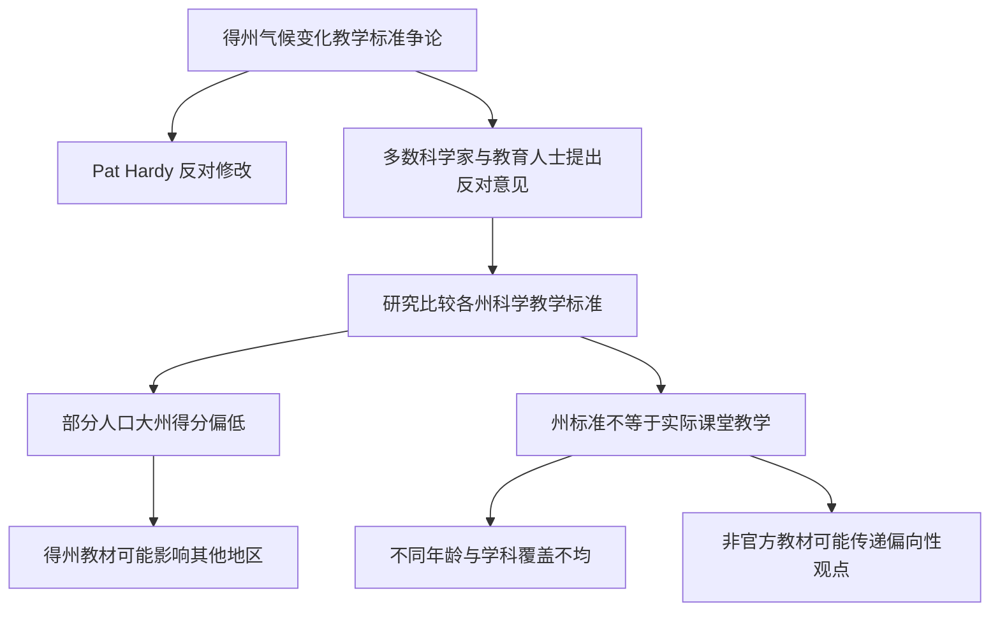
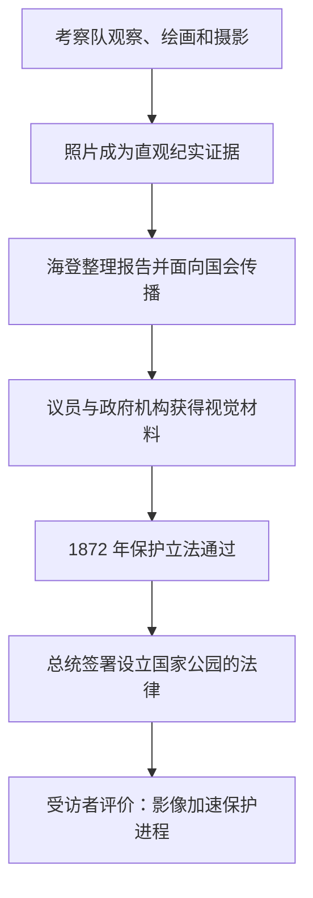

<Callout type="info" title="使用说明">
本页为根据原始资料整理的**考研英语（一）精读学习笔记**，按试卷题型顺序组织。原稿未完整提供选项的题目不会被虚构为官方答案；文中的原创巩固题与正式真题题目应予区分。
</Callout>

## Section I · 商队客栈与丝绸之路的交流网络

<Callout type="info" title="完形填空主旨">

本文介绍丝绸之路沿线的 **caravanserai（商队客栈）**：从分布位置和名称词源，讲到商旅路线形成后的安全需求，再扩展至文化传播、商品交易与历史遗存。阅读过程中应紧扣“**背景与名称 → 建造原因 → 实际功能 → 历史影响 → 现存状况**”这一顺序。

本部分资料呈现了完形填空的原句及部分设空标记，但**未完整提供全部选项**。以下集中讲清语义和搭配，不在缺乏题目选项时擅自声称还原了官方 1—20 题的答案。

</Callout>

### 一、地理分布与命名来源

<Accordions>
  <Accordion title="商队客栈是什么？为什么多建在城墙外？">

**原句**

> Caravanserais were roadside inns that were built along the Silk Road in areas including China, North Africa and the Middle East.

**参考译文**：商队客栈是沿丝绸之路修建的路边旅舍，分布地区包括中国、北非和中东。

**主干**：`Caravanserais were roadside inns`。

- `that were built along the Silk Road ...`：限制性定语从句，修饰 `roadside inns`。
- `in areas including ...`：说明分布区域；`including` 在此相当于“包括”，不是动词谓语。
- `roadside` 为“路旁的”；`inn` 为小旅馆、客栈。

**原句（去除设空标记）**

> They were typically located outside the walls of a city or village and were usually funded by local governments or privately.

**参考译文**：它们通常建在城市或村庄的城墙外，资金一般来自地方政府或私人。

- `were located ... and were funded ...`：共享主语 `They` 的两个并列被动结构。
- `outside the walls of ...`：位置短语，描述建造地点。
- `by local governments or privately`：资金来源的并列说明。原句中 `privately` 是副词，不能机械地当成 `by` 后的名词宾语；语义上是“或者通过私人资金”。

**选词提示**：`be located` 与空间位置连用；`be funded by` 与资金提供者连用。辨认并列谓语，有助于解决设空处的词性判断。

</Accordion>
  <Accordion title="caravanserai 一词包含哪两个波斯语成分？">

**原句（词源拼写已统一）**

> The word ‘caravanserai’ is a combination of the Persian words ‘kārvān’, which means a group of travellers or a caravan, and ‘sarāy’, a palace or enclosed building.

**参考译文**：`caravanserai` 一词由两个波斯语词组成：`kārvān`，指一群旅行者或一支商旅队伍；`sarāy`，指宫殿或围合式建筑。

**句子主干**：`The word ... is a combination of the Persian words A and B`。

- `which means ...`：非限制性定语从句，解释第一个词 `kārvān` 的含义。
- `a palace or enclosed building`：名词性同位说明，解释第二个词 `sarāy`。
- `a combination of A and B`：固定搭配，“A 与 B 的结合”。
- 原稿对词源有多种拼写转写，这里统一使用带长音符号的常见转写；不改变词源解释。

**原句**

> The term caravan was used to describe groups of people who travelled together across the ancient network for safety reasons, such as merchants, travellers or pilgrims.

**参考译文**：`caravan` 一词用来指那些出于安全考虑而沿古代交通网络结伴同行的人群，例如商人、旅行者和朝圣者。

- `was used to describe ...`：被动结构中的目的表达，“被用来描述”。
- `who travelled together ...`：限制性定语从句，限定 `groups of people`。
- `for safety reasons`：说明结伴出行的原因；`such as` 引出例子。
- `pilgrim` 为“朝圣者”，不应只笼统译作“旅行者”。

</Accordion>
</Accordions>

### 二、建造增长、安全需求与选址逻辑

<Accordions>
  <Accordion title="路线越发达，为什么客栈数量越多？">

**原句**

> From the 10th century onwards, as merchant and travel routes became more developed, the construction of caravanserais increased and they served as a safe place for people to rest at night.

**参考译文**：自 10 世纪起，随着商贸与旅行路线日益发达，商队客栈的建造逐渐增多，这些客栈也为人们提供了夜间休息的安全场所。

**第一层：总体结构**

`From the 10th century onwards, as ..., the construction ... increased and they served as ...`

- `From ... onwards`：从某时间点起，强调持续的时间范围。
- `as ... became more developed`：此处兼具“随着时间推移”的伴随变化及原因意味，按“随着……发展”最自然。
- `the construction ... increased` 与 `they served as ...`：由 `and` 连接的两个并列分句，后一个 `they` 指商队客栈。

**第二层：不定式复合结构**

`a safe place for people to rest at night`：`for people to rest ...` 修饰地点名词 `place`，说明“供谁在夜间休息”；`people` 是不定式 `to rest` 的逻辑主语。

</Accordion>
  <Accordion title="行程中最常见的两类危险是什么？">

**原句**

> Travellers on the Silk Road faced the possibility of being attacked by thieves or being subjected to extreme weather conditions.

**参考译文**：丝绸之路上的旅行者可能遭到盗贼袭击，也可能遭遇极端天气。

**主干**：`Travellers faced the possibility`。

- `of being attacked ... or being subjected ...`：`of` 后面有两个并列的动名词被动结构，分别说明风险内容。
- `be attacked by thieves`：遭窃贼袭击。
- `be subjected to extreme weather conditions`：遭受极端天气影响；`to` 是介词，不是动词不定式标志。
- `possibility of doing`：表达某事件发生的可能性；此处不宜硬判为“the possibility 的同位语从句”。

**原句**

> For this reason, caravanserais were strategically placed so that they could be reached in a day's travel time.

**参考译文**：因此，商队客栈会经过合理选址，让旅行者在一天的行程之内就能抵达。

- `For this reason`：承接前面的危险，给出选址原因。
- `were strategically placed`：被动谓语，强调选址经过规划，而不只是“位置优越”。
- `so that they could be reached ...`：目的状语从句；`they` 指客栈，`could be reached` 指能够抵达。
- `in a day's travel time`：一次日行程的时长，不是“在某个具体日期旅行”。

**因果链**：盗贼与恶劣天气造成旅途风险 → 需要安全驿站 → 客栈间距适合一天行程。

</Accordion>
</Accordions>

### 三、文化、知识与商业的多重功能

<Accordions>
  <Accordion title="文化交流：with 复合结构和分词结果如何区分？">

**原句**

> Caravanserais served as an informal meeting point for the various people who travelled the Silk Road.

**参考译文**：商队客栈为来往于丝绸之路的各类旅人提供了非正式的交流场所。

- `served as`：充当、起……作用；`as an informal meeting point` 是介词短语，说明其功能，**不是主语补足语这一类独立句子成分**。
- `who travelled the Silk Road`：限制性定语从句，修饰 `people`。
- `informal` 在此更接近“非正式的”，并不必然代表“随意且友好”。

**原句**

> As a result, these structures became important centres for cultural exchange and interaction, with travellers sharing their cultures, ideas and beliefs, as well as taking knowledge with them, greatly influencing the development of several civilisations.

**参考译文**：因此，这些建筑逐渐成为文化交流和互动的重要中心。旅人们在这里分享文化、思想和信仰，也把知识带往别处，从而深刻影响了多个文明的发展。

**拆成三层**

1. **核心判断**：`these structures became important centres for cultural exchange and interaction`。
2. **伴随情境**：`with travellers sharing ... as well as taking knowledge with them`。这是 `with + 名词 + 现在分词` 复合结构；`travellers` 是 `sharing` 和 `taking` 的逻辑主语。
3. **影响结果**：`greatly influencing the development ...`。现在分词补充整段交流活动产生的后果；不要误解为建筑物有意识地影响文明。

**并列重点**：`as well as taking knowledge with them` 与 `sharing ...` 语义并列，表示知识既在客栈中传播，也随旅人继续流动。

</Accordion>
  <Accordion title="商业功能：marketplace、wares 与 stock up on">

**原句**

> Caravanserais were also an important marketplace for commodities and aided in the trade of goods along the Silk Road.

**参考译文**：商队客栈同时还是重要的商品交易市场，促进了丝绸之路沿线的货物贸易。

- `were ... and aided ...`：`and` 连接同一个主语的两个谓语。
- `commodity`：商品、交易品；`aid in`：促进、帮助完成某事。
- `trade of goods` 指货物贸易，注意与动词 `trade` 的用法区别。

**原句**

> Indeed, it was frequently the first stop for merchants looking to sell their wares and stock up on supplies for their own journeys.

**参考译文**：事实上，这里往往是商人们启程途中首先停留的地方，他们既能出售货物，也能为接下来的旅程补充物资。

**句法**：`it was frequently the first stop` 为主干；`for merchants` 限定服务对象；`looking to sell ... and stock up on ...` 是现在分词短语后置修饰 `merchants`。原稿把这段整体判作“动名词复合结构作 for 的宾语”并不恰当。

**固定搭配**：`wares`（待售商品）；`stock up on supplies`（补充储备物资）；`for their own journeys`（供各自接下来的行程使用）。

</Accordion>
  <Accordion title="遗存数量：建造总量与今日存量不可混淆">

**原句**

> It is believed that around 12,000 to 15,000 caravanserais were built along the Silk Road although only about 3,000 are known to remain today, many of which are in ruins.

**参考译文**：据认为，丝绸之路沿线曾修建约 1.2 万至 1.5 万座商队客栈；然而目前已知留存的仅约 3000 座，其中很多已成为废墟。

**主干与从句**

- `It is believed that ...`：非人称报告结构，`It` 可作形式主语，`that` 引导的从句承载被认为的内容。
- `although ...`：让步／转折语义，将历史建造量与现存数量进行对比。
- `many of which are in ruins`：非限制性定语从句，`which` 指前文仍有记录的约 3000 座客栈；`many of which` 表示“其中许多”。

**数字辨析**：历史总建造量、目前已知存量、保存完好的建筑数，是不同口径。文中只说明前两者，并指出留存者中许多已破败，没有给出保存完好的精确数量。

</Accordion>
</Accordions>

### 完形填空篇章线索与高频搭配

| 逻辑位置 | 关键表达 | 中文理解与选词提示 |
| --- | --- | --- |
| 定义与分布 | `roadside inns`、`along the Silk Road`、`be located` | 识别定义句和空间位置，注意被动谓语 |
| 资金来源 | `be funded by`、`privately` | 政府与私人是不同资金渠道，避免词性不匹配 |
| 名称词源 | `a combination of`、`which means` | 词源解释中的同位语和非限制性定语从句 |
| 路线发展 | `from ... onwards`、`as routes developed` | 时间推进、背景变化与建造增长 |
| 安全需求 | `face the possibility of`、`be subjected to`、`so that` | 风险 → 选址 → 目的 |
| 文化功能 | `cultural exchange`、`interaction`、`as well as` | 接触、分享与知识传播 |
| 商贸功能 | `marketplace`、`wares`、`stock up on` | 交易与补给这两项功能并存 |
| 历史遗存 | `It is believed that`、`although`、`many of which` | 推测、转折及先行词辨认 |

<Callout type="warn" title="完形填空的校对原则">

原文只提供设空句及部分前后词，没有完整选择题选项；因此本笔记整理的是**篇章结构和语言考点**，并非逐题公布未经核实的标准选项。特别要注意 `as a result`、`indeed`、`although` 等承担句间逻辑的词，不能只按词义孤立选择。

</Callout>

<Question id="zz2023cloze-review01" type="single" tags="2023英语一,完形填空,原创巩固,句法">

在 `with travellers sharing their cultures ... as well as taking knowledge with them` 中，`sharing` 与 `taking` 的逻辑主语是：

<Option>centres</Option>
<Option>cultures</Option>
<Option correct>travellers</Option>
<Option>civilisations</Option>

<Solution>

**答案：C。**`with + travellers + sharing/taking` 是伴随性复合结构；两个现在分词由 `as well as` 连接。

</Solution>
</Question>

<Question id="zz2023cloze-review02" type="single" tags="2023英语一,完形填空,原创巩固,数量比较">

`although only about 3,000 are known to remain today, many of which are in ruins` 最可靠的结论是：

<Option>今天保存完整的商队客栈恰好有 3000 座</Option>
<Option>从前只有 3000 座客栈</Option>
<Option correct>目前已知约有 3000 座留存，但其中不少已成废墟</Option>
<Option>历史上所有客栈都已不复存在</Option>

<Solution>

**答案：C。**`remain today` 是“现今留存”，`many of which` 指这批留存建筑中的许多；没有声称“全部保存完好”。

</Solution>
</Question>

---

## 阅读 Text 1 · 气候变化如何进入学校科学课程

<Callout type="info" title="文章结构与立场">

文章以得克萨斯州的气候教育标准讨论开场：委员会内部出现不同意见，而科学教育组织的研究指出一些州的课程标准存在不足。接着作者借专家解释：**州级标准写得好，并不保证课堂一定会教得好**；教学覆盖年龄、学科以及非官方教材都可能影响实际教学。

关注报道中的**人物观点归属**：Pat Hardy 的说法属于她个人的政治与政策立场；多数科学家与专家、Dan Quinn 以及 Glenn Branch 提出的是不同评价。不能把任何一方的引语无条件写成作者最终结论。

</Callout>

### 一、开场：以天气温度引出会议的“高温”

<Accordions>
  <Accordion title="重点句：The weather may have cooled, but the temperature will be high">

**原句**

> The weather in Texas may have cooled since the recent extreme heat, but the temperature will be high at the State Board of Education meeting in Austin this month as officials debate how climate change is taught in Texas schools.

**参考译文**：近期极端高温之后，得克萨斯州的天气可能已转凉，但本月在奥斯汀举行的州教育委员会会议上，气氛仍将十分火热，因为官员们要就该州学校应如何讲授气候变化展开辩论。

**第一层：并列对比**

- `The weather in Texas may have cooled ...`：字面气温可能下降；`may have cooled` 是对过去到现在变化的推测。
- `but the temperature will be high at ... meeting`：`temperature` 变为比喻，指争论激烈的会议气氛。

**第二层：解释缘由**

- `as officials debate ...`：此处由 `as` 引出会议气氛紧张的背景原因。
- `how climate change is taught in Texas schools`：由 `how` 引导的间接疑问内容，作 `debate` 的宾语；内部是陈述语序 `climate change is taught`。
- `at the State Board of Education meeting in Austin this month`：地点和时间信息集中修饰会议事件。

**技巧**：先判断 `temperature` 是否为比喻，再译 `as` 从句；否则容易形成“会议室的物理温度很高”这一错误理解。

</Accordion>
</Accordions>

### 二、委员会成员与科学界的分歧

<Accordions>
  <Accordion title="Pat Hardy：对能源行业立场较为认同">

**原句**

> Pat Hardy, who sympathises with the views of the energy sector, is resisting proposed changes to science standards for pre-teen pupils.

**参考译文**：帕特·哈迪认同能源行业的一些观点，正反对针对青春期前学生科学课程标准所提出的修改方案。

- `who sympathises with ...`：非限制性定语从句，补充人物立场；`sympathise with` 在这里是“赞同、表示理解”，不是简单的“同情”。
- `is resisting proposed changes`：现在进行时表示正在抵制拟议中的修改；`proposed` 不表示修改已经实施。
- `pre-teen pupils`：尚未进入青少年阶段的学生，不宜固定限定为“十一二岁”这一单一年龄。

**原句**

> “There are as many scientists working against all the panic of global climate change as there are those who are pushing it,” she claims.

**参考译文**：她声称，反对围绕全球气候变化制造恐慌的科学家人数，与推动这种恐慌的科学家人数一样多。

**结构**：`There are as many ... as there are ...` 表数量同等；`working against ...` 修饰前面的 `scientists`；`who are pushing it` 是修饰 `those` 的定语从句。

<Callout type="warn" title="信息来源与指代">

这是一位委员的 **claim（声称）**，不是文章认可的统计事实。`it` 在具体语境中更可能回指前面的“气候变化恐慌／相关警报言论”，而不是声称科学家能“推动气候变化”这一本体事件。必须保留引语与观点归属。

</Callout>

**原句**

> “Texas is an energy state and we need to recognise that.”

**参考译文**：“得克萨斯州是一个能源产业州，我们必须认识到这一点。”

**原句**

> You need to remember where your bread is buttered.

**参考译文**：你得记住自己的生计和利益依靠什么。

- `where your bread is buttered` 在这里是习惯性表达，指某人的收益、生计或利益来源，不能逐字译成“面包在哪里被涂黄油”。
- 引语中的 `that` 指“得州能源产业的重要性”，不是气候变化的科学结论。

</Accordion>
  <Accordion title="多数科学家与 Dan Quinn：争论焦点是什么？">

**原句**

> Most scientists and experts sharply dispute Hardy's views.

**参考译文**：大多数科学家与专家强烈反对哈迪的观点。

- `sharply dispute`：强烈质疑／反驳；不等于“温和讨论”。
- `Most` 表示“大多数”，不能扩张成“全体”。

**原句**

> Board members like her “casually dismiss the career work of scholars and scientists as just another misguided opinion,” says Dan Quinn, senior communications strategist at the Texas Freedom Network, a non-profit group that monitors public education.

**参考译文**：得克萨斯自由网络的高级传播策略师丹·奎因说，像哈迪这样的委员会成员，竟把学者和科学家整个职业生涯积累的研究成果轻率地贬为“又一种错误观点”。得克萨斯自由网络是一家监督公共教育的非营利组织。

**主干**：`Dan Quinn says [Board members ... dismiss A as B]`。报道中把直接引语放前，报道语 `says Dan Quinn` 放后，不改变逻辑主谓关系。

- `dismiss A as B`：把 A 当作 B 而不予重视／否定 A 为 B；其中 `as just another misguided opinion` 是宾语补足性表述。
- `the career work of scholars and scientists`：学者与科学家在职业生涯中积累的研究成果，而非“他们工作的职业”。
- `senior communications strategist ...`：`Dan Quinn` 的同位语；`a non-profit group ...` 又补充说明 `Texas Freedom Network`。
- `that monitors public education`：限制性定语从句，修饰这个非营利组织。

**观点归属**：对轻率否定科学成果的批评出自 **Dan Quinn**；原文并没有说这是 Hardy 对自己的评价。

</Accordion>
  <Accordion title="社会背景：为什么一场州级争论具有全国意义？">

**原句**

> Such debates reflect fierce discussions across the US, as researchers, policymakers, teachers and students step up demands for a greater focus on teaching about the facts of climate change in schools.

**参考译文**：此类争论折射出美国各地正在进行的激烈讨论：研究人员、政策制定者、教师和学生愈发要求学校更重视教授气候变化的科学事实。

- `Such debates reflect ...`：个别州内争论反映全国范围议题。
- `step up demands for ...`：加大要求力度；`step up` 是提高力度，不是向上走台阶。
- `a greater focus on teaching ...`：`focus on` 中 `on` 是介词，后接动名词 `teaching`。
- `as` 可说明上述争议发生的同步背景，也可带有解释意味；不要把它机械地固定成一个不考虑语境的单一中文连词。

</Accordion>
</Accordions>

### 三、研究数据与地区差异

<Accordions>
  <Accordion title="重点句：主语 A study 被多重修饰拉得很长">

**原句**

> A study last year by the National Center for Science Education, a non-profit group of scientists and teachers, looking at how state public schools across the country address climate change in science classes, gave barely half of US states a grade B+ or higher.

**参考译文**：国家科学教育中心——一个由科学家和教师组成的非营利组织——在上一年开展研究，考察全美各州公立学校如何在科学课堂中讲授气候变化。研究结果显示，获得 B+ 或以上等级的州仅约一半。

**剥去修饰后的主干**：`A study gave barely half of US states a grade B+ or higher.`

**修饰链**

1. `last year`：研究发生的时间。
2. `by the National Center for Science Education`：研究机构。
3. `a non-profit group of scientists and teachers`：机构同位语。
4. `looking at how ...`：现在分词短语，修饰 `study`，说明研究关注的问题。
5. `how state public schools ... address climate change in science classes`：`how` 引导间接疑问从句，作 `looking at` 中介词 `at` 的宾语。

**分数信息**：`barely half` 强调“仅约半数／勉强达到半数的程度”，不应机械认定为精确的 50%，也不能仅凭这两个词断言严格低于 50%；`B+ or higher` 包括 B+ 及所有更高等级。

</Accordion>
  <Accordion title="倒装与长从句：为什么 Texas 的影响力格外大？">

**原句**

> Among the 10 worst performers were some of the most populous states, including Texas, which was given the lowest grade (F) and has a disproportionate influence because its textbooks are widely sold elsewhere.

**参考译文**：表现最差的十个州中，包括一些人口最多的州，例如得克萨斯州。该州获得最低的 F 等级；由于其教科书在其他地区也广泛销售，它的影响力显得格外大。

**倒装恢复**：`Some of the most populous states were among the 10 worst performers.`

- `Among the 10 worst performers` 位于句首，引起系动词 `were` 和主语的位置倒置；它是介词短语，不宜认作“表语名词”。
- `including Texas`：举例说明人口大州。
- `which was given ... and has ...`：修饰 `Texas` 的非限制性定语从句，其中两个谓语 `was given` 和 `has` 并列。
- `because its textbooks are widely sold elsewhere`：说明得州教材的影响为什么能超出该州。
- `disproportionate influence`：与州自身规模或范围不成比例的较大影响力，并非“数量不均匀的书”。

**推理重点**：研究分数低并不只影响该州本地教育；由于教材市场外溢，问题可能影响更多地区。文章未断言所有其他州都使用得州教材。

</Accordion>
</Accordions>

### 四、标准文本不等于真实教学

<Accordions>
  <Accordion title="Glenn Branch：课程标准只是有限的衡量指标">

**原句**

> Glenn Branch, the centre's deputy director, cautions that setting state-level science standards is only one limited benchmark in a country that decentralises decisions to local school boards.

**参考译文**：该中心副主任格伦·布兰奇提醒说，在一个把有关教育的许多决策下放给地方学校委员会的国家，制定州级科学课程标准仅是一个作用有限的衡量指标。

- `the centre's deputy director`：`Glenn Branch` 的同位语。
- `cautions that ...`：提醒、告诫；后接宾语从句。
- `setting state-level science standards`：动名词短语作 `that` 从句的主语；谓语为 `is`。
- `in a country that decentralises decisions ...`：交代体制背景，其中 `that ...` 修饰 `country`。
- `only one limited benchmark`：只是有限的评判依据，不意味着州标准毫无作用。

**原句**

> Even if a state is considered a high performer in its science standards, “that does not mean it will be taught”, he says.

**参考译文**：他指出，即使某州的科学教育标准评分很高，“也不代表有关内容就一定会被教给学生”。

- `Even if` 引导让步状语从句。
- `that does not mean ...`：`that` 回指“州标准评分很高”这一事实；后面的 `it` 指前文有关科学内容，特别是气候变化教学。
- 逻辑形式：**纸面标准好 ≠ 课堂实施到位**；切忌把 `does not mean` 看成“完全不会教授”。

</Accordion>
  <Accordion title="课程覆盖：高中、低年级和各学科情况不相同">

**原句**

> Another issue is that, while climate change is well integrated into some subjects and at some ages—such as earth and space sciences in high schools—it is not as well represented in curricula for younger children and in subjects that are more widely taught, such as biology and chemistry.

**参考译文**：另一个问题是：气候变化虽已较好地融入一些学科和年龄段的教学，比如高中的地球与空间科学，但在低龄学生的课程，以及生物、化学等更普遍开设的学科中，相关内容体现得还不够充分。

**层次**

1. 主句框架：`Another issue is that ...`；`that` 引导表语从句。
2. 让步对比：`while climate change is well integrated into ...` 与 `it is not as well represented ...`；在此 `while` 主要表达“虽然／然而”的对照。
3. 举例：`such as earth and space sciences ...`、`such as biology and chemistry`。
4. `that are more widely taught`：限制性定语从句修饰 `subjects`。

**原句**

> It is also less prominent in many social studies courses.

**参考译文**：此外，气候变化在许多社会研究类课程中也不够突出。

- `It` 指气候变化主题。
- `less prominent` 表相对不突出，不表示该内容在这类课程中完全不存在。

</Accordion>
  <Accordion title="官方与非官方教材：被动进行时的警示作用">

**原句**

> Branch points out that, even if a growing number of official guidelines and textbooks reflect scientific consensus on climate change, unofficial educational materials that convey more biased perspectives are being distributed to teachers.

**参考译文**：布兰奇指出，即便越来越多的官方教学指南和教科书体现了气候变化方面的科学共识，一些传递更具倾向性观点的非官方教学材料仍正被分发给教师。

**主干层级**

- 主句：`Branch points out ...`。
- 第一层宾语从句：`that ... unofficial educational materials ... are being distributed to teachers`。
- 插入的让步从句：`even if a growing number of official guidelines and textbooks reflect ...`。
- 限制性定语从句：`that convey more biased perspectives`，修饰 `unofficial educational materials`。

**语法重点**：`are being distributed` 是**现在进行时的被动语态**，强调正在发生的分发行为；不能理解成“已经全部发完”。

**原句**

> They include materials sponsored by energy industry associations.

**参考译文**：其中包括由能源行业协会赞助的材料。

- `They` 指前句的非官方教学材料。
- `sponsored by ...` 是过去分词短语作后置定语，说明赞助者。

**文章落点**：对课堂教学的影响不仅来自州级正式课程标准，还可能来自课内实际选材、学段覆盖及外部机构赞助的补充资料。

</Accordion>
</Accordions>

### 本篇阅读思维导图

### 词汇与阅读态度辨析

| 表达 | 语境义 | 易错理解 |
| --- | --- | --- |
| `temperature will be high` | 会议争论将很激烈 | 会议室气温高 |
| `sympathise with views` | 认同某种立场 | 仅指怜悯 |
| `dismiss A as B` | 把 A 斥为／贬为 B | 同意 A 等同于 B |
| `career work` | 职业生涯积累的研究成果 | 一份职业工作 |
| `barely half` | 仅约半数，数量不多 | 精确 50% |
| `disproportionate influence` | 超出相应比例的影响力 | 必然不利或必然有利的影响 |
| `benchmark` | 衡量标准、基准 | 确认课堂实施情况的直接证据 |
| `curricula` | `curriculum` 的复数，课程体系 | 一份课表的别名 |
| `are being distributed` | 目前正被分发 | 过去已分发完毕 |

<Question id="zz2023text1-review01" type="single" tags="2023英语一,阅读理解,原创巩固,观点归属">

哪一项最准确地概括文章对 Pat Hardy 有关科学家人数说法的处理？

<Option correct>这是 Hardy 自己提出的主张，文章随即展示多数专家对此提出的质疑</Option>
<Option>该数字已经由国家科学教育中心的研究证实</Option>
<Option>作者将其作为所有科学家的共同意见</Option>
<Option>这是 Glenn Branch 用来支持修改课程标准的直接引语</Option>

<Solution>

**答案：A。**&#x2060;关键提示词是 `she claims` 及后文的 `Most scientists and experts sharply dispute Hardy's views`。阅读理解中，报道某观点不等于认可该观点。

</Solution>
</Question>

<Question id="zz2023text1-review02" type="single" tags="2023英语一,阅读理解,原创巩固,逻辑推断">

`Even if a state is considered a high performer in its science standards, that does not mean it will be taught` 主要提醒读者：

<Option>评价高的州不可能教好科学课程</Option>
<Option correct>课程标准的质量与课堂实际教授情况不能直接画等号</Option>
<Option>只有地方学校委员会才有权研究科学问题</Option>
<Option>课程标准一定与科学教学完全无关</Option>

<Solution>

**答案：B。**`Even if` 表让步，`does not mean` 否定的是自动推导关系，而不是直接断言教学一定失败。

</Solution>
</Question>

---

## 阅读 Text 2 · 短期租赁、住房供应与旅游业利益

<Callout type="info" title="阅读主线与信息边界">

文章讨论新英格兰地区的短期租赁监管：一方面，住房供应紧缺，使人们担忧大规模短租挤占长期居住空间；另一方面，旅游业相关人士指出短租也承载游客住宿需求，并为当地劳动力创造工作。住房政策研究者则提醒，真正严重的问题可能是**开发商将短租规模化、变成规避税费和监管的事实性酒店**，而非所有普通房主的出租行为。

以下根据原稿可核对的文字与观点精读，后文内容在本年度后续小节接续。

</Callout>

### 一、监管紧迫性：房价、库存与投资性收购

<Accordions>
  <Accordion title="背景：短租平台兴起后，新英格兰社区怎样应对？">

**原句（跨段已接合）**

> Communities throughout New England have been attempting to regulate short-term rentals since sites like Airbnb took off in the 2010s.

**参考译文**：自爱彼迎等短租平台在 2010 年代迅速兴起以来，新英格兰各地社区一直尝试对短期租赁加以监管。

- `have been attempting`：现在完成进行时，说明从过去开始、持续到当前的管理尝试。
- `since sites like Airbnb took off in the 2010s`：时间状语从句，说明尝试开始的背景；`take off` 在互联网产品语境是“迅速流行”。
- `regulate`：用规则加以管理，而不是必然“全面禁止”。

</Accordion>
  <Accordion title="翻译重点·26：嵌套 who / that / to do 分别修饰什么？">

**原句**

> Now, with record-high home prices and historically low inventory, there's an increased urgency in such regulation, particularly among those who worry that developers will come in and buy up swaths of housing to flip for a fortune on the short-term rental market.

**参考译文**：如今，房价创下历史新高，可供出售的住房存量又处于历史低位，对短租进行监管因此变得更加紧迫；尤其是那些担心开发商会大举入场、收购成片房屋，并借短租市场牟取暴利的人，更有这种紧迫感。

**拆解四层结构**

1. 背景状语：`with record-high home prices and historically low inventory`。`with + 两个名词短语` 给出现实背景。
2. 主干：`there's an increased urgency in such regulation`。`there is` 表“存在／出现”，`urgency in` 强调监管的紧迫性。
3. 人群限定：`particularly among those who worry ...`，其中 `who worry ...` 是修饰 `those` 的定语从句。
4. 担忧内容：`that developers will come in and buy up swaths of housing to flip for a fortune ...` 是 `worry` 后的宾语从句；`come in and buy up` 为并列动作；`to flip ...` 表目的或预期获利方式。

**重要措辞**

- `record-high`：创纪录的高位；`historically low inventory`：历史低位的房源供应存量。
- `buy up`：成批收购；`swaths of housing`：大量或成片住宅。
- `flip for a fortune`：通过买入再操作房产取得巨大利润。具体是转卖还是改作短租经营，要依赖更完整语境；此处不擅自将其锁定为单一方式。

<Callout type="warn" title="谁在担忧，谁已经采取行动？">

`those who worry that developers will ...` 描述的是**一些人的担忧和预测**，并未证明“开发商已经买光当地房产”。阅读题可能用“担忧”与“既成事实”互换设置陷阱。

</Callout>

</Accordion>
</Accordions>

### 二、新罕布什尔州：房源紧缺与立法博弈

<Accordions>
  <Accordion title="出租房空置率低于 1%，为什么会加剧担忧？">

**原句**

> In New Hampshire, where the rental vacancy rate has dropped below 1 percent, housing advocates fear unchecked short-term rentals will put further pressure on an already strained market.

**参考译文**：在出租房空置率已经降到 1% 以下的新罕布什尔州，住房倡导者担心，不受约束的短期租赁会进一步加剧本已紧张的住房市场压力。

- `where the rental vacancy rate has dropped below 1 percent`：`where` 引导非限制性定语从句，补充说明 `New Hampshire` 的市场情况。
- `fear (that) ...`：`that` 可以省略，宾语从句说明担忧的内容。
- `put further pressure on ...`：给……施加更大压力。
- `unchecked`：未得到充分约束的；`strained`：处于压力之下、紧张的。

**数据注意**：出租房空置率低于 1% 是文中所报道的状态，不是说房价增幅低于 1%，也不是说所有住房都被短租占用。

</Accordion>
  <Accordion title="翻译重点·27：被否决的法案原本打算禁止什么？">

**原句**

> The state Legislature recently voted against a bill that would've made it illegal for towns to create legislation restricting short-term rentals.

**参考译文**：该州立法机构最近投票否决了一项法案；如果该法案获得通过，城镇制定限制短期租赁的法规就会被视为违法。

**关键逻辑**

- `voted against a bill`：投票反对／否决该法案，是已经发生的动作。
- `that would've made ...`：修饰 `a bill` 的定语从句，含 `would have made` 的过去假设意义，指法案**本来会**带来的效果。
- `made it illegal for towns to create legislation ...`：`make + it + 形容词 + for sb. to do`；`it` 为形式宾语，真正被评价的动作是城镇制定相关法规。
- `restricting short-term rentals`：现在分词短语后置修饰 `legislation`，说明法规限制的对象。

**必须区分的三件事**

1. 该州提出过一项**限制地方政府限制短租权力**的法案。
2. 这项法案**被投票否决**。
3. 否决本身不等于“所有城镇已经通过限制短租的条例”，也不能推成“州全面禁止短租”。

</Accordion>
  <Accordion title="劳动力住房：为什么会影响雇主招人？">

**原句**

> “We are at a crisis level on the supply of rental housing,” said Nick Taylor, executive director of the Workforce Housing Coalition of the Greater Seacoast.

**参考译文**：大海岸地区劳动力住房联盟执行董事尼克·泰勒表示：“出租住房的供给已到了危机程度。”

- `said Nick Taylor`：引语在前、报道语在后，`said` 与主语 `Nick Taylor` 位置倒置；不是引语内部的句法倒装。
- `executive director ...`：`Nick Taylor` 的同位语，说明职务。
- `rental housing`：出租住房，不能等同于“低价出售的商品房”。

**原句**

> Without enough affordable housing in southern New Hampshire towns, “employers are having a hard time attracting employees, and workers are having a hard time finding a place to live,” Taylor said.

**参考译文**：泰勒表示，由于新罕布什尔州南部城镇缺乏足够的可负担住房，“雇主难以招到员工，劳动者也很难找到居所”。

**主干**：引语内两分句并列：`employers are having a hard time ...` 与 `workers are having a hard time ...`。

- `without enough affordable housing`：指出前提／原因。
- `have a hard time doing sth.`：做某事很困难；后接现在分词形式 `attracting`、`finding`，不能写成 `to attract` 作为这个搭配的固定形式。
- `affordable housing`：居民或劳动者能够负担得起的住房，不只指某一个国家特定法律定义下的“经济适用房”。

**因果链**：住房供应紧张 → 员工居住成本或寻找住房的难度上升 → 企业招聘困难与用工稳定性受到影响。

</Accordion>
</Accordions>

### 三、旅游业与住房政策研究者的不同视角

<Accordions>
  <Accordion title="Ryan Castle：短租与旅游就业形成怎样的循环？">

**原句**

> However, short-term rentals also provide housing for tourists, pointed out Ryan Castle, CEO of a local association of realtors.

**参考译文**：然而，当地房地产经纪人协会首席执行官瑞安·卡斯尔指出，短期租赁同样为游客提供住宿场所。

- `However` 标出与前文压力论证不同的视角。
- `provide housing for tourists`：为游客提供短期住宿，这与保障当地居民长期住房是不同需求。
- `pointed out Ryan Castle`：报道语倒装，`CEO ...` 是介绍身份的同位语。

**原句**

> “A lot of workers are servicing the tourist industry, and the tourism industry is serviced by those people coming in short term,” Castle said, “and so it's a cyclical effect.”

**参考译文**：卡斯尔说：“许多劳动者在为旅游业提供服务，而旅游业又依赖那些短期到访的游客来维系，因此这形成了一种循环作用。”

**结构**

- `workers are servicing the tourist industry`：劳动者服务于旅游业。
- `the tourism industry is serviced by those people coming in short term`：短期到访者——主要是游客——为旅游业带来需求；`coming in short term` 修饰 `those people`。
- `and so it's a cyclical effect`：`and so` 引出卡斯尔的总结，即游客需求与就业供给相互支持。

**辨析**：第一个分句中的 `workers` 和第二个分句的 `those people coming in short term` 不是同一群体，不能都译为“短期工人”。

</Accordion>
  <Accordion title="Keren Horn：普通房东与大规模商业开发者要分开看">

**原句**

> Short-term rentals themselves are not the crux of the issue, said Keren Horn, an expert on affordable housing policy.

**参考译文**：可负担住房政策专家克伦·霍恩指出，短期租赁本身并不是问题的核心。

- `themselves`：反身代词作强调，“短租本身”。
- `crux`：要害、关键；`an expert on ...` 补充身份。

**原句**

> “I think individuals being able to rent out their second home is a good thing.”

**参考译文**：“我认为，个人能够出租自己的第二套住房是一件好事。”

**结构重点**：`I think (that) [individuals being able to rent out their second home] is a good thing`。

- `individuals being able to ...` 整体是名词性表达，承担嵌入从句的主语功能；`is` 与这一整体匹配。
- `rent out` 为“出租”，不要与 `rent` 的“租入”混淆。

**原句**

> “If it's their vacation home anyway, and it's just empty, why can't you make money off it?” Horn said.

**参考译文**：“如果那本来就是他们的度假房，而且空着不用，那为什么不能靠它取得收入呢？”霍恩说。

- `If ... and ...`：并列条件，指出“本来有一处闲置的度假住房”的前提。
- `why can't you ...?`：反问，表示支持把闲置房屋出租的合理性。
- `make money off it`：利用该资产获得收入。

**观点边界**：霍恩认可个人合理出租闲置第二套住房，并**不表示**她支持所有形式的大规模短租开发或反对一切监管。

</Accordion>
  <Accordion title="翻译重点·29：de facto hotels 为什么是问题？">

**原句**

> Issues arise, however, when developers attempt to create large-scale short-term rental facilities—de facto hotels—to bypass taxes and regulations.

**参考译文**：然而，当开发商试图建立大规模短租设施——实质上相当于酒店——以规避税费和监管规定时，问题就出现了。

**结构**

1. 主干：`Issues arise`，`however` 是插入性的转折语。
2. `when developers attempt ...`：时间／情境状语从句；在论证中具有“当这种情况发生时”的条件意味。
3. `to create large-scale short-term rental facilities`：动词不定式作 `attempt` 的补足内容，说明开发商企图做什么。
4. `—de facto hotels—`：破折号插入的同位说明，把这类规模化短租的**实际性质**与“酒店”对应起来。
5. `to bypass taxes and regulations`：目的状语，解释其动机是规避税费与监管。

**高频短语**：`de facto` = “事实上、实际上的”，与 `de jure`（法律上的、法定的）形成概念对照；`bypass regulations` = “绕过监管”，不是“经过监管批准”。

**文章作用**：在肯定正常出租价值后，进一步指出政策真正需要关注的潜在问题：大型商业主体把住宅包装成短租业务，从而逃避酒店类似业务所承担的规则。

</Accordion>
</Accordions>

### 观点矩阵：区分“谁说了什么”

| 发言者或群体 | 主要关切 | 不应推成的结论 |
| --- | --- | --- |
| 新英格兰地区社区 | 短租平台兴起后的监管需求 | 所有社区已经全面禁止短租 |
| 新罕布什尔州住房倡导者 | 低空置率下短租可能挤压住房供应 | 全部住房短缺均由短租造成 |
| Nick Taylor | 可负担住房缺乏影响雇主招聘与劳动者居住 | 所有企业都无法雇佣员工 |
| Ryan Castle | 游客短住需求与旅游业就业互相支持 | 旅游业利益高于所有居民住房需求 |
| Keren Horn | 普通房主出租闲置住房与大型开发商商业化短租应区别对待 | 她认为一切短租都没有问题 |

### 专题重要单词与固定搭配

| 英文 | 中文语境义 | 关键用法 |
| --- | --- | --- |
| `regulate` | 监管、规制 | `regulate short-term rentals` |
| `inventory` | 可供应的住房存量 | `historically low inventory` |
| `buy up` | 大量买入 | `buy up swaths of housing` |
| `vacancy rate` | 空置率 | `drop below 1 percent` |
| `unchecked` | 不受约束的 | `unchecked short-term rentals` |
| `strained` | 承压、紧张的 | `an already strained market` |
| `would have made` | 本会导致（未发生） | 用于与已否决法案相关的假设后果 |
| `affordable` | 可负担的 | `affordable housing` |
| `have a hard time doing` | 做某事有困难 | `have a hard time finding ...` |
| `realtor` | 房地产经纪人 | 和政策研究者的身份区别 |
| `cyclical effect` | 循环作用 | 旅游需求与相关就业相互支持 |
| `crux` | 核心、关键 | `the crux of the issue` |
| `de facto` | 实际上的、事实上的 | `de facto hotels` |
| `bypass` | 绕过、规避 | `bypass taxes and regulations` |

<Question id="zz2023text2-review01" type="single" tags="2023英语一,阅读理解,原创巩固,政策逻辑">

州立法机构 `voted against a bill that would've made it illegal for towns to create legislation restricting short-term rentals`。由此能直接确定的是：

<Option>该州已经彻底禁止所有短租业务</Option>
<Option correct>一项原本可能禁止城镇出台短租限制法规的州级法案遭到否决</Option>
<Option>各城镇已经一致通过短租监管法</Option>
<Option>相关法案已获得通过，只待生效</Option>

<Solution>

**答案：B。**`voted against` 是否决；`would've made` 描述假设情况下法案本可能产生的效果。必须同时看清两层否定和假设。

</Solution>
</Question>

<Question id="zz2023text2-review02" type="single" tags="2023英语一,阅读理解,原创巩固,观点区分">

以下哪一项与文中 Keren Horn 的观点最一致？

<Option>无论规模大小，所有短期租赁都应被一概否定</Option>
<Option>私人度假屋必须永远闲置，不得有收益</Option>
<Option correct>普通个人出租闲置住房与开发商经营事实性酒店应加以区分</Option>
<Option>旅游需求不可能影响当地就业</Option>

<Solution>

**答案：C。**&#x2060;Horn 先承认普通房主出租第二套房的正当性，随后指出开发商打造 `de facto hotels`、规避税费和监管时才会出现特殊问题。

</Solution>
</Question>

### 综合题型复习：四类高频逻辑

<Steps>
  <Step>

  ### 先恢复英语句子的真正主干

  遇到 `A study ... gave ...`、`there's an increased urgency ...` 或 `Issues arise ...`，先删去中间修饰，找主谓宾、系表或存在句，再逐层恢复从句。

</Step>
  <Step>

  ### 把“被报道的观点”与“可核验的事实”分开

  `claims`、`fear`、`cautions`、`points out`、`is believed` 提示不同证据等级。一个受访者的主张不能自动变成文章作者的确定结论。

</Step>
  <Step>

  ### 用限定词控制结论的强度

  `may`、`might`、`only`、`barely`、`even if`、`would have` 和 `some` 都会改变命题真假。特别注意**提出法案**、**法案遭否决**与**法律已经实施**之间的区别。

</Step>
  <Step>

  ### 翻译习语、隐喻和制度词时先看领域

  `where your bread is buttered` 指利益来源，`temperature` 可以指争论气氛，`speak volumes about` 指充分说明，`de facto hotels` 是“事实上的酒店”。逐字对译往往会失去真正的考点。

</Step>
</Steps>

---

## 阅读 Text 2 · 短租监管与住房供应（结篇）

<Callout type="info" title="核心问题：监管短租，是否就能解决住房短缺？">

文章在区分“个人出租闲置住房”和“开发商经营事实上的酒店”之后，转向具体政策：登记、保险、征税与地方监管。作者借受访者的观点提醒读者：**短租监管可能有帮助，但增加住房建设仍是缓解住房供给不足的关键措施。**

</Callout>

### 一、限制大型商业化短租：霍恩的反问

<Accordions>
  <Accordion title="重难句·Q29：shouldn't ... be treated, taxed and regulated ...?">

**原句**

> “I think the question is, shouldn't a developer who's really building a hotel, but is disguising it as not a hotel, be treated and taxed and regulated like a hotel?” Horn said.

**参考译文**：霍恩说：“我认为真正的问题是：开发商实际上建的是一家酒店，却把它伪装成非酒店设施，难道不应该按照酒店的标准受到管理、征税和监管吗？”

**从外到内拆解**

1. 报道语：`Horn said`，说明引语来源。
2. 第一层：`I think (that) ...`，`think` 后接省略 `that` 的宾语从句。
3. 第二层：`the question is, ...`，由 `is` 引出后面的实质问题。后面采用**直接疑问句**，可看作松散的口语引语或解释性问句；不宜机械地把倒装疑问句标成标准的 `that` 表语从句。
4. 疑问句主语：`a developer`，由 `who's really building a hotel, but is disguising it as not a hotel` 修饰。
5. 疑问句谓语：`shouldn't ... be treated and taxed and regulated ...?`，助动词前置形成反问；`treated / taxed / regulated` 为三个并列的过去分词，与 `be` 构成被动结构。

**关键逻辑**：作者并非质疑正常房主是否有权出租，而是在追问：**实质相同的商业活动，是否应承受相当的税收及监管义务？**

**词汇**：`disguise A as B` 把 A 伪装成 B；`tax` 征税；`regulate` 监管；`de facto hotel` 事实上的酒店。

</Accordion>
</Accordions>

### 二、地方政府的监管措施

<Accordions>
  <Accordion title="马萨诸塞州法案：目的不等于已验证的效果">

**原句**

> At the end of 2018, Governor Charlie Baker of Massachusetts signed a bill to rein in those potential investor-buyers.

**参考译文**：2018 年年底，马萨诸塞州州长查理·贝克签署了一项法案，旨在约束那些可能大量购入房产的投资者。

- 主干：`Governor Charlie Baker ... signed a bill`。
- `At the end of 2018`：时间状语。
- `of Massachusetts`：修饰州长身份。
- `to rein in ...`：不定式说明立法**目的**，并不直接证明法案已经实现了住房市场的改善。
- `rein in`：控制、约束；原为勒住缰绳，不能简单译为“完全禁止”。

</Accordion>
  <Accordion title="并列谓语：register、carry insurance、local taxes">

**原句**

> The bill requires every rental host to register with the state, mandates they carry insurance, and opens the potential for local taxes on top of a new state levy.

**参考译文**：该法案要求所有短租房东向州政府登记，规定他们必须购买保险，并为地方政府在新增州税之外另行征税创造了可能。

**句子主干**：`The bill` 后面有三个并列的谓语结构。

| 并列动作 | 宾语或补足部分 | 含义 |
| --- | --- | --- |
| `requires` | `every rental host to register with the state` | 要求房东向州政府登记 |
| `mandates` | `(that) they carry insurance` | 规定必须购买保险 |
| `opens` | `the potential for local taxes ...` | 为地方征税打开政策空间 |

**语法易错点**

- `require sb. to do sth.`：`to register` 是宾语补足内容。
- `mandate (that) sb. (should) do sth.`：`they carry insurance` 是省略 `that` 的宾语从句；这里的 `carry` 用动词原形表达要求，不可把它误当作普通一般现在时的主谓一致错误。
- `on top of a new state levy`：**在新的州级征税之外，还可能增加地方征税**；不是“税款已经全部实施”。

**词汇**：`rental host` 短租房东；`mandate` 强制规定；`insurance` 保险；`levy` 税款；`on top of` 除……之外还。

</Accordion>
  <Accordion title="波士顿为何更进一步？">

**原句**

> Boston took things even further, requiring renters to register with the city's Inspectional Services Department.

**参考译文**：波士顿甚至更进一步，要求从事租赁活动的相关人员到市检查服务部门登记。

- 主干：`Boston took things even further`，强调相较州级规定更严格或更具体的地方措施。
- `requiring ...`：现在分词短语补充解释“进一步”具体体现在哪里，可理解为伴随实施的举措。
- `register with`：向某个机构登记。
- 原文用 `renters`，字面上指“租房者”；但根据上下文，涉及短租登记义务的具体适用主体可能取决于当地法规。**不要仅据该句擅自改成所有游客都需要登记**。

</Accordion>
</Accordions>

### 三、政策结论：供给才是根本变量

**原句**

> Horn said similar registration requirements could benefit struggling cities and towns, but “if we want to make a change in the housing market, the main one is we have to build a lot more.”

**参考译文**：霍恩说，类似的登记要求可能会帮助面临困境的城镇，但“如果我们想真正改变住房市场，最重要的一点还是必须大幅增加住房建设”。

**结构**：`Horn said (that) similar requirements could benefit ...` 与后半段直接引语形成转折；引语内部 `if we want ...` 是条件状语从句，`the main one is (that) we have to build a lot more` 是“主系表＋省略引导词的表语从句”。

**语气与态度**

- `could benefit` 是**可能性**，不能写成“一定解决”。
- `but` 由次要工具转向主要手段。
- `build a lot more` 在住房讨论语境中省略宾语 `housing / homes`，指**建造更多住房**，不是“修建更多短租酒店”。

<Callout type="idea" title="考场速判">

问“作者或专家最终强调什么”时，优先看末段的转折总结：**登记与征税是辅助性治理工具，增加住房供给更直接地回应住房短缺。**

</Callout>

<Question id="zz2023text2-review03" type="single" tags="2023英语一,阅读理解,原创巩固,推断与语气">

根据霍恩最后的表述，下列哪种理解最合理？

<Option>只要房东登记，住房供应就会立即充足</Option>
<Option>州政府已经禁止所有短租业务</Option>
<Option correct>短租登记有一定帮助，但增加住房建设更加关键</Option>
<Option>建设更多酒店比建设住房更符合作者立场</Option>

<Solution>

**答案：C。**`could benefit` 提供保留语气，`but ... the main one ... build a lot more` 才是结论重心。

</Solution>
</Question>

### 本文回顾：三层政策判断

| 要判断的问题 | 文章中的依据 | 正确理解 |
| --- | --- | --- |
| 住房供给为何紧张？ | 房源短缺、劳动力住房压力、短租扩张 | 短租是讨论因素之一，不是唯一原因 |
| 哪种短租最受质疑？ | `de facto hotels` 与规避税费监管 | 大型商业开发者不同于个人出租闲置住所 |
| 怎样改善市场？ | 登记、保险、可能的地方税，以及 `build a lot more` | 监管与扩建住房应区别其作用层级 |

---

## 阅读 Text 3 · 水石书店与企鹅兰登书屋：出版市场的集中化

<Callout type="info" title="文章主旨与核心矛盾">

英国书店 **Waterstones（水石书店）** 与大型出版商 **Penguin Random House（企鹅兰登书屋，PRH）** 因赊购条件发生商业僵持。表面是单个零售商和出版商的谈判分歧，深层则关乎**出版行业集中化、腰部作者的曝光机会，以及文化产品的多样性**。

**论证路径**：新书不易买到 → PRH 收紧赊购条件 → 门店降低 PRH 图书陈列优先级 → 知名度较低的作者受影响 → 出版巨头合并加剧议价能力不对称 → 多元出版面临风险。

</Callout>

### 一、以两本畅销书引入商业冲突

<Accordions>
  <Accordion title="开篇长句：If ...; the same may be true of ...">

**原句**

> If you're heading for your nearest branch of Waterstones, the biggest book retailer in the UK, in search of the Duchess of Sussex's new children's book *The Bench*, you might have to be prepared to hunt around a bit; the same may be true of *The President's Daughter*, the new thriller by Bill Clinton and James Patterson.

**参考译文**：如果你正打算去英国最大图书零售商水石书店离你最近的分店，寻找萨塞克斯公爵夫人的新儿童读物《长凳》，可能需要多找一会儿；比尔·克林顿与詹姆斯·帕特森合作的新惊险小说《总统的女儿》也可能面临同样的情况。

**结构分层**

1. 条件从句：`If you're heading for your nearest branch of Waterstones ... in search of ...`。
2. 插入同位语：`the biggest book retailer in the UK` 解释 `Waterstones` 身份。
3. 主句：`you might have to be prepared to hunt around a bit`。
4. 分号后独立分句：`the same may be true of The President's Daughter`，说明第二本书同样不易找到。
5. `the new thriller by Bill Clinton and James Patterson` 是书名的同位说明。

**易错辨析**

- `head for` 前往；不是“负责”。
- `in search of` 寻找；修饰前往书店的目的。
- `hunt around` 四处寻找；不等于“打猎”。
- `may / might` 只是可能性，不能译为“一定断货”。
- `the same is true of ...` 对……也是如此；这里 `may` 保留不确定语气。

**句子作用**：用有知名度的作家与书名吸引读者，再引向商业纠纷。两本书并不是文章真正要讨论的文学评价对象。

</Accordion>
  <Accordion title="用出版方身份揭示冲突">

**原句**

> Both of these books are published next week by Penguin Random House (PRH), a company currently involved in a stand-off with Waterstones.

**参考译文**：这两本书都将于下周由企鹅兰登书屋出版，而该公司眼下正与水石书店陷入僵持。

- 主干：`Both of these books are published ... by PRH`。
- `next week`：相对于文章撰写时点，不要误写成阅读笔记编写时的“下周”。
- `a company ...`：PRH 的同位语。
- `currently involved in a stand-off with Waterstones`：过去分词短语后置修饰 `company`，形容目前处在僵局中。
- `stand-off`：对峙、僵持；不是“独立站立”。

**命题切入**：开头两本新书是**引出 ongoing conflict（正在持续的争执）**&#x2060;的例子，而非说明作品具有共同文学题材。

</Accordion>
</Accordions>

### 二、赊购限制：争议是怎样发生的

<Accordions>
  <Accordion title="起因：PRH 对水石调整商业信用条件">

**原句**

> The problem began late last year, when PRH confirmed that it had introduced a credit limit with Waterstones “at a very significant level”.

**参考译文**：问题始于上一年年底：当时 PRH 证实，它已对水石书店实施了相当严格的赊购额度限制。

**结构**

- 主干：`The problem began late last year`。
- `when PRH confirmed ...`：对前述时间点作进一步交代，语义上是时间补充；不应错误地把 `when` 后整段认成主句的一部分。
- `that it had introduced ...`：`confirmed` 的宾语从句。
- `had introduced`：过去完成时，说明实施限制早于“证实”这一过去时点。

**商业术语**

- `credit limit`：赊购额度或信用额度的限制。
- `credit terms`：赊购条款，包括期限、额度等交易条件。
- `at a very significant level`：程度显著，这里联系上下文理解为限制力度较大；不能机械译成“信用额度很大”。

**为什么重要**：出版社对书店的交易信用条件会影响书店能购进多少书、怎样安排库存，也就间接影响图书可见度。

</Accordion>
  <Accordion title="《书商》杂志披露的陈列变化">

**原句**

> The trade magazine *The Bookseller* reported that Waterstones branch managers were being told to remove PRH books from prominent areas such as tables, display spaces and windows, and were “quietly retiring them to their relevant sections”.

**参考译文**：行业杂志《书商》报道，水石书店各分店经理正被告知，要把 PRH 图书从展示桌、重点陈列区和橱窗等显眼位置撤下，并“悄悄地将它们移回相应的书籍分类区”。

**主干与语法**

- `The Bookseller reported that ...`：报道动词后接宾语从句。
- `branch managers were being told`：过去进行时的被动语态，强调经理们**当时正在被要求**采取行动。
- `to remove PRH books from ...`：`told` 对应的不定式补足语，说明被要求做什么。
- `such as tables, display spaces and windows`：列举显眼位置。
- `and were “quietly retiring them ...”`：与前面的动作描述并列，`retire` 在此表示撤离显眼展示位置，**不是书籍退休或永久下架**。

**逻辑关键**：减少重点展示会降低顾客遇见 PRH 图书的机会，尤其影响原本依靠书店店员推荐和现场陈列的作者。

**辨析**：`relevant sections` = 按题材或分类归属的正常书架，不等于 `irrelevant sections`（不相干的区域）。

</Accordion>
</Accordions>

### 三、书店发言人的回应：不是抵制，而是库存与交易约束

<Accordions>
  <Accordion title="发言人首先澄清 PRH 是英国市场上的特殊限制者">

**原句**

> PRH declined to comment on the issue, but a spokesperson for Waterstones told me: “Waterstones are currently operating with reduced credit terms from PRH, the only publisher in the UK to place any limitations on our ability to trade.”

**参考译文**：PRH 拒绝对此发表评论，但一位水石书店发言人告诉作者：“目前我们的经营受到 PRH 收紧赊购条款的影响。在英国出版商中，只有 PRH 对我们的交易能力施加了限制。”

**结构**

- `declined to comment`：拒绝发表评论；`decline` 在新闻表达中并非“销售下降”。
- `a spokesperson ... told me: ...`：冒号后为直接引语。
- `the only publisher ...`：PRH 的同位语。
- `to place any limitations on our ability to trade`：不定式后置修饰 `publisher`；`to trade` 修饰 `ability`，意为交易或经营的能力。

**信息边界**：这是**书店发言人的说法**，不是调查已核实“PRH 确为唯一一家采取此类行动的英国出版商”。阅读态度题必须区分消息来源。

</Accordion>
  <Accordion title="not ... but ...：没有抵制，只是在尽力维持供货">

**原句**

> We are not boycotting PRH titles but we are doing our utmost to ensure that availability for customers remains good despite the lower overall levels of stock.

**参考译文**：我们并没有抵制 PRH 的图书；尽管总体库存水平下降，我们仍正竭尽全力确保顾客能够顺利买到这些书。

**结构分层**

1. `We are not boycotting ...`：否认抵制行为。
2. `but we are doing our utmost ...`：转折，说明实际应对措施。
3. `to ensure that ...`：目的不定式；`that availability ... remains good` 是 `ensure` 的宾语从句。
4. `despite the lower overall levels of stock`：介词 `despite` 后接名词短语，表示让步。

**易错词义**：`title` 在出版语境下是“一种书、某本作品”，不是职位头衔；`availability` 在此是顾客是否能买到书；`boycott` 才是主动抵制。

</Accordion>
  <Accordion title="两组希望并列：正常交易并未保证恢复">

**原句**

> We are hopeful with our shops now open again that normality will return and that we will be allowed to buy appropriately.

**参考译文**：随着我们的门店重新营业，我们希望经营恢复正常，也希望今后能够按正常需要进货。

**语法**

- `We are hopeful`：主系表，不是主谓宾。
- `with our shops now open again`：`with + 宾语 + 形容词性补足语`，构成带独立主格意味的伴随／背景结构；`open` 在这里作形容词，不是过去分词被动语态。
- `that normality will return` 与 `that we will be allowed to buy appropriately`：两个并列的 `that` 内容从句，说明希望的具体内容；均依附形容词 `hopeful`，不宜简单称为动词宾语从句。
- `will be allowed`：将来时的被动结构。

**命题陷阱**：`hopeful ... will return` 不等于“赊购限制已经取消”；只是对未来的期望。

</Accordion>
  <Accordion title="门店销售情况：忙碌不等于恢复正常赊购">

**原句**

> Certainly, our shops are exceptionally busy.

**参考译文**：当然，我们的门店经营十分繁忙。

**原句**

> The sales for our May Books of the Month surpassed any month since 2018.

**参考译文**：我们五月份“月度图书”的销售表现超过了自 2018 年以来的其他月份。

- `exceptionally` 表程度“格外、特别”，不是“例外地营业”。
- `surpass`：超过、优于。
- 第二句形式上以 `sales` 与 `month` 比较；应根据语义补出“与其他月份销售业绩相比”，不能直译为“销量超过了某个月份这个时间单位”。
- 销售忙碌说明书店并非一片萧条，但不证明与 PRH 的信用争议已解决。

</Accordion>
</Accordions>

### 四、谁受损最明显？腰部作家与书店的推荐作用

<Accordions>
  <Accordion title="PRH 作者受到影响，但影响并不均等">

**原句**

> In the meantime, PRH authors have been the losers.

**参考译文**：与此同时，PRH 旗下的作家成了这场争执的利益受损者。

- `in the meantime`：在此期间；承接争议持续的背景。
- `have been`：现在完成时，指争执延续至文章讨论时，这些作者一直处于不利地位。
- `losers`：这里不是“失败者、输掉比赛的人”，而是商业纠纷中的**受损者**。

</Accordion>
  <Accordion title="重难句·Q34：it's ... who 强调句与插入性定语从句">

**原句**

> Big-name PRH authors may suffer a bit, but it's those mid-list authors, who normally rely on Waterstones staff's passion for promoting books by lesser-known writers, who will be praying for an end to the dispute.

**参考译文**：PRH 的知名作者可能只受到一些影响；真正急切盼望争执结束的，是那些中等销量梯队的作者。他们通常依靠水石书店员工热心推介知名度较低作家的作品。

**先读主干**：`Big-name PRH authors may suffer a bit, but it's those mid-list authors who will be praying for an end to the dispute.`

| 结构 | 功能 | 理解要点 |
| --- | --- | --- |
| `Big-name PRH authors may suffer a bit` | 第一并列分句 | 知名作者也受影响，但程度或许较小 |
| `but` | 转折 | 真正需要关注的是下一类作者 |
| `it's those mid-list authors who ...` | 强调句 | 强调腰部作者是迫切盼望结束争议的人 |
| `who normally rely on ...` | 非限制性定语从句 | 补充这类作者依靠店员推荐的原因 |
| `who will be praying ...` | 强调结构的后半部分 | 不能与前一个 `who` 混为同一级修饰 |

**关键辨析**

- `mid-list authors`：书籍销售表现处于中间梯队、并非畅销头部的作者，绝不是“中等规模的书店”。
- `passion for promoting ...`：热衷推介；`for promoting` 解释 `passion` 的具体对象。
- `books by lesser-known writers`：不太知名作家写的书；`by` 表示作者，非被动动作发出者。
- `pray for an end to ...`：迫切希望……结束，不一定表示正式宗教祈祷。

**推断训练**：曝光减少对依靠员工推荐的腰部作者伤害更显著，是基于文章的商业机制；不要反推知名作者完全不受影响。

</Accordion>
</Accordions>

### 五、出版商兼并与行业多样性

<Accordions>
  <Accordion title="重难句：合并可能带来竞标减少、预付款下降和内容趋同">

**原句**

> It comes at a time when authors are already worried about the consequences of the proposed merger between PRH and another big publisher, Simon & Schuster—the reduction in the number of unaligned UK publishers is likely to lead to fewer bidding wars, lower advances, and more conformity in terms of what is published.

**参考译文**：这场争议恰好发生在作家们已对 PRH 与另一家大型出版商西蒙与舒斯特的拟议合并忧心忡忡之际。独立于大型集团的英国出版商数量若进一步减少，就很可能导致出版社之间对作品的竞价减少、支付给作者的预付款下降，出版内容也越来越趋同。

**分层拆解**

1. 主干一：`It comes at a time ...`，`It` 指当前的纠纷。
2. `when authors are already worried ...`：修饰 `a time` 的定语从句。
3. `the proposed merger between PRH and another big publisher, Simon & Schuster`：`proposed` 说明属于**拟议**交易，不能说已完成。
4. 破折号后为解释性完整分句：`the reduction ... is likely to lead to A, B, and C`。
5. 三项并列结果：`fewer bidding wars`、`lower advances`、`more conformity in terms of what is published`。
6. `what is published`：`what` 引导的名词性从句，充当 `in terms of` 中介词 `of` 的宾语，表示“所出版的内容”。

**词汇**

- `merger` 合并；`proposed merger` 拟议合并。
- `unaligned publishers` 未隶属于相关大集团的出版商，可依语境理解为独立出版力量。
- `bidding wars` 多方竞价；此处是各出版商争夺作者作品的竞争。
- `advances` 出版合同中的**预付款、预支版税**，不是“进步”。
- `conformity` 趋同、一致化，在本篇带有对文化多样性下降的担忧。

**观点性质**：`is likely to lead to` 是预测，不是已被证实的后果。

</Accordion>
  <Accordion title="出版经纪人：权力集中不仅是大公司规模变大">

**原句**

> “This is all part of a wider change towards concentration of power,” says literary agent Andrew Lownie.

**参考译文**：文学经纪人安德鲁·劳尼说：“这一切都是权力日益集中这一更广泛变化的一部分。”

- `says literary agent Andrew Lownie`：引语置前、报道语置后，报道语中谓语与主语顺序倒置。
- `literary agent`：文学经纪人，代表作家处理作品出版等事务。
- `concentration of power`：议价与市场决定权向少数强势主体集中；不是一般意义的“集中注意力”。

**原句**

> “The publishing industry talks about diversity in terms of authors and staff but it also needs a plurality of ways of delivering intellectual contact, choice and different voices.”

**参考译文**：“出版业谈论作者和员工群体的多样性，但同样还需要多种多样的渠道，来实现思想交流、提供选择并传递不同的声音。”

**拆解**：`The publishing industry talks about A but it also needs B` 为两个并列分句。`plurality of ways` 是第二分句宾语核心；`of delivering ...` 说明这些方式用于传递或提供什么。

- `diversity in terms of authors and staff`：从作者与员工组成看待的多样性。
- `plurality of ways`：渠道或方式的多元性，强调发行出版结构中的不同主体。
- `intellectual contact`：原文确为此表达，按语境译为“思想与知识交流”，不要擅自改成 `intellectual content`。
- `choice and different voices`：读者的选择权与不同观点，不是“被迫统一意见”。

**原句**

> After all, many of the most interesting books in recent years have come from small publishers.

**参考译文**：毕竟，近年来许多最有意思的书正是由小型出版社推出的。

`After all` 引出支撑前述观点的依据：**小型出版机构对文化多样性具有重要价值。**

</Accordion>
  <Accordion title="结尾：是否会牺牲多样性？">

**原句**

> We shall see whether that plurality is a casualty of the current need among publishers to be big enough to take on all-comers.

**参考译文**：在出版商都想发展到足够大的规模以应对各方竞争的当下，这种多元性是否会成为牺牲品，还需要拭目以待。

**句子主干**：`We shall see whether ...`，`whether` 引导宾语从句，表达尚未确定的结局。

- `that plurality`：回指前文的出版主体与传播途径的多元性。
- `a casualty of ...`：某种趋势的受损对象或牺牲品，不是字面“事故伤员”。
- `the current need among publishers`：出版商当前认为有必要采取的规模扩张策略。
- `to be big enough to take on all-comers`：说明这种“需要”的内容：规模大到足以应对各种竞争对手。
- `take on`：与……竞争／迎战；不是“聘用所有人”。

**作者态度**：用 `whether ... We shall see` 保持开放式疑问，但通过引用经纪人忧虑、分析小出版社的作用，提示读者关注**市场集中化可能损害文化多元**的风险。

</Accordion>
</Accordions>

### 文章逻辑与题型定位

| 段落功能 | 信号词／原文线索 | 对应考点 |
| --- | --- | --- |
| 以新书难找起笔 | `hunt around`、`stand-off` | 举例的论证目的 |
| 交代争执起点 | `credit limit`、`prominent areas` | 细节与因果 |
| 引用水石回应 | `not boycotting ... but`、`hopeful` | 观点归属和事实／希望区分 |
| 分析受损人群 | `mid-list authors`、强调句 | 推断与人物影响 |
| 引入兼并忧虑 | `fewer bidding wars`、`lower advances` | 商业机制与预测 |
| 以行业多元收束 | `plurality`、`casualty` | 作者立场与主旨 |

### 重点词汇：出版与商业谈判

| 表达 | 阅读语境义 | 记忆搭配／易错 |
| --- | --- | --- |
| `retailer` | 零售商 | `book retailer` 图书零售商 |
| `stand-off` | 僵局、对峙 | `be involved in a stand-off` |
| `credit limit` | 赊购额度限制 | 不等于“银行信用卡” |
| `credit terms` | 赊购条款 | 含支付期限与信用条件 |
| `prominent` | 显眼的 | `prominent areas` 重点展示区域 |
| `retire ... to ...` | 移回原来位置 | 本文不指永久停售 |
| `boycott` | 抵制 | 主动拒绝合作，与存货受限不同 |
| `availability` | 供应／可获得性 | `ensure availability` 确保顾客能买到 |
| `do one's utmost` | 尽最大努力 | `do our utmost to ensure ...` |
| `mid-list` | 中等销量梯队的 | 依赖推荐而非天然知名度 |
| `lesser-known` | 不太知名的 | `lesser-known writers` |
| `conformity` | 趋同 | 内容多样性减少 |
| `advance` | 作者预支版税 | 本文常用复数 `advances` |
| `plurality` | 多元、多样性 | 与 `diversity` 呼应 |
| `casualty` | 受害者；牺牲品 | 抽象变化的负面后果 |
| `all-comers` | 所有挑战者／竞争者 | `take on all-comers` |

<Question id="zz2023text3-review01" type="single" tags="2023英语一,阅读理解,原创巩固,篇章功能">

文章开头提到《长凳》和《总统的女儿》这两本书，主要意在：

<Option>介绍英国新书市场的全部畅销趋势</Option>
<Option correct>借新书难以买到的情境引出书店与出版社的商业争执</Option>
<Option>证明儿童读物比惊险小说更受欢迎</Option>
<Option>比较两本书的文学艺术价值</Option>

<Solution>

**答案：B。**&#x2060;两本书的共同点在于均由陷入 `stand-off` 的 PRH 发行；例子的论证目的在于铺垫冲突。

</Solution>
</Question>

<Question id="zz2023text3-review02" type="single" tags="2023英语一,阅读理解,原创巩固,商业机制">

水石书店减少 PRH 图书的显眼位置陈列，与下列哪项背景联系最紧密？

<Option>PRH 已经永久停止在英国出版新书</Option>
<Option correct>PRH 调整了与水石书店之间的赊购条件</Option>
<Option>店员全面抵制所有图书阅读</Option>
<Option>英国政府禁止在书店橱窗展示图书</Option>

<Solution>

**答案：B。**&#x2060;第二段 `credit limit` 与展示调整构成篇章前后关联，不能断言书店已对 PRH 正式抵制。

</Solution>
</Question>

<Question id="zz2023text3-review03" type="single" tags="2023英语一,阅读理解,原创巩固,句法强调">

`it's those mid-list authors ... who will be praying ...` 的主要强调对象是什么？

<Option>大型出版商的董事会</Option>
<Option>已经享有最高知名度的作家</Option>
<Option correct>依赖书店推荐获得曝光的中等销量梯队作者</Option>
<Option>只购买电子书的消费者</Option>

<Solution>

**答案：C。**&#x2060;强调句框架是 `It is X who ...`，`who normally rely ...` 是补充说明 X 的非限制性定语从句。不要被两个 `who` 干扰。

</Solution>
</Question>

<Question id="zz2023text3-review04" type="single" tags="2023英语一,阅读理解,原创巩固,作者态度">

结尾“出版多元性是否会成为牺牲品”的追问，主要指向哪种担忧？

<Option correct>出版业权力集中和兼并可能削弱不同出版主体与作品的多样性</Option>
<Option>所有小出版社应立刻并入一家大型集团</Option>
<Option>图书市场上已经完全不再存在文学作品</Option>
<Option>作者的预付款和竞价必将不受任何影响</Option>

<Solution>

**答案：A。**`casualty` 指受损者，`plurality` 指多元性；合并与竞价减少的机制承接全文。

</Solution>
</Question>

<Callout type="warn" title="精读易错：四种不同的语气">

- `were being told`：当时正在被要求，强调报道的行动状态。
- `have been the losers`：一直处于受损状态，强调截至叙述时的影响。
- `we are hopeful that ... will return`：发言人的**希望**，而非已经发生的事实。
- `is likely to lead to ...`：对未来竞争结构的**预测**，不是已完成合并后的结果。

</Callout>

---

## 阅读 Text 4 · 学术引用操纵与“引用卡特尔”

<Callout type="info" title="从学术评价指标到引用操纵">

学术论文既是研究成果的记录，也是科研人员晋升和机构声誉评估的依据。当**引用次数**成为重要指标，少数作者、期刊与服务机构就可能合谋人为抬高引用量。文章解释这一行为的手法、演变、危害与识别方式，最后向作者提出明确的应对建议。

**逻辑主线**：研究发表 → 评价依赖引用 → 出现引用操纵联盟 → 借掠夺性期刊批量制造引用 → 数据库可能识别异常 → 作者应拒绝并举报不合理引用要求。

</Callout>

### 一、指标为何容易被操纵：学术评价的基础

<Accordions>
  <Accordion title="科学论文的两种基础功能：记录进展、承载评价">

**原句**

> Scientific papers are the recordkeepers of progress in research.

**参考译文**：科学论文记录着研究的发展与进步。

**原句**

> Each year researchers publish millions of papers in more than 30,000 journals.

**参考译文**：每年，研究人员在三万多种期刊上发表数百万篇论文。

- `recordkeeper` 字面是“记录保管人”，这里用拟人化说法突出论文记录科研进展的功能，可自然译为“科学论文是研究进展的记录载体”。
- `millions of papers`、`more than 30,000 journals`：强调科研出版规模，**论文数量与期刊数量不是同一个指标**。
- `journal`：学术期刊，不是此处的“私人日记”。

</Accordion>
  <Accordion title="重难句：论文质量评估为何涉及影响因子与引文数？">

**原句**

> The scientific community measures the quality of those papers in a number of ways, including the perceived quality of the journal (as reflected by the title's impact factor) and the number of citations a specific paper accumulates.

**参考译文**：科学界会从多个方面衡量这些论文的质量，包括所属期刊被认为具有的质量水平——这一点可以由期刊影响因子反映——以及某篇具体论文累计获得的引用次数。

**先确定主干**：`The scientific community measures the quality of those papers in a number of ways.`

**层级解析**

1. `of those papers`：后置修饰 `the quality`，指出评价对象。
2. `in a number of ways`：方式状语，说明有多种衡量路径。
3. `including ... and ...`：举例说明这些方式，其中并列两项：`the perceived quality of the journal` 和 `the number of citations ...`。
4. `as reflected by the title's impact factor`：省略性的被动比较／补充说明结构，说明期刊质量印象怎样被影响因子体现；`title` 在期刊出版语境中指某种期刊刊名，而非某篇文章的标题。
5. `a specific paper accumulates`：省略关系代词 `that/which` 的限制性定语从句，修饰 `citations`；完整理解为 `citations (that) a specific paper accumulates`。

**特别提醒**：本句描述科学界**使用**的评价方式，并不意味着期刊影响因子或单篇引用数必然能准确测出真实研究质量。这正是下文揭示操纵问题的前提。

</Accordion>
  <Accordion title="重难句·Q36：even more so 的省略比较">

**原句**

> The careers of scientists and the reputation of their institutions depend on the number and prestige of the papers they produce, but even more so on the citations attracted by these papers.

**参考译文**：科学家的职业发展以及其所在机构的声誉，取决于他们发表论文的数量与声望，但在更大程度上取决于这些论文获得的引用次数。

**抽主干**：`The careers ... and the reputation ... depend on A, but even more so on B.`

- 并列主语：`The careers of scientists` 与 `the reputation of their institutions`。
- `the papers (that) they produce`：省略关系代词的限制性定语从句。
- `attracted by these papers`：过去分词短语修饰 `citations`，表示“这些论文所获得的引用”。
- `even more so on ...`：省略重复信息，相当于 `depend even more on ...`，不可把 `so` 单独理解成“因此”。

**逻辑意义**：职业评价高度依赖引用指标，为后文作弊提供了**激励条件**；这并不证明所有获得高引用的文章都有问题。

</Accordion>
</Accordions>

### 二、引用卡特尔怎样形成：从互引联盟到付费服务

<Accordions>
  <Accordion title="定义：citation cartel 是什么？">

**原句**

> Citation cartels, where journals, authors, and institutions conspire to inflate citation numbers, have existed for a long time.

**参考译文**：所谓“引用卡特尔”由来已久：在这类串通关系中，期刊、作者及机构合谋抬高论文的引用次数。

**句法**

- 主干：`Citation cartels have existed for a long time`。
- `where ... conspire ...`：`where` 引导关系从句，补充说明该串通体系**内部**发生的行为。关系副词可用于指抽象场景或机制，不限于具体地理地点。
- `conspire to inflate`：密谋或串通以抬高某指标。

**术语释义**：`cartel` 常指合谋操控市场或资源的联盟；`citation cartel` 指以互相提供不合理引用、推动引用数字虚高为目的的合作群体。

</Accordion>
  <Accordion title="算法识别：异常互引网络有哪些信号？">

**原句**

> In 2016, researchers developed an algorithm to recognize suspicious citation patterns, including groups of authors that disproportionately cite one another and groups of journals that cite each other frequently to increase the impact factors of their publications.

**参考译文**：2016 年，研究人员开发了一种算法，用来识别可疑的引用模式，例如作者群体之间不成比例地相互引用，或期刊群体通过频繁互引抬高各自的期刊影响因子。

**结构拆解**

1. 主干：`researchers developed an algorithm`。
2. `to recognize suspicious citation patterns`：目的不定式，说明算法用途。
3. `including groups of authors ... and groups of journals ...`：两个并列群体类型作为例子。
4. `that disproportionately cite one another`：修饰 `groups of authors`；`one another` 表示彼此。
5. `that cite each other frequently to increase ...`：修饰 `groups of journals`；`to increase` 指出频繁互引的意图。

**区分**：`disproportionately` = 以不相称、过高的比例；并非“引用数量大”就必然作弊，需要结合网络结构和相关性进行判断。

</Accordion>
  <Accordion title="重难句·Q37：咨询机构有时诱导添加引用">

**原句**

> Recently, another expression of this predatory behavior has emerged: so-called support service consultancies that provide language and other editorial support to individual authors and to journals sometimes advise contributors to add a number of citations to their articles.

**参考译文**：最近，这种掠夺性行为又出现了新的表现形式：一些所谓的支持服务咨询机构，原本为作者和期刊提供语言润色及编辑支持，却有时会建议投稿者在文章中额外加入若干引文。

**先从冒号处切开**

- 前句：`another expression of this predatory behavior has emerged`，说明出现新的表现。
- 冒号后：`support service consultancies ... sometimes advise contributors ...`，具体解释这种表现是什么。
- `that provide language and other editorial support ...`：限制性定语从句，修饰 `consultancies`。
- `to individual authors and to journals`：两个并列介词短语，说明服务对象。
- `advise contributors to add ...`：`advise sb. to do sth.`，建议投稿者增加引用。
- `to their articles`：加到投稿者自己的文章中，不是让他们去读更多材料。

**注意**：`so-called` 在此带有对某些服务机构名实不符的质疑；但不能据此断言**所有**语言润色公司均参与引用操纵。

**词汇**：`predatory` 掠夺性的；`consultancy` 咨询机构；`editorial` 编辑的；`contributor` 稿件作者、投稿人；`advise` 建议。

</Accordion>
</Accordions>

### 三、掠夺性期刊：如何把引用“批量生产”

<Accordions>
  <Accordion title="电子出版扩张与掠夺性期刊出现">

**原句**

> The advent of electronic publishing and authors' need to find outlets for their papers resulted in thousands of new journals.

**参考译文**：电子出版的兴起，加上作者寻找论文发表渠道的需求，催生了数以千计的新期刊。

**主干**：`The advent ... and authors' need ... resulted in thousands of new journals`。

- `the advent of`：……的出现或到来。
- `outlet`：文章发表渠道；本篇不是“商店折扣店”。
- `result in`：导致、产生；方向是**原因 → 结果**，与 `result from` 相反。

**原句**

> The birth of predatory journals wasn't far behind.

**参考译文**：掠夺性期刊的出现也随之而来。

`wasn't far behind` 是形象表达，指两种现象发生时间相隔不远，而不是“掠夺性期刊位于某个地点后面”。

</Accordion>
  <Accordion title="重难句·Q38：milk cows 是怎样的隐喻？">

**原句**

> These journals can act as milk cows where every single article in an issue may cite a specific paper or a series of papers.

**参考译文**：这些期刊可以变成源源不断提供引用的“奶牛”：某一期刊中的每篇文章都可能引用同一篇特定论文，或同一系列论文。

**结构**

- 主干：`These journals can act as milk cows`。
- `where every single article ... may cite ...`：关系从句说明这种“奶牛”运作的方式。
- `every single article`：强调**每一篇**，而非几篇偶然碰巧引用。
- `a specific paper or a series of papers`：两个并列引用对象。

**比喻意义**：`milk cow` 本义是奶牛，在此形象指可持续“产出”引文的工具；不要解释成学术研究涉及畜牧业。

</Accordion>
  <Accordion title="内容与引文脱节：为什么显示操纵倾向？">

**原句**

> In some instances, there is absolutely no relationship between the content of the article and the citations.

**参考译文**：在某些案例中，文章的实际内容与其所列的引文完全没有关系。

- `there is no relationship between A and B`：不存在 A 与 B 的联系。
- `absolutely`：强化否定程度，表示“完全没有”。
- `in some instances`：范围限制，仅说**部分案例**，不是所有期刊。

**原句**

> The peculiar part is that the journal that the editor is supposedly working for is not profiting at all—it is just providing citations to other journals.

**参考译文**：奇怪之处在于，编辑名义上服务的那家期刊自身根本没有获益——它不过是在替其他期刊提供引用。

**两层 `that` 不同**

1. `The peculiar part is that ...`：第一个 `that` 引导表语从句。
2. `the journal that the editor is supposedly working for`：第二个 `that` 引导限制性定语从句，修饰 `journal`，并在从句中作介词 `for` 的宾语。
3. `is not profiting at all`：该期刊并未获益。
4. `it is just providing citations to other journals`：破折号后解释该期刊实际承担的引用供应角色。

`at all` 在否定句中加强“丝毫不”；`supposedly` 意为“据称、名义上”，带有对表面身份的保留。

</Accordion>
  <Accordion title="一年内获得 150 余次引用：强调异常增长">

**原句**

> Such practices can lead an article to accrue more than 150 citations in the same year that it was published.

**参考译文**：这样的做法可能使某篇论文在发表当年就累计获得超过 150 次引用。

**语法**

- `Such practices can lead an article to accrue ...`：`lead + 宾语 + to do` 使……产生某种结果。
- `accrue`：累积、逐渐增加。
- `in the same year that it was published`：说明引用累计发生的时间；`that` 引导关系从句，修饰 `year`，语义相当于“论文发表的那一年”。

**特别注意**：数字是文章用来表现操纵可产生显著引用量的**例子**，不能把“150 次”机械当成判定学术不端的法定阈值。

</Accordion>
</Accordions>

### 四、引用操纵为何隐蔽且可能波及数据库

<Accordions>
  <Accordion title="How insidious ...? 疑问倒装与评价词">

**原句**

> How insidious is this type of citation manipulation?

**参考译文**：这种引用操纵究竟有多么隐蔽、危害又有多深？

- 结构：`How + 形容词 + be + 主语?`，是程度疑问句的正常疑问语序。
- `insidious`：暗中滋长、潜藏危害的，不只是“看不见”。
- `citation manipulation`：人为操纵引用指标，不等于通常的文献引用或参考文献整理。

</Accordion>
  <Accordion title="一个人操纵至少 15 种期刊的案例">

**原句**

> In one example, an individual—acting as author, editor, and consultant—was able to use at least 15 journals as citation providers to articles published by five scientists at three universities.

**参考译文**：在一个案例中，一名同时担任作者、编辑和顾问的人，能够利用至少 15 种期刊为三所大学五名科学家发表的论文提供引用。

**结构**

1. `In one example`：用具体个案说明，不代表所有机构的普遍情况。
2. 主干：`an individual was able to use at least 15 journals`。
3. 破折号部分 `acting as author, editor, and consultant`：现在分词短语补充这个人兼任的多重身份。
4. `as citation providers`：说明这 15 种期刊被当成什么来使用。
5. `to articles published by five scientists at three universities`：说明引用供应的目标论文；`published by ...` 是过去分词后置定语修饰 `articles`。

**数字逻辑**：至少 15 种期刊、五名科学家、三所大学，分别指期刊、个人和机构，不要混为“一共有 15 篇论文”。

</Accordion>
  <Accordion title="Scopus 数据库为何被点名？">

**原句**

> The problem is rampant in Scopus, a citation database, which includes a high number of the new “international” journals.

**参考译文**：这种问题在引文数据库 Scopus 中相当普遍；该数据库收录了大量新近出现的所谓“国际”期刊。

- `Scopus, a citation database`：同位语解释 Scopus 的性质。
- `which includes ...`：非限制性定语从句，补充说明数据库收录情况。
- `rampant`：猖獗的、泛滥的，具有明显的负面评价色彩。
- 引号中的 `international` 表示原作者对相关期刊自称“国际”的距离感，并不等于对所有国际期刊作否定评价。

**原句**

> In fact, a listing in Scopus seems to be a criterion to be targeted in this type of citation manipulation.

**参考译文**：事实上，被 Scopus 收录似乎成了这类引用操纵活动挑选目标时考虑的一项条件。

**关键辨析**：`seems to be` = “似乎是”，保留推测；`a listing in Scopus` = “被 Scopus 收录”。不能误译成“数据库官方把作弊列为收录标准”或“所有被收录期刊都参与作弊”。

</Accordion>
</Accordions>

### 五、识别与应对：技术信号和个人行动

<Accordions>
  <Accordion title="重难句·Q39：数据充足不意味着已经有效治理">

**原句**

> Scopus itself has all the data necessary to detect this malpractice.

**参考译文**：Scopus 数据库本身掌握着识别这种不当行为所需的全部数据。

**主干**：`Scopus itself has all the data`。

- `itself`：强调 Scopus 自身。
- `necessary to detect this malpractice`：形容词短语后置修饰 `data`，可理解为“为检测这种不端行为所必需的”。
- `malpractice`：不当行为、失职行为；此处指引文操纵这一科研评价上的不端现象。

**读题谨慎**：有数据可用于识别，不等于数据库已经发现了所有串通网络，更不意味着所有涉及异常数字的论文一定有不端行为。

</Accordion>
  <Accordion title="示警信号：首年出现不寻常的引用暴增">

**原句**

> Red flags include a large number of citations to an article within the first year.

**参考译文**：警示信号包括：某篇文章在发表后的第一年内就获得大量引用。

- `red flag`：比喻“预警信号、危险征兆”，不是文章中的红色旗帜图案。
- `within the first year`：限制时间范围，强调增长速度异常。
- `include`：列举可能的危险信号，并非给出唯一的诊断规则。

**分析边界**：突然高被引可能来自热点研究，也可能存在操纵，应与异常互引、内容相关性、期刊网络等指标综合核查。

</Accordion>
  <Accordion title="重难句·Q40：when ... do not ... and do report ...">

**原句**

> And for authors who wish to steer clear of citation cartel activities: when an editor, a reviewer, or a support service asks you to add inappropriate references, do not oblige and do report the request to the journal.

**参考译文**：对于希望远离引用卡特尔活动的作者而言：当编辑、审稿人或相关支持服务机构要求你添加不恰当的参考文献时，不要照办，而且务必要向期刊举报这一要求。

**从冒号处拆开**

1. `for authors who wish ...`：表示建议面向的对象；`who wish to steer clear ...` 为限制性定语从句。
2. `when an editor, a reviewer, or a support service asks ...`：条件或时间情境状语从句。
3. `asks you to add inappropriate references`：`ask sb. to do sth.`，要求作者添加不合适的引用。
4. `do not oblige`：否定祈使句，不答应、不照办。
5. `and do report the request ...`：肯定祈使句，助动词 `do` **表强调**，即“一定要报告”，并非疑问句或陈述语气。

**最重要的区分**：作者反对的是**不合理、与内容无关的被迫引文**，并不是建议作者完全不要引用其他研究。

</Accordion>
</Accordions>

### 常考概念：区分正常引用、异常引用与串通作弊

| 行为 | 是否必然违规 | 判别关键 |
| --- | --- | --- |
| 高质量论文获得大量真实引用 | 否 | 引用是否与研究内容真实相关 |
| 相似研究者彼此引用 | 否 | 是否基于真实学术联系 |
| 期刊通过强制引用无关论文提升指标 | 高度可疑 | 是否存在不当要求和利益动机 |
| 多家期刊长期协调互相输送无关引用 | 涉嫌引用操纵 | 是否存在异常网络及串通证据 |
| 首年引用数激增 | 单独不足以认定 | 是风险线索，需进一步核验 |

### 本文考研词汇与搭配

| 词汇／短语 | 核心义 | 文中用法 |
| --- | --- | --- |
| `citation` | 引文、被引次数 | `citation numbers` 引用次数 |
| `impact factor` | 期刊影响因子 | 衡量期刊引用影响的指标 |
| `prestige` | 声望、威望 | `the prestige of papers` |
| `conspire` | 串通、合谋 | `conspire to inflate` |
| `inflate` | 夸大、虚增 | `inflate citation numbers` |
| `disproportionately` | 不成比例地 | 异常互引占比 |
| `predatory` | 掠夺性的 | `predatory journals` |
| `outlet` | 发表渠道 | `find outlets for papers` |
| `milk cow` | 可不断产生利益的工具 | 期刊成为引文供应源 |
| `peculiar` | 奇怪的、异乎寻常的 | `The peculiar part is ...` |
| `accrue` | 累积 | `accrue citations` |
| `insidious` | 隐蔽而有害的 | `insidious manipulation` |
| `rampant` | 猖獗的、泛滥的 | `The problem is rampant` |
| `criterion` | 标准（单数） | 复数 `criteria` |
| `malpractice` | 不端行为 | 学术操纵或行业失范 |
| `red flag` | 警示信号 | 异常早期引用激增 |
| `steer clear of` | 避免、远离 | `steer clear of cartels` |
| `oblige` | 依照请求去做、帮忙 | `do not oblige` 不要照办 |

### 阅读理解巩固

<Question id="zz2023text4-review01" type="single" tags="2023英语一,阅读理解,原创巩固,论证逻辑">

文章开头强调科研职业发展依赖引用次数，其主要篇章作用是什么？

<Option>说明引用次数可以完全替代同行评审</Option>
<Option correct>解释为何有人可能被激励去操纵引用指标</Option>
<Option>证明高引用论文都存在科研不端</Option>
<Option>主张彻底取消科学论文出版</Option>

<Solution>

**答案：B。**`depend on ... citations` 建立学术评价的激励背景，随后文章介绍利用指标获取不当利益的方式。

</Solution>
</Question>

<Question id="zz2023text4-review02" type="single" tags="2023英语一,阅读理解,原创巩固,隐喻">

本文将某些掠夺性期刊比作 `milk cows`，是因为它们：

<Option>持续资助农业相关的科研项目</Option>
<Option>专门出版动物营养学论文</Option>
<Option correct>能通过批量文章不断向目标论文提供引用</Option>
<Option>停止接受任何非原创投稿</Option>

<Solution>

**答案：C。**&#x2060;紧接着 `where every single article ... may cite a specific paper ...` 解释这种隐喻：期刊被用来“生产”引用。

</Solution>
</Question>

<Question id="zz2023text4-review03" type="single" tags="2023英语一,阅读理解,原创巩固,证据边界">

关于论文在发表后第一年内获得大量引用，以下判断最准确的是：

<Option>足以单独认定作者参与引用卡特尔</Option>
<Option correct>属于可能的警示信号，仍需结合其他证据调查</Option>
<Option>说明这篇论文不可能具有学术价值</Option>
<Option>证明数据库已自动删除该篇论文</Option>

<Solution>

**答案：B。**&#x2060;原文 `Red flags include ...` 是风险提示，不是成立违规的充要条件。

</Solution>
</Question>

<Question id="zz2023text4-review04" type="single" tags="2023英语一,阅读理解,原创巩固,建议与祈使句">

有人要求作者在论文中添加与内容无关的引用时，本文建议作者：

<Option>照做并保持沉默</Option>
<Option>删除所有真实有效的参考文献</Option>
<Option correct>拒绝不当要求，并向期刊报告</Option>
<Option>通过更多互引来补偿自己</Option>

<Solution>

**答案：C。**`do not oblige and do report the request` 为并列祈使句；肯定的 `do` 加强报告义务。

</Solution>
</Question>

<Callout type="idea" title="学术评价类阅读通用解题方法">

先问**指标为何重要**，再问**谁有动力改变指标**，然后辨析**作者描述的机制**与**作者最终的建议**。遇到 `suspected / seems / can / may / red flags` 等词，保持推断语气，不把怀疑直接写成已被证实的违规事实。

</Callout>

---

## Part B · 黄石公园：摄影如何推动自然保护观念

<Callout type="info" title="选段阅读的叙事线索">

材料围绕美国早期自然保护观念的形成，以及摄影师威廉·亨利·杰克逊参与黄石地区科学考察的经历展开。

**时间线与因果链**：早期移民不普遍认同自然保护 → 黄石地区的壮丽风景需要被更多人认识 → 科学考察邀请摄影师和画家参与 → 团队于 1871 年开展实地工作 → 杰克逊克服笨重摄影技术的限制拍摄珍贵影像 → 照片为公众及政府认识自然景观提供直观证据。

Part B 做题应先抓 **时间、地点、人物、事件作用**，而不是只把每个句子拆成语法标签。

</Callout>

### 一、社会观念转折：从利用自然到保护自然

<Accordions>
  <Accordion title="rather than 的对照：保护，不是开发">

**原句**

> Two centuries ago, the idea of preserving nature, rather than exploiting it, was a novel one to many U.S. settlers.

**参考译文**：大约两个世纪以前，对许多美国移民来说，保护自然而非开发利用自然的观念还是相当新鲜的。

**句子主干**：`the idea ... was a novel one`。

- `Two centuries ago`：时间状语，相对于原报道的叙事时点。
- `of preserving nature`：介词 `of` 后的动名词短语，解释 `the idea` 的内容。
- `rather than exploiting it`：与 `preserving nature` 形成对照，“保护而非开发利用”；`it` 回指 `nature`。
- `novel one`：`novel` 为形容词“新颖的”，`one` 代指 `idea`，不是“一本小说”。
- `to many U.S. settlers`：从这些移民的感受与认知角度来说；并非所有美国人都不重视自然。

**记忆**：`preserve` 强调保护、留存；`exploit` 可指合理利用，也可能带过度开发或利用之意，译法看上下文。

</Accordion>
  <Accordion title="重难句：转折点为何来自照片？">

**原句**

> One of the turning points in public support for land conservation efforts—and recognizing the magnificence of the Yellowstone region in particular—came in the form of vivid photographs.

**参考译文**：公众支持土地保护事业的态度发生转变，其中一个重要转折点就是一组生动鲜明的照片；这些照片尤其使人们认识到黄石地区的壮丽景观。

**先找主干**：`One of the turning points ... came in the form of vivid photographs.`

**修饰层级**

1. `in public support for land conservation efforts`：修饰 `turning points`，说明哪一方面发生转折。
2. 破折号中 `and recognizing the magnificence ... in particular`：补充并突出认识黄石地区自然之美的意义；可以先跳过，再回接句意。
3. `came in the form of ...`：以……的形式出现，是非常重要的名词搭配。
4. `vivid photographs`：生动逼真的照片，强调媒介改变认知的力量。

**段落作用**：后文为什么要详细写摄影师、器材和实地拍摄？因为照片是材料开头提出的“公众观念发生改变”的具体载体。

</Accordion>
</Accordions>

### 二、人物和考察团队：谁拍照，谁组织，谁提供科学支撑

<Accordions>
  <Accordion title="一百五十周年纪念：主语不等于纪念活动本身">

**原句**

> Last year marked the 150th anniversary of a series of Yellowstone photographs by the renowned landscape photographer William Henry Jackson.

**参考译文**：上一年，正值著名风景摄影师威廉·亨利·杰克逊拍摄一系列黄石照片的 150 周年。

**拆解**

- `Last year marked ...`：时间名词作主语，`marked` 表示“标志着、适逢”，不是“上一年标记了一个日期”。
- `the 150th anniversary of ...`：纪念的是**那一系列照片拍摄之事**，不是杰克逊出生 150 周年。
- `by the renowned ... photographer`：修饰照片，表拍摄者。
- `landscape photographer`：风景摄影师；`renowned` = 著名的。

**时间提醒**：原报道中的 `last year` 是相对时间表达，笔记不把它直接等同于当前年份。

</Accordion>
  <Accordion title="重难句：杰克逊在海登组织的考察中拍摄风景照">

**原句**

> Jackson snapped the first-ever shots of iconic landmarks such as the Tetons, Old Faithful and the Colorado Rockies on a late 19th-century expedition through the Yellowstone Basin, conducted by the head of the U.S. Geological and Geographical Survey of the Territories Ferdinand V. Hayden.

**参考译文**：在一次由美国领土地质与地理调查局负责人费迪南德·V. 海登组织、穿越黄石地区的十九世纪后期考察中，杰克逊拍摄了提顿山、老忠实泉和科罗拉多落基山脉等标志性景观的早期照片。

**主干**：`Jackson snapped the first-ever shots of iconic landmarks`。

**逐层恢复**

1. `of iconic landmarks ...`：修饰 `shots`，说明拍摄对象。
2. `such as the Tetons, Old Faithful and the Colorado Rockies`：举例列出景点；`Old Faithful` 通常译为**老忠实泉**，不是 OCR 的“老实泉”。
3. `on a ... expedition through the Yellowstone Basin`：交代拍摄发生于一次穿越黄石地区的考察中。
4. `conducted by ... Ferdinand V. Hayden`：过去分词短语后置修饰 `expedition`，说明考察的组织者。
5. `the head of ...`：海登的身份头衔，不是杰克逊的职务。

**名词辨析**

- `snap`：快速拍摄（照片）；`snapshot` 快照。
- `iconic landmarks`：具有代表性的标志性景观。
- `first-ever shots`：早期、首次拍摄的照片；不要夸张为此前从未有人见过这些景观。
- `conduct an expedition`：组织或实施考察。

</Accordion>
  <Accordion title="科学考察不是摄影师单独行动">

**原句**

> The team included a meteorologist, a zoologist, a mineralogist, and an agricultural statistician.

**参考译文**：团队中有气象学家、动物学家、矿物学家和农业统计学家。

**主干**：`The team included A, B, C, and D`。

| 职业 | 含义 | 词形提示 |
| --- | --- | --- |
| `meteorologist` | 气象学家 | `meteorology` 气象学 |
| `zoologist` | 动物学家 | `zoology` 动物学 |
| `mineralogist` | 矿物学家 | `mineral` 矿物 |
| `agricultural statistician` | 农业统计学家 | `statistics` 统计学 |

**篇章作用**：说明考察目标不仅是艺术摄影，还包括收集黄石地区的科学与地理信息。

</Accordion>
</Accordions>

### 三、为什么需要这次考察：当地知晓与全国认知之间的差距

<Accordions>
  <Accordion title="让步对比：原住民早已了解，但多数美国人还不了解">

**原句**

> Though Native Americans (and later miners and fur trappers) had long recognized the area's riches, most Americans did not.

**参考译文**：虽然美洲原住民以及后来的矿工和毛皮捕猎者早已认识到这片地区丰富的自然资源，但大多数美国人对此并不了解。

**句法**

- `Though ... had long recognized ...`：让步状语从句。
- `Native Americans (and later miners and fur trappers)`：括号部分加入后来同样熟悉当地的人群。
- `most Americans did not`：省略结构，补全为 `most Americans did not recognize the area's riches`。
- `riches`：丰富资源或富饶之处，不仅是金钱或金矿。

**理解边界**：`most Americans` 是报道作者作出的概括，不代表原住民知识不重要；反而强调**当地已有认知与更广泛公众认知之间存在落差**。

</Accordion>
  <Accordion title="考察目标：从温泉瀑布到动植物群">

**原句**

> That's why Hayden's expedition aimed to produce a fuller understanding of the Yellowstone River region, from its hot springs and waterfalls to its variety of flora and fauna.

**参考译文**：正因如此，海登的考察旨在让人们更全面地了解黄石河地区：从温泉、瀑布到多样的动植物群。

- `That's why`：由上一句“多数美国人尚不了解”引出的**原因—目标**关系。
- `aimed to produce a fuller understanding`：旨在增进认识；不等于任务已全部完成。
- `from ... to ...`：列举范围的两端，突出考察内容广泛，并非真的只研究两类景观。
- `flora and fauna`：植物群和动物群，考试中可视为固定词组记忆。

</Accordion>
  <Accordion title="摄影与绘画：把科学发现分享给公众">

**原句**

> In addition to the entourage of scientists, the team also included artists: Painter Thomas Moran and photographer Jackson were charged with capturing this astounding natural beauty and sharing it with the world.

**参考译文**：除了随行的科学家，考察团队还包括艺术家：画家托马斯·莫兰和摄影师杰克逊受命记录这片令人惊叹的自然美景，并把它呈现给世人。

**结构**

1. `In addition to ...`：除了……之外还；这里是累加关系，不是排除关系。
2. `the team also included artists`：团队还有艺术工作者。
3. 冒号后独立分句说明艺术家具体是谁、职责是什么。
4. `Painter Thomas Moran`、`photographer Jackson`：职业称谓位于姓名前，构成人物身份表达。
5. `were charged with capturing ... and sharing ...`：被赋予……职责，`capturing` 与 `sharing` 为并列动名词。

**最重要的短语**：`be charged with doing sth.` 在此为“被委以某项任务”；虽然 `charge` 也可指收费或指控，但**本文不是司法指控**。

</Accordion>
</Accordions>

### 四、考察路线与时间：怎样在 Part B 中快速定位

<Steps>
  <Step>

  ### 起点：1871 年 6 月 8 日，犹他州奥格登

**原句**

> The journey officially began in Ogden, Utah, on June 8, 1871.

**参考译文**：1871 年 6 月 8 日，考察旅程在犹他州奥格登正式开始。

`in Ogden, Utah` 是地点状语；`on June 8, 1871` 是具体日期状语。地名与州名组合是专有名词，不应与团队成员混淆。

</Step>
  <Step>

  ### 路线：进入蒙大拿，沿黄石河、绕黄石湖

**原句**

> Over nearly four months, dozens of men made their way on horseback into Montana and traversed along the Yellowstone River and around Yellowstone Lake.

**参考译文**：在将近四个月的时间里，数十人骑马进入蒙大拿州，随后沿黄石河并绕黄石湖展开考察。

- `Over nearly four months`：持续时间。
- `made their way ... into Montana`：设法前进并进入蒙大拿；`make one's way` 指行进，不是“制造道路”。
- `on horseback`：骑马。
- `traversed along ... and around ...`：沿河与绕湖两个路线描写，连接并列介词短语。

</Step>
  <Step>

  ### 终点：当年秋季，怀俄明州布里杰堡

**原句**

> That fall, they concluded the survey in Fort Bridger, Wyoming.

**参考译文**：同年秋天，他们在怀俄明州的布里杰堡结束了实地勘察。

`That fall` 回指前述考察的年份；`concluded the survey` 意为完成勘察，并非“总结了一份问卷调查”。

</Step>
</Steps>

### 五、早期摄影为何如此困难：火棉胶工艺与笨重器材

<Accordions>
  <Accordion title="重难句：using ... that involved ... 三项连续操作">

**原句**

> Throughout the trip, Jackson juggled multiple cameras and plate sizes using the collodion process that involved coating the plates with a chemical mixture, exposing them and developing the resulting images with a portable darkroom.

**参考译文**：整个考察期间，杰克逊需要同时操作多台相机和不同尺寸的感光板，采用火棉胶摄影工艺：先在感光板上涂覆化学混合液，再进行曝光，最后借助便携式暗房冲洗出影像。

**句法主干**：`Jackson juggled multiple cameras and plate sizes`。

**逐层分析**

1. `Throughout the trip`：时间范围，贯穿整个行程。
2. `juggled multiple cameras and plate sizes`：`juggle` 原意可指抛接多个物件，在这里引申为**同时协调、操作多种器材**。
3. `using the collodion process ...`：现在分词短语作方式状语。
4. `that involved ...`：限制性定语从句，修饰 `the collodion process`。
5. `coating ... / exposing ... / developing ...`：三个并列动名词，均作 `involved` 的宾语成分，按工艺顺序构成连续操作。
6. `with a chemical mixture`：说明涂覆时使用的材料；`with a portable darkroom`：说明冲洗成像时使用的设备。

**专业词义**

- `collodion process`：火棉胶摄影工艺；这里描述的是传统湿版摄影操作。
- `plate`：用于摄影的感光板，**不是餐盘**。
- `expose`：在摄影语境中指“曝光”，不是“揭露丑闻”。
- `develop`：对照片进行显影／冲洗处理，不是“开发软件”。
- `portable darkroom`：便携式暗房，服务于移动考察条件下的成像流程。

**写作启示**：说明技术复杂性，是为了凸显杰克逊获取珍贵自然影像所付出的额外努力，为后面的“照片具有独特说服力”铺垫。

</Accordion>
  <Accordion title="技术局限：educated guesses 不等于没有依据的乱猜">

**原句**

> The crude technique required educated guesses on exposure times, and involved heavy, awkward equipment—several men had to assist in its transportation.

**参考译文**：这种尚不成熟的技术要求摄影师凭经验判断曝光时间，而且还需要笨重、操作不便的设备——光搬运这些器材就得好几个人帮忙。

**结构**

- 主语：`The crude technique`。
- 并列谓语：`required ...` 和 `involved ...`。
- `educated guesses on exposure times`：根据专业经验作出的曝光时间估计，**不是完全随意地猜测**。
- `heavy, awkward equipment`：既重又不便搬运操作的器材。
- 破折号后 `several men had to assist ...`：完整的解释性分句，说明笨重到何种程度。
- `assist in its transportation`：协助设备运输；`its` 指设备或相关器材。

**词汇**：`crude` 粗糙的、初级的；`educated guess` 有根据的推测；`awkward` 笨拙、操作不便的；`transportation` 运输。

</Accordion>
</Accordions>

### 六、影像的证据力量：摄影与文字描述有何不同？

<Accordions>
  <Accordion title="despite：即使器材艰苦，仍获得大量照片">

**原句**

> Despite these challenges, Jackson captured dozens of striking photos, ranging from majestic images like his now-famous snapshot of Old Faithful, to casual portraits of expedition members at the camp.

**参考译文**：尽管困难重重，杰克逊还是拍摄了数十张令人印象深刻的照片：既有老忠实泉那张如今著名的快照等雄伟壮丽的风景照，也有考察队员在营地里自然随意的人像照。

**句子主干**：`Jackson captured dozens of striking photos`。

- `Despite these challenges`：介词短语表让步；不要误标成 `although` 引导的从句。
- `ranging from ... to ...`：现在分词短语补充展示照片类型的范围。
- `majestic images`：壮丽的景观照片。
- `like his ... snapshot ...`：列举代表性实例。
- `casual portraits`：非正式的自然人像，不是“不认真的肖像画”。
- `at the camp`：描述队员所在拍摄场景。

**篇章作用**：既有代表性的地理地貌，也有考察生活的纪实片段，体现摄影成果的丰富性。

</Accordion>
  <Accordion title="while：文字能描述，照片却带来不同的体验">

**原句**

> While veterans of previous expeditions had written at length about stunning sights, these vivid photographs were another thing entirely.

**参考译文**：尽管此前考察队的老手们已经用大量文字详细描写过那些令人惊叹的景色，这些生动的照片带来的感受却完全不同。

**句法**

1. `While veterans ... had written ...`：让步状语从句，`while` 在此倾向于“尽管”，而不只是“当……的时候”。
2. `veterans of previous expeditions`：之前考察的资深参与者；`veteran` 指经验丰富的人，不一定是退伍军人。
3. `had written at length about ...`：过去完成时，说明此前已有详细的文字介绍。
4. `these vivid photographs were another thing entirely`：主系表结构，强调照片的直观性具有不同于文字描述的价值。

**高频表达**：`at length` 详尽地；`stunning` 令人惊叹的；`entirely` 完全地。

</Accordion>
  <Accordion title="后续论证的起点：照片成为可被政府看见的记录证据">

**原句**

> Perhaps most importantly, these images provided documentary evidence that later made its way to government officials.

**参考译文**：或许最重要的是，这些影像提供了具有记录价值的直观证据，而这些证据后来传到了政府官员手中。

- `Perhaps most importantly`：作者的评价性插入语，指出更重要的结果；`perhaps` 保留审慎语气。
- `these images provided documentary evidence`：这里的 `documentary` 强调**记录性、纪实性证据**，不能机械译为“书面证据”——照片本身并非文字文件。
- `that later made its way to government officials`：限制性定语从句，修饰 `documentary evidence`。
- `make one's way to ...`：逐步到达、最终传到；`its` 回指单数不可数的 `evidence`。

**理解边界**：这句话只说影像证据后来传到了政府官员手中；至于后续政策或法律层面的具体影响，应在继续读到下一段完整证据后再作判断，不把尚未出现的结论提前编进这批笔记。

</Accordion>
</Accordions>

### 选段阅读：用四种衔接快速复原顺序

| 衔接类型 | 典型信息 | 应如何利用 |
| --- | --- | --- |
| 主题承接 | `preserving nature`、`land conservation` | 识别“自然保护观念”总论 |
| 人物与身份 | `Hayden`、`Jackson`、`Moran` | 区分组织者、摄影师、画家 |
| 时间推进 | `June 8, 1871` → `nearly four months` → `That fall` | 形成考察的起止时间线 |
| 转折与因果 | `Though ... most Americans did not`、`That's why`、`Despite`、`While` | 依次理解信息缺口、考察目的、克服困难与影像优势 |

### 考研词汇速查

| 单词或词组 | 本文语境义 | 固定搭配／辨析 |
| --- | --- | --- |
| `preserve` | 保护 | `preserve nature` |
| `exploit` | 开发、利用 | 与 `preserve` 对照 |
| `conservation` | 自然或资源保护 | `land conservation` |
| `magnificence` | 宏伟、壮丽 | 风景之美 |
| `vivid` | 生动逼真的 | `vivid photographs` |
| `renowned` | 著名的 | `renowned photographer` |
| `iconic` | 标志性、具有代表性的 | `iconic landmarks` |
| `expedition` | 考察远征 | `conduct an expedition` |
| `flora and fauna` | 动植物群 | 固定搭配 |
| `entourage` | 随行人员 | 不是“娱乐团队” |
| `be charged with` | 被委托承担 | 本文不是指控犯罪 |
| `astounding` | 令人惊叹的 | `astounding beauty` |
| `on horseback` | 骑马 | 交通方式 |
| `survey` | 勘察 | 本文不是问卷 |
| `collodion` | 火棉胶 | 早期摄影技术 |
| `coat` | 涂覆 | `coat plates with chemicals` |
| `exposure` | 曝光 | `exposure times` |
| `portable` | 便携式的 | `portable darkroom` |
| `crude` | 初级、粗糙的 | `crude technique` |
| `striking` | 引人注目的 | `striking photos` |
| `portrait` | 肖像、人像照 | `casual portraits` |
| `veteran` | 有经验者 | `veterans of expeditions` |
| `documentary evidence` | 纪实证据、记录证据 | 本文是照片提供的证据 |

### 学习巩固：从语言结构回到篇章证据

<Question id="zz2023partb-review01" type="single" tags="2023英语一,新题型,原创巩固,人物定位">

关于黄石考察团队，哪一项对应关系与本文一致？

<Option>杰克逊组织了考察，海登主要负责拍摄照片</Option>
<Option correct>海登组织考察，杰克逊负责摄影，莫兰是画家</Option>
<Option>莫兰担任矿物学家，杰克逊负责统计农业数据</Option>
<Option>全队只有摄影师，没有参与科学研究的人</Option>

<Solution>

**答案：B。**&#x2060;文中 `conducted by ... Hayden` 确定组织者，`photographer Jackson` 与 `Painter Thomas Moran` 指明艺术成员的角色。

</Solution>
</Question>

<Question id="zz2023partb-review02" type="single" tags="2023英语一,新题型,原创巩固,指代与因果">

`That's why Hayden's expedition aimed to ...` 中的 `That's why` 主要承接哪项内容？

<Option>所有美国人都早已充分认识黄石地区</Option>
<Option correct>熟悉当地资源的人与缺少相关认识的大多数公众之间存在差距</Option>
<Option>摄影器材在当时完全不需要化学处理</Option>
<Option>黄石地区所有风景照片都已由政府提前出版</Option>

<Solution>

**答案：B。**&#x2060;上一句 `Though Native Americans ... had long recognized ..., most Americans did not` 是考察旨在增进公众认识的直接背景。

</Solution>
</Question>

<Question id="zz2023partb-review03" type="single" tags="2023英语一,新题型,原创巩固,技术理解">

文中对火棉胶摄影工艺的介绍最能说明什么？

<Option>当时摄影无需专业技能，拍摄极为简便</Option>
<Option>杰克逊的考察成果完全由计算机自动完成</Option>
<Option correct>早期野外摄影需要复杂的化学工序、经验判断和大量器材搬运</Option>
<Option>所有照片都只有文字记录，没有影像成品</Option>

<Solution>

**答案：C。**`coating / exposing / developing`、`educated guesses` 和 `heavy, awkward equipment` 共同说明技术难度。

</Solution>
</Question>

<Question id="zz2023partb-review04" type="single" tags="2023英语一,新题型,原创巩固,观点归纳">

作者强调照片与此前长篇文字记录的不同，主要是因为照片：

<Option>能使此前关于黄石的文字记载完全失去价值</Option>
<Option correct>以直观、纪实的形式呈现景观，并可帮助更广泛的公众与官员认识它</Option>
<Option>证明自然保护思想已为所有移民接受</Option>
<Option>表示摄影师可以代替科学家完成所有科学研究</Option>

<Solution>

**答案：B。**`vivid photographs were another thing entirely` 与 `documentary evidence ... government officials` 体现影像的直观传播和记录价值。

</Solution>
</Question>

### 综合复习：四条跨篇通用方法

<Steps>
  <Step>

  ### 找事实中的限定词

`might`、`could`、`is likely to`、`we are hopeful`、`seems` 分别表示可能、条件预期、概率预测、愿望和审慎推断。遇到选项把它们改成“已必然发生”，应高度警惕。

</Step>
  <Step>

  ### 用动词和连接词恢复篇章逻辑

`not ... but ...` 区分否认与真实做法；`however / but` 找作者转折重点；`That's why` 锁定原因；`despite / while` 识别让步和对比。

</Step>
  <Step>

  ### 先识别消息来源，再判断作者态度

水石书店发言人、文学经纪人、受访住房专家、学术研究者的说法，都不应未经区分地写成“作者证实的事实”。阅读理解要重视 `said / reported / seems / advised`。

</Step>
  <Step>

  ### 用准确的领域词义避免翻译错误

出版篇的 `title / credit terms / advances`，学术篇的 `citation / impact factor / malpractice`，考察篇的 `plate / expose / develop / documentary evidence`，都必须回到所在专业语境释义。

</Step>
</Steps>

---

## Part B · 黄石摄影如何推动国家公园保护（结篇）

<Callout type="info" title="文章主线：影像证据怎样转化为公共行动">

前文讲述了 1871 年海登考察队的实地调查，以及摄影师威廉·亨利·杰克逊、画家托马斯·莫兰留下的视觉记录。本节回答最后的问题：**照片怎样从考察成果变成说服国会的证据，并与黄石国家公园的建立联系起来？**

**考场提醒**：文中有研究者的**反事实评价**，但不意味着每一个历史影响都已得到独立因果检验。应区分史实、报道及受访者的判断。

</Callout>

### 一、考察结束后：整理报告、争取支持

<Accordions>
  <Accordion title="重点句 1 · 照片成为可传递的纪实证据">

**原句**

> Perhaps most importantly, these images provided documentary evidence that later made its way to government officials.

**参考译文**：或许更为重要的是，这些影像提供了具有纪实价值的证据；这些证据后来传到了政府官员手中。

**主干—修饰—逻辑**

- **主干**：`these images provided documentary evidence`，主语为 `these images`，谓语为 `provided`，宾语为 `documentary evidence`。
- **后置定语**：`that later made its way to government officials` 是修饰 `documentary evidence` 的限制性定语从句；`that` 在从句中作主语。
- **评价插入语**：`Perhaps most importantly` 指出重要性，同时用 `perhaps` 留出判断余地。
- **短语**：`make one's way to` 表示“逐渐到达／最终传到”，不能按“自己走路”直译。`its` 指代单数不可数名词 `evidence`。

<Callout type="warn" title="易错词：documentary">

`documentary evidence` 在摄影语境里指**记录事实的、具有纪实性质的证据**。不能因为 `documentary` 也和“文件、纪录片”有关，就把照片翻译为“书面文件”。

</Callout>

</Accordion>
  <Accordion title="重点句 2 · 海登把实地观察转化为政策说服材料">

**原句**

> Weeks after completing the expedition, Hayden collected his team's observations into an extensive report aimed at convincing senators and representatives, along with colleagues at government agencies like the Department of the Interior, that Yellowstone ought to be preserved.

**参考译文**：考察结束数周后，海登把团队的观察成果汇集成一份详尽的报告，意在说服参众两院议员，以及内政部等政府机构的同事：黄石地区应当得到保护。

**拆解步骤**

1. 找到主干：`Hayden collected his team's observations into an extensive report`，表示“把观察结果汇成报告”。
2. 剥离时间：`Weeks after completing the expedition` 表示“考察结束数周后”。这是以 `Weeks` 为中心的时间状语表达，`after completing ...` 修饰其时间关系，不宜把整个结构简单贴上“名词短语作时间从句”的标签。
3. 找后置修饰：`aimed at convincing ...` 修饰 `an extensive report`，明确报告的**意图**，不直接等于说服已经成功。
4. 确定说服对象：`senators and representatives`（参众两院议员）与 `colleagues at government agencies ...` 并列，`along with` 用来追加另一组对象。
5. 把宾语后的内容接回：`convince sb. that ...` 的 `that Yellowstone ought to be preserved` 交代被说服者要相信的**具体主张**。`ought to` 表示“应该”，`be preserved` 是被动语态。

**两个介词链**：`agencies like the Department of the Interior` 举例说明机构；`at government agencies` 修饰 `colleagues`。不要将内政部误译为一个“议员团体”。

</Accordion>
  <Accordion title="重点句 3 · 直观材料为什么有说服力">

**原句**

> An effective Washington operator, Hayden sensed that he could capitalize on the expedition's stunning visuals.

**参考译文**：海登善于在华盛顿推动事务，他意识到可以充分利用这次考察中令人震撼的视觉资料。

- `An effective Washington operator` 是前置同位性名词短语，说明海登擅长在首都的政治、行政环境中开展工作。`operator` 在此不是“机器操作员”。
- `Hayden sensed` 是主干；`that he could capitalize on ...` 是 `sensed` 的宾语从句。
- `capitalize on` 指**充分利用机会或现有优势**；`visuals` 在此包括照片、绘画等视觉材料，不只是“视力”。

</Accordion>
  <Accordion title="重点句 4 · 分发照片：谁提出要求，谁负责传播">

**原句**

> He asked Jackson to print out large copies and distributed them, along with reproductions of Moran's paintings, to each member of Congress.

**参考译文**：他请杰克逊冲印大幅照片，随后将照片连同莫兰画作的复制品分发给每位国会议员。

**结构判断**：`He asked Jackson to print out large copies` 是一部分；`and distributed them ...` 以过去式 `distributed` 与 `asked` 并列，**不是**与 `to print out` 并列的不定式。由此应理解为“海登要求杰克逊制作大幅副本，并安排／完成分发”，而非直接认定两个动作都由杰克逊独自承担。

`along with reproductions of Moran's paintings` 是伴随补充；`to each member of Congress` 说明材料的接收者。注意 `Congress` 指美国国会，而非普通“会议”。

</Accordion>
</Accordions>

### 二、从视觉冲击到立法行动

<Accordions>
  <Accordion title="引语：hit home、双层 that 与报道语倒置">

**原句**

> “The visualization, particularly those photographs, really hit home that this is something that has to be protected,” says Alicia Murphy, Yellowstone's park historian.

**参考译文**：黄石公园历史学家艾丽西亚·墨菲说：“这些视觉展示材料——尤其是那些照片——让人们真正意识到：这里是必须加以保护的地方。”

- **引语内主干**：`The visualization ... really hit home`，强调视觉材料使保护必要性变得直观、深入人心。`hit home` 不能只译为“打中家”。
- `particularly those photographs` 是插入补充，突出照片的作用。
- `that this is something ...` 说明“深入人心的内容是什么”；可将它理解为对 `hit home` 后感知内容的补足，不必机械把它视作动词 `hit` 的典型宾语。
- `that has to be protected` 是修饰 `something` 的限制性定语从句。
- **报道语倒置**：`says Alicia Murphy` 的顺序是“谓语＋主语”，但这不是 `Only ...` 引起的部分倒装；`Yellowstone's park historian` 为人物身份的同位语。

</Accordion>
  <Accordion title="法案通过与总统签署：历史时间线">

**原句 A**

> The bill proved largely popular and sailed through Congress with large majorities in favor.

**参考译文**：事实证明，这项法案得到广泛支持，并以明显的多数赞成票顺利通过国会。

- `proved largely popular`：`prove` 表示“被证明是／结果表明”，后接形容词。
- `sailed through`：比喻“顺利通过（议会审议）”，不表示乘船。
- `majorities in favor`：支持者占多数，强调投票支持情况。

**原句 B**

> In quick succession, the Senate and House passed legislation protecting Yellowstone in early 1872.

**参考译文**：1872 年初，参议院和众议院接连通过了保护黄石地区的立法。

`In quick succession` 表示“接连、相继”；`protecting Yellowstone` 为现在分词短语，修饰 `legislation`，说明立法所要保护的对象。

**原句 C**

> That March, President Ulysses S. Grant signed an act into law that established Yellowstone as the world's first national park.

**参考译文**：同年三月，尤利西斯·S. 格兰特总统签署法案，使其正式成为法律，并将黄石地区确立为世界上第一个国家公园。

`sign an act into law` 表示签署法案使其生效；`that established ...` 是修饰 `an act / law` 所指立法的定语从句；`establish A as B` 是“将 A 确立为 B”。

**原句 D**

> While some locals opposed the designation, the decision was largely accepted—and Jackson's photos played a key role in the fight to protect the area.

**参考译文**：尽管一些当地居民反对将该地区指定为国家公园，这项决定总体上仍得到广泛接受，而杰克逊的照片在保护黄石的努力中发挥了关键作用。

`While` 引导**让步状语从句**；破折号后追加影像发挥的重要作用。这里的 `designation` 指“指定为国家公园”的决定，不是“职务任命”。

</Accordion>
  <Accordion title="结尾评价：反事实中的时间限定">

**原句**

> “I don't believe that the legal protection would have happened in the timeframe that it did without those images,” says Heather Hansen, journalist and author of *Prophets and Moguls, Rangers and Rogues, Bison and Bears: 100 Years of the National Park Service*.

**参考译文**：记者、相关著作作者希瑟·汉森说：“我不认为，如果没有那些影像，法律保护还能在当时那么短的时间内实现。”

**主干与层级**

1. 直接引语内部：`I don't believe that ...`，`believe` 后为宾语从句；否定作用于说话者的判断。
2. 从句主干：`the legal protection would have happened`，`would have happened` 与 `without those images` 共同表达**假设过去没有那些影像的反事实推测**。
3. `in the timeframe that it did`：`that it did` 是修饰 `the timeframe` 的定语从句；`did` 代替前面的“保护确实发生（happened）”。
4. 引语外 `says Heather Hansen` 是报道语的主谓顺序倒置；后接同位语介绍身份。

<Callout type="warn" title="如何准确理解反事实">

本句**不是**“没有照片，黄石绝对不可能被保护”，而是“受访者认为，没有这些照片，保护措施未必能在实际发生的那段时间里实现”。时间限定 `in the timeframe that it did` 是这句推断的重点。

</Callout>

</Accordion>
</Accordions>

### 文章论证链与关键词

| 词汇或短语 | 本文含义 | 考场提醒 |
| --- | --- | --- |
| `documentary evidence` | 纪实性证据 | 不限于书面材料 |
| `ought to be preserved` | 应当受到保护 | 情态语气＋被动 |
| `extensive report` | 内容详尽的报告 | `extensive` 不只是“篇幅长” |
| `convince sb. that ...` | 让某人相信…… | `that` 引出相信的内容 |
| `capitalize on` | 充分利用 | 常接机会或优势 |
| `visualization / visuals` | 可视化材料／视觉资料 | 语境中指摄影与绘画等 |
| `reproduction` | 复制品、翻印品 | 本文指画作复制品 |
| `hit home` | 产生触动；使人深刻理解 | 非字面“击中” |
| `sail through` | 轻松、顺利通过 | 议会或考试均可用 |
| `in quick succession` | 接连发生 | 时间顺序衔接 |
| `designation` | 正式指定；授予某种地位 | 本文指国家公园认定 |
| `timeframe` | 时间范围、时间跨度 | 反事实评价的核心限定 |

<Question id="zz2023partb-review05" type="single" tags="2023英语一,新题型,原创巩固,因果推断">

下列哪项最准确地概括黄石摄影材料的作用？

<Option>照片本身直接具有法律效力，能够自动设立国家公园</Option>
<Option correct>照片让保护价值更直观，并成为向立法者说明情况的证据之一</Option>
<Option>只有照片在传播，海登未提供文字报告</Option>
<Option>当时所有当地居民都支持保护决定</Option>

<Solution>

**答案：B。**&#x2060;文章从 `documentary evidence`、`report`、向国会分发复制品，逐步讲到立法。A 混淆证据与法律，C、D 与原文相反。

</Solution>
</Question>

<Question id="zz2023partb-review06" type="single" tags="2023英语一,新题型,原创巩固,虚拟语气">

汉森说 `I don't believe ... would have happened in the timeframe that it did without those images`，她最主要表达的是：

<Option>黄石至今没有获得任何法律保护</Option>
<Option correct>没有影像材料，保护措施很可能无法那么及时地落实</Option>
<Option>摄影是保护黄石唯一可能采取的手段</Option>
<Option>照片传到政府之前，法律已经签署</Option>

<Solution>

**答案：B。**`without those images` 构成反事实条件，`in the timeframe that it did` 限定的是实现保护的时间。不能扩大为“完全不可能保护”。

</Solution>
</Question>

---

## Part C · 人工智能在数字营销中的应用与挑战

<Callout type="info" title="翻译篇中心：效率、人与数据保护之间的张力">

全文依次介绍 AI 的营销用途、人工交互与就业方面的顾虑、数据使用限制，以及**如何以不打扰客户的方式投递内容**。做翻译题时，不仅要看单句语法，还要识别 `also → but → therefore → not only ... but also` 的推进关系。

**本篇重点句对应翻译第 46—50 题。** 以下依据已读取的原句整理中文译文和拆句方法；不把解析者的补充解释冒充英文原文。

</Callout>

### 一、背景：用数据了解客户与生成营销内容

<Accordions>
  <Accordion title="普通句 · AI 应用的总体背景">

**原句**

> There has been some exploration around the use of artificial intelligence (AI) in digital marketing.

**参考译文**：业界已对人工智能（AI）在数字营销中的应用开展了一些探索。

- `There has been`：**there be 存在句的现在完成时**，不应把 `There` 当作真实主语。
- `some exploration around ...`：围绕某个应用领域的探索；`around` 在此不是地理上的“围绕一圈”。
- `the use of AI in digital marketing`：多重名词修饰链，意为“AI 在数字营销中的应用”。

</Accordion>
  <Accordion title="长句 · analyze what ... by revealing ... through ...">

**原句**

> For example, AI can be used to analyse what type of advertising content or copy would be appropriate to 'speak' to a specific target customer group by revealing information about trends and preferences through the analysis of big data.

**参考译文**：例如，人工智能可以通过分析大数据、揭示市场趋势和客户偏好，判断哪种广告内容或文案适合用来与特定目标客户群进行有效沟通。

**由外向内翻译**

1. 主干：`AI can be used to analyse ...`，AI“能够被用于分析／判断……”。
2. 分析内容：`what type of advertising content or copy would be appropriate`，`what type of ...` 引导**间接疑问型宾语从句**，作 `analyse` 的宾语。
3. 目的：`to 'speak' to a specific target customer group`，说明怎样的文案适合“面向某类客户传达信息”；`speak` 加引号是比喻说法。
4. 手段：`by revealing information about trends and preferences`，方式介词短语；`through the analysis of big data` 进一步交代“利用大数据分析”的手段。

**易错点**：`advertising copy` 是“广告文案”，不是“广告副本”；`target customer group` 是“目标客户群体”，不是“被攻击的客户群”。

</Accordion>
  <Accordion title="Q46 · identify lifestyle choices → provide unique content">

**原句**

> AI can also be used to identify the lifestyle choices of customers regarding their hobbies, favourite celebrities, and fashions to provide unique content in marketing messages put out through social media.

**参考译文**：人工智能还可用于识别客户在兴趣爱好、喜爱的名人和时尚偏好等方面的生活方式选择，从而使通过社交媒体发布的营销信息包含更有针对性的个性化内容。

**主干**：`AI can also be used to identify ...`，`be used to do` 表用途，`to identify` 与其构成固定搭配，不能把这里的 `used to` 误认为“过去常常”。

**逐层还原**

- `the lifestyle choices of customers`：所识别的信息，中心词是 `choices`，`of customers` 表所属。
- `regarding their hobbies, favourite celebrities, and fashions`：`regarding` 表“关于／涉及”，明确生活方式选择涉及的领域。
- `to provide unique content`：目的，说明识别偏好为何能改进营销文案。
- `in marketing messages`：内容承载在营销信息中。
- `put out through social media`：过去分词短语修饰 `marketing messages`，指通过社交媒体发布的信息，不是说“社交媒体被关闭”。

**翻译得分点**：`identify`（识别）、`regarding`（关于）、`unique content`（针对性的内容）、`put out`（发布）、`through social media`（通过社交媒体）。

</Accordion>
  <Accordion title="补充句 · AI 也可直接生成内容">

**原句**

> At the same time AI can also be used to generate content for social media posts and chat sites.

**参考译文**：与此同时，人工智能也可以用于生成社交媒体帖子和聊天网站所需的内容。

`generate` 强调**生成内容**，与上一句的 `identify ... choices`（识别用户偏好）功能不同；`for social media posts and chat sites` 说明生成内容的使用场景。

</Accordion>
</Accordions>

### 二、问题：人际交往、工作岗位与品牌控制权

<Accordions>
  <Accordion title="长句 · 形式上的表语从句与 not only ... but also ...">

**原句**

> The main disadvantage of using AI to respond to customers is that there are concerns about trusting personal interactions to machines, which could lead not only to the subsequent loss of interpersonal connections, but also to a decrease in marketing personnel.

**参考译文**：用人工智能回应客户的主要弊端在于，人们担忧将人际互动交给机器处理：这样做不仅可能使人与人之间的联系逐渐减少，还可能导致营销岗位缩减。

**主干**：`The main disadvantage ... is that ...`，`is` 后接表语从句 `that there are concerns ...`。

**从句内部**：`there are concerns about trusting personal interactions to machines`，表示“存在把人际互动托付给机器所引起的顾虑”。

**非限制性定语从句**：`which could lead not only to ... but also to ...`，`which` 在语义上承接前述“把互动交给机器的做法／情况”，不要武断地认为它仅指单个名词 `machines`。

**并列结构**：`not only to the ... loss of interpersonal connections, but also to a decrease in marketing personnel`。两个 `to` 都与动词短语 `lead to` 搭配。

<Callout type="warn" title="情态动词不能漏译">

`could lead to` 是“可能导致”，而非“必然造成”。`subsequent` 指后续出现的影响；`personnel` 在此指营销人员或相关岗位，不应误译为“营销金额”。

</Callout>

</Accordion>
  <Accordion title="Q47 · 消极影响与成本收益的双重认识">

**原句**

> Some believe that AI is negatively impacting on the marketer's role by reducing creativity and removing jobs, but they are aware that it is a way of reducing costs and creating new information.

**参考译文**：一些人认为，人工智能削弱创造力、减少就业岗位，因而正对营销人员的角色产生负面影响；不过，他们也意识到，它能够成为降低成本和创造新信息的一种途径。

**层级**

1. `Some believe that ...`：`Some` 指部分人；第一个 `that` 引出看法。
2. `AI is negatively impacting on the marketer's role`：AI 对营销工作或营销人员的职业角色产生负面影响。
3. `by reducing creativity and removing jobs`：`by` 引导方式／机制，两个 `-ing` 结构并列。
4. `but they are aware that ...`：`but` 转折；`be aware that` 后的 `that` 引出意识到的内容。
5. `a way of reducing costs and creating new information`：两个动名词是 `of` 的并列宾语。

**语篇逻辑**：`Some believe` 不等于作者认可 AI 一定破坏就业；`but` 说明持此忧虑者也知道 AI 有降本等价值。

</Accordion>
  <Accordion title="品牌叙事控制权 · find that ...">

**原句**

> By allowing AI to develop content some brand marketers may find that they are losing control over the brand narrative.

**参考译文**：允许人工智能开发内容之后，一些品牌营销人员可能会发现，自己正在逐渐失去对品牌叙事的控制。

- `By allowing AI to develop content`：介词 `by` 表方式；`allow sb. to do sth.` 里的 `to develop content` 是**宾语补足语**，不是目的状语。
- `some brand marketers may find`：主干；`may` 保留“可能”。
- `that they are losing control over ...`：宾语从句；`lose control over` 表“失去对……的控制”。
- `brand narrative`：品牌叙事、品牌对外讲述的故事或形象表达，不能简单译为“品牌小说”。

</Accordion>
  <Accordion title="Q49 关联句 · 算法引起的伦理与效果忧虑">

**原句**

> Algorithms used to simulate human interactions are creating many of these concerns, especially as no-one is quite sure what the outcomes of using AI to interact with customers will be.

**参考译文**：用于模拟人类互动的算法正在引发许多此类顾虑，尤其是因为没有人十分确定，用人工智能与客户交流究竟会产生什么结果。

**拆句**

- 主干：`Algorithms ... are creating many of these concerns`。
- 后置定语：`used to simulate human interactions` 修饰 `Algorithms`，是**过去分词短语**；这里 `used to` 不是“过去常常”。
- `especially as ...`：`as` 表示原因，强调“不确定性”使忧虑加深，不表示单纯的同时发生。
- `no-one is quite sure ...`：`what the outcomes of using AI to interact with customers will be` 为内嵌疑问从句，补足形容词 `sure` 的内容。传统题型中可归入“名词性从句”考点，但比简单标作 `be` 的宾语更精确。
- `to interact with customers`：修饰 `using AI` 这一目的；`what ... will be` 为**陈述语序**，不应改为 `what will the outcomes ... be`。

**识别修正**：原转写稿混有无关字符，已依据完整英文原句恢复为“什么结果”。

</Accordion>
</Accordions>

### 三、数据限制：实现 AI 效果需要客户许可

<Accordions>
  <Accordion title="数据可用性与隐私监管之间的转折">

**原句**

> For AI to be successful, data needs to be accessible, but the use of personal data is becoming more regulated and the automated sharing of data is becoming more difficult.

**参考译文**：要使人工智能发挥作用，数据必须能够被获取和使用；然而，个人数据的使用正受到越来越严格的监管，数据自动共享也正变得更加困难。

- `For AI to be successful`：`for + 名词／代词 + to do` 的**不定式复合结构**，表示“为了使 AI 成功／要让 AI 有效运行”。
- `data needs to be accessible`：`need to be + 形容词` 表示必要条件；`accessible` 此处是可获取、可使用，不只是“无障碍设施可进入”。
- `but` 引入现实限制；`the use ... is becoming more regulated` 与 `the automated sharing ... is becoming more difficult` 是两项并列变化。
- `more regulated` 表示受到更严格的管制，不等于“已经完全禁止”。

</Accordion>
  <Accordion title="Q49 · if 条件从句与并列谓语">

**原句**

> If customers are not willing to share data, AI will be starved of essential information and will not be able to function effectively or employ machine learning to improve its marketing content and communication.

**参考译文**：如果客户不愿共享数据，人工智能就会缺少必要的信息，从而既无法有效运行，也无法运用机器学习改善营销内容和客户沟通。

**主干拆法**

1. 条件：`If customers are not willing to share data`，`be willing to do` 表愿意做某事。
2. 第一结果：`AI will be starved of essential information`，`be starved of` 表示严重缺乏，不涉及字面“挨饿”。
3. 第二结果：`(AI) will not be able to function effectively or employ machine learning ...`，第二个 `will` 仍以 `AI` 为主语。
4. `function` 与 `employ` 是 `be able to` 后面由 `or` 连接的并列动词。
5. `to improve its marketing content and communication` 表示运用机器学习的目的。

<Callout type="idea" title="条件推断题速判">

原文使用 `If ... will ...`，说明的是**在客户不愿共享数据时的预期后果**。不能改写为“所有客户都拒绝提供数据”或“AI 已经完全失效”。

</Callout>

</Accordion>
  <Accordion title="unless 条件：没有授权可能限制 AI 应用">

**原句**

> Therefore, unless customers are prepared to sign release agreements, the use of AI may become somewhat restricted in the future.

**参考译文**：因此，除非客户愿意签署授权协议，否则未来人工智能的使用可能会在一定程度上受到限制。

- `unless` = **if ... not**，用来设定例外条件。
- `be prepared to do`：愿意／准备好做某事，具体含义由语境决定。
- `release agreements`：这里指授权、许可使用信息的相关协议，不能译成“放生协议”。
- `may become somewhat restricted`：有三层限定——**可能**、**变得**、**一定程度上受限**。删去任何一层都会把原文语气说得过满。

</Accordion>
</Accordions>

### 四、解决路径：精准而不打扰的营销投放

<Accordions>
  <Accordion title="not only 句首的部分倒装">

**原句**

> Not only can AI help to create the marketing content, but it can also provide a non-intrusive way of delivering the content to the target customers.

**参考译文**：人工智能不仅能够帮助制作营销内容，还能提供一种不打扰目标客户的内容投放方式。

**语法要点**

- `Not only` 置于分句句首，触发**部分倒装**：`can AI help`，而不是 `AI can help`。
- 后半句 `but it can also provide ...` **不倒装**。
- `a non-intrusive way of delivering ...`：`of + doing` 修饰 `way`，说明“传递内容的方式”；`to the target customers` 表接收对象。
- `non-intrusive` 指尽量不侵扰、不打扰，而不是保证永远“不可察觉”。

</Accordion>
  <Accordion title="长句 · 客户情境数据和营销形式的对应关系">

**原句**

> Data can be gathered on where the customer can be engaged, such as location, devices used, website interactions, and sites visited, to display marketing messages in appropriate forms, including emails, social media posts, pop-up advertisements, and banners at an appropriate frequency.

**参考译文**：可以收集客户在何种情境下可能接受营销信息的相关数据，例如所处位置、使用的设备、与网站互动的情况以及访问过的网站，以便通过适当形式和频率呈现营销内容，包括电子邮件、社交媒体帖子、弹出式广告和横幅广告。

**层级**

1. 主干：`Data can be gathered ...`，`Data` 是被收集的对象，谓语是被动语态。
2. `on where the customer can be engaged`：介词 `on` 后接 `where ...` 引导的**名词性从句**，说明关注“在什么场景下能与客户有效接触”。
3. `such as location, devices used, website interactions, and sites visited`：举例说明可搜集的情境信息，`devices used` 与 `sites visited` 含省略关系从句的过去分词修饰。
4. `to display marketing messages in appropriate forms`：目的状语，数据帮助选择投递方式。
5. `including emails ... banners`：举例说明展示形式；`at an appropriate frequency` 表示投递频率要合适。

**翻译决策**：`engage` 在数字营销语境指吸引、触达并促成互动，不必生硬译为“使客户订婚”。

</Accordion>
  <Accordion title="Q50 · 长主语 + that 定语从句">

**原句**

> The non-intrusive delivery of the marketing messages in a way that is sensitive to the needs of the target customer is one of the critical challenges to the digital marketer.

**参考译文**：如何以一种体察目标客户需求、又不造成打扰的方式传递营销信息，是数字营销人员面临的关键挑战之一。

**先切主干**：

`The non-intrusive delivery ... is one of the critical challenges ...`

其中 `The non-intrusive delivery` 是中心主语，`is` 是系动词，`one of the critical challenges` 是表语。长主语内部再处理：

- `of the marketing messages`：修饰 `delivery`，回答“传递什么”。
- `in a way ...`：说明传递方式，不宜将其机械看作单纯的“delivery 的所属关系”。
- `that is sensitive to the needs of the target customer`：`that` 定语从句修饰 `a way`；`be sensitive to` 表示“体察、顾及、适应”，不一定是负面的“过敏”。
- `to the digital marketer`：指挑战面向的行业从业者。

**推荐译法**：英语以抽象名词 `delivery` 开头，汉语可处理为“如何……传递信息”，把名词化结构改成更自然的动宾表达，但不得删去“不打扰”和“考虑客户需要”这两个限定。

</Accordion>
</Accordions>

### 第 46—50 题：翻译考点归纳

| 题号 | 主要语言现象 | 译文中必须落实的意思 |
| --- | --- | --- |
| Q46 | `be used to ... to provide ...`；过去分词后置定语 | 识别偏好、形成个性化营销内容、经由社交媒体发布 |
| Q47 | 两个 `that` 内容从句；`but` 转折 | 对创造力与岗位的负面影响忧虑，同时承认降本价值 |
| Q48 | 数据与客户许可的篇章条件 | 数据获取要求、隐私限制及 AI 使用前提 |
| Q49 | `as` 表原因；`if` 表条件；嵌套疑问从句 | 算法效果不确定、客户拒绝分享数据时信息不足 |
| Q50 | 长主语、`one of`、修饰 `way` 的定语从句 | 尊重客户需求且不打扰客户的营销投放，是难题之一 |

<Callout type="warn" title="关于 Q48 的核查边界">

这批资料对部分句子标注了题号，但未给出一个足以独立确认的完整 Q48 原题起讫范围。上表对 Q48 只归纳相关语篇考点，**不把它宣称为已经核准的官方划线句**。考前做正式翻译题时仍应对照整张试卷的划线位置。

</Callout>

### 核心词组与易错辨析

| 表达 | 语境释义 | 易错点 |
| --- | --- | --- |
| `advertising copy` | 广告文案 | `copy` 不是仅有“复印”义 |
| `target customer group` | 目标客户群 | `target` 不是“攻击” |
| `put out` | 发布、投放 | 不译为“扑灭” |
| `generate content` | 生成内容 | 区别于识别偏好 |
| `trust ... to machines` | 将……托付给机器 | `to` 标示承接对象 |
| `interpersonal connections` | 人际联系 | 与网络连接不是一回事 |
| `impact on` | 对……产生影响 | 与 `by` 手段短语合看 |
| `brand narrative` | 品牌叙事、形象表达 | 非“品牌小说” |
| `be starved of` | 严重缺少 | 比喻用法 |
| `release agreement` | 授权／许可协议 | 需结合信息共享语境 |
| `non-intrusive` | 尽量不打扰的 | 不等于完全不显示 |
| `be sensitive to` | 顾及、察觉并适应 | 语境可能是褒义 |
| `at an appropriate frequency` | 以适当频率 | 表展示频次 |

### 原创巩固：看懂结构而不是背译文

<Question id="zz2023partc-review01" type="single" tags="2023英语一,翻译,原创巩固,词组辨析">

`AI can also be used to identify the lifestyle choices ... to provide unique content` 中第二个 `to provide` 最自然的语法功能是：

<Option>修饰 `AI` 的定语从句</Option>
<Option correct>说明识别客户偏好的目的</Option>
<Option>构成 `used to do` 表“过去常常做”</Option>
<Option>表示与 `identify` 相反的事实条件</Option>

<Solution>

**答案：B。**`to provide unique content` 说明识别生活方式与偏好后要达到的营销目的。`be used to identify` 表示“被用于识别”，不同于 `used to do` 的旧习惯义。

</Solution>
</Question>

<Question id="zz2023partc-review02" type="single" tags="2023英语一,翻译,原创巩固,从句功能">

`especially as no-one is quite sure what the outcomes ... will be` 中，`as` 和 `what ... will be` 分别表达：

<Option>比较关系、定语从句</Option>
<Option correct>原因关系、嵌入式疑问内容</Option>
<Option>让步关系、独立主格</Option>
<Option>时间关系、直接疑问句倒装</Option>

<Solution>

**答案：B。**`as` 解释顾虑增加的原因；`what the outcomes ... will be` 是形容词 `sure` 所需的内容补足，内部使用陈述语序。

</Solution>
</Question>

<Question id="zz2023partc-review03" type="single" tags="2023英语一,翻译,原创巩固,语气与条件">

下列哪项最符合作者对客户数据与营销 AI 的态度？

<Option>客户不共享数据时，AI 已经被所有国家依法禁止</Option>
<Option>签署授权协议后就不必再顾及客户体验</Option>
<Option correct>数据获取对于 AI 很重要，但隐私限制和客户意愿会影响实际应用</Option>
<Option>人工智能仅能够制作文案，无法帮助内容投放</Option>

<Solution>

**答案：C。**`data needs to be accessible` 说明条件，`but / if / unless / may` 说明限制，结尾又强调以符合客户需求的方式投递内容。

</Solution>
</Question>

<Question id="zz2023partc-review04" type="single" tags="2023英语一,翻译,原创巩固,倒装">

`Not only can AI help to create ...` 的非倒装正常语序是：

<Option correct>AI can help to create ...</Option>
<Option>Can help AI to create ...</Option>
<Option>AI help can to create ...</Option>
<Option>Only AI cannot help to create ...</Option>

<Solution>

**答案：A。**`Not only` 置于分句句首引发部分倒装，助动词 `can` 置于主语 `AI` 前；去掉句首触发词后恢复 `AI can help ...`。

</Solution>
</Question>

---
