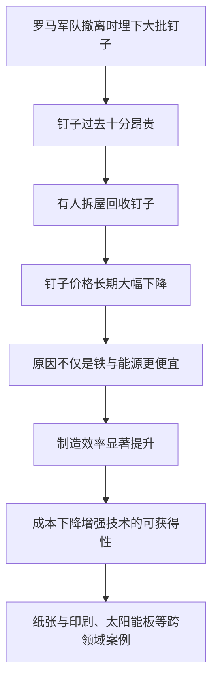
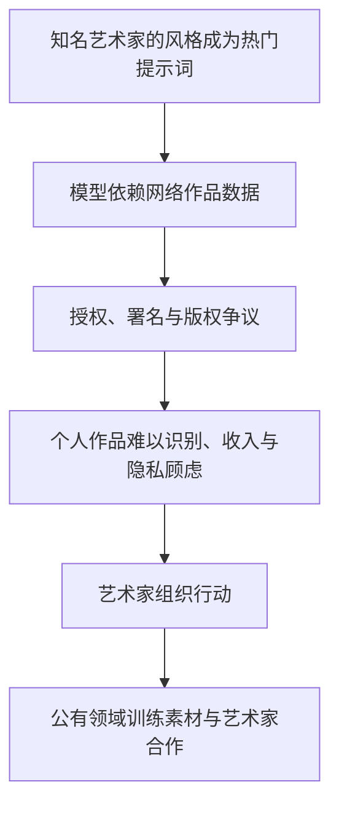
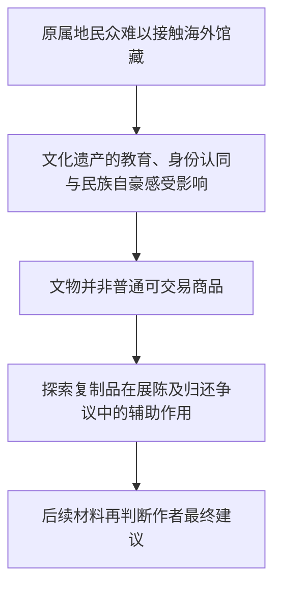
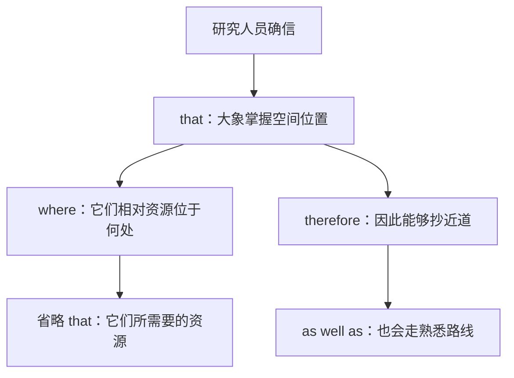
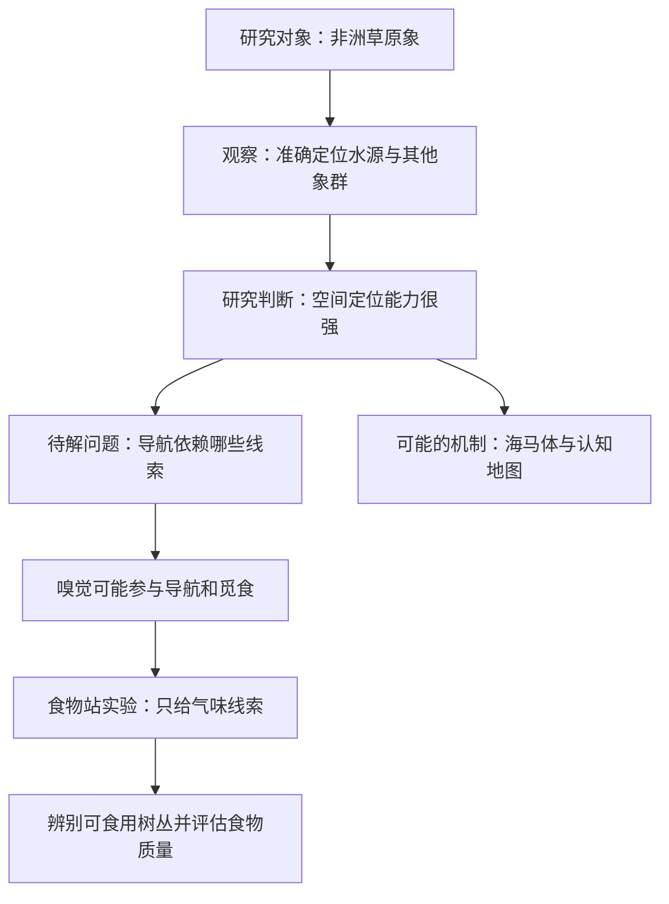

<Callout type="info" title="使用说明">
本页为根据原始资料整理的**考研英语（一）精读学习笔记**，按试卷题型顺序组织。原稿未完整提供选项的题目不会被虚构为官方答案；文中的原创巩固题与正式真题题目应予区分。
</Callout>

## 完形填空 · 自动门：从便利设计到传感器原理

<Callout type="info" title="完形填空的解题主线">

文章以自动门带来的“欢迎感”开篇，依次论述**无接触便利 → 技术商业化 → 出入口空间管理 → 传感器差异化使用**。空格涉及名词、介词、动词、形容词和逻辑连接词。**原资料没有提供各题的完整四个选项**，以下重点梳理正文与语境线索，不伪造逐题官方标准答案。

</Callout>

### 一、开篇：不用触碰的便利与无障碍出入

<Accordions>
  <Accordion title="比较结构：nothing more welcoming than ...">

**原句**

> There's nothing more welcoming than a door opening for you.

**参考译文**：没有什么比一扇为你自动打开的门更能让人感到受到欢迎。

- `There is nothing + 比较级 + than ...`：常表示强烈程度，相当于“没有比……更……的了”。
- `more welcoming`：形容词比较级作后置修饰，说明 `nothing` 的性质。
- `a door opening for you`：`opening for you` 是修饰 `door` 的现在分词短语；`a door` 在比较结构中并非与前句平行的新谓语主语。
- `welcoming`：在此指使人感到亲切、方便，不是字面“迎宾工作人员”。

</Accordion>
  <Accordion title="Q1—Q3 关联长句：without / improving / convenience">

**原句**

> Without the need to be touched to open or close, automatic doors are essential in improving disabled access to buildings and helping provide general convenience to commercial buildings.

**参考译文**：自动门无须人们接触就能开启或关闭，因此对改善残障人士进入建筑物的便利程度、提升商业建筑的整体通行便利性十分重要。

**主干**：`automatic doors are essential`，属于“主语＋系动词＋表语”。

**补充结构**

1. `Without the need to be touched to open or close`：介词短语说明**无需人为触碰的条件或特点**，`to be touched` 为被动不定式；逻辑上是“门不必被碰触”，并不是“人不必被碰触”。
2. `be essential in doing sth.`：在某方面至关重要；介词 `in` 后的 `improving ...` 与 `helping ...` 作为并列动名词结构。
3. `disabled access to buildings`：指残障人士进入建筑物的通达性、无障碍出入条件，不是“使进入建筑物失效”。
4. `general convenience`：普遍的、整体的便利性；`to commercial buildings` 指商业建筑使用场景。

**考场提示**：空格前后的介词搭配与抽象名词搭配，比孤立背诵“某词的中文意思”更重要。

</Accordion>
</Accordions>

### 二、商业化发展：从新奇装置到人群疏导

<Accordions>
  <Accordion title="商业化时间线：after being invented ...">

**原句**

> Self-sliding doors began to emerge as a commercial product in 1960 after being invented six years previously by Americans Dee Horton and Lew Hewitt.

**参考译文**：自动滑动门由美国人迪伊·霍顿和卢·休伊特在此前六年发明，并于 1960 年开始作为商业产品进入市场。

**结构层级**

- `Self-sliding doors began to emerge`：中心谓语是 `began`，`to emerge` 为其补足内容；不能把 `to emerge` 当作一个独立的“名词宾语”。
- `as a commercial product`：说明出现时的身份，即“作为一种商业产品”。
- `in 1960`：开始商业化的时间；`six years previously` 是**相对于 1960 年的此前六年**，不是距今天六年。
- `after being invented ... by ...`：`after + 动名词被动式`，修饰商业化出现的时间先后；`by` 引出发明者。

</Accordion>
  <Accordion title="Q5—Q6：started out ... but as ... benefits have extended">

**原句**

> They started out as a novelty feature, but as their use has grown, their benefits have extended within our technologically advanced world.

**参考译文**：自动门最初只是一个新奇的功能设计；但随着使用越来越广泛，其优势也在技术高度发达的现代社会中不断拓展。

- `start out as`：最初作为……出现；`novelty feature` 强调新奇特征，**并不等于“不实用”**。
- `but`：前后对比“初期的噱头／特色”和“后来实用价值的扩展”。
- `as their use has grown`：`as` 为“随着”，与主句变化同步发生，不必误判为“因为”。
- `their benefits have extended`：现在完成时概括从初期到现在持续发展的结果。

</Accordion>
  <Accordion title="人群管理：especially useful / act as / by reducing">

**原句**

> Particularly useful in busy locations or during times of emergency, the doors act as crowd management by reducing the obstacles put in people's way.

**参考译文**：这种门在人流密集场所或紧急情况下尤其有用；它们能够减少人们通行时遇到的障碍，从而帮助疏导人群。

**重点分析**

- `Particularly useful ...`：句首形容词短语，补充说明主语 `the doors` 的适用情形；不是一个缺少谓语的独立句子。
- `act as crowd management`：此处意为发挥人群疏导、通行管理作用，不宜逐词硬译成“作为人群管理本身”。
- `by reducing ...`：`by + -ing` 表“通过什么方式”，说明疏导的实现机制。
- `obstacles put in people's way`：`put in people's way` 是修饰 `obstacles` 的过去分词短语；`in one's way` 是妨碍通行／阻碍行动。

</Accordion>
</Accordions>

### 三、侧向开启：为何节省空间？

<Accordions>
  <Accordion title="Q9—Q10：the way (in which / that) ... 与 occupied by ...">

**原句**

> As well as making access both in and out of buildings easier for people, the difference in the way many of these doors open helps reduce the total area occupied by them.

**参考译文**：除了让人们进出建筑物更加方便外，许多自动门独特的开启方式还有助于减少它们所占用的空间。

**主干**：`the difference ... helps reduce the total area ...`。

- `As well as making ... easier`：`as well as + -ing` 表“除了……之外，还……”。
- `make + 宾语 + 形容词`：`making access ... easier`，`easier` 是宾语补足语。
- `the way (in which / that) many of these doors open`：`way` 后可以用 `in which`、`that` 或零关系词引导定语从句；不要照抄成不自然的 `the way how ...`。
- `occupied by them`：过去分词短语修饰 `the total area`，表示门的开启动作所需要的占地空间。

</Accordion>
  <Accordion title="with + 名词 + 现在分词：侧滑门板的动作">

**原句**

> Automatic doors often open to the side, with the panels sliding across one another.

**参考译文**：自动门通常向侧面开启，门板相互错开、沿侧向滑动。

- 主干：`Automatic doors often open to the side`。
- `with the panels sliding across one another` 是 **with 复合结构**，即 `with + 名词 + 现在分词`，表示伴随的动作状态。
- `the panels` 是 `sliding` 的逻辑主语；若换成 `slid` 会改变句意和结构。
- `across one another` 强调门板交错滑动，不必硬写成“门板一定滑到另一扇固定门上”。

</Accordion>
  <Accordion title="Q11—Q12：allow ... to ... / without having to ...">

**原句**

> Replacing swing doors, these allow smaller buildings to maximise the usable space inside without having to clear the way for a large, sticking-out door.

**参考译文**：用这种门替代平开门后，较小的建筑物就能最大化利用室内空间，而不必再为向外伸出的宽大门扇预留开门位置。

- `Replacing swing doors`：现在分词短语，交代“通过取代原有平开门”这一背景或方式。
- `allow A to do B`：`allow smaller buildings to maximise ...`，其中建筑物是拟人化转喻，实际受益者是建筑使用者和空间设计者。
- `without having to do`：表示“不必做”，`having to` 不等于完成时。
- `clear the way for`：腾出空间、清除障碍，不是“清理一条道路”。
- `sticking-out`：形容词，指向外突出的；形容平开门的占用空间。

</Accordion>
</Accordions>

### 四、自动门的不同传感器如何匹配场景

<Accordions>
  <Accordion title="Q13—Q15：with 复合结构、when to open 与让步关系">

**原句 A**

> There are many different types of automatic door, with each relying on specific signals to tell them when to open.

**参考译文**：自动门有很多不同的类型，每一种都依靠特定信号来判断应该何时开门。

`There are ...` 是存在句；`with each relying on ...` 是 **with 复合结构**，其中 `each` 指每种门，`relying` 以 `each` 为逻辑主语。`to tell them when to open` 表明信号的作用，`when to open` 是 **疑问词＋不定式** 的结构，不能误判为一般时间状语从句。

**原句 B**

> Although these methods differ, the main principles remain the same.

**参考译文**：虽然开门方式各有差异，基本原理却大体相同。

`Although` 明确让步关系；主干 `the main principles remain the same` 采用系表结构。核心是**差异中的共同性**。

</Accordion>
  <Accordion title="Q16—Q17：analyse ... as ... / complement ...">

**原句 A**

> Each automatic door system analyses the light, sound, weight or movement in their vicinity as a signal to open.

**参考译文**：每套自动门系统都会检测附近的光线、声音、重量或运动变化，并将这些信息作为开门的信号。

- `analyse A as B`：把 A 分析／判定为 B。这里可能涉及光学、声学、压力或运动信号。
- `in their vicinity`：在门的附近；`vicinity` 是“邻近区域”，不是“速度”。
- 原句 `Each ... their ...` 用单数泛指整体、后文复数物主代词的自然表达，整理时不需擅自改动其英文内容。

**原句 B**

> Sensor types are chosen to complement the different environments they are needed in.

**参考译文**：人们会根据不同的应用环境选择与之相适配的传感器类型。

- `are chosen`：被动语态，选择的实施者未明说。
- `to complement`：不定式表目的，意思是“与……配合、相适应”，不表示“称赞”。
- `environments (that / which) they are needed in`：省略关系词的定语从句，修饰 `environments`；介词 `in` 留在句尾属于常见结构。

</Accordion>
  <Accordion title="Q18—Q20：繁忙街道为何不适合运动感应门">

**原句 A**

> For example, a busy street might not suit a motion-sensored door, as it would constantly be opening for passers-by.

**参考译文**：例如，繁忙街道的环境可能不适合使用运动感应门，因为门会不断被路过的人触发开启。

`might not suit` 是“可能不适合”；`as` 在本句引导**原因状语从句**，原因是 `it would constantly be opening for passers-by`。`passers-by` 为 `passer-by` 的复数。

**原句 B**

> A pressure-sensitive mat would be more appropriate to limit the surveyed area.

**参考译文**：相比之下，使用压力感应垫可能更恰当，因为它能够限制传感器需要检测的范围。

`pressure-sensitive mat` 是压力感应垫；`surveyed area` 在此指**感应／检测区域**，不是“问卷调查范围”。`to limit ...` 解释其适用原因或目的。

</Accordion>
</Accordions>

### 完形填空：语境线索与高频搭配

| 考查位置 | 上下文提示 | 解题关注点 |
| --- | --- | --- |
| Q1—Q3 | 无须接触、残障通达性、商业场所便利 | `without`、`improving access`、`provide convenience` |
| Q4 | 1960 年商业化，发明时间更早 | `previously` 与时间先后 |
| Q5—Q6 | `novelty feature` 转向广泛用途 | `start out as`；`but as ...` |
| Q7—Q8 | 繁忙场所、紧急情况、人群疏导 | `particularly useful`；`act as` |
| Q9—Q10 | 侧开式门节省空间 | `as well as`、`occupied by` |
| Q11—Q12 | 取代平开门、节省内部空间 | `allow ... to`、`clear the way` |
| Q13—Q15 | 多种门型共用基本原理 | `rely on`、`when to open`、`although` |
| Q16—Q17 | 信号检测与环境适配 | `analyse ... as`、`complement` |
| Q18—Q20 | 人流频繁的街道、压力感应垫 | `for example`、`suit`、`appropriate` |

<Callout type="warn" title="完形填空与标准答案的边界">

这里的 Q1—Q20 是**题目位置与解题线索索引**，不是未经核对的官方选择题答案。由于原始转写材料未提供完整 A—D 选项，不能根据当前印出的完整文章反推选项字母。

</Callout>

### 技术与篇章词汇表

| 表达 | 语境含义 | 典型搭配 |
| --- | --- | --- |
| `welcoming` | 让人感到方便／受到欢迎的 | `a welcoming gesture` |
| `disabled access` | 无障碍通行条件 | `improve access` |
| `convenience` | 便利性 | `provide convenience` |
| `commercial product` | 商业化产品 | `emerge as` |
| `novelty feature` | 新颖的功能或装置 | `start out as` |
| `emergency` | 紧急情况 | `during times of emergency` |
| `crowd management` | 人群引导、疏导管理 | `act as` |
| `obstacle` | 障碍 | `put obstacles in one's way` |
| `swing door` | 平开门 | 与 `sliding door` 对照 |
| `maximise` | 最大限度利用 | `maximise space` |
| `vicinity` | 附近区域 | `in the vicinity` |
| `rely on` | 依靠 | `rely on signals` |
| `complement` | 与……互补、相适配 | 注意不是 `compliment`“称赞” |
| `motion-sensored` | 运动传感的 | 用于门控系统 |
| `pressure-sensitive` | 压力感应的 | `pressure-sensitive mat` |
| `passer-by` | 过路人 | 复数 `passers-by` |
| `surveyed area` | 检测区域 | 传感器语境 |

### 原创巩固

<Question id="zz2024cloze-review01" type="single" tags="2024英语一,完形填空,原创巩固,衔接逻辑">

`They started out as a novelty feature, but as their use has grown, their benefits have extended ...` 中的 `but` 主要体现：

<Option>两种传感器在工作原理上完全相同</Option>
<Option correct>自动门从新奇设计发展为具有广泛实际价值的技术</Option>
<Option>自动门商业化后完全没有带来便利</Option>
<Option>自动门直到现在都未出现于商业建筑</Option>

<Solution>

**答案：B。**`started out` 指初始阶段，`as ... has grown` 与 `benefits have extended` 指发展后的变化，`but` 把两者对照起来。

</Solution>
</Question>

<Question id="zz2024cloze-review02" type="single" tags="2024英语一,完形填空,原创巩固,语法结构">

`with the panels sliding across one another` 中，`sliding` 与 `the panels` 的关系是：

<Option>独立谓语和形式宾语</Option>
<Option correct>现在分词表示以 panels 为逻辑主语的主动动作</Option>
<Option>过去分词表示门板被动地滑动</Option>
<Option>定语从句修饰 `automatic doors`</Option>

<Solution>

**答案：B。**&#x2060;该结构为 `with + 名词 + 现在分词`，说明开门时门板所发生的伴随动作。

</Solution>
</Question>

<Question id="zz2024cloze-review03" type="single" tags="2024英语一,完形填空,原创巩固,技术情境">

为什么繁忙街道可能更适合压力感应垫，而非普通运动感应门？

<Option>压力感应垫可在建筑任何位置感知所有人的运动</Option>
<Option>运动感应门完全不可能用于室内环境</Option>
<Option correct>压力感应垫可限制检测范围，避免路人频繁触发开门</Option>
<Option>压力感应垫的唯一作用是降低建筑物高度</Option>

<Solution>

**答案：C。**`constantly be opening for passers-by` 是问题，`limit the surveyed area` 是针对性解决方式。

</Solution>
</Question>

---

## 阅读 Text 1 · 一颗钉子如何解释技术进步与价格变化

<Callout type="info" title="文章主旨：改变世界的不一定是最炫目的发明">

作者以罗马人埋藏钉子的历史事件开篇，说明手工制造时代**一颗小钉子具有高价值**；再借经济学家的长期价格研究，论证制造工艺与生产效率如何使日常技术逐渐普及。结尾以古登堡印刷机、纸张和太阳能电池板为例，强调：**技术革新的社会影响，不仅取决于能否发明，还取决于能否降本普及。**

</Callout>

### 一、开篇悬念：罗马人为什么埋下近百万颗钉子？

<Accordions>
  <Accordion title="事件背景：as 时间从句与冒号的解释功能">

**原句**

> Nearly 2,000 years ago, as the Romans began to pull out of Scotland, they left behind a curious treasure: 10 tons of nails, nearly a million of the things.

**参考译文**：近两千年前，罗马人开始撤离苏格兰时，留下了一批奇特的“宝藏”：足足十吨、将近一百万颗钉子。

**主干拆解**

1. `Nearly 2,000 years ago`：时间状语，为后文叙事设定历史背景。
2. `as the Romans began to pull out of Scotland`：`as` 引导时间状语从句，表示“当……之时”。
3. `they left behind a curious treasure`：主句主干，主语 `they` 指罗马人。
4. 冒号后的 `10 tons of nails` 解释 `a curious treasure`，`nearly a million of the things` 又补充说明规模。

**词义**：`pull out of` 是撤出、退出；`leave behind` 是离开时遗留；`treasure` 在此带有“竟然是钉子”的悬念与反差。

</Accordion>
  <Accordion title="发现藏钉地点：过去分词后置修饰">

**原句**

> The nail hoard was discovered in 1960 in a four-metre-deep pit covered by two metres of gravel.

**参考译文**：1960 年，人们在一个深四米、上方覆盖着两米厚砾石的坑中发现了这批储藏的钉子。

- `The nail hoard was discovered`：被动语态，强调发现事件，不要求知道发现者身份。
- `in 1960`：发现时间；`in a four-metre-deep pit`：发现地点。
- `covered by two metres of gravel`：过去分词短语，修饰 `pit`，即“被两米厚的砾石覆盖的坑”，不是修饰“发现者”。
- `hoard`：储藏物、秘藏的一批东西，不能因其另有“囤积”义就译成“钉子货币”。
- `four-metre-deep`：复合形容词中的计量单位用单数 `metre`。

</Accordion>
</Accordions>

### 二、钉子为何珍贵：撤离与战略物资的联系

<Accordions>
  <Accordion title="Q21 · 表语从句中包含原因推断">

**原句 A**

> Why had the Romans buried a million nails?

**参考译文**：罗马人为什么要把一百万颗钉子埋起来？

**原句 B**

> The likely explanation is that the withdrawal was rushed, and they didn't want the local Caledonians getting their hands on 10 tons of weapon-grade iron.

**参考译文**：一种较有可能的解释是，罗马军队撤离得很仓促，而且他们不想让当地的喀里多尼亚人得到这十吨可以用来制造武器的铁。

**结构要点**

1. `The likely explanation is that ...`：`that` 引导表语从句，具体解释“原因是什么”。
2. `the withdrawal was rushed` 与 `they didn't want ...` 并列；撤离仓促和不让对方获得铁材是相互补充的解释。
3. `want sb. doing sth.`：`they didn't want the local Caledonians getting ...`，表示不愿意看到当地人获取铁材；这里的 `getting` 是宾语补足语，不是独立谓语。
4. `get one's hands on ...`：设法得到、获得。
5. `weapon-grade iron`：足以用来制造武器的铁料，不是“已经制造出的十吨武器”。

<Callout type="warn" title="推断 ≠ 已证实的史实">

`likely explanation` 表示**较为可能的解释**。文章没有把罗马军队每个参与者的动机都以直接史料证明，因此阅读题不能把推测改写成唯一、确定的事实。

</Callout>

</Accordion>
  <Accordion title="so ... that：藏得如此深，以至于……">

**原句**

> The Romans buried the nails so deep that they would not be discovered for almost two millennia.

**参考译文**：罗马人把钉子埋得如此之深，以至于人们将近两千年都未能发现它们。

- `so + 形容词／副词 + that ...`：结果状语从句。
- `deep` 描述埋藏的深度；`they would not be discovered` 为过去视角下的未来被动结果。
- `for almost two millennia`：持续时间，“将近两个千年”。`millennium` 单数、`millennia` 复数。

**易错点**：结果从句不是一个带明确主观目的的 `so that` 目的状语从句；本句重心是**埋藏深度导致长期未被发现**。

</Accordion>
</Accordions>

### 三、为何有人拆毁整栋房子去回收钉子？

<Accordions>
  <Accordion title="铁匠的劳动：价格不只是原材料成本">

**原句**

> Later civilisations would value the skilled blacksmith's labour in a nail even more than the raw material.

**参考译文**：在后来的文明社会中，人们对一颗钉子所凝结的熟练铁匠劳动的重视程度，甚至超过了对其原材料的重视。

- 主干：`Later civilisations would value ... even more than ...`。
- `skilled blacksmith's labour in a nail`：指体现在钉子中的手工劳动价值，`in a nail` 不意味着铁匠真的住在钉子里面。
- `even more than the raw material`：比较的是**加工劳动**与**原材料**的重要性。
- `would` 在历史叙述中可描述过去某一时期的常见做法或状况，不必统一译成“将会”。

</Accordion>
  <Accordion title="Q22 · 作者引述历史实例的目的">

**原句**

> As Roma Agrawal explains in her new delightful book *Nuts and Bolts*, early 17th-century Virginians would sometimes burn down their homes if they were planning to relocate.

**参考译文**：正如罗马·阿格拉沃尔在她的新书《螺母与螺栓》中所描述的，17 世纪早期的弗吉尼亚居民有时甚至会在打算搬家时烧掉自己的房屋。

**句法层次**

- `As Roma Agrawal explains ...`：`as` 引导的句首评注性从句，相当于“正如……所解释的”。有的教材归作非限制性定语从句，但在翻译时把它处理为**信息来源说明**更清晰。
- `early 17th-century Virginians would sometimes burn down their homes`：主句。`would sometimes` 表过去会有的做法，**不是现代将来时**。
- `if they were planning to relocate`：条件状语从句，说明这种极端行为发生在计划搬迁时。
- `burn down`：烧毁建筑，而不是仅仅“点燃一小部分”。

**原句续接**

> This was an attempt to recover the valuable nails, which could be reused after sifting the ashes.

**参考译文**：这样做是为了回收有价值的钉子；把灰烬筛过之后，这些钉子还能再次利用。

- `This` 回指“烧毁旧房的做法”。
- `to recover the valuable nails`：不定式修饰 `an attempt`，说明行动目的。
- `which could be reused`：非限制性定语从句修饰 `the valuable nails`。
- `after sifting the ashes`：`after + -ing` 表时间先后；`sift` 是“筛、筛选”，不是“使灰烬下沉”。

</Accordion>
  <Accordion title="Q22 长句：that 同位语从句与 how 感叹内容从句">

**原句**

> The idea that one might burn down an entire house just to reclaim the nails underlines how scarce, costly and valuable the simple-seeming technology was.

**参考译文**：有人竟然可能为回收钉子而烧毁整栋房屋，这一想法凸显出这种看似简单的技术在当时是多么稀缺、昂贵而有价值。

**层级解析**

1. 主干：`The idea ... underlines ...`，`The idea` 为主语中心词，`underlines` 意为“凸显、强调”。
2. `that one might burn down an entire house just to reclaim the nails`：**同位语从句**，具体说明 `idea` 的内容；这里的 `that` 既不替代名词，也不在从句中作主宾语。
3. `just to reclaim the nails`：不定式作目的状语，`just` 强调“仅仅为了”。
4. `how scarce, costly and valuable the simple-seeming technology was`：由 `how` 引出的感叹性名词从句，作 `underlines` 的宾语；内部语序为 `how + 形容词 + 主语 + 系动词`。
5. `simple-seeming technology` 指看起来不起眼的钉子制造技术；**并非说制造过程真的简单**。

**考场方法**：先隔离 `that ... nails` 同位语从句，句子可简化为 `The idea underlines how ... the technology was`，再翻译多层限定。

</Accordion>
</Accordions>

### 四、核心证据：价格长期下降说明了什么？

<Accordions>
  <Accordion title="价格下降幅度：90% 及其统计对象">

**原句**

> The price of nails fell by 90% between the late 1700s and mid-1900s, as economist Daniel Sichel points out in a research paper.

**参考译文**：正如经济学家丹尼尔·西奇尔在一篇研究论文中指出的，从 18 世纪末到 20 世纪中叶，钉子的价格下降了 90%。

- `The price of nails fell by 90%`：下降的是**钉子的价格**，不是钉子的使用数量或生产产能。
- `fell by 90%`：比原来的价格下降 **90%**；不能把 `by` 误译为“降到了原来的 90%”。
- `between the late 1700s and mid-1900s`：时间范围是 18 世纪末至 20 世纪中叶。
- `as economist ... points out ...`：评注性 `as` 从句，指出证据来源，而非在 18 世纪“这位经济学家同时在发表论文”。

</Accordion>
  <Accordion title="Q23 关联句：although 的让步与生产工艺的主因">

**原句**

> According to Sichel, although the falling price of nails was driven partly by cheaper iron and cheaper energy, most of the credit goes to nail manufacturers who simply found more efficient ways to turn steel into nails.

**参考译文**：西奇尔认为，尽管铁料和能源成本下降对钉子降价起到了一定作用，但更大的功劳应归于钉子制造商——他们找到了将钢材加工为钉子的更高效方法。

**句法与逻辑**

- `According to Sichel`：表明该判断出自研究者，不可省成“作者已经直接实验证明”。
- `although ... was driven partly by ...`：让步状语从句，`partly` 只承认原料、能源更便宜是**部分原因**。
- 主干：`most of the credit goes to nail manufacturers`，`credit` 在此指**功劳、主要贡献**，不是贷款、信用卡积分。
- `who simply found more efficient ways ...`：定语从句修饰制造商。
- `to turn steel into nails`：不定式修饰 `ways`，指出加工方法；`turn A into B` 表“把 A 制成 B”。

<Callout type="idea" title="文章核心因果链">

钉子降价并非完全归因于原材料变便宜，作者通过 `although ... partly ..., most ...` **先让步，再强调生产技术和效率改善**。观点题往往考后半句的着重点。

</Callout>

</Accordion>
</Accordions>

### 五、为何用钉子研究历史价格，而不用跑车？

<Accordions>
  <Accordion title="Q24 · 研究对象虽然变化，却保持可比性">

**原句 A**

> Nails themselves have changed over the years, but Sichel studied them because they haven't changed much.

**参考译文**：这些年来钉子确实发生了一些变化，但西奇尔之所以研究钉子，恰恰是因为它们的基本形态并没有发生太大变化。

**关键词**：`themselves` 用于强调“钉子本身”；`but` 指出“变化”与“变化不大”表面矛盾，背后强调跨时段可比性；`because` 给出研究理由。

**原句 B**

> Roman lamps and Roman chariots are very different from LED strips and sports cars, but Roman nails are still clearly nails.

**参考译文**：罗马时代的灯具和战车与今天的 LED 灯带、跑车差别极大，但罗马时代的钉子显然仍是我们今天所说的钉子。

**比较结构**：`be different from`；两组技术之间的对比体现**产品迭代跨度不同**。不能把这句话简单处理成“罗马人已有 LED 灯和跑车”。

**原句 C**

> It would be absurd to try to track the changing price of sports cars since 1695, but to ask the same question of nails makes perfect sense.

**参考译文**：如果试图追踪跑车自 1695 年以来的价格变化，那就十分荒谬；但对钉子提出相同问题，却完全合理。

- `It would be absurd to try ...`：形式主语 `It`，真正的主语是后面的不定式短语。
- `to ask the same question of nails makes perfect sense`：不定式短语作**后半句的主语**。
- `make sense`：合乎情理、有意义，绝不只译为“制造意义”。
- **论证意图**：跑车并不存在一个可持续数百年的同质价格序列，而钉子功能基本稳定，适合做长期价格比较。

</Accordion>
</Accordions>

### 六、作者的经济学视角：普及比“炫技”更重要

<Accordions>
  <Accordion title="作者自述：为什么总关注价格">

**原句 A**

> I make no apology for being obsessed by a particular feature of everyday objects: their price.

**参考译文**：我毫不避讳自己对日常物品的一个特征格外着迷，那就是它们的价格。

`make no apology for ...` 表“并不因……而感到需要道歉／理直气壮地承认”；并非正式向谁“提交了一份道歉文件”。`obsessed by` 是“被……强烈吸引”。冒号后 `their price` 解释 `a particular feature`。

**原句 B**

> I am an economist, after all.

**参考译文**：毕竟，我是一名经济学家。

`after all` 在此解释作者为什么重视价格；它是承接论证的提示词，而非机械表示“在所有事物之后”。

</Accordion>
  <Accordion title="双重强调句：谁受宣传，谁真正改变世界？">

**原句**

> After writing two books about the history of inventions, one thing I've learnt is that while it is the enchantingly sophisticated technologies that get all the hype, it's the cheap technologies that change the world.

**参考译文**：写了两本关于发明史的书后，我悟出一个道理：尽管那些精妙复杂的技术往往最受追捧、宣传声势最大，但真正改变世界的却是价格低廉、能够广泛应用的技术。

**四步拆句**

1. 句首 `After writing two books ...` 是时间状语，修饰作者得出认识这一行为。
2. `one thing (that) I've learnt`：省略关系代词的限制性定语从句修饰 `one thing`。
3. `is that ...`：系动词 `is` 后的表语从句说明“学到的道理”。
4. 里面包含 `while ... , ...` 的让步／对照关系。前后各有一个 **it-cleft 强调句**：

   - `it is the enchantingly sophisticated technologies that get all the hype`：受到最多宣传的是精妙复杂的技术。
   - `it's the cheap technologies that change the world`：真正改变世界的是便宜的技术。

**强调句还原**：

`The enchantingly sophisticated technologies get all the hype.`

`The cheap technologies change the world.`

**理解关键**：作者没有说精密技术“一无是处”，而是强调**社会影响不一定等同于技术的夺目程度，成本下降是广泛普及的重要条件**。

</Accordion>
  <Accordion title="古登堡与纸：without 的隐含反事实">

**原句**

> The Gutenberg printing press transformed civilisation not by changing the nature of writing but by changing its cost—and it would have achieved little without a parallel collapse in the price of surfaces to write on, thanks to an often-overlooked technology called paper.

**参考译文**：古登堡印刷机改变文明，并不是因为它改变了书写本身的性质，而是因为它大幅改变了书写的成本。与此同时，如果没有承载文字的材料价格也同步大幅下降，印刷机本身能够取得的成就恐怕十分有限；促成这一降价的，是常常被忽略的技术——造纸。

**第一层：真正改变了什么**

- 主干：`The Gutenberg printing press transformed civilisation`。
- `not by changing the nature of writing but by changing its cost`：`not ... but ...` 排除“改变书写性质”，强调“降低书写或信息复制的成本”。

**第二层：必要的配套条件**

- `and it would have achieved little without ...`：`would have + 过去分词` 与 `without` 构成过去事实的**隐含反事实**。如果缺少低廉的书写载体，印刷机成果会大打折扣。
- `a parallel collapse in the price of surfaces to write on`：`collapse` 是价格的剧烈下降；`surfaces to write on` 指纸张等文字承载媒介，不是地理上的“地表”。
- `thanks to an often-overlooked technology called paper`：说明价格下降得益于纸张这种技术媒介；`called paper` 是过去分词短语修饰 `technology`，不是原因状语。

**不要漏掉的转折**：印刷机是显眼的大技术，廉价纸张却是使印刷收益能够规模化释放的关键配套条件；该例证深化文章的“低成本才使技术影响扩大”。

</Accordion>
  <Accordion title="太阳能板：从小众应用到能源系统转型">

**原句**

> Solar panels had a few niche uses until they became cheap; now they are transforming the global energy system.

**参考译文**：太阳能电池板在价格降下来之前，只适用于少数小众用途；如今，它们正在改变全球能源体系。

- `had a few niche uses`：早期只有有限的、特定场景的应用。
- `until they became cheap`：关键时间分界点是“价格降低”。
- 分号后的 `now`：形成历史与当下的对比；`are transforming` 是当前正在进行的变化。
- `niche`：小众细分领域；不宜译成“壁龛用途”。

</Accordion>
</Accordions>

### 论证结构：从历史悬念到一般规律

### 阅读题定位与陷阱

| 题号线索 | 定位段落 | 核心推理 | 容易误选的方向 |
| --- | --- | --- | --- |
| Q21 | 罗马军队埋钉 | 撤离仓促＋不愿当地人获取战略铁材 | 把 `likely explanation` 当成绝对确定的史实 |
| Q22 | 弗吉尼亚人烧屋取钉 | 钉子的加工劳动和回收价值很高 | 仅理解为当时建筑防火措施落后 |
| Q23 | 长期价格下降 | 制造效率提升是研究者强调的主要原因 | 把全部原因归于廉价原材料 |
| Q24 | 钉子变化不大 | 产品功能可比，适于长期价格研究 | 认为钉子数百年间完全没有变化 |
| 全文主旨 | 古登堡与太阳能板 | 价格下降帮助技术普及、扩大社会影响 | 认为越复杂的技术才一定越重要 |

### 核心词汇与表达

| 单词／搭配 | 本文含义 | 对照提示 |
| --- | --- | --- |
| `hoard` | 成批的储藏物 | `a hoard of nails` |
| `pull out of` | 撤出 | 语境为罗马军队撤离 |
| `gravel` | 砾石 | 坑的覆盖物 |
| `withdrawal` | 撤退、撤离 | 非银行“提款”义 |
| `weapon-grade` | 可制武器等级的 | 修饰 `iron` |
| `get one's hands on` | 获取、搞到 | 不只指用手触碰 |
| `blacksmith` | 铁匠 | 手工劳动价值 |
| `sift` | 筛选 | `sift the ashes` |
| `reclaim` | 回收、取回 | `reclaim the nails` |
| `scarce` | 稀缺的 | 供给少 |
| `costly` | 昂贵的 | 成本高 |
| `underlie / underline` | 作为根本原因／强调 | 本文 `underlines` = 凸显 |
| `credit goes to` | 功劳归于 | 不是消费信贷 |
| `nail manufacturer` | 钉子制造商 | 技术效率主体 |
| `make sense` | 合乎情理 | `make perfect sense` |
| `obsessed` | 强烈着迷的 | `be obsessed by / with` |
| `sophisticated` | 精密复杂的 | 与 `cheap` 形成对照 |
| `hype` | 大肆宣传 | 不等于“真实使用价值” |
| `parallel collapse` | 同步大幅下降 | 价格变化 |
| `niche` | 小众、细分的 | `niche uses` |

### 原创巩固

<Question id="zz2024text1-review01" type="single" tags="2024英语一,阅读,原创巩固,事实推断">

罗马人掩埋大量钉子的可能原因是什么？

<Option>他们准备制造大型太阳能设备</Option>
<Option correct>撤离仓促，同时不愿使当地人获得大量可用于制作武器的铁材</Option>
<Option>当地人早已彻底掌握更高效的现代制钉技术</Option>
<Option>他们认为铁钉没有经济价值</Option>

<Solution>

**答案：B。**`withdrawal was rushed` 与 `didn't want ... getting their hands on ... weapon-grade iron` 构成并列的推测理由。注意原文称 `likely explanation`，不是唯一解释。

</Solution>
</Question>

<Question id="zz2024text1-review02" type="single" tags="2024英语一,阅读,原创巩固,句法">

`The idea that one might burn down an entire house ...` 中的 `that` 从句应如何理解？

<Option correct>同位语从句，说明 the idea 的具体内容</Option>
<Option>限制性定语从句，that 在从句中作主语</Option>
<Option>结果状语从句，意为“以至于”</Option>
<Option>条件状语从句，意为“如果”</Option>

<Solution>

**答案：A。**`that one might burn down ...` 是完整陈述句，解释 `idea` 到底指何种想法；`that` 在从句内部不担任主、宾语。

</Solution>
</Question>

<Question id="zz2024text1-review03" type="single" tags="2024英语一,阅读,原创巩固,论证主因">

根据经济学家西奇尔的说明，钉子价格大幅下降最主要归功于：

<Option>钉子作为原材料被完全替代</Option>
<Option>所有地方的铁矿资源无限供应</Option>
<Option correct>制造商发现了更高效的制钉方法</Option>
<Option>罗马军队留下的钉子被持续使用了两千年</Option>

<Solution>

**答案：C。**`although ... partly ... most of the credit goes to nail manufacturers who ... found more efficient ways` 采用先让步、后突出主要解释的结构。

</Solution>
</Question>

<Question id="zz2024text1-review04" type="single" tags="2024英语一,阅读,原创巩固,主旨理解">

作者为什么在结尾谈到古登堡印刷机、纸张和太阳能电池板？

<Option>为了说明古代的所有技术都比现代技术可靠</Option>
<Option>为了证明纸张比任何电子设备都更复杂</Option>
<Option correct>说明技术成本下降和配套条件成熟，可以显著扩大其社会影响</Option>
<Option>为了证明只有最受宣传的技术才能改变文明</Option>

<Solution>

**答案：C。**&#x2060;印刷机的影响需要廉价书写载体配合，太阳能板也在变便宜后扩展用途，呼应 `it's the cheap technologies that change the world`。

</Solution>
</Question>

---

## 阅读 Text 2 · 共同育儿与狩猎采集社会的启示（前半）

<Callout type="info" title="当前材料涉及的核心假说">

文章介绍研究者从非洲狩猎采集社群的育儿实践中得到的启发：**多个成年人共同照看孩子，以及较年长儿童参与照护，可能缓解孩子和照料者的焦虑。** 这里的 `may / could` 表示研究假说或谨慎推断；后续完整论证将在后面的文本中继续展开。

</Callout>

### 一、研究切入点：从其他社会寻找育儿启发

<Accordions>
  <Accordion title="报道语后置：Parenting tips ... may be ... researchers have suggested">

**原句**

> Parenting tips obtained from hunter-gatherers in Africa may be the key to bringing up more contented children, researchers have suggested.

**参考译文**：研究者提出，从非洲狩猎采集群体的育儿实践中总结出的经验，可能有助于培养出更加快乐、满足的孩子，甚至可能是其中的关键。

**句子主干**：`Parenting tips ... may be the key ...`。

- `obtained from hunter-gatherers in Africa`：过去分词短语修饰 `Parenting tips`，说明建议来源；并不是说所有非洲人都实行相同的育儿方式。
- `may be the key to ...`：`may` 留有可能性；`the key to` 中的 `to` 是**介词**，后接 `bringing up` 动名词，而非 `to bring` 原形不定式。
- `more contented children`：更感满足、情绪较安稳的孩子，`contented` 不等于“内容丰富的”。
- `researchers have suggested`：后置报道语，表明这是研究者提出的认识，而不是文章无条件承诺的育儿结果。

</Accordion>
  <Accordion title="地点定语：where each child is cared for by many adults">

**原句**

> The idea is based on studies of communities such as the Kung of Botswana, where each child is cared for by many adults.

**参考译文**：这一观点源于对博茨瓦纳昆人等社群的研究。在这些社群中，一个孩子往往由多位成年人共同照看。

- `The idea is based on studies ...`：主干，`be based on` 表示观点的依据。
- `communities such as the Kung of Botswana`：例证，强调研究针对特定社群；`such as` 不是因果连接词。
- `where each child is cared for by many adults`：`where` 引导非限制性定语从句，补充说明社群中的照护情形，指代前面的社群／环境。
- `be cared for by`：被照料、由……照顾，`for` 是短语动词 `care for` 不可省的一部分。

<Callout type="warn" title="文化研究中的表述范围">

这里介绍的是**被研究社群中的观察**，不是说世界各地儿童都由许多成年人照料，更不能据此断言任何一种家庭模式对所有孩子都更有效。

</Callout>

</Accordion>
  <Accordion title="两个并列事实：年长儿童帮助照护与 baby-wearing">

**原句**

> Kung children as young as four will help to look after younger ones and “baby-wearing”, in which infants are carried in slings, is considered the norm.

**参考译文**：昆人社群中，年仅四岁的孩子就会帮忙照料更小的孩子；而用背巾或吊带贴身携带婴儿的做法也被视为常态。

**先把两个并列主语拆开**

1. `Kung children as young as four will help to look after younger ones`：第一分句说明较年长儿童参与照护。`as young as four` 强调年龄小至四岁，不是“超过四岁”。
2. `and “baby-wearing” ... is considered the norm`：第二分句说明背带育儿是普遍做法。`baby-wearing` 是主语，`is considered` 为被动谓语。
3. `in which infants are carried in slings`：非限制性定语从句，解释 `baby-wearing` 的具体方式。

**词语辨析**：`look after` 照顾；`infant` 婴儿；`sling` 育儿背巾或吊带；`the norm` 常态、通常的做法，**不是一道“社会规范强制令”**。

</Accordion>
</Accordions>

### 二、研究解释：alloparenting 是否可能缓解焦虑？

<Accordions>
  <Accordion title="may / could：研究者提出的潜在益处">

**原句**

> According to Dr Nikhil Chaudhary, an evolutionary anthropologist at Cambridge University, these practices, known as alloparenting, could lead to less anxiety for children and parents.

**参考译文**：剑桥大学的进化人类学家尼基尔·乔杜里博士表示，这种由亲生父母以外的人共同参与照护的育儿方式，被称为“共同育儿”或“非父母照护”，可能有助于减轻儿童与父母的焦虑。

- `According to Dr Nikhil Chaudhary`：明确观点来源。
- `an evolutionary anthropologist at Cambridge University`：同位语，解释研究者的专业及所属机构。
- `these practices`：回指多人照顾孩子、较大儿童帮忙及婴儿背带携带等做法。
- `known as alloparenting`：过去分词短语作补充说明。更严格的概念核心是**除亲生父母外其他个体也参与照料孩子**；背带使用方式是相关场景，不能独立等同于 `alloparenting` 的全部定义。
- `could lead to less anxiety`：`could` 表可能性，`lead to` 表潜在影响，不能改写成“已经证明能消除儿童和父母所有焦虑”。

**术语补充**：`alloparenting` 可以译作“共同育儿／非亲生父母参与照护（协同照料）”。不要因中文“异亲”字面联想而将其误解为“只有陌生人或领养父母照顾孩子”。

</Accordion>
</Accordions>

### 开篇论证结构

<Steps>
  <Step>

  ### 提出研究方向

从狩猎采集社群的照护方式中寻找现代育儿可以借鉴的经验。

</Step>
  <Step>

  ### 呈现观察样例

特定社群中的儿童由多位成年人共同照护，较年长孩子也参与，婴儿背带携带较普遍。

</Step>
  <Step>

  ### 给出谨慎推断

研究者认为这些实践**可能**有助于缓解父母与孩子的焦虑，但仅凭当前引文无法认定普遍因果效应。

</Step>
</Steps>

### 育儿社会学高频词汇

| 表达 | 含义 | 注意点 |
| --- | --- | --- |
| `parenting tips` | 育儿建议、经验 | `tips` 为实用建议 |
| `hunter-gatherers` | 狩猎采集者／群体 | 特定社会生活方式 |
| `contented` | 感到满足的 | 区别于 `content`“内容” |
| `bring up children` | 抚养、培养孩子 | `bring up` 的育儿义 |
| `be based on` | 基于…… | 观点的证据来源 |
| `community` | 社群 | 不等于互联网社区 |
| `care for` | 照料、照顾 | 被动 `be cared for` |
| `as young as four` | 小至四岁 | 强调低龄 |
| `look after` | 照看 | `look after younger ones` |
| `baby-wearing` | 用背带贴身携带婴儿 | 与育儿方式相关 |
| `infant` | 婴儿 | 比 `child` 年龄更小 |
| `sling` | 背巾、吊带 | 这里非“投石器” |
| `the norm` | 常见做法、常态 | 不一定是法律规定 |
| `alloparenting` | 非父母参与的协同照护 | 照护者不必是陌生人 |
| `evolutionary anthropologist` | 进化人类学家 | 研究者身份 |
| `lead to less anxiety` | 可能减轻焦虑 | 结合 `could` 理解 |

### 原创巩固

<Question id="zz2024text2-review01" type="single" tags="2024英语一,阅读,原创巩固,观点归属">

根据现有材料，研究者对共同育儿的看法最接近哪项？

<Option>共同育儿已被证明可完全消除所有儿童的焦虑</Option>
<Option>所有非洲社群都采用完全一致的育儿模式</Option>
<Option correct>从部分社群观察到的协同照护做法，可能有助于缓解照料者和儿童的焦虑</Option>
<Option>研究建议完全取消亲生父母的照护责任</Option>

<Solution>

**答案：C。**`communities such as ...` 限定研究对象，`could lead to less anxiety` 保留潜在效果的判断。其余选项都明显超出了原文。

</Solution>
</Question>

<Question id="zz2024text2-review02" type="single" tags="2024英语一,阅读,原创巩固,语法">

`may be the key to bringing up more contented children` 中 `to` 的词性和后续形式是：

<Option>不定式标记，后接原形 `bringing`</Option>
<Option correct>介词，后接动名词 `bringing`</Option>
<Option>连词，引导独立的目的状语从句</Option>
<Option>副词，修饰 `more`</Option>

<Solution>

**答案：B。**`the key to doing sth.` 中 `to` 是介词，故接动名词 `bringing`，不要误写成 `the key to bring`。

</Solution>
</Question>

### 本组综合复习：四种可迁移的考研方法

<Steps>
  <Step>

  ### 先找时间，再恢复前后事件的顺序

黄石公园的“考察—传播—立法”，自动门的“发明—商业化—普及”，钉子的“古代稀缺—近现代降价”，都依赖明确的时间关系。`after / before / in quick succession / over the years / until` 是快速定位线索。

</Step>
  <Step>

  ### 把从句的“内容”和“修饰”分开

`the idea that one might ...` 里的 `that` 是说明 idea 内容的**同位语从句**；`evidence that later made its way ...` 是修饰 evidence 的**定语从句**；`what the outcomes ... will be` 是**嵌入式疑问内容**。

</Step>
  <Step>

  ### 读清限定词，防止把可能写成确定

`perhaps / likely / might / could / may / would ... without ...` 分别体现判断保留、可能性或反事实推测。阅读选择题如果把它们全部改成“必然”或“已经证实”，通常有明显问题。

</Step>
  <Step>

  ### 从实例提炼作者真正的中心论证

历史钉子的重要性不仅来自“这东西很古老”，而是可以揭示生产成本；AI 营销的意义不仅在于“自动生成文案”，还必须满足数据许可与用户体验；育儿研究中的某种群体实践也不等于普遍适用的因果规律。

</Step>
</Steps>

---

## 阅读 Text 2 · 共同育儿：从人类学研究到现代家庭（续）

<Callout type="info" title="阅读主线">

前文介绍狩猎采集社群中广泛存在的**协同照护（alloparenting）**。这里的重点转向三层论证：**现代社会能否借鉴这些实践 → 核心家庭与人类照护历史的差异 → 可能带来的减压与儿童社会化收益**。研究者谈的是可以探索的机制，不能将其一律理解成已经证实的普适因果结论。

</Callout>

### 一、现代社会如何借鉴协同照护

**原句 1**

> Dr Annie Swanepoel, a child psychiatrist, believes that there are ways to incorporate them into western life.

**译文：**&#x2060;儿童精神病学家安妮·斯瓦内普尔博士认为，可以找到将这些协同照护做法融入西方生活的方式。

**拆句：**

- **主干：**`Dr Annie Swanepoel believes ...`（斯瓦内普尔博士认为……）。
- **同位语：**`a child psychiatrist` 补充说明她的职业身份，前后逗号隔开。
- **宾语从句：**`that there are ways ...`，其中 `there are` 表示“存在……方法”。
- **后置定语：**`to incorporate them into western life` 修饰 `ways`，回答“什么样的方法”。
- **指代：**`them` 承接前文的共同育儿实践，而不是指“孩子”。

**原句 2**

> In Germany, one scheme has paired an old people's home with a nursery.

**译文：**&#x2060;在德国，一项计划将一家养老院与一家托儿所结成合作单位。

**结构：**`one scheme`（主语）+ `has paired A with B`（把 A 与 B 配对／结对）。现在完成时强调这种安排已经实行并与现在有关；`in Germany` 表地点。

**原句 3**

> The residents help to look after the children, an arrangement akin to alloparenting.

**译文：**&#x2060;养老院的住户帮忙照看孩子，这种安排类似于非父母参与的协同照护。

**结构：**`The residents help to look after the children` 是主句。逗号后的 `an arrangement` 为**概括前一整件事的同位性补充说明**；`akin to alloparenting` 是形容词短语，说明这种安排的性质。此处的 `residents` 指养老院住户，不能一概译成“社区居民”。

**原句 4**

> Another measure could be encouraging friendships between children in different school years to mirror the unsupervised mixed-age playgroups in hunter-gatherer communities.

**译文：**&#x2060;另一项可能的措施是鼓励不同年级的孩子建立友谊，以借鉴狩猎采集社群中无人持续监管的混龄游戏群体的做法。

**主干：**`Another measure could be encouraging friendships ...`。“措施可能是……”中的 `could` 表示建议或可能性；`encouraging` 为动名词作表语的核心。`between children in different school years` 修饰 `friendships`，`in different school years` 修饰 `children`；`to mirror ...` 为目的状语。`unsupervised` 不宜绝对化为“没有任何成年人照顾”，它强调游戏小组不受持续、直接的成人监督。

<Accordions>
  <Accordion title="高频词与句式：incorporate、pair A with B、akin to">

| 表达 | 贴合上下文的含义 | 典型搭配与区分 |
| --- | --- | --- |
| `incorporate A into B` | 将 A 纳入／融入 B | 强调融合既有做法，而非完全照搬 |
| `scheme` | 计划、项目、方案 | 语境中不是“阴谋” |
| `pair A with B` | 将 A 与 B 配对、结成合作关系 | `has paired` 是现在完成时 |
| `nursery` | 托儿所、幼儿照护机构 | 非本句中的“苗圃” |
| `resident` | 住户、居住者 | 由前文 `old people's home` 限定 |
| `akin to` | 类似于…… | 形容词短语，常作后置说明 |
| `school year` | 学年／年级 | 这里取“不同年级”之义 |
| `mirror` | 模仿、呼应、反映 | 动词，不是“镜子” |
| `unsupervised` | 无人直接监督的 | 不等于无人照料或没有安全保障 |

</Accordion>
</Accordions>

### 二、核心家庭与演化历史的差异

**原句 5 · 观点依据**

> In a paper published in the Journal of Child Psychology and Psychiatry, researchers said that the western nuclear family was a recent invention which broke with evolutionary history.

**译文：**&#x2060;研究人员在一篇发表于《儿童心理学与精神病学杂志》的论文中指出，西方的核心家庭是相对晚近形成的社会安排，与人类漫长演化历史中的照护模式有所不同。

**主干—修饰—逻辑：**

1. `researchers said ...` 是主干；`In a paper ...` 是来源状语。
2. `published in ...` 是过去分词短语，修饰 `paper`，相当于 `which was published ...`。
3. `that the western nuclear family was a recent invention ...` 为宾语从句。
4. `which broke with evolutionary history` 为**限定性定语从句**，修饰 `a recent invention`；`break with` 是“与……决裂／偏离传统”。

<Callout type="warn" title="理解“recent invention”">

研究者是在**人类演化时间尺度**上称核心家庭为“较新的制度／模式”，不是说核心家庭由某个人或某一年“发明”；`broke with` 也不必按字面译成“打破演化史”。

</Callout>

**原句 6 · 核心论证**

> This abrupt shift to an “intensive mothering narrative”, which suggests that mothers should manage childcare alone, was likely to have been harmful.

**译文：**&#x2060;这种突然转向“密集母职叙事”的变化很可能已经造成不良影响；这种观念主张母亲应独自承担儿童照护责任。

**分层拆解：**

- **主干：**`This abrupt shift ... was likely to have been harmful.`（这一突然转变很可能产生过负面影响）。主语核心是 `shift`，`to an “intensive mothering narrative”` 补足转向的目标。
- **非限定性定语从句：**`which suggests ...` 补充说明 `an “intensive mothering narrative”`。
- **宾语从句：**`that mothers should manage childcare alone` 是 `suggests` 的内容。
- **时间与把握程度：**`was likely to have been` 含有**过去视角下对既往影响的可能性判断**，不可改成“已经确凿证明它有害”。

**原句 7**

> “Such narratives can lead to maternal exhaustion and have dangerous consequences,” they wrote.

**译文：**&#x2060;研究者写道：“此类叙事可能使母亲精疲力竭，并带来危险的后果。”

这里的 `lead to ... and have ...` 是同一主语 `Such narratives` 下的两个并列谓语结构；`can` 作用于两项，表示可能性。`they wrote` 是后置的引语归属语，不要把它分析成另一层独立的宾语从句。

### 三、研究观察：非父母照护者承担多少工作

**原句 8**

> By contrast, in hunter-gatherer societies adults other than the parents can provide almost half of a child's care.

**译文：**&#x2060;相比之下，在狩猎采集社会，父母以外的成年人能够承担近一半的儿童照护工作。

`By contrast` 明确建立与前文“独自育儿”的对比；`other than the parents` 后置修饰 `adults`；`almost half` 是**将近一半**，不能写成“超过一半”。

**原句 9**

> One previous study looked at the Efé people of the Democratic Republic of Congo.

**译文：**&#x2060;一项早先的研究考察了刚果民主共和国的埃菲人（Efé）。

`look at` 在学术论述中表示“研究、考察”，不是“看一眼”。`of the Democratic Republic of Congo` 限定研究人群的地域来源。

**原句 10 · 数据重点**

> It found that infants had an average of 14 alloparents a day by the time they were 18 weeks old and were passed between caregivers eight times an hour.

**译文：**&#x2060;研究发现，婴儿长到 18 周大时，平均每天有 14 名非父母照护者参与照顾，并且平均每小时在不同照护者之间被交接八次。

**结构：**`It found that ...` 引出研究结果；`infants had ... and were passed ...` 是 `that` 从句内并列的两个谓语。`by the time they were 18 weeks old` 是时间状语从句，`an average of 14 ... a day` 与 `eight times an hour` 使用**不同时间单位**。

<Callout type="warn" title="数据限定与研究范围">

“每天平均 14 名照护者”“每小时交接八次”是文中**一项特定研究**的观察，不能外推为世界上所有狩猎采集社会的固定标准，更不能将“照护者交接频次”理解为“弃养”或“无人负责”。

</Callout>

### 四、可能的现代启示及其限度

**原句 11 · 多重从句与并列逻辑**

> Chaudhary said that parents now had less childcare support from family and social networks than during most of humans' evolutionary history, but introducing additional caregivers could reduce stress and maternal depression, which could have a “knock-on” benefit to a child's wellbeing.

**译文：**&#x2060;乔杜里表示，与人类演化史中的大多数时期相比，如今父母从家庭和社会关系网络获得的育儿支持较少；但增加照护者可能减轻压力和产后或育儿相关的母亲抑郁问题，继而可能给儿童福祉带来连带益处。

**拆解与逻辑链：**

- `Chaudhary said that ...` 为主句及其宾语从句。
- 从句内部由 `but` 连接两层信息：`parents now had less childcare support ...`（现状）与 `introducing additional caregivers could reduce ...`（可能的改善途径）。
- `less ... than during most of humans' evolutionary history` 是比较结构，省略了可由上下文恢复的历史照护支持状况。
- `which could have a “knock-on” benefit ...` 是非限定性定语从句，主要承接**减少压力和母亲抑郁**这一作用，而不是单独修饰最近的名词 `depression`。

**原句 12 · 比例比较**

> An infant born to a hunter-gatherer society could have more than ten caregivers—this contrasts starkly to nursery settings in the UK where regulations call for a ratio of one carer to four children aged two to three.

**译文：**&#x2060;出生于狩猎采集社会的婴儿可能拥有十多位照护者；这与英国托育机构的配置形成鲜明对比：英国相关规定要求，对两至三岁的儿童，每四名儿童配备一名照护者。

- **破折号前：**`An infant ... could have more than ten caregivers`。`born to ...` 为过去分词后置修饰，`could` 仍是可能性。
- **破折号后：**`this contrasts starkly with/to ...` 表鲜明对比；`where regulations call for ...` 修饰 **nursery settings in the UK** 所指的托育情境，不宜机械地只连到 `the UK`。
- `a ratio of one carer to four children aged two to three` = **1 名照护者：4 名两到三岁儿童**；这并非“一个孩子分到四名照护者”。

**原句 13 · 教育模式比较**

> While hunter-gatherer children learnt from observation and imitation in mixed-age playgroups, researchers said that western “instructive teaching”, where pupils are asked to sit still, may contribute to conditions such as attention deficit hyperactivity disorder.

**译文：**&#x2060;狩猎采集社会的孩子通过在混龄游戏群体中观察和模仿来学习；与此形成对照，研究者指出，西方要求学生端坐接受指导的“指令式教学”可能是注意缺陷多动障碍等问题的促成因素之一。

**语法和立场：**

- `While ... , researchers said ...`：这里 `while` 以**对比／让步**为主，不是“当孩子学习时研究者正好在说”。
- `that western “instructive teaching” ... may contribute ...`：宾语从句；`where pupils are asked to sit still` 是插入的非限定性关系从句，用来描述这种教学情境。
- `are asked to sit still` 是被动结构，`to sit still` 为主语补足性不定式；不是“将 still 作动词”。
- `may contribute to` = **可能是促成因素**，尤其不能翻成“这种教学已被证明会导致 ADHD”。

**原句 14 · 结论**

> Chaudhary said that Britain should explore the possibility that older siblings helping their parents “might also enhance their own social development.”

**译文：**&#x2060;乔杜里认为，英国应探索这样一种可能性：年长的兄姐参与帮助父母照护弟妹，也可能促进兄姐自身的社会性发展。

**结构重点：**`explore the possibility that ...` 中 `that` 引导**同位语／内容从句**，说明 `possibility` 的具体内容。`older siblings helping their parents` 语义核心是“年长兄姐帮助父母的行为”；整体作 `might enhance ...` 的主语概念，`their own` 指年长兄姐自己。切勿将 `that` 误读为仅修饰 `possibility` 的定语从句（`that` 在从句内不充当宾语）。

### 高频词与近义辨析

| 词汇或搭配 | 核心义 | 考研阅读中容易混淆的点 |
| --- | --- | --- |
| `nuclear family` | 核心家庭（通常父母及其子女） | 与 `extended family` 扩展家庭区别 |
| `intensive mothering` | 高投入／密集母职模式 | 描述社会观念，不是医学诊断 |
| `abrupt shift` | 突然转变 | `shift to` 表转向 |
| `maternal exhaustion` | 母亲过度疲惫 | `maternal` = 母亲的 |
| `by contrast` | 相比之下 | 指向两个模式的鲜明反差 |
| `other than` | 除……之外 | 不等同于 `rather than`“而非” |
| `by the time` | 到……时候为止 | 注意主从句的时间顺序 |
| `knock-on benefit` | 连带的／间接的益处 | 英式表达，常对应间接效应 |
| `wellbeing` | 身心健康、福祉 | 不限于是否患病 |
| `starkly` | 鲜明地、强烈地 | 与 `contrast` 常搭配 |
| `ratio` | 比率、比例 | 辨清 A 对 B 的方向 |
| `instructive teaching` | 指令式／指导性教学 | 本文指要求端坐听讲的模式 |
| `attention deficit hyperactivity disorder` | 注意缺陷多动障碍（ADHD） | 疾病名称，不是一般的“好动” |
| `enhance social development` | 促进社会性发展 | `enhance` = 改善、提升 |

### 本篇复习策略

<Steps>
  <Step>

  ### 先标出比较对象

  将“现代核心家庭”与“狩猎采集社群的协同照护”分别列出，明确原文讨论的是育儿支持体系，而不是否定父母的照护作用。

</Step>
  <Step>

  ### 再标出证据层级

  区分特定社群的观察、某项研究的数据、专家提出的解释以及对现代社会的政策建议，不将不同层级混为一个确定结论。

</Step>
  <Step>

  ### 最后检查情态动词

  遇到 `could / may / might / likely`，在中文里保留“可能”“或许”“有助于”等限制，不夸大科研证据。

</Step>
</Steps>

### 原创巩固题

<Question id="zz2024text2-review03" type="single" tags="2024英语一,阅读,原创巩固,细节">

文中德国养老院与托儿所合作的例子主要用于说明什么？

<Option>狩猎采集社会不需要任何成年照护者</Option>
<Option correct>某些协同育儿实践可以在现代社会中探索应用</Option>
<Option>养老院住户在所有国家都承担正式教师工作</Option>
<Option>核心家庭制度是在德国首先出现的</Option>

<Solution>

**答案：B。**&#x2060;例子紧跟 `ways to incorporate them into western life`，说明将非父母成员纳入照护网络的可行思路；不支持其他三项绝对化或无关推断。

</Solution>
</Question>

<Question id="zz2024text2-review04" type="single" tags="2024英语一,语法,原创巩固">

`the possibility that older siblings helping their parents might also enhance their own social development` 中，`that` 从句的主要功能是：

<Option>修饰 `possibility`，并由 `that` 在从句中充当动词宾语</Option>
<Option correct>说明 `possibility` 所指的具体内容</Option>
<Option>引导主句的让步状语</Option>
<Option>说明上一句已经得到普遍验证</Option>

<Solution>

**答案：B。**`possibility that ...` 为内容说明关系，`that` 不在从句内充当句子成分；`might` 仍表示可能性。

</Solution>
</Question>

---

## 阅读 Text 3 · 生成式 AI 绘画、艺术家权益与版权争议

<Cards>
  <Card title="阅读主题">
    以波兰数字艺术家 Greg Rutkowski 为例，讨论图像生成模型的训练数据来源、署名权、作品传播与商业竞争问题。
</Card>
  <Card title="论证顺序">
    艺术家意外走红 → 提示词广泛使用 → 数据抓取与版权顾虑 → 搜索结果被 AI 内容淹没 → 艺术家组织行动与政策建议。
</Card>
</Cards>

### 一、背景：艺术家的名字为何成为“提示词”

**原句 1**

> A Polish digital artist who uses classical painting styles to create dreamy fantasy landscapes, Greg Rutkowski has made illustrations for games such as Dungeons & Dragons and Magic: The Gathering.

**译文：**&#x2060;格雷格·鲁特科夫斯基是一位波兰数字艺术家，擅长运用古典绘画风格创作梦幻般的奇幻风景画，也曾为《龙与地下城》和《万智牌》等游戏绘制插画。

**句法：**&#x2060;句首 `A Polish digital artist ...` 是对 `Greg Rutkowski` 的**同位语性前置说明**；`who uses ...` 是定语从句，修饰 `artist`；`to create ...` 为目的状语。全句真正主干为 `Greg Rutkowski has made illustrations for games ...`。不要将开头的 `A Polish digital artist` 误当成全句谓语所在的独立分句。

**原句 2**

> And he's become a sudden hit in the new world of text-to-image AI generation.

**译文：**&#x2060;如今，他又在“文本生成图像”的人工智能领域突然大受欢迎。

`a hit` 在此是“受欢迎的人／事物”，不是动词“击打”；`has become` 说明名气变化与现在相关。作者在为接下来的**反常现象**铺垫：艺术家本人未必因这种“走红”而受益。

**原句 3 · Q31 核心定位**

> His distinctive style is now one of the most commonly used prompts in the new open-source AI art generator Stable Diffusion.

**译文：**&#x2060;如今，在新兴的开源 AI 绘画生成器 Stable Diffusion 中，他富有辨识度的风格已经成为最常被用作提示词的风格之一。

**拆句：**`His distinctive style`（主语）+ `is`（系动词）+ `one of the most commonly used prompts`（表语）+ `in ... Stable Diffusion`（限定应用范围）。`one of the most ...` = **最……之一**，切勿译成“唯一最常用”。这里说的是在提示词中使用艺术家的风格或名字，并非“作者主动提供训练素材”。

**原句 4**

> The tool, along with other popular image-generation AI models, allows anyone to create impressive images based on text prompts.

**译文：**&#x2060;与其他热门图像生成模型一样，这一工具让任何人都能依据文字提示生成令人印象深刻的图片。

`The tool` 才是语法主语；`along with other ... models` 是插入性伴随结构，**不改变主语单复数**，故使用 `allows`。`allow sb. to do sth.` 表“允许／使某人能够做某事”；`based on text prompts` 修饰生成的图像或其生成依据，不应译成“以 prompt 为依据的画家”。

**原句 5 · 长句示范**

> For example, type in “Wizard with sword and a glowing orb of magic fire fights a fierce dragon Greg Rutkowski,” and the system will produce something that looks not a million miles away from works in Rutkowski's style.

**译文：**&#x2060;例如，输入类似“持剑、手握发光魔法火球的巫师与凶猛巨龙战斗，格雷格·鲁特科夫斯基风格”的文字提示，系统便会生成一些看上去与鲁特科夫斯基风格的作品颇为相似的图像。

**阅读结构：**

1. `type in ... , and the system will produce ...` 是“**祈使句 + and + 陈述句**”，具有“只要输入……，就会……”的条件—结果关系。
2. 引号中是用于图像生成的**提示词文本**，不必强求它符合普通英语叙述句的标点与语法。
3. `something that looks ...` 中 `that` 引导限定性定语从句，修饰 `something`。
4. `not a million miles away from` 是形象说法，表示“与……并不相差太远／很相似”，不能按字面翻译成距离不到一百万英里。

### 二、争议起点：抓取训练数据与未获许可

**原句 6 · Q32 核心定位**

> But these open-source programs are built by scraping images from the internet, often without permission and proper attribution to artists.

**译文：**&#x2060;但这些开源程序的构建依赖从互联网上抓取图片，而这一过程往往没有获得艺术家的许可，也未对作品来源作出恰当署名。

**拆句：**

- `are built` 是被动谓语；`by scraping images from the internet` 交代构建／训练素材收集的方法，其中 `by` 后接动名词。
- `without permission and proper attribution` 是省略的补充状语，强调数据利用方式上的问题。
- `attribution to artists` 是作品归属或作者署名的认可，不能简单译成“向作者提供资料”。
- `often` 是“经常、往往”，不等于“一律”。

**原句 7**

> As a result, they are raising tricky questions about ethics and copyright.

**译文：**&#x2060;因此，这些程序引发了有关伦理与版权的棘手问题。

`As a result` 是**结果标志词**；`raise questions about` = 引发……问题；`tricky` 不是“调皮的”，而是“棘手、难处理的”。

**原句 8**

> And artists like Rutkowski have had enough.

**译文：**&#x2060;而鲁特科夫斯基这样的艺术家已经忍无可忍。

`have had enough` 为固定表达“受够了”，提示下文会从技术介绍转向**艺术家的反应与维权诉求**。

<Callout type="warn" title="区分事实陈述与法律结论">

文中指出某些模型的图像抓取常常缺少许可与署名，并由此引发版权争议；文章**并未**据此逐案完成法律上的侵权认定。做主旨题、态度题时，要将“伦理／版权问题受到质疑”与“法院已判所有模型侵权”区分开。

</Callout>

### 三、个人经历：从意外惊喜到担心作品被淹没

**原句 9 · 数据定位**

> According to the website Lexica, which tracks over 10 million Stable Diffusion images and prompts, Rutkowski's name has been used as a prompt around 93,000 times.

**译文：**&#x2060;根据 Lexica 网站的数据，该网站追踪了超过一千万张 Stable Diffusion 生成图像及其提示词，鲁特科夫斯基的名字已被用作提示词约九万三千次。

**结构与数字：**&#x2060;主干是 `Rutkowski's name has been used ... around 93,000 times`；`According to ...` 为信息来源；`which tracks ...` 为非限定性定语从句，补充说明 Lexica。**10 million = 一千万；93,000 = 九万三千**，两者统计对象不同，不能混成同一指标。

**原句 10**

> Rutkowski was initially surprised but thought it might be a good way to reach new audiences.

**译文：**&#x2060;鲁特科夫斯基起初感到惊讶，但又认为这或许是接触新受众的一个好办法。

`was surprised but thought ...` 为同一主语下的并列谓语；`it might be ...` 是省略 `that` 的宾语从句；`to reach new audiences` 后置说明 `a good way` 的用途。`might` 保留试探语气。

**原句 11**

> Then he tried searching for his name to see if a piece he had worked on had been published.

**译文：**&#x2060;随后，他试着搜索自己的名字，想看看自己参与创作的一件作品是否已经发表。

**主干：**`he tried searching for his name`；`to see ...` 是目的状语。`if a piece ... had been published` 是间接疑问式宾语从句；`he had worked on` 为省略关系代词的定语从句，修饰 `a piece`。`had been published` 是过去完成时的被动结构，时间早于他进行搜索的行为。

**原句 12 · Q33 转折关键**

> The online search brought back work that had his name attached to it but wasn't his.

**译文：**&#x2060;然而，搜索结果返回的作品虽然标有他的名字，却根本不是他创作的。

- `brought back work`：此处 `bring back` 指搜索“返回／检索出”结果。
- `that had his name attached to it but wasn't his`：`that` 引导定语从句，里面以 `but` 连接“挂着他的名字”和“并非出自他之手”两个相矛盾的判断。
- `have sth. attached to it`：某物附有某种标记；`wasn't his` 此处指非他的**创作**，不是仅仅没有他的实体所有权。

**原句 13—16 · 直接引语**

> “It's been just a month. What about in a year? I probably won't be able to find my work out there because the internet will be flooded with AI art,” Rutkowski said. “That's concerning.”

**译文：**“这才过去一个月。一年后又会怎样呢？那时我很可能无法在网上找到自己的作品，因为互联网将充斥着 AI 生成的艺术图像。”鲁特科夫斯基说，“这令人担忧。”

**表达解析：**`What about in a year?` 是省略式追问，联系上一句补出“一年后这种情况会变成什么样”；`because` 引导原因状语从句；`be flooded with` = 被……淹没／充斥。作者引用他的原话，突出“**创作者真实作品的可见性下降**”这一风险。

### 四、艺术家的集体行动与替代方案

**原句 17**

> Other artists besides Rutkowski have been surprised by the apparent popularity of their work in text-to-image generators—and some are now fighting back.

**译文：**&#x2060;除鲁特科夫斯基之外，其他艺术家也对自己作品在文生图系统中的表面热度感到意外，有些人如今开始采取反制行动。

`besides Rutkowski` 修饰 `Other artists`；`have been surprised by` 表“对……感到惊讶”；`fight back` = 反击、展开抗争。破折号后是**立场和行动的转折**。`apparent popularity` 表“看上去很受欢迎”，并不等同于艺术家从中取得可观收入。

**原句 18**

> Karla Ortiz, an illustrator based in San Francisco who found her work in Stable Diffusion's data set, has been raising awareness about the issues around AI art and copyright.

**译文：**&#x2060;旧金山插画师卡拉·奥尔蒂斯在 Stable Diffusion 的数据集中发现了自己的作品，此后一直在提高公众对 AI 绘画与版权问题的关注。

**句法主干：**`Karla Ortiz has been raising awareness ...`。`an illustrator ...` 是同位语，其中 `based in San Francisco` 为过去分词后置修饰；`who found ...` 为限定性定语从句，补充身份背景。`has been raising` 是**现在完成进行时**，强调行动从此前持续到当前；`raise awareness about` = 提高对……的认识／关注。

**原句 19**

> Artists say they risk losing income as people start using AI-generated images based on copyrighted material for commercial purposes.

**译文：**&#x2060;艺术家表示，当人们开始将利用受版权保护的素材生成的 AI 图像用于商业用途时，艺术家的收入便面临损失风险。

`Artists say (that) ...` 为主干；`risk losing income` = 冒着失去收入的风险（`risk doing`，不是 `risk to do`）。`as people start using ...` 此处兼有**时间与背景变化**意味；`based on copyrighted material` 后置修饰 `AI-generated images`；`for commercial purposes` 表用途。

**原句 20 · 伦理升级**

> But it's also a lot more personal, Ortiz says, arguing that because art is so closely linked to a person, it could raise data protection and privacy problems.

**译文：**&#x2060;不过，奥尔蒂斯认为，这个问题还涉及更深的个人层面：艺术与创作者本人联系如此紧密，因此 AI 绘画还可能引发数据保护和隐私问题。

**分层：**`it's also a lot more personal` 为主干；`Ortiz says` 是插入的引语归属；`arguing that ...` 补充解释其观点；`because art is so closely linked to a person` 是 `that` 从句内的**原因状语从句**；`it could raise ... problems` 是核心判断。`it` 应根据上下文理解为这种 AI 艺术／相关做法带来的问题，不能只孤立地指代 `art` 这一普通名词。

**原句 21**

> “There is a coalition growing within artist industries to figure out how to tackle or mitigate this,” says Ortiz.

**译文：**&#x2060;奥尔蒂斯说：“艺术行业内部正在形成一个联盟，试图找到解决或缓和这些问题的办法。”

`There is a coalition growing ...` 为存在句；`growing ...` 是现在分词后置修饰 `coalition`；`to figure out ...` 表目的；`how to tackle or mitigate this` 是“疑问词 + 不定式”结构。引语之后的 `says Ortiz` 采用引语归属的倒装语序，不是把引语本身分析为句法倒装。

**原句 22**

> The group is in its early days of mobilization, which could involve pushing for new policies or regulation.

**译文：**&#x2060;该团体的动员活动尚处初期，未来可能包括推动出台新政策或相关监管措施。

`in its early days` = 处于初期；`which could involve ...` 非限定性定语从句，承接前面的组织动员情况；`involve doing sth.`，而非 `involve to do`；`push for` 表“积极争取／推动”。原句用 `could`，不能写成“组织已经促成新法规”。

**原句 23 · Q34 解决方案**

> One suggestion is that AI models could be trained on images in the public domain, and AI companies could forge partnerships with museums and artists, Ortiz says.

**译文：**&#x2060;奥尔蒂斯表示，一项建议是：可以使用公有领域的图像训练 AI 模型，同时 AI 公司也可以与博物馆和艺术家建立合作关系。

**句法：**`One suggestion is ...` 是主干；`that` 引导表语从句；从句由 `and` 连接两项并列建议：**使用公有领域作品训练**、**与博物馆及艺术家建立合作**。`in the public domain` 修饰 `images`；`forge partnerships with` = 与……建立合作伙伴关系。末尾 `Ortiz says` 是发言人说明。

<Callout type="idea" title="阅读解题：识别态度变化与替代方案">

全文不是简单地“艺术家反对一切人工智能”，而是从**提示词走红的意外收益**转向**未经许可使用作品、来源署名和收入流失的风险**，最后提出**公有领域素材与授权合作**等解决思路。区分“要求规范 AI 数据利用”和“要求全面禁止 AI 技术”，是概括题的关键。

</Callout>

### 争议中的核心概念

| 术语 | 语境义 | 易错辨析 |
| --- | --- | --- |
| `digital artist` | 数字艺术家 | 数字创作≠AI 自动生成 |
| `distinctive style` | 独特鲜明的风格 | 不是“与众不同的提示符” |
| `text-to-image` | 文本生成图像 | 技术流程；不等于“图像转文字” |
| `prompt` | （模型）提示词／提示语 | 非“催促”的动词义 |
| `scrape images` | 抓取网络图片 | 本句是数据收集意义 |
| `permission` | 授权、许可 | 作者是否同意使用作品 |
| `attribution` | 署名、作品来源标注 | 与许可是两个不同问题 |
| `copyright` | 版权、著作权 | 不等同于 `privacy` 隐私 |
| `apparently` / `apparent` | 看起来／表面的 | 不保证真实财务收益 |
| `dataset` | 数据集 | 不要与模型生成结果集混淆 |
| `be flooded with` | 充满、被……淹没 | 强调数量过多造成淹没效果 |
| `commercial purposes` | 商业用途 | 与非商业个人欣赏区别 |
| `raise awareness` | 提高公众关注／认识 | `raise` 此处非“抚养” |
| `coalition` | 联盟、联合团体 | 多人／多组织共同推动 |
| `mitigate` | 减轻、缓和 | 不一定意味着彻底解决 |
| `public domain` | 公有领域（版权语境） | 非“网上公开可见的所有图片” |
| `forge partnerships` | 缔结合作关系 | `forge` 非本句“伪造”义 |

### 文章论证链

### 原创巩固题

<Question id="zz2024text3-review01" type="single" tags="2024英语一,阅读,原创巩固,主旨">

根据文章内容，艺术家最主要的担忧是什么？

<Option>所有用户都已经停止使用文字提示词</Option>
<Option correct>AI 模型对作品的利用可能影响署名、可见度、版权与收入</Option>
<Option>艺术家从未尝试过数字绘画技术</Option>
<Option>公有领域图像完全不能用于技术开发</Option>

<Solution>

**答案：B。**&#x2060;文本用数据抓取、冒用姓名、作品搜索困难和商业用途说明权利顾虑；末段还提出合作方案，并未否定 AI 技术的一切可能用途。

</Solution>
</Question>

<Question id="zz2024text3-review02" type="single" tags="2024英语一,阅读,原创巩固,词义">

`The online search brought back work that had his name attached to it but wasn't his.` 中 `brought back` 的最佳理解是：

<Option>使艺术家的作品恢复版权</Option>
<Option>要求艺术家重新绘制原作</Option>
<Option correct>检索并返回了相关搜索结果</Option>
<Option>把原图搬运回艺术家的电脑</Option>

<Solution>

**答案：C。**&#x2060;前文 `searching for his name` 锁定网络搜索语境；`brought back` 是“检索返回”的意义，整句突出姓名标识与真实创作归属不一致。

</Solution>
</Question>

---

## 阅读 Text 4 · 切萨皮克湾湿地保护与最高法院裁决

<Callout type="info" title="中心问题">

切萨皮克湾的生态功能不受州界限制，但美国联邦湿地保护权力因最高法院裁决而收窄。文章从**湿地的生态价值 → 裁决降低联邦保护范围 → 各州独立立法难以充分应对跨州污染 → 呼吁州议员加强保护**展开。论证核心是**跨区域环境治理需要协调**，而非单纯讨论湿地是否“漂亮”。

</Callout>

### 一、开篇：切萨皮克湾的价值在哪里

**原句 1 · 对比句式**

> The miracle of the Chesapeake Bay lies not in its depths, but in the complexity of its natural construction, the interaction of fresh and saline waters, and the mix of land and water.

**译文：**&#x2060;切萨皮克湾的奇妙之处不在于水有多深，而在于其自然构造的复杂性、淡水与咸水的交汇，以及陆地与水域的交织。

**结构：**

- **主干：**`The miracle of the Chesapeake Bay lies ...`，核心谓语搭配为 `lie in`（存在于／在于）。
- **对比：**`not in its depths, but in ...`，应整体理解为“不是……而是……”。
- **三项并列：**`the complexity ...`、`the interaction ...`、`the mix ...` 一起解释湾区自然系统的价值。
- `saline waters` 是含盐水体；`depths` 是“深度”，不是“危险或隐秘之处”。

**原句 2 · 生态功能并列**

> The shallows provide homes for hundreds of species while storing floodwaters, filtering pollutants from water, and protecting nearby communities from potentially destructive storm surges.

**译文：**&#x2060;浅水区为数百种生物提供栖息地，同时蓄积洪水、滤除水中污染物，并保护周边社区免受可能具有破坏性的风暴潮侵袭。

**句法：**`The shallows provide homes for hundreds of species` 为主干；`while storing ..., filtering ..., and protecting ...` 是主语与主句相同的**省略式 while 结构**，三个并列现在分词表示同时发挥的作用。`protect A from B` = 保护 A 免受 B 侵害；`potentially` 修饰 `destructive`，强调潜在风险。

<Cards>
  <Card title="生态栖息地">
    `provide homes for hundreds of species`：为大量物种提供栖息空间。
</Card>
  <Card title="防洪调蓄">
    `storing floodwaters`：拦蓄洪水、缓和洪峰。
</Card>
  <Card title="水质净化">
    `filtering pollutants`：拦截、过滤部分污染物。
</Card>
  <Card title="海岸防护">
    `protecting nearby communities`：减轻风暴潮对社区的冲击。
</Card>
</Cards>

### 二、最高法院裁决如何改变湿地监管

**原句 3 · Q37 核心定位**

> All this was put at great risk late last month, when the U.S. Supreme Court issued a ruling in an Idaho case that provides the U.S. Environmental Protection Agency (EPA) far less authority to regulate wetlands and waterways.

**译文：**&#x2060;上个月末，美国最高法院在一起爱达荷州案件中作出裁决，显著缩小了美国环境保护署（EPA）监管湿地与水道的权限，使上述生态价值面临重大风险。

**结构拆解：**

1. **主干：**`All this was put at great risk`（所有这些都被置于重大风险之中），用被动式突出前文生态功能承受的后果。
2. **时间说明：**`late last month`，`when the U.S. Supreme Court issued ...` 以 `when` 引出补充性的时间关系从句，说明风险出现的事件。
3. **裁决内容：**`a ruling ... that provides the EPA far less authority ...`，`that` 修饰 `a ruling`；`to regulate wetlands and waterways` 说明监管权的用途。
4. **比较：**`far less authority` 是“远少于此前的权力”，其中 `far` 加强比较程度，不是“很远的权力”。

**原句 4 · 裁决标准**

> Specifically, a 5-4 majority decided that wetlands protected by the EPA under its Clean Water Act authority must have a “continuous surface connection” to bodies of water.

**译文：**&#x2060;具体而言，最高法院以五比四的多数意见裁定：在《清洁水法》授权下由 EPA 保护的湿地，必须与相关水体存在“连续的地表连接”。

**语法结构：**`a 5-4 majority decided that ...` 是“多数法官作出裁定 + 宾语从句”；`wetlands protected by ...` 中 `protected` 为过去分词后置定语；`must have` 表法律标准的强制性；`continuous surface connection` 是原文**法律判断关键词**，保留引号有利于定位。

<Callout type="warn" title="法律事实的准确表达">

`5-4 majority` 指**五票赞成、四票反对**的裁决多数，不是“百分之五十四”。这里描述的是联邦《清洁水法》下湿地保护范围的收窄，**并非**美国所有州级湿地保护法律同时失效。阅读题要区分“联邦权限”“州级法规”“各州未来是否接续保护”三层。

</Callout>

**原句 5**

> This narrowing of the regulatory scope was a victory for builders, mining operators and other commercial interests often at odds with environmental rules.

**译文：**&#x2060;监管范围的收缩，对建筑商、采矿经营者以及其他经常与环保法规发生冲突的商业利益方而言是一场胜利。

**句法：**`This narrowing ... was a victory for ...` 为主干。`often at odds with environmental rules` 后置修饰 `builders, mining operators and other commercial interests`，表其与环保规则之间常有利益冲突。`at odds with` = 与……不一致／存在冲突。

**原句 6**

> And it carries “significant repercussions for water quality and flood control throughout the United States,” as Justice Brett Kavanaugh observed.

**译文：**&#x2060;正如大法官布雷特·卡瓦诺指出的那样，这一裁决还将对美国各地的水质与防洪造成“重大影响”。

`it` 承接裁决或监管范围收窄的影响；`carry repercussions for` = 对……产生后果；`throughout the United States` 说明影响范围；`as ... observed` 是引述权威人物评论的结构。`repercussion` 通常暗含**不利后果**，可结合上下文表达为“严重负面影响”，但引号中原文自身未直接出现 `negative`。

### 三、州法仍在，为什么仍不能放心

**原句 7**

> In Maryland, the good news is that there are many state laws in place that provide wetlands protections.

**译文：**&#x2060;就马里兰州而言，好消息是州内已有不少保护湿地的法律。

**双层从句：**`the good news is that ...` = 表语从句；`there are many state laws in place` 表现行法律已经存在；第二个 `that provide wetlands protections` 是修饰 `state laws` 的定语从句。`in place` 在政策语境中指“已实施／已建立”。

**原句 8**

> But that's a very shortsighted view, particularly when it comes to the Chesapeake Bay.

**译文：**&#x2060;但仅仅因此就感到放心，是一种非常短视的看法，尤其是在切萨皮克湾的问题上。

`But` 引出观点反转；`when it comes to` 是固定话题表达“谈到／涉及……时”，这里无需强行解释为真实时间先后事件。`that's a ... view` 中 `that` 概括“依赖马里兰一州既有法规即可放心”的想法。

**原句 9 · 跨界逻辑**

> The reality is that water, and the pollutants that so often come with it, don't respect state boundaries.

**译文：**&#x2060;现实是：水流及其中常常夹带的污染物不会因为到了州界就停止流动。

**结构：**`The reality is that ...` = 表语从句。`and the pollutants that so often come with it` 为对 `water` 的并列补充，其中 `that ... come with it` 是修饰 `pollutants` 的定语从句。`don't respect state boundaries` 用**拟人化表达**说明污染物不受行政区界约束。

**原句 10 · 地理范围**

> The Chesapeake draws from a 64,000-square-mile watershed that extends into Virginia, Pennsylvania, New York, West Virginia, the District of Columbia and Delaware.

**译文：**&#x2060;切萨皮克湾的水源来自一个面积约六万四千平方英里的流域，该流域延伸到弗吉尼亚、宾夕法尼亚、纽约、西弗吉尼亚、特拉华等州以及哥伦比亚特区。

`draw from` 在此为“汇集……的水源／从……获得水”；`a 64,000-square-mile watershed` 是复合形容词修饰 `watershed`，**平方英里**是面积单位；`that extends into ...` 为定语从句，列举流域地理覆盖范围。原文提及的是流域跨越的地区，并非说所有这些州“位于切萨皮克湾内”。

**原句 11—13 · 省略与反问**

> Will those jurisdictions extend the same protections now denied under Sackett v. EPA? Perhaps some, but all? That seems unlikely.

**译文：**&#x2060;这些行政辖区是否都会延续在“萨基特诉美国环境保护署”案之后不再获得联邦保障的同等湿地保护？也许其中一些会；但全部都会吗？这似乎不大可能。

**考点：**`now denied under Sackett v. EPA` 为过去分词短语，后置修饰 `the same protections`，其中 `denied` 强调特定保护已不能按先前方式获得。`Perhaps some, but all?` 是**两个省略分句的对照**，完整意思近似“也许有一些行政辖区会提供，但所有辖区都会吗？”`That seems unlikely` 将作者立场表达为“不太可能”，不是绝对预言。

### 四、作者的主张：跨州污染需要协调

**原句 14 · 形式主语与立场判断**

> It is too easy, and misleading, to see such court rulings as merely standing up for the rights of land owners when the consequences can be so dire for their neighbors.

**译文：**&#x2060;这类裁决的后果可能给相邻地区带来严重危害；如果只把裁决理解为维护土地所有者的权利，就过于简单化，也容易误导公众。

**句法：**`It` 为形式主语，真正主语是 `to see such court rulings as ...`；`see A as B` = 将 A 看作 B，`standing up for the rights of land owners` 为被看作的内容；`when the consequences can be so dire ...` 兼有“在……情况下／鉴于……”的语气，可按**背景理由**处理。`their neighbors` 在语境中涉及受跨界污染影响的**相邻人群或地区**，不必狭义理解为隔壁住户。

**原句 15 · Q39 原因归纳**

> And it's a reminder that the EPA's involvement in the Chesapeake Bay Program has long been crucial as the means to transcend the influence of deep-pocketed special interests in neighboring states.

**译文：**&#x2060;这也提醒我们，EPA 长期参与“切萨皮克湾计划”至关重要：联邦层面的协调有助于超越邻近各州那些资金雄厚的特殊利益集团的影响。

- **主干：**`it's a reminder that ...`；`that` 为说明 `reminder` 内容的**同位语／内容从句**。
- **从句主干：**`the EPA's involvement ... has long been crucial`。主语核心是 `involvement`，不是 `EPA`。
- **方式／角色：**`as the means to transcend ...` 解释“为什么重要”；`to transcend ...` 修饰 `means`。
- **词义：**`deep-pocketed` = 财力雄厚的；`special interests` = 特定利益集团；`transcend` 在此表达“超越／摆脱其影响”。

**原句 16 · Q39 跨州因果实例**

> Pennsylvania farmers, to use one telling example, aren't thinking about next year's blue crab harvest in Maryland when they decide whether to spread animal waste on their fields, yet the runoff into nearby creeks can have enormous impact downstream.

**译文：**&#x2060;举一个很有说服力的例子：宾夕法尼亚州的农民在决定是否向田地施用牲畜粪肥时，不会去考虑马里兰州下一年的蓝蟹收成；然而，径流把这些物质带入附近溪流后，却可能对下游产生巨大影响。

**拆句：**

1. `Pennsylvania farmers ... aren't thinking about ...` 为第一主干；`to use one telling example` 是**插入语**，`telling` 表“有说服力／很能说明问题”。
2. `when they decide whether to spread ...` 为时间状语从句；`whether to spread` 是“是否……的不定式结构”，作 `decide` 的宾语内容。
3. `yet the runoff ... can have enormous impact downstream` 为第二并列分句，`yet` 强烈转折：行动者的考虑范围与真正外部影响不一致。
4. `runoff into nearby creeks` 指进入附近小溪的**地表径流**，而非“泄漏的机器零件”；`downstream` = 下游，强调跨行政区扩散。

### 五、结论：呼吁各州采取行动

**原句 17 · Q40 政策呼吁**

> And so we would call on state lawmakers from Richmond to Albany to consider reviewing their own wetlands protections and see for themselves the enormous stakes involved.

**译文：**&#x2060;因此，我们呼吁从里士满到奥尔巴尼各地的州立法者，考虑审查本州湿地保护措施，并亲自认识到其中利害之重大。

**结构重点：**`call on sb. to do sth.` = 呼吁某人做某事；`from Richmond to Albany` 表空间范围；`to consider reviewing ... and see ...` 是同一个呼吁下的两个并列行动（考虑审查；亲自认识）；`for themselves` 强调“亲自”；`the enormous stakes involved` 中 `stakes` = **重大的利害关系／风险与价值**，并非一定只指“风险”。

**原句 18 · 景观细节与程度结构**

> We can offer them a visit to Blackwater National Wildlife Refuge in Dorchester County where bald eagles fly over tidal marshes so shallow you could not paddle a boat across them but teaming with aquatic life.

**译文：**&#x2060;我们可以邀请他们到多切斯特县的布莱克沃特国家野生动物保护区参观：那里白头海雕飞过潮汐湿地，湿地浅得连小船都无法划过，却又孕育着丰富的水生生命。

**语法：**`We can offer them a visit to ...` 是双宾语结构；`where bald eagles fly ...` 为关系副词引导的定语从句，说明保护区中的景象。`marshes so shallow (that) you could not paddle a boat across them` 为**so ... (that) ... 程度—结果结构**；`but teeming with aquatic life` 与 `so shallow ...` 构成转折，强调浅水并不意味着生态贫瘠。

<Callout type="warn" title="识别修正：teaming → teeming">

原稿写作 `teaming with aquatic life`，但与“充满水生生命”相配的标准表达应为 **`teeming with aquatic life`**。`teem with` 表“充满、大量存在”；`team with` 则通常是“与……合作”，语义不合。笔记按语义与惯用搭配修订为 `teeming`，同时保留这条核对说明，避免学习者误记。

</Callout>

**原句 19 · 收束观点**

> It's worth the scenic drive.

**译文：**&#x2060;这样的风景值得专程开车前去欣赏。

`be worth + 名词／动名词`：值得某事／做某事；`scenic drive` = 沿途观景的自驾行程。文章以可亲身感知的湿地之美结束呼吁，加强其倡议的说服力。

### 全文高频考点

| 词汇与搭配 | 核心义 | 解题提醒 |
| --- | --- | --- |
| `lie in` | 在于、存在于 | 不是“撒谎” |
| `saline` | 含盐的、咸的 | `fresh and saline waters` 淡水和咸水 |
| `shallows` | 浅水区、浅滩 | 常用复数形式 |
| `storm surge` | 风暴潮 | 与日常涨潮不完全等同 |
| `regulatory scope` | 监管范围 | `narrowing` = 收窄 |
| `issue a ruling` | 作出裁决 | 区分法院裁决与行政政策 |
| `far less authority` | 少得多的权力 | `far` 强化比较级 |
| `continuous surface connection` | 连续的地表连接 | 文中关键法律标准 |
| `at odds with` | 与……冲突 | 商业利益与环保法规的关系 |
| `repercussion` | 后果、连带影响 | 往往暗示不利影响 |
| `in place` | 已实施、已具备 | 描写现行制度 |
| `shortsighted` | 目光短浅的 | 对州法足够论的批评 |
| `state boundaries` | 州界 | 区分自然流域与行政边界 |
| `watershed` | 流域、集水区 | 本文取地理水文义 |
| `jurisdiction` | 管辖区、司法辖区 | 可指地理或法律辖区 |
| `dire consequences` | 严重后果 | `dire` 表极其严重 |
| `deep-pocketed` | 财力雄厚的 | 多修饰人或集团 |
| `animal waste` | 牲畜排泄物 | 本文指农业施用物 |
| `runoff` | 地表径流 | 与下游水质直接相关 |
| `stakes` | 利害关系、赌注 | 文中是环境风险与公共利益 |
| `teem with` | 充满…… | 注意词形 **teeming** |

### 原创巩固题

<Question id="zz2024text4-review01" type="single" tags="2024英语一,阅读,原创巩固,主旨">

为什么作者认为仅依赖马里兰州现有法律仍不足以保护切萨皮克湾？

<Option>因为该州已经完全废止湿地保护法律</Option>
<Option>因为保护水质只与风暴潮有关</Option>
<Option correct>因为流域跨越多个行政辖区，污染物不会遵循州界流动</Option>
<Option>因为作者认为湿地没有任何防洪价值</Option>

<Solution>

**答案：C。**`water ... don't respect state boundaries` 与跨州 `watershed`、上游农业径流影响下游的例子共同支持这一判断。

</Solution>
</Question>

<Question id="zz2024text4-review02" type="single" tags="2024英语一,阅读,原创巩固,推理">

`Perhaps some, but all? That seems unlikely.` 最能体现作者的哪种判断？

<Option>所有辖区已经一致强化保护</Option>
<Option correct>部分辖区可能接续保护，但很难指望全部都自发采取同等措施</Option>
<Option>法院裁决不会影响任何湿地</Option>
<Option>联邦监管与各州政策从来没有任何联系</Option>

<Solution>

**答案：B。**&#x2060;作者使用省略疑问与 `unlikely`，表达对各州行动一致性的怀疑，并引向需要跨州协调的结论。

</Solution>
</Question>

<Question id="zz2024text4-review03" type="single" tags="2024英语一,英语语法,原创巩固">

在 `The shallows provide homes ... while storing floodwaters, filtering pollutants ..., and protecting communities ...` 中，`storing / filtering / protecting` 的关系是：

<Option>三个互不相关的过去分词被动谓语</Option>
<Option>三个并列的定语从句，各有独立主语</Option>
<Option correct>共享主语 `The shallows`，由 `while` 引出的并列现在分词结构</Option>
<Option>三个宾语从句，分别修饰 `homes`</Option>

<Solution>

**答案：C。**`while` 后省略重复主语与 `be`，保留三个形式相同的现在分词，描述浅水区同时发挥的三种生态功能。

</Solution>
</Question>

---

## Part B · 贝宁青铜器：文化遗产归还与博物馆责任（开篇）

<Callout type="info" title="选段主旨与论证角度">

这一部分转入**贝宁青铜器（Benin Bronzes）等文化遗产的归属与展示**：海外收藏是否阻碍原属地民众接触本民族历史？数字或实体复制品能否缓解文物归还与博物馆展陈之间的冲突？当前材料先提出“文化遗产应为相关后代所接触”的价值判断，再引出“高质量复制品”的可选方案。后续论述需继续衔接，不能凭现有段落推断作者已经作出完整政策结论。

</Callout>

### 一、文化遗产属于谁的历史

**原句 1**

> Simply, there are people in Nigeria who cannot travel to the Smithsonian Institution to see that part of their history and culture represented by the Benin Bronzes.

**译文：**&#x2060;说得简单些，尼日利亚有些民众无法前往史密森学会，亲眼看到贝宁青铜器所承载的那部分本国历史与文化。

**结构分析：**

- **主干：**`there are people in Nigeria`，存在句说明“存在这样一群人”。
- **定语从句：**`who cannot travel to the Smithsonian Institution ...` 修饰 `people in Nigeria`。
- **目的状语：**`to see that part of their history and culture` 说明前往参观的目的。
- **后置修饰：**`represented by the Benin Bronzes` 为过去分词短语，修饰 `that part of their history and culture`，表示这部分历史文化**由贝宁青铜器呈现／承载**。

**翻译技巧：**&#x2060;遇到 `there are + 名词 + who ...`，中文常先译“有些……无法……”，再安置目的与定语信息。不要按英文语序直译成“那里存在不能旅行到……的人”。

**原句 2**

> These should be available to them as part of their cultural heritage and history and as a source of national pride.

**译文：**&#x2060;这些青铜器既是他们的文化遗产与历史的一部分，也是民族自豪感的来源，因此应当让相关民众能够接触和欣赏。

`These` 指前文的文物；`should be available to them` 为**价值主张**，不只是描述“目前可以获得”。两个 `as` 结构并列，分别解释“作为文化历史的一部分”和“作为民族自豪感的来源”。`available to` 不一定等于“无偿赠送所有权”，这里重点是文化接近性与实际可及性。

**原句 3 · 嵌套结构**

> There is no good reason that these artifacts should be beyond the ordinary reach of the educational objectives or inspiration of the generations to which they were left.

**译文：**&#x2060;没有充分理由让这些文物远离其本应传承给的后代，使那些后代无法在教育与文化启迪中正常接触和利用这些遗产。

**分层拆解：**

1. `There is no good reason ...` = “没有充分的理由……”，直接表明作者反对现状的立场。
2. `that these artifacts should be beyond ...`：`that` 引导对 `reason` 内容的补充说明，并不在从句中充当主语或宾语。
3. `beyond the ordinary reach of ...` = 超出通常能够接触／利用的范围。`ordinary reach` 这里是**现实接近性**，非“普通伸手的长度”。
4. `the generations to which they were left`：`to which` 引导介词前置的定语从句，修饰 `generations`；`they` 承接文物，`were left to ...` = 被留给／传承给……。

<Callout type="idea" title="长句翻译顺序">

英语把反对现状的理由写成长串的 `reason + that + beyond the reach of ... + to which ...`。中文翻译可先给出&#x2060;**“不应阻碍后代接触自己的文化遗产”**&#x2060;这一中心判断，再解释其中的教育价值和代际传承关系，避免机械叠加四五个“的”。

</Callout>

**原句 4**

> They serve no purpose in a museum in the United States or elsewhere except as curious objects.

**译文：**“在美国或其他地方的博物馆里，除了充当供人猎奇的展品，这些文物便没有其他用处。”这是材料中发言者的批评性判断。

`serve no purpose ... except as ...` 是**否定 + 例外**结构，重点是作者的批评态度；`curious objects` 表“令人好奇的物件／奇异展品”，不是“带着好奇心的物体”。译文结合语境明确“未能发挥对原文化群体的教育与传承功能”，避免误称文物在任何海外展陈中绝对“毫无价值”。

**原句 5**

> They cannot be compared to works of art produced for sale which can be passed from hand to hand and place to place by purchase.

**译文：**&#x2060;不能把这些青铜器同那些专为出售而制作、可以通过买卖在人与人之间及不同地点之间流转的艺术品等同起来。

**结构：**`They cannot be compared to works of art ...` 为主干；`produced for sale` 为过去分词后置定语，修饰 `works of art`；`which can be passed from hand to hand and place to place by purchase` 进一步修饰可交易艺术品。`by purchase` 表流转手段；文物归还论证的关键是**文化遗产身份不同于可普通买卖的商品**。

### 二、能否借助高保真复制品解决争议

**原句 6 · 并列被动**

> We know very exact reproductions of artwork can be and are regularly produced.

**译文：**&#x2060;我们知道，艺术品不仅能够被制作成非常精确的复制品，而且这种高保真复制事实上也经常进行。

**句法：**`We know (that) ...` 省略连接词 `that`；`very exact reproductions of artwork` 是从句主语；`can be and are regularly produced` 把**可能性**和**现实常规实践**并列，`can be` 的 `produced` 可从后文补出。不要误看成“复制品能够生成其他复制品”。

**原句 7 · 方案而非既定决定**

> Perhaps museums and governments might explore some role for the use of nearly exact reproductions as a means of resolving issues relating to returning works of art and antiquities.

**译文：**&#x2060;或许博物馆与政府可以探索如何利用几乎与原件一致的复制品，作为解决艺术品和古文物归还争议的一种手段。

**语法重点：**

- `Perhaps ... might explore` 双重保留语气，明确指出这是**值得探讨的可能方案**，不是已经实施的全球规则。
- `some role for the use of nearly exact reproductions` = 高精度复制品在此问题中可以发挥的某种作用。
- `as a means of resolving ...` = 作为解决……的一种手段。
- `issues relating to returning works of art and antiquities`：`relating to` 为现在分词后置修饰 `issues`；`returning` 为介词 `to` 的宾语（动名词）；`antiquities` 指古文物、古代艺术品。

<Accordions>
  <Accordion title="长难句对照：cannot be compared to 与 might explore">

**句式 A：**`They cannot be compared to works of art produced for sale ...`

- **判断层：**&#x2060;强调文化遗产与普通商品不能按同一标准对待。
- **限定层：**`produced for sale` 说明对比对象，而非青铜器自身“专为销售生产”。
- **联系层：**`which can be passed ... by purchase` 补充商品通过交易流转的属性。

**句式 B：**`Perhaps museums and governments might explore ...`

- **语气层：**`Perhaps` + `might` 表开放式建议。
- **方式层：**`use of nearly exact reproductions` 指复制品的可能用途。
- **目的层：**`as a means of resolving issues ...` 说明该方案旨在缓解归还争议。

两句分别回答**为什么文化遗产不能当普通商品对待**与**如何探索更可行的处理方式**。

</Accordion>
</Accordions>

### 文化遗产主题词汇表

| 词汇或搭配 | 对应译法 | 记忆要点 |
| --- | --- | --- |
| `Smithsonian Institution` | 史密森学会／史密森尼学会 | 美国博物馆与研究机构体系 |
| `Benin Bronzes` | 贝宁青铜器 | 与西非贝宁王国历史有关；不要误认为均出自现代贝宁共和国 |
| `represent` | 代表、体现、承载 | 文物呈现文化与历史 |
| `cultural heritage` | 文化遗产 | 兼具历史与身份认同意义 |
| `national pride` | 民族自豪感 | 此处是文化情感价值 |
| `artifact` | 人工制品、文物 | 重点是历史文化遗存 |
| `beyond one's reach` | 超出……能够接触的范围 | 可指经济、地理或制度障碍 |
| `inspiration` | 启发、激励 | 在教育文化语境中理解 |
| `serve a purpose` | 发挥作用、具有用途 | `serve no purpose except ...` 含强烈批评 |
| `curious object` | 奇异／令人好奇的展品 | `curious` 修饰物时是“古怪、有趣” |
| `compare A to B` | 将 A 与 B 相比 | 注意否定 `cannot be compared` |
| `pass from hand to hand` | 在不同人之间转手 | 强调商品的可交易性 |
| `purchase` | 购买、购入 | 可作名词或动词 |
| `reproduction` | 复制品、复制作品 | 与 `original` 原件相对 |
| `exact` | 精确的、忠实的 | `nearly exact` = 近乎完全一致 |
| `explore some role for` | 探讨……可发挥何种作用 | 不等于已经决定采用 |
| `antiquities` | 古文物、古代遗物 | 常用于文博与考古语境 |

### 阅读框架：价值冲突与潜在解法

### 原创巩固题

<Question id="zz2024partb-review01" type="single" tags="2024英语一,PartB,原创巩固,观点">

在已出现的论述中，贝宁青铜器为何不同于普通可出售的艺术品？

<Option>因为所有复制品都无法用于任何博物馆展示</Option>
<Option correct>因为它们与特定社群的文化历史、代际传承和身份认同密切相关</Option>
<Option>因为文中断定它们从未被任何人购买或转移</Option>
<Option>因为它们在任何地方都不存在教育价值</Option>

<Solution>

**答案：B。**&#x2060;前段反复强调 `cultural heritage`、`national pride` 与 `generations`，说明文物的历史归属意义不能仅按普通商品流通来衡量。

</Solution>
</Question>

<Question id="zz2024partb-review02" type="single" tags="2024英语一,PartB,原创巩固,语气">

`Perhaps museums and governments might explore ...` 最准确表达的是：

<Option>博物馆与政府已经统一确定用复制品永久替代全部原件</Option>
<Option>文物归还争议已经通过复制技术完全解决</Option>
<Option correct>可以考虑探索复制品在解决争议中发挥的辅助作用</Option>
<Option>复制品的制作在技术上完全不可能</Option>

<Solution>

**答案：C。**`Perhaps` 和 `might` 都保留试探性，`explore` 也只是“探讨可能性”。其余选项将尚未确定的政策想法写成了既定事实或完全相反的结论。

</Solution>
</Question>

---

## 本组综合复习：四个主题共用的解题方法

<Steps>
  <Step>

  ### 先定位“谁在说”

  共同育儿中的研究者判断、AI 版权争议中的艺术家声音、湿地保护篇的作者立场，以及文化遗产篇的倡议语言，可能属于不同叙述主体。观点归属题先画出发言来源，再判断是否为作者认同。

</Step>
  <Step>

  ### 再分清“已发生”和“可能发生”

  `has been used` 是既成使用情况；`could reduce` 是可能收益；`must have` 在法律裁决中是必要条件；`perhaps ... might explore` 是政策探索。不同情态和时态不能一概译作“已经证明”。

</Step>
  <Step>

  ### 最后恢复长句层级

  优先找有限动词及主干，再认 `that` 的宾语／表语／同位语功能，辨 `which` 的修饰对象和 `while/as/when` 的逻辑。对并列分句、括号插入、破折号补充以及省略结构要分层，而不靠单词的线性翻译硬拼。

</Step>
</Steps>
---

## Part B · 贝宁青铜器：文物归还、博物馆展示与文化可及性（续）

<Callout type="info" title="阅读主线：这是不同发言者的观点材料">

本部分承接“贝宁青铜器应否归还”的讨论。**不要把多位发言者的态度硬合成一种立场**：一位发言者优先考虑展品的故事与背景，支持通过合法渠道进入公共博物馆；另一位强调文物原属国的归还权与保存安全的相对性；还有发言者从**谁有权实际接触本民族文化遗产**出发质疑海外馆藏的便利性。做 Part B 人物观点匹配时，先给每段观点加标签，再判断证据属于谁。

</Callout>

### 一、展品的故事比年代与市场价格更重要

**原句 1**

> The context of any exhibit is more important to me than whether the object being displayed is 2,000 years old or 2 months old.

**译文：**&#x2060;在我看来，一件展品所处的背景与它传达的意义，比它是两千年前还是两个月前制作的更重要。

**句法拆解：**

- 主干：`The context of any exhibit is more important to me than ...`。
- `than whether ...` 引出比较的另一端：**展品的制作年代是否久远**，不是在询问观众的喜好。
- `the object being displayed` 中 `being displayed` 是现在分词的被动形式，后置修饰 `the object`，意为“正在展出的物品”；不宜将它误作主句的谓语。
- `2,000 years old or 2 months old` 构成替代性选择，凸显“历史悠久与否并非此人的首要标准”。

**原句 2**

> In many cases the experts have a hard time agreeing on what is the real object and what is a forgery.

**译文：**&#x2060;在很多情况下，专家们也很难就哪件是真品、哪件是赝品达成一致。

**结构：**`have a hard time (in) doing sth.` 表“做某事有困难”；`agree on` 表“就……达成一致”。两个 `what` 分句并列，是介词 `on` 的宾语内容。注意 `what` 在这里能够担任从句主语，不必机械调整为一般疑问句的语序。

**原句 3**

> Again, the story an exhibit is trying to tell is what matters.

**译文：**&#x2060;归根结底，展品试图讲述的故事才是重要的。

**断句：**`the story [an exhibit is trying to tell]` 为主语，括号内省略了作宾语的关系词 `that/which`；`is what matters` 为系表结构，`what matters` 是表语从句（亦可从融合关系结构理解为“真正重要的事”）。本句不是“展品的故事在问什么”，不要把 `what` 理解为一般疑问词。

**原句 4**

> The monetary value of the objects on display is a distant second place in importance.

**译文：**&#x2060;相比之下，陈列品的金钱价值在重要性上要远远靠后。

`monetary value` 是货币／市场价值；`on display` 后置修饰 `objects`；`a distant second` 为形象表达，强调“远居次要位置”，不是要求排名统计中的“第二名”。

**原句 5**

> When visiting the Baltimore Museum of Art, I came across a magnificent 15th-century Chinese sculpture.

**译文：**&#x2060;我参观巴尔的摩艺术博物馆时，偶然看到一件精美的十五世纪中国雕塑。

`When visiting ...` 为同主语的省略时间状语从句，可还原为 `When I was visiting ...`；`come across` 表“偶遇／无意中发现”，不同于刻意 `search for`。

**原句 6**

> It inspired me to learn more about the culture that it represented.

**译文：**&#x2060;这件作品激发了我进一步了解其所代表文化的兴趣。

`inspire sb. to do sth.` 为“激励某人做某事”；`that it represented` 为限定性定语从句，修饰 `the culture`；两个 `it` 都指代那件雕塑。

**原句 7**

> Artifacts in museums have the power to inspire, and perhaps spark that need to learn and understand the nature of their creators.

**译文：**&#x2060;博物馆中的文物具有启发人的力量，还可能激起人们探究、理解其创造者特质的愿望。

**主干与并列：**`Artifacts ... have the power ... and perhaps spark that need ...`；两个谓语动词是 `have` 与 `spark`。`to inspire` 修饰 `the power`，`to learn and understand ...` 修饰 `that need`。`nature` 在这里是“本性／特质”，不能误译成“创造者所在的大自然”。

### 二、合法收藏与反对掠夺可以同时成立

**原句 8 · 多层嵌套**

> Having said that, I do feel that whatever artifacts find their way to public museums should, in fact, be sanctioned as having been obtained on loan, legally purchased, or obtained by treaty.

**参考译文：**&#x2060;话虽如此，我确实认为：无论何种文物最终进入公共博物馆，都应当确认其取得方式获得正式认可——例如借展、合法购买或通过条约获得。

**由外向内拆解：**

1. `Having said that` = “话虽如此”，用于承认前述观点后补充必要限定，不表示这里真的发生过一次“说完”的具体时间动作。
2. `I do feel that ...`：助动词 `do` 强调说话者“确实认为”，后接宾语从句。
3. `whatever artifacts find their way to public museums`：整体作宾语从句内部的主语，意思接近 `any artifacts that end up in public museums`；`find their way to` 是“最终来到／进入”。
4. `should ... be sanctioned` 为被动语态，`sanction` **在此指正式许可、认可**，不能按其他语境译成“制裁”。
5. `as having been obtained on loan, legally purchased, or obtained by treaty` 说明认定取得正当性的方式；`having been obtained` 为完成式被动动名词结构。原文并列项目表达不完全对称，汉译宜将其规整成三种合法来源。

<Callout type="warn" title="高频陷阱：sanction 的反向词义">

`sanction` 既可指“批准／许可”，也可指“制裁／处罚”。本句的关键词是 `be sanctioned as having been obtained ...`，指证明获得文物的程序**合法、经认可**，不是处罚博物馆。

</Callout>

**原句 9**

> Stealing artifacts from other peoples’ cultures is obscene; it robs not only the physical objects, but the dignity and spirit of their creators.

**译文：**&#x2060;从其他民族文化中盗走文物是令人深恶痛绝的；这种行为夺走的不只是有形器物，还侵害了其创造者的尊严与精神遗产。

前半句以动名词短语 `Stealing artifacts ...` 作主语；分号连接后半句，进一步解释为何 `obscene`。`not only ... but ...` 构成递进：**物质层面的损失 → 文化与尊严层面的损失**。原句中的 `rob` 带有修辞性，译文宜按“掠夺／剥夺／侵害”处理，不要机械套用 `rob sb. of sth.` 强行分析宾语位置。

### 三、强调归还权的一方：安全不是只属于海外博物馆的优势

**原句 10**

> Ancient art that is displayed in foreign countries by all means should be returned to the original country.

**译文：**&#x2060;在外国展出的古代艺术品理应归还其原属国。

主语中心为 `Ancient art`；`that is displayed in foreign countries` 是限定性定语从句；`by all means` 为语气强调（当然、务必），不是在句中修饰“外国采取的一切手段”。`should be returned` 明确是**建议／主张**，并非已经归还的事实。

**原句 11**

> The foreign countries have no right to hold back returning the items.

**译文：**&#x2060;目前收藏这些文物的外国无权阻止归还。

`have no right to do sth.` = 无权做某事；`hold back doing sth.` = 阻碍／延缓做某事。这里的 `foreign countries` 表收藏或展示文物的一方，而非所有外国的普遍法律定性。

**原句 12**

> I would ask that the foreign nations and the original country discuss the terms of transfer.

**译文：**&#x2060;我希望海外收藏国与原属国共同商讨移交条件。

`ask that + 主语 + (should) + 动词原形` 属要求／建议类的虚拟形式；`discuss` 用原形而非 `discusses`。`terms of transfer` 为“移交条款、条件”，不等于“转移过程中的学期”。

**原句 13**

> Yes, there is the risk that the original country will not have as good security as do the foreign countries.

**译文：**&#x2060;诚然，原属国的安保条件有可能不如海外收藏国。

`the risk that ...` 中 `that` 引出风险的**具体内容**，属于同位语从句；`as good security as do the foreign countries` 为比较结构，比较从句将助动词 `do` 提前，代替 `have`。注意说话者只承认**潜在风险**，不是断言原属国不具备保存文物的能力。

**原句 14**

> But look at what happened to Boston's Gardner Museum theft in 1990, including the loss of Rembrandt, Vermeer, Manet, and other masterpieces.

**译文：**&#x2060;但请看看 1990 年波士顿加德纳博物馆发生的盗窃案，伦勃朗、维米尔、马奈等大师的杰作都在损失之列。

`look at what ...` 为祈使句加宾语内容从句。原稿英文 `what happened to ... theft` 搭配不够顺畅，这里**仅按可以确定的事件意义组织汉译**：海外著名博物馆也可能失窃，不可因此推断其安保绝对可靠。`including the loss of ...` 补充举例，其中艺术家姓名代指其作品。

**原句 15**

> Nothing is absolutely safe, nowhere.

**译文：**&#x2060;没有什么是绝对安全的，任何地方都不例外。

`Nothing` 与末尾 `nowhere` 形成口语化的双重强调，逻辑是“不存在绝对安全的保管地点”，而不是逻辑判断题中的“双重否定肯定”。

**原句 16**

> And now Climate Change agitators are attacking publicly displayed works in European museums.

**译文：**&#x2060;如今，一些激进的气候行动者还在欧洲博物馆针对公开展出的艺术品采取攻击性行动。

`agitators` 为该发言者带有评价色彩的称呼，译文可写“激进行动者”；不等于所有气候活动人士均如此。`publicly displayed works` 中 `displayed` 为过去分词作前置定语；`in European museums` 表事件发生场所。

### 四、谁能接触自己的文化遗产：从美国与英国到尼日利亚与雅典

**原句 17 · 长句精读**

> To those of you in the comments section who are having strong feelings about artifacts being removed from cities in the US and Britain and returned to their countries of origin, I would ask you to consider: why do you think Americans have more of a right to easily access the Benin Bronzes than the people of Nigeria?

**译文：**&#x2060;对评论区中那些强烈反对把文物从美国、英国城市移回原属国的人，我想请你们思考：你们为什么觉得美国人比尼日利亚人更有权便利地接触贝宁青铜器？

**结构分层：**

- **主干：**`I would ask you to consider: ...`，冒号后给出希望读者思考的问题。
- **句首对象：**`To those of you in the comments section ...` 指向评论区中的特定读者；`who are having strong feelings ...` 限定修饰 `those of you`。
- **介词宾语：**`about artifacts being removed ... and returned ...` 中 `artifacts` 为 `about` 后动名词结构的逻辑主语，`being removed` 与 `[being] returned` 并列，均表被动。
- **问题核心：**`why do you think Americans have more of a right ... than the people of Nigeria?`，`do you think` 引出受众信念，`why` 质疑“为何更有权”。不能把整句缩减成“美国人是否有参观权”，它比较的是**不同文化群体获得展示机会的平等性**。

**原句 18**

> Why are people who live within a day's drive of London entitled to go and see the Elgin Marbles whenever they want, but the people of Athens aren't?

**译文：**&#x2060;为什么住在距伦敦不到一天车程范围内的人可以随时欣赏埃尔金大理石雕塑，而雅典人却不能享有同样的便利？

`people who live ...` 中 `who` 引导定语从句；`within a day's drive of London` 描述交通可及性；`be entitled to do sth.` 表“有权／有资格做某事”；后半句 `the people of Athens aren't` 省略了与前句重复的 `entitled to go and see ...`，不能按字面说“雅典人不存在”。

**原句 19**

> What intrinsic factors make the West a suitable home for these artifacts but preclude them from being preserved and displayed by their countries of origin?

**译文：**&#x2060;究竟有什么内在因素，使西方适合收藏这些文物，却让其原属国无法保存和展示它们？

`What intrinsic factors` 为主语，两个谓语结构 `make the West a suitable home ...` 与 `preclude them from being preserved ...` 并列。`make + 宾语 + 宾补`，`preclude A from doing` 表“阻止 A 做……”，这里 `being preserved and displayed` 为被动动名词。整句是**质疑海外优越性假设的反问**，不代表真的找到了阻止原属国保存文物的“内在因素”。

**原句 20**

> If your conclusion is that the West is better able to preserve these artifacts, think about why you're assuming that to be true.

**译文：**&#x2060;如果你的结论是西方更有能力保护这些文物，请想一想：你为什么会认为这种判断成立？

`If ...` 是条件状语从句；其中 `that the West is better able ...` 是 `is` 后的表语从句。主句 `think about ...` 为祈使句，`why you're assuming that to be true` 为其宾语内容：`assume + 宾语 + to be + 表语`，`that` 回指此前“西方更擅长保护文物”的假设。结论：**让读者反思判断依据，而不是直接给出西方必然更好的事实断言**。

### 文化遗产争议：观点匹配与语法速查

| 观点焦点 | 代表性语句 | 正确理解 |
| --- | --- | --- |
| 展品语境优先 | `the story ... is what matters` | 重要的是展品讲述的历史与文化故事 |
| 收藏程序合法 | `be sanctioned as having been obtained ...` | 借展、购买或条约等来源应有合法依据 |
| 反对掠夺 | `Stealing artifacts ... is obscene` | 偷盗造成物质与精神双重伤害 |
| 安保非绝对 | `Nothing is absolutely safe` | 不能以海外博物馆永远安全为预设 |
| 文化接触平等 | `more of a right to ... access` | 质疑原属地民众的访问权为何被弱化 |
| 质疑刻板假设 | `why you're assuming that to be true` | 要求说明“西方更适宜保护”的依据 |

<Accordions>
  <Accordion title="重点词汇：真假、价值、合法来源、归还与保存">

| 词组 | 含义 | 场景提示 |
| --- | --- | --- |
| `exhibit` / `artifact` | 展品 / 文物、人工制品 | 前者重陈列状态；后者重人工与历史属性 |
| `context` | 背景、语境 | 不可固定译为“上下文” |
| `forgery` / `authentic` | 赝品／真实的 | 真伪辨别 |
| `monetary value` | 金钱价值 | 与文化价值区分 |
| `on display` | 正在展出 | 与 `on loan`（借展）不同 |
| `sanction` | 批准、认可；亦可指制裁 | 依据句中结构选词义 |
| `obscene` | 极令人反感的 | 不止表示“淫秽” |
| `dignity` | 尊严 | 文化掠夺的道德层面 |
| `hold back` | 阻碍、推迟 | `hold back returning` |
| `terms of transfer` | 移交条款 | `terms` 不作“学期” |
| `entitled to` | 有权、有资格 | 接触文化遗产的权利 |
| `intrinsic` | 固有的、内在的 | 反问并不承认内在优势确实存在 |
| `preclude A from doing B` | 阻止 A 做 B | 后用动名词，可能是被动形式 |
| `preserve` | 保护、保存 | 与 `display`（展示）不同 |
| `assume ... to be true` | 假定……为真 | 不代表事实已获证实 |

</Accordion>
</Accordions>

### 原创巩固题：立场识别

<Question id="zz2024partb-review03" type="single" tags="2024英语一,PartB,原创巩固,态度判断">

说话者强调 `The context of any exhibit ...`，最接近的观点是：

<Option>展品年代必然比其展示方式重要</Option>
<Option correct>展品传达的意义可以比年代与市场价格更值得关注</Option>
<Option>现代复制品必须一律禁止展示</Option>
<Option>专家能够轻松达成所有真伪结论</Option>

<Solution>

**答案：B。**&#x2060;比较结构把展品的语境、故事放在更优先的位置；`monetary value` 又被视为次要因素。

</Solution>
</Question>

<Question id="zz2024partb-review04" type="single" tags="2024英语一,PartB,原创巩固,词义辨析">

`should ... be sanctioned as having been obtained on loan` 中，`sanctioned` 的意义是：

<Option>受到严厉惩罚</Option>
<Option>被秘密转售</Option>
<Option correct>取得方式应获得正式认可</Option>
<Option>必须被永久扣押</Option>

<Solution>

**答案：C。**&#x2060;语境要求合法来源得到认可，`sanction` 的“制裁”义不适用于这里。

</Solution>
</Question>

<Question id="zz2024partb-review05" type="single" tags="2024英语一,PartB,原创巩固,语气与观点">

以 `If your conclusion is that the West is better able to preserve ...` 开头的发言主要是在：

<Option>宣布原属国绝无资格保护文物</Option>
<Option correct>要求读者反思对西方保存能力的预设是否有依据</Option>
<Option>证明所有博物馆保存技术完全相同</Option>
<Option>陈述已经达成的文物归还国际条约</Option>

<Solution>

**答案：B。**&#x2060;条件句先引用读者的可能结论，再用 `think about why ...` 发出质疑；不能把被质疑的假设写成作者认可的结论。

</Solution>
</Question>

---

## Part C · 大象的记忆、空间导航与嗅觉觅食

<Callout type="info" title="翻译与理解的双主线">

材料以俗语 **“Elephants never forget”** 引入研究，再依次说明非洲草原象的分布、远距离找水能力、对空间线索的利用、凭嗅觉选择食物，以及海马体与认知地图的可能关联。学习时把**研究观察**（跟踪设备和食物站实验）与**研究者推断**（嗅觉可能参与导航、可能构建认知地图）明确区分。本材料所标 Q46—Q50 对应原稿中的翻译重点句；下面提供理解与参考译文，不在缺失完整试题说明的情况下声称官方评分细则。

</Callout>

### 一、引言与生活环境：传说背后的可研究能力

**原句 1**

> “Elephants never forget”—or so they say—and that piece of folklore seems to have some foundation.

**译文：**“大象从不遗忘”——人们常这么说——而这则民间传说似乎确有几分依据。

- 引号中完整的一句是一个俗语；`or so they say` 是插入性的转述，相当于“至少人们是这么说的”。
- `and that piece of folklore seems to have some foundation` 是推进论证的主句部分；`seem to` 表**初步判断**，不是“研究已完全证明大象过目不忘”。
- `foundation` 在这里是“根据／事实基础”，并非建筑物地基；`folklore` = 民俗或民间传说。

**原句 2**

> The African savanna elephant, also known as the African bush elephant, is distributed across 37 African countries.

**译文：**&#x2060;非洲草原象，又称非洲丛林象，分布于非洲三十七个国家。

`also known as ...` 为过去分词补充说明语，插在主语与谓语之间；真正谓语为 `is distributed`。地理信息用于交代迁徙和跨栖息地行动的背景，不代表每头大象活动范围覆盖全部国家。

**原句 3**

> They move between a variety of habitats, including forests, grasslands, woodlands, wetlands and agricultural land.

**译文：**&#x2060;它们在多种生境之间移动，包括森林、草地、疏林、湿地和农用地。

`including ...` 为举例补充；`habitat` 表生境／栖息地，`woodland` 可指林地，`grassland` 是草地或草原，`agricultural land` 为农业用地。注意原文没有说这些生境之间“每天定时迁徙”。

### 二、找水与导航：比眼前可见信息更复杂的空间能力

**重点句 Q46**

> They sometimes travel more than sixty miles to find food or water, and are very good at working out where other elephants are—even when they are out of sight.

**参考译文：**&#x2060;它们有时要行进六十多英里寻找食物或水，而且即便其他大象已不在视线范围内，它们仍很擅长判断那些大象的位置。

**分层分析：**

1. 主语 `They` 支配两个并列谓语：`sometimes travel ...` 与 `[they] are very good ...`，后者省略第二个主语；不是把 `are` 错接到前面的宾语 `food or water` 上。
2. `more than sixty miles` 是表**距离**的数量短语，不是 `travel` 的普通受事宾语。
3. `to find food or water` 为目的不定式；`be good at doing sth.` 中 `working out` 是介词 `at` 的宾语。
4. `where other elephants are` 是 `work out` 后的间接疑问式宾语从句，语序为**陈述语序**。这里的 `they`（`even when they are out of sight`）按语义指前面的 `other elephants`，不要误解为所有大象自己失明。
5. `even when` 表强调条件下仍成立，可译“即使／哪怕……时”，比单纯时间词 `when` 更有让步色彩。

**易错译法：**“它们很善于锻炼其他大象在哪里”错误；`work out` 在此是“推断、弄清”，非“锻炼身体”。

**原句 5**

> Using tracking devices, researchers have shown that they have “remarkable spatial acuity.”

**译文：**&#x2060;研究人员利用追踪设备发现，大象具有“非凡的空间辨识能力”。

- 主句：`researchers have shown ...`，现在完成时强调研究证据的累积结果。
- `Using tracking devices` 为方式状语，逻辑主语是 `researchers`，不是大象“拿着设备”做研究。
- `that they have “remarkable spatial acuity”` 为宾语从句；`they` 依语境指大象。
- `spatial acuity` 比一般的 `good memory` 具体，侧重**空间位置的辨别与掌握**；`acuity` = 敏锐度。

**原句 6**

> When finding their way to waterholes, they headed off in exactly the right direction, on one occasion from a distance of roughly thirty miles.

**译文：**&#x2060;当它们寻找水坑时，往往一开始就朝着正确方向行进；有一次，它们甚至从大约三十英里外就找准了方向。

`When finding ...` 可还原为 `When they were finding ...`；`head off` 在这里是“出发、朝……走去”，不是“阻止、拦截”；`on one occasion` 表研究中举出的一个具体案例，**不能推广为每次都从三十英里外准确定位**。

**原句 7**

> What is more, they almost always seem to choose the nearest waterhole.

**译文：**&#x2060;更值得注意的是，它们似乎几乎总会选择最近的水坑。

`What is more` 为递进衔接；`almost always` 表“几乎总是”，而 `seem to` 又保留观察者的判断语气，两者并存不能合并为“必然选择最近的一处”。

**重点句 Q47**

> The researchers are convinced that the elephants always know precisely where they are in relation to all the resources they need, and can therefore take shortcuts, as well as following familiar routes.

**参考译文：**&#x2060;研究人员确信，大象总能准确掌握自己相对于所需资源的位置，因此不仅可以沿着熟悉的路线走，还能够抄近道。

**从外到内拆句：**

- `The researchers are convinced that ...`：`are convinced` 说明**研究人员的确信**，不是单凭语法就保证结论绝无例外；`that` 引入确信的内容。
- 内容层的共同主语为 `the elephants`；并列谓语是 `know ...` 与 `can ... take shortcuts`。
- `know precisely where they are ...` 中 `where` 引导间接疑问式宾语从句；`in relation to all the resources` 说明定位的参照物，不是大象“与资源有亲属关系”。
- `they need` 省略作宾语的关系代词 `(that)`，修饰 `all the resources`，使之成为限定性定语从句。
- `therefore` 是**因果论证信号**：因掌握位置，所以可能选择捷径。
- `as well as following familiar routes` 是附加信息，“除沿熟悉路线以外，还能……”；不能错误理解为“仅依靠熟悉路线抄近道”。

<Accordions>
  <Accordion title="把 Q46—Q47 中的三层从句画清楚">

`that`（观点内容）→ `where`（被认知的位置）→ 省略关系词的限定性定语从句（资源的范围）。翻译不需要按三层套娃的英文次序硬排，可以依照“掌握资源位置—据此选择路线”的因果顺序表达。

</Accordion>
</Accordions>

### 三、导航机制：尚不确定，但嗅觉可能参与

**原句 9**

> Although the cues used by African elephants for long-distance navigation are not yet understood, smell may well play a part.

**译文：**&#x2060;虽然人们尚未弄清非洲象进行长距离导航时所利用的具体线索，但嗅觉很可能在其中发挥作用。

- `Although ...` 为让步状语从句；从句主语核心是 `the cues`。
- `used by African elephants for long-distance navigation` 为过去分词后置定语修饰 `cues`，包含施事 `by ...` 和目的 `for ...`。
- 主句 `smell may well play a part` 中 `may well` = “很可能”，它不是推测能力之外的百分之百确定判断。
- `play a part` = 发挥作用；不能译成“演一部分戏”。

<Callout type="idea" title="阅读推断：观察到了什么，机制又到哪一步？">

跟踪装置提供了**大象可以有效定位**的证据；研究者接着讨论导航依赖什么线索。`are not yet understood` 与 `may well` 表明机制仍待研究。遇到选项把 `may` 偷换成 `must`、把 `not yet understood` 偷换成 `fully explained`，应判为过度推断。

</Callout>

### 四、食物识别：仅靠视觉为何可能效率不高

**原句 10**

> Elephants are very choosy eaters, but until recently little was known about how they selected their food.

**译文：**&#x2060;大象对食物十分挑剔，但直到不久前，人们对它们究竟如何选择食物还所知甚少。

两个分句由 `but` 并列；`little was known about ...` 为被动表达，`little` 是主语（“所知极少”），不可误看为形容词修饰被省略的“little elephant”。`how they selected their food` 是介词 `about` 的宾语内容从句。

**重点句 Q48**

> One possibility was that they merely used their eyes and tried out the plants they found, but that would probably result in a lot of wasted time and energy, not least because their eyesight is actually not very good.

**参考译文：**&#x2060;一种可能的解释是，它们只靠眼睛寻找植物，并对发现的植物逐一尝试；但这样很可能耗费大量时间和精力，尤其是因为大象的视力其实并不好。

**结构分析：**

1. `One possibility was that ...`：`that` 引导表语从句，提出**待评估的假说**，并不等于研究已经证实。
2. `used their eyes and tried out the plants they found`：两个并列动词 `used` / `tried out`；`the plants [they found]` 中省略了关系词 `(that/which)`。
3. `but that would probably result in ...`：后一个 `that` 是**指示代词**，指前面的“靠眼睛观察并逐一尝试”的做法，不是引导从句的连词。
4. `result in` = 导致；`a lot of wasted time and energy` 是浪费的时间和精力。
5. `not least because` = “尤其是因为”，强调一个**重要的解释因素**；`their eyesight is actually not very good` 为原因分句。

**易错点：**`one possibility was` 只是模型之一，后文恰恰指出它存在效率问题。遇到“作者确信大象主要通过视觉筛选食物”的选项，不应接受。

### 五、植物化学信号：远距离嗅觉识别

**重点句 Q49**

> The volatile chemicals produced by plants can be carried a long way, and they are very characteristic: Each plant or tree has its own particular odor signature.

**参考译文：**&#x2060;植物释放的挥发性化学物质可以传播到很远的地方，而且其气味特征很鲜明：每一种植物或树木都有自己独特的气味“标识”。

**结构分析：**

- 第一分句主语为 `The volatile chemicals`；`produced by plants` 是过去分词短语后置修饰。
- `can be carried a long way` 是情态动词加被动语态，`a long way` 表传播距离而非直接宾语。
- `and they are very characteristic` 与前句并列，`they` 指挥发性化学物质，意思是其气味能够帮助区分来源。
- 冒号后的 `Each plant or tree has its own particular odor signature` 为**解释说明**：每一种植物都呈现某种可识别的化学／气味特征。
- `odor signature` 是比喻性专业表达，可译“气味指纹”“气味特征”，不是科学家在气味上签名。

**原句 13**

> What is more, they can be detected even when they are not actually visible.

**译文：**&#x2060;此外，即使这些化学物质肉眼看不见，它们仍然可以被检测到。

`they` 继续指前文的挥发性化学信号；`even when ...` 含“即使”的强调意味；`detected` 是“察觉到／探测到”，不必理解为只能使用实验室仪器，结合大象嗅觉语境也包括感官识别。

**原句 14**

> New research suggests that smell is a crucial factor in guiding elephants—and probably other herbivores—to the best food resources.

**译文：**&#x2060;新研究提示，嗅觉是引导大象——也可能包括其他食草动物——找到最佳食物资源的关键因素。

`New research suggests that ...` 体现研究推断，不等于排除了视觉、记忆或其他线索；`a crucial factor in guiding ...` 中 `in guiding` 为介词短语，具体说明嗅觉发挥作用的方面；破折号中的 `and probably other herbivores` 补充可能适用的其他物种，`probably` 也提醒适用范围未定。

### 六、“食物站”实验：如何证明嗅觉参与判断

**原句 15**

> The researchers first established what kinds of plant the elephants preferred either to eat or avoid when foraging freely.

**译文：**&#x2060;研究人员首先确定了大象在自由觅食时偏好吃哪些植物、又会避开哪些植物。

- `established` 在这里是“确定、弄清”，不是“设立一个机构”。
- `what kinds of plant ...` 为间接疑问式宾语从句；`preferred either to eat or avoid` 构成“选择吃／避开”的两种反应。
- `when foraging freely` 是同主语的省略时间从句，主语依语境为 `the elephants`；`forage` 是“觅食”。

**原句 16**

> They then set up a “food station” experiment, in which they gave the elephants a series of choices based only on smell.

**译文：**&#x2060;随后，他们设计了一项“食物站”实验，让大象在仅能利用气味信息的条件下作出一系列选择。

`in which` 引导非限定性定语从句，指代 `experiment`，可理解为 `in the experiment`；`give sb. a series of choices` = 给某人一系列选择；`based only on smell` 修饰 `choices`／选择依据，突出实验试图隔离**嗅觉线索**，而非直接提供关于味觉的结论。

**重点句 Q50**

> The experiment showed that elephants may well use smell to identify patches of trees that are good to eat, and secondly to assess the quality of the trees within each patch.

**参考译文：**&#x2060;实验表明，大象很可能利用嗅觉，首先识别哪些树丛具有可食用的植物，其次再评估同一片树丛中树木的质量。

**三层结构：**

1. `The experiment showed that ...`：宾语从句包含实验所支持的解释。
2. `elephants may well use smell to identify ... and secondly to assess ...`：`may well` 是可能性判断；两个目的不定式 `to identify`、`to assess` 并列。
3. `patches of trees that are good to eat`：`that are good to eat` 是定语从句，限定哪些树木或树丛具有食用价值；`the trees within each patch` 中 `within each patch` 后置修饰 `trees`。

**论证关键：**&#x2060;嗅觉不只是帮助大象发现“附近有树”，还能帮助它们**筛选值得前往的树丛并比较其中食物的质量**。`secondly` 标记第二项功能，不要误译成“第二次实验”。

**原句 18**

> Free-ranging elephants presumably also use this information to locate their preferred food.

**译文：**&#x2060;据此推测，自由活动的大象也会利用这些信息来找到它们偏爱的食物。

`presumably` = “想必、据推测”，明确不是已被直接逐项观察的全部行为；`to locate` 表目的；`free-ranging` 是“自由活动的／自然活动范围内的”，不应等同于“受人工圈养的”。

### 七、脑结构与认知地图：谨慎的收束结论

**原句 19**

> Their well-developed hippocampal structures may enable elephants, like rats and people, to construct cognitive maps.

**译文：**&#x2060;大象发达的海马体结构可能使它们像老鼠和人类一样，能够建立周围环境的认知地图。

**句法：**`Their well-developed hippocampal structures` 为主语；`may enable` = 可能使……具备能力；`elephants` 是宾语；`to construct cognitive maps` 是不定式宾语补足语。`like rats and people` 为插入比较短语，不是新的并列宾语。**脑结构发达只是可能机制，`may` 不支持“大象一定建立了和人类完全相同的认知地图”的夸大推断。**

### 词汇与逻辑：把分散术语联成一条线

| 表达 | 语境义 | 关联知识点 |
| --- | --- | --- |
| `folklore` / `have some foundation` | 民间传说／有些事实依据 | 俗语引入并不等于科学定论 |
| `savanna` / `habitat` | 稀树草原／栖息地 | 描述研究对象与行动背景 |
| `spatial acuity` | 空间辨识的敏锐度 | `acuity` 强调辨别精度 |
| `work out where ...` | 弄清某物的位置 | 后跟间接疑问从句 |
| `head off` / `waterhole` | 动身／水坑、水源点 | 不能把 `head off` 译“拦截” |
| `take a shortcut` | 走捷径 | 前文 `therefore` 是推断依据 |
| `in relation to` | 相对于；与……的关系 | 方位参照，不是人际关系 |
| `cue` / `navigation` | 线索／导航 | 研究尚未完全了解的机制 |
| `may well` / `presumably` | 很可能／据推测 | 识别语气强弱 |
| `choosy` / `try out` | 挑剔的／试用、尝试 | 靠视觉逐一尝试的低效假说 |
| `not least because` | 尤其是因为 | 突出关键原因 |
| `volatile` / `odor signature` | 易挥发的／气味特征 | 远距离嗅觉线索 |
| `detect` / `herbivore` | 识别、探测／食草动物 | 嗅觉可能帮助其他食草动物 |
| `forage` / `food station` | 觅食／食物站实验 | 科研方法与对照条件 |
| `identify` / `assess` | 识别／评价 | 两项不同功能 |
| `hippocampal` / `cognitive map` | 海马体的／认知地图 | 神经科学的可能解释 |

<Accordions>
  <Accordion title="Q46—Q50 对应的五句译法回顾">

| 重点句 | 核心句式 | 翻译提醒 |
| --- | --- | --- |
| Q46 | 并列谓语 + `where` 宾语从句 + `even when` | 先译长途找水，再译判断其他大象位置的能力 |
| Q47 | `convinced that` + `where` + 省略定从 | 用“已知位置 → 因而能抄近道”复原因果 |
| Q48 | 表语从句 + `but` + `not least because` | 视觉尝试只是一个受质疑的可能假说 |
| Q49 | 过去分词定语 + 并列分句 + 冒号解释 | 解释“挥发性化学物质”和“气味特征”的关系 |
| Q50 | `showed that` + 双目的不定式 + 定语从句 | 分别译“识别可食用区域”“评估区域内质量” |

</Accordion>
</Accordions>

### 原创巩固题：研究证据与语法判断

<Question id="zz2024partc-review01" type="single" tags="2024英语一,翻译,原创巩固,证据推理">

对于大象导航机制，哪一说法最贴合原文？

<Option>所有空间导航线索已经被研究人员完全确认</Option>
<Option>大象只依赖视觉进行长距离导航</Option>
<Option correct>大象具有良好的空间定位能力，但具体线索仍有待研究，嗅觉可能发挥作用</Option>
<Option>实验已经证明其他所有食草动物使用完全相同的策略</Option>

<Solution>

**答案：C。**`are not yet understood` 和 `may well` 同时限定了知识边界；排除 A、B、D 的绝对化表达。

</Solution>
</Question>

<Question id="zz2024partc-review02" type="single" tags="2024英语一,翻译,原创巩固,语法">

在 `they are very good at working out where other elephants are` 中，`where other elephants are` 的语法功能是：

<Option>引导主句的时间状语从句</Option>
<Option correct>作 `working out` 的宾语内容从句</Option>
<Option>修饰前面的 `elephants` 的定语从句</Option>
<Option>表示“如果其他大象存在”的条件状语从句</Option>

<Solution>

**答案：B。**`work out` = 弄清，`where` 引出要弄清楚的“其他大象在哪里”；间接疑问从句保持陈述语序。

</Solution>
</Question>

<Question id="zz2024partc-review03" type="single" tags="2024英语一,翻译,原创巩固,论证逻辑">

Q48 中 `but that would probably result in ...` 的 `that` 主要指：

<Option>大象的海马体结构</Option>
<Option correct>仅靠眼睛找到植物并逐一尝试的做法</Option>
<Option>研究人员设计的气味实验</Option>
<Option>植物的挥发性化学物质</Option>

<Solution>

**答案：B。**&#x2060;这是指示代词的篇章回指，不是 `that` 引导的宾语从句；后文用视力较差解释为何此法低效。

</Solution>
</Question>

<Question id="zz2024partc-review04" type="single" tags="2024英语一,翻译,原创巩固,信息归纳">

“食物站”实验主要支持哪一解释？

<Option>大象必须亲口吃下所有植物才能识别好坏</Option>
<Option>视觉线索已经完全取代嗅觉</Option>
<Option correct>大象可能利用气味识别值得觅食的树丛并评估内部食物质量</Option>
<Option>同一区域的所有树木具有完全相同的味道</Option>

<Solution>

**答案：C。**&#x2060;Q50 中的 `to identify ... and secondly to assess ...` 分别对应嗅觉判断的两个层次；“可能”来自 `may well`。

</Solution>
</Question>

---
