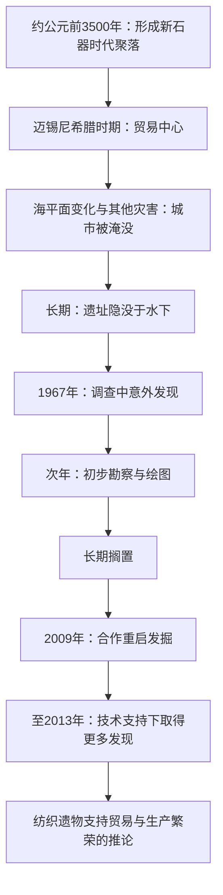
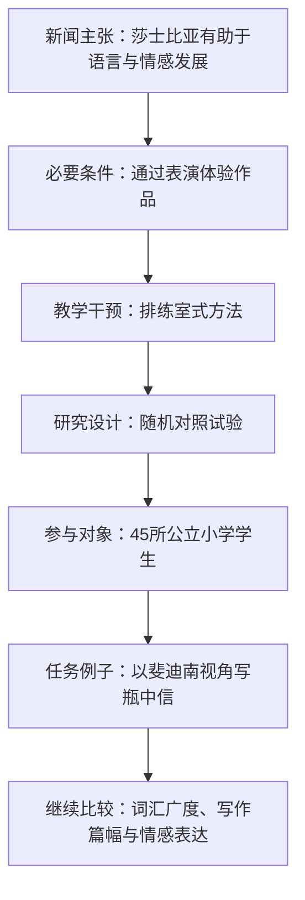
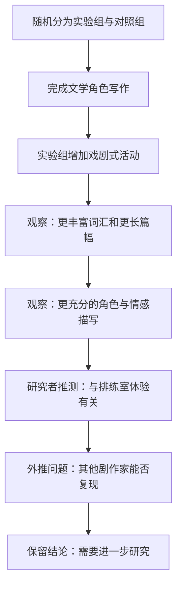
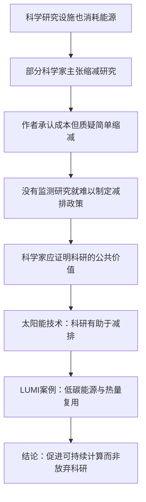
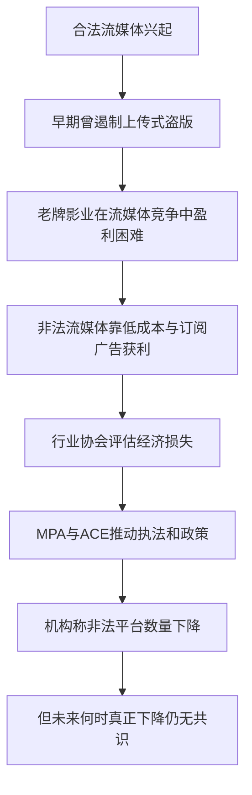
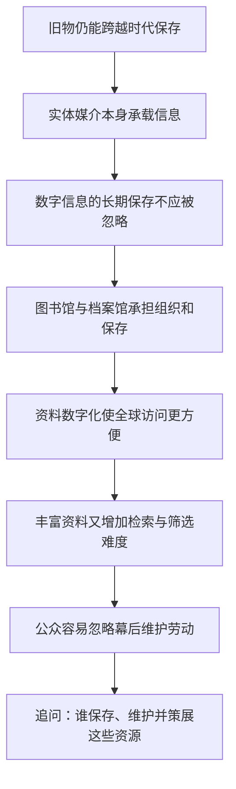
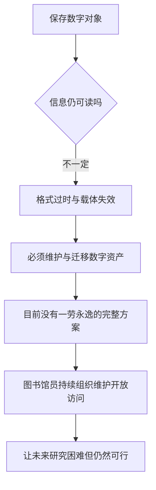
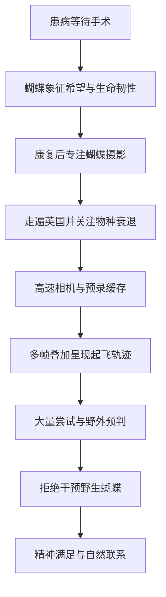
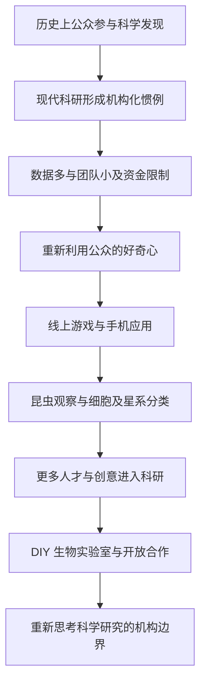

<Callout type="info" title="使用说明">
本页为根据原始资料整理的**考研英语（一）精读学习笔记**，按试卷题型顺序组织。原稿未完整提供选项的题目不会被虚构为官方答案；文中的原创巩固题与正式真题题目应予区分。
</Callout>

## 完形填空 · 帕夫洛彼特里：海底古城的发现与重访

<Callout type="info" title="完形填空的正确学习顺序">

这篇文章以希腊海底古城 **Pavlopetri（帕夫洛彼特里）** 为中心，按**古城繁荣—沉入海底—意外发现—长期搁置—技术进步后重新发掘**的顺序展开。原始转写稿保留了若干空号对应的词语，却没有完整提供每空的全部备选选项。因此下面将这些词作为**原稿标注的上下文学习线索**加以辨析，不把缺失的选项或未核验的答案表格伪装成正式试卷答案。

</Callout>

<Cards>
  <Card title="古代背景">
    约公元前 3500 年形成聚落；迈锡尼希腊时期成为贸易中心；地震、海啸和海平面变化推动城市没入海底。
</Card>
  <Card title="现代发现">
    1967 年科学调查中发现水下遗迹；随后绘图、辨识建筑和街道，但相关发掘一度长期中断。
</Card>
  <Card title="技术推动重访">
    2009 年重启合作发掘；利用机器人、声呐测绘与先进图像技术重建遗址信息。
</Card>
</Cards>

### 一、古城的形成、贸易地位与沉没

**原句 1**

> Located in the southern Peloponnesian peninsula, Pavlopetri (the modern name of the site) emerged as a Neolithic settlement around 3500 B.C. and became an important trading center for Mycenaean Greece (1650–1180 B.C.).

**译文：**&#x2060;帕夫洛彼特里（该遗址现在的名称）位于伯罗奔尼撒半岛南部，约在公元前 3500 年形成新石器时代聚落，后来成为迈锡尼希腊时期（约公元前 1650—1180 年）的重要贸易中心。

**结构拆解：**

1. `Located in ...` 为过去分词短语，作地点背景的补充状语；其逻辑主语是 `Pavlopetri`。
2. `Pavlopetri ... emerged ... and became ...` 为主干，两个谓语 `emerged` 和 `became` 构成古城发展过程。
3. `(the modern name of the site)` 是同位语插入语，说明“帕夫洛彼特里”是现代名称，并非断言古城史前居民也使用相同名称。
4. `as a Neolithic settlement` 表“以新石器时代聚落的形态”；`trading center for Mycenaean Greece` 表后期贸易作用。

**时间顺序：**&#x2060;聚落初现早于后来的迈锡尼希腊时期，不能把两段年代误认为同一历史时刻。

**原句 2**

> This area of the Aegean Sea is prone to earthquakes and tsunamis, which caused the city to gradually sink.

**译文：**&#x2060;爱琴海的这一地区容易发生地震和海啸，这些自然灾害导致这座古城逐渐下沉。

`be prone to + 名词/动名词` 表“容易遭受／倾向于发生”；`which caused ...` 以非限定性定语从句补充前述灾害带来的影响，语义上不是“该地区”主动让城镇下沉；`cause sb./sth. to do` 表“导致……发生”。`gradually` 明确表示过程逐步发生。

**原句 3**

> The slow sea level rise in the Mediterranean submerged the city more than 3,000 years ago.

**译文：**&#x2060;三千多年前，地中海海平面的缓慢上升使这座城市被海水淹没。

`The slow sea level rise` 为主语，`submerged` 为及物动词谓语，`the city` 为宾语；`more than 3,000 years ago` 表过去时间，不是“持续三千多年”。`submerge` 是“淹没，使没入水中”。

<Callout type="warn" title="历史过程不要误写成一次灾变">

原文分别提及地震、海啸与缓慢的海平面变化，未给出一场单独事件能够解释全部沉没过程的严密证据。阅读时保留不同因素在叙述中的作用，不能将它们缩写为“某年一场海啸瞬间摧毁古城”。

</Callout>

### 二、遗址长期沉睡与首次现代发现

**原句 4**

> For millennia, the city's remains lay unseen below some 13 feet of water.

**译文：**&#x2060;数千年来，这座城市的遗迹一直隐没在约十三英尺深的海水之下。

**语法重点：**`remains` 是复数名词“遗迹、残存物”，不是第三人称单数动词 `remains`；`lay` 是不及物动词 `lie`（躺／位于）的过去式，此处搭配 `unseen` 表“处于无人看见的状态”，**不是**及物动词 `lay–laid–laid`（放置）的现在式。`some 13 feet` 中 `some` 表“大约”，不可译为“某些十三英尺”。

**原句 5**

> They were covered by a thick layer of sand off the island of Laconia.

**译文（按可确定信息）：**&#x2060;遗迹位于拉科尼亚一带近岸海域，覆盖着一层厚厚的沙子。

`They` 指遗迹；`were covered by a thick layer of sand` 是被动结构，`by` 指覆盖它们的物质，并非人类施事。原转写稿的 `the island of Laconia` **地理称谓值得复核**：拉科尼亚通常指希腊伯罗奔尼撒半岛的地区，不能未经核验就把它确定为某个同名岛屿。这里采用不超出上下文的译法，同时保留原文以便核对。

**原句 6**

> In recent decades, shifting currents and climate change have eroded a natural barrier that protected Pavlopetri.

**译文：**&#x2060;近几十年来，变化的海流与气候变化逐渐侵蚀了原本保护帕夫洛彼特里的天然屏障。

- `shifting currents and climate change` 为并列主语，`have eroded` 是现在完成时。
- `a natural barrier that protected Pavlopetri` 中 `that ...` 为限定性定语从句，`protected` 是过去时，说明屏障原先起的保护作用。
- `erode` 表缓慢侵蚀，与火灾、爆炸式的瞬间损毁不同。

**原句 7 · 完形重要结构：was doing ... when ...**

> In 1967 a scientific survey of the Peloponnesian coast was gathering data to analyze changes in sea levels when British oceanographer Nicholas Flemming first spotted the submerged structures.

**译文：**&#x2060;1967 年，一项针对伯罗奔尼撒海岸的科学调查正在收集数据，以分析海平面变化；就在此时，英国海洋学家尼古拉斯·弗莱明首次发现了水下建筑遗迹。

**分层：**

1. 时间背景为 `In 1967`；第一分句主语 `a scientific survey of the Peloponnesian coast`，谓语 `was gathering`（过去进行时）。
2. `to analyze changes in sea levels` 为目的不定式；`changes in sea levels` 表“海平面变化”。
3. `when British oceanographer Nicholas Flemming first spotted ...` 在这里体现**某个过去正在进行的活动中发生新的发现**；采用“正在……这时……”比直译为普通时间地点的“当……”更自然。
4. `British oceanographer Nicholas Flemming` 中职业、国籍及姓名同属一个名词短语，不能把 `Nicholas Flemming` 误拆成另一个独立主语。
5. `submerged structures` 为“沉入水下的建筑结构”，其中 `submerged` 作前置定语。

**原句 8**

> A year later, he returned with a few students to examine the location and map the site.

**译文：**&#x2060;一年后，他带着几名学生重返这里，对地点进行勘察并绘制遗址地图。

`returned with ...` 说明同行者；`to examine ... and map ...` 是两个并列的不定式动作，承担“重返目的”的语义；`map` 此处是**动词**“绘制地图”，不是名词“地图”本身。

**原句 9**

> The team identified some 15 buildings, courtyards, a network of streets, and two chamber tombs.

**译文：**&#x2060;调查团队辨认出了大约十五座建筑、一些庭院、一套街道网络和两座墓室式墓葬。

`identify` 是“辨认出、确定”，不只是普通的“给……编号”；`some 15` = 约十五；`a network of streets` 作为一个整体宾语；`chamber tomb` 为墓室墓葬，不是现代意义的“房间”。

**原句 10**

> Despite the exciting initial finds, the site would lie undisturbed for decades before archaeologists would return.

**译文：**&#x2060;尽管早期发现令人振奋，但在考古学家再次返回之前，该遗址还是静静地沉寂了数十年。

- `Despite + 名词短语` 是让步介词结构，**不能**分析为 `although` 引导的完整从句。
- `would lie undisturbed` 站在过去的叙述时点回望后来很长一段时期的状态；`lie` 为不及物动词，`undisturbed` 为状态性补足成分。
- `before archaeologists would return` 表后续重返的时间关系；不能把 `would` 一概译成意愿“愿意”。

<Accordions>
  <Accordion title="完形题解法：如何从时态看出叙述的时间推进">

| 关键表达 | 动作或状态 | 对应时间作用 |
| --- | --- | --- |
| `emerged ... and became ...` | 两个一般过去时动作 | 交代古城形成与发展 |
| `submerged ... ago` | 过去某阶段发生的变化 | 沉没已久 |
| `lay unseen` | 过去持续状态 | 长期未见天日 |
| `have eroded` | 现在完成时 | 近几十年变化延续至叙述当下 |
| `was gathering ... when ... spotted` | 进行中的背景 + 突发发现 | 首次发现的叙事转折 |
| `would lie ... before ... would return` | 过去视角的未来阶段 | 初次发现后长期搁置 |
| `resumed` | 过去发生的恢复行动 | 后期重启发掘 |
| `had made huge advances` | 过去完成时 | 到重访时技术已明显进步 |

</Accordion>
</Accordions>

### 三、重新发掘：技术工具如何改变考古研究

**原句 11**

> In 2009 archaeologists Chrysanthi Gallou and Jon Henderson resumed the excavation of Pavlopetri in cooperation with the Greek Ministry of Culture.

**译文：**&#x2060;2009 年，考古学家克丽桑蒂·加卢与乔恩·亨德森同希腊文化部合作，重新启动了帕夫洛彼特里的发掘工作。

`archaeologists Chrysanthi Gallou and Jon Henderson` 为“职业称谓 + 两个人名”，不是三组并列主语。`resume` = 重启、继续（因中断而恢复），与 `start` 的首次启动不同；`in cooperation with ...` 说明合作方。

**原句 12**

> Since the 1960s, underwater archaeology techniques and tools had made huge advances.

**译文：**&#x2060;自二十世纪六十年代以来，水下考古技术与工具已经取得了长足进步。

`Since the 1960s` 是时间起点；`had made huge advances` 用过去完成时，参照的是2009年重新发掘的过去时间点，表示**在重访之前进步已经积累**。不要不顾上下文将其判成现在完成时，也不要把主语 `techniques and tools` 拆开成孤立的不相干两句。

**原句 13**

> The team employed robotics, sonar mapping, and state-of-the-art graphics to survey the site.

**译文：**&#x2060;研究团队使用机器人技术、声呐测绘和先进图像处理技术，对遗址进行勘测。

`employ` 在此为“采用／运用”，不是“雇佣机器人”。`robotics`、`sonar mapping`、`state-of-the-art graphics` 构成并列工具，`to survey the site` 为目的状语；`state-of-the-art` 是“当时最先进的”，不能直译成“艺术的状态”。

**原句 14**

> From 2009 to 2013 they were able to bring the underwater town to light.

**译文：**&#x2060;2009 至 2013 年间，他们得以逐步揭示这座水下城镇的面貌。

`be able to do` 表具备条件而完成某事；`bring ... to light` 是习语“使……显露／揭示真相”，这里结合考古工作译作“使遗址的面貌重现”，**不表示把整座古城从海底物理抬到陆地**。

**原句 15 · 分词状语与全部从句**

> Covering about two and a half acres, Pavlopetri's three main roads connected some 50 rectangular buildings, all of which had open courtyards.

**译文：**&#x2060;帕夫洛彼特里的三条主干道及其所连接的建筑群分布在约二点五英亩的区域内；这些道路连通着约五十座长方形建筑，每座建筑都设有露天庭院。

**结构拆解：**

- `Covering about two and a half acres` 是现在分词状语，原稿中从语法上紧接主语 `Pavlopetri's three main roads`；但“道路覆盖两点五英亩”在语义上容易产生范围歧义。中文可用“该建筑群／遗址片区分布于约……面积”缓解理解困难，**不擅自新增具体考古测量结论**。
- 主干 `Pavlopetri's three main roads connected some 50 rectangular buildings` 中 `some` 是“大约”，`connected` 是“把……连接起来”。
- `all of which had open courtyards` 为介词加关系代词构成的非限定性定语从句，`which` 回指 `some 50 rectangular buildings`，`all of which` 即“这些建筑全部”。不能把它理解为“三条道路全部有院子”。

**原句 16**

> Excavations revealed a large number of Minoan-style loom weights, suggesting Pavlopetri was a thriving trade center with a robust textile industry.

**译文：**&#x2060;发掘发现了大量米诺斯风格的织布机配重块，由此可推断帕夫洛彼特里曾是贸易繁荣、纺织业兴盛的中心。

- `Excavations revealed ...` 为主干；`a large number of` 后接复数名词 `loom weights`。
- `suggesting ...` 为现在分词短语，说明发现的**推论意义**；其中省略了宾语从句连接词 `that`。
- `loom weights` 是织布机配重块（用于纺织生产的考古遗物），**不能**按字面误译成“纺织机的重量数据”。
- `Minoan-style` 指米诺斯风格，不足以单凭语法断言整个古城的人口均为米诺斯人。
- `robust textile industry` = 发达／兴盛的纺织业，而不是“强壮的纺织品”。

### 完形重点表达：原稿标示的二十处核心线索

以下词项对应原始转写稿中的空号标识，**用于还原语境与词义搭配，不代替完整选择题的备选项或正式答案核验**。

| 线索 | 原文核心表达 | 用法辨析 |
| --- | --- | --- |
| Q1 | `prone to earthquakes and tsunamis` | `be prone to` = 容易遭遇／倾向于 |
| Q2 | `gradually sink` | `sink` = 下沉；注意副词修饰过程 |
| Q3 | `submerged the city` | 及物动词：海平面上升使城市被淹没 |
| Q4 | `the city's remains lay unseen` | `remains` 是遗迹，`lay` 为过去式 |
| Q5 | `off the ... Laconia` | 地点介词 `off` 表近岸海域；地名组合需核对 |
| Q6 | `shifting currents` | `current` = 洋流，`shifting` = 变化的 |
| Q7 | `a barrier that protected ...` | 定语从句中 `protected` 表过去保护作用 |
| Q8 | `was gathering data` | 过去进行时：正在收集资料 |
| Q9 | `when ... first spotted` | 背景活动中出现新的发现 |
| Q10 | `the submerged structures` | 过去分词定语：沉入水下的结构 |
| Q11 | `to examine the location` | `examine` = 考察；与 `map` 并列 |
| Q12 | `Despite the initial finds` | `despite + 名词短语` 表让步 |
| Q13 | `lie undisturbed` | 保持未被扰动的状态 |
| Q14 | `resumed the excavation` | 重新启动中断的工作 |
| Q15 | `archaeology techniques and tools` | 技术与工具两类并列名词 |
| Q16 | `employed robotics` | `employ` = 采用技术，而非雇佣 |
| Q17 | `bring ... to light` | 使遗址面貌／事实显露出来 |
| Q18 | `roads connected ... buildings` | `connect A and B`／“连接” |
| Q19 | `..., suggesting ...` | 分词结果／推论说明，而非新增主句 |
| Q20 | `a robust textile industry` | `robust` 在产业语境为强劲、兴盛 |

<Accordions>
  <Accordion title="四组同义辨析：容易被选项诱导的地方">

**1. `prone to`、`liable to` 与 `immune to`**

- `prone to`：易于遭受或倾向发生，原文与地震、海啸搭配。
- `liable to`：可能遭遇不利结果，在某些语境相近；能否替换还需核查具体选项。
- `immune to`：对……免疫，与原文风险描述相反。

**2. `remains`、`remain` 与 `lie`**

- `remains` 作名词复数是遗迹、残余。
- `remain` 作动词是“仍然是／保持”。
- `lay` 在本句是 `lie`（位于／躺着）的过去式；`laid` 则是 `lay`（放置）的过去式。

**3. `resume`、`continue`、`reveal`**

- `resume` 带有中断后重新开始的时间背景。
- `continue` 不一定包含曾经中断的含义。
- `reveal` 强调显示／揭示结果，而不是重新开工。

**4. `suggest` 与 `prove`**

- `suggesting Pavlopetri was ...` 根据纺织相关遗物作推断。
- `prove` 是更强的证明说法，不能在无额外证据时将 `suggesting` 强改为确定的绝对结论。

</Accordion>
</Accordions>

### 历史叙述的时间线

### 原创巩固题：时态、固定搭配与推理限度

<Question id="zz2025cloze-review01" type="single" tags="2025英语一,完形填空,原创巩固,时态">

`was gathering data ... when ... first spotted the submerged structures` 主要表达：

<Option>两件动作在过去每天同时重复发生</Option>
<Option correct>正在进行的调查构成背景，其间发生首次发现</Option>
<Option>首次发现发生在调查完全结束多年之后</Option>
<Option>发现尚未发生，仅是将来的计划</Option>

<Solution>

**答案：B。**&#x2060;过去进行时 `was gathering` 描述背景过程，一般过去时 `spotted` 引出该过程中发生的事件；`when` 不必机械译作“当……的时候”。

</Solution>
</Question>

<Question id="zz2025cloze-review02" type="single" tags="2025英语一,完形填空,原创巩固,多义词">

`the city's remains lay unseen` 中，`remains` 与 `lay` 分别指：

<Option>“仍然存在”（动词）与“放置”（动词原形）</Option>
<Option correct>“遗迹”（复数名词）与“位于”（lie 的过去式）</Option>
<Option>“居民”（名词）与“说谎”（现在时）</Option>
<Option>“幸存者”（名词）与“合法”（形容词）</Option>

<Solution>

**答案：B。**&#x2060;先看句法位置：`the city's remains` 整体为主语名词短语，`lay unseen` 为谓语与状态说明。

</Solution>
</Question>

<Question id="zz2025cloze-review03" type="single" tags="2025英语一,完形填空,原创巩固,论证">

关于 `loom weights` 的考古发现，最稳妥的推论是：

<Option>织布机配重块直接证明古城所有居民从事贸易</Option>
<Option>织布工具说明这座城市没有农业活动</Option>
<Option correct>相关遗物支持古城曾有较发达纺织活动及贸易功能的判断</Option>
<Option>这些遗物证明当时不存在其他类型的商品</Option>

<Solution>

**答案：C。**`suggesting` 表示根据证据提出解释，不宜扩展为人口构成、全部产业结构或唯一贸易商品的绝对性断言。

</Solution>
</Question>

<Question id="zz2025cloze-review04" type="single" tags="2025英语一,完形填空,原创巩固,短语">

`bring the underwater town to light` 在考古语境中更接近：

<Option>将整座古城吊出海面并建成旅游景区</Option>
<Option correct>利用调查发掘逐渐揭示水下古城的面貌与历史信息</Option>
<Option>为古城安装水下照明灯</Option>
<Option>将遗址全部永久封闭起来</Option>

<Solution>

**答案：B。**`bring ... to light` = 使人知晓、揭示。这里强调考古资料被发现和呈现，而不是进行物理搬迁。

</Solution>
</Question>

---

## 阅读 Text 1 · 通过表演莎士比亚提升儿童语言与情感素养（上）

<Callout type="info" title="当前材料的研究问题">

文章以莎士比亚作品是否能提升儿童的读写与情感能力切入，但立即给出条件：**关键不只是阅读或背诵作品，而是让学生通过表演进入语言与情境**。随后介绍一种“排练室式”教学方法、受委托的研究、随机对照试验的基本参与者与练习任务。下文续篇进一步给出实验组与对照组的写作表现对比，但仍未出现可复核的具体效应量或长期随访数据，不能自行推定。

</Callout>

### 一、新闻式开头：出人意料的研究结论与限定条件

**原句 1 · 双层从句**

> The grammar school boy from Stratford-upon-Avon has landed a scholarly punch after ground-breaking research showed that Shakespeare does benefit children's literacy and emotional development.

**译文：**&#x2060;一项开创性研究表明，莎士比亚的作品确实有助于儿童读写能力和情感发展；这使那位出身于埃文河畔斯特拉特福文法学校的昔日学子——莎士比亚——仿佛又在学术界打出了一记有力的“重拳”。

**由外向内：**

1. `The grammar school boy from Stratford-upon-Avon` 不是本项研究中的某个现代“文法学校男学生”，而是新闻写法对**莎士比亚本人**的借代。
2. 主干 `... has landed a scholarly punch` 为现在完成时；`land a punch` 原本指“打中一拳”，这里延伸为“对既有看法形成强烈冲击／引发学术关注”，不是文学家真的参与拳击比赛。
3. `after ground-breaking research showed ...` 是由 `after` 引出的时间背景；其主语是 `ground-breaking research`。
4. `that Shakespeare does benefit ...` 是 `showed` 的宾语从句；其中的 `does` 属**强调肯定**，不是疑问或无意义重复，表示“确实有助于”。
5. `literacy and emotional development` 为两个并列受益方面，不能把 `literacy` 狭隘理解为“只会拼写单词”。

**原句 2**

> But only if you act him out.

**译文：**&#x2060;但前提是：你得把他的作品真正演出来。

这是报刊开头常见的**省略式短句**，承接前文 `Shakespeare does benefit ...`，补出含义即 `But [that benefit occurs] only if you act him out.`。`only if` 表**必要条件**，不是普通的“如果也可以”；`act him out` 此处借“他”代指莎士比亚笔下人物及戏剧作品的表演活动，不应机械理解为“把作者本人赶出去”。

<Callout type="warn" title="区分 only if 与 if only">

- `only if + 条件`：**只有满足……才……**，表示必要条件，例如 `This approach works only if students perform the plays.`。
- `if only ...`：常表达“要是……就好了”的愿望或遗憾，不能与本句互换。

因此本文不是单纯说“莎士比亚文学总能提高所有儿童的能力”，而是强调**表演式接触作品**的教学情境。

</Callout>

### 二、研究方法：“排练室式”教学为何与普通阅读不同

**原句 3**

> A study found that a “rehearsal room” approach to teaching Shakespeare broadened children's vocabulary and the complexity of their writing as well as their emotional literacy.

**译文：**&#x2060;一项研究发现，采用“排练室式”的莎士比亚教学方法，有助于拓展儿童的词汇量，提高其写作表达的丰富与复杂程度，同时也促进其情感素养。

**语法分层：**

- `A study found that ...`：主句是“研究发现……”，`that` 引入结论内容。
- 内容从句的主语中心是 `a “rehearsal room” approach`，`to teaching Shakespeare` 后置修饰 `approach`，介词 `to` 后必须接动名词 `teaching`。
- 核心谓语为 `broadened`，后面并列讨论 **词汇储备、写作的复杂度和情感素养** 三个方面；`as well as` 是附加并列信息，不要误认为构成一条新的因果从句。
- `emotional literacy` 是情感识别、理解、表达等方面的素养，不等于单纯的“情绪多”或“会读写关于情绪的文章”。

**原句 4 · 复杂引语与从句嵌套**

> “The research shows that the way actors work makes a big difference to the way children use language and also how they think about themselves,” Jacqui O'Hanlon of the Royal Shakespeare Company (RSC), which commissioned the study, said.

**译文：**&#x2060;委托开展这项研究的皇家莎士比亚剧团（RSC）的杰姬·奥汉隆说：“研究表明，演员的工作方式对孩子们运用语言的方式，以及他们认识自身的方式，都能产生显著影响。”

**拆成四层：**

1. **引语归属：**`Jacqui O'Hanlon ... said` = “杰姬·奥汉隆说”。引语置于句首只是新闻报道的排列方法。
2. **身份与补充：**`of the Royal Shakespeare Company (RSC)` 说明她所属机构；`which commissioned the study` 是非限定性定语从句，`which` 指皇家莎士比亚剧团，`commission` = **委托进行研究**，不是“做出结论”。
3. **引语主干：**`The research shows that ...`，宾语从句主语为 `the way actors work`，谓语为 `makes a big difference to ...`。
4. **两个影响对象：**`the way children use language` 与 `how they think about themselves` 并列，前者着重语言使用方式，后者着重自我认识。两个 `the way ...` 结构中的关系词可省略；`how ...` 引出方式内容，不应误译成单一的“为何他们会思考”。

**重难点：**`make a big difference to ...` = 对……有重大影响。`a big difference` 是程度，不一定意味着与一切其他教学法比较后都更优；需要看接下来实验的设计和结果。

### 三、随机对照试验：对象、分组与戏剧任务

**原句 5**

> The randomised control trial involved hundreds of year 5 pupils—aged nine and ten—at 45 state primary schools that had not been “previously exposed to RSC pedagogy”.

**译文：**&#x2060;这项随机对照试验涉及四十五所公立小学的数百名五年级学生，他们年龄为九至十岁；这些学校此前没有接触过皇家莎士比亚剧团的相关教学方法。

**关键拆解：**

- `The randomised control trial involved ...`：主语是实验，谓语 `involved` = “涉及、纳入”；`randomised control trial` 在本语境指**随机对照试验**，文献中也常写作 `randomised controlled trial`。
- `hundreds of year 5 pupils`：`year 5` 是英国学制的五年级，不能机械等同其他国家的年级年龄划分；`aged nine and ten` 是破折号插入说明。
- `at 45 state primary schools` 说明参与学生所在学校；`that had not been “previously exposed to RSC pedagogy”` 是**限定性定语从句**，先行词为 `state primary schools`，不是说这些“学生已被皇家剧团隔离”。
- `had not been previously exposed` 使用过去完成时被动，说明在试验开始之前这些学校**尚无相关教学经验**；`pedagogy` = 教学法、教育方法。

**原句 6 · 原稿尚未给出完整后文**

> They were split into target and control groups and asked to write, for example, a message in a bottle as Ferdinand after the shipwreck in The Tempest.

**译文：**&#x2060;学生被分为实验组与对照组，并被要求完成写作任务；例如，想象自己是《暴风雨》中的斐迪南，在海难之后写下一封装进瓶中的求救或传讯文字。

**结构：**

- `They were split ... and asked ...` 是两个并列的被动谓语结构，第二项省略了 `were`；`They` 回指参与试验的学生。
- `into target and control groups` = 分成目标／实验组与对照组，`control` 在此不是“受控制的人群”，而是用于比较的对照组。
- `to write ...` 为不定式补足语，说明研究要求学生执行的任务。
- `for example` 标记例子，不等于所有实验任务只有这一项。
- `a message in a bottle` 是故事中的瓶中信；`as Ferdinand` 表**以斐迪南身份／角色视角**写作；`after the shipwreck in The Tempest` 指《暴风雨》情节背景。

<Callout type="warn" title="实验结果的证据边界">

文章报道了积极的研究发现，并在下文补充实验组与对照组的词汇、写作篇幅和情绪描写差异；但这些文字资料仍不足以核验具体提升分数、统计效应量、显著性检验或长期随访结果。不可将描述性结果误写为精确量化结论。

</Callout>

### 主题词汇表：研究新闻与文学教育

| 词汇 | 常见义 | 本文理解重点 |
| --- | --- | --- |
| `grammar school` | 文法学校 | 英国语境下的一类学校；开头借指莎士比亚 |
| `land a punch` | 打中一拳 | 新闻标题式比喻：形成冲击 |
| `ground-breaking` | 开创性的 | 修饰研究的创新性，不是“挖地” |
| `literacy` | 读写能力、素养 | 可扩展到语言与文化能力 |
| `emotional literacy` | 情感素养 | 理解并表达情绪等能力 |
| `only if` | 只有在……条件下 | 与 `if only` 区分 |
| `act ... out` | 把情节／人物表演出来 | 本文重戏剧体验 |
| `rehearsal room` | 排练室 | 比喻互动与实际排练的教学方式 |
| `approach to doing` | 做某事的方法 | 介词 `to` 后接动名词 |
| `broaden` | 扩大、拓展 | 可修饰词汇量、知识面 |
| `make a difference to` | 对……产生影响 | 有无差异、影响大小须看研究 |
| `commission` | 委托（研究、作品等） | 不应译成“佣金” |
| `randomised` | 随机化的 | 英式拼写（美式 randomized） |
| `control group` | 对照组 | 与实验组作比较 |
| `be exposed to` | 接触到 | 此处指教学法，不含负面暴露 |
| `pedagogy` | 教学法、教育学 | 特定的戏剧教学实践 |
| `shipwreck` | 海难、船只失事 | 《暴风雨》中的情景 |

### 阅读思路：研究方法与报道主张的边界

### 原创巩固题：细节、指代与研究设计

<Question id="zz2025text1-review01" type="single" tags="2025英语一,阅读,原创巩固,指代">

开篇 `The grammar school boy from Stratford-upon-Avon` 指的是：

<Option>参与实验的某位九岁学生</Option>
<Option>负责委托研究的剧团主管</Option>
<Option correct>以出生地和教育背景借代的莎士比亚</Option>
<Option>英国海洋学家尼古拉斯·弗莱明</Option>

<Solution>

**答案：C。**&#x2060;文章用传记性称呼和新闻式双关引出莎士比亚；后文讨论的也是他的戏剧在教育中的应用。

</Solution>
</Question>

<Question id="zz2025text1-review02" type="single" tags="2025英语一,阅读,原创巩固,条件逻辑">

开篇 `But only if you act him out` 主要限定了什么？

<Option>只要孩子会背莎士比亚的姓名，就必然能提高成绩</Option>
<Option correct>研究报道强调经由表演体验戏剧作品的教学情境</Option>
<Option>戏剧表演与语言学习完全无关</Option>
<Option>实验只招收专业演员的子女</Option>

<Solution>

**答案：B。**`only if` 表必要条件，`act ... out` 强调表演实践，排除将研究结论无限泛化的解读。

</Solution>
</Question>

<Question id="zz2025text1-review03" type="single" tags="2025英语一,阅读,原创巩固,句法">

`which commissioned the study` 中，`which` 的先行词是：

<Option>孩子运用语言的方式</Option>
<Option>这项研究本身</Option>
<Option correct>Royal Shakespeare Company</Option>
<Option>the way actors work</Option>

<Solution>

**答案：C。**&#x2060;非限定性定语从句紧接 `Royal Shakespeare Company (RSC)`，补充说明这家机构**委托了该研究**。

</Solution>
</Question>

<Question id="zz2025text1-review04" type="single" tags="2025英语一,阅读,原创巩固,研究设计">

关于目前可见的随机对照试验信息，哪项最准确？

<Option>原文已提供各组的精确提升分值与显著性检验结果</Option>
<Option>参加试验的学校以前都已长期实施相同教学法</Option>
<Option correct>试验涉及多所公立小学的学生，设置实验与对照组，并安排戏剧角色写作任务</Option>
<Option>原文表示所有学生都只完成一篇相同的作文</Option>

<Solution>

**答案：C。**&#x2060;已出现的材料可以确认参与对象、分组和任务示例，但没有足够内容支持其他选项中的精确结果、先前教学经历或“唯一任务”断言。

</Solution>
</Question>

---
---

## 阅读 Text 1 · 戏剧式莎士比亚教学：语言表达与情感理解（续）

<Callout type="info" title="核心问题：为什么研究强调“把莎士比亚演出来”？">

本部分承接前文的随机对照教学研究。研究不仅比较学生能否理解文本，还观察**词汇丰富度、写作篇幅、角色代入和情感表达**。答题时要严格区分：研究实际观察到的写作差异、研究者对差异原因的解释，以及作者提出但尚未验证的推广假设。

</Callout>

### 一、实验流程：对照组与戏剧活动组

前文提到，学生被分为实验组与对照组，并被要求完成《暴风雨》相关角色写作。本部分的关键句是：

> **They were split into target and control groups and were asked to write, for example, a message in a bottle as Ferdinand after the shipwreck in *The Tempest*.**

**译文：**&#x2060;学生被分为实验组和对照组，并被要求写作。例如，他们要以《暴风雨》中遭遇海难后的斐迪南这一角色的身份，写一封装进漂流瓶里的信。

**句子主干：**`They were split ... and were asked ...`。`were split` 与 `were asked` 是由 `and` 连接的两个并列被动谓语；`into target and control groups` 交代分组结果；`to write` 是 `ask sb. to do sth.` 的被动形式；`as Ferdinand` 表示以斐迪南的身份。`in a bottle` 修饰信息载体，`after the shipwreck in The Tempest` 交代故事情境。

> **The target group was given a 30-minute drama-based activity to accompany the passage.**

**译文：**&#x2060;实验组另有一项配合阅读材料的、时长三十分钟的戏剧活动。

**句法：**`The target group` 为主语，`was given` 为被动谓语，`a 30-minute drama-based activity` 为给予的内容；`to accompany the passage` 表示活动的用途。此处的 `accompany` 是“配合、伴随”，不是“陪同某人”。

<Callout type="warn" title="实验设计题易错点">

`target group` 是**实验组**，`control group` 是**对照组**。本段可以确认实验组接受了附加的戏剧活动，不能因此推断对照组完全没有阅读、写作或教师指导。观察到两组写作有差异，也不等于已经确定所有年龄、所有剧作家的教学效果。

</Callout>

### 二、研究结果：词汇、篇幅与角色代入

#### 1. 更丰富的词汇与更长的文本

> **The peer-reviewed results showed that the target group of pupils drew on a wider vocabulary, used words “classed as more sophisticated or rarer”, and wrote at greater length.**

**译文：**&#x2060;经同行评议的研究结果表明，实验组学生调动了更丰富的词汇，使用了被归为“更高级或更罕见”的词语，而且写出的文本篇幅更长。

**主干与从句：**

- 主句：`The peer-reviewed results showed ...`，`that` 引导宾语从句，说明研究结果所显示的内容。
- 宾语从句的共同主语：`the target group of pupils`；三个并列谓语：`drew on`、`used`、`wrote`。
- `classed as more sophisticated or rarer` 是过去分词短语，后置修饰 `words`，表示“被归类为……的词”。
- `at greater length` 表示“更详细地、篇幅更长地”，不可误译为“更远的长度”。

**答题价值：**&#x2060;本句报告的是可观察的写作差异。`peer-reviewed` 说明经过同行评议，并非研究结论不可质疑；`sophisticated` 在此指词汇的复杂度或成熟度，不指学生行为“世故”。

#### 2. 从“想象自己”到“进入人物内心”

> **They also “appear to be more comfortable writing in role ... while [control] group imagine how they themselves would react to being shipwrecked, [target] group put themselves in the shoes of a literary character and express that character's emotion”.**

**译文：**&#x2060;实验组学生在以角色身份写作时，似乎也更加自如。对照组倾向于想象自己遭遇海难时会如何反应，而实验组则尝试设身处地地理解文学人物，并表达那个人物的情绪。

**结构拆解：**&#x2060;前面 `appear to be` 的语气是**看起来、似乎**，比 `are` 更审慎。后面 `while` 引出两组表现的**对照关系**：

- 对照组：`imagine [how they themselves would react to being shipwrecked]`；`how` 引导名词性从句，充当 `imagine` 的宾语。
- 实验组：`put themselves in the shoes of a literary character and express that character's emotion`；`put` 和 `express` 并列。
- `put oneself in sb.'s shoes` 是习语，指**设身处地从他人处境思考**。不要按字面译为“把自己放在鞋子里”。

<Callout type="idea" title="阅读推断：真正的比较维度">

作者强调的区别不是“哪组更想象丰富”这一笼统评价，而是**第一人称的自我反应**与**站在文学人物立场写作**之间的差别。做细节题要抓住 `while` 前后并列的两类写作策略。

</Callout>

#### 3. 场景描写：刻板意象与丰富细节

> **The Time to Act study also found that while control pupils relied on “desert island clichés” such as palm trees, target pupils were “more expansive [giving] a broader picture of the sky, the sea and the atmospheric conditions”.**

**译文：**“Time to Act”研究还发现，对照组学生常依赖棕榈树等“荒岛式的陈词滥调”，而实验组的描写更为充分，能够展现天空、海洋和天气状况等更丰富的场景。

**主干：**`The ... study found [that ...]`；宾语从句内部由 `while` 引入对比。`rely on` 表示“依赖”；`such as palm trees` 是举例；`more expansive` 在此是“表达更铺展、描写更丰富”，不指物理面积更宽。

**识别修正：**&#x2060;材料中的方括号 `[giving]` 是对引语的编辑性补足，帮助句子通顺，不应视为原文中单独出现的一种新语法。`atmospheric conditions` 在这个写作情境中自然译为“天气或大气状况”。

### 三、情感素养：结果与可能解释

#### 1. 研究者最惊讶的发现

> **O'Hanlon said she had been most surprised by the “emotional literacy that was evident in the [target] children's writing” and that they were “more resilient in their writing, more hopeful”.**

**译文：**&#x2060;奥汉隆表示，最令她惊讶的是实验组儿童作品中显而易见的“情感素养”，以及这些学生在写作中表现得更有韧性、更加充满希望。

**句法层级：**

1. `O'Hanlon said ...` 是报道引语的主句。
2. 第一部分省略了宾语从句引导词 `that`：`(that) she had been most surprised by the emotional literacy ...`。
3. `that was evident in the [target] children's writing` 是限定性定语从句，修饰 `emotional literacy`。
4. 后面的 `and that they were ...` 是与第一个内容并列的**第二个宾语从句**；`resilient` 与 `hopeful` 均描述学生写作表现。

**重点辨析：**`emotional literacy` 指识别、理解及表达情绪的能力；`resilient` 在文章中侧重有韧性、面对困境更能调整，不是简单的“反弹力”。

#### 2. 排练室过程：观察结论与原因推测

> **She added: “The emotional understanding was very evident and it is probably related to the [rehearsal room process] where you are used to trying to imagine your way through.”**

**译文：**&#x2060;她补充说：“孩子们对情感的理解非常明显。这可能与排练室的学习过程有关——在这个过程中，人们会逐渐习惯通过想象进入特定情境。”

**结构：**&#x2060;引语中两个主句由 `and` 连接：`The emotional understanding was very evident` 与 `it is probably related to ...`。`where ...` 为修饰 `the rehearsal room process` 的定语从句；`be used to doing sth.` 表示“习惯于做某事”，**这里的 `to` 是介词**；`trying to imagine` 的 `to` 才是不定式标记。

**观点层级：**`was ... evident` 报告现象，`probably related to` 提出解释。不能把“可能有关”答成“研究已经证明排练室活动是唯一原因”。

> **They were comfortable in describing different emotional states and part of what you do in drama is put yourself in different shoes.**

**译文：**&#x2060;他们能够自如地描述不同的情绪状态，而戏剧活动的一项核心任务，就是设身处地地进入不同角色的处境。

**结构：**&#x2060;前半句 `They were comfortable in describing ...` 与后半句 `part of what you do in drama is ...` 由 `and` 连接。`what you do in drama` 是名词性从句，整体作介词 `of` 的宾语。`is put yourself ...` 是表语位置上的原形不定式结构（与说明活动内容的结构相联系），不宜机械补出 `is putting` 并称为原句。

> **The study showed the importance of embedding the arts in education, she said.**

**译文：**&#x2060;她表示，这项研究凸显了将艺术融入教育的重要性。

**结构：**`The study showed the importance ...` 是直接引语内容；`she said` 是后置报道语。`embedding the arts in education` 为 `of` 的宾语，`embed A in B` 表示“把 A 融入 B”。

### 四、外推边界：换一个剧作家也有效吗？

> **But could the results be replicated with any old dramatist?**

**译文：**&#x2060;但如果换成其他普通剧作家的作品，研究结果也能重现吗？

**易错点：**`any old + 名词` 在口语中常表示“随便哪一个、任何一个”，不应译为“任何一位古代剧作家”。`replicate` 在研究语境中是“重复实验并复现结果”。

> **O'Hanlon said more research would be needed but suggested that Shakespeare's use of 20,000 words, compared with the everyday 2,000 words, gave a “massive expansion of language into children's lives”, which was combined with children “using their whole bodies to bring words to life”.**

**译文：**&#x2060;奥汉隆认为仍需进一步研究；不过她提出，与日常使用的约两千个词相比，莎士比亚作品中约两万个词所提供的语言资源，大大扩展了儿童所接触的语言范围，而这又与孩子们运用全身动作让词语鲜活起来的体验结合在一起。

**长句分层：**

- 最高层：`O'Hanlon said [more research would be needed] but suggested [that ...]`。`said` 与 `suggested` 是并列谓语，后接两个内容从句。
- 第二个内容从句主干：`Shakespeare's use of 20,000 words ... gave a massive expansion ...`。
- `compared with the everyday 2,000 words` 为比较性插入修饰，不是句子的谓语。
- `which was combined with ...` 由 `which` 引导非限定性定语从句，补充说明前文所述的语言扩展及其效果。
- `with children using their whole bodies ...` 里的 `children` 是 `using` 的逻辑主语，整体表示**儿童通过身体活动参与语言学习的情境**；`to bring words to life` 表目的。

<Callout type="warn" title="有关数字和研究结论的准确表述">

文中的“两万个词”与“两千个词”是受访者用来解释效果的对比说法，不能脱离文章直接推出“每个儿童经过教学都掌握两万个词”。而且作者以 `more research would be needed` 明确保留了对其他剧作家教学效果的疑问。

</Callout>

### 重点词汇与短语

| 英语 | 准确含义 | 语境与搭配 |
| --- | --- | --- |
| `peer-reviewed` | 经过同行评议的 | `peer-reviewed results` |
| `draw on` | 利用、调动 | `draw on a wider vocabulary` |
| `sophisticated` | 复杂的、成熟的、高级的 | 描述词汇层次 |
| `at greater length` | 更详细地、篇幅更长地 | 写作评价 |
| `writing in role` | 代入角色写作 | 戏剧教学语境 |
| `put oneself in sb.'s shoes` | 设身处地 | 角色共情 |
| `cliché` | 陈词滥调；套路化描写 | `desert island clichés` |
| `expansive` | 丰富展开的 | `more expansive descriptions` |
| `emotional literacy` | 情感素养 | 情绪理解与表达 |
| `resilient` | 有韧性的、有复原力的 | 心理与行为描述 |
| `be used to doing` | 习惯于做某事 | `be used to trying ...` |
| `replicate` | 复现、重复验证 | 研究结果 |
| `any old` | 随便哪个 | 不等于 `ancient` |
| `embed A in B` | 将 A 融入 B | 艺术融入教育 |

### 阅读论证链

<Accordions>
  <Accordion title="为什么 'while' 不能一律理解为‘当……时’？">

  在 `while control pupils relied on clichés, target pupils were more expansive` 中，两组的行为被直接对照，因此 `while` 应译为“而、相比之下”。如果按时间解释为“当对照组……的时候”，读者就会忽略命题人重点考查的实验组和对照组差异。

</Accordion>
  <Accordion title="'be used to doing' 与 'used to do' 有什么区别？">

  `be used to doing`：习惯于做某事，`to` 是介词。`used to do`：过去常常做某事，强调如今可能已不同。本段的 `you are used to trying` 属于前者。

</Accordion>
</Accordions>

### 原创巩固题

<Question id="zz2025text1-continued-01" type="single" tags="2025英语一,阅读,原创巩固,研究结果">

实验组在写作中表现出的主要特征是：

<Option>所有学生均达到专业演员水平</Option>
<Option correct>词汇更丰富、篇幅更长，并更充分地表达文学人物的情感</Option>
<Option>只描写个人遇难时的本能反应</Option>
<Option>完全不使用常见词汇</Option>

<Solution>

**答案：B。**&#x2060;根据同行评议结果及研究者描述，`wider vocabulary`、`at greater length`、`put themselves in the shoes of a literary character` 是文中明确提到的差异。其他选项都超出了材料。

</Solution>
</Question>

<Question id="zz2025text1-continued-02" type="single" tags="2025英语一,阅读,原创巩固,推断">

`probably related to the rehearsal room process` 体现了研究者的哪种态度？

<Option>已经证实单一因果机制</Option>
<Option>否认戏剧活动的效果</Option>
<Option correct>在观察结果的基础上提出有保留的可能解释</Option>
<Option>认为其他文学作品必然无效</Option>

<Solution>

**答案：C。**`probably` 和 `related to` 都限制了断言力度，属于谨慎推测，不是唯一因果关系的确定证明。

</Solution>
</Question>

<Question id="zz2025text1-continued-03" type="single" tags="2025英语一,阅读,原创巩固,词义">

`any old dramatist` 在文中的合理理解是：

<Option correct>随便哪位其他剧作家</Option>
<Option>年龄很大的剧作家</Option>
<Option>古希腊剧作家</Option>
<Option>名字未知的儿童演员</Option>

<Solution>

**答案：A。**`any old` 在此是表示非特指、随便选取的习语，文章追问教学效果是否能够推广到其他剧作家。

</Solution>
</Question>

---

## 阅读 Text 2 · 科学研究的碳足迹与可持续计算

<Callout type="info" title="文章主旨与作者态度">

作者承认实验室、卫星、数据中心等科学研究基础设施需要能源，**但反对为了减碳而简单削减必要研究**。文章主张一面证明科学研究带来的公共价值，一面推动绿色能源与更可持续的计算方式。阅读态度题要把“承认代价”与“主张停止研究”区分开。

</Callout>

### 第一段：争论缘起——是否应该缩减研究？

> **I was shocked to learn recently that some scientists want to scale back their research in an effort to decrease carbon emissions.**

**译文：**&#x2060;最近听说有些科学家为了减少碳排放而打算缩减研究规模，我感到十分震惊。

**主干：**`I was shocked to learn ...`。`to learn ...` 表触发惊讶情绪的原因；`that some scientists want ...` 是 `learn` 的宾语从句；`in an effort to decrease carbon emissions` 表行动目的。

> **The crisis is here, they said, and we need to cut back on our energy-intensive modelling.**

**译文：**&#x2060;他们认为，气候危机已经到来，因此我们需要削减高耗能的建模工作。

**结构：**`The crisis is here` 与 `we need to cut back ...` 构成并列内容；`they said` 是穿插其中的报道语。这里的“他们”指倡议减少研究活动的科学家，不是作者本人。

> **At the very least, we need to make our energy use far more sustainable.**

**译文：**&#x2060;至少，我们需要让能源的使用方式更加可持续。

**句法：**`make + 宾语 + 形容词宾补`：`make our energy use far more sustainable`。`far` 修饰比较级 `more sustainable`，表示程度“更加明显”。

### 第二段：必须正视的科学基础设施耗能

> **It is unarguable that our laboratories, scientific instruments, rockets and satellites—the tools we scientists need to measure the planet's pulse—demand significant amounts of energy both in their construction and operation.**

**译文：**&#x2060;毋庸置疑，实验室、科学仪器、火箭和卫星——这些科学家用来测量地球“脉搏”的工具——在建造和运行阶段都需要消耗大量能源。

**结构拆解：**

- `It is unarguable that ...`：`it` 为形式主语，`that` 引导真正的主语从句。
- 从句主语是四项并列名词：`our laboratories, scientific instruments, rockets and satellites`；共同谓语为 `demand`。
- 破折号内 `the tools we scientists need to measure the planet's pulse` 是主语的补充说明；`we scientists` 为“我们科学家”的同位表达；`we scientists need ...` 是省略关系代词的定语从句，修饰 `the tools`。
- `both in their construction and operation` 说明**建造和运行两个阶段**都耗能；`both ... and ...` 并列两个范围。

**修正误区：**&#x2060;原稿里的部分层级图容易把 `the tools` 当作新的完整主句。事实上，主句的核心判断仍是“这些研究设施需要大量能源”。`the planet's pulse` 为形象比喻，指对地球状态的监测。

> **And it is equally true that science's unrelenting appetite for information has caused a mushrooming of energy-intensive data centres around the world.**

**译文：**&#x2060;同样不可否认的是，科学研究对信息持续增长的需求，促使高耗能数据中心在世界各地迅速增多。

**句法：**&#x2060;同样是形式主语结构：`it is equally true that ...`。从句主语 `science's unrelenting appetite for information`，谓语 `has caused`，宾语 `a mushrooming of ...`；`mushrooming` 指快速增加，不是食用菌。

> **According to the International Energy Agency, these buildings now consume about 1 per cent of the world's electricity.**

**译文：**&#x2060;按照国际能源署的说法，这些数据中心当时消耗了全球约百分之一的电力。

**信息归属：**&#x2060;这是文章引用机构的统计数据，有特定报道时点，不应写成任何年份都成立的当前比例。`these buildings` 回指上一句的**数据中心**。

### 第三段：作者的反驳——研究虽耗能，仍有必要

> **However, this is a price we must pay for understanding the world.**

**译文：**&#x2060;然而，这是我们为了理解世界必须付出的代价。

**结构：**`we must pay for understanding the world` 是省略关系代词的限定性定语从句，修饰 `a price`；这里 `pay a price for` 表示“为……付出代价”。`However` 标志文章由**承认成本**转向**论证价值**。

> **How can we inform decision makers about the best ways to bring down carbon emissions if we can't track the amount of carbon dioxide in the atmosphere, where it's coming from and who's producing it?**

**译文：**&#x2060;如果我们连大气中二氧化碳的含量、它从哪里来以及是谁排放的都无法追踪，又怎能向决策者说明减少碳排放的最佳途径？

**三层结构：**

1. 主句：`How can we inform decision makers about the best ways ...?`，用反问支持论点。
2. `if we can't track ...` 是条件状语从句；`track` 后有三个并列宾语：`the amount of carbon dioxide in the atmosphere`、`where it's coming from`、`who's producing it`。
3. `where ...` 与 `who ...` 是间接疑问从句，分别作为 `track` 的宾语。**不是地点状语从句与定语从句**；`to bring down carbon emissions` 后置修饰 `ways`。

**翻译技巧：**&#x2060;汉语先译 `if` 条件，再用“又怎能”处理反问；`where it's coming from` 应译成来源，`who's producing it` 是排放主体。

> **The carbon emissions from technological research are well spent: ultimately this research will safeguard the future of our planet.**

**译文：**&#x2060;技术研究所带来的碳排放并非毫无价值的浪费：归根结底，这类研究有助于守护地球的未来。

**语义辨析：**`well spent` 常指“花得值得”。碳排放本身不是值得追求的目标，作者在这里借用“支出值得”的说法强调**为有助于减排的研究付出成本是值得的**。冒号后给出理由。切忌误译成“技术研究的碳排放已经得到妥善处理”。

### 第四段：科学家为何必须解释自己的工作

> **It can be hard for scientists to make the case because our work is complex, often takes place behind closed doors and does not always lend itself to easy interpretation or explanation.**

**译文：**&#x2060;科学家要向公众充分说明研究的价值并不容易，因为我们的工作十分复杂，往往在不对外开放的环境下进行，也并非总能轻松地被解读或解释清楚。

**句法：**`It can be hard for scientists to make the case` 中，`it` 为形式主语，`for scientists to make the case` 是真正的主语。`because` 引导原因状语从句，其中 `our work` 对应三个并列谓语或谓语结构：`is complex`、`takes place behind closed doors`、`does not always lend itself to ...`。

**三个易错表达：**

- `make the case`：提出有说服力的论证，证明某种主张合理，不是“制造案件”。
- `behind closed doors`：不对外公开、在内部环境进行；不能毫无依据推断科研“不合法”。
- `does not always`：**并不总是**，属于部分否定；不等于 `never`（从来不）。

> **But demonstrating the efficacy of science will be crucial if we are to solve humanity's greatest challenges.**

**译文：**&#x2060;但如果我们要解决人类面临的最严峻挑战，证明科学研究确实有效将至关重要。

**句法：**&#x2060;动名词短语 `demonstrating the efficacy of science` 充当主语；`will be crucial` 为系表结构；`if we are to solve ...` 表必须达成的目标或条件。`efficacy` 指有效性，与 `efficiency`（效率）不同。

### 第五段：技术奖及太阳能技术案例

> **Recognising the hope that science and engineering can bring was the impetus behind the creation of the Millennium Technology Prize, which is now entering its 20th year as a celebration of human ingenuity.**

**译文：**&#x2060;正是看到科学和工程技术能够带来的希望，才促成了千禧技术奖的设立；这一旨在礼赞人类创造力的奖项如今正迈入第二十个年头。

**主干：**`Recognising the hope ... was the impetus ...`。整个动名词短语是主语；`that science and engineering can bring` 是修饰 `the hope` 的限定性定语从句，`that` 在从句中作 `bring` 的宾语；`which is now entering ...` 是非限定性定语从句，补充说明奖项。

> **One of the past winners, Professor Martin Green from the University of New South Wales, Australia, is the inventor of the Passivated Emitter and Rear Cell technology which is now found in most of the world's solar panels.**

**译文：**&#x2060;该奖项的往届获奖者之一、澳大利亚新南威尔士大学的马丁·格林教授，是钝化发射极与背面电池（PERC）技术的发明者；文章称，这项技术已被用于全球大多数太阳能电池板。

**主干：**`One of the past winners ... is the inventor ...`。`Professor Martin Green ...` 是对主语身份的同位语补充；`which is now found ...` 定语从句修饰前面的**PERC 技术**，不修饰教授本人。

> **Thanks to his invention, we have a real chance to decrease the world's carbon emissions.**

**译文：**&#x2060;多亏他的发明，我们才真正拥有减少全球碳排放的可能性。

**结构：**`Thanks to his invention` 为原因状语，`to decrease ...` 修饰 `a real chance`，说明“做什么的机会”。这一案例支持作者的主张：**某些科技研发本身耗能，却能创造降低总体排放的工具**。

### 第六段：可持续能源与更可持续的计算

> **Every day, scientists, technologists and engineers are discovering new ways to exploit renewable energy sources and develop techniques not just to use power more intelligently but to power our intelligence.**

**译文：**&#x2060;科学家、技术专家和工程师每天都在寻找新的方法，既开发可再生能源，也改进技术：不仅要更聪明地使用电力，还要借助能源支撑我们的计算与智能活动。

**句法与双关：**`to exploit renewable energy sources and develop techniques ...` 修饰 `new ways`，说明新方法的用途；`not just ... but ...` 并列两个不定式结构。`power` 在同一句中先作名词“能源、电力”，后作动词“为……提供动力”；`our intelligence` 在科研与计算语境中包含人类智能活动及算力应用的意味。

> **A great example of this is Europe's largest supercomputer, LUMI in Finland, which is astonishingly carbon-negative.**

**译文：**&#x2060;一个很好的例子是位于芬兰的 LUMI——文章称其为欧洲最大的超级计算机，且令人惊讶地具有“负碳排放”特征。

**结构：**`A great example ... is ...` 为系表结构；`which is ...` 是补充说明 LUMI 的非限定性定语从句。`carbon-negative` 指相关核算口径下净碳效应为负；不要据此推断每项硬件生产、运输都不产生排放。

> **Established in an old paper mill, it is powered by a nearby river and its remote heat warms the people who live in the surrounding town of Kajaani.**

**译文：**&#x2060;这台超级计算机设置在一处旧造纸厂中，利用附近河流提供的能源运行，其运行产生的热量还为周边卡亚尼镇的居民供暖。

**结构：**`Established in an old paper mill` 是过去分词短语，交代设施所在地；`it is powered ...` 与 `its ... heat warms ...` 为并列主句；`who live ...` 定语从句修饰 `the people`。

<Callout type="warn" title="术语转写待核：remote heat">

原资料转写为 `its remote heat`，这一搭配不够常见；结合附近供暖的上下文，此处可确认**利用设施产生的热量供暖**这一基本意思，但不宜在没有可靠原版对照时将英文擅自改成某个具体术语（如 `waste heat`）。复习时优先掌握能明确确认的能源复用逻辑。

</Callout>

### 第七段：作者最终主张

> **If the world is to meet its net-zero ambitions, we must think hard about how we can deliver sustainable computing and deliver more LUMIs.**

**译文：**&#x2060;如果世界要实现净零排放目标，我们就必须认真思考，如何发展可持续计算，并建设更多像 LUMI 一样的项目。

**结构：**`If the world is to meet ...` 是条件状语从句；`we must think hard about ...` 为主句；`how we can deliver ... and deliver ...` 是作 `about` 宾语的名词性从句。`be to do` 在此有计划、目标导向的意味；`deliver more LUMIs` 指实现更多同类方案，不必直译成“交付更多 LUMI 机器”。

### 重点词汇与句法辨析

| 英语表达 | 意思 | 必须掌握的区别 |
| --- | --- | --- |
| `scale back / cut back on` | 缩减规模／削减 | 前者多强调规模，后者常接支出或使用量 |
| `carbon emissions` | 碳排放 | 不等于所有温室气体的精确总量 |
| `energy-intensive` | 高耗能的 | `energy-intensive modelling` |
| `unarguable` | 无可争辩的 | `It is unarguable that ...` |
| `mushrooming` | 快速增长 | `a mushrooming of data centres` |
| `bring down` | 降低、减少 | `bring down emissions` |
| `inform sb. about sth.` | 告知某人某事 | 注意双宾语和介词结构 |
| `make the case` | 论证某事合理 | 非“造案” |
| `lend itself to` | 适合、易于 | `does not always lend itself to ...` |
| `efficacy` | 有效性 | 与 `efficiency` 效率区别 |
| `impetus` | 动力、推动因素 | `the impetus behind ...` |
| `ingenuity` | 创造力、独创性 | 非 `ingenuous` 天真的 |
| `renewable` | 可再生的 | `renewable energy sources` |
| `carbon-negative` | 净碳效应为负的 | 依赖核算范围 |
| `net-zero` | 净零排放 | 总量与抵消达到净平衡 |

### 原创巩固题

<Question id="zz2025text2-review01" type="single" tags="2025英语一,阅读,原创巩固,主旨">

作者最可能赞同下列哪一种观点？

<Option>停止所有能源密集型科学项目才是唯一减排途径</Option>
<Option>科学研究本身不产生任何碳排放</Option>
<Option correct>承认科研活动耗能，同时改进其能源方式并重视研究的长期价值</Option>
<Option>数据中心增长必然使减排研究失去意义</Option>

<Solution>

**答案：C。**&#x2060;文章从科研耗能争论出发，反驳简单缩减必要研究，最终提出可持续计算与技术创新。A、B、D 都把局部表述绝对化。

</Solution>
</Question>

<Question id="zz2025text2-review02" type="single" tags="2025英语一,阅读,原创巩固,句法">

`where it's coming from and who's producing it` 在含有 `track` 的反问句中，主要充当：

<Option>两个地点状语从句</Option>
<Option correct>两个并列的间接疑问从句，说明需要追踪的信息</Option>
<Option>同位语从句和定语从句</Option>
<Option>两组条件状语从句</Option>

<Solution>

**答案：B。**&#x2060;这两部分与 `the amount of carbon dioxide ...` 并列，都是 `track` 的对象：含量、来源、排放主体。

</Solution>
</Question>

<Question id="zz2025text2-review03" type="single" tags="2025英语一,阅读,原创巩固,词义">

`our work ... does not always lend itself to easy interpretation` 最准确的意思是：

<Option>科学家的工作永远无法解释</Option>
<Option>科学家从不愿意公开工作</Option>
<Option correct>科研工作并非总能轻易被解读或说明</Option>
<Option>科研工作只能通过借贷完成</Option>

<Solution>

**答案：C。**`not always` 是部分否定；`lend itself to` 表“适合于、易于”，与借钱无关。

</Solution>
</Question>

---

## 阅读 Text 3 · 流媒体盗版：商业模式、执法与长期损失

<Callout type="info" title="文章的主要矛盾">

流媒体的崛起一度凭借合法、便捷的内容渠道遏制盗版；但随着竞争加剧、平台增多，盗版者又利用低成本的非法流媒体网站获取高额收益。本文围绕**盗版的盈利方式、行业治理、执法组织及未来损失预测**展开。注意区分“行业协会的估计”“咨询公司的预测”和文章陈述的历史事件。

</Callout>

### 第一段：流媒体竞争的意外获益者

#### 1. 老牌影视公司亏损，盗版者获利

> **Ever since taking on Netflix Inc. at its own game, old Hollywood has struggled to turn a profit in streaming, with the likes of Disney+, Peacock and Paramount+ losing billions of dollars each year, sparking concerns on Wall Street that the services will never be as profitable as cable once was.**

**译文：**&#x2060;自从老牌好莱坞影视公司进入奈飞擅长的流媒体领域与之竞争以来，它们始终难以靠流媒体盈利。迪士尼+、Peacock 和派拉蒙+等平台每年亏损数十亿美元，这引发了华尔街对流媒体服务可能永远无法达到传统有线电视昔日盈利水平的担忧。

**把复杂句拆成五层：**

1. 时间背景：`Ever since taking on Netflix Inc. at its own game`，意为“自从在奈飞最擅长的业务领域与它竞争以来”。`take on sb. at their own game` 是“在对方的主场或强项上挑战对方”。
2. 核心主句：`old Hollywood has struggled to turn a profit in streaming`。“老牌好莱坞”是电影电视公司的转喻；`struggle to turn a profit` 表“艰难地尝试实现盈利”，不等于已经盈利。
3. 伴随结构：`with the likes of Disney+, Peacock and Paramount+ losing ...` 是 `with + 名词短语 + 现在分词` 构成的独立主格式结构，补充亏损实例。这里 `the likes of` 相当于“诸如……”。
4. 结果：`sparking concerns on Wall Street ...`，现在分词短语补充说明前面的情况引发的担忧。
5. 担忧内容：`that the services will never be as profitable as cable once was`，`that` 从句解释 `concerns`，内部有 `as ... as ...` 同级比较；`cable once was` 省略了 `profitable` 这一已知表语。

**论证判断：**“流媒体永远不及有线电视赚钱”只是当时华尔街的**担忧**，并非作者对整个行业盈利前景作出的确定预言。

#### 2. 为什么盗版者反而是“赢家”？

> **But the age of streaming has been a boon for some unintended winners: pirates that use software to rip a film or television show in seconds from legitimate online video platforms and host the titles on their own, illegitimate services, which rake in about \$2 billion annually from ads and subscriptions.**

**译文：**&#x2060;然而，流媒体时代却让一群意料之外的“赢家”受益：盗版者可以用软件在数秒内从合法在线视频平台提取电影或电视剧内容，再把这些作品放到自设的非法平台上。这些盗版服务平台每年据称通过广告和订阅获得约二十亿美元的收入。

**结构：**

- 主句：`the age of streaming has been a boon for some unintended winners`，冒号后的 `pirates ...` 对“意外获益者”作解释。
- `that use software to rip ... and host ...` 是修饰 `pirates` 的限定性定语从句。`use` 和 `host` 并列，依次描述盗取、上传或托管内容。
- `which rake in about \$2 billion ...` 是非限定性定语从句，较自然地回指前面非法流媒体**服务或平台**，说明其收入来源。
- `rake in` 表大量进账，不等于已扣除成本的**净利润**。

<Callout type="warn" title="数据与词义两点警惕">

`about \$2 billion annually` 是原文所引用的相关非法服务的年度收入规模，不能擅自改成“盗版者每人每年获得二十亿美元”，也不能与后文的产业经济损失数字混用。`the titles` 在影视发行语境中指电影、电视剧等**作品或内容**，不只是视频“标题文字”。

</Callout>

### 第二段：盗版为何能有极高的利润率

> **With no video production costs, illegal streaming sites have achieved profit margins approaching 90%, according to the Motion Picture Association (MPA), a trade group representing Hollywood studios that's working to crack down on the thousands of illegal platforms that have cropped up in recent years.**

**译文：**&#x2060;根据代表好莱坞制片公司利益的行业组织美国电影协会（MPA）的说法，非法流媒体网站无需承担视频内容制作成本，因此利润率可能接近九成。该协会正设法打击近年来大量出现的非法平台。

**句法主干：**`illegal streaming sites have achieved profit margins approaching 90%`。

- `With no video production costs` 为原因或背景状语，说明为什么盗版网站成本低。
- `approaching 90%` 为现在分词短语，修饰 `profit margins`，表示“接近九成”，不是恰好等于九成。
- `according to the Motion Picture Association (MPA)` 交代**信息来源**。
- `a trade group representing Hollywood studios` 为同位语，说明 MPA 的身份；`representing` 表“代表行业利益”。
- `that's working to crack down ...` 是修饰 `a trade group` 的定语从句；`that have cropped up ...` 则修饰 `illegal platforms`。

**特别提醒：**&#x2060;原句中的两个 `that` 附着在不同先行词上，不能把所有从句一律挂到 `sites` 后面。`profit margin` 是**利润率**；`profit` 是利润；`revenue` 是营收，三者不可混同。

### 第三段：合法平台曾遏制盗版，但局面后来逆转

> **Initially the rise of legitimate online businesses such as Netflix actually helped curb digital piracy, which had largely been based on file uploads.**

**译文：**&#x2060;起初，奈飞等合法线上平台的兴起确实有助于遏制数字盗版，而在更早阶段，盗版行为主要依靠用户上传文件来传播。

**结构：**`the rise of legitimate online businesses ... helped curb digital piracy`；`such as Netflix` 举例；`which had largely been based on file uploads` 是补充说明 `digital piracy` 的非限定性定语从句。`had been based` 用过去完成时表示在这一历史阶段之前就已形成的传播模式。

**重要逻辑：**&#x2060;文章不是说“奈飞从未减少盗版”。作者明确承认**合法流媒体早期一度抑制盗版**，随后才谈盗版适应新环境并再度增长。`Initially` 与下句 `But now` 是篇章推进的关键转折。

> **But now piracy involving illegal streaming services as well as file-sharing costs the US economy about \$30 billion in lost revenue a year and some 250,000 jobs, estimates the US Chamber of Commerce's Global Innovation Policy Center.**

**译文：**&#x2060;不过，美国商会全球创新政策中心估计，如今涉及非法流媒体服务和文件共享的盗版行为，每年使美国经济损失约三百亿美元的收入以及大约二十五万个工作岗位。

**句法：**

- 主语：`piracy involving illegal streaming services as well as file-sharing`；`involving ...` 是现在分词短语，后置修饰 `piracy`。
- 谓语：`costs`；这里是“使……付出代价、造成……损失”，不是商品售价。
- 对象：`the US economy`；损失内容：`about \$30 billion in lost revenue a year and some 250,000 jobs`。
- `estimates the US Chamber of Commerce's Global Innovation Policy Center` 是引述数据来源的后置报道语，**报道语主谓语序发生倒装**。

**数值核查：**`\$30 billion` 是三百亿美元，不是三十亿美元；`250,000` 是二十五万。这里的数据为机构估计，不能误写成由文章独立审计确认的实际损失。

> **The global impact is about \$71 billion annually.**

**译文：**&#x2060;原文给出的全球年度影响规模约为七百一十亿美元。

**辨析：**`\$71 billion` = 710 亿美元。该数字与前一句的美国市场估计**统计范围不同**，不可直接求差后解释为某个国家的损失。

### 第四段：行业协会如何转变反盗版策略

#### 1. 盗版活动的组织化

> **“The people who are stealing our movies and our television shows and operating piracy sites are not mom and pop operations,” says Charlie Rivkin, chief executive officer of the MPA.**

**译文：**&#x2060;MPA 首席执行官查理·里夫金表示：“那些盗取我们的影视作品并经营盗版网站的人，并不是家庭小作坊式的零散经营者。”

**句法与修辞：**&#x2060;句中 `who are stealing ... and operating ...` 是限定性定语从句，修饰 `the people`；`says Charlie Rivkin` 是报道语，属于引语后的**主谓倒装**。`mom and pop operations` 指小规模的夫妻店或家庭式生意。原句把 `people` 与 `operations` 对照，是借经营方式描述这群人的组织性质，译文需要顺势处理，不宜死译成“人不是企业”。

> **“This is organized crime.”**

**译文：**“这属于有组织的犯罪。”

这是发言者对盗版活动性质的**强烈定性**，不应自动推广成对所有个体侵权行为的法律裁定。

#### 2. 早期协调失败与 ACE 的建立

> **Rivkin joined the MPA in 2017 after the organization failed five years earlier to build consensus between Hollywood and Silicon Valley to win passage of legislation in Congress aimed at stopping online piracy.**

**译文：**&#x2060;里夫金于 2017 年加入 MPA。此前约五年，该组织曾试图促使好莱坞与硅谷达成共识，以推动美国国会通过打击网络盗版的法案，但未能成功。

**长句拆解：**

1. 主句：`Rivkin joined the MPA in 2017`。
2. 时间背景：`after the organization failed five years earlier ...`，`five years earlier` 以 2017 年为参照，可推算为约 2012 年。
3. `failed to build consensus between Hollywood and Silicon Valley`：失败的是**让两方达成共识**。
4. `to win passage of legislation in Congress`：说明寻求共识的目的，即推动国会通过法案。
5. `aimed at stopping online piracy`：过去分词短语修饰 `legislation`，表立法目的。

**语言要点：**`win passage of legislation` 指“争取立法通过”，这里 `passage` 不是“通道”；`build consensus` 不是“建立人口普查”。

> **In 2017 the association formed the Alliance for Creativity and Entertainment (ACE), an enforcement task force of about 100 detectives circling the globe to help local authorities arrest streaming pirates.**

**译文：**&#x2060;2017 年，该协会成立了创意与娱乐联盟（ACE），这是一个由约一百名调查人员组成的执法协作队伍。他们在全球各地开展工作，协助地方执法机关抓捕非法流媒体盗版者。

**结构：**`the association formed ACE` 是主干；`an enforcement task force ...` 为说明 ACE 身份的同位语；`circling the globe` 修饰人员，表示在世界各地行动；`to help local authorities arrest ...` 表活动目的。`help sb. do sth.` 可以省略 `to`。

### 第五段：执法效果与立法支持

> **ACE says it's helped shrink the number of illegal streaming services in North America to 126, from more than 1,400 in 2018, aided in part by the MPA's support for a 2020 federal law that made large-scale streaming of copyrighted material a serious crime.**

**译文：**&#x2060;ACE 表示，其行动已帮助把北美非法流媒体服务的数量从 2018 年的一千四百多个减少到一百二十六个；这一变化在一定程度上还得益于 MPA 对 2020 年一项联邦法律的支持，该法律把大规模非法传播受版权保护的视听内容定为严重犯罪。

**结构分层：**

- 主句：`ACE says ...`；宾语从句：`[that] it has helped shrink the number ...`。
- `from more than 1,400 in 2018` 与 `to 126` 搭配，表达从起点到结果；`shrink` 是“缩减”，不是“收缩身体”。
- `aided in part by ...` 是过去分词短语，补充说明上述进展受哪些因素支持。`in part` 是“部分地”，不可省略为“全靠”。
- `that made large-scale streaming of copyrighted material a serious crime` 是修饰 `a 2020 federal law` 的定语从句。

<Callout type="warn" title="归因限制">

“一千四百多下降至一百二十六”是 **ACE 的自述**；`helped`、`aided in part` 表示它只是促成因素之一，不足以推出“下降全部由该组织单独造成”。这类措辞是阅读中识别因果与归因边界的重要信号。

</Callout>

### 第六段：对未来盗版损失的预测

> **Consulting firm Parks Associates predicts that legitimate US streaming services' cumulative loss from piracy since 2022 will reach \$113 billion in the next two years.**

**译文：**&#x2060;咨询公司 Parks Associates 预测，以 2022 年为起点累计计算的美国合法流媒体服务盗版损失，将在文章所说的未来两年内达到一千一百三十亿美元。

**句法：**`Parks Associates predicts [that ...]`；宾语从句主语为 `legitimate US streaming services' cumulative loss from piracy since 2022`，谓语 `will reach`，宾语 `\$113 billion`，后接时间状语 `in the next two years`。

**数字与时间：**`\$113 billion` = **1130 亿美元**；`cumulative` 表示累计，不是每年损失。`in the next two years` 应按文章发表时点理解，不应自动换算成“从今天往后两年”。

> **“While there is some optimism that emerging countermeasures and best practices may see piracy begin to plateau by 2027, there is no consensus among stakeholders as to when it may begin to decline,” says analyst Steve Hawley.**

**译文：**&#x2060;分析师史蒂夫·霍利表示：“虽然有人乐观地认为，新的反盗版措施和成熟做法或许能使盗版规模在 2027 年前后开始趋于平稳，但各利益相关方并未就盗版究竟何时开始下降达成共识。”

**层级：**

1. 引语的主要判断：`there is no consensus among stakeholders ...`。
2. `While there is some optimism ...` 为让步状语从句，先承认存在乐观预期。
3. `that emerging countermeasures and best practices may see piracy begin to plateau by 2027` 解释 `optimism` 的具体内容，属于**同位语从句**。
4. `as to when it may begin to decline` 中，`as to` 相当于“关于”；`when ...` 是介词后的间接疑问从句，不是修饰 `stakeholders` 的定语从句。
5. `says analyst Steve Hawley` 为后置报道语的主谓倒装。

**三层确定性：**`some optimism`（只是存在乐观看法）→ `may`（可能）→ `no consensus`（尚无共识）。因此不能据此断言盗版**确定会**在 2027 年下降。

**`plateau` 与 `decline` 不等价：**

- `plateau`：进入平台期、增幅趋缓或水平相对稳定。
- `decline`：规模开始下降。
- 盗版不再快速增长，**不意味着**盗版数量已经减少。

### 词汇及易错数字

| 词汇／数据 | 意义 | 阅读注意 |
| --- | --- | --- |
| `take on ... at one's own game` | 在对方擅长领域挑战对方 | 不等于单纯接受一项任务 |
| `turn a profit` | 实现盈利 | `struggle to` 表仍然困难 |
| `with ... doing` | 伴随、补充状况 | 与主句时态、逻辑保持一致 |
| `boon` | 益处、意外利好 | 文中受益的是盗版者 |
| `pirate / piracy` | 盗版者／盗版活动 | 名词人物与行为区别 |
| `rip` | 提取、拷取影视文件 | 媒体语境 |
| `legitimate / illegitimate` | 合法的／非法的 | 区分平台性质 |
| `rake in` | 大量赚取、进账 | 未必等于利润 |
| `subscription` | 订阅 | `ads and subscriptions` |
| `profit margin` | 利润率 | `approaching 90%` 是接近 |
| `curb` | 抑制 | `help curb piracy` |
| `crop up` | 意外地出现、不断涌现 | 盗版平台 |
| `passage of legislation` | 法案通过 | `win passage` 争取通过 |
| `consensus` | 共识 | `build / reach consensus` |
| `enforcement` | 执法、执行 | `enforcement task force` |
| `copyrighted` | 受版权保护的 | `copyrighted material` |
| `cumulative` | 累计的 | 不同于每年数值 |
| `countermeasure` | 应对措施、反制措施 | 反盗版方案 |
| `stakeholder` | 利益相关方 | 不等于 `shareholder` 股东 |
| `plateau` | 趋于稳定、进入平台期 | 不等于下降 |

<Cards>
  <Card title="盗版平台的收入">
    原文提及非法流媒体服务年收入约 **20 亿美元**，来源为广告和订阅；属于营收量级。
</Card>
  <Card title="美国经济损失估计">
    引用的机构估计约 **300 亿美元／年**，及 **25 万个就业岗位**；属于经济影响估算。
</Card>
  <Card title="全球影响估计">
    原文给出的全球年度经济影响为约 **710 亿美元**，统计范围不同于美国单一市场。
</Card>
  <Card title="未来累计损失预测">
    咨询公司预测从 2022 年起累计的美国合法流媒体盗版损失可能达 **1130 亿美元**；不等于当年单年损失。
</Card>
</Cards>

### 论证流程

### 原创巩固题

<Question id="zz2025text3-review01" type="single" tags="2025英语一,阅读,原创巩固,对比">

下列哪项最准确概括合法流媒体与盗版之间的关系变化？

<Option>合法流媒体自出现起就使盗版彻底消失</Option>
<Option correct>合法流媒体早期帮助遏制盗版，随后非法流媒体又产生了新的盗版营利模式</Option>
<Option>盗版网站承担了所有影视制作成本</Option>
<Option>文章认定所有合法平台都已长期持续盈利</Option>

<Solution>

**答案：B。**`Initially ... helped curb` 与 `But now ...` 构成清晰转折，符合文章的时间与论证逻辑。

</Solution>
</Question>

<Question id="zz2025text3-review02" type="single" tags="2025英语一,阅读,原创巩固,数字">

文中的 `\$113 billion` 主要指：

<Option>全球非法网站的年度净利润</Option>
<Option>ACE 的年度预算</Option>
<Option correct>咨询机构对美国合法流媒体因盗版造成的累计损失的预测</Option>
<Option>北美非法流媒体网站的数量</Option>

<Solution>

**答案：C。**`cumulative loss` 和 `predicts` 是两大定位词。113 billion 美元对应 **1130 亿美元**，并非年度利润。

</Solution>
</Question>

<Question id="zz2025text3-review03" type="single" tags="2025英语一,阅读,原创巩固,逻辑">

`piracy begin to plateau` 与 `piracy begin to decline` 的差别是：

<Option correct>前者表示趋于稳定，后者表示开始下降</Option>
<Option>二者都表示彻底消失</Option>
<Option>前者表示加速增长，后者表示维持不变</Option>
<Option>两者都指影视行业开始盈利</Option>

<Solution>

**答案：A。**&#x2060;本题关键是区别“增势趋缓或进入平台期”与“实际下降”；并且原文对二者的实现时间并无确定承诺。

</Solution>
</Question>

<Question id="zz2025text3-review04" type="single" tags="2025英语一,阅读,原创巩固,指代">

`a trade group representing Hollywood studios that's working to crack down ...` 中，`that's working` 主要补充说明：

<Option>非法流媒体网站</Option>
<Option>Netflix 的用户</Option>
<Option correct>代表好莱坞制片公司的行业组织 MPA</Option>
<Option>2018 年的互联网用户</Option>

<Solution>

**答案：C。**`a trade group` 是 MPA 的同位语，后面的限定性定语从句修饰这一行业组织，而不是网站本身。

</Solution>
</Question>

---

## 阅读 Text 4 · 数字记忆的保存危机：图书馆与档案的价值（上）

<Callout type="info" title="文章主旨：数字信息的获取方便，不等于它能长久保存">

文章从古董店中历经岁月仍然存在的纸质物件说起，追问数字信息的寿命、维护责任和未来可获取性。作者强调：**历史资料能留存并被检索，并非只靠一部手机，而是需要图书馆、档案馆及其专业的整理、维护与保存工作。**

</Callout>

### 第一段：为什么旧物可以保存至今？

> **Visit any antiques store and you'll encounter artifacts from the past: photographs, letters, a brochure detailing the Sinclair dinosaur exhibit from the 1964-1965 World's Fair, the ephemera of history.**

**译文：**&#x2060;走进任何一家古董店，你都会看到过去留下的人工制品：照片、信件，还有一本介绍 1964—1965 年世界博览会上辛克莱恐龙展览的宣传册。这些都是历史留下的各类零散资料。

**句法：**

- `Visit any antiques store and you'll encounter ...` 是典型的 **“祈使句 + and + 陈述句”** 结构，整体表达“只要……就……”。
- 冒号后的 `photographs, letters, a brochure ...` 是对 `artifacts from the past` 的举例列举。
- `detailing the Sinclair dinosaur exhibit ...` 是现在分词短语，修饰 `a brochure`；`from the 1964-1965 World's Fair` 修饰展览情境。
- `the ephemera of history` 是对这一类零散历史资料的概括，而非又一个毫无关联的新物品。

**词义：**`antique` 是古董，`artifact` 指人为制作或留下的物件；`ephemera` 指原本打算短期使用、却可能具有历史价值的海报、传单、票据、宣传册等零散资料。

> **Yet these objects aren't truly ephemeral, because they're still here, decades, even centuries later.**

**译文：**&#x2060;然而，它们又不是真正转瞬即逝的物品——数十年甚至数百年后，它们依然存在。

**结构：**`Yet` 表转折；`because they're still here` 为原因状语从句；`decades, even centuries later` 是时间状语，突出物件的长期存在。作者故意把 **ephemera（短期使用的材料）** 与 **ephemeral（短暂的）** 放在一起，形成语言上的对照。

> **Why? Because they're tangible.**

**译文：**&#x2060;为什么会这样？因为它们是有形的。

**理解：**&#x2060;这种简短的自问自答，把论证推进到**实体材料能够被保存、收藏和重新发现**。这不是说一切实体材料都会永久保存，也不能据此推出所有数字材料都一定消失；这是作者为引出数字保存问题设下的对比。

### 第二段：信息载体、无意保存与检索难题

#### 1. 数字信息的长期保存由谁考虑？

> **Have you pondered the life cycle of intangible formats, digital information, given that those who produce these artifacts seldom make provision for their long-term preservation?**

**译文：**&#x2060;考虑到创造数字资料的人很少预先为长期保存作出安排，你是否想过这些无形信息格式——也就是数字信息——究竟有怎样的生命周期？

**结构拆解：**

1. 主句：`Have you pondered the life cycle of intangible formats, digital information?`。
2. `digital information` 解释说明 `intangible formats`，构成同位语性质的补充说明。
3. `given that ...` 引入已知背景或原因，相当于“鉴于、考虑到”。
4. `those who produce these artifacts` 中，`who produce ...` 为修饰 `those` 的限定性定语从句。
5. `make provision for their long-term preservation` 指“提前制定或安排长期保存措施”，`provision` 在此不是单纯“供给物资”。

**阅读价值：**&#x2060;作者的提问并非要求回答一种特定文件格式能活几年，而是引出**产生资料者通常没有长期保存责任意识**的问题。

#### 2. 历史知识依赖偶然存留下来的实物

> **For millennia, we've known what we've known due to artifacts that have survived, often despite their original creators' neglect.**

**译文：**&#x2060;几千年来，我们得以了解过去的许多事情，靠的都是那些幸存下来的物件；这些物件往往在原始制作者并未刻意保存它们的情况下仍留存至今。

**句法：**

- `what we've known` 是名词性从句，充当 `have known` 的宾语；可理解为“我们所知道的那些事情”。
- `due to artifacts ...` 交代原因。
- `that have survived` 修饰 `artifacts`。
- `despite their original creators' neglect` 表让步：“尽管制作者没有妥善关注或保存它们”。

**译法改进：**&#x2060;中文不必重复直译为“我们知道我们所知道的”，要还原为“我们得以认识历史”；`neglect` 是疏忽或未加照管，不必夸大成蓄意毁坏。

> **The thing itself is the medium that delivers the information.**

**译文：**&#x2060;物件本身就是传递信息的媒介。

**结构：**`The thing itself` 是主语，`is` 为系动词，`the medium` 为表语；`that delivers the information` 为修饰 `medium` 的定语从句。`itself` 是反身代词，用于**加强对物件本身的强调**，不是由 `It is ... that ...` 构成的强调句式。

#### 3. 没有刻意保存，传统材料也可能成为历史证据

> **At the time of creation, no attempts were made at intentional preservation, yet analog materials have a chance of surviving and serving as the historical record that biographers, historians, and novelists rely on.**

**译文：**&#x2060;这些材料刚被创造出来时，人们并未刻意设法将其永久保存；然而，模拟媒介上的资料仍有可能留存下来，成为传记作家、历史学家和小说家所依赖的历史记录。

**句法：**

- 第一分句：`no attempts were made at intentional preservation`，为被动语态。
- `yet` 引出第二个并列分句，构成“未刻意保存—却得以留存”的转折。
- `have a chance of surviving and serving ...` 中两个动名词 `surviving` 与 `serving` 并列作 `of` 的宾语。
- `that biographers, historians, and novelists rely on` 为限定性定语从句，修饰 `the historical record`；`rely on` 后的关系代词 `that` 在句中充当介词宾语。

**词义：**&#x2060;这里 `analog materials` 指纸质、胶片等传统非数字化材料。`historical record` 是研究所用的历史记载或证据，不限定为官方编年史。

#### 4. 图书馆和档案馆的长期职责

> **Libraries and archives have traditionally shouldered the responsibility of organization, preservation, and access to information.**

**译文：**&#x2060;图书馆与档案馆历来承担整理信息、保存资料并向人们提供查阅渠道的责任。

**句法：**`Libraries and archives` 为主语，`have traditionally shouldered` 为现在完成时谓语，`the responsibility` 为宾语。`organization, preservation, and access to information` 是并列名词或名词短语，说明责任的三个方面。`shoulder the responsibility` 是“承担责任”。

> **One of S. R. Ranganathan's foundational Laws of Library Science is “Save the time of the reader.”**

**译文：**&#x2060;S. R. 阮冈纳赞提出的图书馆学基本法则之一是：“节省读者的时间。”

**说明：**`One of ... is ...` 是系表结构；`foundational` 表基础性的。这里引用的法则强调**帮助读者高效找到信息**，为下文的数字化检索铺垫。

> **Thus, librarians digitize the tangible so that researchers the world over can quickly search and access their holdings.**

**译文：**&#x2060;因此，图书馆员把实体资料数字化，使世界各地的研究人员能够迅速检索和获取馆藏内容。

**句法：**

- 主句：`librarians digitize the tangible`，`the tangible` 为“有形资料”这一概念的名词化表达。
- `so that ...` 是**目的状语从句**，不是结果已经完成的证据。
- `researchers the world over` 意为“世界各地的研究人员”，`the world over` 作后置修饰。
- `holdings` 指**馆藏资料**，不应机械译为“持有股票”。

#### 5. 丰富到难以查找：数字化后的新问题

> **The result is an embarrassment of historical riches, which brings its own needle-and-haystack problems.**

**译文：**&#x2060;结果是，历史资料丰富到令人无从选择，而信息过于庞杂又产生了新的“大海捞针”难题。

**结构：**`The result is ...` 为系表结构；`which brings ...` 为非限定性定语从句，概括前文大量资料易于获取这一结果带来的新问题。

**两个习语：**

- `an embarrassment of riches`：好东西多到令人难以抉择，强调**选择过多**；不是“富人感到尴尬”。
- `needle-and-haystack problems`：来自“在干草堆中找针”，指海量信息中找到特定内容的困难。

**论证推进：**&#x2060;图书馆把实物数字化 → 可访问的信息剧增 → 搜索和筛选的重要性进一步上升。这里正好回应“节省读者时间”的法则。

### 第三段：手机里的“万事俱备”错觉

> **Librarians' selfless devotion can act against us when users point to universality of access by holding up a cellphone and saying, “it's all in here” as evidence that libraries are less vital for researchers today.**

**译文：**&#x2060;当一些用户举起手机说“什么都能在这里找到”，并以信息获取的普遍便利为依据，认为当今的研究人员已经不那么需要图书馆时，图书馆员无私奉献的成果反而可能被拿来否定其自身工作的必要性。

**句法与语义：**

1. 主句：`Librarians' selfless devotion can act against us`。`act against us` 指“反过来对我们不利”，不是管理员主动损害用户。
2. `when users point to universality of access ...` 是时间／情境状语从句。
3. `by holding up a cellphone and saying ...` 用 `by + 动名词` 表示说明观点的**方式**；两个动名词 `holding` 与 `saying` 并列。
4. `as evidence that libraries are less vital for researchers today` 表示用户将这一现象**当作论据**；`that ...` 解释 `evidence` 所要支持的主张。
5. `less vital` 是比较级“没那么不可或缺”，不能直接改写为 `completely unnecessary`（完全没有必要）。

<Callout type="idea" title="作者的反讽逻辑">

正因为图书馆员长期开展组织、保存和数字化工作，公众才能方便检索信息；可当检索看起来太容易时，部分用户反而忘了这些服务背后的劳动。这是**服务成果越成功、劳动过程越容易被忽视**的悖论。

</Callout>

> **Yet how was that universality of access made possible and, perhaps more importantly, how is it maintained?**

**译文：**&#x2060;然而，这种普遍的信息获取能力当初究竟是如何实现的？或许更重要的是，如今又是谁在维持它？

**结构：**&#x2060;两个特殊疑问句由 `and` 并列：`how was ... made possible` 与 `how is it maintained`；二者都用**被动语态**。前一个关注建立过程，后一个关注持续维护。`perhaps more importantly` 为插入语，进一步凸显**维护工作**的意义。

> **Who curates what is preserved?**

**译文：**&#x2060;究竟是谁在筛选、整理和管理那些被保存下来的资料？

**结构：**`Who` 是主语，`curates` 是谓语，`what is preserved` 是由 `what` 引导的名词性从句，作 `curates` 的宾语。`curate` 在档案与博物馆语境中含“选择、整理、编目和维护”之意，而不只是网页上的“推荐”。

**衔接说明：**&#x2060;这一设问引出后文的格式迁移、长期保存责任及图书馆员的作用；相关论据已经在本篇续节中按原文接续整理。

### 重点术语与搭配

| 英语 | 中文含义 | 应用场景 |
| --- | --- | --- |
| `antique` | 古董 | `antiques store` 古董店 |
| `artifact` | 人工制品、历史物件 | 包括照片、信件、宣传册 |
| `brochure` | 小册子、宣传册 | `a brochure detailing ...` |
| `ephemera` | 短期用途的零散印刷／历史资料 | 常为复数集合名词 |
| `ephemeral` | 短暂的、转瞬即逝的 | 与 `ephemera` 构成词形呼应 |
| `tangible / intangible` | 有形的／无形的 | 物理与数字媒介对照 |
| `ponder` | 深思、考虑 | `ponder the life cycle` |
| `life cycle` | 生命周期 | 信息载体的产生到失效 |
| `given that` | 鉴于、考虑到 | 引出背景原因 |
| `make provision for` | 为……预作安排 | 保存计划 |
| `millennium / millennia` | 千年／数千年 | 单复数对应 |
| `neglect` | 忽视、疏于照管 | `despite ... neglect` |
| `medium` | 媒介、载体 | `the medium that delivers information` |
| `analog` | 模拟的、非数字的 | `analog materials` |
| `historical record` | 历史记录或历史证据 | 研究者依赖 |
| `archive` | 档案馆；档案 | 不只是“压缩包” |
| `shoulder a responsibility` | 承担责任 | 机构职责 |
| `digitize` | 数字化 | 把实体资料转成数字形式 |
| `holdings` | 馆藏资料 | 图书馆语境 |
| `an embarrassment of riches` | 好东西多得难以挑选 | 信息过载 |
| `needle in a haystack` | 大海捞针 | 检索困难 |
| `devotion` | 奉献、投入 | `selfless devotion` |
| `universality` | 普遍性 | `universality of access` |
| `curate` | 筛选、整理、管理 | 档案策展与馆藏 |

### 文章论证结构

### 原创巩固题

<Question id="zz2025text4-review01" type="single" tags="2025英语一,阅读,原创巩固,主旨">

作者借古董店中的旧照片、信件和宣传册，主要想强调什么？

<Option>古董交易是获取历史知识的唯一途径</Option>
<Option>数字文件不具有任何历史价值</Option>
<Option correct>有形资料可在漫长时间后继续存在，从而引出数字信息长期保存的问题</Option>
<Option>图书馆应停止推进数字化</Option>

<Solution>

**答案：C。**&#x2060;第一段的逻辑是“原本短暂的资料居然保存至今—因为它们有实体载体”，紧接着转向数字信息的生命周期问题。

</Solution>
</Question>

<Question id="zz2025text4-review02" type="single" tags="2025英语一,阅读,原创巩固,修辞">

`an embarrassment of historical riches` 最贴近哪一项？

<Option>历史研究已缺少有价值的资料</Option>
<Option correct>可利用的历史资料过于丰富，反而带来筛选和检索困难</Option>
<Option>历史学家的经济收入太高</Option>
<Option>资料都因羞耻而被删除</Option>

<Solution>

**答案：B。**&#x2060;短语 `an embarrassment of riches` 是“好东西多得让人难以选择”；后面的 `needle-and-haystack` 明确提示检索困难。

</Solution>
</Question>

<Question id="zz2025text4-review03" type="single" tags="2025英语一,阅读,原创巩固,作者态度">

为什么图书馆员的奉献反而可能“对我们不利”？

<Option>因为档案人员故意阻止用户搜索</Option>
<Option correct>因为获取信息越来越便利，使部分用户误以为图书馆不再重要</Option>
<Option>因为所有数字化馆藏都会立刻损坏</Option>
<Option>因为图书馆已不负责资料维护</Option>

<Solution>

**答案：B。**&#x2060;作者批评的是把便捷访问当成“图书馆无需存在”的证据，忽视其后台保存、策展与维护劳动。

</Solution>
</Question>

<Question id="zz2025text4-review04" type="single" tags="2025英语一,阅读,原创巩固,从句">

`Who curates what is preserved?` 中的 `what is preserved` 是：

<Option>时间状语从句</Option>
<Option>修饰 `who` 的定语从句</Option>
<Option correct>由 `what` 引导、作 `curates` 宾语的名词性从句</Option>
<Option>省略了主语的条件状语从句</Option>

<Solution>

**答案：C。**&#x2060;整体可替换为 `the material that is preserved`，说明策展和整理的对象是什么；`Who` 则询问承担这一工作的主体。

</Solution>
</Question>

---

## 专项复习：研究报道、商业数据与公共信息治理

<Tabs items={['阅读逻辑', '长难句结构', '易混词义']} defaultIndex={0}>
  <Tab value="阅读逻辑">

  **研究报道的三层判断**：先找作者引用的实验观察，再找研究者的可能解释，最后找尚待研究验证的推广问题。莎士比亚教学篇的 `appear to`、`probably related to`、`more research would be needed`，以及减碳篇引用的机构比例，都要求保留信息来源和断言力度。

  **商业报道的两种数字**：`revenue` 是营收、`profit margin` 是利润率、`loss` 是损失；同一篇材料里的营收数字、地区经济损失估计、累计预测不应互换。

  **公共信息治理的悖论**：数字化提高了资料可达性，但并不能自动解决长期保存、责任归属和检索效率等问题。

</Tab>
  <Tab value="长难句结构">

  1. `It is unarguable that ...`：形式主语 `it` + 真正的 `that` 主语从句。
  2. `with the likes of ... losing ...`：`with + 名词 + 现在分词` 的伴随／独立结构。
  3. `concerns that the services ...`：解释抽象名词内容的同位语从句。
  4. `while there is ... , there is ...`：让步结构，先承认部分预期再提出主要判断。
  5. `Have you pondered ... given that ...?`：主句特殊疑问 + 背景原因从句。
  6. `Who curates what is preserved?`：特殊疑问主语 + `what` 宾语从句。
  7. `Visit ... and you'll ...`：祈使句表示条件，`and` 后陈述结果。

</Tab>
  <Tab value="易混词义">

  | 表达 | 正确辨析 |
  | --- | --- |
  | `any old` | 随便哪个，不能机械译为“古老的” |
  | `replicate results` | 复现研究结果，不是“复制试卷答案” |
  | `efficacy / efficiency` | 有效性／效率 |
  | `well spent` | 花得值得，需结合全文判断价值归属 |
  | `profit / revenue` | 利润／营收 |
  | `stakeholder / shareholder` | 利益相关方／股东 |
  | `plateau / decline` | 趋稳／下降 |
  | `ephemera / ephemeral` | 短期用途资料／短暂的 |
  | `archive holdings` | 档案或馆藏资源，不是股票持仓 |
  | `curate` | 专业筛选、整理和维护，不只是“推荐” |

</Tab>
</Tabs>

<Steps>
  <Step>

  ### 先判定信息来自谁

  每遇到 `according to`、`X predicts`、`X says`、`X suggested`，标明是作者论点、研究者推断、行业协会数据还是咨询公司预测，避免把他人观点错当作者结论。

</Step>
  <Step>

  ### 再分清事实、估计与可能性

  `observed` / `showed` 侧重报告观察，`estimate` 是估算，`predict` 是预测，`may` / `probably` 强调不确定性；`plateau` 不等于 `decline`。

</Step>
  <Step>

  ### 将长句化为两三层骨架

  先找核心谓语，再找 `that`、`which`、`who`、`where`、`what` 的先行词或从句功能，最后处理分词、介词和插入语。不要因原稿的箭头图示复杂，就忽略真正的主谓关系。

</Step>
  <Step>

  ### 翻译时优先还原篇章逻辑

  面对科研减碳的反问句，先说条件再说反问；面对盗版损失的数据句，先报出归属和统计口径；面对数字档案的修辞句，先交代“资料丰富、检索困难”的真正含义。

</Step>
</Steps>

---

## 阅读 Text 4 · 数字档案的长期保存：图书馆为何仍不可替代（续）

<Callout type="info" title="承接前文：信息可访问，不等于信息能永久保存">

前文从古董店中仍然留存的照片、信件和印刷品谈起，转向数字资料的易损性，并指出图书馆的策展、检索与保存劳动往往隐藏在便捷的访问体验之后。本节进一步回答：**谁承担原生数字资料的保存责任？保存文件载体为何不等于保存信息？** 最后由一名图书馆员给出审慎而积极的结论。

</Callout>

### 一、从“谁来策展”到“谁来保管原生数字资料”

#### 1. 策展责任的答案可能是“无人负责”

> **When it comes to born-digital information, the terrifying answer can be: if not librarians and archivists, then no one.**

**译文：**&#x2060;说到原生数字信息，一个令人不安的答案可能是：如果没有图书馆员和档案管理员来负责，那恐怕就没有人会负责。

**句子结构：**&#x2060;主干是 `the terrifying answer can be ...`，冒号引出答案；`when it comes to ...` 在此是引出谈论主题的固定表达，相当于“说到／涉及……”，不必僵硬理解为事件先后发生的时间从句。`if not librarians and archivists, then no one` 是省略表达，可按语义补足为“如果不是这些专业人员承担工作，那还有谁呢？恐怕无人”。材料原稿给出的补全文字只是一种解释，不是可以唯一还原的完整原句。

- **born-digital**：原生数字的，指产生时即为数字形式的资料，区别于纸本文献扫描后得到的数字副本。
- **archivist**：档案管理员、档案工作者；与负责图书、资料组织的 `librarian` 相关但不完全相同。
- **curate**：专业地选择、编目、管理并呈现资料；在此重心不是商业平台的“内容推荐”。

#### 2. 数字信息更需要长期维护

> **Digital information requires a great deal more care than analog.**

**译文：**&#x2060;数字信息需要的维护工作，远比模拟或实体形式的信息多得多。

**结构：**`Digital information / requires / a great deal more care` 为主谓宾；`than analog` 是比较省略，可理解为 `than analog information (does)`。`a great deal` 修饰比较级 `more`，表示“多得多”，不要把它独立译作“大宗交易”。

<Callout type="warn" title="核心概念：保存了“载体”，可能没有保存“可读信息”">

**Even when a digital object is preserved, it may only be the carrier that's saved, not the information itself.**

**译文：**&#x2060;即使某个数字对象被保存下来，真正被保存的可能也只是载体，而不是信息本身。

`Even when ...` 表示“即使在……情况下”，带让步意味；主句 `it may only be the carrier that's saved` 将注意力集中到 `the carrier`。`not the information itself` 与之形成鲜明对照。这里既可以从强调焦点理解 `it ... be ... that`，也不能忽略 **may** 所表达的“不一定”：作者并未说所有数字保存均告失败。

**考研阅读陷阱：**&#x2060;把 `may only be` 换成 `must be`、把“可能只是保存载体”偷换成“数字技术完全不能保存信息”，都属于过度推断。

</Callout>

### 二、为何旧格式会形成“数字黑洞”

#### 1. 技术变化导致格式失效

> **As technology advances and a format becomes obsolete, the object is useless.**

**译文：**&#x2060;随着技术发展、文件格式逐渐过时，保存下来的对象可能变得无法使用。

**结构：**`As` 引导伴随变化的状语从句，其中 `technology advances` 与 `a format becomes obsolete` 并列；主句 `the object is useless`。跨页转写中 `is` 被漏掉，已经按后续完整句法与译文补齐。`obsolete` 是“因技术或需求变化而过时、被淘汰”，不是 `absolute`（绝对的）。

> **Have you ever stared helplessly at a ZIP disk, thinking: how do I get the files off this?**

**译文：**&#x2060;你有没有无助地盯着一张 ZIP 磁盘，心里想着：怎样才能把里面的文件取出来？

**结构：**&#x2060;问句主干 `Have you ever stared ... at a ZIP disk?`；`thinking ...` 是伴随状语，冒号后为人物心中的**直接疑问句** `how do I ...?`，保留疑问语序，不能生搬“宾语从句统一陈述语序”的规则。

**知识补充：**&#x2060;这里的 **ZIP disk** 指曾经使用的可移动磁盘介质（Zip disk），不是 `.zip` 格式的压缩文件。`get the files off` 是从设备／介质中取出或导出文件。

#### 2. 缺乏格式迁移，会造成历史证据断裂

> **Without constant migration of digital assets, a nightmare about the foreseeable future is what keeps historians up at night: a historical record that abruptly stops when digital replaces analog.**

**译文：**&#x2060;如果不持续迁移数字资产，那么令历史学家彻夜难眠的可预见噩梦便可能成真：当数字形式取代模拟形式时，历史记录却突然中断。

**主干分层：**

1. `Without constant migration of digital assets`：句首介词短语表达假设条件，可意译为“若不持续迁移数字资产”。
2. `a nightmare ... is what keeps historians up at night`：`what` 引导**表语从句**，意为“正是使历史学家夜不能寐的事情”；`keep sb. up at night` 是“使某人夜不能寐／持续忧心”。
3. 冒号后的 `a historical record ...` 具体解释 `a nightmare`；`that abruptly stops` 定语从句修饰 `a historical record`；`when digital replaces analog` 为时间从句。

**语言重点：**`migration` 在数字保存语境中是将内容从旧介质、旧系统或旧格式迁移到可继续使用的环境；不仅仅是“复制一份文件”。`foreseeable` 是“可以预见的”，`abruptly` 是“突然地”。

### 三、专业人员的现实判断与最终立场

#### 1. 承认尚无包治百病的保存方案

> **As a librarian whose day job revolves around special collections and digital assets, I share the night terrors of historians, and I'd be lying if I said a comprehensive preservation solution currently exists.**

**译文：**&#x2060;作为一名日常负责特藏资料和数字资产的图书馆员，我同样理解历史学家那种深夜忧虑。如果说当下已经存在一种全面可靠的保存方案，那我就是在说谎。

**主干：**`I share ... , and I'd be lying ...` 为并列两分句。句首 `As a librarian ...` 表示说话者身份；`whose day job revolves around ...` 是修饰 `a librarian` 的定语从句。`if I said ... exists` 为条件从句，内部省略引导词的 `a comprehensive preservation solution currently exists` 是 `said` 的宾语从句。

**高频语气：**`I'd be lying if I said ...` 是委婉但明确的否定，即“我不能声称……”。此处的虚拟表达呈现说话者不认可“全面方案已经存在”，不等于“绝无任何保存方法”。

#### 2. 专业保存工作带来希望

> **Yet researchers can take some comfort in the fact that there are a multitude of librarians devoted to discovering, organizing, and preserving digital information for researchers current and future.**

**译文：**&#x2060;然而，研究人员仍可稍感宽慰：有大批图书馆员致力于发现、组织并保存数字信息，为当代和未来的研究者服务。

**结构：**`researchers can take some comfort in the fact ...` 为主句；`that there are ...` 是说明 `the fact` 具体内容的**同位语从句**；`devoted to ...` 为后置修饰，指“致力于……的图书馆员”。注意 `be devoted to doing` 中的 `to` 是介词，后接 `discovering, organizing, preserving` 三个并列动名词。

> **Librarians are uniquely positioned to understand how end users seek and use information.**

**译文：**&#x2060;图书馆员具备独特优势，能够了解最终使用者如何寻找和利用信息。

**结构：**`be positioned to do sth.` 在此是“具备条件／处于有利地位去做某事”，不是“被摆在某个位置”；`how end users seek and use information` 是 `understand` 的宾语从句，`seek` 与 `use` 是并列谓语。

#### 3. 即使未来的数字研究有难度，也不应成为不可能的事业

> **Thus we play an integral role in identifying, preserving, and providing accessibility to digital artifacts so that, while future researchers may find the digital realm a challenging place to ply their trade, they won't find it an impossible one.**

**译文：**&#x2060;因此，我们在识别、保存数字资料并使其可获取方面发挥着不可或缺的作用；这样一来，未来的研究者即使认为数字领域是一个颇具挑战的研究场所，也不至于觉得这一领域根本无法开展研究。

**结构：**

- 主句：`we play an integral role in ...`；`identifying`、`preserving`、`providing` 是并列的动名词，交代图书馆员发挥作用的方面。
- `so that ...`：表目的／预期结果的从句，其主干是 `they won't find it an impossible one`。
- `while future researchers may find the digital realm a challenging place ...`：嵌入 `so that` 从句内部的**让步从句**；`find + 宾语 + 宾补` 中 `the digital realm` 为宾语，`a challenging place` 为宾补。
- `to ply their trade`：不定式后置修饰 `a challenging place`；`ply one's trade` 是“从事自己的职业或专业活动”。
- `one` 代替前文的 `place`；比较的是“有挑战的研究场所”与“不可能工作的研究场所”。

<Callout type="success" title="文章中心结论">

**数字化并不会自然带来永久保存。**&#x2060;介质淘汰和格式变化会让历史信息失去可读性；尽管目前没有一劳永逸的全面方案，但图书馆员通过识别、组织、迁移、维护与开放获取，为当代及后世研究构筑可靠的基础。

</Callout>

### 重点词汇与易混概念

| 单词／短语 | 精确释义 | 记忆或辨析 |
| --- | --- | --- |
| `born-digital` | 原生数字的 | 与实体资料扫描得到的数字副本区分 |
| `librarian / archivist` | 图书馆员／档案管理员 | 均为数字保存重要专业角色 |
| `analog` | 模拟的；非数字形式的 | 与 `digital` 对照 |
| `carrier` | 载体 | 不等于 `information` 信息内容 |
| `obsolete` | 过时的；被淘汰的 | 不要混为 `absolute` |
| `ZIP disk` | Zip 可移动磁盘 | 不等于 `.zip` 压缩文件 |
| `migration` | 迁移（系统、格式或数据） | 保存长期可用性 |
| `foreseeable` | 可预见的 | `in the foreseeable future` |
| `keep sb. up at night` | 使某人忧心得难以入睡 | 不仅是字面“熬夜” |
| `day job` | 日常本职工作 | `revolve around` 围绕……展开 |
| `comprehensive` | 全面的；综合性的 | 不等于已经做到完美 |
| `devoted to doing` | 致力于做…… | `to` 为介词 |
| `end users` | 终端使用者 | 档案、软件、图书馆语境 |
| `integral` | 必不可少的 | `an integral role` |
| `ply one's trade` | 从事本职工作 | 不要误译为商品交易 |

### 论证脉络

### 原创巩固题

<Question id="zz2025text4-end01" type="single" tags="2025英语一,阅读,原创巩固,逻辑推断">

作者为什么用 ZIP disk 举例？

<Option>证明压缩文件必须使用 ZIP 格式</Option>
<Option correct>说明介质即使尚在，过时的技术也可能使资料无法读取</Option>
<Option>证明历史学家只研究计算机硬件</Option>
<Option>说明保存实体磁盘即可永久读取全部数据</Option>

<Solution>

**答案：B。**&#x2060;例子服务于“数字对象的载体仍在，信息却可能无法取出”的论证。Zip disk 是一种可移动磁盘，并非 `.zip` 压缩格式。

</Solution>
</Question>

<Question id="zz2025text4-end02" type="single" tags="2025英语一,阅读,原创巩固,作者态度">

作者对现有数字保存方案的态度最接近哪一项？

<Option>已经存在完整、无需维护的通用方案</Option>
<Option>任何保存尝试都没有意义</Option>
<Option correct>承认尚无全面方案，同时肯定专业保存工作的价值</Option>
<Option>认为数字信息无须长期保存</Option>

<Solution>

**答案：C。**`I'd be lying if ... exists` 表示不认可全面解决方案已出现，随后 `Yet ... take some comfort` 转向肯定图书馆员的持续工作，构成“问题严峻—仍有行动希望”的逻辑。

</Solution>
</Question>

<Question id="zz2025text4-end03" type="single" tags="2025英语一,阅读,原创巩固,语法">

`the fact that there are a multitude of librarians ...` 中 `that` 从句的作用是：

<Option>修饰 `librarians` 的定语从句</Option>
<Option correct>说明 `the fact` 具体内容的同位语从句</Option>
<Option>表示假设的条件状语从句</Option>
<Option>说明时间先后的时间从句</Option>

<Solution>

**答案：B。**`that there are ...` 陈述“事实是什么”，不是对“某个事实”进行限制性挑选。注意 `devoted to ...` 才是修饰图书馆员的后置成分。

</Solution>
</Question>

---

## Part B · 蝴蝶摄影师的康复、自然保护与极限拍摄

<Cards>
  <Card title="人物主线">
    安德鲁·福塞克·彼得斯在接受癌症手术前，被花园中的蝴蝶触动；康复后，这份兴趣逐渐发展为专业而执着的摄影探索。
</Card>
  <Card title="生态主线">
    英国蝴蝶种类有限，不少物种受到农业集约化、栖息地破碎化和杀虫剂的影响；蝴蝶也是观察昆虫整体变化的重要指标。
</Card>
  <Card title="技术主线">
    高速连拍、按快门前的图像缓存、图像叠加与野外预判相结合，才能捕捉蝴蝶起飞时的多重振翅轨迹。
</Card>
</Cards>

<Callout type="info" title="Part B 学习重点">

这一篇不是单纯介绍相机型号，而是围绕一个人的生命经历，依次展开 **患病与希望 → 摄影痴迷 → 蝴蝶生存危机 → 高速摄影方法 → 反复尝试的挑战 → 自然体验的精神价值**。做段落匹配、信息定位或小标题选择时，应先判断段落功能，再处理数字细节。

</Callout>

### 第一段：从疾病经历中重新看见生命

#### 1. 在等待治疗的夏末

> **Five years ago, at summer's end, Andrew Fusek Peters was diagnosed with bowel cancer.**

**译文：**&#x2060;五年前，夏末时节，安德鲁·福塞克·彼得斯被诊断出患有肠癌。

**结构：**`Andrew Fusek Peters / was diagnosed / with bowel cancer`。`diagnose sb. with sth.` 为“诊断某人患有某病”；被动语态是 `sb. be diagnosed with sth.`。`Five years ago` 与 `at summer's end` 都是时间状语。

> **“I was waiting for surgery, feeling really ill, sitting in my garden.”**

**译文：**“我当时正在等待手术，身体非常难受，就坐在自家的花园里。”

**结构：**`I was waiting for surgery` 为过去进行时主干，两个 `-ing` 短语 `feeling really ill`、`sitting in my garden` 描述当时伴随发生的状态或动作。这里不是两个独立谓语句，不要直接把 `feeling`、`sitting` 判为与 `was waiting` 并列的有限谓语。

#### 2. 蝴蝶成为希望与反抗的象征

> **“It was amazing weather and there were painted lady butterflies everywhere,” he says.**

**译文：**&#x2060;他说：“当时天气好极了，到处都是小红蛱蝶。”

**结构：**&#x2060;引语中 `It was amazing weather` 与 `there were painted lady butterflies everywhere` 由 `and` 并列；句尾 `he says` 是引述语。`painted lady butterfly` 是一种蝴蝶的名称，不能只按 `painted` 与 `lady` 的单词字面意义翻译。

> **“They were a symbol of fragile life, of hope and defiance, and something appealed to my soul.”**

**译文：**“它们象征着脆弱的生命、希望和不屈；其中某种东西触动了我的心灵。”

**结构：**`They were a symbol ...` 与 `something appealed to my soul` 是并列分句；`of fragile life`、`of hope and defiance` 对 `a symbol` 作并列说明。`appeal to sb.` 在情感语境中表示“打动某人、对某人有吸引力”，不同于法律语境“上诉”。

<Callout type="idea" title="段落功能判断">

“肠癌诊断”不是全文要讨论的医学主题，而是引出主人公与蝴蝶建立情感联系的契机。`fragile life / hope / defiance` 为后文摄影动力与精神回报埋下伏笔。

</Callout>

### 第二段：由偶然的好奇转向持续追求

> **A children's author and poet who had become a keen amateur photographer, Peters watched the butterflies and idly wondered if he could capture them in flight.**

**译文：**&#x2060;彼得斯是一名儿童文学作家兼诗人，也已经成为热情的业余摄影爱好者。他注视着蝴蝶，漫不经心地想，自己是否能拍下它们飞翔的画面。

**句子拆解：**

- `A children's author and poet ...` 是置于句首、说明 **Peters** 身份的同位语性名词短语，不是全句主语。
- `who had become a keen amateur photographer` 是修饰这个名词短语的定语从句；过去完成时表明这一摄影爱好在当时之前已经形成。
- 主句的两个并列谓语是 `watched` 与 `wondered`。
- `if he could capture them in flight` 是 `wondered` 的宾语从句，`if` 意为“是否”，不是条件“如果”。

**词汇：**`keen` 热衷的；`amateur` 业余爱好者／业余的；`idly wonder` 随意地想；`capture ... in flight` 拍摄飞行中的……。

> **It swiftly became an obsession as he recovered from a successful operation to remove the cancer.**

**译文：**&#x2060;随着他在成功切除肿瘤的手术后逐渐康复，这个念头很快成了令他着迷的追求。

**结构：**`It swiftly became an obsession` 为主句；`as he recovered ...` 表随时间推进的背景；`to remove the cancer` 修饰 `operation`，说明手术目的。`obsession` 可译为“强烈的痴迷、执念”，并不必然含医学意义的“强迫症”。

> **In recent summers, he has travelled the length and breadth of Britain to photograph all 58 native species of butterfly.**

**译文：**&#x2060;在此后的几个夏天，他走遍英国各地，拍摄英国本土的全部 58 种蝴蝶。

**结构：**`he has travelled ...` 为现在完成时；`the length and breadth of Britain` 是“英国各地”，`to photograph ...` 是目的不定式。`all 58 native species` 指原文报道范围内的物种数量，不应当成此时此刻所有官方分类的实时统计。

> **Now the fruits of those summers have been published in a beautiful new book.**

**译文：**&#x2060;如今，那些夏日追寻蝴蝶的成果，已经集结成一本精美的新书出版。

**结构：**`the fruits ... have been published` 是现在完成时被动语态。`the fruits of ...` 是隐喻，指努力的**成果**，而非真正的水果。

### 第三段：英国蝴蝶的生态危机

#### 1. 栖息地破碎化与农业影响

> **Britain has relatively few butterfly species compared with mainland Europe and 80% are in decline, mostly because intensive chemical farming has reduced many species to tiny fragments of habitat and small nature reserves.**

**译文：**&#x2060;与欧洲大陆相比，英国的蝴蝶物种相对较少，而且文中称约 80% 的物种呈下降趋势；重要原因是依赖化学投入的集约化农业，使不少物种只能在零碎栖息地和小型自然保护区中生存。

**结构：**

- 并列主句①：`Britain has relatively few butterfly species ...`。
- 并列主句②：`80% are in decline`，`80%` 根据上下文指所讨论的英国蝴蝶物种。
- `because intensive chemical farming has reduced many species to ...`：原因状语从句，`reduce ... to ...` 是“使……缩减至／使……局限于……”。

**阅读注意：**`80% are in decline` 意为“约八成物种正呈衰退趋势”，不是“蝴蝶总数量已经下降 80%”。`fragments of habitat` 重点是栖息地**破碎化**，非字面“碎石”。

#### 2. 气候变化的影响并非对所有物种相同

> **Global heating is benefiting some species but others are too isolated to find suitable new habitat, and gardening habits—paving over gardens and using pesticides—aren't helping either.**

**译文：**&#x2060;全球变暖让某些蝴蝶物种受益，但另一些因栖息地过于孤立，难以迁往适宜的新环境；人们将花园铺成硬质地面以及使用杀虫剂的习惯，也没有改善状况。

**句子拆解：**

- `but` 对照 `some species` 与 `others`：有的受益，有的难以迁移。
- `too isolated to find suitable new habitat` 是 `too ... to ...` 的程度—结果结构，表示“过于孤立，以致难以找到新栖息地”。
- 破折号内 `paving over gardens and using pesticides` 是对 `gardening habits` 的插入解释；原稿跨页的冒号或断行属于转写干扰，语义应连成一句。
- `either` 出现在否定句尾，表示“也不”。

**易错点：**`global heating is benefiting some species` 并不意味着作者否认变暖带来的整体生态风险；`gardening` 在此涉及人们经营自家庭院的行为，而不是广义农田管理。

#### 3. 蝴蝶是重要的生态指示类群

> **Butterflies may not pollinate as many plants as wild bees and hoverflies, but because British butterflies are the best-studied group of insects in the world, they are an extremely useful indicator of the wider declines in flying insects.**

**译文：**&#x2060;蝴蝶授粉的植物数量或许不如野生蜜蜂和食蚜蝇多，但由于英国蝴蝶是全球研究最充分的昆虫类群之一（原文称研究最充分的类群），它们可以作为观察飞行昆虫整体衰退趋势的极有价值的指标。

**结构：**`may not ... as many ... as ...` 是同级比较的否定；`but` 转折之后插入 `because ...` 原因从句；结论为 `they are an extremely useful indicator ...`。`best-studied` 强调数据与观察积累丰富，而非“蝴蝶生物学价值最高”。

**术语修正：**`hoverfly` 是**食蚜蝇／悬停蝇**，不是原稿错写的“食蚜蛇”；`pollinate` 是授粉，`indicator` 是“指示性指标或指示类群”。

### 第四段：高速相机如何记录起飞瞬间

#### 1. “一张照片中出现多个振翅轨迹”

> **Peters' signature shot is a butterfly “take-off”, showing the multiple wing-beats of one butterfly in one frame as it lifts off from a flower.**

**译文：**&#x2060;彼得斯的标志性作品是蝴蝶“起飞照”：同一只蝴蝶从花朵上腾起时，多次振翅的轨迹被呈现在同一幅画面中。

**结构：**`Peters' signature shot / is / a butterfly take-off`；`showing ...` 为分词短语，进一步说明这种作品呈现的画面内容；`as it lifts off ...` 为时间状语从句。`signature shot` 可译“代表性照片”；`frame` 在摄影里为“画面／帧”，不是“相框”。

> **How does he capture it? Technology helps.**

**译文：**&#x2060;他是怎样捕捉到这一瞬间的？科技手段帮了大忙。

两句非常短，在叙述上起过渡作用：从**画面效果**转入**技术解释**。

#### 2. 数字与设备必须准确对应

> **A typical digital SLR camera shoots 20 frames a second.**

**译文：**&#x2060;普通数码单反相机每秒约可拍摄 20 帧画面。

> **He uses a high-speed OM System which shoots 120 frames a second.**

**译文：**&#x2060;他使用一套高速 OM System 摄影设备，每秒可拍摄 120 帧。

**结构与数字：**`which shoots 120 frames a second` 是限定性定语从句，说明该相机的拍摄性能。文章将普通相机的 **20 帧/秒** 与彼得斯所用设备的 **120 帧/秒** 作比较；二者都属于原文叙述的具体设备条件，而非所有单反或所有 OM System 产品的通用上限。

### 第五段：先缓存再按快门的“时间旅行”

> **A butterfly takes off so quickly it is still impossible to react quickly enough to capture that take-off but if he half-presses the shutter, the camera saves the 70 previous frames before the moment he actually takes the picture.**

**译文：**&#x2060;蝴蝶起飞快得让人来不及在瞬间作出反应并拍下画面；但如果他先把快门按到一半，相机就能保留实际按下快门拍摄之前的 70 帧影像。

**拆句三步：**

1. `A butterfly takes off so quickly (that) it is still impossible ...`：`so ... (that) ...` 结果结构，`that` 可以省略；从句中 `it` 为形式主语，真正主语为 `to react quickly enough to capture ...`。
2. `but if he half-presses the shutter ...`：`but` 转折，`if` 条件从句；不要把两个连词误看作同一层从句。
3. `the camera saves the 70 previous frames before the moment he actually takes the picture`：主句在条件满足后成立；`he actually takes the picture` 是修饰 `the moment` 的定语从句，可理解为省略 `when`；`70 previous frames` 指**拍摄触发前的历史帧**。

**语义提醒：**&#x2060;设备的核心不是“人类反应速度变快”，而是利用预先缓存保存错过的瞬间。`half-press the shutter` 是“半按快门”，`shutter` 不是电动门的百叶窗。

> **“It's time travel, so I don't miss the moment of take-off,” he says.**

**译文：**&#x2060;他说：“这简直像时间旅行，让我不会错过蝴蝶起飞的瞬间。”

`time travel` 为形象比喻：从摄影者的体验看，似乎能够“回到”按下快门之前的时间，并非真正穿越时空。

> **After he's captured the butterfly taking off, he layers 10 to 15 frames together in Photoshop.**

**译文：**&#x2060;捕捉到蝴蝶起飞的影像后，他会在 Photoshop 中把 10 至 15 帧叠加起来。

**结构：**`After ...` 为时间从句；`capture + 宾语 + doing` 中 `the butterfly` 为宾语，`taking off` 描述被拍摄的动作，可按“拍到蝴蝶正在起飞”理解，不宜简单等同于只修饰名词的定语。主句 `he layers 10 to 15 frames together` 说明后期叠加操作。

<Callout type="warn" title="三个数字属于不同维度">

原文分别出现 **120 帧/秒**（高速连拍能力）、**70 帧**（触发拍摄前可回存的影像）和 **10—15 帧**（最终叠加展示的帧数）。不能把“70 帧”写成“每秒 70 帧”，也不能把“10—15 帧”写成设备最大连拍速度。

</Callout>

### 第六段：技术使之可行，不代表作品轻易得到

#### 1. “看似轻松”与“实际上极难”

> **That makes it sound easy, and artificial, but Peters insists it is still a massive challenge.**

**译文：**&#x2060;这样的处理听起来似乎很轻松，甚至有些刻意加工的感觉，但彼得斯坚持认为，拍出这样的作品仍是巨大的挑战。

**结构：**`That makes it sound easy, and artificial` 中 `make + it + sound ...` 是“使其听起来……”，`easy` 和 `artificial` 为并列表语性成分；`but` 引出作者要强调的转折；`(that) it is still a massive challenge` 是 `insists` 的宾语从句。

> **He typically takes between 10,000 and 20,000 shots to get one butterfly take-off sequence in focus.**

**译文：**&#x2060;为了得到一组焦点清晰的蝴蝶起飞序列，他通常需要拍摄一万到两万张照片。

`between ... and ...` 表范围；`to get ...` 表目的；`in focus` 指对焦清晰。**拍摄总量**与**最终使用帧数**是不同指标。

#### 2. 野外摄影的真正困难是预判与对焦

> **At such high shutter speeds, the depth of field is tiny, and as butterflies do not fly in a straight line they swiftly flutter out of focus.**

**译文：**&#x2060;在这样的高速摄影条件下，画面景深很浅；而蝴蝶又不会沿直线飞行，因此很容易迅速脱离清晰对焦的范围。

**结构：**&#x2060;两分句由 `and` 并列；后半句的 `as butterflies do not fly in a straight line` 是原因状语从句，`as` 意为“由于”。`depth of field` 是摄影术语“景深”，`out of focus` 指“失焦”，不是“注意力不集中”。

> **As well as thousands of attempts, it takes patience and fieldcraft to anticipate a butterfly's likely flight-line—and catch it—in focus.**

**译文：**&#x2060;除了反复尝试数千次，还需要耐心和野外活动经验，才能预判蝴蝶可能的飞行路线，并将其清晰地拍下来。

**结构：**`it takes + 名词 + to do sth.` 中 `it` 为形式主语，真正要表达的是“做这件事需要……”。`patience and fieldcraft` 是所需能力；`to anticipate ... and (to) catch ...` 为并列不定式。原稿把破折号后的 `catch it` 视为简单补充“预判”，实际更适合作为与 `anticipate` 并列的动作：不仅要预判，还要拍到。

**单词：**`fieldcraft` 野外观察与行动技能；`flight-line` 飞行路线；`flutter` 扑翅飞动；`anticipate` 预判；`sequence` 一组连续画面。

### 第七段：画面美感、广角镜头与不干扰原则

> **Peters likes to photograph butterflies in a landscape, celebrating the beauty of their surroundings as well as the insects themselves.**

**译文：**&#x2060;彼得斯喜欢把蝴蝶置于自然景观中拍摄，既赞颂蝴蝶本身的美，也展现它们周围环境的美。

**结构：**`Peters likes to photograph ...` 为主干；`celebrating ...` 表伴随的创作意图与效果；`as well as` 连接欣赏对象 `the beauty of their surroundings` 与 `the insects themselves`。不是说景色是蝴蝶的“同位语”。

> **His pictures of a Glanville fritillary rising from the sea-pinks beside the chalk cliffs of Compton Bay on the Isle of Wight are particularly glorious.**

**译文：**&#x2060;他拍摄的格兰维尔豹纹蛱蝶从怀特岛康普顿湾白垩悬崖旁的海石竹花丛中腾飞的照片，尤其壮丽。

**主干：**`His pictures ... are particularly glorious`；中间 `of a Glanville fritillary rising from ...` 修饰 `pictures`，其中 `rising from ...` 是修饰蝴蝶的现在分词短语。**不应**机械地把 `a butterfly rising` 定为动名词复合结构；这里最自然的解读是“照片呈现的对象＋正在发生的动作”。后续多个地点介词短语沿景物逐层限定，不必颠倒地名隶属关系。

> **These take-off shots are even more challenging because they require a wide-angle lens, which means he must be less than 2cm from the butterfly.**

**译文：**&#x2060;这样的起飞照片拍摄起来更加困难，因为要使用广角镜头；这意味着他必须距离蝴蝶不到 2 厘米。

**结构：**`because they require ...` 给出原因；逗号后的 `which means ...` 是**非限定性定语从句**，这里 `which` 回指前面使用广角镜头所产生的拍摄要求，而非将 `which` 简单理解为只修饰 `lens`。`he must be less than 2cm from ...` 是 `means` 的宾语从句，省略了 `that`。

> **It's incredibly difficult to get that close to a skittish, sun-warmed insect.**

**译文：**&#x2060;要如此靠近一只晒得暖洋洋、又极易受惊的昆虫，实在太难了。

**结构：**`It is + 形容词 + to do sth.`；`it` 形式主语，`to get that close ...` 真正主语。`sun-warmed` 是复合形容词“被阳光晒暖的”；`skittish` 指“易受惊、警觉”。

> **Unlike some photographers, who “cheat” by keeping insects in a fridge to slow them down, Peters refuses to tamper with wild butterflies.**

**译文：**&#x2060;与有些把昆虫放进冰箱减缓其活动速度、以此“取巧”的摄影师不同，彼得斯拒绝人为摆弄野生蝴蝶。

**结构：**`Unlike some photographers ...` 构成对比；`who “cheat” ...` 为修饰 `some photographers` 的非限定性定语从句；`by keeping insects in a fridge` 表方式，`to slow them down` 表目的；主句 `Peters refuses to tamper with ...` 是拒绝干预野生蝴蝶。

<Callout type="idea" title="作者为何保留摄影师拒绝“作弊”的细节？">

这一细节不仅是摄影技巧介绍，更突出主人公的**自然观察伦理**：图像虽使用高速拍摄与后期叠加技术，但他不愿通过人为降低昆虫活性来制造更容易拍摄的场景。不要把“使用 Photoshop”与“虐待／干预昆虫”混为一谈。

</Callout>

### 第八段：为什么艰辛仍值得？

> **So what's the appeal of a long, sweaty day in pursuit of an elusive, fast-moving wild animal?**

**译文：**&#x2060;那么，花费漫长而汗流浃背的一天追逐一只难以捕捉、行动敏捷的野生动物，究竟有什么吸引力？

**结构：**`what's the appeal ...?` 是直接问句；`of a long, sweaty day` 修饰吸引力所针对的体验；`in pursuit of ...` 交代这一天的具体活动。`elusive` 是“难寻、难捉摸的”，不是“难以说明的（illusive）”。

> **“It just feels bloody brilliant,” says Peters.**

**译文：**&#x2060;彼得斯说：“那种感觉真是棒极了。”

`bloody` 在此为英式口语强调语气，类似“真是、特别”，不用译出血腥意味。`says Peters` 是引述语中常见的**主谓倒装**，不应将 `Peters` 误判为句子宾语。

> **“If I've had a full day of good encounters with butterflies, met interesting butterfly people and I've got some good shots, that becomes a vault in my spiritual bank.”**

**译文：**“如果我一整天与蝴蝶有过美妙的邂逅，又结识了有趣的蝴蝶爱好者，还拍到了满意的照片，那一天的经历便成了我精神银行中的一笔珍贵储蓄。”

**结构：**`If ...` 从句串联三个体验：`I've had ...`、省略主语与助动词的 `(I've) met ...`，以及 `I've got ...`；主句 `that becomes a vault ...` 中 `that` 概括整天的收获。`spiritual bank` 和 `vault` 均属精神财富比喻，不能照字面理解为银行理财产品。

> **“It's a happy feeling.”**

**译文：**“那是一种幸福的感受。”

**段落落点：**&#x2060;开头的病痛与脆弱生命，最终转为与自然接触所积累的精神力量。摄影的价值不止是获得稀有画面，还包括经历、相遇、观察和内心满足。

### 高频词汇与关键数值

| 表达 | 中文与注意点 |
| --- | --- |
| `be diagnosed with` | 被诊断患有…… |
| `bowel cancer` | 肠癌 |
| `fragile / defiance` | 脆弱的／反抗、不屈 |
| `amateur / obsession` | 业余爱好者／痴迷、强烈执念 |
| `the length and breadth of` | 遍及……各处 |
| `species in decline` | 数量或生存状况趋于衰退的物种 |
| `intensive farming` | 集约化农业 |
| `habitat fragmentation` | 栖息地破碎化 |
| `hoverfly` | 食蚜蝇、悬停蝇 |
| `pollinate` | 授粉 |
| `take-off / lift off` | 起飞（名词）／起飞（动词短语） |
| `shutter / frame / sequence` | 快门／单帧／连续画面序列 |
| `in focus / out of focus` | 对焦清晰／失焦 |
| `fieldcraft / anticipate` | 野外活动技能／预判 |
| `skittish / elusive` | 易受惊的／难捕捉的 |
| `tamper with` | 摆弄、干预；含不当操作色彩 |
| `spiritual bank` | 精神财富的比喻 |

<Accordions>
  <Accordion title="原文中的数字怎样归类？">

  | 数值 | 对应含义 |
  | --- | --- |
  | 58 | 文中摄影师拍摄的英国本土蝴蝶物种数 |
  | 80% | 文中称呈下降趋势的蝴蝶物种比例，并非“总体数量下降幅度” |
  | 20 帧/秒 | 文章用来比较的普通数码单反拍摄速度 |
  | 120 帧/秒 | 彼得斯所用高速摄影设备的拍摄速度 |
  | 70 帧 | 半按快门后可保留的拍摄前影像 |
  | 10—15 帧 | 后期叠加成一幅作品的帧数 |
  | 10,000—20,000 张 | 为获得一组清晰起飞画面可能尝试的拍摄总量 |
  | 不足 2 厘米 | 广角镜头接近蝴蝶所需的距离 |

</Accordion>
  <Accordion title="文章的段落匹配线索">

  第一段讲疾病经历与蝴蝶象征，第二段讲摄影兴趣形成，第三段讲蝴蝶生态危机，第四和第五段讲技术与高速缓存，第六和第七段讲拍摄难度与不干扰原则，第八段讲精神回报。这种**主题分区**比记忆孤立数字更适合 Part B 的选段匹配思路。

</Accordion>
  <Accordion title="容易看错的两个介词与一个从句">

  `appeal to` 在本文指情感上打动；`in focus` 是摄影专业用语；`wondered if he could ...` 中 `if` 引导“是否”宾语从句，不是“如果”的条件从句。

</Accordion>
</Accordions>

### 文章逻辑导图

### 原创巩固题（不等同于真题原选项）

<Question id="zz2025partb-butterfly01" type="single" tags="2025英语一,PartB,原创巩固,主题">

文章为什么首先讲彼得斯的疾病经历？

<Option>为了比较肠癌治疗方案的优劣</Option>
<Option correct>交代蝴蝶为何对他具有个人情感意义，从而引出后来持续的摄影追求</Option>
<Option>为了证明拍照能够替代外科手术</Option>
<Option>为了讨论英国医院的收费体系</Option>

<Solution>

**答案：B。**&#x2060;花园中蝴蝶的出现给他带来希望与不屈的象征意义，构成摄影热情的情感起点。

</Solution>
</Question>

<Question id="zz2025partb-butterfly02" type="single" tags="2025英语一,PartB,原创巩固,细节">

在描述英国蝴蝶的生态状况时，作者为什么提到它们“研究非常充分”？

<Option>证明所有蝴蝶物种都比野生蜜蜂更擅长授粉</Option>
<Option>说明英国已经不存在蝴蝶保护问题</Option>
<Option correct>解释为何可以将蝴蝶变化作为观察飞行昆虫整体衰退的指标</Option>
<Option>说明蝴蝶的生态数据永远不会改变</Option>

<Solution>

**答案：C。**`because ... best-studied` 提供理由，`they are an extremely useful indicator` 才是结论。

</Solution>
</Question>

<Question id="zz2025partb-butterfly03" type="single" tags="2025英语一,PartB,原创巩固,摄影技术">

文中“70 previous frames”的主要作用是什么？

<Option>让蝴蝶起飞时间延长 70 秒</Option>
<Option correct>保存按下快门之前的画面，弥补人来不及反应的问题</Option>
<Option>表示最终成品一定叠加 70 帧</Option>
<Option>表示摄影师每次只拍 70 张照片</Option>

<Solution>

**答案：B。**&#x2060;这一技术帮助保存短暂、难以靠人的反应及时捕捉的起飞画面；真正叠加的帧数在另一处另有说明。

</Solution>
</Question>

<Question id="zz2025partb-butterfly04" type="single" tags="2025英语一,PartB,原创巩固,人物态度">

彼得斯拒绝把蝴蝶放进冰箱的行为，最能说明什么？

<Option correct>他重视不干预野生动物的拍摄方式</Option>
<Option>他拒绝使用任何数字拍摄技术</Option>
<Option>他从不对照片作后期处理</Option>
<Option>他认为蝴蝶不需要生境保护</Option>

<Solution>

**答案：A。**&#x2060;他使用高速拍摄和后期叠加，但拒绝通过人为减慢蝴蝶活动来获得便利；技术运用与生态伦理要分开判断。

</Solution>
</Question>

<Question id="zz2025partb-butterfly05" type="single" tags="2025英语一,PartB,原创巩固,主旨">

`a vault in my spiritual bank` 最准确的理解是：

<Option>将摄影作品出售并存入银行</Option>
<Option>将所有相机设备放入保险柜</Option>
<Option correct>把与蝴蝶、自然和人的美好相遇视为精神财富</Option>
<Option>计划开设专门服务摄影师的银行</Option>

<Solution>

**答案：C。**&#x2060;这一比喻呼应开头的希望与生命韧性；全文最终落在非物质的快乐和充实感上。

</Solution>
</Question>

---

## Part C · 公民科学：让公众重新参与科学发现

<Callout type="info" title="翻译材料的中心思想">

**Citizen science（公民科学／公众参与式科学）** 指非职业科研人员在一定组织或合作机制下参与数据收集、分析、观察乃至科学项目设计。本篇先说明公众参与科学的历史传统，再指出当代科研面临的数据、人力与经费限制，继而以在线游戏、手机应用、昆虫计数、癌细胞分类和星系识别为例，说明开放参与如何促进知识生产，并引出 DIY 生物实验室和跨机构协作。

**翻译重点句：**&#x2060;第 46—50 题所在句均已在本节单独展开。下文的“参考译文”旨在忠实传达原句意义；不是未经核验的官方评分细则。原始转写中的句法误标已按实际结构校正。

</Callout>

### 第一段：公众参与科学并不是新事物

#### 1. 科学研究历来依赖公众参与

> **Innovation and research have relied on public participation in science for centuries.**

**参考译文：**&#x2060;几个世纪以来，创新与科学研究始终离不开公众对科学活动的参与。

**语法：**`Innovation and research` 是并列主语，`have relied on` 为现在完成时谓语，`public participation` 为宾语；`in science` 后置修饰 `participation`，`for centuries` 是一段持续时间。`rely on` 译作“依靠、依赖”。

#### 2. 以天王星的发现作为历史例证

> **It was a musician who discovered the planet Uranus in the 18th century by making his own telescope with mirrors composed of copper and tin.**

**参考译文：**&#x2060;十八世纪，发现天王星的正是一位音乐家。他利用铜和锡制成的反射镜，亲手制作了一架望远镜，并借此完成了发现。

**结构分析：**

- `It was a musician who ...` 是强调句，重点强调发现者的身份 **a musician**；去掉强调句框架可还原为 `A musician discovered the planet Uranus ...`。
- `in the 18th century` 为时间状语；`by making his own telescope` 为方式状语。
- `with mirrors composed of copper and tin` 描述望远镜所用反射镜；`composed of copper and tin` 是过去分词短语，后置修饰 `mirrors`。

**术语校正：**`mirror` 是反射镜，特别是在该金属望远镜语境中，不宜一概写为“镜片／玻璃透镜”。这个例子强调**非职业科研身份也可以作出重大科学发现**，不是鼓励不受训练地随意从事实验。

#### 3. 公民科学扩大参与和科学民主化

> **Citizen science provides an opportunity for greater public engagement and the democratisation of science.**

**参考译文：**&#x2060;公民科学为更多公众参与科学活动、推动科学知识生产的民主化提供了契机。

**语法：**`Citizen science / provides / an opportunity` 为主谓宾；`for greater public engagement and the democratisation of science` 解释这种机会的具体内容，其中 `engagement` 与 `democratisation` 并列。

#### 翻译重点句 46：科学参与曾变得高度机构化

> **Recent decades have seen science move into a convention where engagement in the subject can only be done through institutions such as a university.**

**参考译文：**&#x2060;近几十年来，科学逐渐形成了一种惯常模式：人们要参与这一领域的研究，似乎只能通过大学等机构进行。

<Steps>
  <Step>

  ### 抓住时间主语与核心谓语

  `Recent decades have seen ...` 采用**时间名词作主语**的英语表达，直译为“近几十年见证了……”，翻译时可顺成“近几十年来，……逐渐……”。`have seen` 不是“几十年长着眼睛”，而是把变化呈现为发生于这一时期的事实。

</Step>
  <Step>

  ### 判断 `see + 宾语 + 宾补`

  `science move into a convention` 中，`science` 是 `have seen` 的宾语，省略 `to` 的原形不定式 `move` 及其后续部分是宾语补足语，表示“看到科学进入某种惯例模式”。不要把 `science` 与 `move` 直接拼成没有谓语的独立主句。

</Step>
  <Step>

  ### 找出 `where` 所修饰的抽象名词

  `where engagement in the subject can only be done through institutions ...` 是修饰 `a convention` 的**限定性定语从句**，`where` 表示在这种制度或惯例中。`engagement in the subject` 是从句主语，`can only be done` 为情态动词加被动结构；`such as a university` 对机构举例。

</Step>
  <Step>

  ### 按汉语表达顺序重组

  英文从“年代见证变化”入手，再以定语从句解释惯例；汉语可先译“近几十年来”，再译“科学形成了一种惯常模式”，最后以冒号介绍这一模式的内容。

</Step>
</Steps>

**翻译得分关注：**&#x2060;时间表达 `Recent decades have seen`、结构 `science move into ...`、定语从句 `where ...`，以及限制语 `only`。**观点边界：**&#x2060;这描述文章批评的机构化惯例，并不表示科学活动在事实上只能由大学合法开展。

### 第二段：数据、人员与资金的限制，如何通过公众参与缓解

#### 1. 当代科研所面对的三类约束

> **In the information era, large data sets, small teams and financial restrictions have slowed scientific process.**

**参考译文：**&#x2060;在信息时代，海量数据、团队规模有限以及经费不足，减缓了科研活动的推进。

**结构：**`large data sets`、`small teams` 和 `financial restrictions` 构成并列主语，谓语是 `have slowed`。原转写为 `scientific process`，可按语义译为“科研进程／科学研究的推进”；如用于正式真题逐字核对，需注意原扫描是否可能混淆 `process` 与 `progress`，本笔记不在缺少高清原文证据的情况下擅自改写英文单词。

**论证逻辑：**&#x2060;问题并不是“公众没有兴趣”，而是科研内部面临**数据量大、研究团队人手有限、经费约束**，为后文公众参与提供现实理由。

#### 翻译重点句 47：通过直接吸纳非专业人士克服挑战

> **But by utilising the natural curiosity of the general public it is possible to overcome many of these challenges by engaging non-scientists directly in the research process.**

**参考译文：**&#x2060;但是，如果充分利用公众天然的求知欲，让非职业科研人员直接参与研究过程，就有可能克服其中的许多难题。

**主干与层次：**

1. `But` 承接前文科研资源约束，开启解决方案。
2. `by utilising the natural curiosity of the general public` 为第一层方式状语——**利用公众的天然好奇心**。
3. `it is possible to overcome many of these challenges` 是形式主语句型；真正主语为 `to overcome many of these challenges`。
4. `by engaging non-scientists directly in the research process` 为第二层方式状语，说明实际操作方式——**让非科学专业人士直接参与研究**。

**核心搭配：**`utilise` = `utilize`（利用），`engage sb. in sth.`（使某人参与……），`overcome challenges`（克服困难）。`non-scientists` 指没有专业科学家身份的人，不等于“反对科学的人”。

<Callout type="warn" title="第 47 题：两个 by 不能漏译">

第一个 `by` 对应思想和动机资源（公众的求知欲），第二个 `by` 对应实施渠道（直接纳入科研过程）。译文可以合并为“利用……，通过让……参与……”，但不能把后一手段删除，否则逻辑因果关系不完整。

</Callout>

#### 2. 参与者不必具备专业科研背景

> **Anyone can be a citizen scientist, regardless of age, nationality or academic experience.**

**参考译文：**&#x2060;任何人都有机会成为公民科学的参与者，不论年龄、国籍或学术背景如何。

**结构：**&#x2060;主干 `Anyone can be a citizen scientist`；`regardless of` 引出让步条件，意为“不论……”。句意是强调参与门槛可以降低，**不是**说所有科学任务都不需要安全培训或专业审核。

> **You don't even need any formal training, just an inquisitive mind and the enthusiasm to join one of the thousands of citizen science projects to generate new knowledge and the means to understand a genuine scientific outcome.**

**参考译文：**&#x2060;你甚至不一定需要接受正规培训；拥有一颗好奇、求知的心，以及投身众多公民科学项目的热情，就有机会参与创造新知识，并帮助建立理解真实科研成果的途径。

**结构还原：**

- `You don't even need any formal training, just ...`：逗号后的 `just` 表示前后省略重复谓语，可补为 `you just need an inquisitive mind and the enthusiasm ...`，形成“不需要……，只需……”对比。
- `to join one of the thousands of ... projects`：不定式后置修饰 `the enthusiasm`，说明“加入项目的热情”。
- `to generate new knowledge and the means to understand a genuine scientific outcome`：说明参与项目的目标及可带来的成果；`to understand ...` 修饰 `the means`，即“用以理解科研成果的方法／途径”，**不是**固定介词短语。

**翻译提醒：**&#x2060;英文原句修饰链长，中文可拆成两句，不必保持一个巨型句子。`inquisitive` 指“充满求知欲的”；`enthusiasm` 指“热情”，不等于已具备专业能力。

### 第三段：公民科学怎样以具体项目落地

#### 翻译重点句 48：线上游戏和手机应用让公众进入研究流程

> **Scientists have employed a variety of ways to engage the general public in their research, such as making data analysis into an online game or sample collection into a smartphone application.**

**参考译文：**&#x2060;科学家们已经采用多种方式吸引公众参与研究，例如把数据分析设计成在线游戏，或把样本采集设计成智能手机应用程序。

**语法拆解：**

- 主句：`Scientists / have employed / a variety of ways`，现在完成时。
- `to engage the general public in their research`：不定式修饰 `ways`，说明这些方法用于让公众参与研究。
- `such as ...`：举例说明具体方法，而非另起一个与 `Scientists` 平行的主句。
- `making data analysis into an online game or (making) sample collection into a smartphone application`：`or` 连接并列的动名词结构，第二个 `making` 被省略，可根据平行结构补足。`make A into B` 是“把 A 设计／转变成 B”。

**翻译顺序：**&#x2060;先译“采用多种方法”，再译“吸引公众参与”，最后引入“例如……”。`application` 在此特指手机**应用程序**，不是“申请表”或抽象“应用”。

> **They've implored citizen scientists to help with bug counting and categorizing cancer cells, and even identifying distant galaxies.**

**参考译文：**&#x2060;他们还呼吁公民科学参与者协助清点昆虫、分类癌细胞，甚至辨识遥远的星系。

**结构：**`They've implored citizen scientists to help with ...`；`implore sb. to do sth.` 在此是“恳请／呼吁某人做某事”；介词 `with` 后的 `bug counting`、`categorizing cancer cells`、`identifying distant galaxies` 为并列动名词短语。

**篇章意义：**&#x2060;作者选取生态观察、生物医学资料处理与天文学识别三个不同领域，强调公民科学**可参与的任务范围广**。这里的“协助癌细胞分类”不等于公众可自行作出临床诊断。

### 第四段：开放参与怎样扩展科研创新

#### 1. 用更广泛的智慧发现更丰富的问题

> **This form of accessible science means that great minds are able to join the race to create and develop projects with the potential to change the world.**

**参考译文：**&#x2060;这种人人更容易参与的科学形式，意味着更多有才智的人可以投身创新竞赛，共同创建并推进那些有望改变世界的项目。

**主干：**`This form of accessible science / means / that ...`；`that` 引导宾语从句。宾语从句中，`great minds` 是主语；`are able to join the race` 是谓语核心；`to create and develop projects` 说明竞赛所追求的目标；`with the potential to change the world` 修饰 `projects`。

**重点辨析：**`accessible` 是“更易参与、更易接触”，不单指残障无障碍设施；`great minds` 在此指有才智的参与者，不必限定为已获认可的顶级科学家；`potential` 是“潜力”，不是一定实现的结果。

> **A citizen science-based approach can extend the field of vision and include more ideas and different brains to problem-solve and create, making innovation faster and more effective.**

**参考译文：**&#x2060;基于公民科学的研究方式能够拓宽研究视野，吸纳更多想法和不同思维的人参与问题解决与创新，从而使创新过程更迅速、更有效。

**结构：**

- `can extend ... and include ...`：两个并列谓语，同受 `can` 支配。
- `to problem-solve and create`：表目的或用途，说明聚集更多想法和人才是为了**解决问题与创新**。
- `making innovation faster and more effective`：现在分词短语，说明前述做法带来的可能结果；内部 `make + innovation + faster and more effective` 是宾语补足语结构。

**译法：**`different brains` 是转喻，指“不同背景、不同思维方式的人”，不宜译成“不同的大脑器官”；`field of vision` 是“视野／研究思路”，不能误译为医学视野检查。

### 第五段：DIY 生物实验室与公众科研社区

> **The rise of citizen science has grown alongside the rise of do-it-yourself biology laboratories around the world.**

**参考译文：**&#x2060;公民科学的发展与世界各地自助式生物实验室的兴起几乎同步推进。

**结构：**`The rise of citizen science` 为主语，`has grown` 为谓语；`alongside the rise of ... laboratories` 为伴随关系。原文 `rise ... has grown` 表达略显重复，译文按核心语义处理即可，不需要强行照搬成“兴起不断增长”。

#### 翻译重点句 49：走出机构，让更多人接触科学发现

> **These groups of people are part of a rapidly expanding biotechnological social movement of citizen scientists and professional scientists seeking to take discovery out of institutions and put it into the hands of anyone with the enthusiasm.**

**参考译文：**&#x2060;这些群体是一个迅速壮大的生物技术社会运动的一部分。在这场运动中，公民科学家与专业科学家共同努力，试图让科学发现走出研究机构，进入每一个有热情参与其中的人手中。

**复杂修饰还原：**

1. **核心主干：**`These groups of people / are / part of a ... social movement`。
2. `rapidly expanding biotechnological` 修饰 `social movement`，强调这一科技社群正在迅速发展。
3. `of citizen scientists and professional scientists` 指构成运动的两类参与者。
4. `seeking to take discovery out of institutions and put it into the hands of anyone ...` 是**现在分词后置修饰成分**，语义上描述参加该运动的人所追求的目标。原识别稿将其一概称为“动名词复合结构”，不够准确；这里更自然地按现在分词短语分析。
5. `to take ... and (to) put ...` 是并列不定式，第二个 `to` 省略。`it` 回指 `discovery`；`with the enthusiasm` 修饰 `anyone`。

**高频表达：**`take A out of B` 将 A 带离 B；`put A into the hands of C` 让 C 能得到或掌握 A；`with the enthusiasm` 表“有参与热情的”。注意不是主张取消一切大学、研究所，而是**扩大科学参与和知识掌握的渠道**。

### 第六段：研究社区如何协同突破边界

#### 1. 自组织实验中心的例子

> **There are around 40 official do-it-yourself biology centres across the globe in locations including Paris, London, Sydney, and Tel Aviv.**

**参考译文：**&#x2060;文章介绍，当时全球大约有 40 个正式设立的 DIY 生物研究中心，分布在巴黎、伦敦、悉尼和特拉维夫等城市。

**结构：**`There are around 40 ... centres` 是存在句；`across the globe` 和 `in locations including ...` 表示分布范围与地点。`around 40` 是**原文写作时点的概数**，并非对当前世界中心数量的实时断言。

#### 翻译重点句 50：资源共享、合作和跳出传统思路

> **They pool resources, collaborate, think outside the box, and find solutions and ways around obstacles to explore science for the sake of science without the traditional boundaries of working inside a formal setting.**

**参考译文：**&#x2060;这些中心汇集资源、开展协作、突破固有思维，并寻找跨越障碍的办法；他们不再受传统正规机构工作模式的限制，而是出于对科学探索本身的热爱开展研究。

**句子结构：**

- 共同主语：`They`，回指前文 DIY 生物研究中心或其中的参与者。
- 四个并列谓语：`pool resources`、`collaborate`、`think outside the box`、`find solutions and ways around obstacles`。译文按同一主体连续组织动词，避免将其误认成四个互不关联的句子。
- `to explore science`：目的不定式，说明前面协作行动的目标。
- `for the sake of science`：表示目的和动机——“为了科学探索本身”。
- `without the traditional boundaries of working inside a formal setting`：说明不受传统组织方式或正式机构情境的限制；`of working ...` 是修饰 `boundaries` 内容的介词短语，不能凭空认作两个主句之间的连接词。

**词义精修：**`pool` 为动词“集中、汇集”，不是“游泳池”；`collaborate` 是“合作”；`think outside the box` 是“突破传统思维”；`ways around obstacles` 是“绕过或克服障碍的方法”；`for the sake of` 是“为了……的缘故”。

> **So is it time to take the Petri dish out of the laboratory and into the garage?**

**参考译文：**&#x2060;那么，现在是不是该把培养皿从专业实验室带到车库，让更多人在实验室之外参与科学探索了呢？

**结构：**`Is it time to do sth.?` 是“是不是该做某事了？”；`to take the Petri dish ...` 解释所问的行动。`out of the laboratory` 和 `into the garage` 是方向性的并列介词短语。`Petri dish` 是**培养皿**，`garage` 在 DIY 创新语境中象征民间或家庭工作场所。

**作者意图：**&#x2060;文末采用设问结束，邀请读者重新思考科学研究是否必须被机构边界严格限定；它没有宣布所有生物研究都应该脱离安全规范或监督。

### 五道重点翻译句速查

| 题号 | 最值得抓住的结构 | 翻译时必须保留的信息 |
| --- | --- | --- |
| 46 | `Recent decades have seen ...` + `see + O + OC` + `where` 定语从句 | 近几十年形成的机构化惯例，以及 `only` 限制 |
| 47 | 形式主语 `it` + 两个 `by doing` 方式短语 | 公众好奇心与直接参与研究的两层手段 |
| 48 | `ways to engage ...` + `such as` + 并列省略 | 把数据分析做成游戏、样本采集做成手机应用 |
| 49 | 超长后置修饰 + `seeking to ... and (to) ...` | 专业与非专业研究者共同拓宽科学发现的可及性 |
| 50 | 四组并列谓语 + 目的不定式 + `for the sake of` | 汇集资源、协作、创新以及突破传统机构限制 |

<Tabs items={['译文表达', '句法辨析', '核心词汇']} defaultIndex={0}>
  <Tab value="译文表达">

  **机构化与开放参与的转折：**&#x2060;第一段从历史说明公众参与是科学发展的常态，第 46 题指出近几十年形成的机构化模式；第二段用资源限制解释为什么要重新扩大参与；第三至第六段通过在线应用、社会运动和协作社区说明开放参与的实践路径。翻译每句时把这些承接关系读通，表达会更自然。

  **两个容易过度表达的地方：**`can`、`possible`、`potential` 提供可能性，不等于“保证成功”；`without the traditional boundaries` 指不受某些传统机构边界束缚，而不是“任何科学规则都无效”。

</Tab>
  <Tab value="句法辨析">

  - **强调句：**`It was a musician who ...` 突出“音乐家”的身份。
  - **时间主语：**`Recent decades have seen ...` 自然译为“近几十年来……”。
  - **抽象先行词的定语从句：**`a convention where ...`，`where` 说明在某种惯常模式中。
  - **形式主语：**`it is possible to overcome ...`，`it` 占据主语位置。
  - **介词后的动名词：**&#x2060;两个 `by ...ing`，以及 `with bug counting and ...`。
  - **现在分词后置修饰：**`scientists seeking to take ...`，不应随意改成动名词复合结构。
  - **目的与结果：**`to explore ...` 表目的，`making innovation faster ...` 表结果。
  - **让步与限制：**`regardless of` 和 `only` 的意义各不相同，不能漏译。

</Tab>
  <Tab value="核心词汇">

  | 词汇／搭配 | 在文中的含义 |
  | --- | --- |
  | `citizen science` | 公民科学；公众参与式科研 |
  | `engagement / participation` | 参与、投入 |
  | `democratisation` | 民主化；扩大公众参与渠道 |
  | `convention` | 惯例；习常模式 |
  | `data set` | 数据集 |
  | `financial restrictions` | 经费／资金约束 |
  | `utilise / engage sb. in` | 利用／让某人参与 |
  | `inquisitive / enthusiasm` | 好奇好学的／热情 |
  | `implore / categorize` | 恳请、呼吁／分类 |
  | `accessible / potential` | 易于参与的／潜力 |
  | `do-it-yourself (DIY)` | 自助式、自己动手 |
  | `biotechnological` | 生物技术的 |
  | `pool / collaborate` | 集中资源／协作 |
  | `think outside the box` | 跳出固定思维 |
  | `obstacle` | 障碍 |
  | `for the sake of` | 为了……的缘故 |
  | `Petri dish` | 培养皿 |

</Tab>
</Tabs>

### 全文脉络：历史—问题—参与方式—创新网络

### 原创巩固题（与真题第 46—50 题不同）

<Question id="zz2025partc-citizen01" type="single" tags="2025英语一,翻译,原创巩固,结构">

`Recent decades have seen science move into a convention ...` 的主干结构最接近：

<Option>`Recent decades` 是宾语，`science` 是主语</Option>
<Option correct>时间名词作主语，`have seen` 后接宾语与省略 `to` 的不定式宾补</Option>
<Option>`where` 引导整个句子的主语从句</Option>
<Option>`move` 是与 `have seen` 并列的另一有限谓语</Option>

<Solution>

**答案：B。**`Recent decades / have seen / science / move ...` 是主谓宾宾补结构。强调某时期“见证了”科学参与方式的转变。

</Solution>
</Question>

<Question id="zz2025partc-citizen02" type="single" tags="2025英语一,翻译,原创巩固,论证">

第 47 题两次使用 `by` 的主要目的是什么？

<Option>表示科学参与受到两次禁止</Option>
<Option>表示两项研究结论在时间上先后发生</Option>
<Option correct>分别说明利用公众好奇心以及让非职业研究者直接参与研究的方式</Option>
<Option>表示对上一段所有观点的全面否定</Option>

<Solution>

**答案：C。**&#x2060;两个 `by doing` 均表示手段，可合并译成流畅中文，但信息层次应完整保留。

</Solution>
</Question>

<Question id="zz2025partc-citizen03" type="single" tags="2025英语一,翻译,原创巩固,省略">

`such as making data analysis into an online game or sample collection into a smartphone application` 最合适的结构说明是：

<Option>两组词汇都是强调句</Option>
<Option correct>`or` 连接并列举例，第二项可补出省略的 `making`</Option>
<Option>后半部分是与全文无关的独立问句</Option>
<Option>`sample collection` 是整句主语</Option>

<Solution>

**答案：B。**&#x2060;可读作 `making data analysis into an online game or (making) sample collection into a smartphone application`，保证并列结构平衡。

</Solution>
</Question>

<Question id="zz2025partc-citizen04" type="single" tags="2025英语一,翻译,原创巩固,非谓语">

`professional scientists seeking to take discovery out of institutions ...` 中 `seeking` 最自然的作用是：

<Option>充当全句主要的限定性谓语</Option>
<Option>充当表示“过去发生”的过去分词</Option>
<Option correct>现在分词后置修饰参与运动的科学家，说明其追求的目标</Option>
<Option>充当不相关的单独主语从句</Option>

<Solution>

**答案：C。**`seeking ...` 为后置分词修饰；其内部包含 `to take ... and (to) put ...` 两个并列不定式。原转写稿将其笼统称为动名词复合结构，容易误导。

</Solution>
</Question>

<Question id="zz2025partc-citizen05" type="single" tags="2025英语一,翻译,原创巩固,主旨">

作者在结尾提出“把培养皿从实验室带到车库”，最可能希望读者思考：

<Option>未来所有正式实验室都应被取缔</Option>
<Option>研究生培养必须取消所有安全规范</Option>
<Option correct>如何突破传统机构壁垒，拓宽公众参与科学探索的渠道</Option>
<Option>科学探索必须由纯商业公司垄断</Option>

<Solution>

**答案：C。**&#x2060;培养皿和车库构成形象对照，服务于全文的“扩大公众参与”主旨，并不是取消科研机构或监管要求的直接政策宣言。

</Solution>
</Question>

---

## 专题总复习 · 2025 年阅读与翻译的共通能力

### 1. 将“作者的判断”与“引文数据”分开

阅读材料中出现 `80%`、`120 frames a second`、`around 40 centres` 等数字，首先核查**数字描述的是哪个对象、何种指标、何时的报告**。比如“80% 物种呈下降趋势”不等于“蝴蝶总数下降 80%”；“70 帧历史影像”不等于“每秒 70 帧”；原文中“约 40 家 DIY 生物中心”不等于今天实时统计。

### 2. 分清科学研究中的三种语气

| 用词 | 语气或功能 | 答题方法 |
| --- | --- | --- |
| `may / might` | 可能；保留不确定性 | 不改成 `must` |
| `possible / potential` | 有实现的可能 | 不改成“已经成功” |
| `because` | 在文本中给出原因 | 确定论证的是谁的原因 |
| `so that` | 目的或预期结果 | 看上下文，不机械译“所以” |
| `however / yet / but` | 转折或反驳 | 转折后通常更接近作者想突出之处 |
| `such as` | 举例 | 例子服务于概括，不自动等于全部 |

### 3. 五种句法结构应熟练识别

<Steps>
  <Step>

  ### 找到真正的主干

  面对长主语和插入修饰，先压缩出 `主语—谓语—宾语／表语`。例如 `His pictures ... are particularly glorious`，不要误把 `rising` 当整句谓语。

</Step>
  <Step>

  ### 分清 `that` 的几种作用

  `the fact that ...` 中解释事实内容的同位语从句、`insists (that) ...` 中的宾语从句，以及 `the carrier that's saved` 中的强调焦点结构，作用截然不同。

</Step>
  <Step>

  ### 识别非谓语的逻辑主语

  `Peters watched ... and wondered` 是并列谓语，`feeling ... sitting ...` 是伴随状态，`scientists seeking to ...` 是后置修饰，`making innovation faster ...` 则表示伴随结果。

</Step>
  <Step>

  ### 区分 `if` 与 `as` 的不同含义

  `wondered if he could ...` = 是否；`if he half-presses ...` = 如果。`as he recovered ...` 可译“随着”；`as butterflies do not fly ...` = 由于。不能凭连接词的拼写直接确定逻辑关系。

</Step>
  <Step>

  ### 翻译时保留信息限制与指代

  `may only be` 不等于“一定只是”；`what is preserved` 是保存下来的内容；`it`、`one`、`they` 应联系前文确认指代。译成流畅中文后再反查是否漏掉数字、范围、比较和否定。

</Step>
</Steps>

### 4. 关键主题对照

| 材料 | 明线 | 深层论证 |
| --- | --- | --- |
| 数字档案保存 | 格式迁移、馆藏维护、图书馆员 | 便捷访问依赖持续的专业劳动 |
| 蝴蝶摄影 | 疾病康复、高速相机、野外拍摄 | 自然关系、保护伦理与精神价值 |
| 公民科学 | 线上协作、DIY 生物实验室 | 科学参与渠道的扩大与知识共享 |

## 综合复习：跨年度阅读、翻译与完形的共用方法

<Steps>
  <Step>

  ### 第一步：标出句子中真正的判断主体

  贝宁青铜器讨论里，“展品讲述故事”“原属国有权归还”“海外保存优势有待审视”可能属于不同发言者；大象研究里，`researchers are convinced` 与 `research suggests` 的把握程度也不同。先看**谁提出观点、提出到何种程度**，再做态度或推断题。

</Step>
  <Step>

  ### 第二步：定位连词与修饰层级

  遇到 `whether`、`what`、`where`、`that`、`which`，依次判断其在当前句子中充当宾语内容、表语内容、定语修饰还是补充解释。不要因相同连接词反复出现就认为功能相同，例如 `that` 既可作内容从句连接词，也可作指示代词。

</Step>
  <Step>

  ### 第三步：分辨事实、假说、推断和必要条件

  `showed` 常用于报告已观察到的现象；`may well`、`probably`、`presumably` 引入不同程度的推测；`only if` 设置必要条件；`suggesting` 多用于基于证据的解释。将它们统一写成“已经完全证明”容易导致阅读判断出错。

</Step>
  <Step>

  ### 第四步：还原篇章的时间线与因果线

  海底古城文章包含历史年代、发现年份和重新发掘阶段；不要把 `had made advances` 与 `was gathering` 所指的时间颠倒。大象材料则是“观察定位能力 → 提出机制疑问 → 嗅觉实验 → 解释食物选择”的论证链。能画出时间与因果主线，比逐字死记更有助于完形和阅读。

</Step>
</Steps>

<Callout type="success" title="本资料整理结束">

已经按原资料顺序完成至最后一篇公民科学翻译。末尾商业宣传内容未纳入学习笔记。全文保留各年度学习模块、重点原句、参考译文、句法分析和巩固练习；原创巩固题均有明确标识，避免与官方真题选项混淆。

</Callout>
