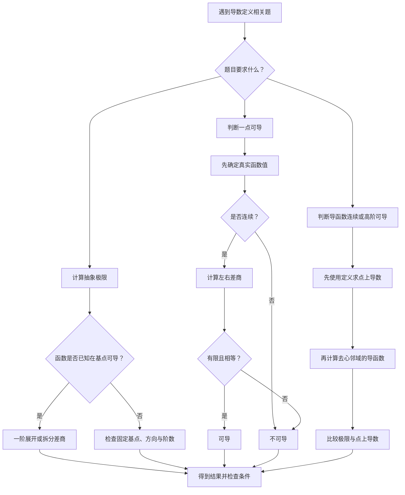

<Callout type="idea" title="本节解题主线">

任何变形差商都先检查三件事：基点是否固定、增量是否双向逼近零、分母是否是真正的自变量增量。

</Callout>

## 学习导览

<Cards>

<Card title="导数定义">

固定基点和双侧差商；可导当且仅当一阶线性近似成立。

</Card>

<Card title="抽象极限">

以 $f(a+h)=f(a)+f'(a)h+o(h)$ 统一处理复合增量。

</Card>

<Card title="可导性判断">

分段点、绝对值、振荡函数与参数阈值。

</Card>

<Card title="综合迁移">

导函数连续、二阶可导、积分与充分必要条件。

</Card>

</Cards>

## 一、先建立本节的核心思想

导数定义这一节最重要的，不是背求导公式，而是理解：

导数就是函数在某一点的增量与自变量增量之比，在增量趋于零时的极限。

数学表达式为

$$
\boxed{ f'(a)=\lim_{h\to0}\frac{f(a+h)-f(a)}{h} }
$$

这个公式有三个不可缺少的部分：

1. 固定基点 $a$：研究的是函数在 $a$ 点附近的变化。
2. 真实函数增量 $f(a+h)-f(a)$：必须减去函数在基点的实际取值。
3. 双侧极限 $h\to0$：一般所说的可导，要求从左右两个方向趋近时得到同一个有限结果。

后面无论遇到抽象函数、复合变量、绝对值还是振荡函数，都应该回到这三个要求。

例如：

$$
\lim_{h\to0}\frac{f(a+h)-f(a)}h
$$

是标准导数定义。

但

$$
\lim_{h\to0}\frac{f(a+h)-f(a-h)}{2h}
$$

是对称差商，它的极限即使存在，也不一定能推出函数在 $a$ 处可导。

再如：

$$
\lim_{h\to0}\frac{f(a+h^2)-f(a)}{h^2}
$$

由于 $h^2\geq0$，实际上只反映右侧变化，不能直接推出双侧可导。

这几种形式看起来非常相似，但逻辑意义不同。

本节绝大部分判断题，都是在考查你能否看出这种区别。

## 二、导数到底是什么？从直观理解到严格定义

### 2.1 几何理解：割线斜率趋向切线斜率

考虑曲线 $y=f(x)$，取两个点：

$$
A=(a,f(a)),\qquad B=(a+h,f(a+h))
$$

连接这两点，割线 $AB$ 的斜率是

$$
k_{AB}=\frac{f(a+h)-f(a)}{h}
$$

当 $h\to0$ 时，点 $B$ 沿曲线趋近点 $A$。

如果割线斜率趋于一个有限的确定值 $L$，就有

$$
f'(a)=L
$$

这个值就是曲线在该点的切线斜率。

因此，可导意味着函数在该点具有确定的局部一阶变化率。

例如：

$$
f(x)=x^2
$$

在 $x=2$ 处：

$$
\begin{aligned} f'(2) &=\lim_{h\to0}\frac{(2+h)^2-4}{h}\\ &=\lim_{h\to0}(4+h)\\ &=4 \end{aligned}
$$

所以函数在 $x=2$ 附近满足

$$
f(2+h)\approx4+4h
$$

当自变量增加 $0.001$ 时，函数值大约增加 $0.004$。

这就是导数的局部线性近似意义。

### 2.2 导数与微分的真正联系

导数存在时，

$$
\lim_{h\to0} \frac{f(a+h)-f(a)}h=f'(a)
$$

意味着

$$
\frac{f(a+h)-f(a)}h=f'(a)+o(1)
$$

两边乘以 $h$，得

$$
\boxed{ f(a+h)=f(a)+f'(a)h+o(h) }
$$

这不是单纯的近似公式，而是一点可导的充要条件。

其中：

$$
o(h)
$$

表示比 $h$ 高阶的无穷小，即余项 $r(h)$ 满足

$$
\lim_{h\to0}\frac{r(h)}h=0
$$

于是，函数增量可以写成

$$
\Delta y=f'(a)\Delta x+o(\Delta x)
$$

微分定义为

$$
\boxed{dy=f'(a)\,dx}
$$

它是函数增量中的线性主部。

为什么这个理解对考研极其重要？

因为以后遇到抽象函数极限：

$$
\lim_{x\to0} \frac{f(1+3x)-f(1-2x)}x
$$

你完全不需要知道 $f$ 的具体表达式。

只要知道 $f'(1)$ 存在，就可以写：

$$
f(1+3x)=f(1)+3f'(1)x+o(x)
$$

$$
f(1-2x)=f(1)-2f'(1)x+o(x)
$$

相减得

$$
f(1+3x)-f(1-2x)=5f'(1)x+o(x)
$$

因此

$$
\boxed{ \lim_{x\to0} \frac{f(1+3x)-f(1-2x)}x=5f'(1) }
$$

这实际上就是本节最常用的抽象函数解题方法。

### 2.3 一点可导与函数连续

必须掌握：

$$
\boxed{ \text{可导}\Longrightarrow\text{连续} }
$$

证明很简单：

如果 $f'(a)$ 存在，那么

$$
f(a+h)-f(a) =h\frac{f(a+h)-f(a)}h
$$

因为第二个因子趋于有限数 $f'(a)$，所以

$$
\lim_{h\to0}[f(a+h)-f(a)]=0
$$

于是

$$
\lim_{h\to0}f(a+h)=f(a)
$$

即连续。

但反过来不成立。

最典型的例子：

$$
f(x)=|x|
$$

在 $x=0$ 连续。

但是

$$
f'_+(0)=\lim_{h\to0^+}\frac{|h|}{h}=1
$$

$$
f'_-(0)=\lim_{h\to0^-}\frac{|h|}{h}=-1
$$

左右导数不相等，因此不可导。

### 2.4 考研必须分清的四个层次

| 概念 | 核心判断 |
| --- | --- |
| 极限存在 | $\lim_{x\to a}f(x)$ 是否存在 |
| 连续 | 极限是否等于 $f(a)$ |
| 可导 | 双侧差商是否具有有限极限 |
| 导函数连续 | $\lim_{x\to a}f'(x)=f'(a)$ 是否成立 |

**最重要的逻辑关系：**

$$
\boxed{ f'\text{ 在 }a\text{ 处连续} \Longrightarrow f\text{ 在 }a\text{ 处可导} \Longrightarrow f\text{ 在 }a\text{ 处连续} }
$$

逆向一般都不成立。

特别注意：$f'(a)$ 存在，不要求 $\lim_{x\to a}f'(x)$ 存在。

这一点会在后面的振荡函数中反复出现。

## 三、模型一：识别导数定义与变形差商

这是核心题目第一组的主要考点，也是选择题特别喜欢设置陷阱的地方。

### 3.1 必须熟悉的几种差商形式

<Callout type="warn" title="差商方向决定信息量">

用 $h^2$ 替换增量只能覆盖一个方向；对称差商极限存在，也不足以推出真正的双侧导数存在。

</Callout>

| 已知极限形式 | 能得到什么 |
| --- | --- |
| $\displaystyle\lim_{h\to0}\frac{f(a+h)-f(a)}h$ | $f'(a)$ |
| $\displaystyle\lim_{h\to0}\frac{f(a-h)-f(a)}h$ | $-f'(a)$，若极限存在 |
| $\displaystyle\lim_{h\to0}\frac{f(a+h^2)-f(a)}{h^2}$ | 右导数 |
| $\displaystyle\lim_{h\to0}\frac{f(a-h^2)-f(a)}{-h^2}$ | 左导数 |
| $\displaystyle\lim_{h\to0}\frac{f(a+h^3)-f(a)}{h^3}$ | 双侧导数 |
| $\displaystyle\lim_{h\to0}\frac{f(a+h)-f(a-h)}{2h}$ | 对称差商，不能反推可导 |

这里的含义要格外严格：

前三列中说某个极限等于导数，是指相应导数存在时二者相等，或者该极限本身给出了对应的单侧导数。

例如 $h^2$ 只能提供右侧信息，所以右导数存在并不意味着双侧导数存在。

### 3.2 核心题目：对称差商为什么等于两倍导数？

题目

设 $f(x)$ 在 $x=a$ 处可导，求

$$
L=\lim_{x\to0} \frac{f(a+x)-f(a-x)}x
$$

<Tabs items={['拆分标准差商', '一阶展开']} defaultIndex={0}>

<Tab value="拆分标准差商">

**方法一：拆成两个标准差商**

在分子中加减 $f(a)$：

$$
\begin{aligned} L &=\lim_{x\to0} \left[ \frac{f(a+x)-f(a)}x+ \frac{f(a)-f(a-x)}x \right] \end{aligned}
$$

第一项直接等于 $f'(a)$。

第二项令 $t=-x$，则

$$
\frac{f(a)-f(a-x)}x = \frac{f(a+t)-f(a)}t
$$

所以也趋于 $f'(a)$。

因此

$$
\boxed{L=2f'(a)}
$$

</Tab>

<Tab value="一阶展开">

**方法二：一阶展开**

因为 $f$ 在 $a$ 处可导：

$$
f(a+x)=f(a)+f'(a)x+o(x)
$$

$$
f(a-x)=f(a)-f'(a)x+o(x)
$$

于是

$$
f(a+x)-f(a-x)=2f'(a)x+o(x)
$$

故

$$
L=2f'(a)
$$

</Tab>

</Tabs>

两种方法都正确。

方法一更适合定义识别题；方法二更适合多个函数值混合的复杂极限。

### 3.3 核心题目：哪种变形差商足以保证函数可导？

文档给出的四种候选形式中，有以下重要代表。

形式 A

$$
\lim_{h\to+\infty} h\left[f\left(a+\frac1h\right)-f(a)\right]
$$

令 $t=1/h$，则

$$
t\to0^+
$$

因此该式等价于

$$
\lim_{t\to0^+}\frac{f(a+t)-f(a)}t
$$

只能保证右导数存在。

形式 B

$$
\lim_{h\to0} \frac{f(a+2h)-f(a+h)}h
$$

它的两个函数值对应的自变量都在移动。

虽然看起来像导数，但没有固定的 $f(a)$。

反例：

$$
f(a)=0,\qquad f(a+t)=\operatorname{sgn}(t)\quad(t\ne0)
$$

对于足够小的非零 $h$，$h$ 与 $2h$ 同号，因此

$$
f(a+2h)-f(a+h)=0
$$

题设极限存在且为零。

但 $f$ 在 $a$ 处甚至不连续。

所以不充分。

形式 C

$$
\lim_{h\to0} \frac{f(a+h)-f(a-h)}{2h}
$$

取

$$
f(x)=|x-a|
$$

分子恒为零，因此极限为零。

但是函数在 $a$ 处不可导。

所以也不充分。

形式 D

$$
\lim_{h\to0} \frac{f(a)-f(a-h)}h
$$

令 $t=-h$：

$$
\frac{f(a)-f(a-h)}h = \frac{f(a+t)-f(a)}t
$$

而 $t\to0$ 仍是双侧趋近。

因此它与标准导数定义完全等价。

$$
\boxed{\text{答案 D}}
$$

这道题最重要的收获是：

不要只看分母是否含有 $h$，还要检查分子有没有固定基点，以及变量是否覆盖基点两侧。

### 3.4 核心题目：$h^2$ 型对称差商陷阱

题目

已知

$$
\lim_{h\to0} \frac{f(a-h^2)-f(a+h^2)} {e^{h^2}-1}=A
$$

问能否推出 $f$ 在 $a$ 处可导？

答案是：

$$
\boxed{\text{不能}}
$$

甚至不能单独确定左导数或右导数。

令

$$
t=h^2\to0^+
$$

原极限变为

$$
\lim_{t\to0^+} \frac{f(a-t)-f(a+t)}{e^t-1}=A
$$

由于

$$
e^t-1\sim t
$$

所以只知道

$$
\lim_{t\to0^+} \frac{f(a-t)-f(a+t)}t=A
$$

这限制了左右两侧函数值之间的差，却没有告诉我们它们分别怎样接近 $f(a)$。

怎么构造反例？

考虑连续的分段线性函数：

$$
f(a)=0
$$

对 $t>0$，令

$$
f(a+t)=ct
$$

$$
f(a-t)=(A+c)t
$$

那么

$$
\frac{f(a-t)-f(a+t)}{e^t-1} = \frac{At}{e^t-1}\to A
$$

但右导数为

$$
f'_+(a)=c
$$

左导数为

$$
f'_-(a)=-(A+c)
$$

只要选择

$$
c\ne-\frac A2
$$

左右导数就不相等。

于是虽然题设成立，但函数不可导。

这个反例比单纯记住答案更重要。

它告诉你：

两个移动函数值之间的差，不能自动决定各自相对于固定基点的变化率。

### 3.5 核心题目：为什么 $x^3$ 与 $1-e^x$ 可以恢复双侧导数？

设 $f(0)=0$，考虑条件

$$
\lim_{x\to0}\frac{f(1-e^x)}x
$$

是否存在。

令

$$
t=1-e^x
$$

当 $x\to0$ 时，

$$
t\to0
$$

而且 $x$ 从正负两侧趋近零时，$t$ 也能从正负两侧趋近零。

注意

$$
\frac tx=\frac{1-e^x}{x}\to-1
$$

于是

$$
\frac{f(1-e^x)}x = \frac{f(t)}t\frac tx
$$

第二个因子趋于非零常数 $-1$，因此原极限存在，当且仅当

$$
\lim_{t\to0}\frac{f(t)}t
$$

存在。

而 $f(0)=0$，所以这正是 $f'(0)$。

由此得到

$$
\boxed{ f'(0)\text{ 存在} \iff \lim_{x\to0}\frac{f(1-e^x)}x \text{ 存在且有限} }
$$

并且

$$
\boxed{ \lim_{x\to0}\frac{f(1-e^x)}x=-f'(0) }
$$

#### 为什么 $x^3$ 可以，$x^2$ 却不一定？

因为

$$
x^3
$$

能取遍零附近正负两侧的小数。

但

$$
x^2\ge0
$$

永远不能提供负方向的信息。

这可以概括为：

$$
\boxed{ \text{变量代换能否用于可导性充要判定} = \text{方向覆盖} + \text{一阶尺度匹配} }
$$

方向覆盖是指新变量覆盖零附近的正负两侧；尺度匹配是指分母与真实函数增量之比趋于非零有限常数。

二者缺一不可。

### 3.6 高价值进阶：为什么阶数匹配同样重要？

考虑

$$
\lim_{x\to0} \frac{f(a+x^3)-f(a)}{x^2}
$$

即使这个极限存在，也不一定能推出 $f'(a)$ 存在。

取

$$
f(a+t)=|t|^{2/3},\qquad f(a)=0
$$

则

$$
f(a+x^3)=|x^3|^{2/3}=x^2
$$

因此

$$
\frac{f(a+x^3)-f(a)}{x^2}=1
$$

极限存在。

但真正的差商是

$$
\frac{f(a+t)-f(a)}t = \frac{|t|^{2/3}}t
$$

其绝对值为

$$
|t|^{-1/3}\to+\infty
$$

函数不可导。

所以：

即使变量覆盖了左右两侧，如果分母的阶数不对，也可能完全无法恢复导数定义。

## 四、模型二：抽象函数极限——不必知道函数解析式

这是本节最值得练熟的计算类型。

### 4.1 一般公式

<Callout type="idea" title="抽象函数的主线">

已知在基点 $a$ 可导，优先用局部一阶展开，利用系数之和为零消掉常数项。

</Callout>

已知 $f$ 在 $a$ 处可导，如果

$$
u(x)=c_1x+o(x)
$$

$$
v(x)=c_2x+o(x)
$$

那么

$$
f(a+u(x))=f(a)+c_1f'(a)x+o(x)
$$

$$
f(a+v(x))=f(a)+c_2f'(a)x+o(x)
$$

因此

$$
\boxed{ \lim_{x\to0} \frac{f(a+u(x))-f(a+v(x))}{x} =(c_1-c_2)f'(a) }
$$

再推广到多个函数值：

若

$$
u_j(x)=c_jx+o(x)
$$

并且

$$
\sum_{j=1}^m\lambda_j=0
$$

则

$$
\boxed{ \lim_{x\to0} \frac{\sum_{j=1}^m\lambda_j f(a+u_j(x))}{x} = f'(a)\sum_{j=1}^m\lambda_jc_j }
$$

这个公式非常适合考研中的多项抽象函数极限。

### 4.2 核心题目、李正元共同考题：三个函数值的组合极限

已知 $f'(1)$ 存在，求

$$
\lim_{x\to0} \frac{ f(1+x)+f(1+2\sin x)-2f(1-3\tan x) }{x}
$$

<Steps>

<Step>

### 第一步：识别三个增量。

$$
u_1=x
$$

$$
u_2=2\sin x=2x+o(x)
$$

$$
u_3=-3\tan x=-3x+o(x)
$$

</Step>

<Step>

### 第二步：列出外部系数。

三个函数值前面的系数分别是

$$
1,\quad1,\quad-2
$$

它们的和为

$$
1+1-2=0
$$

所以常数项 $f(1)$ 会自动抵消。

</Step>

<Step>

### 第三步：计算一阶系数。

$$
1\cdot1+1\cdot2+(-2)\cdot(-3)=9
$$

所以原极限为

$$
\boxed{9f'(1)}
$$

</Step>

</Steps>

#### 两种方法比较

| 方法 | 思路 | 适用场景 |
| --- | --- | --- |
| 拆分差商 | 每个函数值分别加减 $f(1)$ | 两项或三项的简单极限 |
| 一阶展开 | 直接保留各项的一阶系数 | 多个复合函数值、复杂线性组合 |

这类题最容易错的是负号。

特别是

$$
-2f(1-3\tan x)
$$

它提供的一阶系数是

$$
(-2)(-3)=6
$$

而不是 $-6$。

### 4.3 李正元练习：复合增量与等价无穷小

已知

$$
f(0)=0,\qquad f'(0)=1
$$

求

$$
L= \lim_{x\to0} \frac{f(1-\cos x)}{\tan(x^2)}
$$

这里要注意：已知 $f'(0)$ 存在，因此可以使用可导性的展开。

$$
f(t)=t+o(t)
$$

而

$$
1-\cos x\sim\frac{x^2}{2}
$$

所以

$$
f(1-\cos x) = 1-\cos x+o(1-\cos x) \sim\frac{x^2}{2}
$$

又因为

$$
\tan(x^2)\sim x^2
$$

所以

$$
\boxed{L=\frac12}
$$

这道题特别容易和上一组可导性判别题混淆。

两者的根本区别是：

- 这里已经知道 $f$ 在零点可导，所以可以直接把 $f(t)$ 展开。
- 如果只知道这个复合极限存在，却想反过来判断 $f$ 可导，那么 $1-\cos x$ 只提供正方向的信息，通常不够。

已知可导去计算极限，与利用极限反推可导，是两种不同的逻辑任务。

### 4.4 核心题目：不同尺度 $x$ 与 $x^3$

已知

$$
f(0)=0,\qquad f'(0)\text{ 存在}
$$

求

$$
L=\lim_{x\to0} \frac{x^2f(x)-2f(x^3)}{x^3}
$$

设

$$
c=f'(0)
$$

因为 $f(0)=0$，

$$
f(x)=cx+o(x)
$$

$$
f(x^3)=cx^3+o(x^3)
$$

于是

$$
x^2f(x)=cx^3+o(x^3)
$$

所以

$$
\begin{aligned} x^2f(x)-2f(x^3) &=cx^3-2cx^3+o(x^3)\\ &=-cx^3+o(x^3) \end{aligned}
$$

因此

$$
\boxed{L=-f'(0)}
$$

这里要特别掌握余项的尺度：

$$
f(x^3)=cx^3+o(x^3)
$$

而不是简单地把所有余项都记成 $o(x)$。

后一种写法虽然有时仍成立，却可能精度不足，无法完成除以 $x^3$ 的运算。

### 4.5 李林880提高题：从复杂极限反求导数

已知 $f'(0)$ 存在，$f(0)=0$，且

$$
\lim_{x\to0} \left[ 1+\frac{1-\cos f(x)}{\sin x} \right]^{1/x} =e
$$

求 $f'(0)$。

设

$$
c=f'(0)
$$

则

$$
f(x)=cx+o(x)
$$

因为

$$
1-\cos t=\frac{t^2}{2}+o(t^2)
$$

所以

$$
1-\cos f(x) = \frac{c^2x^2}{2}+o(x^2)
$$

这里即使 $c=0$，等式依然成立。

又有

$$
\sin x=x+o(x)
$$

因此

$$
\frac{1-\cos f(x)}{\sin x} = \frac{c^2}{2}x+o(x)
$$

原极限化为

$$
\lim_{x\to0} \left[1+\frac{c^2}{2}x+o(x)\right]^{1/x}
$$

利用

$$
\lim_{x\to0}[1+Ax+o(x)]^{1/x}=e^A
$$

得到

$$
e^{c^2/2}=e
$$

所以

$$
\frac{c^2}{2}=1
$$

最终：

$$
\boxed{f'(0)=\pm\sqrt2}
$$

这一题把三个知识点合在了一起：

$$
\text{抽象函数可导} \longrightarrow \text{一阶展开} \longrightarrow \text{幂指型极限}
$$

以后遇到抽象函数和指数极限混合的题目，要优先考虑这种转换方式。

## 五、模型三：判断一点是否可导——从简单函数到复杂分段函数

前面主要研究抽象差商，现在进入本节的另一大重点：

给出一个具体函数，判断它在某一点是否可导，并求导数。

这类题可以归纳成一个统一流程。

$$
\boxed{ \text{确定点值} \longrightarrow \text{检查连续} \longrightarrow \text{计算左右差商} \longrightarrow \text{比较左右极限} }
$$

对于分段函数，这四步尤其重要。

### 5.1 核心题目：有极限不代表函数在该点连续

设 $f(x)$ 在零点邻域内有定义，且

$$
\lim_{x\to0}f(x)=0
$$

如果还知道

$$
\lim_{x\to0}\frac{f(x)}x=m
$$

能不能推出

$$
f'(0)=m
$$

答案：不能。

为什么？

真正的导数是

$$
f'(0)=\lim_{x\to0}\frac{f(x)-f(0)}x
$$

题设并没有告诉我们

$$
f(0)=0
$$

构造反例：

$$
f(x)= \begin{cases} 0,&x\ne0,\\ 1,&x=0. \end{cases}
$$

此时

$$
\lim_{x\to0}f(x)=0
$$

并且

$$
\lim_{x\to0}\frac{f(x)}x=0
$$

但函数在零点不连续，所以根本不可导。

这一题的重要启示是：

$$
\boxed{ \lim_{x\to0}\frac{f(x)}x=m \quad\text{与}\quad f'(0)=m }
$$

只有在已经知道 $f(0)=0$ 等适当条件时，才能直接等同。

反过来，如果题设已知

$$
f'(0)=m
$$

并且

$$
\lim_{x\to0}f(x)=0
$$

那么可导推出连续，连续再推出

$$
f(0)=0
$$

这时就能得到

$$
\lim_{x\to0}\frac{f(x)}x=m
$$

### 5.2 核心题目：用不等式直接证明可导

设函数满足

$$
|f(x)|\le x^2
$$

对零点某邻域内所有 $x$ 成立。

问 $f'(0)$ 是否存在？

第一步：确定函数值。

代入 $x=0$：

$$
|f(0)|\le0
$$

因此

$$
f(0)=0
$$

第二步：计算差商。

$$
\left|\frac{f(x)-f(0)}x\right| = \frac{|f(x)|}{|x|} \le |x|
$$

因为

$$
|x|\to0
$$

所以根据夹逼定理：

$$
\boxed{f'(0)=0}
$$

这里既没有使用复杂求导公式，也没有要求 $f$ 在其他点可导。

进一步推广：

若

$$
|f(x)-f(a)|\le C|x-a|^{1+\alpha}
$$

其中 $C>0,\alpha>0$，则

$$
\left|\frac{f(x)-f(a)}{x-a}\right| \le C|x-a|^\alpha\to0
$$

因此

$$
\boxed{f'(a)=0}
$$

这个模型经常与振荡函数、有界函数、积分函数结合考查。

### 5.3 核心题目、李林880：有界函数也可能保证可导

考虑

$$
f(x)= \begin{cases} \dfrac{1-\cos x}{\sqrt x},&x>0,\\[6pt] x^2g(x),&x\le0, \end{cases}
$$

其中 $g(x)$ 是有界函数。

判断 $f$ 在零点是否可导。

题目并没有告诉你 $g(x)$ 连续，更没有告诉你 $g'(x)$ 存在。

但是这些条件都不需要。

因为

$$
f(0)=0
$$

对于左侧：

$$
\frac{f(x)-f(0)}x=xg(x)
$$

由于 $g$ 有界，

$$
xg(x)\to0
$$

于是

$$
f'_-(0)=0
$$

对于右侧：

$$
\frac{f(x)-f(0)}x = \frac{1-\cos x}{x^{3/2}}
$$

利用

$$
1-\cos x\sim\frac{x^2}{2}
$$

得到

$$
\frac{1-\cos x}{x^{3/2}} \sim\frac{\sqrt x}{2}\to0
$$

所以

$$
f'_+(0)=0
$$

因此

$$
\boxed{f'(0)=0}
$$

这道题要掌握的思想是：

> 判断一点可导，不一定需要知道函数在附近其他点的导数。只要函数增量足够小，直接使用定义就能证明。

尤其当题目出现“有界函数”时，要立即联想到夹逼定理。

## 六、分段函数：考研必须熟练掌握的参数匹配

### 6.1 核心题目、李正元练习：求参数使函数可导

设

$$
f(x)= \begin{cases} x^2\sin\dfrac1x,&x>0,\\[5pt] ax+b,&x\le0. \end{cases}
$$

如果 $f$ 在 $x=0$ 处可导，求 $a,b$。

第一步：可导必连续，先确定 $b$。

因为

$$
\left|x^2\sin\frac1x\right|\le x^2
$$

所以

$$
\lim_{x\to0^+}x^2\sin\frac1x=0
$$

又因为

$$
f(0)=b
$$

所以连续性要求

$$
b=0
$$

第二步：求右导数。

$$
\begin{aligned} f'_+(0) &=\lim_{x\to0^+}\frac{f(x)-f(0)}x\\ &=\lim_{x\to0^+}x\sin\frac1x\\ &=0 \end{aligned}
$$

第三步：求左导数。

由于 $b=0$，左侧函数为 $ax$。

$$
f'_-(0)=a
$$

要使导数存在，必须满足

$$
f'_-(0)=f'_+(0)
$$

即

$$
a=0
$$

所以

$$
\boxed{a=0,\qquad b=0}
$$

这里还有一个容易忽略的反常识现象。

对于 $x>0$，

$$
f'(x)=2x\sin\frac1x-\cos\frac1x
$$

这个表达式在 $x\to0^+$ 时没有极限。

但是

$$
f'_+(0)=0
$$

确实存在。

所以一定要区分：

$$
\boxed{ f'(0) \ne \text{未经条件保证的 }\lim_{x\to0}f'(x) }
$$

前者必须用零点的函数差商判断。

### 6.2 李林880：分段函数匹配时，连续与导数各给一个方程

考虑

$$
f(x)= \begin{cases} a\sqrt x,&0\le x\le b,\\ \ln x,&x>b. \end{cases}
$$

已知函数在 $(0,+\infty)$ 内可导，在 $x=0$ 处右连续。

求 $a,b$。

首先，条件要求 $b>0$，否则右侧的对数函数无法满足零点右连续性。

真正需要匹配的是 $x=b$。

连续条件：

$$
a\sqrt b=\ln b
$$

左右导数相等：

$$
\frac{a}{2\sqrt b}=\frac1b
$$

由第二式：

$$
a=\frac2{\sqrt b}
$$

代入连续条件：

$$
2=\ln b
$$

于是

$$
b=e^2
$$

进一步得到

$$
a=\frac2e
$$

所以

$$
\boxed{ a=\frac2e,\qquad b=e^2 }
$$

这道题体现了分段函数参数题的标准规律：

$$
\boxed{ \begin{cases} \text{函数值匹配},\\ \text{一阶导数匹配}. \end{cases} }
$$

如果要求二阶可导，还需要进一步匹配二阶导数。

但是要注意：先保证低阶可导，再讨论高阶可导。

### 6.3 核心题目：点值不连续会破坏单侧导数

设

$$
f(x)= \begin{cases} \dfrac23x^3,&x\le1,\\ x^2,&x>1. \end{cases}
$$

判断在 $x=1$ 处左右导数是否存在。

首先：

$$
f(1)=\frac23
$$

左导数：

$$
f'_-(1) = \lim_{h\to0^-} \frac{\frac23(1+h)^3-\frac23}{h} =2
$$

右导数：

$$
\begin{aligned} f'_+(1) &=\lim_{h\to0^+} \frac{(1+h)^2-\frac23}{h}\\ &=\lim_{h\to0^+} \left(\frac1{3h}+2+h\right) \end{aligned}
$$

右侧差商趋于 $+\infty$，不存在有限右导数。

因此：

$$
\boxed{ \text{左导数存在，右导数不存在} }
$$

这里最容易出现的错误是直接计算右侧表达式 $x^2$ 在 $x=1$ 处的导数，得到 $2$。

这是错误的。

因为右导数的定义要求减去真实的 $f(1)=2/3$，而不是减去 $1$。

## 七、绝对值函数：不是见到绝对值就不可导

绝对值题要掌握两个关键因素：

1. 绝对值内部在哪些位置等于零。
2. 外部因子能否消除绝对值带来的尖点。

### 7.1 李林880：四个函数，为什么只有一个不可导？

判断下列函数在零点的可导性：

$$
\begin{aligned} A&:\ |x|\sin|x|\\ B&:\ |x|\sin\sqrt{|x|}\\ C&:\ \cos|x|\\ D&:\ \cos\sqrt{|x|} \end{aligned}
$$

逐个分析。

A：

因为

$$
\sin|x|\sim |x|
$$

所以

$$
|x|\sin|x|\sim x^2
$$

差商趋于零，可导。

B：

$$
\sin\sqrt{|x|}\sim\sqrt{|x|}
$$

因此

$$
|x|\sin\sqrt{|x|} \sim |x|^{3/2}
$$

除以 $x$ 后，其绝对值趋于零。

所以也可导。

C：

由于余弦是偶函数，

$$
\cos|x|=\cos x
$$

这是光滑函数，在零点可导。

D：

$$
\cos\sqrt{|x|}-1 \sim-\frac{|x|}{2}
$$

因此

$$
\frac{\cos\sqrt{|x|}-1}{x} \sim-\frac{|x|}{2x}
$$

左侧极限：

$$
\lim_{x\to0^-}\frac{\cos\sqrt{|x|}-1}{x} =\frac12
$$

右侧极限：

$$
\lim_{x\to0^+}\frac{\cos\sqrt{|x|}-1}{x} =-\frac12
$$

左右不相等。

所以：

$$
\boxed{\text{只有 D 不可导}}
$$

这类题可以迅速转化为增量阶数判断。

$$
f(x)-f(0)=o(x)
$$

则

$$
f'(0)=0
$$

但若

$$
f(x)-f(0)=c|x|+o(|x|)
$$

且 $c\ne0$，左右差商通常分别趋于 $c$ 和 $-c$，因此不可导。

### 7.2 核心题目：绝对值的尖点能否被外部零因子消除？

设

$$
f(x)=(x^2-x-2)|x^3-x|
$$

求不可导点的个数。

第一步：找绝对值内部的零点。

$$
x^3-x=x(x-1)(x+1)
$$

所以候选点是

$$
x=-1,\quad0,\quad1
$$

第二步：检查外部因子。

$$
x^2-x-2=(x-2)(x+1)
$$

在 $x=0$ 与 $x=1$ 处，外部因子不为零，而绝对值内部具有一重零点，所以形成尖点。

这两处不可导。

但在 $x=-1$ 处，外部因子同时含有 $x+1$。

令

$$
h=x+1
$$

当 $h\to0$ 时：

$$
x^2-x-2=-3h+O(h^2)
$$

$$
x^3-x=2h+O(h^2)
$$

因此

$$
f(-1+h)=O(h|h|)
$$

由于 $f(-1)=0$，

$$
\frac{f(-1+h)-f(-1)}h=O(|h|)\to0
$$

所以在 $x=-1$ 处反而可导。

最终：

$$
\boxed{\text{不可导点共有 2 个}}
$$

这是一道很有迁移价值的题。

以后遇到

$$
g(x)|h(x)|
$$

不要直接把 $h(x)=0$ 的所有解都判成不可导点。

如果外部因子 $g(x)$ 同时趋于零，就可能把尖点消除。

### 7.3 核心题目：乘积可导，不代表每个因子都连续

考虑

$$
F(x)=f(x)|\sin x|
$$

其中 $f$ 在零点邻域有定义。

要求 $F$ 在零点可导的充要条件是什么？

由于

$$
F(0)=0
$$

所以

$$
\frac{F(x)-F(0)}x =f(x)\frac{|\sin x|}{x}
$$

对于 $x\to0^+$：

$$
\frac{|\sin x|}{x}\to1
$$

因此右导数存在，当且仅当 $f(x)$ 的有限右极限存在，且

$$
F'_+(0)=\lim_{x\to0^+}f(x)
$$

对于 $x\to0^-$：

$$
\frac{|\sin x|}{x}\to-1
$$

因此

$$
F'_-(0)=-\lim_{x\to0^-}f(x)
$$

要使 $F$ 可导，两个有限单侧极限必须存在且相等：

$$
\boxed{ \lim_{x\to0^-}f(x) = -\lim_{x\to0^+}f(x) }
$$

注意：不要求 $f$ 自身连续。

例如令

$$
f(x)= \begin{cases} -1,&x<0,\\ 0,&x=0,\\ 1,&x>0. \end{cases}
$$

它在零点不连续。

但是零点附近

$$
f(x)|\sin x|=\sin x
$$

于是乘积函数在零点可导，而且

$$
F'(0)=1
$$

这一题说明，考研中的“乘积可导”与“各因子可导”不能随意互推。

## 八、振荡函数：用统一模型解决一大类题目

这是本节最重要的综合考点之一。

### 8.1 先理解振荡与振幅的关系

考虑

$$
f(x)= \begin{cases} |x|^\alpha\sin\dfrac1{|x|^\beta},&x\ne0,\\[5pt] 0,&x=0, \end{cases}
$$

其中

$$
\alpha>0,\qquad\beta>0
$$

函数由两部分构成。

振荡部分：

$$
\sin\frac1{|x|^\beta}
$$

在 $x\to0$ 时无限振荡。

振幅部分：

$$
|x|^\alpha
$$

则不断趋于零。

函数是否连续、可导，取决于振幅能否压住振荡。

### 8.2 第一问：什么时候连续？

因为

$$
\left| |x|^\alpha\sin\frac1{|x|^\beta} \right| \le |x|^\alpha
$$

只要

$$
\alpha>0
$$

就有

$$
f(x)\to0=f(0)
$$

所以

$$
\boxed{ \alpha>0\Longrightarrow f\text{ 在 }0\text{ 连续} }
$$

在本题参数范围内，连续性自动成立。

### 8.3 第二问：什么时候可导？

由导数定义：

$$
\frac{f(x)-f(0)}x = \operatorname{sgn}(x) |x|^{\alpha-1} \sin\frac1{|x|^\beta}
$$

因此有估计：

$$
\left|\frac{f(x)}x\right| \le |x|^{\alpha-1}
$$

当

$$
\alpha>1
$$

时，右侧趋于零。

所以

$$
f'(0)=0
$$

若 $\alpha=1$，差商仍然振荡。

若 $0<\alpha<1$，差商沿某些数列会无界，而沿另一些数列为零。

因此：

$$
\boxed{ f'(0)\text{ 存在} \iff \alpha>1 }
$$

### 8.4 第三问：什么时候导函数在零点连续？

这是核心题目第四模型的重点。

对 $x\ne0$ 求导：

$$
\begin{aligned} f'(x) ={}& \alpha\operatorname{sgn}(x) |x|^{\alpha-1} \sin\frac1{|x|^\beta}\\ &- \beta\operatorname{sgn}(x) |x|^{\alpha-\beta-1} \cos\frac1{|x|^\beta} \end{aligned}
$$

注意第二项。

它来自振荡相位的求导，出现了新的负幂。

要使

$$
\lim_{x\to0}f'(x)=0=f'(0)
$$

第一项要求

$$
\alpha>1
$$

第二项要求

$$
\alpha-\beta-1>0
$$

也就是

$$
\alpha>\beta+1
$$

后一条件已经包含前一条件。

因此：

$$
\boxed{ f'\text{ 在 }0\text{ 连续} \iff \alpha>\beta+1 }
$$

### 8.5 必须背后的原理，而不是只背结论

| 参数范围 | 零点连续 | 零点可导 | 导函数在零点连续 |
| --- | --- | --- | --- |
| $0<\alpha\le1$ | 是 | 否 | 否 |
| $1<\alpha\le\beta+1$ | 是 | 是 | 否 |
| $\alpha>\beta+1$ | 是 | 是 | 是 |

这里“导函数连续”的条件比“函数可导”更严格。

原因是：

- 判断原点可导时，只除一次 $x$。
- 判断导函数连续时，对振荡相位求导，会出现额外的 $|x|^{-\beta-1}$。

这就是两个门槛不同的根源。

### 8.6 李正元练习：整数参数如何判断？

设

$$
f(x)= \begin{cases} x^\lambda\sin\dfrac1{x^2},&x\ne0,\\ 0,&x=0, \end{cases}
$$

其中 $\lambda$ 为整数。

若要求 $f'$ 在零点连续，求 $\lambda$。

对于整数 $\lambda$，振幅阶数为 $|x|^\lambda$，振荡参数为

$$
\beta=2
$$

所以必须满足

$$
\lambda>2+1=3
$$

因此：

$$
\boxed{ \lambda\ge4,\qquad\lambda\in\mathbb Z }
$$

如果只要求原点可导，则

$$
\lambda>1
$$

对于整数就是

$$
\lambda\ge2
$$

这两个结果不能混淆。

## 九、可导、导数连续、二阶可导：三个不同层次

<Callout type="info" title="三种性质不能混淆">

一点可导不意味着导函数在此连续，更不意味着二阶导数存在；分别用定义与去心邻域导数检验。

</Callout>

### 9.1 核心题目：高阶可导性不能直接看函数表达式

设

$$
f(x)=3x^3+x^2|x|
$$

求 $f^{(n)}(0)$ 存在的最高阶数。

把绝对值展开：

$$
f(x)= \begin{cases} 4x^3,&x\ge0,\\ 2x^3,&x<0 \end{cases}
$$

首先：

$$
f'(0)=\lim_{h\to0}\frac{f(h)-f(0)}h=0
$$

对非零点求导：

$$
f'(x)= \begin{cases} 12x^2,&x>0,\\ 6x^2,&x<0 \end{cases}
$$

于是

$$
f''(0) = \lim_{h\to0}\frac{f'(h)-f'(0)}h=0
$$

再考虑二阶导函数：

$$
f''(x)= \begin{cases} 24x,&x>0,\\ 12x,&x<0 \end{cases}
$$

计算三阶导数的左右差商：

$$
\lim_{h\to0^+}\frac{f''(h)-f''(0)}h=24
$$

$$
\lim_{h\to0^-}\frac{f''(h)-f''(0)}h=12
$$

不相等，因此三阶导数不存在。

所以

$$
\boxed{n_{\max}=2}
$$

### 9.2 张宇1000题：相似函数的高阶可导性

题目：

$$
f(x)=|x|\sin^2x
$$

求其在零点存在的最高阶导数阶数。

因为

$$
\sin^2x=x^2+O(x^4)
$$

所以

$$
f(x)=|x|^3+O(|x|^5)
$$

主项是

$$
|x|^3
$$

它在零点具有两阶导数，但三阶导数不存在。

因此

$$
\boxed{n_{\max}=2}
$$

如果想严格证明，应该先写出

$$
f(x)= \begin{cases} x\sin^2x,&x\ge0,\\ -x\sin^2x,&x<0 \end{cases}
$$

再逐阶使用定义。

这样可以避免仅凭主项就直接宣布最高阶数，而忽略余项的可导性要求。

### 9.3 张宇1000题：参数函数一阶可导，但二阶不可导

设

$$
\begin{cases} x=2t+|t|,\\ y=|t|\tan t \end{cases}
$$

其中 $t$ 在零附近变化。

判断原点附近的可导性。

对于 $t<0$：

$$
x=t,\qquad y=-t\tan t
$$

于是

$$
f(x)=-x\tan x,\qquad x<0
$$

对于 $t\ge0$：

$$
x=3t
$$

因此

$$
f(x)=\frac{x}{3}\tan\frac{x}{3}, \qquad x\ge0
$$

于是得到分段函数：

$$
f(x)= \begin{cases} -x\tan x,&x<0,\\[5pt] \dfrac x3\tan\dfrac x3,&x\ge0 \end{cases}
$$

利用

$$
\tan x=x+O(x^3)
$$

得到

$$
f(x)= \begin{cases} -x^2+O(x^4),&x<0,\\[4pt] \dfrac{x^2}{9}+O(x^4),&x>0 \end{cases}
$$

因为两侧函数都是 $O(x^2)$，所以

$$
f'(0)=0
$$

而且两侧导函数都趋于零，所以 $f'$ 在零点连续。

但是：

$$
f''_-(0)=-2
$$

$$
f''_+(0)=\frac29
$$

因此

$$
f''(0)
$$

不存在。

最终：

$$
\boxed{ f'(0)=0,\quad f'\text{ 在 }0\text{ 连续},\quad f''(0)\text{ 不存在} }
$$

这道题非常值得反复练习。

它说明：

一阶导函数连续，不意味着二阶导数存在。

## 十、三个容易忽略的进阶考点

### 10.1 原点附近有无穷多个间断点，原点还能可导吗？

核心题目给出：

$$
f(x)= \begin{cases} x,&x\le0,\\[5pt] \dfrac1n,&\dfrac1{n+1}<x\le\dfrac1n,\quad n=1,2,\ldots \end{cases}
$$

它在正半轴上呈阶梯状。

在 $x=1/n$ 等位置存在跳跃。

但它在原点仍然可导。

因为

$$
f(0)=0
$$

左导数显然是

$$
f'_-(0)=1
$$

右侧，当

$$
\frac1{n+1}<x\le\frac1n
$$

时，

$$
f(x)=\frac1n
$$

因此

$$
1\le\frac{f(x)}x<\frac{n+1}{n}
$$

当 $x\to0^+$ 时，$n\to\infty$，所以

$$
\frac{f(x)}x\to1
$$

得到

$$
f'_+(0)=1
$$

最终：

$$
\boxed{f'(0)=1}
$$

这道题最重要的结论是：

一点可导不要求它周围所有点都连续，更不要求它周围所有点都可导。

### 10.2 没有有限导数，曲线就一定没有切线吗？

不是。

核心题目与李正元练习中有：

$$
f(x)=\sqrt{|x|}
$$

在原点：

$$
\frac{f(x)-f(0)}x= \begin{cases} \dfrac1{\sqrt x},&x>0,\\[6pt] -\dfrac1{\sqrt{-x}},&x<0 \end{cases}
$$

左右差商分别趋于 $+\infty$ 与 $-\infty$。

因此通常意义下的有限导数不存在。

但从曲线上的点

$$
(x,\sqrt{|x|})
$$

连接原点形成割线。

把方向向量除以 $\sqrt{|x|}$，得

$$
\left( \frac{x}{\sqrt{|x|}},1 \right) \longrightarrow(0,1)
$$

因此割线对应的无向直线都趋于同一条竖直直线：

$$
\boxed{x=0}
$$

所以曲线有竖直切线，却没有有限导数。

要注意，这不等于所有斜率发散的情况都有切线，仍然需要检查割线的直线方向是否趋于确定方向。

### 10.3 导数在一点为正，能推出什么？

李正元与李林都考查了这一类题目。

已知

$$
f'(a)>0
$$

则根据导数定义：

$$
\lim_{x\to a} \frac{f(x)-f(a)}{x-a}>0
$$

由极限保号性，存在 $\delta>0$，使得

$$
0<|x-a|<\delta
$$

时，

$$
\frac{f(x)-f(a)}{x-a}>0
$$

因此：

当 $x>a$ 时，

$$
f(x)>f(a)
$$

当 $x<a$ 时，

$$
f(x)<f(a)
$$

所以：

$$
\boxed{ \begin{aligned} x\in(a-\delta,a)&\Rightarrow f(x)<f(a)\\ x\in(a,a+\delta)&\Rightarrow f(x)>f(a) \end{aligned} }
$$

但它不能直接推出 $f$ 在 $a$ 的某个完整邻域内单调递增。

因为 $f'(a)>0$ 只控制以 $a$ 为固定端点的差商，不控制附近任意两点之间的差商。

如果另外知道 $f'$ 在 $a$ 附近连续，就可以利用导函数保号性和中值定理证明局部单调性。

## 十一、核心题目综合：极限定义与隐函数、参数函数

这类题目往往表面是极限，实际上要求先求导。

### 11.1 核心题目：隐函数定义的数列极限

设 $y=f(x)$ 由

$$
y-x=e^{x(1-y)}
$$

确定。

求

$$
\lim_{n\to\infty} n\left[f\left(\frac1n\right)-1\right]
$$

第一步：确定基点。

令 $x=0$：

$$
y=e^0=1
$$

所以

$$
f(0)=1
$$

原极限变成

$$
\lim_{n\to\infty} \frac{f(1/n)-f(0)}{1/n}
$$

即右侧差商。

第二步：隐函数求导。

对原方程求导：

$$
y'-1=e^{x(1-y)}[(1-y)-xy']
$$

令

$$
x=0,\qquad y=1
$$

得

$$
y'-1=0
$$

所以

$$
f'(0)=1
$$

这里局部可导分支的存在也有保证：令

$$
G(x,y)=y-x-e^{x(1-y)}
$$

则

$$
G_y(0,1)=1\ne0
$$

因此可在 $(0,1)$ 附近解出可导的 $y=f(x)$。

最终：

$$
\boxed{ \lim_{n\to\infty} n\left[f\left(\frac1n\right)-1\right]=1 }
$$

这类题目的标准思维是：

$$
\text{含 }n\text{ 的极限} \rightarrow h=\frac1n \rightarrow \text{导数定义} \rightarrow \text{隐函数求导}
$$

### 11.2 核心题目：参数方程与导数定义结合

设函数由

$$
\begin{cases} x=1+t^3,\\ y=e^{t^2} \end{cases}
$$

确定。

求

$$
\lim_{x\to+\infty} x\left[f\left(2+\frac2x\right)-f(2)\right]
$$

注意题目中的极限变量 $x$ 与参数 $t$ 不是同一个角色。

首先令

$$
h=\frac2x
$$

则

$$
x=\frac2h,\qquad h\to0^+
$$

原极限等于

$$
2\lim_{h\to0^+} \frac{f(2+h)-f(2)}h
$$

只需计算

$$
f'(2)
$$

由

$$
1+t^3=2
$$

得

$$
t=1
$$

参数曲线求导：

$$
\frac{dy}{dx} = \frac{dy/dt}{dx/dt} = \frac{2te^{t^2}}{3t^2}
$$

在 $t=1$：

$$
f'(2)=\frac{2e}{3}
$$

所以原极限为

$$
\boxed{\frac{4e}{3}}
$$

这一题告诉你：

看到

$$
n[f(a+c/n)-f(a)]
$$

或者

$$
x[f(a+c/x)-f(a)]
$$

应立即联想到

$$
cf'(a)
$$

但要注意趋近方向，并确认相应单侧导数或双侧导数存在。

## 十二、导数定义与积分结合：数学一高价值综合题

本节核心文档还把导数定义与积分函数结合起来，这是值得重点掌握的提升内容。

### 12.1 核心题目：不需要被积函数可导

已知 $f(x)$ 连续，且

$$
\lim_{x\to0}\frac{f(x)}x=1
$$

定义

$$
g(x)=\int_0^1f(xt)\,dt
$$

求 $g'(x)$，并判断 $g'$ 在零点是否连续。

第一步：先确定 $f(0)$。

由题设：

$$
f(x)=x+o(x)
$$

所以

$$
f(x)\to0
$$

又因为 $f$ 连续，

$$
f(0)=0
$$

第二步：换元。

当 $x\ne0$ 时，令

$$
u=xt
$$

则

$$
g(x)=\frac1x\int_0^xf(u)\,du
$$

由于 $f$ 连续，可以使用微积分基本定理：

$$
\boxed{ g'(x)= \frac{xf(x)-\int_0^xf(u)\,du}{x^2}, \qquad x\ne0 }
$$

第三步：单独求 $g'(0)$。

由

$$
g(0)=0
$$

得

$$
g'(0)= \lim_{x\to0} \frac{g(x)}x
$$

即

$$
g'(0)= \lim_{x\to0} \frac1{x^2}\int_0^xf(u)\,du
$$

因为

$$
f(u)=u+o(u)
$$

所以

$$
\int_0^xf(u)\,du = \frac{x^2}{2}+o(x^2)
$$

因此

$$
\boxed{g'(0)=\frac12}
$$

第四步：判断导函数连续。

当 $x\ne0$：

$$
g'(x)= \frac{xf(x)-\int_0^xf(u)\,du}{x^2}
$$

利用

$$
xf(x)=x^2+o(x^2)
$$

以及

$$
\int_0^xf(u)\,du = \frac{x^2}{2}+o(x^2)
$$

得

$$
g'(x)=\frac12+o(1)
$$

故

$$
\lim_{x\to0}g'(x)=\frac12=g'(0)
$$

所以

$$
\boxed{g'\text{ 在零点连续}}
$$

这里最值得学习的不是计算本身，而是方法选择。

题目只给出了 $f$ 连续。

如果直接写

$$
g'(x)=\int_0^1t f'(xt)\,dt
$$

就隐含使用了未被保证存在的 $f'$，不合法。

正确方法是先换元，把参数移到积分上限，再使用微积分基本定理。

### 12.2 核心题目：导数一阶主项与变上限积分

设

$$
f(0)=0,\qquad f'(0)\ne0
$$

求

$$
L= \lim_{x\to0} \frac{\displaystyle\int_0^{x^2}f(t)\,dt} {x^2\displaystyle\int_0^xf(t)\,dt}
$$

设

$$
c=f'(0)\ne0
$$

则

$$
f(t)=ct+o(t)
$$

分子：

$$
\int_0^{x^2}f(t)\,dt = \frac c2x^4+o(x^4)
$$

分母：

$$
\begin{aligned} x^2\int_0^xf(t)\,dt &=x^2\left(\frac c2x^2+o(x^2)\right)\\ &=\frac c2x^4+o(x^4) \end{aligned}
$$

所以

$$
\boxed{L=1}
$$

这类积分题可以记住一个通用形式。

若

$$
f(t)\sim ct^p,\qquad c\ne0,\quad p>-1
$$

则

$$
\boxed{ \int_0^xf(t)\,dt \sim\frac{c}{p+1}x^{p+1} }
$$

在 $x\to0^+$ 时该式直接适用；对于需要双侧趋近的情形，应根据幂函数定义域及渐近关系确认相应条件。

这一规律能大幅减少变上限积分极限的计算量。

## 十三、两类高阶思维：充分必要条件与构造反例

这是决定你能否处理新题的关键。

### 13.1 核心题目：关于 $|f(x)|$ 的逆向推理

已知 $f$ 在零点连续，且

$$
\lim_{x\to0} \frac{|f(x)|-|f(0)|}{x}
$$

存在。

能否推出 $f'(0)$ 存在？

答案是：

$$
\boxed{\text{能够}}
$$

分情况讨论。

情况一：$f(0)\ne0$。

因为 $f$ 连续，所以在零点附近 $f(x)$ 与 $f(0)$ 同号。

因此

$$
|f(x)|=\operatorname{sgn}(f(0))f(x)
$$

于是 $|f|$ 的可导性可以直接反推 $f$ 的可导性。

情况二：$f(0)=0$。

此时

$$
| f(x) | \ge0= | f(0) |
$$

所以 $|f|$ 在零点取得极小值。

如果 $|f|$ 在零点可导，那么根据费马必要条件：

$$
(|f|)'(0)=0
$$

也就是说：

$$
\lim_{x\to0} \frac{|f(x)|}{x}=0
$$

于是

$$
\left|\frac{f(x)}x\right| = \frac{|f(x)|}{|x|} \to0
$$

所以

$$
f'(0)=0
$$

综合两种情况：

$$
\boxed{ f\text{ 在 }0\text{ 连续且 }|f|\text{ 在 }0\text{ 可导} \Longrightarrow f\text{ 在 }0\text{ 可导} }
$$

由于 $f$ 可导也会推出 $|f|$ 在零点可导吗？

不一定。

例如

$$
f(x)=x
$$

处处可导，但

$$
| f(x) | = | x |
$$

在零点不可导。

所以这里只有单向推出，而不是一般意义上的等价关系。

这正是充分条件、必要条件题目的常见陷阱。

<Accordions>

<Accordion title="反例工具箱：可导性与逆命题">

当题目问“能否推出可导”时，应该有意识地准备以下经典反例。

| 想要否定的错误推理 | 优先考虑的反例 |
| --- | --- |
| 连续推出可导 | $f(x)=\lvert x\rvert$ |
| 对称差商存在推出可导 | $f(x)=\lvert x\rvert$ |
| 去心极限存在推出连续 | 修改单个点的函数值 |
| 右导数存在推出双侧可导 | $f(x)=\lvert x\rvert$ |
| 一点可导推出导函数连续 | $x^2\sin(1/x)$ 补零 |
| 附近导数极限存在推出该点可导 | 修改单个点的函数值 |
| 移动点差商存在推出可导 | $\operatorname{sgn}(x)$ 型函数 |
| 复合差商存在推出可导 | $\lvert x\rvert^{2/3}$ 配合 $x^3$ 代换 |

这里需要补充一条很重要的正面定理：

如果 $f$ 在 $a$ 处连续，在 $a$ 的去心邻域内可导，而且

$$
\lim_{x\to a}f'(x)=L
$$

存在且有限，则根据拉格朗日中值定理，可以推出

$$
f'(a)=L
$$

因此，否定“导函数极限存在就能推出该点可导”的反例，关键就在于原函数在该点的连续性没有得到保证。

</Accordion>

</Accordions>

## 十四、从导数定义出发证明求导法则

核心文档还包括利用定义证明乘积求导法则。

这类题不一定高频直接考证明，但它能让你真正理解抽象函数求导。

设 $u,v$ 均在 $x$ 处可导。

根据定义：

$$
(uv)'(x) = \lim_{h\to0} \frac{ u(x+h)v(x+h)-u(x)v(x) }{h}
$$

在分子中加减

$$
u(x+h)v(x)
$$

得到

$$
\begin{aligned} &u(x+h)v(x+h)-u(x)v(x)\\ ={}&u(x+h)[v(x+h)-v(x)]\\ &+v(x)[u(x+h)-u(x)] \end{aligned}
$$

因此

$$
\begin{aligned} (uv)'(x) ={}&\lim_{h\to0} u(x+h)\frac{v(x+h)-v(x)}h\\ &+v(x)\lim_{h\to0} \frac{u(x+h)-u(x)}h \end{aligned}
$$

因为可导必连续：

$$
u(x+h)\to u(x)
$$

最终：

$$
\boxed{ (uv)'=u'v+uv' }
$$

注意：

证明过程中隐含使用了“可导必连续”。

对于多个因子，推广为：

$$
\boxed{ \left(\prod_{j=1}^nu_j(x)\right)' = \sum_{k=1}^n u_k'(x) \prod_{\substack{1\le j\le n\\j\ne k}}u_j(x) }
$$

这也解释了李正元与李林练习中常见的“大量因子相乘，只在某一点求导”的技巧。

例如，若

$$
P(x)=u_1(x)u_2(x)\cdots u_n(x)
$$

且

$$
u_1(a)=0,\qquad u_j(a)\ne0\quad(j\ge2)
$$

那么

$$
\boxed{ P'(a)=u_1'(a)\prod_{j=2}^nu_j(a) }
$$

因为乘积求导的其他各项仍然包含因子 $u_1(a)=0$，会全部消失。

## 十五、再补充六道高价值迁移训练

下面这些题主要用于检验你是否真正掌握方法，而不只是记住已经讲过的答案。

### 训练一：抽象函数增量

已知 $f'(2)=3$，计算

$$
\lim_{x\to0} \frac{f(2+2\sin x)-f(2-3\tan x)}x
$$

由于

$$
2\sin x=2x+o(x)
$$

$$
-3\tan x=-3x+o(x)
$$

所以

$$
\begin{aligned} &f(2+2\sin x)-f(2-3\tan x)\\ &=3(2+3)x+o(x) \end{aligned}
$$

得到

$$
\boxed{15}
$$

迁移点： 基点不变、两个增量不同，但都能通过一阶展开处理。

### 训练二：可导性反向判断

已知

$$
\lim_{h\to0} \frac{f(h^2)-f(0)}{h^2}=2
$$

能否推出 $f'(0)=2$？

不能。

它只保证右导数为 $2$。

反例：

$$
f(x)= \begin{cases} 2x,&x\ge0,\\ 3x,&x<0 \end{cases}
$$

题设极限为 $2$，但是

$$
f'_+(0)=2,\qquad f'_-(0)=3
$$

所以零点不可导。

迁移点： 识别新变量的方向，而不是机械地套用导数定义。

### 训练三：最大值函数中的隐藏光滑性

设

$$
f(x)=\max\{x^2,2x-1\}
$$

判断 $x=1$ 是否可导。

注意：

$$
x^2-(2x-1)=(x-1)^2\ge0
$$

所以对一切实数：

$$
f(x)=x^2
$$

因此

$$
\boxed{f'(1)=2}
$$

虽然题目使用了最大值函数，但并没有真正发生主导分支切换。

迁移点： 最大值函数的交点不一定是不可导点。需要检查分支的大小关系及一阶斜率。

### 训练四：二阶精度与可导性

设

$$
f(x)= \begin{cases} \dfrac{e^x-1-x}{x},&x\ne0,\\ 0,&x=0 \end{cases}
$$

求 $f'(0)$。

按定义：

$$
f'(0) = \lim_{x\to0} \frac{e^x-1-x}{x^2}
$$

利用

$$
e^x=1+x+\frac{x^2}{2}+o(x^2)
$$

得到

$$
\boxed{f'(0)=\frac12}
$$

迁移点： 判断补值函数的一阶导数，往往需要对原来的分子展开到二阶。

### 训练五：振荡函数的参数判断

设

$$
f(x)= \begin{cases} |x|^\alpha\sin\dfrac1{|x|^3},&x\ne0,\\ 0,&x=0, \end{cases}
$$

其中 $\alpha>0$。

问：

（1）何时在零点可导？

（2）何时导函数在零点连续？

根据前面的统一模型：

$$
\boxed{ f'(0)\text{ 存在}\iff\alpha>1 }
$$

因为 $\beta=3$：

$$
\boxed{ f'\text{ 在 }0\text{ 连续}\iff\alpha>4 }
$$

迁移点： 先判断振幅能否压住一次差商，再判断能否压住求导产生的更高阶振荡。

### 训练六：绝对值的复合函数

设 $f$ 在零点可导，且

$$
f(0)=-2,\qquad f'(0)=3
$$

令

$$
g(x)=|f(x)|
$$

求 $g'(0)$。

因为 $f$ 连续且 $f(0)<0$，所以在零点附近仍有

$$
f(x)<0
$$

因此局部有

$$
g(x)=-f(x)
$$

得到

$$
\boxed{g'(0)=-3}
$$

迁移点： 绝对值函数在复合点处的可导性首先取决于内部函数是否为零。

如果内部函数值非零，往往可以直接利用连续性消去绝对值。

## 十六、不同解法应该怎样选择？

不是所有导数定义题都适合使用同一种方法。

| 题目特征 | 首选方法 | 不建议的做法 |
| --- | --- | --- |
| 标准抽象差商 | 导数定义 | 猜测 $f(x)$ 的解析式 |
| 多个抽象函数值组合 | 一阶 Peano 展开 | 逐项复杂求导 |
| 分段函数拼接 | 连续性＋左右差商 | 只求两侧表达式的导数 |
| 含 $\lvert x\rvert$、$\sqrt{\lvert x\rvert}$ | 分方向＋主项阶数 | 见绝对值就断言不可导 |
| 振荡函数 | 振幅夹逼＋数列反证 | 直接代入振荡函数求极限 |
| 判断导函数连续 | 先求点上导数，再求附近导数极限 | 用附近导数极限代替点上导数 |
| 参数函数 | 消参或参数求导 | 混淆参数与函数自变量 |
| 隐函数极限 | 先定位基点，再隐函数求导 | 直接进行复杂极限计算 |
| 积分函数 | 换元＋积分渐近式 | 在未保证 $f'$ 存在时直接对 $f$ 求导 |
| 充分必要条件 | 检查双向蕴含＋构造反例 | 只举几个成立的例子 |

有一个特别值得掌握的比较：导数定义、泰勒展开与洛必达法则如何选择？

以

$$
f(x)= \begin{cases} \dfrac{e^x-1}{x},&x\ne0,\\ 1,&x=0 \end{cases}
$$

求 $f'(0)$ 为例。

按定义：

$$
f'(0)=\lim_{x\to0}\frac{e^x-1-x}{x^2}
$$

用泰勒展开：

$$
e^x-1-x=\frac{x^2}{2}+o(x^2)
$$

立即得

$$
f'(0)=\frac12
$$

若用洛必达法则，在适用条件满足时：

$$
\begin{aligned} f'(0) &=\lim_{x\to0}\frac{e^x-1-x}{x^2}\\ &=\lim_{x\to0}\frac{e^x-1}{2x}\\ &=\frac12 \end{aligned}
$$

两种方法都能算出结果。

但对于抽象函数

$$
f(a+h)=f(a)+f'(a)h+o(h)
$$

这类题目，泰勒式的一阶展开往往更通用。

因为你只知道 $f'(a)$ 存在，并没有足够条件对各种复杂表达式反复使用洛必达法则。

## 十七、最后把本节知识凝结成一套解题决策系统

考试时遇到新题，应该先判断题目真正问什么。

### 17.1 考试中需要立即反应的信号

看见

$$
f(a+u(x))-f(a)
$$

应该想到：

$$
f'(a)u(x)+o(u(x))
$$

看见

$$
f(a+u(x))-f(a+v(x))
$$

应该想到：

$$
f'(a)[u(x)-v(x)]
$$

的一阶主项，并检查余项阶数。

看见

$$
f(a+h^2)
$$

应该想到单侧信息。

看见

$$
f(a+h^3)
$$

应该检查是否可以恢复双侧差商。

看见

$$
|x|^\alpha\sin\frac1{|x|^\beta}
$$

应该想到：

$$
\alpha>1
$$

对应可导门槛，

$$
\alpha>\beta+1
$$

对应导函数连续门槛。

看见

$$
f(x)= \begin{cases} f_1(x),&x\le a,\\ f_2(x),&x>a \end{cases}
$$

应该先想到：

$$
f_1(a)=\lim_{x\to a^+}f_2(x)
$$

然后再判断：

$$
f'_-(a)=f'_+(a)
$$

其中右导数必须使用真实点值 $f(a)$。

看见

$$
n[f(a+1/n)-f(a)]
$$

应该想到右导数；如果已知双侧可导，便直接等于 $f'(a)$。

### 17.2 本节最值得记住的八条结论

1. 导数的本质是同一固定基点的函数增量比。
2. 可导等价于存在一阶线性展开 $f(a+h)=f(a)+Lh+o(h)$。
3. 可导必连续，连续不一定可导。
4. 对称差商存在不保证可导。
5. 分段函数必须使用真实点值计算左右导数。
6. 振荡函数在一点可导与导函数在该点连续，条件一般不同。
7. 一点可导不要求导函数在该点连续，也不要求附近每一点连续。
8. 判断高阶可导时，必须逐阶确认低阶导数已经存在。

## 十八、针对这份题库的复习顺序

根据这次阅读的四组资料，我建议按照以下顺序巩固，而不是从头到尾机械刷完三本书的整章。

| 学习轮次 | 重点资料 | 训练目标 |
| --- | --- | --- |
| 第一轮 | 核心题目模型一 | 熟练识别各种变形差商与充分必要条件 |
| 第二轮 | 核心题目模型二＋李正元分段函数题 | 连续性、左右导数、参数匹配 |
| 第三轮 | 李林880绝对值与抽象函数题 | 主项阶数、反例、复杂极限 |
| 第四轮 | 核心题目模型三、四 | 导函数连续、高阶可导、振荡参数 |
| 第五轮 | 张宇1000参数函数及高阶可导题 | 综合多步骤判断 |
| 第六轮 | 本讲迁移训练与未讲过的原题 | 练习识别新题结构，减少依赖固定套路 |

### 怎样判断这一节是否真正学会？

不只是把已经讲过的题重新算对。

更重要的是，看到一道没有做过的题，你能主动回答：

第一，它考查的是极限、连续、可导，还是导函数连续？

如果这个层次都没有确定，后面的计算就容易用错条件。

第二，我能不能直接使用导数定义？

先找固定基点、真实函数值以及双侧增量。

第三，是否存在更简单的一阶主项？

复杂三角函数、指数函数、绝对值函数，很多时候只需要保留一阶或二阶主项。

第四，题目是在要求证明充分条件、必要条件，还是充要条件？

一旦存在逆向推理，就要警惕单侧信息、对称差商以及点值不匹配。

第五，如果题目结论不成立，我能不能构造反例？

熟悉 $|x|$、改变单个点值、$\operatorname{sgn}(x)$、$x^2\sin(1/x)$ 和分段线性函数这几种典型反例，会显著提升判断题的正确率。

### 最后的核心总结

这一节最需要真正理解的公式只有一个：

$$
\boxed{ f'(a)= \lim_{h\to0}\frac{f(a+h)-f(a)}h }
$$

而它的等价形式是：

$$
\boxed{ f(a+h)=f(a)+f'(a)h+o(h) }
$$

前一个公式用于识别、判定、证明。

后一个公式用于计算、展开、比较阶数。

把这两个公式与左右导数、连续性、振荡函数的阶数比较结合起来，就构成了解决本节大部分考研数学一题目的基础工具。

尤其需要建立三个反射：

$$
\boxed{ \text{抽象函数}\rightarrow\text{一阶展开} }
$$

$$
\boxed{ \text{分段函数}\rightarrow\text{点值＋左右差商} }
$$

$$
\boxed{ \text{振荡函数}\rightarrow\text{振幅阶数＋导数连续门槛} }
$$

掌握这些方法后，面对题目中的新组合，例如“抽象函数＋复合增量”“振荡函数＋分段拼接”“隐函数＋数列极限”“积分函数＋导函数连续”，就可以从定义重新建立解题过程，而不是依赖记忆某一道原题的答案。
