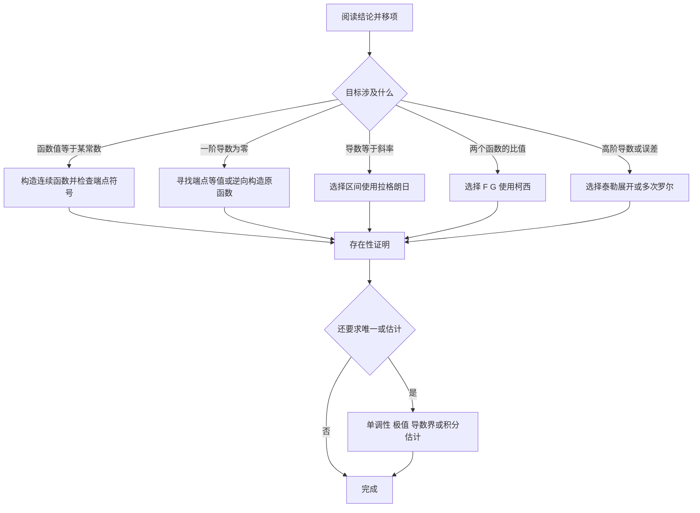

import { Steps, Step } from 'fumadocs-ui/components/steps';

## 知识体系总览

本专题将连续函数的存在性结论与微分中值定理统一为一套可操作的证明框架。五个章节循序递进，并在每章保留完整例题推导、常见陷阱与配套训练答案。

<Callout type="idea" title="一条主线贯穿全部五章">

**先把结论改写为目标形式，再选择定理、构造函数、确定区间，最后严格核查连续性、可导性及中值点范围。**

</Callout>

## 五章导航

<Cards>
  <Card title="01 · 零点定理与介值定理" href="./01-zero-intermediate-value">端点异号、不动点、积分平均值与根数判定</Card>
  <Card title="02 · 泰勒中值定理" href="./02-taylor-theorem">对称展开、消项、余项和插值误差</Card>
  <Card title="03 · 罗尔中值定理" href="./03-rolle-theorem">等值点、辅助函数与二阶存在性</Card>
  <Card title="04 · 拉格朗日中值定理" href="./04-lagrange-theorem">割线斜率、分段区间与导数估计</Card>
  <Card title="05 · 柯西中值定理" href="./05-cauchy-theorem">双函数增量比、积分与综合证明</Card>
</Cards>

## 五类定理如何选择

| 目标形式 | 优先方法 | 构造或关键条件 |
| --- | --- | --- |
| $F(\xi)=0$ | 零点定理 | 闭区间连续，端点异号 |
| $F'(\xi)=0$ | 罗尔定理 | 两端点函数值相等 |
| $f'(\xi)=\dfrac{f(b)-f(a)}{b-a}$ | 拉格朗日中值定理 | 所选闭区间连续、内部可导 |
| $\dfrac{f'(\xi)}{g'(\xi)}=\dfrac{f(b)-f(a)}{g(b)-g(a)}$ | 柯西中值定理 | 两个函数；如写比值，需验证分母不为零 |
| $f(x)-P_n(x)$ 或 $f^{(n)}(\xi)$ | 泰勒中值定理 | 选展开中心、展开阶数和适用余项 |
| 至少两个不同的导数零点 | 分段罗尔 | 至少三个有序等值点，或构造新的等值点 |

## 一张决策流程图

## 共通易错点

- **存在不等于唯一**：零点定理与中值定理通常先给出“至少存在”；唯一性要另证。
- **中值点一般不同**：两次应用定理得到的 $\xi_1,\xi_2$ 不能自行合并。
- **端点必须合法**：只知开区间可导，不能漏检所选闭区间的连续性。
- **分母必须非零**：柯西中值定理先给乘积形式，写商式需有非零条件。
- **余项条件不同**：佩亚诺余项适合局部渐近，拉格朗日余项适合导数界控制。
- **反向构造**：复杂辅助函数常由目标表达式中的乘积、商、导数阶数反推而来。

## 建议学习路径

<Steps>
<Step>

### 先建立零点与等值点意识

熟练把目标改写为 $F(\xi)=0$ 或 $F'(\xi)=0$，检查所需区间与条件。

</Step>
<Step>

### 再练辅助函数与区间选择

由导数表达式逆推乘积或指数辅助函数，并根据目标斜率选取端点。

</Step>
<Step>

### 最后完成综合题与误差估计

将泰勒展开、多次罗尔、柯西中值定理和积分估计按需组合。

</Step>
</Steps>

## 关于资料来源与使用

本专题基于五篇讲解材料编辑，保留其完整核心题型与证明思路，并补充缺失的练习解答。年份与来源描述沿用原材料提供的信息；正式备考引用题目时，仍应以对应试卷或原始题目为准。

公式采用 `$...$` / `$$...$$` 书写。Fumadocs 项目需启用 `remark-math`、`rehype-katex` 并加载 KaTeX 样式。配套练习使用 `fumadocs-ui/components/accordion` 折叠解答。
