# 文档信息

- PDF 来源：[查看原始 PDF](<https://ocr-files.any1.tech/527063e4-37b8-452b-bec3-d953aa6301a6.pdf>)
- 转换时间：2026-10-25T06:04:52+00:00
- 原始页数：82
- 转换范围：1–82 页
- 转换结果：完成（82/82 页）
- 识别流程：PaddleOCR-VL-1.6 → gemini / gemini-3.5-flash-lite

---

<!-- 第 1 页 -->

# 2027 王道 408 冲刺模拟题 · 八套卷

<!-- 第 2 页 -->

## 目录

2027 王道 408 冲刺模拟试卷（一） ................................................. 1
2027 王道 408 冲刺模拟试卷（二） ................................................. 13
2027 王道 408 冲刺模拟试卷（三） ................................................. 24
2027 王道 408 冲刺模拟试卷（四） ................................................. 33
2027 王道 408 冲刺模拟试卷（五） ................................................. 44
2027 王道 408 冲刺模拟试卷（六） ................................................. 53
2027 王道 408 冲刺模拟试卷（七） ................................................. 62
2027 王道 408 冲刺模拟试卷（八） ................................................. 71

<!-- 第 3 页 -->

# 2027 王道 408 冲刺模拟试卷（一）

考试时间 180 分钟 满分 150 分

## 一、单项选择题：第 1–40 题，每题 2 分，共 80 分。在每小题给出的四个选项中，只有一项符合题目要求。

1. 在下列选项中，不属于算法的主要特征的是（ ）。

(A) 有穷性 &emsp;&emsp; (B) 可行性 &emsp;&emsp; (C) 确定性 &emsp;&emsp; (D) 可读性

2. 设 $n$ 是描述问题规模的正整数，则下列程序段的时间复杂度是（ ）。

```c
for (i=1; i<=n; i++) {
    for (j=2*i; j<=n; j++) {
        y+=i*j;
    }
}
```

(A) $O(n)$ &emsp;&emsp; (B) $O(n^2)$ &emsp;&emsp; (C) $O(n \log_2 n)$ &emsp;&emsp; (D) $O(\log_2 n)$

3. 在有 6 个结点的二叉树中，结点编号为 1, 2, 3, 4, 5, 6，其中叶结点的编号为 2, 5, 6。该二叉树的先序遍历结果为 1, 4, 3, 2, 5, 6，则遍历结果 1, 4, 6, 3, 5, 2 可能采用的是（ ）。

(A) 先序遍历算法 &emsp;&emsp; (B) 中序遍历算法 &emsp;&emsp; (C) 后序遍历算法 &emsp;&emsp; (D) 层次遍历算法

4. 当有 7 个结点的树转换为二叉树后，总共可能有（ ）种不同的形态。

(A) 132 &emsp;&emsp; (B) 154 &emsp;&emsp; (C) 429 &emsp;&emsp; (D) 无法确定

5. 在一次哈夫曼编码的过程中，若要求编码的长度小于或等于 4，假设现已对两个字符编码为 0 和 10，则最多还可对（ ）个字符进行编码。

(A) 3 &emsp;&emsp; (B) 4 &emsp;&emsp; (C) 5 &emsp;&emsp; (D) 6

6. 对有 $n$ 个顶点的强连通图，若采用邻接矩阵存储，则其邻接矩阵中至少有（ ）个非零元素。

(A) $n - 1$ &emsp;&emsp; (B) $n$ &emsp;&emsp; (C) $2n - 2$ &emsp;&emsp; (D) $2n$

7. 下列关于有向图 $G$ 的强连通分量特性的叙述中，正确的是（ ）。

(A) 假设图 $G$ 中有两个不同的强连通分量 $C$ 和 $C'$，顶点 $u, v \in C$，顶点 $u', v' \in C'$，若存在一条从 $u$ 到 $u'$ 的路径，则可能存在一条从 $v'$ 到 $v$ 的路径

(B) 在图 $G$ 中加入一条新的有向边，若该边的两个顶点都处于同一个强连通分量中，则可能会增加图 $G$ 的强连通分量数量

(C) 在图 $G$ 中加入一条新的有向边，若该边的两个顶点 $A$ 和 $A'$ 分别处于不同的强连通分量中，且 $A$ 和 $A'$ 之间原先没有路径，则添加后可能会增加图 $G$ 的强连通分量数量

(D) 在图 $G$ 中加入一条新的有向边，若该边的两个顶点 $A$ 和 $A'$ 分别处于不同的强连通分量中，且 $A$ 和 $A'$ 之间原先有一条路径，则添加后可能会减少图 $G$ 的强连通分量数量

8. 在下列选项中，（ ）不可能构成任何二叉排序树的前序遍历序列。

(A) 4, 2, 3, 5, 6, 7

(B) 4, 3, 2, 7, 6, 5

(C) 6, 5, 4, 2, 3, 7

(D) 6, 5, 3, 4, 2, 7

<!-- 第 4 页 -->

9. 设有一散列表 $HT$，其长度为 7（下标范围为 0–6），初始时为空。散列函数定义如下：

$$H_1(k) = k \bmod 7, \quad H_2(k) = 1 + (k \bmod 5)$$

采用双散列法解决冲突，探查序列为 $(H_1(k) + i \times H_2(k)) \bmod 7$ （$i = 0, 1, 2, \cdots$）。将关键字序列 19, 26, 13, 48 依次插入 $HT$ 后，查找关键字 48 成功所需的比较次数为（ ）。

(A) 1

(B) 2

(C) 3

(D) 4

10. 下列关于 B 树和 B+ 树的描述中，正确的是（ ）。

I. B 树的结点可以同时存储关键字和数据，而 B+ 树的非叶结点仅可以存储关键字  
II. B+ 树的叶结点之间存在指针链接，这有利于进行范围查询  
III. 在相同的磁盘 I/O 条件下，B+ 树通常比 B 树更适用于数据库索引  
IV. B 树在进行插入和删除操作时，可能需要合并或分裂结点以保持其平衡性  

(A) 仅 I 和 IV  
(B) 仅 I、II 和 IV  
(C) 仅 I、III 和 IV  
(D) I、II、III 和 IV

11. 对 8 个元素的线性表进行快速排序，在最好情况下，元素之间的比较次数为（ ）。

(A) 7  
(B) 8  
(C) 12  
(D) 13

12. 假定执行一条指令 $I$ 需要 20 个时钟周期，该指令在程序中出现的频率为 10%，其他所有指令的平均 CPI 为 5，则 CPU 执行指令 $I$ 所用的时间占整个 CPU 时间的比例是多少？（ ）如果对硬件进行改进能使指令 $I$ 的执行时间缩短为 10 个时钟周期，但同时会使 CPU 时钟周期延长 10%，那么是否值得采取这种改进措施？（ ）

(A) 30.77%，值得  
(B) 15.39%，值得  
(C) 30.77%，不值得  
(D) 15.39%，不值得

13. 下面是一个用来计算数组 $a$ 中各元素之和的程序，当参数 $\text{len}$ 为 0 时，返回值应该是 0，但在执行时发生了存储器访问异常。请问程序应如何修改？（ ）

```c
float sum_elements(float a[], unsigned len) {
    int i;
    float result = 0;
    for (i = 0; i <= len - 1; i++)
        result += a[i];
    return result;
}
```

(A) 将变量 $\text{result}$ 定义为 $\text{double}$ 型  
(B) 将变量 $\text{result}$ 定义为 $\text{int}$ 型  
(C) 将变量 $\text{len}$ 定义为 $\text{int}$ 型  
(D) 将数组 $a$ 定义为 $\text{int}$ 型

14. 已知采用 IEEE 754 单精度浮点数标准（舍入方式为“就近舍入到偶数”）。设参与运算的两个操作数均为精确表示的二进制规格化数：

$$x = (1.111111111111111111111111111111)_2 \times 2^0 \text{（尾数部分 } 23 \text{ 位全为 } 1\text{）},$$

$$y = (1.00000000000000000000000)_2 \times 2^{-24}.$$

按照 IEEE 754 单精度浮点数加法标准流程（对阶、尾数相加、规格化、舍入）完成 $x + y$ 运算后，最终结果为（ ）。

(A) $(1.1111111111111111111111111111)_2 \times 2^0$  
(B) $(1.0000000000000000000000000)_2 \times 2^1$  
(C) $(1.000000000000000000000000)_2 \times 2^0$  
(D) $(1.1111111111111111111111110)_2 \times 2^0$

<!-- 第 5 页 -->

15. 某 DDR3 SDRAM 芯片内部的核心频率为 133.25 MHz，通过芯片内部的 I/O 缓冲可以实现预取功能，芯片总线上每秒传输数据的次数达到芯片内部核心频率的 8 倍。存储器总线在时钟信号 CLK 的上升沿与下降沿共进行两次数据传输，每次传输 8 B，则下列说法中错误的是（）。

(A) 芯片内部的 I/O 缓冲采用 8 位预取技术
(B) 存储器总线每秒传输 1066 M 次数据
(C) 存储器总线的时钟频率为 1066 MHz
(D) 存储器总线的带宽约为 8.5 GB/s

16. 假定用若干 $8K \times 8$ 位的芯片组成一个 $32K \times 32$ 位的存储器，存储字长为 32 位，内存按字编址，则地址 41F0H 所在芯片的最大地址是（）。

(A) 0000H
(B) 4FFFH
(C) 5FFFH
(D) 7FFFH

17. 在一个五段式指令流水线的 CPU 中，当执行 `lw` 指令（从内存中取数据）或 `sw` 指令（往内存中写数据）时，TLB 缺失和 Cache 缺失有可能在（ ）时钟周期被检测到。

① IF（取指） ② ID（译码/取数） ③ EX（执行） ④ Mem（存储器访问） ⑤ WB（写回）

(A) ①和②
(B) ①和④
(C) ②、④和⑤
(D) ①、④和⑤

18. 假定编译器对 C 语言程序中的变量和计算机中的寄存器做了以下分配：变量 $f, g, h, i, j$ 分别分配到寄存器 `s0`, `s1`, `s2`, `s3`, `s4` 中，并将一条 C 语言赋值语句编译后，生成如下汇编代码序列，第一个操作数是目的操作数。

```text
add t0, s1, s2
add t1, s3, s4
sub s0, t0, t1
```

这条 C 语言赋值语句是（）。

(A) $f = (g + i) - (h + j)$
(B) $f = (g + j) - (h + i)$
(C) $f = (g + h) - (i + j)$
(D) $f = (i + j) - (g + h)$

19. 下列关于多周期处理器和单周期处理器的描述中，错误的是（）。

(A) 单周期处理器的 CPI 总是比多周期处理器的 CPI 大
(B) 单周期处理器的时钟周期比多周期处理器的时钟周期长
(C) 在一条指令的执行过程中，单周期处理器中的每个控制信号的值保持不变，而多周期处理器中的控制信号的值可能发生改变
(D) 在一条指令的执行过程中，单周期处理器的数据通路中的每个部件只能使用一次，而在多周期处理器的数据通路中同一个部件可使用多次

20. 执行如下指令序列（第一列为指令序号），其中 `t1`、`t2`、`a0` 和 `v0` 表示寄存器编号。

```text
1 add t1, 0, 20 // R[t1] <- 20
2 lw t2, 12(a0) // R[t2] <- M[R[a0]+12]
3 add v0, t1, t2 // R[v0] <- R[t1]+R[t2]
```

在以上指令序列中，第1条和第3条、第2条和第3条指令之间发生数据相关。假定采用“取指、译码/取数、执行、访存、写回”的五段式流水线，并控制在时钟的前半周期写寄存器堆，后半周期读寄存器堆，不采用“转发”技术，则至少需要在第3条指令前加入（ ）条空操作（nop）指令才能使这段程序不发生数据冒险。

(A) 1
(B) 2
(C) 3
(D) 4

<!-- 第 6 页 -->

21. 主机和外设之间的正确连接通路是（ ）。

(A) CPU 和主存—I/O 总线—I/O 接口（外设控制器）—通信总线（电缆）—外设

(B) CPU 和主存—I/O 接口（外设控制器）—I/O 总线—通信总线（电缆）—外设

(C) CPU 和主存—I/O 总线—通信总线（电缆）—I/O 接口（外设控制器）—外设

(D) CPU 和主存—I/O 接口（外设控制器）—通信总线（电缆）—I/O 总线—外设

22. 在一个支持多重中断的系统中，已知中断源 A 的处理优先级高于中断源 B 的处理优先级，中断源 B 的响应优先级高于中断源 A 的响应优先级。在下列关于中断响应和处理的说法中，错误的是（ ）。

(A) 在 “中断响应” 周期，CPU 将中断允许触发器清零，以使 CPU 关中断

(B) 在 “中断响应” 周期，CPU 把后继指令地址作为返回地址保存在固定的地方

(C) 当 CPU 正在执行中断源 A 的中断服务程序时，中断源 B 发出中断请求，则 CPU 在当前指令周期结束后能检测到中断源 B 发出的中断请求信号

(D) 若中断源 A 和 B 同时发出中断请求，且都未被屏蔽，则 CPU 先响应中断源 B 的中断请求，但先完成中断源 A 的中断处理过程

23. 操作系统可以管理计算机系统的各类资源，并对资源进行虚拟化。下列关于虚拟化的说法中，正确的是（ ）。

Ⅰ. 时间片轮转调度算法是一种对 CPU 资源的虚拟化

Ⅱ. 内存分区是一种对内存资源的虚拟化

Ⅲ. SPOOLing 是一种设备虚拟技术，采用了类似于脱机输入/输出的思想

Ⅳ. 虚拟机管理程序一定运行在内核态

(A) I、II、III 
(B) I、II 
(C) II、III 
(D) I、II、III、IV

24. 操作系统第一个要运行的程序是引导扇区中存放的代码，这是一个汇编程序文件，引导扇区中存放的代码是（ ）。

(A) 由 BIOS 写进去的

(B) 安装操作系统时写进去的

(C) 格式化硬盘时写进去的

(D) 所有硬盘都固有的一段代码

25. 下列关于进程创建和进程撤销的说法中，错误的是（ ）。

(A) 引起进程创建的主要事件有用户登录、作业调度、提供用户需要的服务、应用请求等

(B) 引起进程撤销的最主要的因素是进程的正常结束

(C) 在进程运行期间，可能出现某些错误迫使进程终止，包括越界错误、保护错、非法指令、算术运算错、I/O 故障等

(D) 进程有可能受操作员或操作系统干预而终止运行，但是父进程不能终止子进程运行

26. 下列关于进程状态的转换的说法中，错误的是（ ）。

(A) 进程状态的转换和对资源的需求都会记录在进程控制块中，进程结束时进程控制块需要回收

(B) 信号量的 signal() 和 wait() 操作其实是对系统调用的封装，会导致进程在运行态、就绪态和阻塞态之间转换

(C) 当进行进程调度时，一个高优先级的进程抢占低优先级进程的 CPU 后，低优先级进程的状态转为就绪态

(D) 成功执行完创建原语后，进程的状态转为创建态

<!-- 第 7 页 -->

27. 下列关于进程的相关说法中，正确的是（ ）。

(A) 一个进程的状态发生变化总会引起其他一些进程的状态发生变化

(B) $\text{wait}()$、$\text{signal}()$ 操作可以解决一切互斥问题

(C) 在进程对应的代码中使用 $\text{wait}()$、$\text{signal}()$ 操作后，可以防止系统发生死锁

(D) 程序的顺序执行具有不可再现性

28. 假定某系统中有 3 台设备 R1、4 台设备 R2，它们被 $P_1, P_2, P_3, P_4$ 四个进程互斥共享，且已知这四个进程均以下面所示的顺序使用现有设备：申请 R1 → 申请 R2 → 申请 R1 → 释放 R1 → 释放 R2 → 释放 R1。在系统运行过程中，是否可能产生死锁？（ ）。

(A) 不会产生死锁

(B) 有可能产生死锁，因为 R1 资源不足

(C) 有可能产生死锁，因为 R2 资源不足

(D) 有可能其中的三个进程进入死锁状态，而另一个进程正常运行

29. 下列关于共享段的说法中，错误的是（ ）。

(A) 在共享段表中，存在共享进程计数变量 $\text{count}$，它记录有多少个进程正在共享该分段，只有当 $\text{count}$ 值为 0 时，才由系统回收该段所占用的内存区

(B) 共享段表中有一个存取控制字段，可以为不同的进程赋予不同的存取权限

(C) 对于一个共享段，在不同的进程中有不同的段号

(D) 每个进程都拥有一张共享段表

30. 在现代操作系统中，文件分配表中引入了“簇”的概念，下列关于“簇”的说法中，错误的是（ ）。

(A) 磁盘容量不断增大，因此不再以盘块而以簇为基本单位进行盘块分配，一簇应包含的扇区数量与磁盘容量大小直接相关

(B) 以簇为基本分配单位，可以减少 FAT 表的表项数，在相同的磁盘容量下，FAT 表的表项数与簇的大小是成正比的

(C) 以簇为基本分配单位，可以使 FAT 表占用更少的存储空间

(D) 以簇为基本分配单位，可以减少访问 FAT 表的存取开销

31. 设备驱动程序主要是指在请求 I/O 的进程与设备控制器之间的一个通信和转化程序，下列有关设备驱动程序的特点，说法错误的是（ ）。

(A) 设备驱动程序与设备控制器和 I/O 设备的硬件特性密切相关

(B) 设备驱动程序应允许可重入，即允许多个进程进行访问但不允许任何进程修改

(C) 设备驱动程序应允许系统调用

(D) 设备驱动程序的一部分须用汇编语言编写，目前许多设备驱动程序的基本部分已经固化在 ROM 中

<!-- 第 8 页 -->

32. 信息在外存空间中的排列也会影响存取等待时间。考虑几条逻辑记录 A、B、C、…、J，它们被存放于磁盘上，每个磁道存放 10 条记录，安排如表 1 所示。

表1 每个磁道存放 10 条记录

| 物理块 | 1 | 2 | 3 | 4 | 5 | 6 | 7 | 8 | 9 | 10 |
| :---: | :---: | :---: | :---: | :---: | :---: | :---: | :---: | :---: | :---: | :---: |
| 逻辑记录 | A | B | C | D | E | F | G | H | I | J |

假定要经常顺序处理这些记录，磁道旋转用时为 $20\text{ ms/转}$，处理程序读出每条记录后花 $4\text{ ms}$ 进行处理。考虑对信息的分布进行优化，如表 2 所示。相比之前的信息分布，优化后的时间缩短了（ ）。

表2 优化后磁道存放的 10 条记录

| 物理块 | 1 | 2 | 3 | 4 | 5 | 6 | 7 | 8 | 9 | 10 |
| :---: | :---: | :---: | :---: | :---: | :---: | :---: | :---: | :---: | :---: | :---: |
| 逻辑记录 | A | H | E | B | I | F | C | J | G | D |

(A) 60 ms 
(B) 104 ms 
(C) 144 ms 
(D) 204 ms

33. 如下图所示，网络采用数据报交换方式，每个数据报在到达路由器时均根据“该路由器到目的主机的当前最小路径时延”进行独立路由选择（当存在多条路径的时延相等时，优先选择经过路由器 B 的路径）。忽略路由器处理时延及主机 C 到路由器 A 的传输时延。


主机 C 在时刻 $t = 0, 1, 2\text{ ms}$ 依次向目的主机 S 发送三个等长数据报 P1、P2、P3。已知链路 A→D 的时延在 $t \in [2, 6]\text{ ms}$ 期间由 $5\text{ ms}$ 变为 $4\text{ ms}$，链路 B→S 的时延在 $t \in [4, 8]\text{ ms}$ 期间由 $5\text{ ms}$ 变为 $30\text{ ms}$，其余各条链路时延保持恒定。则 S 接收到这三个数据报的先后顺序是（ ）。

(A) P1、P2、P3 
(B) P1、P3、P2 
(C) P3、P1、P2 
(D) P2、P3、P1

34. 某信道的长度为 $1\text{ km}$，信道带宽为 $160\text{ MHz}$，信号功率为 $0.6\text{ W}$，噪声功率为 $0.0193\text{ W}$，信号在该信道中的传播速率为 $200000\text{ km/s}$。在该信道中，主机 A 向 B 连续传输一个 $6000\text{ bit}$ 的文件，则该链路上的比特数量的最大值是（ ）。

(A) 500 bit 
(B) 512 bit 
(C) 1024 bit 
(D) 4000 bit

35. 数据链路层采用 SR 协议传输数据，使用 $4\text{ bit}$ 给帧编号，接收窗口的尺寸取值为 5，发送窗口的尺寸取最大值，发送窗口内的起始序号为 0，数据帧的初始序号为 0。假设发送方已发送了 0~6 号数据帧，现已收到 1、3、5 号帧的确认，而 0、2、4 号数据帧依次超时，则此时发送方最多能发送的数据帧数量为（ ）。

(A) 8 
(B) 7 
(C) 5 
(D) 4

<!-- 第 9 页 -->

36. 某应用程序发送一个 UDP 数据报，在网络层把 IP 数据报划分为 4 个报片发送出去，结果前两个报片丢失，后两个报片正确到达目的站。过段时间后，应用程序重传该 UDP 数据报，网络层仍将其划分为 4 个报片来传送，结果这次前两个报片正确到达目的站，而后两个报片丢失。假定目的站第一次收到的后两个报片仍保存在目的站的缓存中，则下列说法中，正确的是（）。

(A) 因 UDP 不保证可靠传输，故目的站能够将两次传输的 4 个报片组装成 IP 数据报

(B) 因 IP 不保证可靠传输，故目的站能够将两次传输的 4 个报片组装成 IP 数据报

(C) 因首部标识字段不同，故目的站不能将两次传输的 4 个数据报片组装成 IP 数据报

(D) 因首部源 IP 地址不同，故目的站不能将两次传输的 4 个数据报片组装成 IP 数据报

37. 某网络的拓扑结构如图所示，假设交换机当前已学习到了主机 E 的 MAC 地址，主机 A 向主机 E 发送 ARP 请求报文，主机 E 收到后，向主机 A 发送 ARP 响应报文，则能收到 ARP 请求报文和 ARP 响应报文的主机数量分别是（）。

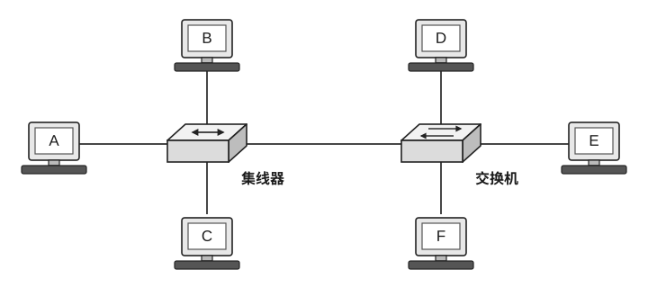

(A) 5, 3 

(B) 5, 1 

(C) 3, 5 

(D) 1, 1

38. 在基于 TCP/IP 模型的分组交换网络中，每个分组都可能走不同的路径，所以在分组到达目的主机后应该重新排序。又由于不同类型的物理网络的 MTU 不同，因此一个分组在传输的过程中也可能需要分段，这些分段在到达目的主机后也必须重组。对于分组的排序和分段的重组，下列说法中正确的是（）。

(A) 排序和重组工作都由网络层完成

(B) 排序和重组工作都由传输层完成

(C) 排序工作由网络层完成，而重组工作由传输层完成

(D) 排序工作由传输层完成，而重组工作由网络层完成

39. 在以下关于 TCP 中各种计时器的描述中，错误的是（）。

(A) 超时计时器用于控制报文段的重传时机

(B) 持续计时器用于防止接收长报文分片造成的死锁

(C) 时间等待计时器用于保证 TCP 连接释放的可靠性

(D) 保活计时器用于检测长期空闲的 TCP 连接是否仍然有效

<!-- 第 10 页 -->

40. 下列关于 HTTP 的说法中，正确的是（ ）。

Ⅰ. 当用户点击某个包含1个文本文件和3张图片的网页时，如果 HTTP 使用持续连接，那么只需发送1个请求报文就能收到4个响应报文

Ⅱ. 可以使用同一个 HTTP/1.1 持续连接传输对 x.com/1.html 和 x.com/2.html 的请求和响应

Ⅲ. 当 HTTP 使用非持续连接时，一个 TCP 报文段也可装入两个不同的请求报文

Ⅳ. 响应报文中的实体主体部分永远不会是空的

(A) Ⅰ、Ⅱ &emsp;&emsp; (B) 仅 Ⅱ &emsp;&emsp; (C) Ⅲ、Ⅳ &emsp;&emsp; (D) Ⅱ、Ⅳ

## 二、综合应用题：第 41-47 题，共 70 分。

41. （10分）某有向图 $G$ 的邻接矩阵如图所示，顶点从 0 开始编号，回答下列问题。

$$
\begin{bmatrix}
0 & 3 & 1 & 3 & 5 \\
3 & 0 & 1 & 2 & 4 \\
1 & 1 & 0 & 1 & 1 \\
3 & 2 & 1 & 0 & 1 \\
5 & 4 & 1 & 1 & 0
\end{bmatrix}
$$

（1）图 $G$ 共有多少个强连通分量？

（2）对于下列函数 `f()`，说明其功能，并写出函数调用 `f(&G,3)` 的返回值。

```c
int f(MGraph *G, int i) {
    int d = 0, j;
    for (j = 0; j < G->n; j++) {
        if (G->edges[i][j]) d++;
        if (G->edges[j][i]) d++;
    }
    return d;
}
```

（3）假设图 $G$ 是无向图，若要求该图的最小生成树，从节省时间开销的角度考虑，应采用哪种算法？计算该图的最小生成树的权值（树中所有边的权值之和）。

42. （13分）假设二叉树采用二叉链表存储，试设计算法求该二叉树的高度，并判断该二叉树是否平衡。本题中的“平衡”是指二叉树中任意一个结点的左、右子树的高度差的绝对值不超过 1。二叉树的结点的定义如下：

```c
typedef struct BiTNode {
    int data;                        // 数据域
    struct BiTNode *lchild, *rchild; // 左、右孩子指针
} BiTNode, *BiTree;
```

回答下列问题：

（1）给出算法的基本设计思想。

（2）根据设计思想，采用 C 或 C++ 语言描述算法，关键之处给出注释。

<!-- 第 11 页 -->

43. (11分) 以下是计算两个向量点积的程序段：

```c
float Dotproduct(float x[8], float y[8]) {
    float sum = 0.0;
    int i;
    for (i = 0; i < 8; i++)
        sum += x[i] * y[i];
    return sum;
}
```

回答下列问题：

(1) 分析访问数组 x 和 y 时的的时间局部性和空间局部性。

(2) 假定数据 Cache 采用直接映射方式，Cache 容量为 32 B，每个主存块的大小为 16 B；编译器将变量 sum 和 i 分配在寄存器中，内存按字节编址，数组 x 存放在以 0000 0040H 开始的 32 B 的连续存储区中，数组 y 则紧跟在 x 后进行存放。该程序数据访问的命中率是多少？要求说明每次访问时 Cache 的命中情况。

(3) 将（2）中的数据 Cache 改用 2 路组相联映射方式，并采用 LRU 替换算法，块的大小改为 8 B，其他条件不变，则该程序数据访问的命中率是多少？

(4) 在（2）中条件不变的情况下，将数组 x 定义为 float[12]，则数据访问的命中率是多少？

<!-- 第 12 页 -->

44. （12分）下图所示为单周期数据通路（一个时钟周期内完成一条指令），支持顺序取指，可执行 R 型运算指令及 lw/sw 访存指令。假设不考虑异常与冒险情况。


图中关键控制信号定义如下：

RegDst：选择写回目的寄存器为 rt (0) 或 rd (1)。

RegWrite：控制寄存器堆是否允许写回（1 允许，0 禁止）。

AluSrc：选择 ALU 第二操作数为 R[rt]（0）或符号扩展立即数 SignExtend(imm)（1）。

MemWrite：控制数据存储器是否执行写入（1 写入，0 禁止）。

MemToReg：选择写回数据源为内存读出数据（1）或 ALU 结果（0）。

该数据通路基于一种简化的指令集，仅包含两类指令：

① R 型指令：op(6)=000000 | rs(5) | rt(5) | rd(5) | shamt(5)=00000 | funct(6)；语义为 $R[rd] \leftarrow f(R[rs], R[rt])$。

② I 型指令：op(6) | rs(5) | rt(5) | imm(16)；lw 语义为 $R[rt] \leftarrow \text{Mem}[R[rs] + \text{SignExtend}(imm)]$，sw 语义为 $\text{Mem}[R[rs] + \text{SignExtend}(imm)] \leftarrow R[rt]$。

其中，rs/rt/rd 为 5 位寄存器编号（0 ~ 31），imm 为 16 位立即数，SignExtend(imm) 表示符号扩展至 32 位。寄存器堆的读操作为组合逻辑、写操作在时钟上升沿完成。ALU 功能说明：R 型指令由 funct 字段决定具体运算；lw/sw 指令中 ALU 固定执行加法用于地址计算。

请回答下列问题：

（1）在该单周期数据通路中，是否可以增加指令寄存器 IR？说明理由。

（2）对 R 型、lw、sw 三类指令，判断是否写寄存器堆/写数据存储器：给出 RegWrite、MemWrite 的取值（0 或 1）。

（3）对三类指令，分别确定：写回目的寄存器（rd/rt/无写回），并给出 RegDst 取值（0/1 或无关）；写回数据来源（ALU/Mem/无写回），并给出 MemToReg 取值（0/1 或无关）。

（4）对三类指令，分别确定 ALU 第二操作数选择：给出 AluSrc 取值 (0/1)，并说明 ALU 两个输入源（如 R[rs]、R[rt]、SignExtend(imm)）。

（5）若增加 addi 指令：$R[rt] \leftarrow R[rs] + \text{SignExtend}(imm)$，请给出上述 5 个控制信号的设置值及理由。

45. （8分）假设有两个生产者进程 A、B 和一个销售者进程 C，它们共享一个无限大的仓库。生产者每次循环生产一件产品，然后入库供销售者销售，销售者每次循环从仓库取出一件产品进行销售。如果不允许同时入库，也不允许边入库边出库，而且要求生产产品 A 和 B 的件数关系满足：$-n \leqslant \text{A 的件数} - \text{B 的件数} \leqslant m$，其中 $n, m$ 是正整数，但对仓库中产品 A 和 B 的件数无上述要求。用信号量机制写出 A、B、C 三个进程的工作流程。

<!-- 第 13 页 -->

46. (7分) 某 32 位系统采用请求分页内存管理方式，页面大小可设为 4 KB 或 4 MB，按字节编址，页表所在的页框大小均为 4 KB，页表项大小为 4 字节。对于 4 KB 的页，采用二级分页方式，其中 32 位逻辑地址的划分如下图所示：

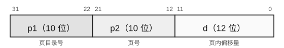

高 10 位为页目录号，中间 10 位为页号，低 12 位为页内偏移量。页表项的条目有一个标志位 Page_Size，当 Page_Size 置为 1 时，表示页面大小为 4 MB，而不是标准的 4 KB，页目录的条目会绕过内层页表而直接指向 4 MB 的页帧，且地址的低 22 位指向 4 MB 页内偏移量。该系统的逻辑地址和物理地址均为 32 位。执行某进程时，页基址寄存器的值为 7F65 4000H，假设该进程的页目录表内容如下所示：

| 目录号 | 页框号 | 有效位 | 装入时刻 | Page_Size |
| :---: | :---: | :---: | :---: | :---: |
| 0H | FF101H | 1 | 120 | 0 |
| 1H | B1A60H | 0 | 40 | 0 |
| 2H | 254H | 1 | 180 | 1 |
| 3H | 202H | 0 | 20 | 1 |
| 4H | CD404H | 1 | 220 | 0 |
| 5H | 163H | 1 | 300 | 1 |
| ... | ... | ... | ... | ... |
| BAH | FF807H | 0 | 60 | 0 |

回答下列问题：

(1) 某指令周期内访问的虚拟地址分别是 013F F35AH 和 015F 123DH，则获得这两个地址所对应的数据分别需要至少进行多少次访存？

(2) 虚拟地址 015F 123DH 转换后得到的物理地址是什么？这个数据所在的页框大小是多少？

(3) 假设系统采用固定分配局部置换策略为该进程分配两个 4 KB 的页框和两个 4 MB 的页框，对这两组不同大小的页均采用 FIFO 置换算法，当该进程执行到 404 时刻时，要访问虚拟地址 00D4 0866H 的数据，则地址转换后得到的物理地址是什么？

(4) 在进程执行过程中，若访问虚拟地址 2EBC A234H 时发生缺页，在缺页异常处理过程中，要为所缺页分配页框并更新相应的页目录表表项，则本次更新的页目录表表项的物理地址是什么？

<!-- 第 14 页 -->

47. （9分）某无线局域网采用 802.11 DCF 工作方式，拓扑结构如右图所示。服务器 Host-S 通过 100Base-T 接口连接交换机 S，S 再通过 100Base-T 接口连接无线接入点 AP；无线终端 STA1 和 STA2 通过无线链路接入 AP。系统忽略 RTS/CTS 机制，采用基本接入机制，TCP 连接已建立且不考虑拥塞控制细节，仅考察确认与可靠传输的基本现象。

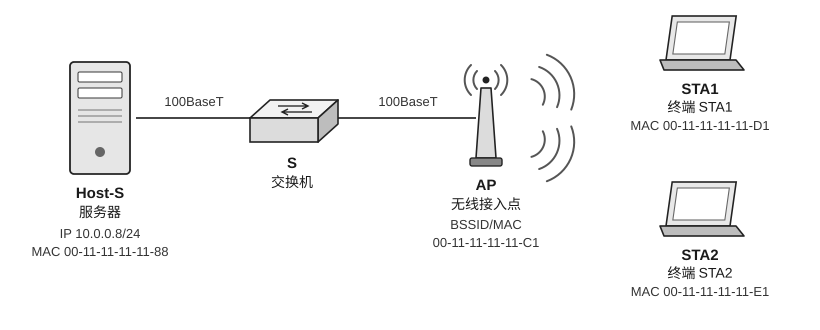

请回答下列问题：

（1）802.11 DCF 使用的介质访问控制机制是什么？与以太网 CSMA/CD 的区别是什么？

（2）当 STA1 监听到信道忙，在信道转空闲后，802.11 发送数据前通常需要等待哪些时间间隔/过程？802.11 如何保证优先级更高的响应帧（如 ACK）优先发送？

（3）若 Host-S 向 STA1 下行发送一个 IP 分组 P（经 AP 转发至无线），则在 STA1 收到的该 802.11 数据帧中，地址 1、地址 2、地址 3 分别是什么？

（4）STA1 通过 TCP 向 Host-S 连续发送若干段数据，其中第一段在无线链路上丢失（假设丢在 STA1→AP 方向），从现象上看 Host-S 的 TCP ACK 将呈现什么特征？STA1 最可能触发哪类重传机制？说明理由。

(5) 若 STA1 与 STA2 同时有数据要发，在不使用 RTS/CTS 的情况下，CSMA/CA 仍可能出现哪种典型问题？结合本图说明在什么条件下会发生。

<!-- 第 15 页 -->

# 2027 王道 408 冲刺模拟试卷（二）

考试时间 180 分钟 满分 150 分

一、单项选择题：第 1–40 题，每题 2 分，共 80 分。在每小题给出的四个选项中，只有一项符合题目要求。

1. 设二叉树共有 $n$ 个结点，则下列程序段的时间复杂度是（ ）。

```cpp
int maxFunc(TreeNode* root) {
    if (root == NULL) return 0;
    return max(maxFunc(root->left), maxFunc(root->right)) + 1;
}
```

(A) $O(\log_{2} n)$        (B) $O(n)$        (C) $O(n \log_{2} n)$        (D) $O(2^{n})$

2. 已知某二叉树共有 5 个结点，其先序遍历和中序遍历的序列都是 “abcde”，则这样的二叉树共有（ ）种不同的形状。

(A) 1          (B) 3          (C) 5          (D) 6

3. 若一棵二叉树有 100 个结点，根结点为第 1 层，则第 7 层最多有（ ）个结点。

(A) 37          (B) 48          (C) 49          (D) 64

4. 已知一棵完全二叉树有 64 个叶结点，根结点的深度为 1，则该树可能达到的最大深度为（ ）。

(A) 7          (B) 8          (C) 9          (D) 10

5. 下列关于二叉树的说法中，错误的是（ ）。

(A) 若二叉排序树的一个结点有两个孩子，则它的中序后继结点没有左孩子，它的中序前驱结点没有右孩子

(B) 若二叉排序树的一个结点 $x$ 的右子树为空，且 $x$ 有一个中序后继 $y$，则 $y$ 一定是 $x$ 的祖先，且其左孩子也是 $x$ 的祖先 ($x$ 可视为自身的祖先)

(C) 在中序线索树中，从最左边的结点开始不断地查找后继结点，不一定能遍历完树中的所有结点

(D) 若 $x$ 是二叉排序树的叶结点，$y$ 是其父结点，则 $y$ 的值要么是树中大于 $x$ 的值的最小关键字，要么是树中小于 $x$ 的值的最大关键字

6. 有向图的邻接矩阵 $A$ 如右所示，在下列说法中，错误的是（ ）。

$$
A = \begin{bmatrix} 0 & 1 & 0 & 0 & 0 \\ 0 & 0 & 0 & 1 & 0 \\ 0 & 0 & 0 & 0 & 1 \\ 1 & 0 & 0 & 0 & 0 \\ 0 & 0 & 0 & 1 & 0 \end{bmatrix}
$$

I. 图中没有环

II. 该图的强连通分量的数量为 2

III. 拓扑序列存在

(A) I          (B) I、III          (C) II、III          (D) I、II、III

<!-- 第 16 页 -->

7. 在右面的 AOE 网中，时间余量最大的活动的时间余量是（）。

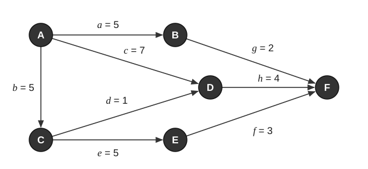

(A) 5 &emsp;&emsp; (B) 6 &emsp;&emsp; (C) 3 &emsp;&emsp; (D) 4

8. 下列关于红黑树的说法中，正确的是（）。

(A) 任意一棵红黑树中红结点的数量和黑结点的数量一定相等

(B) 红黑树的黑高可能正好是整棵红黑树高度的一半

(C) 红黑树的查找效率要优于平衡二叉树

(D) 一棵合法的红黑树应该也是一棵平衡二叉树

9. 对于如下这棵 3 阶 B 树，完成“删除 71”操作后应该是（）。

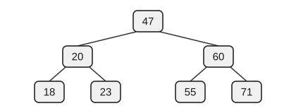

备选 B 树如下：

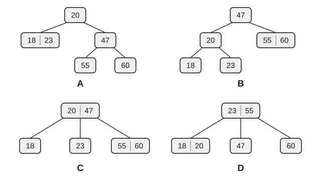

<!-- 第 17 页 -->

10. 设有 $n$（$n > 100000$）个互不相同的整数存储在数组 $M[1..n]$ 中，要求在平均情况下以尽可能少的比较次数找出其中最小的 10 个元素，且不要求这 10 个元素按升序排列。给定算法 $X$ 如下：反复对当前子数组执行一次 partition 操作——任选枢轴 pivot，原地重排使得 pivot 左侧的所有元素均小于 pivot、右侧的所有元素均大于 pivot，并得到 pivot 的最终位置 pos（按全局下标计）。若 pos = 10，则算法终止并输出 $M[1..10]$；若 pos > 10，则仅在左半部分继续执行算法 $X$；若 pos < 10，则仅在右半部分继续执行算法 $X$（并相应调整目标名次）。

关于算法 $X$ 的叙述中，正确的是（ ）。

(A) 当算法终止（pos = 10）时，$M[1..10]$ 一定已按升序排列

(B) 当算法终止（pos = 10）时，虽然第 10 小元素就位，但 $M[1..9]$ 未必是全局最小的 9 个元素

(C) 算法 $X$ 的平均时间复杂度为 $O(n)$，但在极端情况下最坏时间复杂度可能达到 $O(n^2)$

(D) 为保证算法正确性，算法 $X$ 每轮 partition 必须选取当前子数组的中位数作为 pivot

11. 堆排序分为两个阶段，其中第一个阶段将给定的序列建成一个堆，第二个阶段逐次输出堆顶元素。设给定序列为 {48, 62, 35, 77, 55, 14, 35, 98}，若在堆排序的第一个阶段将该序列建成一个堆（大根堆），则交换元素的次数为（ ）。

(A) 5 
(B) 6 
(C) 7 
(D) 8

12. 下面给出了改善计算机性能的四种可能措施：

I. 用更快速的处理器替换原来的慢速处理器  
II. 增加同类处理器的个数，使不同的处理器能同时执行程序  
III. 优化编译生成的代码，减少程序执行的总时钟周期数  
IV. 缩短指令执行过程中访问内存的时间  

其中能够缩短 CPU 执行时间的措施是（ ）。

(A) I、II、III 
(B) I、II、IV 
(C) I、III、IV 
(D) I、II、III、IV

13. 在某 8 位计算机中，假定 x 和 y 是两个带符号整数变量，用补码表示有 $[x]_{\text{补}} = 44\text{H}$，$[y]_{\text{补}} = \text{DCH}$，则 $x/2 + 2y$ 的机器数以及相应的溢出标志 OF 分别是（ ）。

(A) CAH、0  
(B) CAH、1  
(C) DAH、0  
(D) DAH、1

14. 在 IEEE 754 单精度浮点数的加减运算中，当对阶操作得到的两个阶码之差的绝对值 $\left|\Delta E\right|$ 大于或等于（ ）时，就无须继续进行后续操作，此时运算结果直接取阶大的那个数。已知在对阶移位时保留两位附加位，在根据附加位进行舍入时采用就近舍入的方式。

(A) 24 
(B) 25 
(C) 126 
(D) 128

15. 某计算机的字长为 64 位，采用 64 位定长指令字，存储器总线的宽度为 64 位，若用 8 个 $64\text{M} \times 8$ 位的 DRAM 芯片扩展构成一个 $64\text{M} \times 64$ 位的内存条，支持突发传输方式，则下列说法中正确的是（ ）。

I. 在该内存条中，所有芯片行缓冲的总大小为 64KB  
II. 采用多模块交叉编址方式  
III. 每代 DRAM 芯片如果地址引脚数增加 1 个，那么容量至少增加 4 倍  
IV. 该计算机的主存数据寄存器（MDR）的宽度为 8 位  

(A) I、III 
(B) I、II、III 
(C) II、III 
(D) I、II、III、IV

<!-- 第 18 页 -->

16. 某系统同时采用三类存储器：SRAM（用作高速缓存）、DRAM（用作主存储器）和 Flash 存储器（支持块擦除和页编程）。关于这三类存储器的读/写特性，下列说法中正确的是（ ）。

(A) SRAM 与 DRAM 都必须 “先擦除后写”，否则无法将某些位从 0 改写为 1

(B) EEPROM 与块擦除型非易失存储器一样，通常只能按 “块” 为最小单位擦除，因此无法按字节擦除/写入

(C) 块擦除型非易失存储器的编程操作通常只能使位从1变为0；要将0变回1，必须先对包含该位的擦除单位执行擦除操作

(D) DRAM 断电后数据会丢失，因此无须刷新；刷新仅用于 SRAM

17. Cache 缺失会导致系统需要额外的时间开销去获取数据，通常以时钟周期为单位来衡量 Cache 缺失的开销。下列关于 Cache 缺失引起的开销的说法中，正确的是（ ）。

(A) 若 Cache1 比 Cache2 的缺失率高，则 Cache1 的总缺失开销一定比 Cache2 的大

(B) 提高 Cache 的关联度一定能降低 Cache 的缺失率

(C) 无论是直接映射还是组相联映射，都可能发生刚被替换出的数据又被访问的情况，导致缺失率为 100%

(D) Cache 缺失所引起的时间开销只和 Cache 本身的结构有关

18. 在某指令系统中，过程调用与返回指令的执行语义定义如下：

`call L`：先将返回地址（`call` 指令的下一条指令地址）压栈，然后将 `PC` 置为 `L`。

`ret`：从栈顶弹出一个字并将其加载到 `PC` 中。

关于上述 `call`/`ret` 指令的功能，下列说法中正确的是（ ）。

(A) `call` 指令会将被调用过程的入口地址压栈，以便 `ret` 指令执行返回操作

(B) `call` 指令执行完成后，栈顶保存的是 `call` 指令的下一条指令地址

(C) `ret` 指令执行时，`PC` 会自增（加 1 或加指令字长）以返回到调用者

(D) `ret` 指令会同时弹出返回地址和本次调用传递的参数

19. 在采用 “取指、译码/取数、执行、访存、写回” 五段式流水线的处理器中，执行如下指令序列（第一列为指令序号），其中 t0、t1、s3、s4、s5 表示寄存器编号。

```text
1 loop: add t1, s3, s3  //R[t1]=R[s3]+R[s3]
2       add t1, t1, t1  //R[t1]=R[t1]+R[t1]
3       lw  t0, 0(t1)   //R[t0]=M[R[t1]+0]
4       bne t0, s5, exit //if (R[t0]!=R[s5]) then goto exit
5       add s3, s3, s4  //R[s3]=R[s3]+R[s4]
6       j   loop        //goto loop
7 exit:
```

在上述指令序列中，共有（ ）条指令会产生分支控制冒险。

(A) 1 
(B) 2 
(C) 3 
(D) 4

<!-- 第 19 页 -->

20. 某 CPU 的数据通路有两种实现方案：①总线式数据通路，寄存器组、ALU 等部件通过一条共享内部总线进行数据传输；②专用数据通路，关键部件之间设置多条独立数据通路，可在同一时钟周期内并行传输多路数据。在下列关于两种数据通路的描述中，正确的是（ ）。

(A) 总线式数据通路的并行传输能力更强，通常比专用数据通路需要更多连线与硬件资源

(B) 总线式数据通路不存在结构冲突，因此同一周期内可无条件完成多对寄存器的同时读/写

(C) 专用数据通路可减少结构冲突，提高并行传输能力，但连线与硬件资源通常更多，控制也更复杂

(D) 专用数据通路由于 “专用” 特性，无法支持多周期控制，也不适合实现复杂指令

21. 在下列各种情况中，最应采用异步传输方式的是（ ）。

(A) I/O 接口与打印机交换信息

(B) CPU 与主存交换信息

(C) CPU 和 PCI 总线交换信息

(D) 非统一时序信号控制方式下的设备

22. 开中断和关中断两种操作都用于对（ ）进行设置。

(A) 中断允许触发器 

(B) 中断屏蔽寄存器 

(C) 中断请求寄存器 

(D) 中断向量寄存器

23. 在同一台计算机上，运行 Windows、Linux、UNIX 等不同的操作系统，它们的系统调用一般是通过执行（ ）的系统调用指令来实现的；运行在不同硬件平台上的相同 Linux 操作系统，它们执行的系统调用指令一般是（ ）的。

(A) 相同，相同 

(B) 相同，不同 

(C) 不同，不同 

(D) 不同，相同

24. 在操作系统中，以下过程通常不需要切换到内核态执行的是（ ）。

(A) 执行 I/O 指令 

(B) 系统调用 

(C) 通用寄存器清零 

(D) 修改页表

25. 在以下关于进程上下文切换机制与异常/中断机制比较的叙述中，错误的是（ ）。

(A) 进程上下文切换完成后，CPU 执行另一个进程的代码

(B) 异常/中断请求被响应后，CPU 执行内核程序的代码

(C) 进程上下文切换和异常/中断响应处理均通过执行内核程序实现

(D) 进程上下文切换和异常/中断响应均会引起执行路径（运行进程/处理流程）的改变

26. 在下列描述中，哪个不是多线程系统的特长？（ ）

(A) 利用线程并行地执行矩阵乘法运算

(B) Web 服务器利用线程请求 HTTP 服务

(C) 键盘驱动程序为每个正在运行的应用配备一个线程，用来响应相应的键盘输入

(D) 基于 GUI 的调试程序用不同线程处理用户的输入、计算、跟踪等操作

---

2027 王道 408 冲刺模拟试卷（二） 第 17 页（共 79 页）

<!-- 第 20 页 -->

27. 某系统采用两级队列调度算法，其调度机制如下：第一级队列 $Q_1$ 采用时间片轮转调度算法，时间片大小为 $5\text{ ms}$；第二级队列 $Q_2$ 采用先来先服务调度算法。调度规则为：系统优先调度 $Q_1$ 中的进程，仅当 $Q_1$ 为空时才调度 $Q_2$；新创建的进程首先进入 $Q_1$；若进程在 $Q_1$ 中执行完一个时间片后仍未完成，则将其移至 $Q_2$。在调度 $Q_2$ 期间，若有新进程进入 $Q_1$，则立即中断 $Q_2$ 的调度，转而调度 $Q_1$。系统初始时 $Q_1$ 和 $Q_2$ 均为空。在 $t=0$ 时刻创建进程 $P_1$ 和 $P_2$，所需 CPU 时间分别为 $10\text{ ms}$ 和 $5\text{ ms}$；在 $t=6\text{ ms}$ 时刻创建进程 $P_3$，所需 CPU 时间为 $5\text{ ms}$。这三个进程的平均等待时间约为（ ）。

(A) $4\text{ ms}$ &nbsp;&nbsp;&nbsp;&nbsp; (B) $6\text{ ms}$ &nbsp;&nbsp;&nbsp;&nbsp; (C) $8\text{ ms}$ &nbsp;&nbsp;&nbsp;&nbsp; (D) $10\text{ ms}$

28. 对于下面的四条语句，（ ）是对应的前驱图。

```c
S1: a=x+y;
S2: b=z+1;
S3: c=a-b;
S4: w=c+1;
```


29. 如下程序在页式虚存系统中执行，程序代码位于虚空间 0 页中，$A$ 为 $128 \times 128$ 的数组，在虚空间以行为主序存放，每页存放 128 个数组元素。工作集大小为 2 个页框（开始时程序代码已在内存中，占 1 个页框），用 LRU 算法，下面两个对 $A$ 初始化的程序引起的页故障数约为（ ）。

程序1：

```c
for (j=1;j<=128;j++)
  for (i=1;i<=128;i++)
    A[i][j]=0;
```

程序2：

```c
for (i=1;i<=128;i++)
  for (j=1;j<=128;j++)
    A[i][j]=0;
```

(A) $128 \times 128$, 128 &nbsp;&nbsp;&nbsp;&nbsp; (B) $128, 128 \times 128$ &nbsp;&nbsp;&nbsp;&nbsp; (C) $64, 64 \times 64$ &nbsp;&nbsp;&nbsp;&nbsp; (D) $64 \times 64$, 64

30. 文件共享可以基于索引节点，也可以基于符号链。在下列关于这两种文件共享方式的说法中，正确的是（ ）。

(A) 采用索引节点的文件共享方式，文件增加的部分不能被共享

(B) 在索引节点中，设置有链接计数值 `count`，表示本索引节点被打开的次数

(C) 符号链接能够用于链接世界上任何地方的计算机中的文件，只需提供该文件所在机器的网络地址以及该机器中的文件路径即可

(D) 采用符号链接时，所有共享该文件的用户都拥有指向其索引节点的指针

31. 在下列 I/O 方式中，会导致用户进程进入阻塞态的是（ ）。

I. 程序直接控制 &nbsp;&nbsp;&nbsp;&nbsp; II. 中断控制方式 &nbsp;&nbsp;&nbsp;&nbsp; III. DMA 控制方式

(A) I、II &nbsp;&nbsp;&nbsp;&nbsp; (B) I、III &nbsp;&nbsp;&nbsp;&nbsp; (C) II、III &nbsp;&nbsp;&nbsp;&nbsp; (D) I、II、III

<!-- 第 21 页 -->

32. 下列关于磁盘高速缓存的说法中，错误的是（ ）。

(A) 磁盘高速缓存是指在内存中设置的一个缓冲区，用于保存某些盘块的副本

(B) 当出现访问磁盘的请求时，先查看磁盘高速缓存，如果盘块内容已在磁盘高速缓存中，就省去了启动磁盘的操作

(C) 设计磁盘高速缓存时，需考虑如何将磁盘高速缓存中的数据传输给请求进程

(D) 设计磁盘高速缓存时，需考虑采用什么样的置换策略以及已修改的盘块数据何时写回磁盘

33. 在某分组交换网中，各设备的发送速率相同，通信两端要经过 2 段链路。设报文长度为 $0.2\text{ MB}$，分组的首部长度为 $20\text{ B}$，传播时延和节点排队时间均可忽略不计；假设各设备的发送速率为 $s$，分组的数据载荷长度为 $x$，分组数量恰好为整数个，为使总时延最小，分组的数据载荷长度应约为（ ）。

(A) 1024B \quad (B) 2048B \quad (C) 3072B \quad (D) 4096B

34. 在下列关于香农定理和信噪比的说法中，正确的是（ ）。

(A) 在实际的传输环境中，信噪比是可以做到任意大的

(B) 对于一定的信噪比，码元的传输率越小就越容易出现接收时的判决错误

(C) 如果减小信噪比，那么码元的传输率就可以提高而不至于使判决错误的概率增大

(D) 香农公式的意义在于，只要信息传输率低于信道的极限信息传输率，就一定可以找到某种办法来实现无差错的传输

35. 主机 A、B 之间建立了一条 TCP 连接，发送窗口的大小是 3，序号范围是 $[0, 15]$，传输媒介保证在接收方能够按序收到分组。在某个时刻，接收方期望收到的下一个序号是 5，则发送窗口可能出现的序号组合有（ ）个。

(A) 2 \quad (B) 3 \quad (C) 4 \quad (D) 5

36. 如右图所示，主机 H1 通过 CSMA/CD 协议与主机 H2 进行通信，主机 H1 向主机 H2 发送 ARP 请求帧，数据帧的大小为 64B（最小帧长），且不考虑以太网帧的前导码，信道的数据传输速率为 $100\text{ Mb/s}$，信号传播速率为 $200\text{ m}/\mu\text{s}$，数据帧通过每个集线器时有 $0.48\ \mu\text{s}$ 的延迟，则主机 H1 和主机 H2 理论上的最远距离为（ ）。


(A) 512m \quad (B) 256m \quad (C) 416m \quad (D) 320m

37. 若将某个 “/17” 地址块划分为 9（不多也不少）个子块，则可能的最小子块中所包含的 IP 地址数量为（ ）。

(A) 126 \quad (B) 128 \quad (C) 2046 \quad (D) 2048

<!-- 第 22 页 -->

38. 右图给出了一个移动 IP 的示例，移动主机 A 的归属网络地址、外地网络地址、永久地址以及漫游到外地网络后从外地代理获得的一个属于该外地网络的转交地址都已在图中标注。假设图中的固定主机 B 要给处于外地网络的主机 A 发送一个 IP 数据报，则该 IP 数据报从主机 B 发送出来时的目的 IP 地址和从配置有归属代理的路由器转发出来时的目的 IP 地址分别是（ ）。


(A) 218.75.230.16, 175.1.1.1

(B) 175.1.1.1, 218.75.230.16

(C) 218.75.230.16, 0.0.0.0

(D) 255.255.255.255, 218.75.230.16

39. 在以下关于 IPv4 向 IPv6 过渡技术的叙述中，错误的是（ ）。

(A) 双协议栈方案是指在 IPv4 网络中将 IPv6 数据报封装后传输

(B) 双协议栈方案是指一个结点同时运行 IPv4 与 IPv6 两套协议栈

(C) 两台使用 IPv6 协议的主机通过 IPv4 网络通信时可采用隧道技术

(D) 隧道配置可分为路由器—路由器、主机—主机、主机—路由器或路由器—主机

40. 不考虑接收双方的容量限制，在下列关于 TCP 报文段的长度的理解中，正确的是（ ）。

(A) TCP 报文段的总长度有最小值，没有最大值

(B) TCP 报文段的总长度最小可以是零，最大值没有上限

(C) TCP 报文段的总长度最小不能是零，最大不能超过 65515B

(D) TCP 报文段的总长度最小可以是零，最大不能超过 65515B

<!-- 第 23 页 -->

二、综合应用题：第 41-47 题，共 70 分。

41. （11分）某组织中，每位领导均直接管理两名下属，分别记为“下属1”和“下属2”。

（1）对“下属1”的考核指标为工作能力，以整型评分表示。

（2）对“下属2”的考核指标为外貌形象，以整型评分表示。

（3）组织中最高层领导无考核标准。

说明：两类下属的考核指标互不相同，且每个下属仅具备其对应的评价属性。

已知该组织的层级关系如下：

（1）领导“咸鱼”的下属1为“木鱼”，下属2为“腊鱼”。

（2）领导“腊鱼”的下属1为“干鱼”，下属2为“冻鱼”。

（3）“咸鱼”为该组织的最高层领导（以上均为昵称）。

请回答下列问题：

1）将题目中的组织层级关系抽象为数据结构时，其对应的逻辑结构是什么？

2）设计一种合适的链式存储结构表示该组织关系，要求同时存储层级管理关系及两类下属的不同评价属性（下属1：工作能力评分；下属2：外貌形象评分）。简要说明设计理由。

3）依据第2问设计的存储结构，画出题目所给组织关系的链式存储示意图（需包含结点、指针及属性字段）。

42. （12分）给定两个非空单链表，分别表示两个非负整数。链表的头结点对应数字的最高位，每个结点存储一位数字（0～9）。要求将这两个数相加，返回一个新的单链表表示其和。假设除数字 0 本身外，两个数均无前导 0，链表长度范围为 $[1, 100]$，结点值域为 $[0, 9]$，输入数据保证链表表示的数字无前导 0。

单链表结点定义如下：

```c
struct ListNode {
    int val;
    struct ListNode *next;
};
```

示例 1：输入： $L1=[7,2,4,3]$， $L2=[5,6,4]$；输出：$[7,8,0,7]$；解释： $7243+564=7807$。

示例 2：输入： $L1=[2,4,3]$， $L2=[5,6,4]$；输出：$[8,0,7]$；解释： $243+564=807$。

回答下列问题：

1）给出算法的基本设计思想。

2）根据设计思想，采用 C 或 C++ 语言描述算法，关键之处给出注释。

3）分析所设计算法的时间复杂度和空间复杂度。

43. （12分）在某字长为 8 位的计算机中， $x$ 和 $y$ 为无符号整数，已知 $x=68$， $y=80$， $x$ 和 $y$ 分别存放在寄存器 A 和 B 中。回答下列问题（结果要求尽量用十六进制数表示）。

1）寄存器 A 和 B 中的内容分别是什么？

2）若 $x$ 和 $y$ 相加后的结果存放在寄存器 C 中，则寄存器 C 中的内容是什么？运算结果是否正确？加法器最高位的进位 $C_{out}$ 是什么？ $\text{ZF}$ 和 $\text{CF}$ 标志的值各是多少？

3）若 $x$ 和 $y$ 相减后的结果存放在寄存器 D 中，则寄存器 D 中的内容是什么？运算结果是否正确？加法器最高位的进位 $C_{out}$ 是什么？ $\text{ZF}$ 和 $\text{CF}$ 标志的值各是多少？

4）执行无符号整数加/减法运算时，加法器最高位的进位 $C_{out}$ 的含义是什么？它与 $\text{CF}$ 标志的关系是什么？

5）无符号整数通常用来表示什么？为什么通常不对无符号整数的运算结果判断溢出？

<!-- 第 24 页 -->

44.（11分）假定 A 是一个 32 位的地址，A_upper 和 A_lower 分别表示地址 A 的高、低 16 位，以下汇编指令代码用来将存放在存储器地址 A 中的机器数读入寄存器 s0。

```text
lui t0, A_upper         //将 A_upper 的 (1) 添加 16 个 0，送 t0
ori t0, t0, A_lower     //将 A_lower 的 (2) 添加 16 个 0，与 t0 的内容 (3)，送 t0
lw  s0, 0(t0)           //将 t0 的内容和 0 相加得到有效地址，从中取数送 s0
```

上述功能也能用以下两条汇编指令来实现。

```text
lui t0, A_upper_adjusted
lw  s0, A_lower(t0)     //将 A_lower 进行符号扩展后，和 t0 的内容相加，得到有效地址，
                        //从中取数送 s0
```

回答下列问题：

1）根据上述指令推断，该指令系统中的立即数占多少位？为什么不能直接将 A 送入寄存器，而要通过上述题干中的方式？

2）①处应该填低位还是高位？②处应该填低位还是高位？③处应该执行“或”操作还是执行“与”操作？为什么？

3）A_upper_adjusted 的值应该如何得到？请说明理由（提示：根据 A_lower 的最高位分类讨论）。

45.（7分）一个完整的机械产品由 1 个零件 A 和 3 个零件 B 装配组成。有 5 条生产线并行生产，其中 1 条生产零件 A，3 条生产零件 B，1 条装配产品。规定：①每条零件生产线生产出来的零件输入装配生产线；②装配生产线最多可接收 1 个零件 A 和 3 个零件 B，若已有 1 个零件 A 在等待装配，零件 A 的生产线就需等待；类似地，若已有 3 个零件 B 等待装配，则零件 B 生产线就需等待；③每当装配生产线接收到足够的零件时，就开始完成一个产品组装过程，然后激活等待的其他零件生产线。请使用 P、V 操作描述零件 A、B 生产线以及装配生产线的并发与同步控制过程，必要之处给出注释。

46. 进程 P 在用户态执行 `putchar('X')` 向终端输出一个字符。系统采用中断驱动的输出方式：内核为终端设备维护一个有限大小的输出队列 outq；设备控制器提供发送数据寄存器 DATA 和状态位 READY（READY=1 表示设备空闲，可向 DATA 写入数据以启动一次发送操作；字符发送完成后，硬件自动将 READY 置为 1 并产生“发送完成中断”）。注意：只要字符已成功写入 outq（且必要时已启动发送），putchar/write 系统调用即可返回用户态，无须等待该字符实际发送完成。

为描述该过程，将相关操作编号如下（编号仅标识操作定义，非实际执行顺序）：

① P 通过系统调用陷入内核态；② 将字符 X 追加到 outq（若 outq 已满，则需等待空位）；③ 若 READY=1，向 DATA 写入字符以启动发送；④ P 从系统调用返回用户态继续执行；⑤ 字符发送完成，硬件产生中断请求；⑥ CPU 响应中断并进入中断处理程序；⑦ 中断处理：从 outq 取出下一字符写入 DATA（若 outq 为空，则结束）；⑧ outq 满时将 P 插入阻塞队列；⑨ outq 出现空位时唤醒 P，将其插入就绪队列。

请回答下列问题：

1）当 outq 初始为空且 READY=1 时，写出“从 P 调用 `putchar('X')` 到系统调用返回，以及随后一次发送完成中断被处理”的主要操作执行顺序（用①~⑨表示）。

2）当 outq 初始已满时，指出会导致 P 阻塞的操作编号，以及会使 P 重新变为就绪的操作编号；写出 P 从阻塞状态到最终返回用户态的关键操作链路（用①~⑨表示，可省略无关步骤）。

3）将操作①~⑨按“进程上下文（系统调用路径）”“中断处理程序 ISR”“硬件事件”三类进行归类。

4）执行操作⑥⑦时，P 可能处于哪些状态？此时 CPU 是处于内核态还是处于用户态？（至少写出两种可能场景）。

<!-- 第 25 页 -->

47. （9 分）某单位的网络拓扑结构如下图所示，使用 5 台路由器（R1～R5）连接下属各个部门的局域网，并通过路由器 R3 连接到 Internet。各台路由器均使用 RIP 交换路由信息并更新路由表。部门 1 和部门 2 的局域网分别有联网计算机 18 台和 25 台，分别连接到路由器 R1 的接口 D1 和 D2。可供这两个部门局域网使用的 IP 地址段为 211.72.32.0/26。路由器之间互连接口 L1～L13 的 IP 地址已标注在图中，各互连链路的网络前缀均为 /30。

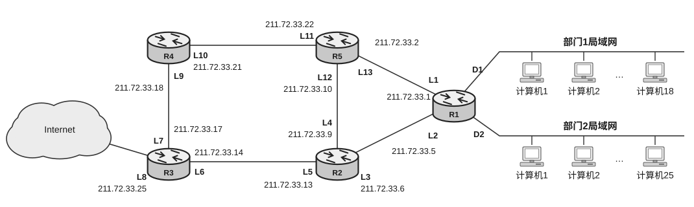

1）请为部门 1、部门 2 的局域网分配 IP 地址，用 CIDR 记法给出分配结果，并给出为路由器接口 D1 和 D2 分配的 IP 地址。

2）以部门 1 的局域网为例，其计算机在进行网络配置时，除配置 IP 地址外，还需配置正确的子网掩码和默认网关地址，请给出这两项的值。

3）各路由器的路由工作正常时，各路由器的路由表收敛后，请分别给出路由器 R1 和 R4 中目的网络为部门 1、部门 2 和 Internet 的路由表项，要求表项数尽可能少。

| 目的网络 | 子网掩码 | 下一跳 IP 地址 | 接口 |
| :---: | :---: | :---: | :---: |
| | | | |

4）假设网络稳定运行一段时间后，路由器 R2 由于故障停机，请简述其他路由器如何适应这一变化，并给出路由器 R1 中路由表收敛后目的网络是 Internet 的路由表项。

<!-- 第 26 页 -->

# 2027 王道 408 冲刺模拟试卷（三）

考试时间 180 分钟 满分 150 分

## 一、单项选择题：第 1–40 题，每题 2 分，共 80 分。在每题给出的四个选项中，只有一项符合题目要求。

1. 设有一个包含 $n=6$ 个顶点的带权有向图，图中允许存在负权边，但不存在负权环。使用 Floyd 算法求解任意两个顶点间的最短路径，算法的三重循环伪代码如下所示：

```text
for k=1 to n
    for i=1 to n
        for j=1 to n
            if d[i][k]+d[k][j]<d[i][j] then
                d[i][j]=d[i][k]+d[k][j]
```

其中 $d$ 为距离矩阵。若不考虑矩阵初始化与赋值操作的执行代价，仅统计上述伪代码中 `if` 语句条件判断的执行总次数，则该次数为（ ）。

(A) 180 
(B) 216 
(C) 240 
(D) 360

2. 假设链式队列 $Q$ 采用不带头结点的循环单链表存储，并且只设队尾指针 `rear`，若队列中有 $n$ 个结点，则出队和进队操作的时间复杂度分别为（ ）。

(A) $O(1), O(1)$ 
(B) $O(1), O(n)$ 
(C) $O(n), O(1)$ 
(D) $O(n), O(n)$

3. 已知 $A[1 \cdots N]$ 是一棵顺序存储的完全二叉树，9 号结点和 11 号结点共同的祖先是（ ）。

(A) 4 
(B) 6 
(C) 2 
(D) 8

4. 在二叉树的顺序存储中，每个结点的存储位置与其双亲、左右孩子结点的位置都存在一个简单映射关系，因此可与三叉链表对应。若某二叉树共有 $n$ 个结点，采用三叉链表存储时，每个结点的数据域占用 $d$ 字节，每个指针域占用 $4\text{B}$；采用顺序存储，且最后一个结点的下标为 $k$（起始下标为 1），那么当（ ）时采用顺序存储更节省空间。

(A) $d < 12n/(k - n)$ 
(B) $d > 12n/(k - n)$ 
(C) $d < 12n/(k + n)$ 
(D) $d > 12n/(k + n)$

5. 设结点 $x$ 是树 $T$ 中的一个非根结点，树 $T$ 的孩子从左往右计数，B 是 $T$ 所对应的二叉树，在二叉树 B 中 $x$ 是其双亲的右孩子，则下列说法中正确的是（ ）。

(A) 在树 $T$ 中 $x$ 是其双亲的第一个孩子
(B) 在树 $T$ 中 $x$ 一定有右兄弟
(C) 在树 $T$ 中 $x$ 一定是叶结点
(D) 在树 $T$ 中 $x$ 一定有左兄弟

6. 若 $G$ 是一个有 36 条边的非连通简单无向图，则图 $G$ 的顶点数至少是（ ）。

(A) 11 
(B) 10 
(C) 9 
(D) 8

---

2027 王道 408 冲刺模拟试卷（三） 第 24 页（共 79 页）

<!-- 第 27 页 -->

7. 已知一个有向图的邻接表存储结构如右图所示，根据有向图的深度优先遍历算法，从顶点1出发，所得到的顶点序列是（）。

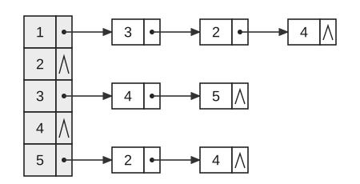

(A) $1,2,3,5,4$ 
(B) $1,2,3,4,5$ 
(C) $1,3,4,5,2$ 
(D) $1,4,3,5,2$

8. 在一个长度为 12 的有序顺序表中，每个元素的查找概率相等，则对其进行折半查找时，查找成功的平均查找长度是（）。

(A) $35/12$ 
(B) $31/12$ 
(C) $37/12$ 
(D) $39/12$

9. 散列表的表长为 $m = 14$，散列函数为 $\text{Hash}(key) = key\%11$。表中已有 4 个结点，地址分别为 $\text{addr}(15) = 4$、$\text{addr}(38) = 5$、$\text{addr}(61) = 6$ 和 $\text{addr}(84) = 7$，其余地址均为空。若采用二次探测法解决冲突，则关键码值为 49 的散列地址是（）。

(A) 8 
(B) 3 
(C) 5 
(D) 9

10. 对关键字序列 $\{23, 17, 72, 60, 25, 8, 68, 71, 52\}$ 进行堆排序，输出两个最小关键字后的剩余堆是（）。

(A) $\{23,72,60,25,68,71,52\}$ 
(B) $\{23,25,52,60,71,72,68\}$

(C) $\{71,25,23,52,60,72,68\}$ 
(D) $\{23,25,68,52,60,72,71\}$

11. 6 路归并的败者树的深度为（）。

(A) 3 
(B) 5 
(C) 6 
(D) 4

12. 假定 M1 和 M2 是以不同方式实现同一个指令集的两种机器，M1 的时钟频率为 800MHz，M2 的时钟频率为 400MHz。该指令集中共有 A、B 和 C 三类指令，有两种不同的编译器 C1 和 C2。假设对同一个程序而言，两种编译器生成的代码中的指令总条数相等，但各类指令的组合情况不同。各类指令在 M1 和 M2 上运行时，所需的平均时钟周期数和两种编译器生成的代码中各类指令所占的比例如下表所示。若在 M1 和 M2 上都用 C1 编译器，则 M1 的执行速度约是 M2 的（）倍；若在 M1 和 M2 上都用 C2 编译器，则 M2 的执行速度约是 M1 的（）倍。

| | M1 的 CPI | M2 的 CPI | C1 的程序 | C2 的程序 |
| :---: | :---: | :---: | :---: | :---: |
| | 2 | 1 | 30% | 30% |
| | 3 | 2 | 50% | 20% |
| | 4 | 1.5 | 20% | 50% |

(A) 1.2, 1.1 
(B) 1.1, 1.2 
(C) 1.1, 1.1 
(D) 1.2, 1.2

<!-- 第 28 页 -->

13. 下图所示为一个采用“移位+条件加法”实现的 32 位无符号整数乘法器。关于该结构的工作过程以及 32 位无符号乘法的溢出判定，下列说法中正确的是（ ）。


(A) 若乘数寄存器 $Y$ 的最高位为 1，则乘积寄存器 $P$ 初始化为 32 位全 1

(B) 一次乘法运算过程中，ALU 一定会执行 32 次加法

(C) 运算结束后，若乘积寄存器 $P$（高 32 位）不全为 0，则说明本次乘法发生溢出

(D) 运算结束后，若乘数寄存器 $Y$ 不全为 0，则说明本次乘法发生溢出

14. 某导弹系统有一个内置时钟，用计数器实现，每隔 0.1s 计数一次。0.1 的二进制数是一个无限循环序列：$0.00011[0011]\cdots$（方括号中的序列是无限循环的）。假定系统用一个 float 型变量 $x$ 表示 0.1，尾数采用就近舍入方式，则变量 $x$ 在机器中的表示是（ ）。

(A) 3DCC CCCCH 
(B) 3DCC CCCDH 
(C) 3BCC CCCCH 
(D) 3BCC CCDDH

15. 现代计算机通常采用以存储器为中心的工作方式来提高系统性能，在下列 I/O 控制方式中，（ ）可以实现以存储器为中心的工作方式。

(A) 中断方式 
(B) 程序查询方式 
(C) DMA 方式 
(D) 无条件查询方式

16. 下列关于磁盘术语的说法中，错误的是（ ）。

(A) 沿磁道方向单位长度记录的二进制信息位称为位密度，可以采用固定位置密度方式，这样磁盘不同柱面的磁道上存储的信息量是不一样的

(B) 沿磁盘半径方向单位长度的磁道数称为道密度，道密度是相邻磁道间距的倒数

(C) 传输一个扇区数据的时间只取决于扇区大小和磁盘所允许的最大转速

(D) 磁盘控制器是指用来控制磁盘/写以及控制磁盘和主存之间传输数据的部件

17. 某计算机的主存地址位数为 32 位，按字节编址。L1 data Cache 和 L1 code Cache 采用 8 路组相联方式，主存块大小为 64B，采用回写（Write Back）方式和随机替换策略。两种 Cache 的数据区都是 32KB，L1 Cache 总容量至少有（ ）。

(A) 530K 位 
(B) 531K 位 
(C) 533K 位 
(D) 534K 位

<!-- 第 29 页 -->

18. 通常将在部件之间进行数据传输的指令称为传输指令。在下列关于各类传输指令的功能的描述中，错误的是（ ）。

(A) 出/入栈指令（push/pop）实现 CPU 和栈顶之间的数据传输

(B) 访存指令（load/store）实现 CPU 和存储单元之间的数据传输

(C) I/O 指令（in/out）实现 CPU 和 I/O 端口之间的数据传输

(D) 寄存器传输指令（move）实现 CPU 和寄存器之间的数据传输

19. 某同步时序电路由多个“寄存器—组合逻辑—寄存器”结构级联构成。系统时钟周期必须满足时序约束：在相邻两个时钟有效沿之间，数据需从前一级寄存器稳定传输至后一级寄存器，并满足后级寄存器的建立时间要求。下列关于“时钟周期”与“组合逻辑电路关键路径”概念的说法中，正确的是（ ）。

(A) 最小时钟周期由电路中组合逻辑延迟最小的路径段决定

(B) 若缩短关键路径上的组合逻辑延迟，则在其他条件不变时可提高电路的最高时钟频率

(C) 关键路径是指数据通路中经过寄存器数量最多的路径

(D) 只要提高时钟频率（减小时钟周期），同步时序电路必然能正常工作

20. 某计算机采用微程序控制方式，微指令字长为 24 位，采用水平型编码控制的微指令格式；共有微命令 30 个，构成 4 个互斥类，各包含 5 个、8 个、14 个和 3 个微命令；外部条件共 3 个。则控制存储器的容量应该为（ ）。

(A) $256 \times 24\text{bit}$ &emsp;&emsp; (B) $30 \times 24\text{bit}$ &emsp;&emsp; (C) $31 \times 24\text{bit}$ &emsp;&emsp; (D) $24 \times 24\text{bit}$

21. 下列关于存储器总线的说法中，错误的是（ ）。

(A) 并行传输方式可以同时传输多位数据 &emsp;&emsp; (B) 总线中有地址、数据和控制三组传输线

(C) 一定有时钟信号线用于总线操作的定时 &emsp;&emsp; (D) 每个时钟周期内只能并行传输一次数据

22. 假设磁盘采用 DMA 方式与主机交换信息，其数据传输率为 8Mb/s，平均传输的数据块大小为 4KB，若忽略预处理时间，则该磁盘机向 CPU 发出中断请求的时间间隔最少是（ ）。

(A) $500\mu\text{s}$ &emsp;&emsp; (B) $512\mu\text{s}$ &emsp;&emsp; (C) $4000\mu\text{s}$ &emsp;&emsp; (D) $4096\mu\text{s}$

23. 在下列关于 CPU 内核态和用户态两种运行模式的说法中，正确的是（ ）。

I. 外部设备 I/O 操作完成时，就会发出中断信号，然后 CPU 立即切换到内核态。

II. 假设系统采用虚拟内存管理，当进行地址转换时，若页号大于页表长度，则 CPU 需要切换到内核态。

III. 假设系统采用虚拟内存管理，若要访问的页面不在内存，则 CPU 需要切换到内核态。

IV. 当 CPU 响应并处理中断时，此时一定发生了进程切换。

(A) I、II、III &emsp;&emsp; (B) I、II &emsp;&emsp; (C) II、III &emsp;&emsp; (D) I、II、III、IV

24. 进程从运行态到等待（阻塞）态可能是（ ）。

(A) 运行进程执行了 P 操作 &emsp;&emsp; (B) 进程调度程序的调度

(C) 运行进程的时间片用完 &emsp;&emsp; (D) 运行进程执行了 V 操作

<!-- 第 30 页 -->

25. 在操作系统中，虚拟文件系统（VFS）的主要作用是（ ）。

(A) 提供物理存储设备的直接管理功能

(B) 为不同类型的文件系统（如 EXT4、NTFS、FAT32）提供统一的抽象接口

(C) 仅用于加速文件读取和写入操作

(D) 替代具体文件系统，直接处理用户文件的存储和检索

26. 下图为单处理器系统中各个进程运行时占用 CPU 的时间。当 $T_0 = 0\text{s}$ 时，进程 A、D 被创建并进入就绪队列，调度程序首先为进程 A 分配 CPU；当 $T_1 = 3\text{s}$ 时，进程 A 执行结束，同时进程 D 被调度程序选中，不考虑调度开销；当 $T_2 = 3.5\text{s}$ 时，进程 D 执行结束；当 $T_3 = 4\text{s}$ 时，进程 B 被创建，并进入就绪队列开始执行；当 $T_4 = 6\text{s}$ 时，进程 C 被创建并进入就绪队列，进程 C 的优先级高于进程 B，系统是可抢占的，进程 C 抢占进程 B 的 CPU；当 $T_5 = 8\text{s}$ 时，进程 C 执行结束，调度程序重新调度进程 B；当 $T_6 = 10\text{s}$ 时，进程 B 执行结束。

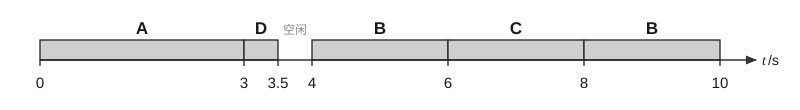

下列说法中，正确的是（ ）。

I. 在这段时间内，CPU 的利用率是 95%。

II. 进程 A、B、C 和 D 的平均周转时间是 3.625s。

III. 进程 D 的等待时间最长。

IV. 进程 A、B、C 和 D 的平均带权周转时间是 2.625。

(A) I、II &nbsp;&nbsp;&nbsp;&nbsp;&nbsp;&nbsp;&nbsp;&nbsp; (B) II、III &nbsp;&nbsp;&nbsp;&nbsp;&nbsp;&nbsp;&nbsp;&nbsp; (C) I、II、III &nbsp;&nbsp;&nbsp;&nbsp;&nbsp;&nbsp;&nbsp;&nbsp; (D) I、II、III、IV

27. 为了破坏“请求和保持”条件，提出了两种方法：第一种方法是在进程运行前，必须一次性地申请其在整个运行期间所需的全部资源；第二种方法是允许进程只获得运行初期所需的资源后便可开始运行，进程在运行期间再逐步释放已分配给自己且已使用完毕的全部资源后，才能请求新的资源。在关于这两种方法的说法中，错误的是（ ）。

(A) 第一种方法简单、易行且安全，但是降低了资源的利用率

(B) 第二种方法能使进程更快地完成任务，提高设备的利用率

(C) 第一种方法发生饥饿的概率很大，第二种方法不会发生饥饿

(D) 第二种方法是对第一种方法的改进，减小了进程发生饥饿的概率

28. 若存储单元的长度为 $n$，存放在该存储单元中的程序长度为 $m$，则剩下的长度为 $n - m$ 的空间称为该单元的内部碎片。在下面的存储分配方法中，哪种存在内部碎片？（ ）

I. 固定式分区 &nbsp;&nbsp;&nbsp;&nbsp; II. 动态分区 &nbsp;&nbsp;&nbsp;&nbsp; III. 页式管理

IV. 段式管理 &nbsp;&nbsp;&nbsp;&nbsp; V. 段页式管理 &nbsp;&nbsp;&nbsp;&nbsp; VI. 请求段式管理

(A) I 和 II &nbsp;&nbsp;&nbsp;&nbsp;&nbsp;&nbsp;&nbsp;&nbsp; (B) I、III 和 IV &nbsp;&nbsp;&nbsp;&nbsp;&nbsp;&nbsp;&nbsp;&nbsp; (C) IV、V 和 VI &nbsp;&nbsp;&nbsp;&nbsp;&nbsp;&nbsp;&nbsp;&nbsp; (D) III 和 V

<!-- 第 31 页 -->

29. 在请求分页系统中，因为进程在运行时经常发生页面换入换出的情况，所以一个明显的事实是，页面换入换出所付出的开销将对系统性能产生重大影响，于是就有了相应的页面缓冲算法，其核心思想是在内存中设置相应的链表缓冲区。在下列有关页面缓冲算法的说法中，错误的是（）。

(A) 显著地降低了页面换入换出的频率，使磁盘 I/O 次数大为减少

(B) 因为页面缓冲算法使得换入换出的开销大幅减小，所以能让系统采用一种比较简单的置换策略，如先进先出算法

(C) 系统可以设置空闲页面链表并修改页面链表，这两个链表都设置在外存中

(D) 空闲页面链表是系统掌握的空闲物理块，修改页面链表是由已修改页面形成的链表

30. 在下列选项中，属于符号链接和硬链接实现文件共享时所共有的问题的是（）。

(A) 每次访问共享文件的开销很大

(B) 有可能出现空指针异常导致文件访问错误

(C) 要将一个目录中的所有文件都转储到磁带上时，可能对一个共享文件产生多份副本

(D) 以上说法均正确

31. 在以下关于 I/O 子系统的描述中，错误的是（）。

(A) I/O 子系统由 I/O 软件和 I/O 硬件两大部分组成

(B) I/O 软件分为用户空间的 I/O 软件和内核空间的 I/O 软件

(C) 内核空间的 I/O 软件包括设备无关软件、设备驱动程序和中断服务程序

(D) 直接控制 I/O 硬件设备的是中断服务程序，而非设备驱动程序

32. 提前读和延迟写是有效提高磁盘 I/O 速度的两种方法。在下列关于提前读和延迟写的说法中，错误的是（）。

(A) 若用户对文件进行访问时采用的是随机访问方式，则不存在提前读

(B) 提前读是通过减少磁盘 I/O 次数来等价地提高磁盘 I/O 速度的

(C) 若用户对文件进行写操作时采用的是随机访问方式，则不存在延迟写

(D) 延迟写是通过在内存中设置一个空闲缓冲区队列来实现的

33. 假定从站点 A 发送一个很短的分组到站点 B，站点 B 收到后立即发送很短的应答分组给站点 A（双方的发送时延均可忽略不计），站点 A 测量出往返时间 RTT，则（）。

(A) 该 RTT 的值就是站点 A 和站点 B 之间的传输介质的往返传播时延

(B) 该 RTT 的值有可能小于站点 A 和站点 B 之间的传输介质的往返传播时延

(C) 该 RTT 的值一定大于站点 A 和站点 B 之间的传输介质的往返传播时延

(D) 该 RTT 的值大于或等于站点 A 和站点 B 之间的传输介质的往返传播时延

34. 右图为一段差分曼彻斯特编码的信号波形，其编码的比特流是（）。


(A) 0001 101

(B) 0001 011

(C) 1011 110

(D) 1001 110

<!-- 第 32 页 -->

35. 假设一个以太网只有两个站点，它们同时发送数据，并且产生了碰撞，于是按截断二进制指数退避算法进行重传，则重传第二次才成功的概率是（ ）。

(A) 0.5 
(B) 0.375 
(C) 0.125 
(D) 0.325

36. 在下列关于 PPP（点对点协议）的说法中，错误的是（ ）。

(A) 接收方每收到一个帧就进行 CRC 检验，检验错误就丢弃这个帧

(B) PPP 支持多种网络层协议在同一条物理链路上运行

(C) PPP 不对帧进行编号

(D) PPP 有确认机制

37. R1 和 R2 是一个自治系统中采用 RIP 路由协议的两个相邻路由器，R1 的路由表如表 1 所示，R1 收到 R2 发送的报文（见表 2）后，R1 更新的 3 个路由表项中距离值从上到下依次为（ ）。

**表 1 R1 的路由表**

| 目的网络 | 距离 | 路由 |
| :---: | :---: | :---: |
| 10.0.0.0 | 0 | 直接 |
| 20.0.0.0 | 7 | R2 |
| 30.0.0.0 | 4 | R2 |

**表 2 R2 发送的报文**

| 目的网络 | 距离 |
| :---: | :---: |
| 10.0.0.0 | 3 |
| 20.0.0.0 | 4 |
| 30.0.0.0 | 3 |

(A) 0, 4, 3 
(B) 0, 4, 4 
(C) 0, 5, 3 
(D) 0, 5, 4

38. 一台主机的 IP 地址为 11.1.1.100，子网掩码为 255.0.0.0。现在，用户需要配置该主机的默认路由。观察发现，与该主机直接相连的路由器有如下 4 个 IP 地址和子网掩码：

I. IP 地址：11.1.1.1，子网掩码：255.0.0.0

II. IP 地址：11.1.2.1，子网掩码：255.0.0.0

III. IP 地址：12.1.1.1，子网掩码：255.0.0.0

IV. IP 地址：13.1.2.1，子网掩码：255.0.0.0

IP 地址和子网掩码可能是该主机默认路由的是（ ）。

(A) I 和 II 
(B) I 和 III 
(C) I、III 和 IV 
(D) III 和 IV

39. 使用类似于 TCP 滑动窗口的可靠传输字节流的某种协议，数据传输率为 $2.5\text{Gb/s}$。假定 PDU 的最大生存时间为 $51.2\text{s}$，若要尽可能快地传输数据，则 PDU 首部中序号字段的长度至少应该设计为（ ）（注：$G = 2^{30}$）。

(A) 64bit 
(B) 37bit 
(C) 34bit 
(D) 32bit

40. 在下列关于 DNS 域名系统的说法中，正确的是（ ）。

(A) 若整个互联网的 DNS 都瘫痪了，即使知道某个站点的 IP 地址，也无法发送数据

(B) 为提高 DNS 的查询效率，减轻根域名服务器的负荷，并减少互联网上的 DNS 查询报文数量，在域名服务器中广泛地使用了高速缓存

(C) DNS 是基于 TCP 进行传输的，目的是保证可靠传输

(D) 当进行一次 DNS 查询时，假设查询到了某个权限域名服务器，若其不能给出最后的查询回答，就告诉发出查询请求的 DNS 客户本次查询失败

<!-- 第 33 页 -->

二、综合应用题：第 41—47 题，共 70 分。

41. （10分）如右图所示，请回答下列问题：

1）写出该图的邻接矩阵。

2）写出全部拓扑序列。

3）以 $V_1$ 为源点，以 $V_8$ 为终点，给出所有事件（和活动）允许发生的最早时间和最晚时间，并给出关键路径。

4）求 $V_1$ 到各点的最短路径和距离。


42. （13分）给定一个由正整数组成的数组 `nums` 和一个整数 $k$，计算并返回所有满足“子数组内元素乘积严格小于 $k$”的连续子数组的总数。

示例 1：输入：`nums=[10,5,2,6]`，$k=100$；输出：8。

解释：满足条件的 8 个子数组分别为 $[10]$、$[5]$、$[2]$、$[6]$、$[10,5]$、$[5,2]$、$[2,6]$、$[5,2,6]$。注意，$[10,5,2]$ 的乘积为 100，不满足严格小于的条件。

示例 2：输入：`nums=[1,2,3]`，$k=0$；输出：0。

解释：由于数组元素均为正整数，任何非空子数组的乘积至少为 1，不可能小于 0。

回答下列问题：

1）给出解决该问题的算法设计思想。

2）根据设计思想，采用 C 或 C++ 语言描述算法，关键之处给出注释。

3）分析所设计算法的时间复杂度和空间复杂度。

43. （12分）某计算机的主存地址空间大小为 64KB，按字节编址，Cache 采用 4 路组相联映射、LRU 替换算法和写回（write back）策略，数据 Cache 的大小为 4KB，主存与 Cache 之间交换的主存块大小为 64B。回答下列问题：

1）主存地址字段如何划分？要求说明每个字段的含义、位数及在主存地址中的位置。

2）Cache 的总容量有多少位？

3）若 Cache 初始为空，CPU 依次顺序从地址 0 号单元访问到 4344 号单元，共重复访问 16 次。Cache 存取时间为 20ns，主存存取时间为 200ns，试计算 CPU 的平均访存时间。

44. （11分）某计算机的中断系统有 5 个中断源，分别记为 1、2、3、4、5，各中断源的中断响应优先级为 $1 > 2 > 3 > 4 > 5$，中断处理优先级为 $1 > 4 > 5 > 2 > 3$。请回答下列问题：

1）设计各级中断服务程序的中断屏蔽字（假设 1 为屏蔽，0 为开放）。

2）若在运行用户程序时，中断源 2 和 4 同时发出中断请求，而在处理中断源 2 的过程中，中断源 1、3 和 5 同时发出中断请求，试说明此时 CPU 运行的具体情况，即响应和处理各个中断源的顺序。

<!-- 第 34 页 -->

45.（7分）一名主修动物行为学、辅修计算机科学的学生参加了一个课题，调查花果山的猴子是否能够理解死锁概念。他找到一个峡谷，横跨峡谷拉了一根绳索（假设为南北方向），这样猴子就可攀着绳索越过峡谷。只要它们朝着相同的方向，同一时刻就可有多只猴子通过。然而，若在相反的方向上同时有猴子通过，则会发生死锁（这些猴子将卡在绳索中间，假设这些猴子无法在绳索上从另一只猴子身上翻过去）。如果一只猴子想越过峡谷，就必须看当前是否有其他猴子正在逆向通过。请用 P、V 操作来解决该问题。

46.（8分）某磁盘上的文件系统采用混合索引分配方式，文件 FCB 中共有 13 个地址项，第 0~9 个地址项为直接地址，第 10 个地址项为一次间接地址，第 11 个地址项为二次间接地址，第 12 个地址项为三次间接地址。每个盘块的大小为 512B，盘块号需要用 3B 来描述，而每个盘块最多存放 170 个盘块地址。请回答下列问题：

1）该文件系统支持的最大文件长度是多少？

2）如何将文件的字节偏移量 5000、15000、150000 转换为物理块号和块内偏移量？

3）假设某个文件的 FCB 已在内存中，但其他信息均在外存中，为了访问该文件中某个位置的内容，最少需要访问几次磁盘？最多需要访问几次磁盘？

47.（9分）下图是一个网络拓扑图，根据该图回答下列问题。


1）设备 X1 是交换机还是路由器？

2）M1 向 PC2 发送数据，PC2 收到的数据帧中的源 MAC 地址是什么？PC2 向 M1 返回数据，M1 收到的数据帧中的地址 3 是什么？

3）通常把子网内地址中的第一个 IP 地址分配给默认网关，则 PC1 所在子网的默认网关是哪个？该子网还有多少个空闲的 IP 地址可供分配？给出分析过程。

4）路由表的结构如下，请给出 R1 的路由表，要求尽可能采用路由聚合以减少表项数。

| 目的网络 | 子网掩码（点分十进制数表示） | 接口 |
| :--- | :--- | :--- |
| | | |

<!-- 第 35 页 -->

# 2027 王道 408 冲刺模拟试卷（四）

考试时间 180 分钟 满分 150 分

一、单项选择题：第 1–40 题，每题 2 分，共 80 分。在每题给出的四个选项中，只有一项符合题目要求。

1. 设 $n$ 是描述问题规模的正整数，则下列程序段的时间复杂度是（ ）。

```c
i=n*n;
while(i!=1)
    i=i/2;
```

(A) $O(\log_2 n)$

(B) $O(n)$

(C) $O(\sqrt{n})$

(D) $O(n^2)$

2. 假设一个 $1000 \times 850$ 稀疏矩阵有 1000 个非零元素。每个整数占 2B，每个矩阵元素占 4B，则用三元组表存储该矩阵时所需的字节数是（ ）。

(A) 4000 
(B) 7000 
(C) 8000 
(D) 18000

3. 下列二叉树中，（ ）的所有非叶结点的度均为 2。

Ⅰ. 完全二叉树 Ⅱ. 满二叉树 Ⅲ. 平衡二叉树 Ⅳ. 哈夫曼树 Ⅴ. 二叉排序树

(A) Ⅱ 和 Ⅳ 
(B) Ⅰ 和 Ⅲ 
(C) Ⅱ、Ⅳ 和 Ⅴ 
(D) Ⅱ、Ⅲ 和 Ⅳ

4. 右图是一棵双亲表示法存储的树。在以下说法中，错误的是（ ）。

| | data | parent |
|---|---|---|
| 0 | $R$ | $-1$ |
| 1 | $A$ | 0 |
| 2 | $B$ | 0 |
| 3 | $C$ | 0 |
| 4 | $D$ | 1 |
| 5 | $E$ | 1 |
| 6 | $F$ | 3 |
| 7 | $G$ | 6 |
| 8 | $H$ | 6 |
| 9 | $K$ | 6 |

(A) 这种存储结构用一组连续的空间来存储每个结点

(B) 该树的结点共有 4 层

(C) 该树共有 5 个叶结点

(D) 该树转换为二叉树后共有 8 层

<!-- 第 36 页 -->

5. 有一棵包含 31 个结点的二叉树，采用队列实现层序遍历，算法规则如下：

① 初始时将根结点入队。

② 每次出队一个结点并访问。

③ 该结点存在左孩子时，左孩子入队；存在右孩子时，右孩子入队。

在遍历过程中，队列的最大长度可能为（ ）。

(A) 8 (B) 15 (C) 16 (D) 17

6. 对于有向图，其邻接矩阵表示相比邻接表表示更容易进行的操作是（ ）。

(A) 求一个顶点指向的邻接点 (B) 求一个顶点的度

(C) 深度优先遍历 (D) 广度优先遍历

7. 设无向图 $G = (V, E)$。从任意一个未被访问的顶点出发，执行一次 DFS 或 BFS，将此次搜索所访问到的所有顶点标记为已访问；然后重复上述过程，直至图中所有顶点均被标记为已访问。该过程结束后，所执行的搜索次数等于图 $G$ 的（ ）。

(A) 顶点数 (B) 边数 (C) 连通分量个数 (D) 生成树个数

8. 设初始时有 8 个元素 $\{1, 2, \cdots, 8\}$，构成 8 个互不相交的集合。并查集采用按秩合并与路径压缩优化策略，其中按秩合并规则为 [$\text{union}(x, y)$ 表示合并包含 $x$ 与 $y$ 的两个集合]：①若两个集合的秩不同，则将秩较小的集合的根结点作为秩较大的集合的根结点的孩子；②若两个集合的秩相同，则将 $y$ 所在集合的根结点作为 $x$ 所在集合的根结点的孩子，并将 $x$ 所在集合的根结点的秩加 1。按以下顺序执行合并操作：

$\text{union}(1, 2), \text{union}(3, 4), \text{union}(1, 3), \text{union}(5, 6), \text{union}(7, 8), \text{union}(5, 7), \text{union}(1, 5)$

随后依次执行查找操作 $\text{find}(2)$、$\text{find}(4)$、$\text{find}(6)$、$\text{find}(8)$，其中 $\text{find}(x)$ 操作在返回根结点前，会将 $x$ 到根结点路径上的所有中间结点（包含 $x$，不包含根结点）的父指针直接指向根结点（执行路径压缩），且每次 $\text{find}$ 操作的路径压缩效果会保留并影响后续操作。执行上述所有操作后，并查集中任何一个结点到其所在集合根结点的最大距离（从该结点到根结点所需经过的边数）为（ ）。

(A) 1 (B) 2 (C) 3 (D) 4

9. 下列关于散列表的说法中，不正确的有（ ）个。

I. 散列表的平均查找长度与处理冲突方法无关。

II. 在散列表中，“比较”操作一般是不可避免的。

III. 散列表查找成功时的平均查找长度只与表长有关。

IV. 若在散列表中删除一个元素，则只需简单地将该元素删除即可。

(A) 1 (B) 2 (C) 3 (D) 4

10. 对一组数据 $(84, 47, 15, 21, 25)$ 排序，数据在排序过程中的变化如下：

1）84 47 15 21 25；2）25 47 15 21 84；3）21 25 15 47 84；4）15 21 25 47 84。

则所采用的排序方法是（ ）。

(A) 堆排序 (B) 冒泡排序 (C) 快速排序 (D) 插入排序

11. 18 个初始归并段进行 5 路平衡归并，需要增加（ ）个虚拟归并段。

(A) 1 (B) 2 (C) 3 (D) 4

<!-- 第 37 页 -->

12. 已知一台时钟频率为 $2\text{ GHz}$ 的计算机的 CPI 为 1.2。某程序 $P$ 在该计算机上的指令条数为 $4 \times 10^9$ 条。若在该计算机上程序 $P$ 从开始启动到执行结束所经历的时间是 4s，则运行 $P$ 所用的 CPU 时间占整个 CPU 时间的百分比大约是（ ）。

(A) 40% 
(B) 60% 
(C) 80% 
(D) 100%

13. 某 C 语言程序在一台 32 位机器上运行，程序中定义了一个 `unsigned short` 型变量 $us = 2^{15}$、一个 `int` 型变量 $x$，则执行赋值语句 `x = us` 后，$x$ 的值变为（ ）。

(A) $2^{15}$ 
(B) $-2^{15}$ 
(C) $2^{32} - 2^{15}$ 
(D) $2^{31}$

14. 在 IEEE 754 标准的规格化单精度浮点数中，所能表示的最接近 0 的负数是（ ）。

(A) $-2^{-126}$ 
(B) $-(2-2^{-23})2^{-126}$ 
(C) $-(2-2^{-23})2^{-127}$ 
(D) $-2^{-127}$

15. 在下列关于固态硬盘的说法中，错误的是（ ）。

(A) 固态硬盘的写速度慢，读速度快

(B) 固态硬盘支持随机访问

(C) 固态硬盘重复写同一个块可能会缩短寿命

(D) 磨损均衡机制的目的是加快硬盘读/写速度

16. 对于存储器层次结构，在下列描述中，属于 Cache—主存和主存—辅存这两个层次结构的不同点的是（ ）。

(A) 一个必须考虑慢速存储器和快速存储器之间的映射问题，另一个不需要

(B) 二者的引入目的不同，一个是加快速度，另一个是增加系统的存储容量

(C) 一个需要考虑将哪一块从快速存储器中替换出来，另一个需要考虑替换

(D) 当在快速存储器中找不到信息时，一个从慢速存储器中找，另一个直接从其他层次找

17. 已知如下 C 代码片段：

```c
int x,d[4096],i;
for(i=0;i<4096;i++)
    x=d[i]/x;
```

循环体指令已全部驻留于指令 Cache，循环变量 $i$ 与 $x$ 已分配至通用寄存器，数组 $d$ 已完全加载至主存储器，但其数据尚未驻留于数据 Cache。系统采用字节编址方式，字长为 32 位。数据 Cache 的数据区容量为 16KB，采用 4 路组相联映射方式，主存块大小为 64B；Cache 命中时间为 2 个时钟周期，缺失损失为 160 个时钟周期。数组 $d$ 的起始地址为 `0x01A0003C`，则在该 for 循环执行过程中，访问数组 $d$ 的 Cache 缺失率和数组元素的平均访问时间分别为（ ）。

(A) 缺失率为 6.27%，平均访问时间为 12.04 周期

(B) 缺失率为 6.25%，平均访问时间为 12.00 周期

(C) 缺失率为 6.25%，平均访问时间为 12.04 周期

(D) 缺失率为 6.27%，平均访问时间为 12.00 周期

<!-- 第 38 页 -->

18. 假定不采用 Cache 和指令预取技术，且机器处于开中断状态，则在下列有关指令的叙述中，错误的是（ ）。

(A) 每个指令周期中 CPU 都至少访问内存一次
(B) 每个指令周期一定大于或等于一个 CPU 时钟周期
(C) 空操作指令的指令周期中，任何寄存器的内容都不会改变
(D) 当前程序在每条指令执行结束时都可能被外部中断打断

19. 下面是一段指令序列：

```text
add eax, 20 //eax <- eax+20
shl ecx, 1 //eax <- ecx<<1
mov edx, ecx //edx <- ecx
```

在以上指令序列中，第三条指令会发生数据相关问题。假定采用“取指、译码/取数、执行、访存、写回”这种五段流水线方式，还假定不采用“转发”，那么为了使这段程序的执行不被阻塞，需要在第三条指令前加入（ ）条 nop 指令（空操作）。

(A) 1 
(B) 2 
(C) 3 
(D) 4

20. 已知指令字长为 16 位，地址字段长度为 6 位，指令系统包含二地址、一地址和零地址三种格式，采用两级扩展操作码编码方式：

① 二地址指令格式：[4位操作码] [6位地址 A] [6位地址 B]，共 $P$ 条（$P \leqslant 2^4$），占用 $P$ 个 4 位操作码。
② 其余 $(2^4 - P)$ 个 4 位操作码作为扩展前缀，在每个前缀下用后 6 位组成 10 位操作码，形成一地址指令格式：[10位操作码] [6位地址]。
③ 在上述 10 位操作码中再选若干作为“零地址引导码”，每个引导码用最后 6 位可扩展出 $2^6$ 条零地址指令：[16位操作码]。

若二地址指令有 $P$ 条，零地址指令有 $Q$ 条，则一地址指令最多有（ ）。

(A) $(2^4 - P)2^6 - Q$
(B) $(2^4 - P)2^{10} - [Q/2^6]$
(C) $(2^4 - P)2^6 - [Q/2^6]$
(D) $(2^4 - P)2^6 - [Q/2^6]$

21. 设 CPU 与 I/O 设备以中断方式进行数据传输，当 CPU 响应中断时，该 I/O 设备接口控制器送给 CPU 的中断向量表（中断向量表中存放中断向量）的指针是 0800H，0800H 单元中的值为 1200H。则该 I/O 设备的中断服务程序在主存中的入口地址为（ ）。

(A) 0800H 
(B) 0801H 
(C) 1200H 
(D) 1201H

22. 当下列情况出现时，引起 CPU 自动查询有无中断请求，进而可能进入中断响应周期的是（ ）。

(A) 一条指令执行结束
(B) 一次 I/O 操作结束
(C) 一次中断处理结束
(D) 一次 DMA 操作结束

23. 在下列关于多处理机系统的说法中，错误的是（ ）。

(A) 引入多处理机系统的原因之一是靠提高 CPU 时钟频率来提高系统性能的方法已接近极限
(B) 随着处理机数量的增加，系统的处理能力也相应增强，利用 $n$ 个处理机所获得的加速比是 1 个处理机的 $n$ 倍
(C) 采用 $n$ 个处理机的系统与采用 $n$ 台独立的计算机相比，可以节省投资
(D) 多处理机系统与单处理机系统相比，可以大大提高系统的可靠性

<!-- 第 39 页 -->

24. 在下列关于内存管理的说法中，正确的是（ ）。

(A) 不同进程对应的页表中可能包含内容相同的页表项

(B) 虚拟地址空间总是大于物理地址空间

(C) 在页式存储管理中，页面越小越有利于消除外部碎片，从而提高内存利用率

(D) 在段式存储管理中，分段大小可以不同，从而可以消除外部碎片，提高内存利用率

25. 在下列关于进程和线程的叙述中，正确的是（ ）。

I. 一个进程可以包含多个线程，各个线程共享进程的逻辑地址空间。

II. 一个进程可以包含多个线程，各个线程共享栈空间。

III. 当一个多线程进程（采用一对一线程模型）中的某个线程被阻塞后，其他线程将继续工作。

IV. 当一个多线程进程中的某个线程被阻塞后，该阻塞线程将被撤销。

(A) I、II、III 

(B) I、III 

(C) II、III 

(D) II、IV

26. 在下列各种调度算法中，属于基于时间片的调度算法的是（ ）。

I. 时间片轮转法 &nbsp;&nbsp; II. 多级反馈队列调度算法 &nbsp;&nbsp; III. 抢占式调度算法

IV. FCFS（先来先服务）调度算法 &nbsp;&nbsp; V. 高响应比优先调度算法

(A) I 和 II 

(B) I、II 和 IV 

(C) I、III 和 IV 

(D) I、II 和 III

27. 生产者进程和消费者进程的代码如下。生产者进程有一个局部变量 nextProduced，以存储新产生的项；消费者进程有一个局部变量 nextConsumed，以存储所要使用的项。

```c
while(1){ //producer
    /*produce an item in nextProduced*/
    while((in+1)%BUFFER_SIZE==out); /*do nothing*/
    buffer[in]=nextProduced;
    in=(in+1)%BUFFER_SIZE;
}
while(1){ //consumer
    while(in==out); /*do nothing*/
    nextConsumed=buffer[out];
    out=(out+1)%BUFFER_SIZE;
    /*consume the item in nextConsumed*/
}
```

条件 `in==out` 和 `(in+1)%BUFFER_SIZE==out` 成立时，缓冲区中 item 的数量分别是（ ）。

(A) 0, BUFFER_SIZE 

(B) 0, BUFFER_SIZE-1

(C) BUFFER_SIZE-1, 0 

(D) BUFFER_SIZE, 0

28. 某操作系统采用可变分区分配存储管理方法，操作系统占用低地址部分的 126KB。用户区大小为 386KB，且用户区的始址为 126KB，用空闲分区表管理空闲分区。若分配时采用分配空闲区高地址部分的方案，且初始时用户区的 386KB 空间空闲，对申请序列：作业 1 申请 80KB，作业 2 申请 56KB，作业 3 申请 120KB，作业 1 释放 80KB，作业 3 释放 120KB，作业 4 申请 156KB，作业 5 申请 81KB。若采用首次适应算法处理上述序列，则最小空闲块的大小为（ ）。

(A) 12KB 

(B) 13KB 

(C) 89KB 

(D) 56KB

<!-- 第 40 页 -->

29. 某系统采用伙伴系统管理空闲内存，最小分配块大小为 1KB。现有大小为 64KB 的连续空闲内存块（可视为 $2^{6}$ 个 1KB 块），某进程请求分配 9KB 内存，分配成功且不考虑其他开销。则本次分配完成后，因按 2 的幂次分配而造成的内部碎片大小为（）。

(A) 1KB \quad (B) 3KB \ (C) 7KB \quad (D) 8KB

30. 文件系统的全局信息第一次写入磁盘的时机发生在（）时。

(A) 磁盘物理格式化 \quad (B) 磁盘分区 \quad (C) 磁盘逻辑格式化 \quad (D) 操作系统初始化

31. 某操作系统采用双缓冲区传输磁盘上的数据。设一次将数据从磁盘传输到缓冲区的时间为 $T_1$，一次将缓冲区中的数据传输到用户区所用的时间可忽略不计，CPU 处理一次数据的时间为 $T_2$，读入并处理该数据共重复 $n$ 次该过程，需要的总时间为（ ）。

(A) $n(T_1 + T_2)$ \quad (B) $nT_2 + T_1$
(C) $nT_1 + T_2$ \quad (D) $(n - 1)\max(T_1, T_2) + T_1 + T_2$

32. 某磁盘组共有 80 个柱面，每个柱面有 12 条磁道，每条磁道划分为 16 个扇区，现有一个 8000 条逻辑记录的文件，逻辑记录的大小与扇区大小相等，该文件按顺序结构存放在磁盘组上，柱面、磁道、扇区均从 0 开始编址，逻辑记录的编号从 0 开始，文件数据从 0 号柱面、0 号磁道、0 号扇区开始存放，则该文件的 5687 号逻辑记录应存放在（）。

(A) 第 29 个柱面的第 7 个磁道的第 6 个扇区 \quad (B) 第 30 个柱面的第 8 个磁道的第 7 个扇区
(C) 第 29 个柱面的第 7 个磁道的第 7 个扇区 \quad (D) 第 28 个柱面的第 7 个磁道的第 7 个扇区

33. 在下列关于 TCP/IP 体系结构的各层使用的服务的说法中，正确的是（）。

(A) 如果下层使用面向连接的服务，那么紧邻的上层必须使用相同性质的服务

(B) 如果下层使用无连接的服务，那么紧邻的上层必须使用相同性质的服务

(C) 在所有层上都有服务方式的选择问题

(D) 并非在所有层上都有服务方式的选择问题，有些层只提供一种服务

34. 在以下关于物理层协议的描述中，错误的是（）。

(A) 物理层可连接不同类型的传输介质

(B) 通信信道可分为点对点信道和广播信道两类

(C) 物理层需根据所采用的传输介质制定相应的物理层协议

(D) 物理层协议规定了数据信号的编码方式、传输速率与数据链路质量

<!-- 第 41 页 -->

35. 点对点链路数据链路层采用 GBN 协议（累计确认，忽略 ACK 帧的传输时延）。发送方连续发送 $\text{Data}_0 \sim \text{Data}_3$ 共 4 帧，其中 $\text{Data}_2$ 在传输过程中丢失（如右图所示）；接收方仅按序接收正确帧并返回累计 $\text{ACK}$。超时重传计时器设置为 $T_0 = T_f + 2T_p$（从发送该帧起始时刻开始计时），超时后发送方按 GBN 协议连续重传“最早未确认帧及其后续已发送帧”。设一帧发送时间为 $T_f$，单程传播时延为 $T_p$。从发送方开始发送 $\text{Data}_0$ 起，至发送方收到 $\text{ACK}_3$ 为止，发送方的平均信道利用率 $U$（有效发送时间/总历时）为（ ）。

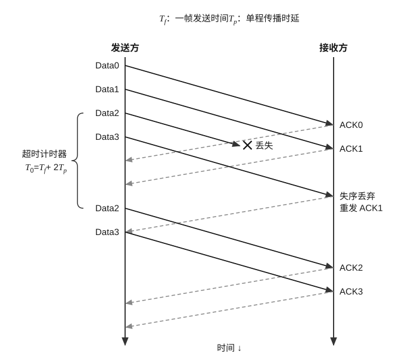

(A) $\frac{4T_f}{5T_f + 4T_p}$ \quad (B) $\frac{4T_f}{6T_f + 4T_p}$ \quad (C) $\frac{4T_f}{8T_f + 4T_p}$ \quad (D) $\frac{4T_f}{8T_f + 2T_p}$

36. 在下面关于 VLAN 的描述中，正确的是（ ）。

(A) 一个 VLAN 是一个广播域 \quad (B) 一个 VLAN 是一个冲突域  
(C) 一个 VLAN 必须连接同一台交换机 \quad (D) 不同 VLAN 之间不能通信

37. 一个长度为 3200bit 的 TCP 报文段传输到 IP 层，加上 160bit 的首部后成为 IP 数据报。下面的互联网由两个局域网通过路由器连接，但第二个局域网所能传输的最长数据帧中的数据部分只有 1200bit，因此数据报在路由器中必须进行分片，则第二个局域网要向其上层传输（ ）的数据（这里的“数据”是指局域网看见的数据）。

(A) 3160bit \quad (B) 3840bit \quad (C) 4240bit \quad (D) 3200bit

<!-- 第 42 页 -->

38. 一个自治系统分配到的 IP 地址块为 30.138.118.0/23，包括 5 个局域网，每个局域网的主机数量如下图所示，则在关于该自治系统的两种地址分配方案的说法中，正确的是（）。


| | 第一组分配方案 | 第二组分配方案 |
| :---: | :---: | :---: |
| LAN1 | 30.138.119.192/29 | 30.138.118.192/27 |
| LAN2 | 30.138.119.0/25 | 30.138.118.0/25 |
| LAN3 | 30.138.118.0/24 | 30.138.119.0/24 |
| LAN4 | 30.138.119.200/29 | 30.138.118.224/27 |
| LAN5 | 30.138.119.128/26 | 30.138.118.128/27 |

(A) 第一组方案合理，第二组方案不合理

(B) 第一组方案不合理，第二组方案合理

(C) 两组方案都合理

(D) 两组方案都不合理

39. 在下列关于 UDP 检验和的说法中，正确的是（）。

I. 如果发送方决定不使用检验和，就将检验和的值全置为 0。

II. 如果检验和的计算结果刚好为全 0，就将它设置为全 1。

III. 如果检验和的计算结果刚好为全 1，就将它保持为全 1。

(A) I、II 
(B) II、III 
(C) I、III 
(D) I、II、III

40. HTTP 服务器收到 GET 请求后执行相应的操作，这属于网络协议三要素中的（）。

(A) 透明 
(B) 时序 
(C) 语义 
(D) 语法

二、综合应用题：第 41-47 题，共 70 分。

41.（10分）假设有一批需要实时处理的数据元素组成的集合 $S$，实时处理开始后，每间隔 1s 会收到一个新的数据元素加入 $S$。现要求在每次接收一个新元素前，找出 $S$ 中现有的最小元素并将其输出（即从 $S$ 中删除）。

1）试选择或构造一种合适的数据结构并设计算法，尽可能高效地完成上述任务。

2）例如集合 $S = \{59, 31, 29, 18, 78, 26, 48, 10, 65, 35\}$，新接收的数据为 39、12。请以此为例描述算法的执行过程。

<!-- 第 43 页 -->

42.（13分）两棵二叉树 $T_{1}$ 和 $T_{2}$ 镜像相似是指它们在树形上对称同构，即一棵二叉树的树形是另一棵二叉树左右翻转后的树形，不要求结点的值相同。例如，右图所示的两棵二叉树 A 和 B 就是对称同构的。假设二叉树采用二叉链表存储，请设计一个算法，判断两棵二叉树是否镜像相似。二叉树结点的定义如下：

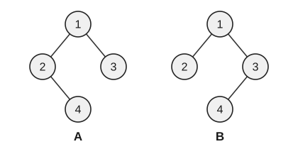

```c
typedef struct BiTNode{
    int data; // data field
    struct BiTNode *lchild, *rchild;
} BiTNode, *BiTree;
```

1）给出算法的基本设计思想。

2）根据设计思想，采用 C 或 C++ 语言描述算法，关键之处给出注释。

43.（11分）某 32 位计算机采用小端方式存储数据，有一个 C 语言编写的程序片段如下：

```c
int i, a[10], b[10];
float x = -15.25;
for (i = 0; i < 10; i++)
    if (b[i] < a[i])
        b[i] = 1;
    else
        b[i] = 0;
```

假设初始时 $a[5] = 0x7FFF\ FFFF$、$b[5] = 0xFFFF\ FFFF$。

1）判断语句 `if(b[i] < a[i])` 在计算机中是通过 `b[i] - a[i]` 实现的。执行 `b[5] - a[5]` 后，标志位 CF、OF、ZF、SF 的值分别是多少？

2）执行该程序段后，$b[5]$ 的结果是多少？

3）变量 $x$ 在内存中的首地址为 `0x1234 5670`，请问地址 `0x1234 5670`、`0x1234 5671`、`0x1234 5672`、`0x1234 5673` 中的内容分别是什么？

44.（12分）在某字长为 32 位的计算机系统中，假定存储器分别连接下面两种不同的同步总线：

总线 A 是 64 位数据和地址复用的总线，能在一个时钟周期内传输一个 64 位的数据或地址，支持最多连续 8 个字的存储器读和存储器写的总线事务。任何一次读/写操作总是先用 1 个时钟周期传输地址，然后有 2 个时钟周期的延迟等待，从第 4 个时钟周期开始，存储器准备好数据，总线以每个时钟周期 2 个字的速度传输，最多传输 8 个字。

总线 B 是分离的 32 位地址和 32 位数据的总线，支持最多连续 8 个字的存储器读和存储器写的总线事务。读操作过程：1 个时钟周期传输地址，2 个时钟周期延迟等待，从第 4 个时钟周期开始，存储器准备好数据，总线以每个时钟周期 1 个字的速度传输 8 个字（最多）。写操作过程：第 1 个时钟周期内第 1 个字与地址一起传输，经过 2 个时钟周期延迟等待后，第 1 个字写入存储器，并在后面 7 个时钟周期内以每个时钟 1 个字的速度传输余下的 7 个字（最多）。假定这两种总线的时钟频率都为 100 MHz，回答下列问题。

1）两种总线的最大数据传输率（总线带宽）分别为多少？

2）当连续进行单个字的存储器读总线事务时，两种总线的数据传输率分别是多少？

3）当连续进行单个字的存储器写总线事务时，两种总线的数据传输率分别是多少？

4）每次传输 8 个字的数据块，60% 是读操作总线事务，40% 是写操作总线事务，两种总线的数据传输率分别是多少？

<!-- 第 44 页 -->

45.（7分）假设某个多道程序设计系统中有供用户使用的内存100K，打印机1台。系统采用可变分区方式管理内存，并且采用首次适应算法；对打印机采用静态分配，并且假设输入/输出操作的时间可以忽略不计；采用最短剩余时间优先的进程调度算法，进程剩余执行时间相同时，采用先来先服务算法。进程调度时机选择在执行进程结束时或有新进程到达时。现有一个进程序列如下表所示。

| 进程号 | 进程到达时间 | 要求执行时间 | 要求主存量 | 申请打印机数 |
| :---: | :---: | :---: | :---: | :---: |
| 1 | 0 | 8 | 15K | 1台 |
| 2 | 4 | 4 | 30K | 1台 |
| 3 | 10 | 1 | 60K | 0台 |
| 4 | 11 | 20 | 20K | 1台 |
| 5 | 16 | 14 | 10K | 1台 |

假设系统优先分配内存的低地址区域，且不准移动已在主存中的进程。

1）给出进程调度算法选中进程的次序，并说明理由。

2）计算全部进程执行结束所用的时间。

46.（8分）某操作系统提供了文件操作的接口，包括 open()、read()、write()和 close()等函数。文件系统采用混合索引分配方式，每个索引节点（inode）占64B，每个地址项占4B，包含10个直接索引地址项、1个一级间接索引地址项和1个二级间接索引地址项，磁盘块大小为4KB，整个文件系统最多拥有4TB的空间。现有一个文件系统，它包含如右图所示的文件和目录结构。

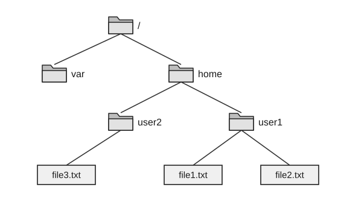

1）假设文件系统已将用户 user1 的文件 file1.txt 和 file2.txt 的索引节点加载到内存中，用户 user1 打开文件 file1.txt 并读取其中的某块，如果 file1.txt 的大小为 5MB，则打开该文件并将其读入内存需要几次读磁盘块操作？说明理由。

2）假设文件系统已将用户 user2 的文件 file3.txt 的索引节点加载到内存中，用户 user2 打开文件 file3.txt 并写入 12KB 的数据需要进行几次磁盘块的写入操作？假设文件长度小于 4124KB，若修改了磁盘索引节点，则需要将磁盘索引节点重新写回外存。

3）用户 user1 对指定文件 file1.txt 进行打开和关闭操作时，传递的参数是否相同？如果不相同，请说明分别需要传递什么参数。

<!-- 第 45 页 -->

47. （9分）某局域网拓扑如下图所示。R 为支持 NAT 功能的路由器，S 为支持 IEEE 802.1Q 标准的 100Base-T 以太网交换机，AP 为工作于桥接模式的 802.11 无线接入点。各设备及接口的 IP 地址、MAC 地址已在图中标注。交换机 S 划分 VLAN10（端口 1、2、5）与 VLAN20（端口 3、4）；H1、H2 分别接入端口 1、2 且默认网关（GW）均配置为 192.168.0.1；AP 接入端口 3；DHCP 服务器接入端口 4；H3、H4 已通过 DHCP 获取 IPv4 地址并接入网络。请回答下列问题：


1）VLAN10 与 VLAN20 是否属于同一广播域？H1 发出的以太网广播帧能否到达 H3？

2）H1 在浏览器输入域名 www.s.com 访问 Internet 中的 Web 服务器，按“主机侧网络通信过程”写出从应用层到链路层依次发生的关键步骤（需包含 DNS 解析是否必需、ARP 解析对象、网络层下一跳地址以及以太网帧目的 MAC 地址）。

3）H1 与 Web 服务器分属不同网络（H1 在私网，Web 服务器在公网），需经路由器 R 转发并进行 NAT 转换。请结合拓扑说明：① H1 构造的以太网帧在 VLAN10 内的转发路径；② R 完成 NAT 转换后，离开 R 的以太网帧的目的 MAC 地址是什么？

4）H1 首次访问时的现象为：能 ping 通默认网关 192.168.0.1，浏览器已解析出 Web 服务器的公网 IP 地址，但 HTTP 请求持续超时。现给出如下可能的故障选项：① R 的 NAT 转换规则配置错误（例如未放行 HTTP 流量）；② H1 的默认网关配置错误（例如非 192.168.0.1）；③ DNS 服务器地址配置错误。请选择最可能的选项，并说明理由。已知 R 的接口配置、路由表、NAT 功能及 VLAN 间路由均正确。

<!-- 第 46 页 -->

## 2027 王道 408 冲刺模拟试卷（五）

考试时间 180 分钟 满分 150 分

一、单项选择题：第 1–40 题，每题 2 分，共 80 分。在每题给出的四个选项中，只有一项符合题目要求。

1. 在下列数据结构中，不适用于快速排序的是（ ）。

Ⅰ. 数组 Ⅱ. 单链表 Ⅲ. 静态链表 Ⅳ. 双链表

(A) Ⅱ、Ⅳ (B) Ⅱ、Ⅲ、Ⅳ (C) Ⅰ、Ⅱ、Ⅳ (D) 全部适用

2. 现有一个共享栈 $S$，其低位记为栈 $S_1$，高位记为栈 $S_2$，低位栈的栈顶地址从低到高增长，高位栈的栈顶地址从高到低减小，要求该共享栈在一端非空时，栈指针指向当前元素的下一位置，则在下列说法中，（ ）是错误的。

(A) 该共享栈降低了溢出的可能性，提高了空间利用率

(B) 当两端都非空且 $S_1.\text{top}+1==S_2.\text{top}$ 时，共享栈满

(C) $S_1$ 的入栈操作是 $\text{S}[S_1.\text{top}++]=x$，出栈操作是 $x=\text{S}[--S_1.\text{top}]$

(D) $S_2$ 的入栈操作是 $\text{S}[S_2.\text{top}--]=x$，出栈操作是 $x=\text{S}[++S_2.\text{top}]$

3. 在将中缀表达式转换为等价的后缀表达式的过程中，要利用堆栈保存运算符。对于中缀表达式 $A - (B + C / D) \times E$，当扫描读到操作数 $E$ 时，堆栈中保存的运算符依次是（ ）。

(A) $-\times$ (B) $-( \times$ (C) $-+$ (D) $-(+$

4. 对一棵完全二叉树的所有结点按层次自上向下、同一层次自左向右进行编号，根结点的编号为 0，则判断结点 $p$ 和 $q$ 在同一层次的条件是（ ）。

(A) $\lfloor \log_2(p+1) \rfloor = \lfloor \log_2(q+1) \rfloor$

(B) $\lfloor \log_2 p \rfloor = \lfloor \log_2 q \rfloor$

(C) $\lceil \log_2 p \rceil = \lceil \log_2 q \rceil$

(D) $p / 2 = q / 2$

5. 给定结点数 $n$，在下面的二叉树中，叶结点数不能确定的是（ ）。

(A) 满二叉树 (B) 完全二叉树 (C) 哈夫曼树 (D) 二叉排序树

6. 使用 Kruskal 算法求解最小生成树时，为了设计高效的算法，数据结构方面可以（ ）。

(A) 利用最小堆存储边 (B) 利用栈存储结点

(C) 利用二维数组存储结点 (D) 利用并查集存储边

7. 相比邻接矩阵，下列算法使用邻接表效率更高的是（ ）。

Ⅰ. 拓扑排序 Ⅱ. 广度优先搜索 Ⅲ. 深度优先搜索 Ⅳ. 普里姆算法

(A) Ⅱ、Ⅲ (B) Ⅰ、Ⅱ (C) Ⅰ、Ⅱ、Ⅲ、Ⅳ (D) Ⅱ

---
2027 王道 408 冲刺模拟试卷（五） 第 44 页（共 79 页）

<!-- 第 47 页 -->

8. 设有一棵包含 $n$ 个结点的 AVL 树。对该树执行一次关键字删除操作，并在失衡时进行必要的平衡调整。关于此次删除操作过程中可能发生的旋转次数，下列叙述中正确的是（ ）。

(A) 至多发生 1 次旋转

(B) 至多发生 2 次旋转

(C) 最坏情况下可能需要 $O(\log n)$ 次旋转

(D) 与插入操作相同，最坏情况下恰好需要 2 次旋转

9. 散列表的装填因子 $\alpha$ 可以大于或等于 1 的情况仅发生在使用（ ）法处理冲突时。

(A) 线性探测 
(B) 二次探测 
(C) 双散列 
(D) 链地址

10. 如果从下图的堆中删除值为 11 的结点，那么值为 70 的结点将出现在图中的（ ）位置。


(A) A 
(B) B 
(C) C 
(D) D

11. 外部排序过程中的主要开销是 I/O 操作，因此可以采取一些措施来缩短 I/O 时间，则下列说法中正确的是（ ）。

(A) 使用置换-选择排序是为了通过减小初始归并段的长度来减少元素之间的比较次数

(B) 使用败者树可以优化置换-选择排序来减少元素之间的比较次数

(C) 败者树是为了增大归并路数，败者树的路数越多，排序时间就越短

(D) 构建的最佳归并树和哈夫曼树一样，只有度为 0 和 2 的结点

12. 冯·诺依曼机可以区分指令和数据的部件是（ ）。

(A) 总线 
(B) 控制器 
(C) 控制存储器 
(D) 运算器

13. 在下列关于补码和浮点数运算的说法中，正确的是（ ）。

I. 定点补码运算时，其符号位不参与运算。

II. 浮点运算可由阶码运算和尾数运算两部分组成。

III. 阶码在乘除运算时只进行加、减操作。

IV. 浮点数的正负由阶码的正负符号决定。

V. 尾数只进行乘除运算。

(A) I、II 和 III 
(B) I、II 和 V 
(C) II、III 和 IV 
(D) II 和 III

<!-- 第 48 页 -->

14. 在 C 语言的不同类型数据强制类型转换中，说法错误的是（ ）。

    (A) 从 int 型转换成 float 型时，数据可能会溢出
    (B) 从 int 型转换成 double 型时，数据不会溢出
    (C) 从 double 型转换成 float 型时，数据可能会溢出，也可能舍入
    (D) 从 double 型转换成 int 型时，数据可能舍入

15. 磁盘阵列（RAID）做不到的是（ ）。

    (A) 让多个磁盘并行工作
    (B) 加快数据的输入/输出
    (C) 提高存储器的可靠性
    (D) 减少数据冗余

16. 假定主存地址位数为 32 位，按字节编址，主存和 Cache 之间采用全相联映射方式，主存块大小为 1 字，1 字 32 位，采用回写（Write Back）方式和随机替换策略，则能存放 32K 字数据的 Cache 的总容量至少应有（ ）位。

    (A) 1536K 
    (B) 1568K 
    (C) 2016K 
    (D) 2048K

17. 某虚拟存储系统采用页式存储管理，只有 $a$、$b$ 和 $c$ 三个页框，页面访问顺序为：0,1,2,4,2,3,0,2,1,3,2,3,0,1,4。若采用 FIFO 算法，则命中率为（ ）。

    (A) 20% 
    (B) 26.7% 
    (C) 15% 
    (D) 50%

18. 在下列关于基址寻址和变址寻址的说法中，正确的是（ ）。

    I. 两者都扩大指令的寻址范围。
    II. 变址寻址适合于编写循环程序。
    III. 基址寻址适合于多道程序设计。
    IV. 基址寄存器的内容由操作系统确定，在执行过程中可变。
    V. 变址寄存器的内容由用户确定，在执行过程中不可变。

    (A) I、II 和 III 
    (B) I、II 和 V 
    (C) II 和 III 
    (D) II、III、IV 和 V

19. 对汇编语言程序员来说，以下部件中不透明的是（ ）。

    I. 指令缓冲器 II. 移位器 III. 通用寄存器 IV. 中断字寄存器 V. 乘法器 VI. 先行进位链

    (A) I、II 和 III 
    (B) IV、V 和 VI 
    (C) III 和 IV 
    (D) I、II、V 和 VI

20. 硬件多线程技术是一种共享单个处理器核内功能部件的技术，在下列关于硬件多线程的描述中，错误的是（ ）。

    (A) 每个线程实际上相当于一个指令序列
    (B) 多个线程可共享处理器核内的通用寄存器组和 PC
    (C) 细粒度和粗粒度多线程指的都是线程并发执行
    (D) 同时多线程（SMT）是一种多线程并行执行技术

21. 某支持猝发传输的同步总线的时钟频率为 $200\,\text{MHz}$，带宽为 32 位，地址和数据线复用，每个时钟周期传输一个地址或数据。若一次存储器读总线事务传输用的时间为 $25\,\text{ns}$，第一个周期传输地址和命令，则本次传输的有效数据位数是（ ）。

    (A) 32 位 
    (B) 160 位 
    (C) 128 位 
    (D) 256 位

<!-- 第 49 页 -->

22. 当外设发生异常事件或完成特定任务时，一般通过 “外部中断” 请求 CPU 执行相应的中断服务程序来处理。在以下情形中，（ ）会引起外部中断。

(A) 访问内存时缺页 (B) Cache 没有命中 (C) 磁盘寻道结束 (D) 运算发生溢出

23. 中断是操作系统赖以生存的基础，在下列关于中断的说法中，正确的是（ ）。

I. 中断在操作系统中有着特殊的重要地位，它是多道程序得以实现的基础，没有中断，就不可能实现多道程序，因为进程之间的切换是通过中断来完成的。

II. 为了提高处理机的利用率以及实现 CPU 与 I/O 设备的并行，必须有中断的支持。

III. 中断处理程序是 I/O 系统中最低的一层，它是整个 I/O 系统的基础。

(A) I、II (B) II、III (C) I、III (D) I、II、III

24. 下列情况中，进程调度可能发生的时机有（ ）。

I. 当前运行的进程时间片用完。

II. 当前运行的进程发起 I/O 请求后进入阻塞态。

III. 有更高优先级的进程进入就绪态（如被唤醒或创建完成），发生抢占。

IV. 等待硬盘 I/O 完成的进程被唤醒。

(A) I (B) I、II、III、IV (C) II、IV (D) I、III、IV

25. 在关于优先级的如下论述中，错误的是（ ）。

I. 计算型作业的优先级一定高于 I/O 型作业的优先级。

II. 短作业的优先级一定高于长作业的优先级。

III. 用户进程的优先级一定高于系统进程的优先级。

IV. 对资源要求多的作业的优先级一定高于对资源要求少的作业的优先级。

(A) I 和 IV (B) III 和 IV (C) I、III 和 IV (D) I、II、III 和 IV

26. 某指令系统允许一级间接寻址，采用请求分页的内存管理方式。若不考虑页面共享，则在给一个进程分配页帧时，至少分配（ ）个页帧。

(A) 1 (B) 2 (C) 3 (D) 4

27. 在下列叙述中，错误的是（ ）。

I. 在请求分页存储管理中，若将页面的大小增加一倍，则缺页中断次数减少一半。

II. 分页存储管理方案在逻辑上扩充了主存容量。

III. 在分页存储管理中，减小页面可减少内存的浪费，因此页面越小越好。

IV. 一个虚拟存储器的地址空间的大小等于辅存的容量加上主存的容量。

(A) I、III 和 IV (B) II、III 和 IV (C) III 和 IV (D) I、II、III 和 IV

28. 在请求分页存储管理系统中，地址变换过程可能会因为（ ）而产生中断。

I. 地址越界 II. 缺页 III. 访问权限错误 IV. 内存溢出

(A) I 和 II (B) II、III 和 IV (C) II 和 III (D) I、II 和 III

<!-- 第 50 页 -->

29. 大多数操作系统中都引入了“打开”文件系统调用，在下列关于打开文件操作的说法中，错误的是（）。

(A) “打开”是指系统将指定文件的属性（包括该文件在外存上的物理位置）从外存复制到内存打开文件表的一个表目中，并将该表目的编号（也称索引号）返回给用户

(B) “打开”是指在用户和指定文件之间建立一个连接，此后用户可以通过该连接直接得到文件信息，从而避免再次通过目录检索文件

(C) 文件被打开后，用户对文件的任何操作都只需使用文件描述符 fd 而非路径名

(D) 与打开文件相对应的是“关闭”文件系统调用，每个用户使用完文件后，都会执行“关闭”文件系统调用，并将文件的控制信息写回外存

30. 在 UNIX 系统中，一个盘块的大小为 1KB，每个盘块号占 4B，采用混合索引的文件分配方式。在 FCB 中，第 0–9 个地址为直接地址，第 10 个地址为一次间接地址，第 11 个地址为二次间接地址，第 12 个地址为三次间接地址。一个文件的字节偏移量为 420000，则在关于其物理地址的转化过程的描述中，正确的是（）。

(A) 通过二次间接索引在第 11 个地址中得到一次间接地址，由此得到二次间接地址，再找到物理块号，其块内偏移量为 160

(B) 通过二次间接索引在第 11 个地址中得到一次间接地址，由此得到二次间接地址，再找到物理块号，其块内偏移量为 44

(C) 通过一次间接索引在第 10 个地址中得到物理块号，其块内偏移量为 160

(D) 通过一次间接索引在第 10 个地址中得到物理块号，其块内偏移量为 44

31. 主机 A 上的应用 1 给局域网内的主机 B 上的应用 2 发送信息，在下列过程中，需要用到设备驱动程序的是（）。

(A) 操作系统将 TCP 报文段封装成 IP 数据报并放入内核空间

(B) 操作系统将内核空间中的 IP 数据报封装成数据链路层的数据帧

(C) 将封装好的数据帧送入网卡并发送

(D) 支持应用 1 的进程把将想要发送的信息封装成 TCP 报文段并放入进程空间

32. 在下列关于虚拟设备的叙述中，正确的是（）。

(A) 虚拟设备是指允许用户使用比系统中具有的物理设备更多的设备

(B) 虚拟设备是指允许用户以标准方式来使用物理设备

(C) 虚拟设备是指将一个物理设备变成多个对应的逻辑设备

(D) 虚拟设备是指允许用户程序不必全部装入内存就可使用系统中的设备

33. 在以下关于网络接口概念的描述中，错误的是（）。

(A) 网络接口是通信节点之间交换信息的连接点

(B) 协议对同层实体间信息交互过程与格式有明确规定

(C) 节点内低层通过接口向相邻高层提供服务

(D) 只要接口条件不变，低层功能的具体实现方法就不会影响上层功能

<!-- 第 51 页 -->

34. 对 7 位信息位进行海明码编码，采用偶校验，校验位置于序号为 1、2、4、8、... 的位置（序号从 1 开始）。则所需的最少校验位个数及海明码总码长分别为（ ）。

(A) 3 个，10 位 (B) 4 个，11 位 (C) 4 个，12 位 (D) 5 个，12 位

35. 主机 A 和 B 采用 CSMA/CA 协议进行通信，SIFS 为 $28\ \mu\text{s}$，DIFS 为 $120\ \mu\text{s}$，RTS、CTS、ACK 的发送时延分别为 $3\ \mu\text{s}$、$2\ \mu\text{s}$、$2\ \mu\text{s}$，忽略所有传播时延。主机 A 要向主机 B 发送 1000B 的数据，数据传输率为 50Mb/s，AP 收到 RTS 帧后，要向主机 A 发送一个 CTS 帧，则在该 CTS 帧中，至少要将网络分配向量 NAV 的值设置为（ ）。

(A) $218\ \mu\text{s}$ (B) $248\ \mu\text{s}$ (C) $251\ \mu\text{s}$ (D) $371\ \mu\text{s}$

36. 某路由器的路由表如下所示。如果它收到一个目的地址为 192.168.10.23 的 IP 数据报，那么它为该数据报选择的下一路由器地址为（ ）。

| 要达到的网络 | 下一路由器 |
| :---: | :---: |
| 192.168.1.0 | 直接投递 |
| 192.168.2.0 | 直接投递 |
| 192.168.3.0 | 192.168.1.35 |
| 0.0.0.0 | 192.168.2.66 |

(A) 192.168.1.35 (B) 192.168.2.66 (C) 直接投递 (D) 丢弃

37. 当 IP 分组经过路由器进行分片时，其首部发生变化的字段有（ ）。

I. 标识 IDENTIFICATION    II. 标志 FLAG    III. 片偏移    IV. 总长度    V. 检验和

(A) I、II 和 III (B) II、III、IV 和 V (C) II、III 和 IV (D) II 和 III

38. 在 TCP 拥塞控制中，假设接收方接收缓存足够大，发送方要发送的数据足够多，初始拥塞窗口 $cwnd = 1\text{MSS}$，慢启动阈值 $ssthresh = 16\text{MSS}$。在第 1-5 个 RTT 期间，发送的报文段数量依次为 1、2、4、8、16，且均被接收方成功接收并按序确认。在第 6 个 RTT 期间，第 1 个报文段丢失，其余报文段均成功发送；发送方收到 3 个重复 ACK 后，触发快速重传，但重传的报文段再次丢失。假设超时重传时间（RTO）设置为当前 RTT 的 2 倍，从第 6 个 RTT 开始计时。如果超时后的第 1-3 个 RTT 时间内的 TCP 段的传输都是成功的，那么从第 1 个 RTT 到“超时后第 3 个 RTT 周期结束”为止，接收方按序确认的报文段总数为（ ）。

(A) 63 (B) 54 (C) 47 (D) 39

39. 当使用 TCP 数据传输时，假设有一个确认报文段丢失了，则（ ）。

(A) 一定会引起与该确认报文段对应的数据的重传

(B) 一定不会引起与该确认报文段对应的数据的重传

(C) 若这个确认报文段对应的数据段是本次传输的最后一个数据段，则一定会引起数据的重传

(D) 如果发送方还未重传数据就收到了对更低序号的确认，则一定不会引起数据的重传

<!-- 第 52 页 -->

40. 在下列关于客户端/服务器模型的描述中，错误的是（ ）。

I. 客户端和服务器必须都事先知道对方的地址，以提供请求和服务。

II. HTTP 基于客户端/服务器模型，客户端和服务器端的默认端口号都是 80。

III. 浏览器显示的内容来自服务器。

IV. 客户端是请求方，即使连接建立后，服务器端也不能主动发送数据。

(A) I 和 IV 
(B) II 和 IV 
(C) I、II 和 IV 
(D) 只有 IV

## 二、综合应用题：第 41-47 题，共 70 分。

41. （11分）平衡二叉树（AVL树）是一种自平衡二叉搜索树，约定：空树的高度为0，叶结点的高度为1，结点的平衡因子定义为左子树高度减去右子树高度。旋转类型包括：左单旋（LL）、右单旋（RR）、先左后右双旋（LR）、先右后左双旋（RL）。现将关键字序列 30, 20, 10, 25, 28, 27 依次插入一棵初始为空的 AVL 树。回答下列问题：

1）在插入过程中，分别写出每次发生失衡时的失衡结点关键字，并标注对应的旋转类型（LL/LR/RL/RR）。画出完成全部插入后的 AVL 树（仅需标注关键字与左右孩子关系）。

2）在问题 1 得到的 AVL 树上，按顺序删除关键字 10、28。约定：若被删除结点度为 2，则用其中序后继结点替换。对每次删除操作，判断是否需要旋转。若需要，写出旋转类型及旋转发生的结点。画出完成两次删除后的 AVL 树。

3）比较 AVL 树与红黑树在“查找性能”和“插入/删除调整代价”上的差异：若应用场景为“内存中读多写少的有序集合”，则更推荐使用哪种数据结构？若应用场景为“工程实现中读写都频繁”，则更推荐使用哪种数据结构？

42. （12分）已知线性表 $(a_1, a_2, a_3, \cdots, a_n)$ 存放在一维数组 $A$ 中。试设计一个在时间和空间上都尽可能高效的算法，将所有奇数号元素移到所有偶数号元素前面，且不得改变奇数号（或偶数号）元素之间的相对顺序，要求：

1）给出算法的基本设计思想。

2）根据设计思想，采用 C 或 C++ 或 Java 语言描述算法，关键之处给出注释。

3）说明你所设计算法的时间复杂度和空间复杂度。

43. （10分）某计算机的主存地址为 32 位，Cache 容量为 512KB，Cache 块大小为 32B，采用 4 路组相联、LRU 算法和回写法。请回答：

1）Cache 控制部分每行至少为多少位？若主存地址为 12345678H 且 Cache 命中，则命中的 Cache 组号是什么？

2）4 个 $1\text{G}\times8$ 位的存储体构成一个 4GB 的存储器，采用低位交叉工作方式。一个存储体的存储周期为 20ns，总线与主存的数据传输一次为 32 位，则 32 位总线频率为多少？每进行一次猝发传输，需要先花一个总线时钟周期传输地址和命令，一次最多能传输 32B 的数据，则总线传输一个 Cache 块（采用猝发传输）所用的时间为多少？

44. （13分）假设某计算机的所有指令都可用两个总线周期完成，一个总线周期用来取指令，另一个总线周期用来存取数据。若总线宽度为 8 位，每个总线周期为 250ns，因而每条指令的执行时间为 500ns。若在该计算机配置的磁盘中，每个磁道有 16 个 512B 的扇区，磁盘旋转一圈的时间是 8.192ms，请回答下列问题：

1）磁盘不工作时，主存空闲时间的占比是多少？

2）若磁盘和主存之间的 DMA 传送采用周期挪用法，则该计算机执行指令的速度由于 DMA 传送而降低了多少？

3）若磁盘和主存之间的 DMA 传送采用周期挪用法，现将总线宽度升级为 16 位，则该计算机执行指令的速度由于 DMA 传送而降低了多少？

<!-- 第 53 页 -->

45. (8分) 进程 $A_{1}, A_{2}, \cdots, A_{n_{1}}$ 通过 $m$ 个缓冲区向进程 $B_{1}, B_{2}, \cdots, B_{n_{2}}$ 不断发送消息，发送和接收工作遵循如下规则：

1）每个发送进程一次发送一个消息，写入一个缓冲区，缓冲区大小与消息长度相同。

2）对于每个消息，进程 $B_{1}, B_{2}, \cdots, B_{n_{2}}$ 都需各接收一次，读入自己的数据区内。

3）当 $m$ 个缓冲区都满时，发送进程等待；当没有可读的消息时，接收进程等待。

试用 `wait`、`signal` 操作描述它们的同步关系。

46. 某 32 位系统按字节编址，采用分页式虚拟存储管理，页大小为 4KB，采用请求分页机制（缺页时由磁盘 I/O 调入页面，I/O 完成后通过中断通知），内存管理采用局部页面置换策略（置换算法为 LRU），进程调度采用可抢占优先级调度（就绪队列中出现更高优先级进程时可立即抢占）。时刻 $t_0$，进程 P（优先级较高）正在用户态运行，执行一条访存指令读取虚拟地址 `0x00405ABC`，触发缺页异常，该虚拟页属于 P 的工作集。此时 P 的驻留集及其“最近一次访问时刻”如下表所示（时刻数值越大表示访问越新近）：

| 页号 (VPN) | 最近访问时刻 |
| :---: | :---: |
| `0x00120` | $t_{0} - 9$ |
| `0x00405` | 不在内存 |
| `0x00A10` | $t_{0} - 3$ |
| `0x00B00` | $t_{0} - 7$ |

系统当前无空闲页框，需在 P 的驻留集中选择一页换出（换出策略：脏页写回磁盘，干净页直接丢弃）。已知 VPN=`0x00120` 为脏页，VPN=`0x00A10` 和 `0x00B00` 为干净页。就绪队列中存在进程 Q（优先级低于 P），当 P 因等待磁盘 I/O 而阻塞时，CPU 将调度 Q 运行，且假设磁盘 I/O 完成中断到来时，Q 尚未执行完毕。请回答下列问题：

1）将虚拟地址 `0x00405ABC` 拆分为虚页号 VPN 与页内偏移 $d$（十六进制表示），并写出 $d$ 的位数。

2）本次缺页需要页面置换。按 LRU 规则：①应换出哪一个 VPN？②该页是否需要写回磁盘？说明理由。

3）将下列事件按时间先后顺序排列，写出编号序列即可。

① I/O 完成产生中断，CPU 响应中断进入中断处理。

② 将进程 P 置为阻塞态，调度进程 Q 运行。

③ 用户态访存触发缺页异常，CPU 陷入内核态。

④ P 从异常返回路径重启该访存指令并完成访问。

⑤ 查页表确认缺页，选择换出页（LRU），必要时发起写回 I/O。

⑥ 中断处理收尾，唤醒 P 使其变为就绪态。

⑦ 发起调入目标页的磁盘读 I/O。

⑧ 因 P 优先级高于 Q，在中断返回路径发生抢占，切换到 P。

4）在上述事件链路中，指出两处可能发生进程调度的时机，并分别说明原因。

<!-- 第 54 页 -->

47. （9分）某企业网络的拓扑结构如下图所示。该企业的3个部门分别使用以太网交换机S1、S2、S3组建局域网，3个部门的局域网均连接到核心路由器R1上，并经路由器R2接入Internet。路由器R1的对外接口WAN1与Internet的路由器R2接口WAN2相连，链路层协议采用PPP，企业内网的网络设备之间互连均使用以太网技术。已知分配给企业内网的IP地址块为160.10.10.0/24，部门1-3的计算机数量分别为112台、60台、29台，其中部门1的计算机中有一台是对外提供服务的Web服务器，各部门的计算机均需访问Internet。回答下列问题。


1）请为3个部门分配IP地址，用CIDR表示，并给出部门1的计算机的默认网关地址（要求尽可能节省IP地址以留作扩展，且部门1-3按地址值从小到大分配）。

2）已知路由器 R1 接口 WAN1 的 IP 地址和子网掩码用 CIDR 表示为 198.10.10.18/30，请给出路由器 R2 接口 WAN2 的 IP 地址和子网掩码（用 CIDR 表示），并给出计算过程。

3）要确保该企业网络能正常访问 Internet，则路由器 R2 中至少应该有哪些路由表项？要求尽可能地进行路由聚合以减少表项数，路由表的格式如下所示。

| 目的网络 | 子网掩码（点分十进制表示） |
| :---: | :---: |
| … | … |

4）假设 Internet 中的某主机向该企业部门 1 中的 Web 服务器发出了 1 个请求报文，该报文所对应的 IP 分组在从路由器 R2 到 Web 服务器的转发过程中，需要经过几次 ARP 地址解析？说明理由（假设此时所有设备的 ARP 缓存均初始为空）。

<!-- 第 55 页 -->

# 2027 王道 408 冲刺模拟试卷（六）

考试时间 180 分钟 满分 150 分

一、单项选择题：第 1–40 题，每题 2 分，共 80 分。在题目给出的四个选项中，只有一个选项最符合试题要求。

1. 静态链表结点的类型定义如下，假设 S 表示静态链表的数组。

```c
typedef struct node{
    DataType data;
    int link;
}SListNode;
```

若逻辑上第 $k$ 个结点的下标是 $i$，则逻辑上第 $k+1$ 个结点的数据是（ ）。

(A) S[i+1].data  
(B) S[k+1].link.data  
(C) S[S[i].link].data  
(D) S[S[k].link].data

2. 假设栈的容量为 3，入栈的序列为 1, 2, 3, 4, 5，则出栈的序列可能为（ ）。

(A) 3, 2, 1, 5, 4  
(B) 1, 5, 4, 3, 2  
(C) 5, 4, 3, 2, 1  
(D) 4, 3, 2, 1, 5

3. 循环队列用数组 $A[0\cdots m-1]$ 存放其元素值，头尾指针分别为 front 和 rear，front 指向队头元素，rear 指向队尾元素的下一个元素，其移动按数组下标增大的方向进行（rear!=m-1），则当前队列中的元素个数是（ ）。

(A) $(\text{rear} - \text{front} + m)\%m$  
(B) $(\text{rear} - \text{front} + 1)\%m$  
(C) $\text{rear} - \text{front} - 1$  
(D) $\text{rear} - \text{front}$

4. 在使用 KMP 算法进行模式匹配的过程中，如果某趟匹配失败， $i$ 指示主串中失配的位置， $j$ 指示模式串中失配的位置，若 $k = \text{next}[j]$， $k' = \text{next}[i]$，则下一趟匹配比较时，模式串的第（ ）位与主串中的第 $i$ 位对齐。

(A) $j + 1$  
(B) $k$  
(C) $k'$  
(D) $j - 1$

5. 一棵树共有 $n$ 个结点，其中所有分支结点的度均为 $k$，则该树中的叶结点数为（ ）。

(A) $n(k-1)/k$  
(B) $n/k$  
(C) $(n+1)/k$  
(D) $(nk-n+1)/k$

6. 在下列关于哈夫曼树的说法中，正确的是（ ）。

I. 哈夫曼树是排序二叉树。 II. 哈夫曼树是完全二叉树。  
III. 哈夫曼树的叶结点数 = 非叶结点数 + 1。  
IV. 哈夫曼树上层结点的值一定大于或等于下层结点的值。

(A) III、IV  
(B) II、III、IV  
(C) III  
(D) I、III、IV

7. 在下列几种算法中，（ ）可以用于求无向图的连通分量。

(A) 广度优先遍历  
(B) 拓扑排序  
(C) 求最短路径  
(D) 求关键路径

2027 王道 408 冲刺模拟试卷（六） 第 53 页（共 79 页）

<!-- 第 56 页 -->

8. 由元素序列 $(27, 16, 75, 38, 51)$ 构造平衡二叉树时，首次出现的最小不平衡子树的根（离插入结点最近且平衡因子的绝对值为 2 的结点）是（ ）。

(A) 27 \quad (B) 38 \quad (C) 51 \quad (D) 75

9. 在一棵高度为 $h$ 的 B 树中插入一个新关键码可能导致结点分裂，这种分裂过程可能从下向上直到根结点，使得树的高度加 1。假设内存足够大，在插入过程中为查找插入位置读入的结点一直在内存中，则最坏情况下可能需要读/写磁盘次数为（ ）。（假设根结点的高度为 1，且根结点初始时未读入内存。）

(A) $h + 1$ \quad (B) $2h + 1$ \quad (C) $3h + 1$ \quad (D) $4h + 2$

10. 从二叉树的任一结点出发到根的路径上，所经过的结点序列必按其关键字降序排列的是（ ）。

(A) 排序二叉树 \quad (B) 大顶堆 \quad (C) 小顶堆 \quad (D) 平衡二叉树

11. 已知待排序的 $n$ 个元素可分为 $n/k$ 组，每组包含 $k$ 个元素，任一组内的各元素均分别大于前一组内的所有元素且小于后一组内的所有元素，若采用基于比较的排序，其时间下界为（ ）。

(A) $O(n \log_{2} n)$ \quad (B) $O(n \log_{2} k)$ \quad (C) $O(k \log_{2} n)$ \quad (D) $O(k \log_{2} k)$

12. 已知 C 程序中，某 int 型变量 $x$ 的值为 -1088。程序执行时，$x$ 先被存放在 16 位寄存器 R1 中，然后进行算术右移 4 位的操作，则此时 R1 中的内容（十六进制数表示）是（ ）。

(A) FBC0H \quad (B) FFBCH \quad (C) 0FBCH \quad (D) 87BCH

13. 在 IEEE 754 单精度浮点数的加、减运算中，两个浮点数分别记为 $[x]_{0}$ 和 $[y]_{0}$，对阶操作时，需计算两个阶码 EX 和 EY 之差的补码 $[\Delta E]_{0}$（结果用 8 位二进制补码表示），$[EX]_{0}$、$[EY]_{0}$ 和 $[\Delta E]_{0}$ 的最高有效位分别记为 EXS、EYS 和 EBS。当 $[\Delta E]_{0}$ 发生溢出时，正确的处理方式是（ ）。

(A) 中止当前程序的执行，并转到相应的“溢出”异常处理程序

(B) 当 EXS 为 1 时，置最终结果为 $[x]_{0}$；当 EXS 为 0 时，置最终结果为 $[y]_{0}$

(C) 当 EYS 为 1 时，置最终结果为 $[x]_{0}$；当 EYS 为 0 时，置最终结果为 $[y]_{0}$

(D) 当 EBS 为 0 时，置最终结果为 $[x]_{0}$；当 EBS 为 1 时，置最终结果为 $[y]_{0}$

14. 一个磁盘的转速为 $6000\text{ rpm}$（转/分），平均寻道时间为 $5\text{ ms}$，平均数据传输率为 $4096000\text{ B/s}$，不考虑排队等待时间，则读一个 512B 扇区的平均时间约为（ ）。

(A) $5.125\text{ ms}$ \quad (B) $10.125\text{ ms}$ \quad (C) $15.125\text{ ms}$ \quad (D) $20.125\text{ ms}$

15. 某计算机的主存大小为 8GB，按字节编址，主存块大小为 64B，Cache 数据区为 64KB。若 Cache 采用 8 路组相联方式，则 Cache 中比较器的个数为（ ），一个主存地址在 Cache 中比较的总次数为（ ）。若 Cache 采用直接映射方式，则 Cache 中比较器的个数为（ ），一个主存地址在 Cache 中比较的总次数为（ ）。

(A) 1, 1, 1, 1 \quad (B) 8, 8, 512, 512 \quad (C) 8, 8, 1, 1 \quad (D) 8, 8, 512, 1

<!-- 第 57 页 -->

16. 在下列关于 Cache 与 TLB 的描述中，说法错误的是（）。

(A) TLB 与 Cache 中保存的数据是不同的

(B) TLB 缺失后，有可能直接在 Cache 中找到页表内容

(C) TLB 缺失会导致程序执行出错，但 Cache 缺失不会

(D) TLB 和 Cache 的命中率都与程序的局部性有关

17. 某计算机按字节编址，采用小端方式存储，其中某指令的一个操作数为 16 位，该操作数采用基址寻址方式，指令中的形式地址（用补码表示）为 FF00H，当前基址寄存器的内容为 C000 0000H，则该操作数的 MSB 存放的地址是（）。

(A) C000 FF00H 

(B) C000 FF01H 

(C) BFFF FF00H 

(D) BFFF FF01H

18. 在下列关于定长指令字和变长指令字的说法中，错误的是（）。

(A) 定长指令字的读取非常简单，每次可以按照确定的字节从指令存储器中读出

(B) 变长指令字每次可以按照最大的指令长度来读取

(C) 定长指令字和变长指令字都需要一个专门的 PC 增量器来进行 PC 自增的计算

(D) 从处理器设计的角度来看，定长指令字格式比变长指令字格式要好

19. 某 CPU 采用微程序控制方式，控制存储器（CS）按字编址。微指令字长为 48 位（1 条微指令占 1 个字地址），控制地址寄存器（CAR）的宽度为 11 位，可寻址 $2^{11} = 2048$ 条微指令。采用 “两级微地址形成” 机制：机器指令操作码为 7 位，经映射后直接作为对应微程序入口地址的高 7 位；入口地址低 4 位固定为 0（微程序入口必须按 16 条微指令对齐，每条指令的微程序只能存放在从 16 的整数倍地址开始的连续区域中）。该 CPU 指令系统共 40 条指令，其中 8 条指令各需 33 条微指令，其余 32 条指令各需 17 条微指令。不同指令的微程序互不共享；除入口对齐要求外，不考虑其他保留空间。为存放全部微程序，控制存储器至少需要的编址单元个数为（）。

(A) 808 

(B) 1024 

(C) 1408 

(D) 1414

20. 在下列关于指令流水线 CPU 控制指令执行的说法中，正确的是（）。

① 指令译码器产生相关的控制信号后，分别送到各个流水段中。

② 取指和指令译码两个阶段的动作是一致的，因此不需要控制信号对其进行控制。

③ 指令译码后，每个流水段中执行的动作一定要和特定的指令对应。

④ 译码阶段得到的控制信号也以流水线的方式传输，每经过一个时钟周期，控制信号就往后一个流水段传输一次。

(A) ①②③ 

(B) ①②④ 

(C) ②③④ 

(D) 全部

21. 在下列关于超标量技术的描述中，错误的是（）。

(A) 超标量技术是指在流水线中采用更多的流水段数

(B) 超标量技术执行指令时，可以同时发射多条指令至流水线中

(C) 采用超标量技术的 CPU 必须配置多个不同的功能部件

(D) 采用超标量技术的目的是利用部件的并行性来提高指令吞吐率

<!-- 第 58 页 -->

22. 某 32 位同步总线，时钟频率为 50MHz，支持突发传输。约定：每个时钟周期最多传送一次信息（地址或一个 32 位数据字），每个数据阶段传送一个 32 位数据字，不考虑总线仲裁与突发传输之间的空闲间隔。存储器读事务时序：地址阶段 1 周期，等待阶段 3 周期，数据阶段 8 周期；存储器写事务时序：地址阶段 1 周期，等待阶段 2 周期，数据阶段 8 周期，恢复阶段 2 周期。则读/写事务的“有效数据传输速率”（单位为 MB/s）分别为（ ）。

(A) 读 133.33，写 123.08
(B) 读 123.08，写 133.33
(C) 读 160.00，写 160.00
(D) 读 114.29，写 100.00

23. 在操作系统中，有些指令只能在系统的内核态下运行，而且不允许普通用户程序使用。在下列操作中，可以运行在用户态下的是（ ）。

(A) 设置定时器的初值
(B) 触发 Trap 指令
(C) 内存单元复位
(D) 关闭中断允许位

24. 在单处理器系统中，若 5 个进程同时被创建，CPU 调度程序采用某种调度策略安排这些进程的并发执行。假设这五个进程单独占用 CPU 时的执行时间分别为 2，4，6，8，10。当这五个并发进程全部执行完毕后，它们的最小平均等待时间是（ ）。

(A) 2
(B) 8
(C) 6
(D) 10

25. 设整型信号量 $S$ 的初值为 1，用于实现互斥访问。现采用“开中断/关中断”方式实现信号量操作如下：

```c
wait(S) { 关中断；while(S<=0) { 开中断；关中断；} S=S-1；开中断；}
signal(S) { 关中断；S=S+1；开中断；}
```

在单处理器系统中，关于上述实现的叙述中，正确的是（ ）。

(A) 能保证互斥，但会导致忙等待，CPU 利用率较低
(B) 不能保证互斥，因为开中断后 $S$ 可能被并发修改而导致 $S < 0$
(C) 会发生死锁，因为 wait 过程中关中断导致 signal 永远无法执行
(D) 能保证互斥且不会忙等待，因为开中断后进程会自动阻塞

26. 为方便用户使用 I/O 设备（如磁盘），操作系统在描述磁盘操作的数据位置时，对（ ）进行了抽象，以屏蔽物理设备的具体实现细节。

I. 柱面号    II. 盘面号    III. 文件路径名    IV. 扇区号

(A) I、II、IV
(B) I、II、III
(C) II、III、IV
(D) I、III、IV

27. 某台计算机采用动态分区方式来分配内存，经过一段时间的运行后，内存中按地址从小到大存在 100KB、450KB、250KB、200KB 和 600KB 的空闲分区，分配指针现在指向地址起始点，继续运行还会 有 212KB、417KB、112KB 和 426KB 的进程申请使用内存，则能够完全完成分配任务的算法是（ ）。

(A) 首次适应算法
(B) 邻近适应算法
(C) 最佳适应算法
(D) 最坏适应算法

28. 总体上说，按需调页（Demand-paging）是一种很好的虚拟内存管理策略。但是，有些程序设计技术并不适合这种环境。例如，（ ）。

(A) 堆栈
(B) 线性搜索
(C) 向量运算
(D) 二分搜索

<!-- 第 59 页 -->

29. 在下面的选项中，不属于文件索引节点（inode）的特征的是（ ）。

(A) 维护对应文件的逻辑结构

(B) 索引节点是实现文件共享的一种方式

(C) 内存索引节点和磁盘索引节点的内容并不完全相同

(D) 索引节点中存放文件的存取控制权限的相关信息

30. 在下列选项中，（ ）不能提高对文件的访问速度。

(A) 改进文件的目录结构和检索目录的方法来减少对目录的查找时间

(B) 选取好的文件存储结构，以提高对文件的访问速度

(C) 提高磁盘的 I/O 速度，文件中的数据能快速地从磁盘传输到内存，或者相反

(D) 优化进程的调度算法，提高 CPU 的利用率

31. 在以下关于 I/O 空间独立编址方式下设备驱动程序的叙述中，错误的是（ ）。

(A) 设备驱动程序的实现与 I/O 控制方式密切相关

(B) 必须包含 I/O 指令，通过执行 I/O 指令控制外设

(C) 必然会执行处理器调度程序使 CPU 转去执行其他进程

(D) 属于操作系统内核程序，在核心态执行以进行 I/O 控制

32. 磁盘将一块数据传输到缓冲区所用的时间为 $80\mu s$，将缓冲区中的数据传输到用户区所用的时间为 $40\mu s$，CPU 处理一块数据所用的时间为 $30\mu s$。若需要连续处理多块数据，采用单缓冲区传输磁盘数据，则处理一块数据所用的平均时间约为（ ）。

(A) $110\mu s$ \quad (B) $150\mu s$ \quad (C) $120\mu s$ \quad (D) $70\mu s$

33. 一个传输数字信号的模拟信道的信号功率是 0.62W，噪声功率是 0.02W，频率范围是 3.5~3.9MHz，则该信道的最高数据传输率是（ ）。

(A) 1Mb/s \quad (B) 2Mb/s \quad (C) 4Mb/s \quad (D) 8Mb/s

34. 主机甲、乙间采用停止等待协议，发送帧长为 50B 的数据帧，确认帧采用捎带确认，数据传输率为 2kb/s，RTT 约为 200ms，则最大信道利用率约为（ ）。

(A) 50% \quad (B) 33% \quad (C) 60% \quad (D) 100%

35. CSMA 协议可利用多种监听算法来减小发生冲突的概率。在下面关于各种监听算法的描述中，错误的是（ ）。

I. 非坚持型监听算法有利于缩短网络空闲时间。

II. 1-坚持型监听算法有利于减小冲突的概率。

III. $p$-坚持型监听算法无法缩短网络的空闲时间。

IV. 1-坚持型监听算法能够及时抢占信道。

(A) I、II 和 III \quad (B) II 和 III \quad (C) I、II 和 IV \quad (D) II 和 IV

36. ARP 的作用是由 IP 地址求 MAC 地址，某结点响应其他结点的 ARP 请求是通过（ ）发送的。

(A) 单播 \quad (B) 组播 \quad (C) 广播 \quad (D) 点播

<!-- 第 60 页 -->

37. IP 数据报的首部检验和采用二进制反码求和取反，而不采用 CRC 检验码的主要原因是（ ）。

(A) 二进制反码求和的方式比采用 CRC 检验码更可靠

(B) 不采用 CRC 检验码可以缩短路由器进行检验的时间

(C) IP 数据报首部太长，只能采用二进制反码求和校验，不能采用 CRC 校验

(D) IP 数据报的首部长度在路由器转发过程中是可变的，不适合采用 CRC 检验

38. 在下列关于传输层的伪首部的理解中，正确的是（ ）。

(A) 只有 UDP 数据报计算检验和时才需要伪首部，TCP 不需要

(B) 伪首部指的是 UDP 数据报和 TCP 报文段的首部中的一个字段

(C) 源主机需要额外发送伪首部给目的主机

(D) 伪首部既不向下传输也不向上递交，仅用于计算传输层的检验和

39. 在 TCP 连接关闭的过程中，为了避免旧 TCP 报文段对后续连接产生错误干扰而使用的状态是（ ）。

(A) TIME-WAIT 
(B) FIN-WAIT-2 
(C) FIN-WAIT-1 
(D) CLOSED

40. 一台主机希望解析域名 www.cskaoyan.com，若这台主机配置的 DNS 地址为 A，Internet 根域名服务器为 B，而存储域名 www.cskaoyan.com 与其 IP 地址对应关系的域名服务器为 C，则这台主机通常先查询（ ）。

(A) 域名服务器 A 
(B) 域名服务器 B 
(C) 域名服务器 C 
(D) 以上都不对

## 二、综合应用题：第 41-47 题，共 70 分。

41. （11分）已知外存现存放有 $n$ 条记录，一条记录占一个磁盘块，而内存只能存放 $k$ 条记录（$n \gg k$），采用内部排序的方法来形成初始归并段，并采用 4 路归并排序合并初始归并段。

1）最初会形成多少个初始归并段？

2）这样划分初始归并段有什么弊端？可以怎样优化？

3）假设最终初始归并段的记录条数分别为 12，25，39，61，19，42，33，49，采用最佳归并树的方法来决定哪些初始归并段先进行归并操作，问最终需要多少次 I/O 操作来进行归并？画出最佳归并树。

42. （12分）假设无权有向图的邻接表表示为 $G$，回答下列问题。

1）写出图 $G$ 的邻接表的定义，要求顶点采用整数编号。

2）设计算法，在上面定义的数据结构的基础上，求给定顶点 $v$ 的入度。

<!-- 第 61 页 -->

43. （13分）假设一个计算机系统中有 TLB 和 Cache，该系统按字节编址，虚拟地址为 16 位，物理地址为 13 位，页大小为 256B；TLB 为 4 路组相联，共有 16 个页表项；Cache 采用直接映射方式，块大小为 4B，共 16 行。在系统运行到某个时刻时，TLB、页表和 Cache 中的部分内容（十六进制数）如表 (a)～表 (c) 所示。

| 组号 | 标记 | 页框号 | 有效位 | 标记 | 页框号 | 有效位 | 标记 | 页框号 | 有效位 | 标记 | 页框号 | 有效位 |
| :---: | :---: | :---: | :---: | :---: | :---: | :---: | :---: | :---: | :---: | :---: | :---: | :---: |
| 0 | 03 | - | 0 | 09 | 0D | 1 | 00 | - | 0 | 01 | 02 | 1 |
| 1 | 03 | 2D | 1 | 02 | - | 0 | 01 | 13 | 1 | 0A | - | 0 |
| 2 | 02 | - | 0 | 01 | 19 | 1 | 06 | - | 0 | 03 | - | 0 |
| 3 | 01 | 11 | 1 | 63 | 0D | 1 | 0A | 34 | 1 | 72 | - | 0 |

(a) TLB（4路组相联）：4组、16个页表项

| 虚拟页号 | 页框号 | 有效位 |
| :---: | :---: | :---: |
| 00 | 08 | 1 |
| 01 | 03 | 1 |
| 02 | 14 | 1 |
| 03 | 02 | 1 |
| 04 | - | 0 |
| 05 | 16 | 1 |
| 06 | 19 | 1 |
| 07 | 07 | 1 |
| 08 | 13 | 1 |
| 09 | 17 | 1 |
| 0A | 09 | 1 |
| 0B | - | 0 |
| 0C | - | 0 |
| 0D | - | 0 |
| 0E | 11 | 1 |
| 0F | 0D | 1 |

(b) 部分页表：（开始16项）

| 行索引 | 标记 | 有效位 | 字节3 | 字节2 | 字节1 | 字节0 |
| :---: | :---: | :---: | :---: | :---: | :---: | :---: |
| 0 | 19 | 1 | 12 | 56 | C9 | AC |
| 1 | - | 0 | - | - | - | - |
| 2 | 1B | 1 | 03 | 45 | 12 | CD |
| 3 | - | 0 | - | - | - | - |
| 4 | 32 | 1 | 23 | 34 | C2 | 2A |
| 5 | 0D | 1 | 46 | 67 | 23 | 3D |
| 6 | - | 0 | - | - | - | - |
| 7 | 16 | 1 | 12 | 54 | 65 | DC |
| 8 | 24 | 1 | 23 | 62 | 12 | 3A |
| 9 | - | 0 | - | - | - | - |
| A | 2D | 1 | 43 | 62 | 23 | C3 |
| B | - | 0 | - | - | - | - |
| C | 12 | 1 | 76 | 83 | 21 | 35 |
| D | 16 | 1 | A3 | F4 | 23 | 11 |
| E | 65 | 1 | 2D | 4A | 45 | 55 |
| F | - | 0 | - | - | - | - |

(c) Data Cache：直接映射，共16行，块大小为4B

回答下列问题。

1）虚拟地址中哪几位表示虚拟页号？哪几位表示页内偏移量？虚拟页号中哪几位表示 TLB 标记？哪几位表示 TLB 索引？

2）物理地址中哪几位表示物理页号？哪几位表示页内偏移量？

3）主存（物理）地址如何划分成标记字段、行索引字段和块内地址字段？

4）CPU 从地址 067AH 中取出的 short 型值（16bit，小端方式存储）为多少？说明 CPU 读取地址 067AH 中的内容的过程。

<!-- 第 62 页 -->

44.（10分）某计算机的字长 16 位，存储器按字编址，CPU 内部结构如下图所示，CPU 和存储器之间采用同步通信方式。假设采用定长指令字格式，指令由两个字组成：第一个字指明操作码和寻址方式，第二个字包含立即数 Imm16。若一次存储访问所用的时间为两个时钟周期（用 Read1 和 Read2 分别表示两个时钟周期内的操作控制信号），每次存储访问存取 1 个字，取指阶段第二次访存将 Imm16 取到 MDR 中。在数据通路中，所有与内部总线相连的寄存器都有相应的 Rin 和 Rout 控制信号来控制总线和寄存器之间的数据传输。总线和 ALU 输入端之间、寄存器 Y 与 ALU 输入端之间都不需要控制信号。ALU 输出与寄存器 Z 之间也有控制信号 Zin。写出下列指令在执行阶段（不考虑取指阶段）的控制信号序列，并说明需要几个时钟周期。

1）将 Imm16 加到寄存器 R1 中，此时 Imm16 为立即数，即 $R[R1] \leftarrow R[R1] + \text{Imm16}$。

2）将从存储单元 Imm16 中读出的内容加到寄存器 R1 中，此时 Imm16 为直接地址，即 $R[R1] \leftarrow R[R1] + M[\text{Imm16}]$。

3）将从存储单元 Imm16 中读出的内容作为地址再访问主存，然后将读出的内容加到寄存器 R1 中，此时 Imm16 为间接地址，即 $R[R1] \leftarrow R[R1] + M[M[\text{Imm16}]]$。

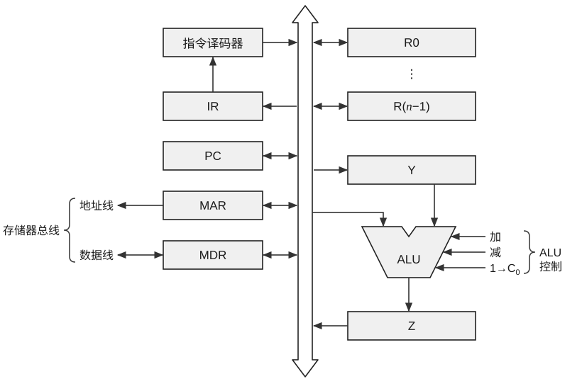

45.（7分）有一个没有设置快表的虚拟页式存储系统，其页面大小为 100B。一个仅有 460B 的程序有下述内存访问序列（下标从 0 开始）：10, 11, 104, 170, 73, 309, 185, 245, 246, 434, 458, 364。为该程序分配有两个可用页帧（Page frame）。

1）试叙述缺页中断与一般中断的主要区别。

2）若分别采用 FIFO 和 LRU 算法，则访问过程中发生多少次缺页中断？

3）若一次访存的时间是 10ms，平均缺页中断处理时间为 25ms，为使该虚拟存储系统的平均有效访问时间不大于 22ms，则可接受的最大缺页中断率是多少？

46.（8分）假设磁盘的 I/O 请求队列中的柱面号依次为 35, 58, 40, 28, 80, 160, 143, 38, 204，磁头的初始位置为 95，完成下列关于磁盘调度算法的问题。

1）若采用最短寻道时间优先（SSTF）算法，则共移动多少个磁道？

2）若采用扫描（SCAN）算法，磁头往磁道增大的方向移动，则共移动多少个磁道？

3）若采用循环扫描（C-SCAN）算法，磁头往磁道增大的方向移动，则共移动多少个磁道？

4）在常见的磁盘调度算法中，哪些算法有可能产生磁头臂黏着？注：系统总是访问磁盘的某个磁道而不响应对其他磁道的访问请求，这种现象称为磁头臂黏着。

5）在磁盘上进行一次读/写操作需要哪几部分时间？磁盘调度算法能够优化的是哪一部分的时间？磁盘数据的读取通常采用哪种 I/O 控制方式？

<!-- 第 63 页 -->

47. （9分）假设用户在浏览器上点击一个 URL 时，本地主机没有缓存该 URL 的 IP 地址，因此需要使用 DNS 解析；假设查询到该 URL 的 IP 地址共经过了 $n$ 台 DNS 服务器，每次查询所经过的时间均为 $\text{RTT}$。若从找到的服务器上只需读取一张很小的图片（忽略这张小图片的传输时间），从本地主机到服务器的往返时间为 $\text{RTT}_w$，回答下列问题。

1）从点击该 URL 开始到本地主机获取到所需的小图片，共需经历多长时间？

2）假设访问该服务器的一个 HTML 文件又引用了 3 个非常小的对象，若忽略这些对象的发送时间，试计算下列条件下客户点击并读取这些对象所需的时间：

① 使用非流水线的非持续 HTTP；

② 使用非流水线的持续 HTTP；

③ 使用流水线的持续 HTTP。

<!-- 第 64 页 -->

# 2027 王道 408 冲刺模拟试卷（七）

考试时间 180 分钟 满分 150 分

一、单项选择题：第 1–40 题，每题 2 分，共 80 分。在题目给出的四个选项中，只有一个选项最符合试题要求。

1. 一个带头结点的单链表，头指针为 L，尾指针 r 指向最后一个结点，要保证插入的先后顺序与对应结点在链中的顺序相反，则插入 p 结点的操作为（ ）。

(A) L->next=p; p->next=L->next; 

(B) p->next=L->next; L->next=p;

(C) L->next=p; r=p; 

(D) p->next=r;

2. 假设用不带头结点的单链表 A 作为链式栈，其结点结构为 `data|link`，top 是指向栈顶的指针。若要删除链式栈的栈顶结点，并将被删除结点的值保存到 x 中，则应执行的操作是（ ）。

(A) x=top->data; top=top->link; 

(B) top=top->link; x=top->data;

(C) x=top; top=top->link; 

(D) x=top->data;

3. 6 个元素以 6, 5, 4, 3, 2, 1 的顺序进栈，下列不合法的出栈序列是（ ）。

(A) 5, 4, 3, 6, 1, 2 

(B) 4, 5, 3, 1, 2, 6 

(C) 3, 4, 6, 5, 2, 1 

(D) 2, 3, 4, 1, 5, 6

4. 串 'acaba' 的 next 数组值为（ ）。

(A) 01234 

(B) 01212 

(C) 01121 

(D) 01230

5. 前序遍历和中序遍历结果相同的二叉树为（ ）。

Ⅰ. 只有根结点的二叉树 

Ⅱ. 根结点无右孩子的二叉树

Ⅲ. 所有结点只有左子树的二叉树 

Ⅳ. 所有结点只有右子树的二叉树

(A) 仅有 I 

(B) I、II 和 IV 

(C) I 和 III 

(D) I 和 IV

6. 在以下算法中，需要用到并查集的是（ ）。

(A) Floyd 算法 

(B) Kruskal 算法 

(C) Prim 算法 

(D) Dijkstra 算法

7. 右图所示为一棵平衡二叉树（字母不是关键字），在结点 D 的右子树上插入结点 F 后，会导致该平衡二叉树失去平衡，则调整后的平衡二叉树中平衡因子的绝对值为 1 的分支结点数为（ ）。

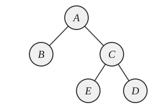

(A) 0 

(B) 1 

(C) 2 

(D) 3

8. 在平衡二叉树中插入一个结点后造成了不平衡，设最低的不平衡结点为 $a$，且已知插入前 $a$ 的左孩子的平衡因子为 -1，右孩子的平衡因子为 0，则做（ ）调整有可能使其平衡。

Ⅰ. 左旋 

Ⅱ. 先左旋后右旋 

Ⅲ. 先右旋后左旋 

Ⅳ. 右旋

(A) I 和 III 

(B) II 和 IV 

(C) I 和 II 

(D) III 和 IV

2027 王道 408 冲刺模拟试卷（七） 第 62 页（共 79 页）

<!-- 第 65 页 -->

9. 设对数组 $A[1 \cdots n]$ 进行折半插入排序（升序）。对于第 $i$ （ $i = 2, 3, \cdots, n$）个元素 $\text{key}$，先在已排序子数组 $A[1 \cdots i - 1]$ 中使用二分查找确定其插入位置。在二分查找过程中，每次执行比较操作 $A[\text{mid}] > \text{key}$ 记为 1 次比较，其中 $\text{mid} = \lfloor (low + high)/2 \rfloor$（向下取整），且不统计循环控制、边界判断、赋值与元素移动等操作的次数。给定待排序序列为 $\{6, 2, 9, 1, 5\}$，则整个折半插入排序过程中，比较操作 $A[\text{mid}] > \text{key}$ 的总执行次数为（ ）。

(A) 7 \quad\quad (B) 8 \quad\quad (C) 9 \quad\quad (D) 10

10. 在下列排序方法中，时间性能与待排序记录的初始状态无关的是（ ）。

(A) 插入排序和快速排序 \quad\quad (B) 归并排序和快速排序

(C) 选择排序和归并排序 \quad\quad (D) 插入排序和归并排序

11. 若对 29 条记录只进行 3 趟多路平衡归并，则选取的归并路数至少是（ ）。

(A) 2 \quad\quad (B) 3 \quad\quad (C) 4 \quad\quad (D) 5

12. 在某 32 位计算机中，全局变量 `buf` 的声明为 `int buf[4]={-2,103,-10,-20};`，假定 `buf` 的地址为 `0x8049320`，则地址 `0x804932a` 中的内容为（ ）。

(A) 0000 0000 \quad\quad (B) 1111 1010 \quad\quad (C) 1111 0101 \quad\quad (D) 1111 1111

13. 在 IEEE 754 标准的单精度浮点数中，最大规格化负数的机器数为（ ）。

(A) $80\text{C}0\ 0000\text{H}$ \quad\quad (B) $80800000\text{H}$ \quad\quad (C) $80000000\text{H}$ \quad\quad (D) $80000001\text{H}$

14. 某计算机的存储系统由 Cache-主存系统构成，Cache 的存取周期为 10ns，主存的存取周期为 50ns。当 CPU 执行一段程序时，Cache 完成存取的次数为 4800 次，主存完成存取的次数为 200 次，则该 Cache-主存系统的效率是（ ）。（设 Cache 和主存不能同时访问。）

(A) 0.833 \quad\quad (B) 0.856 \quad\quad (C) 0.958 \quad\quad (D) 0.862

15. 在页面尺寸为 4KB 的页式存储器中，按字节编址，页表中的内容如下图所示，则物理地址 32773 对应的逻辑地址为（ ）。（本题中的所有数字均为十进制数。）

| 虚页号 | 页框号 | 有效位 | 虚页号 | 页框号 | 有效位 |
| :---: | :---: | :---: | :---: | :---: | :---: |
| 0 | 2 | 1 | 3 | 8 | 1 |
| 1 | 5 | 1 | 4 | 7 | 1 |
| 2 | 7 | 0 | 5 | 11 | 1 |

(A) 32773 \quad\quad (B) 42773 \quad\quad (C) 12293 \quad\quad (D) 62773

16. 在下列关于 Cache 和虚拟存储器的说法中，错误的有（ ）。

I. 当 Cache 失效（不命中）时，处理器将切换进程，以更新 Cache 中的内容。

II. 当虚拟存储器失效（如缺页）时，处理器将切换进程，以更新主存中的内容。

III. Cache 和虚拟存储器由硬件和 OS 共同实现，对应用程序员均是透明的。

IV. 虚拟存储器的容量等于主存和辅存的容量之和。

(A) I 和 IV \quad\quad (B) III 和 IV

(C) I、II 和 III \quad\quad (D) I、III 和 IV

<!-- 第 66 页 -->

17. 设寄存器 R 中的数值为 600，地址为 600 和 700 的主存单元中存放的内容分别是 700 和 800，则（ ）得到的操作数为 600。

I. 直接寻址 600 II. 寄存器间接寻址 R III. 立即寻址 600 IV. 寄存器寻址 R

(A) I 
(B) II、III 
(C) III、IV 
(D) IV

18. 假设相对寻址的转移指令占 2B，第一个字节是操作码，第二个字节是相对位移量，用补码表示。每当 CPU 从存储器中取出 1B 时，即自动完成 $(PC) + 1 \rightarrow PC$。若当前 PC 值为 2000H，2000H 处的指令为 JMP * -9 (* 为相对寻址特征)，则执行这条指令后，PC 值为（ ）。

(A) 1FF7H 
(B) 1FF8H 
(C) 1FF9H 
(D) 1FFAH

19. 在下列几项中，不符合 RISC 指令系统特征的是（ ）。

(A) 控制器多采用微程序方式，以期更快的设计速度
(B) 指令格式简单，不同指令数量少
(C) 寻址方式少且简单
(D) 所有指令的平均执行时间约为一个时钟周期

20. 在微程序控制器中，微程序的入口地址是由（ ）形成的。

(A) 机器指令的地址码字段
(B) 微指令的微地址字段
(C) 机器指令的操作码字段
(D) 微指令的操作码字段

21. 某同步总线时钟周期为 200ns，每周期传输 1B。每条指令需访问主存 2 次（取指令、取操作数各占 1 个总线周期），无其他开销。磁盘采用 DMA 周期挪用方式向主存连续传送数据，传输速率为 1MB/s，每传送 1B 占用 1 个总线周期。忽略 DMA 初始化与中断处理开销。则在 DMA 传送期间，CPU 指令执行速度较无 DMA 时降低（ ）。

(A) 10% 
(B) 20% 
(C) 25% 
(D) 50%

22. 在下列关于各种 I/O 控制方式的说法中，错误的是（ ）。

I. 在中断周期中，置 “0” 允许中断触发器是由关中断指令完成的。
II. 中断服务程序的最后一条指令是无条件转移指令。
III. CPU 通过中断来控制 DMA 接口的传输工作。
IV. 程序中断和 DMA 方式都由硬件和软件结合来实现数据的传输。

(A) I、III、IV 
(B) III、IV 
(C) I、II、III 
(D) I、II、III、IV

23. 多用户系统有必要保证进程的独立性，保证操作系统本身的安全，但为了向用户提供更大的灵活性，应尽可能少地限制用户进程。在下面列出的各种操作中，（ ）是必须加以保护的。

(A) 从内核态转换到用户态
(B) 从存放操作系统内核的空间读取数据
(C) 从存放操作系统内核的空间读取指令
(D) 打开定时器

<!-- 第 67 页 -->

24. 关于临界区问题的一个算法（假设只有进程 $P_0$ 和 $P_1$ 可能会进入该临界区）如下（$i$ 为 0 或 1），该算法（ ）。

```text
Repeat
    retry: if(turn!=1) turn=i;
    if(turn!=i) goto retry;
    turn=1-i;
    临界区
    turn=0;
    剩余区
until false;
```

(A) 不能保证进程互斥进入临界区，且会出现“饥饿”

(B) 不能保证进程互斥进入临界区，但不会出现“饥饿”

(C) 保证进程互斥进入临界区，但会出现“饥饿”

(D) 保证进程互斥进入临界区，不会出现“饥饿”

25. 当利用银行家算法进行安全性检查时，不需要的参数是（ ）。

(A) 系统资源总数

(B) 满足系统安全的最少资源数

(C) 用户最大需求数

(D) 用户已占有的资源数

26. 设 $m$ 为同类资源数，$n$ 为系统中的并发进程数。当 $n$ 个进程共享 $m$ 个互斥资源时，每个进程的最大需求是 $w$，则在下列情况中，会出现系统死锁的是（ ）。

(A) $m = 2, n = 1, w = 2$

(B) $m = 2, n = 2, w = 1$

(C) $m = 4, n = 3, w = 2$

(D) $m = 4, n = 2, w = 3$

27. 支持程序存放在不连续内存中的存储管理方法有（ ）。

I. 动态分区分配 II. 固定分区分配 III. 分页式分配

IV. 段页式分配 V. 分段式分配

(A) I 和 II 

(B) III 和 IV 

(C) III、IV 和 V 

(D) I、III、IV 和 V

28. 在一个请求分页系统中，当采用 LRU 算法时，假设一个作业的页面走向为 1, 3, 2, 1, 1, 3, 5, 1, 3, 2, 1, 5。当分配给该作业的物理块数分别为 3 和 4 时，在访问过程中发生的缺页率分别为（ ）。

(A) 50% 和 33% 

(B) 25% 和 100% 

(C) 25% 和 33% 

(D) 50% 和 75%

29. 在下列关于文件系统的说法中，正确的是（ ）。

(A) 文件系统负责文件存储空间的管理，但不能实现文件名到物理地址的转换

(B) 在多级目录结构中，对文件的访问是通过路径名和用户目录名进行的

(C) 文件可以被划分成大小相等的若干物理块，且物理块大小可任意指定

(D) 逻辑记录是对文件进行存取操作的基本单位

30. 在某个文件系统中，每个盘块的大小为 512B，文件控制块占 64B，其中文件名占 6B。若索引节点编号占 2B，对一个存放在磁盘上的 256 个目录项的目录，试比较引入索引节点前后，为了找到其中一个文件的 FCB，平均启动磁盘的次数减少了（ ）次。

(A) 4.5 

(B) 8.5 

(C) 13 

(D) 16.5

<!-- 第 68 页 -->

31. 在下列关于设备独立性的论述中，正确的是（ ）。

(A) 设备独立性是 I/O 设备具有独立执行 I/O 功能的一种特性

(B) 设备独立性是指用户程序独立于具体使用的物理设备的一种特性

(C) 设备独立性是指独立实现设备共享的一种特性

(D) 设备独立性是指设备驱动独立于具体使用的物理设备的一种特性

32. 在下列关于固态硬盘（SSD）的说法中，正确的是（ ）。

(A) 固态硬盘属于磁表面存储器

(B) 固态硬盘的闪存翻译层相当于磁盘中的磁盘控制器，起到地址转换的作用

(C) 固态硬盘的随机读时延远低于常规硬盘，但随机写时延和常规硬盘的相差不大

(D) 在对固态硬盘的某块写入信息时，不必按照块内页的顺序写入信息

33. 正确描述网络体系结构中的分层概念的是（ ）。

(A) 分层机制使得网络灵活且易于修改

(B) 所有的网络体系结构都使用相同的层次名称和功能

(C) 把相关的网络功能组合在一层中

(D) 定义各层的功能以及功能的具体实现

34. 在下列关于边界网关协议（BGP）的叙述中，正确的是（ ）。

Ⅰ. 从 eBGP 对等方收到的 BGP 路由，可通过 iBGP 告知同一个 AS 内的对等方。

Ⅱ. 从 iBGP 对等方收到的 BGP 路由，可通过 eBGP 告知不同 AS 内的对等方。

Ⅲ. 从 iBGP 对等方收到的 BGP 路由，不能转告给同一个 AS 内不同 iBGP 的对等方。

Ⅳ. 一个 AS 内的所有 iBGP 必须是全连通的，即使两个路由器之间没有直接的物理连接。

(A) 仅 I、II 
(B) 仅 III、IV 
(C) 仅 II、III、IV 
(D) I、II、III、IV

35. 一个 $2\,\text{Mb/s}$ 的网络，线路长度为 $1\,\text{km}$，传输速度为 $20\,\text{m/ms}$，分组大小为 $100\,\text{B}$，应答帧大小可以忽略。若采用停止-等待协议，则实际数据率是（ ）。

(A) $2\,\text{Mb/s}$ 
(B) $1\,\text{Mb/s}$ 
(C) $8\,\text{kb/s}$ 
(D) $16\,\text{kb/s}$

36. 以太网交换机的自学习算法是指，它根据帧中的（ ）进行地址学习。

(A) 源 MAC 地址

(B) 目的 MAC 地址

(C) 源 MAC 地址和目的 MAC 地址

(D) 源 IP 地址

37. 若子网掩码是 255.255.192.0，则在下列主机中，必须通过路由器才能与主机 129.23.144.16 通信的是（ ）。

(A) 129.23.191.21 
(B) 129.23.127.222 

(C) 129.23.130.33 
(D) 129.23.148.127

38. 下列关于网际组管理协议（IGMP）的说法中，正确的是（ ）。

(A) IGMP 知道 IP 多播组包含的成员数

(B) IGMP 在互联网范围内对所有多播组成员进行管理

(C) 当某个主机加入新的多播组时，该主机应向多播组的多播地址发送一个 IGMP 报文

(D) 多播组的成员关系一旦固定，就不能改变

<!-- 第 69 页 -->

39. 下列关于 TCP 的端口号的说法中，正确的是（ ）。

I. 一台主机可用的端口号数量不超过 65536。

II. 一台主机上能同时存活的连接数量不超过 65536。

III. 连接释放后，端口号可以再次使用。

IV. 一台主机可在一个端口建立多个 TCP 连接。

(A) I、II (B) II、III (C) I、II、III、IV (D) I、III、IV

40. 某同学利用校园网访问因特网，在从该同学打开计算机电源到使用命令 `ftp` 连通到文件服务器 202.38.70.25 的过程中，（ ）协议可能未用到。

(A) IP (B) ICMP (C) ARP (D) DHCP

## 二、综合应用题：第 41-47 题，共 70 分。

41.（10分）输入关键字序列 15，10，24，47，37，68，50，建立大根堆，回答下列问题。

1）堆是顺序存储的还是非顺序存储的？

2）使用 C 或 C++ 语言，给出堆的数据结构定义。

3）画图模拟大根堆的建堆过程。

42.（13分）设树 $T$ 采用孩子兄弟链表表示（数据域、孩子域、兄弟域），设计算法计算树 $T$ 的度。

1）写出树结点的数据结构定义。

2）给出算法的基本设计思想。

3）根据设计思想，采用 C 或 C++ 语言描述算法，关键之处给出注释。

43.（11分）通过对方格中的每个点设置相应的 CMYK 值，可以在该方格内涂上相应的颜色。下图所示的三个程序段都可将一个 $8\times8$ 的方格涂上黄色。

**程序段 A**
```c
struct pt_color {
    int c;
    int m;
    int y;
    int k;
};
struct pt_color square[8][8];
int i, j;
for (i=0; i<8; i++) {
    for (j=0; j<8; j++) {
        square[i][j].c=0;
        square[i][j].m=0;
        square[i][j].y=1;
        square[i][j].k=0;
    }
}
```

**程序段 B**
```c
struct pt_color {
    int c;
    int m;
    int y;
    int k;
};
struct pt_color square[8][8];
int i, j;
for (i=0; i<8; i++) {
    for (j=0; j<8; j++) {
        square[j][i].c=0;
        square[j][i].m=0;
        square[j][i].y=1;
        square[j][i].k=0;
    }
}
```

**程序段 C**
```c
struct pt_color {
    int c;
    int m;
    int y;
    int k;
};
struct pt_color square[8][8];
int i, j;
for (i=0; i<8; i++) {
    for (j=0; j<8; j++) {
        square[i][j].y=1;
    }
}
for (i=0; i<8; i++) {
    for (j=0; j<8; j++) {
        square[i][j].c=0;
        square[i][j].m=0;
        square[i][j].y=1;
        square[i][j].k=0;
    }
}
```

假设 Cache 的数据区大小为 512B，采用直接映射，块大小为 32B，存储器按字节编址，`sizeof(int)=4`。编译时变量 `i` 和 `j` 分配在寄存器中，数组 `square` 按行优先存储在 `0000 0C80H` 开始的连续主存区域中，主存地址为 32 位，回答下列问题。

1）分析并比较程序段 A、B、C 中数组访问的时间局部性和空间局部性。

2）一个 Cache 行中能存放几个 square 数组元素？整个数组共占用几个主存块？第一个数组元素位于主存的第几块中？映射到 Cache 的第几行？

3）试计算三个程序段 A、B、C 中数组访问的写操作次数、写不命中次数和写缺失率。

<!-- 第 70 页 -->

44.（12分）某 C 程序中包含代码 `for(i=0;i<5;i++) j=j+B[i];`，假设编译时变量 i、j 分别保存在寄存器 R1 和 R2 中，int 型数组 B 的首地址分配在寄存器 R3 中，这段代码对应的汇编代码和机器代码如下表所示。

| 编号 | 地址 | 机器代码 | 汇编代码 | 注释 |
| :---: | :---: | :---: | :---: | :---: |
| 1 | 00003000H | 00000820H | add R1,R0,R0 | 0 → R1 |
| 2 | 00003004H | 00012880H | sll R5,R1,2 | (R1)<<2 → R5 |
| 3 | 00003008H | 00A32820H | add R5,R5,R3 | (R5)+(R3) → R5 |
| 4 | 0000300CH | 8CA60000H | lw R6,0(R5) | ((R5)+0) → R6 |
| 5 | 00003010H | 00461020H | add R2,R2,R6 | (R2)+(R6) → R2 |
| 6 | 00003014H | 20210001H | addi R1,R1,1 | (R1)+1 → R1 |
| 7 | 00003018H | 28240005H | slti R4,R1,5 | if (R1)<5 1 → R4 |
| 8 | 0000301CH | 1480FFF9H | bne R4,R0,loop | if (R4)≠0 goto loop |

这段代码在某台主频为 $100\,\text{MHz}$ 且采用 32 位定长指令字的计算机上运行，其中的 bne 指令格式如下图所示。

| OP(31–26) | Rs(25–21) | Rt(20–16) | OFFSET(15–0) |
| :---: | :---: | :---: | :---: |

OP 为操作码，Rs 和 Rt 为寄存器编号，OFFSET 为偏移量，用补码表示。回答下列问题。

1）该计算机的 CPU 中包含多少个通用寄存器？存储器编址单位是多少？

2）bne 指令采用相对寻址，OFFSET 部分存放的是字偏移量，给出指令中 loop 指向的地址。

3）该计算机的各类指令所花费的时钟周期数如下：运算类指令 4 个，分支跳转类指令 3 个，访存类指令（可以包含计算）5 个，计算这段代码的平均 CPI、MIPS 及总执行时间。

4）若该计算机采用五级流水线，且硬件不使用任何转发措施，则 bne 指令的执行会引起两个时钟周期的阻塞。这段代码中哪些编号的指令执行会由于数据相关导致阻塞？哪些编号的指令执行会引起控制相关？

45.（7分）有三个进程 PA、PB 和 PC 合作解决文件打印问题。PA 将文件记录从磁盘读入主存的缓冲区 1，每执行一次就读一条记录；PB 将缓冲区 1 的内容复制到缓冲区 2，每执行一次就复制一条记录；PC 将缓冲区 2 的内容打印出来，每执行一次就打印一条记录。缓冲区的大小等于一条记录的大小。请用 P、V 操作来保证文件的正确打印。

<!-- 第 71 页 -->

46. （8分）某系统采用成组链接法来管理磁盘的空闲空间，当前磁盘的状态如下图所示。

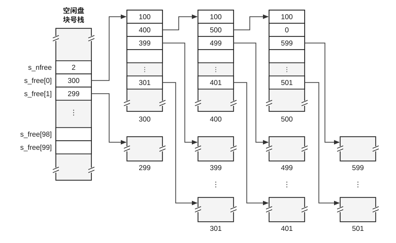

1）该磁盘中目前还有多少个空闲盘块？

2）在为某个文件 F1 分配 3 个盘块后，写出空闲盘块号栈的栈顶盘块号。

3）在上一问的基础上，删除另一文件 F2 并回收它所占的 5 个盘块，盘块号分别是 700，711，703，788，701，写出回收后空闲盘块号栈的栈顶指针的值和空闲盘块号。

<!-- 第 72 页 -->

47.（9分）本地主机A的一个应用程序使用TCP与同一个局域网内的另一台主机B通信。用Sniffer工具捕获主机A以太网发送和接收的所有通信流量，目前已得到8个IP数据报。下表以十六进制数据格式逐字节列出了这些IP数据报的全部内容，其中编号2、3、6为主机A接收的IP数据报，其余为主机A发送的IP数据报。假定所有数据报的IP和TCP检验和均是正确的。

<table><tr><td align="center">编号</td><td colspan="20">IP 数据报的全部内容</td></tr><tr><td rowspan="3">1</td><td align="center">45</td><td align="center">00</td><td align="center">00</td><td align="center">30</td><td align="center">82</td><td align="center">fc</td><td align="center">40</td><td align="center">00</td><td align="center">80</td><td align="center">06</td><td align="center">f5</td><td align="center">a5</td><td align="center">c0</td><td align="center">a8</td><td align="center">00</td><td align="center">15</td><td align="center">c0</td><td align="center">a8</td><td align="center">00</td><td align="center">c0</td></tr><tr><td align="center">06</td><td align="center">64</td><td align="center">31</td><td align="center">ba</td><td align="center">22</td><td align="center">68</td><td align="center">b9</td><td align="center">90</td><td align="center">00</td><td align="center">00</td><td align="center">00</td><td align="center">00</td><td align="center">70</td><td align="center">02</td><td align="center">ff</td><td align="center">ff</td><td align="center">cc</td><td align="center">c2</td><td align="center">00</td><td align="center">00</td></tr><tr><td align="center">02</td><td align="center">04</td><td align="center">05</td><td align="center">b4</td><td align="center">01</td><td align="center">01</td><td align="center">04</td><td align="center">02</td><td align="center"></td><td align="center"></td><td align="center"></td><td align="center"></td><td align="center"></td><td align="center"></td><td align="center"></td><td align="center"></td><td align="center"></td><td align="center"></td><td align="center"></td><td align="center"></td></tr><tr><td rowspan="3">2</td><td align="center">45</td><td align="center">00</td><td align="center">00</td><td align="center">2f</td><td align="center">00</td><td align="center">07</td><td align="center">40</td><td align="center">00</td><td align="center">40</td><td align="center">01</td><td align="center">24</td><td align="center">42</td><td align="center">c0</td><td align="center">a8</td><td align="center">00</td><td align="center">65</td><td align="center">da</td><td align="center">20</td><td align="center">7b</td><td align="center">57</td></tr><tr><td align="center">08</td><td align="center">00</td><td align="center">69</td><td align="center">5a</td><td align="center">36</td><td align="center">6f</td><td align="center">00</td><td align="center">07</td><td align="center">73</td><td align="center">48</td><td align="center">5b</td><td align="center">49</td><td align="center">37</td><td align="center">5c</td><td align="center">04</td><td align="center">00</td><td align="center">08</td><td align="center">09</td><td align="center">0a</td><td align="center">0b</td></tr><tr><td align="center">0c</td><td align="center">0d</td><td align="center">0e</td><td align="center">0f</td><td align="center">10</td><td align="center">11</td><td align="center">12</td><td align="center"></td><td align="center"></td><td align="center"></td><td align="center"></td><td align="center"></td><td align="center"></td><td align="center"></td><td align="center"></td><td align="center"></td><td align="center"></td><td align="center"></td><td align="center"></td><td align="center"></td></tr><tr><td rowspan="3">3</td><td align="center">45</td><td align="center">00</td><td align="center">00</td><td align="center">30</td><td align="center">00</td><td align="center">00</td><td align="center">40</td><td align="center">00</td><td align="center">40</td><td align="center">06</td><td align="center">b8</td><td align="center">a2</td><td align="center">c0</td><td align="center">a8</td><td align="center">00</td><td align="center">c0</td><td align="center">c0</td><td align="center">a8</td><td align="center">00</td><td align="center">15</td></tr><tr><td align="center">31</td><td align="center">ba</td><td align="center">06</td><td align="center">64</td><td align="center">5b</td><td align="center">9f</td><td align="center">f7</td><td align="center">1c</td><td align="center">22</td><td align="center">68</td><td align="center">b9</td><td align="center">91</td><td align="center">70</td><td align="center">12</td><td align="center">20</td><td align="center">00</td><td align="center">83</td><td align="center">45</td><td align="center">00</td><td align="center">00</td></tr><tr><td align="center">02</td><td align="center">04</td><td align="center">05</td><td align="center">b4</td><td align="center">01</td><td align="center">01</td><td align="center">04</td><td align="center">02</td><td align="center"></td><td align="center"></td><td align="center"></td><td align="center"></td><td align="center"></td><td align="center"></td><td align="center"></td><td align="center"></td><td align="center"></td><td align="center"></td><td align="center"></td><td align="center"></td></tr><tr><td rowspan="2">4</td><td align="center">45</td><td align="center">00</td><td align="center">00</td><td align="center">28</td><td align="center">82</td><td align="center">fd</td><td align="center">40</td><td align="center">00</td><td align="center">80</td><td align="center">06</td><td align="center">f5</td><td align="center">ac</td><td align="center">c0</td><td align="center">a8</td><td align="center">00</td><td align="center">15</td><td align="center">c0</td><td align="center">a8</td><td align="center">00</td><td align="center">c0</td></tr><tr><td align="center">06</td><td align="center">64</td><td align="center">31</td><td align="center">ba</td><td align="center">22</td><td align="center">68</td><td align="center">b9</td><td align="center">91</td><td align="center">5b</td><td align="center">9f</td><td align="center">f7</td><td align="center">1d</td><td align="center">50</td><td align="center">10</td><td align="center">ff</td><td align="center">ff</td><td align="center">c6</td><td align="center">d9</td><td align="center">00</td><td align="center">00</td></tr><tr><td rowspan="3">5</td><td align="center">45</td><td align="center">00</td><td align="center">00</td><td align="center">38</td><td align="center">82</td><td align="center">fe</td><td align="center">40</td><td align="center">00</td><td align="center">80</td><td align="center">06</td><td align="center">f5</td><td align="center">9b</td><td align="center">c0</td><td align="center">a8</td><td align="center">00</td><td align="center">15</td><td align="center">c0</td><td align="center">a8</td><td align="center">00</td><td align="center">c0</td></tr><tr><td align="center">06</td><td align="center">64</td><td align="center">31</td><td align="center">ba</td><td align="center">22</td><td align="center">68</td><td align="center">b9</td><td align="center">91</td><td align="center">5b</td><td align="center">9f</td><td align="center">f7</td><td align="center">1d</td><td align="center">50</td><td align="center">18</td><td align="center">ff</td><td align="center">ff</td><td align="center">bc</td><td align="center">b7</td><td align="center">00</td><td align="center">00</td></tr><tr><td align="center">f8</td><td align="center">9f</td><td align="center">e3</td><td align="center">c3</td><td align="center">2c</td><td align="center">12</td><td align="center">c2</td><td align="center">89</td><td align="center">24</td><td align="center">34</td><td align="center">6a</td><td align="center">13</td><td align="center">55</td><td align="center">b7</td><td align="center">65</td><td align="center">59</td><td align="center"></td><td align="center"></td><td align="center"></td><td align="center"></td></tr><tr><td rowspan="2">6</td><td align="center">45</td><td align="center">00</td><td align="center">00</td><td align="center">28</td><td align="center">3f</td><td align="center">28</td><td align="center">40</td><td align="center">00</td><td align="center">40</td><td align="center">06</td><td align="center">79</td><td align="center">82</td><td align="center">c0</td><td align="center">a8</td><td align="center">00</td><td align="center">c0</td><td align="center">c0</td><td align="center">a8</td><td align="center">00</td><td align="center">15</td></tr><tr><td align="center">31</td><td align="center">ba</td><td align="center">06</td><td align="center">64</td><td align="center">5b</td><td align="center">9f</td><td align="center">f7</td><td align="center">1d</td><td align="center">22</td><td align="center">68</td><td align="center">b9</td><td align="center">a1</td><td align="center">50</td><td align="center">10</td><td align="center">20</td><td align="center">00</td><td align="center">af</td><td align="center">f9</td><td align="center">00</td><td align="center">00</td></tr><tr><td rowspan="3">7</td><td align="center">45</td><td align="center">00</td><td align="center">00</td><td align="center">38</td><td align="center">83</td><td align="center">0b</td><td align="center">40</td><td align="center">00</td><td align="center">80</td><td align="center">06</td><td align="center">f5</td><td align="center">8c</td><td align="center">c0</td><td align="center">a8</td><td align="center">00</td><td align="center">15</td><td align="center">c0</td><td align="center">a8</td><td align="center">00</td><td align="center">c0</td></tr><tr><td align="center">06</td><td align="center">64</td><td align="center">31</td><td align="center">ba</td><td align="center">22</td><td align="center">68</td><td align="center">b9</td><td align="center">a1</td><td align="center">5b</td><td align="center">9f</td><td align="center">f7</td><td align="center">1d</td><td align="center">50</td><td align="center">18</td><td align="center">ff</td><td align="center">ff</td><td align="center">bc</td><td align="center">a7</td><td align="center">00</td><td align="center">00</td></tr><tr><td align="center">f8</td><td align="center">9f</td><td align="center">e3</td><td align="center">c3</td><td align="center">2c</td><td align="center">12</td><td align="center">c2</td><td align="center">89</td><td align="center">24</td><td align="center">34</td><td align="center">6a</td><td align="center">13</td><td align="center">55</td><td align="center">b7</td><td align="center">65</td><td align="center">59</td><td align="center"></td><td align="center"></td><td align="center"></td><td align="center"></td></tr><tr><td rowspan="4">8</td><td align="center">45</td><td align="center">00</td><td align="center">00</td><td align="center">48</td><td align="center">83</td><td align="center">3c</td><td align="center">00</td><td align="center">00</td><td align="center">80</td><td align="center">06</td><td align="center">35</td><td align="center">4c</td><td align="center">c0</td><td align="center">a8</td><td align="center">00</td><td align="center">15</td><td align="center">c0</td><td align="center">a8</td><td align="center">00</td><td align="center">c0</td></tr><tr><td align="center">06</td><td align="center">64</td><td align="center">31</td><td align="center">ba</td><td align="center">22</td><td align="center">68</td><td align="center">b9</td><td align="center">a1</td><td align="center">5b</td><td align="center">9f</td><td align="center">f7</td><td align="center">1d</td><td align="center">50</td><td align="center">18</td><td align="center">ff</td><td align="center">ff</td><td align="center">b2</td><td align="center">8d</td><td align="center">00</td><td align="center">00</td></tr><tr><td align="center">f8</td><td align="center">9f</td><td align="center">e3</td><td align="center">c3</td><td align="center">2c</td><td align="center">12</td><td align="center">c2</td><td align="center">89</td><td align="center">24</td><td align="center">34</td><td align="center">6a</td><td align="center">13</td><td align="center">55</td><td align="center">b7</td><td align="center">65</td><td align="center">59</td><td align="center">dd</td><td align="center">47</td><td align="center">2c</td><td align="center">3a</td></tr><tr><td align="center">b1</td><td align="center">0c</td><td align="center">9a</td><td align="center">f1</td><td align="center">75</td><td align="center">1b</td><td align="center">4f</td><td align="center">75</td><td align="center">62</td><td align="center">df</td><td align="center">03</td><td align="center">19</td><td align="center"></td><td align="center"></td><td align="center"></td><td align="center"></td><td align="center"></td><td align="center"></td><td align="center"></td><td align="center"></td></tr></table>

注意，IP 分组头结构和 TCP 段头结构分别如图 1 和图 2 所示。协议域为 1、6、17、89，它们分别对应 ICMP、TCP、UDP、OSPF 协议。

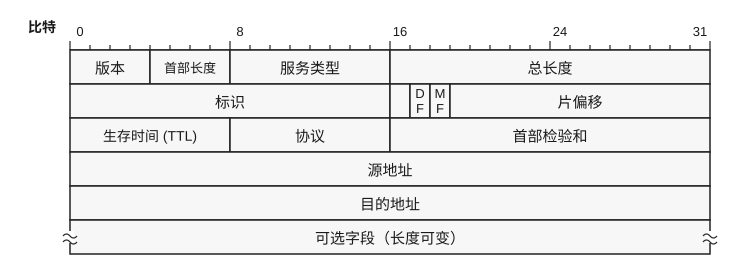

图 1 IP 分组头结构

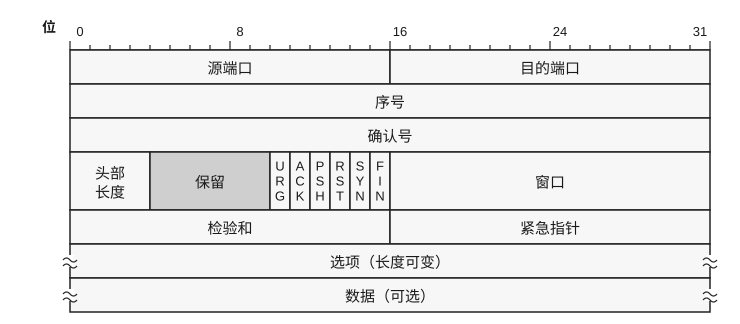

图 2 TCP 段头结构

本题中窗口域描述窗口时使用的计量单位为 1B。回答下列问题。

1）在表所示的 IP 分组中，哪几个分组完成了 TCP 连接建立过程中的三次握手？根据三次握手报文提供的信息，连接建立后，如果 B 发送数据给 A，那么首字节的编号是多少？

2）根据表中的 IP 分组，A 上的应用程序已经请求 TCP 发送的应用层数据的总字节是多少？

3）若在 8 号 IP 分组后，B 正确接收了 A 发送的所有 IP 分组，则 B 新送给 A 的 TCP 报文段中的确认号应当是多少（十六进制数）？若在 8 号 IP 分组后，A 上的应用程序请求 TCP 发送新的 65495B 的应用层数据，则按 TCP，在 A 未能得到 B 的任何确认报文之前，TCP 可以发送到网络中的应用层数据最多是多少字节？

<!-- 第 73 页 -->

# 2027 王道 408 冲刺模拟试卷（八）

考试时间 180 分钟 满分 150 分

一、单项选择题：第 1–40 题，每题 2 分，共 80 分。在题目给出的四个选项中，只有一个选项最符合试题要求。

1. 假设有一个不带头结点的链式队列 $Q$，其队头指针和队尾指针分别为 `front` 和 `rear`，新进队的元素结点为 $s$，则进队操作是（ ）。

(A) Q.front=s; Q.front=Q.front->link;

(B) s->link=Q.front; Q.front=s;

(C) s->link=Q.rear; Q.rear=s;

(D) Q.rear->link=s; s->link=NULL; Q.rear=s;

2. 栈初始为空，将中缀表达式 $a - (b \times c + d / e)$ 转化为等价的后缀表达式，运算符栈中元素最多时有（ ）个。

(A) 2          (B) 3          (C) 4          (D) 5

3. 对于一个有 10 个顶点的无向图，可用一个 $10 \times 10$ 阶对称矩阵 $A$ 来存储图中任意两个顶点之间的最短距离。矩阵元素 $a_{ij}$ ($1 \leqslant i, j \leqslant 10$) 存储的是 $i$ 号和 $j$ 号顶点之间的最短距离，现用一个一维数组 $B$ 来对矩阵 $A$ 进行压缩存储，$B[0]$ 存储的是 $A[1][1]$，$B[1]$ 存储的是 $A[1][2]$，则 $B[35]$ 存储的是（ ）顶点之间的最短距离。

(A) 4 号和 6 号 (B) 4 号和 7 号 (C) 6 号和 5 号 (D) 6 号和 7 号

4. 已知字符串 $S$ 为 “aabaabcabc”，模式串 $T$ 为 “aaaabc”。使用 $\text{nextval}$ 优化后的 KMP 算法进行匹配，匹配到 $i=2$ 且 $j=2$ 时，失配 ($S[i] \neq T[j]$)。则下次开始匹配时，$i$ 和 $j$ 分别是（ ）。

(A) 2 和 2          (B) 2 和 1          (C) 3 和 0          (D) 3 和 2

5. 设有一棵表达式树，其叶结点为操作数，内部结点为运算符，结构如图所示。关于该表达式树及其相关性质，下列叙述中正确的是（ ）。


(A) 该表达式树所对应的表达式（按通常的运算优先级）可表示为 $A + B \times C - D$

(B) 对任意表达式树进行中序遍历，均无法直接得到语法正确的中缀表达式

(C) 任意表达式树的非叶结点的度均为 2

(D) 若一棵表达式树仅包含二元运算符“+”与“-”，且运算符结点数为 $n$，则操作数（叶）结点数为 $n+1$

<!-- 第 74 页 -->

6. 如图所示，若从顶点 $A$ 出发进行遍历，则下列序列中既不是深度优先遍历又不是广度优先遍历的序列为（）。


(A) $A, B, C, E, F, D$ \quad (B) $A, B, E, C, D, F$ \quad (C) $A, E, D, F, C, B$ \quad (D) $A, E, D, C, B, F$

7. 在下列关于连通图的 BFS 和 DFS 生成树的高度的说法中，正确的是（）。

(A) BFS 生成树的高度小于 DFS 生成树的高度

(B) BFS 生成树的高度小于或等于 DFS 生成树的高度

(C) BFS 生成树的高度大于 DFS 生成树的高度

(D) BFS 生成树的高度大于或等于 DFS 生成树的高度

8. 在有 15 个结点的平衡二叉树上，查找关键字为 28（存在该结点）的结点，则依次比较的关键字有可能是（）。

(A) 30, 36

(B) 38, 48, 28

(C) 48, 18, 38, 28

(D) 60, 20, 50, 40, 38, 28

9. 设有一棵初始为空的红黑树 $T$，所有空指针均视为黑色 NIL 叶结点。依次插入关键字 41，38，31，12，19，8（新结点初始为红色），插入完成后，下列说法中正确的是（）。

(A) 根结点为 38，且为黑色

(B) 插入 19 时仅发生一次左旋操作

(C) 插入 8 后，该树的黑高（从根到任一 NIL 叶结点的路径上黑结点数，不包括根）为 3

(D) 最终树中不存在任何红色非叶结点

10. 散列表的地址范围为 $0 \sim 17$，散列函数为 $H(k) = k \pmod{17}$。采用线性探测法处理冲突，将关键字序列 26，25，72，38，8，18，59 依次存储到散列表中。元素 59 存放在散列表中的地址是（）。

(A) 8 \quad (B) 9 \quad (C) 10 \quad (D) 11

11. 在最好情况下，时间复杂度可以达到线性时间的排序算法是（）。

① 冒泡排序 ② 堆排序 ③ 快速排序 ④ 归并排序 ⑤ 直接插入排序

(A) ① \quad (B) ①⑤ \quad (C) ④⑤ \quad (D) ②③

12. 某计算机按字节编址，采用小端方式存储信息。其中，某指令的一个操作数为 16 位，该操作数采用基址寻址方式，指令中的形式地址（用补码表示）为 FF00H，当前基址寄存器的内容为 C000 0000H，则该操作数的 LSB 中存放的地址是（）。

(A) BFFF FF00H \quad (B) BFFF FF01H

(C) C000 FF00H \quad (D) C000 FF01H

<!-- 第 75 页 -->

13. 在 C 语言中，若有如下定义：

```c
int a=5, b=8; float x=4.2, y=3.4;
```

则表达式 `(float)(a+b)/2+(int)x%(int)y` 的值是（ ）。

(A) 7.500000 
(B) 7 
(C) 7.000000 
(D) 8

14. 假设一次 ALU 运算花费 1 个时钟周期，一次移位运算花费 1 个时钟周期，若忽略其他操作的时间，则计算机实现 32 位原码一位乘法花费的时钟周期数最多为（ ）。

(A) 32 
(B) 63 
(C) 64 
(D) 65

15. 有一个八体低位交叉存储器，每个存储体的容量为 $256\text{M} \times 64$ 位，若每个存储体的存储周期为 80ns，采用轮流启动的方式，则该存储器能提供的最大带宽是（ ）。

(A) 426.67MB/s 
(B) 800MB/s 
(C) 213.33MB/s 
(D) 400MB/s

16. 某台按字节编址的计算机采用小端方式存储，一维数组 a 中有 100 个元素，其类型为 float，存放在以地址 C000 1000H 开始的连续区域中，则最后一个数组元素的 MSB（最高有效字节）所在的地址应该是（ ）。

(A) C000 1396H 
(B) C000 1399H 
(C) C000 118CH 
(D) C000 118FH

17. 有一条双字长直接寻址的子程序调用 CALL 指令，其第一个字为操作码和寻址特征，第二个字为地址码 5000H。假设 PC 的当前值为 1000H，SP 的内容为 0100H，栈顶内容为 1234H，存储器按字编址，且进栈操作是先 $(SP) - 1 \rightarrow SP$，后存入数据，则 CALL 指令执行后，SP 及栈顶的内容分别为（ ）。

(A) 00FFH, 1000H 
(B) 0101H, 1000H 
(C) 00FEH, 1002H 
(D) 00FFH, 1002H

18. 假定采用相对寻址方式的转移指令占 2B，第一个字节是操作码，第二个字节是相对位移量（用补码表示）。取指令时，每次 CPU 从存储器中取出一个字节，并且自动完成 $PC + 1 \rightarrow PC$ 操作。假设执行到某条转移指令时（取指令前），PC 的内容为 200CH，该指令的转移目标地址为 1FB0H，则该转移指令的第二个字节的内容应是（ ）。

(A) 5CH 
(B) 5EH 
(C) A2H 
(D) A4H

19. 某微机的指令格式如下所示：

| 操作码（位 $15 \sim 10$） | X（位 $9 \sim 8$） | D（位 $7 \sim 0$） |
| :---: | :---: | :---: |

其中 D 为位移量，X 为寻址特征位。X=00：直接寻址；X=01：用变址寄存器 X1 进行变址；X=10：用变址寄存器 X2 进行变址；X=11：相对寻址。设 $(PC) = 1234\text{H}$，$(X1) = 0037\text{H}$，$(X2) = 1122\text{H}$，则指令 $2222\text{H}$ 的有效地址是（ ）。

(A) $22\text{H}$ 
(B) $1144\text{H}$ 
(C) $1256\text{H}$ 
(D) $0059\text{H}$

20. 某系统采用 DMA 方式从磁盘读取一个 4KB 数据块至主存：CPU 预处理 $8\mu\text{s}$，磁盘寻道 5ms，平均旋转延迟 4.6ms。磁盘控制器配备 512B 缓冲区，磁盘 I/O 接口峰值传输速率为 200MB/s。DMA 采用周期挪用方式：总线周期 200ns，每次传输 4B。传输结束后产生 1 次中断，CPU 后处理 $12\mu\text{s}$。忽略其他开销，则该 I/O 操作全流程的总时间约为（ ）。

(A) 9.62ms 
(B) 9.82ms 
(C) 10.02ms 
(D) 14.42ms

<!-- 第 76 页 -->

21. 假设执行最复杂的指令需要完成 6 个子功能，分别由对应的功能部件 A ~ F 来完成，每个功能部件所花的时间分别为 80ps、40ps、50ps、70ps、20ps、30ps，流水段寄存器延时为 20ps，现将最后两个功能部件 E 和 F 合并，以产生一个五段式流水线，则该五段式流水线 CPU 的时钟周期至少是（ ）。

(A) 70ps 
(B) 80ps 
(C) 90ps 
(D) 100ps

22. DMA 方式的接口电路中有程序中断部件，其作用包括（ ）。

I. 实现数据传输    
II. 向 CPU 提出总线使用权  
III. 向 CPU 提出传输结束    
IV. 检查数据是否出错

(A) 仅 III 
(B) III 和 IV 
(C) I、III 和 IV 
(D) I 和 II

23. 当系统采用 BIOS 多阶段引导方式启动时，CPU 依次执行的正确程序顺序是（ ）。

(A) ROM 引导程序 o 分区引导程序 o 硬盘主引导程序 o 操作系统初始化程序  
(B) 硬盘主引导程序 o 分区引导程序 o ROM 引导程序 o 操作系统初始化程序  
(C) ROM 引导程序 o 硬盘主引导程序 o 分区引导程序 o 操作系统初始化程序  
(D) ROM 引导程序 o 硬盘主引导程序 o 操作系统初始化程序 o 分区引导程序  

24. 在以下关于临界区互斥的叙述中，正确的是（ ）。

(A) 互斥锁用于保证同一时刻仅有一个进程进入临界区  
(B) 抢占式调度或时间片轮转可避免竞争条件，无须同步机制  
(C) “关中断” 能在用户态普遍用于保护临界区  
(D) 信号量用于互斥时，wait 与 signal 必须由同一进程成对调用，否则必会导致死锁  

25. 利用死锁定理简化得到下列进程资源图，则处于死锁状态的是（ ）。

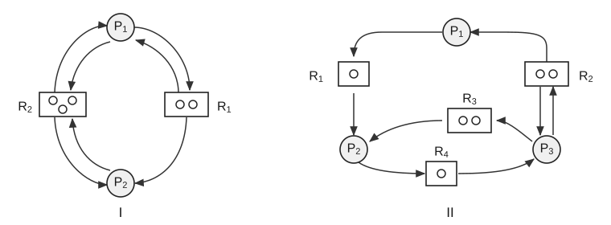

(A) I  
(B) II  
(C) I 和 II  
(D) 都不处于死锁状态

<!-- 第 77 页 -->

26. 假设系统有5个进程，以及A、B、C三类资源。某时刻进程和资源状态如下：

<table>
  <tr>
    <td></td>
    <td colspan="3">Allocation</td>
    <td colspan="3">Max</td>
    <td colspan="3">Available</td>
  </tr>
  <tr>
    <td></td>
    <td>A</td>
    <td>B</td>
    <td>C</td>
    <td>A</td>
    <td>B</td>
    <td>C</td>
    <td>A</td>
    <td>B</td>
    <td>C</td>
  </tr>
  <tr>
    <td>$P_{1}$</td>
    <td>2</td>
    <td>1</td>
    <td>2</td>
    <td>5</td>
    <td>5</td>
    <td>9</td>
    <td>2</td>
    <td>3</td>
    <td>3</td>
  </tr>
  <tr>
    <td>$P_{2}$</td>
    <td>4</td>
    <td>0</td>
    <td>2</td>
    <td>5</td>
    <td>3</td>
    <td>6</td>
    <td></td>
    <td></td>
    <td></td>
  </tr>
  <tr>
    <td>$P_{3}$</td>
    <td>4</td>
    <td>0</td>
    <td>5</td>
    <td>4</td>
    <td>0</td>
    <td>11</td>
    <td></td>
    <td></td>
    <td></td>
  </tr>
  <tr>
    <td>$P_{4}$</td>
    <td>2</td>
    <td>0</td>
    <td>4</td>
    <td>4</td>
    <td>2</td>
    <td>5</td>
    <td></td>
    <td></td>
    <td></td>
  </tr>
  <tr>
    <td>$P_{5}$</td>
    <td>3</td>
    <td>1</td>
    <td>4</td>
    <td>4</td>
    <td>2</td>
    <td>4</td>
    <td></td>
    <td></td>
    <td></td>
  </tr>
</table>

在下列叙述中，正确的是（）。

(A) 系统不安全

(B) 该时刻系统安全，安全序列为 $\langle P_{1}, P_{2}, P_{3}, P_{4}, P_{5} \rangle$

(C) 该时刻系统安全，安全序列为 $\langle P_{2}, P_{3}, P_{4}, P_{5}, P_{1} \rangle$

(D) 该时刻系统安全，安全序列为 $\langle P_{4}, P_{5}, P_{1}, P_{2}, P_{3} \rangle$

27. 在一台 64 位的计算机系统中，地址线宽为 64 位，实际使用的虚拟地址空间大小是 $2^{48}$，若采用虚拟页式存储管理，每页的大小为 $2^{13}$，即 8KB，页表表项长为 8B，采用多级页表进行管理，则多级页表的级次最小是（）。

(A) 3 (B) 4 (C) 5 (D) 6

28. 某虚拟存储器的用户空间为 1024 个页面，每页 1KB，主存为 64KB。假设某时刻系统为用户的第 0，1，2，3 页分别分配的物理块为 5，10，4，7，则虚拟地址 0x00A6F 对应的物理地址是（）。

(A) 0x126F (B) 0x166F (C) 0x2A6F (D) 0x1E6F

29. 某文件系统物理结构采用三级索引分配方法，若每个磁盘块的大小为 1024B，每个盘块索引占用 4B，则在该文件系统中，最大的文件长度约为（）。

(A) 16GB (B) 32GB (C) 8GB (D) 以上均不对

30. 设备驱动程序层是与硬件密切相关的 I/O 软件层，在下列关于设备驱动程序功能的说法中，错误的是（）。

(A) 接收由与设备无关的软件发来的命令和参数，并将命令中的抽象要求转换为与设备相关的低层操作序列

(B) 检查用户 I/O 请求的合法性，了解 I/O 设备的工作状态，传递与 I/O 设备操作有关的参数，设置设备的工作方式

(C) 发出 I/O 命令，若设备空闲，则立即启动 I/O 设备，完成指定的 I/O 操作；若设备忙碌，则将请求者的请求块挂在设备队列上等待

(D) 具有统一的处理方式，和具体的 I/O 控制方式关系不大

31. 磁头当前位于第 100 道，正向磁道序号增加的方向移动。现有一个磁道访问请求序列 55, 58, 39, 18, 90, 160, 150, 38, 184，则采用 SCAN 算法得到的磁道访问序列是（）。

(A) 55, 58, 39, 18, 90, 160, 150, 38, 184

(B) 90, 58, 55, 39, 38, 18, 150, 160, 184

(C) 150, 160, 184, 90, 58, 55, 39, 38, 18

(D) 150, 160, 184, 18, 38, 39, 55, 58, 90

<!-- 第 78 页 -->

32. 以下关于设备驱动程序与中断处理程序的叙述中，正确的是（ ）。

I. 设备驱动程序通常包含与设备相关的中断服务例程（ISR）代码。

II. 驱动程序加载后，通常需要向内核注册（或挂接）相应的中断处理入口，以确保设备中断能够被正确响应。

III. 中断处理程序一般作为独立于驱动程序的应用程序单独安装。

IV. 中断处理程序的注册（或挂接）通常发生在系统引导阶段，且在系统运行过程中不变。

(A) I、II 

(B) II、III 

(C) I、IV 

(D) III、IV

33. 在网络参考模型中，上层协议实体与下层协议实体之间的逻辑接口称为服务访问点（SAP）。在以太网帧中，（ ）属于数据链路层的服务访问点。

(A) 类型字段 

(B) 目的地址字段 

(C) 协议字段 

(D) 端口号字段

34. 在以下关于 IEEE 802.11 帧间间隔（InterFrame Space, IFS）的描述中，错误的是（ ）。

(A) 帧间间隔仅指发送一帧之后到发送下一帧所需间隔的时间

(B) IEEE 802.11 规定的短帧间间隔（Short IFS, SIFS）长度为 $28\mu s$

(C) 低优先级帧比高优先级帧的等待时间长

(D) 帧间间隔的长短主要取决于待发送帧的类型

35. 数据链路层采用 GBN 协议传输数据，使用 3 比特给帧编号，发送方的发送窗口取最大值，不考虑流量控制，假设发送方发送的第一个帧的序号为 0，且序号落入发送窗口内的所有帧都已发送出去。当计时器超时的时候，若发送方只收到了 1、3 号帧的确认，则发送方需要重发的帧的数量以及发送窗口内的最后一个序号分别是（ ）。

(A) 1, 2 

(B) 2, 0 

(C) 3, 2 

(D) 7, 0

36. 考虑建立一个 CSMA/CD 网络，电缆长度为 1km，不使用中继器，传输率为 1Gb/s，电缆中信号的传播速率是 $200000\text{km/s}$，则该网络中的最小帧长是（ ）。

(A) 10000bit 

(B) 1000bit 

(C) 5000bit 

(D) 20000bit

37. 在下列关于 IPv6 分组和 IPv4 分组首部的相关说法中，正确的有（ ）。

I. IPv6 取消了首部检验和字段，因此可以加快路由器处理 IPv6 分组的速度。

II. IPv6 取消了首部长度字段，因为 IPv6 分组的首部长度是固定的 20B。

III. IPv6 取消了标识、标志、片偏移这三个字段，因此 IPv6 没有分片功能。

IV. IPv6 分组的数据载荷中可以包含扩展首部，取代了 IPv4 首部中的可选字段。

(A) I 

(B) I、IV 

(C) II、III 

(D) II、III、IV

<!-- 第 79 页 -->

38. 某网络的拓扑结构如下图所示，假设 $\text{AS}_1$ 和 $\text{AS}_4$ 之间运行 RIP， $\text{AS}_2$ 和 $\text{AS}_3$ 之间运行 OSPF，$\text{AS}$ 之间运行 eBGP 和 iBGP。目前，先假定 $\text{AS}_2$ 和 $\text{AS}_4$ 之间没有物理连接。

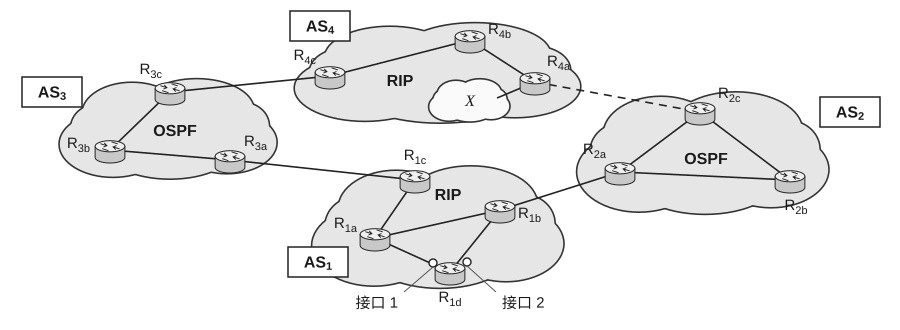

路由器 $R_{3c}$、 $R_{3a}$、 $R_{1c}$、 $R_{1d}$ 分别使用（）协议知道网络前缀 X ($X$ 在 $\text{AS}_4$ 中)。

(A) eBGP、OSPF、eBGP、RIP 

(B) iBGP、eBGP、iBGP、eBGP

(C) eBGP、iBGP、eBGP、iBGP 

(D) RIP、iBGP、OSPF、iBGP

39. 网络拓扑结构同第 38 题。路由器 $R_{1d}$ 知道前缀 X，并将前缀 X 写入转发表。试问路由器 $R_{1d}$ 应从（）转发分组。现在假定 $\text{AS}_2$ 和 $\text{AS}_4$ 之间有物理连接，即图中的虚线变成了实线。假定路由器 $R_{1d}$ 知道到达前缀 X 可经过 $\text{AS}_2$，但也可经过 $\text{AS}_3$，问路由器 $R_{1d}$ 应从（）转发分组。

(A) 接口 1, 接口 1 

(B) 接口 1, 接口 2 

(C) 接口 2, 接口 1 

(D) 接口 2, 接口 2

40. 网络拓扑结构同第 38 题，问 RIP、OSPF、eBGP、iBGP 分别使用（）协议进行传输。

(A) IP、UDP、TCP、TCP 

(B) UDP、IP、TCP、UDP

(C) UDP、TCP、IP、TCP 

(D) UDP、IP、TCP、TCP

## 二、 综合应用题：第 41-47 题，共 70 分。

41.（11 分）设记录的关键字（key）集合为 $K = \{24, 15, 39, 26, 18, 31, 05, 22\}$，回答下列问题。

1）依次取 $K$ 中的各个值，构造一棵排序二叉树（不要求平衡），并写出该树的前序、中序和后序遍历序列。

2）散列表的表长为 $m = 16$，散列函数为 $H(\text{key}) = (\text{key}) \bmod 13$，处理冲突的方法为二次探测法，依次取 $K$ 中的各个值，构造出满足所给条件的散列表；求出等概率条件下查找成功时的平均查找长度。

3）将集合 $K$ 视为一个未调整的堆，画出 $K$ 调整成大根堆后的形状。

42. (14 分) 已知一个长度为 $n$ ($n > 1$) 的单链表，其表头指针为 L，结点结构由 data 和 next 两个域构成，其中 data 域为字符型。试设计一个在时间和空间上都尽可能高效的算法，判断该单链表是否是中心对称的（如 xyx、xxyyx 都是中心对称的），要求：

1）给出算法的基本设计思想。

2）根据设计思想，采用 C 或 C++ 或 Java 语言描述算法，关键之处给出注释。

3）说明你所设计算法的时间复杂度和空间复杂度。

<!-- 第 80 页 -->

43. 某 32 位计算机系统采用 5 级流水线（IF/ID/EX/MEM/WB），指令字长为 32 位。系统特性如下：指令存储器与数据存储器分离；beq 指令在 EX 阶段生成新的 PC；mul 指令在 EX 阶段需连续占用 2 个时钟周期；指令集包含 add、sub、mul（R 型）、lw、sw（I 型）和 beq（条件分支）指令，其中 beq 采用 PC 相对寻址，offset 以指令字（4B）为单位，立即数 imm 为 16 位并经符号扩展至 32 位。寄存器约定：R1 用于存储累加和 sum，R2 用于存储循环变量 i，R3 存储数组 A 的首地址，R6 存储数组长度 N，R5 和 R7 为临时寄存器。数组 A 的元素为 32 位整型，程序段起始地址为 0x00401000。程序段的机器级代码如下：

| 序号 | 地址 | 汇编指令 | 注释 |
| :---: | :--- | :--- | :--- |
| 1 | 0x00401000 | loop: sll R7,R2,2 | R7=i\*4 |
| 2 | 0x00401004 | add R7,R7,R3 | R7=A+i\*4 |
| 3 | 0x00401008 | lw R5,0(R7) | R5=A[i] |
| 4 | 0x0040100C | mul R5,R5,R5 | R5=A[i]*A[i] |
| 5 | 0x00401010 | add R1,R1,R5 | sum+=R5 |
| 6 | 0x00401014 | add R2,R2,1 | i++ |
| 7 | 0x00401018 | beq R2,R6,exit | if(i==N) exit |
| 8 | 0x0040101C | beq R0,R0,loop | 无条件跳回 |
| 9 | 0x00401020 | exit: sw R1,0(R3) | Mem[A]=sum |

对应的 C 语言代码片段为：

```c
for(i=0; i<N; i++) {
    sum += A[i] * A[i];
}
Mem[A]=sum; // 将 sum 写回到 Mem[A]
```

分支目标地址计算公式为：$\text{Target} = (PC + 4) + \text{offset} \times 4$（PC 为 beq 指令地址）。请回答下列问题：

1）系统的编址单位是什么？数组 A 的每个元素占多少位？说明理由。

2）计算指令 7（beq R2, R6, exit）和指令 8（beq R0, R0, loop）的 offset。

3）假设系统无任何冒险处理硬件（无数据转发、无指令暂停、无分支预测、无延迟槽），仅允许插入 nop 指令。“数据相关”定义为：某指令需要使用的寄存器值来自前面尚未完成写回的指令。已知以下 3 个数据相关：

指令 1 写 R7 $\rightarrow$ 指令 2 读 R7；指令 2 写 R7 $\rightarrow$ 指令 3 读 R7；指令 3 写 R5 $\rightarrow$ 指令 4 读 R5。请写出其余所有数据相关。指出哪些指令引发控制冒险，并说明原因。在不改变指令顺序的前提下，为保证正确执行，指令 3 与指令 4 之间至少插入几条 nop？指令 4 与指令 5 之间至少插入几条 nop？

4）现增加以下硬件支持：EX/MEM$\rightarrow$EX 和 MEM/WB$\rightarrow$EX 数据转发，sw 写数据可转发到 MEM 阶段；当出现“load 后紧跟使用”时，流水线需要额外等待 1 个时钟周期；分支在 EX 阶段生成新 PC，若发生跳转，则作废已取入的后续指令并重新取指。回答：

① 指令 3 到指令 4 之间是否需要额外等待？若需要，等待几个周期？

② 由于 mul 的 EX 阶段需连续占用 2 个时钟周期，在一次迭代中，指令 4 执行 mul 时，会使其后的哪条指令在进入 EX 前必须等待？该等待会额外增加几个时钟周期？说明原因。

③ “一次循环”指 for 循环体执行 1 次（指令 1~8 各执行一次）。在流水线进入稳定状态后（忽略程序开始的填充与结束的排空），估算“每执行一次循环体（1~8）平均需要的时钟周期数”。已知：每次分支跳转额外消耗 2 个时钟周期（作废已取入的指令并重新取指），不考虑指令 7 最后一次转移的开销。

<!-- 第 81 页 -->

44. （12分）在某高级语言程序中编译语句 `while(save[i]==k) i+=1；` 时，编译器将变量 i 和 k 分别分配到寄存器 s3 和 s5 中，数组 save 的基地址存放在寄存器 s6 中，生成的汇编代码如下：

```text
1  loop: sll t1, s3, 2    R[t1]=R[s3]<<2, 即 $i \times 4$
2        add t1, t1, s6   R[t1]=R[t1]+R[s6], 即 save[i] 地址
3        lw t0, 0(t1)     R[t0]=M[R[t1]+0], 即 save[i]
4        bne t0, s5, exit R[t0] \neq R[s5] 则转 exit
5        add s3, s3, 1    R[s3]=R[s3]+1, 即 i=i+1
6        j loop           转到 loop
7  exit:
```

假定五段式指令流水线数据通路中各主要功能单元的操作时间如下：存储器操作 200ps，ALU 和加法器 100ps，寄存器堆（读或写）50ps。回答如下问题。

1）在不考虑流水段寄存器、多路选择器、控制单元、PC、扩展器和线路等延迟的情况下，五段式指令流水线处理器的最小时钟周期为多少?

2）指出循环体中指令之间的数据相关性。

3）假定采用 “转发” 技术，那么可以消除哪些数据相关？对于不能消除的数据相关，需要额外多少个时钟周期的阻塞？

4）在 3）的条件下，当流水线稳定时，在该流水线处理器上执行 8 次循环所用的时间为多少纳秒？（已知程序在 8 次循环执行中因为分支冒险而引起的阻塞共有 11 个时钟周期。）

45. （7分）某计算机系统采用页式虚拟存储管理方式，按字节编址，采用 LRU 算法和局部置换策略，地址变换时先访问 TLB，若 TLB 未命中，再访问页表，TLB 初始为空，能存放两个页表项。假设访问一次内存的时间是 $A$ 纳秒，访问一次 TLB 的时间是 $B$ 纳秒，处理一次缺页的平均时间为 $C$ 纳秒（含更新页表和 TLB 的时间），逻辑地址为 20 位，物理地址也为 20 位，进程最多允许包含 256 个逻辑页，回答下列问题。

1）每个物理页面的大小是多少字节？

2）系统固定为某个进程分配两个物理页面，初始时所有页均未进入内存。首先，依次访问逻辑地址 `00324H` 和 `01367H`，系统分别为其分配物理页面 9 和 6，并将相应的页表信息写入 TLB。接下来要访问的逻辑地址序列为 `02C76H`、`01A56H`、`03B33H`、`04478H`。计算在这四次访问中的缺页次数，并指出发生缺页的逻辑地址。

3）分别给出逻辑地址 `02C76H`、`01A56H`、`03B33H`、`04478H` 对应的物理地址。

4）计算访问逻辑地址 `01367H` 和 `01A56H` 所需的时间。

46. （7分）一个文件系统中有一个 20MB 的大文件和一个 20KB 的小文件，当分别采用连续分配、隐式链接分配方案时，每块的大小为 4096B，每块地址用 4B 表示，请问：

1）采用链接分配时，该文件系统所能管理的最大文件是多大？

2）为了能够知道大、小两个文件的物理地址，在连续分配和链接分配的情况下，操作系统需要在其文件 FCB 中分别设置哪几个字段？

3）若需要读大文件前面第 5.5KB 的信息和后面第 $(16\text{MB}+5.5\text{KB})$ 的信息，则两种分配方案各需要多少次磁盘 I/O 操作？假设文件 FCB 已读入内存。

<!-- 第 82 页 -->

47. （9分）某主机 A 的浏览器使用 HTTP 从 Web 服务器 B 下载一个大小为 10MB 的文件。下表以表格形式给出了 A 和 B 之间通信开始后传输的 TCP 报文段信息，每行对应一个报文段，报文段按传输时间的先后顺序编号为 S1 ~ S14。“数据长度”栏表示报文段所搭载的应用数据长度，表格中的数值均为十进制数，标注为“X”表示该字段值未知。已知 A 和 B 之间建立 TCP 连接时通过选项字段协商确定的最大报文段长度 MSS=1000 字节，双方均按慢开始和拥塞避免算法进行传输，慢开始门限值 ssthresh 初始均为 4MSS，传输过程中没有报文段超时。

| 编号 | 方向 | 序号 | 确认号 | ACK | SYN | 窗口 | 数据长度 |
| :---: | :---: | :---: | :---: | :---: | :---: | :---: | :---: |
| S1 | $\rightarrow$ | 0 | 0 | X | X | 6500 | 0 |
| S2 | $\leftarrow$ | 0 | 1 | X | X | 16384 | 0 |
| S3 | $\rightarrow$ | 1 | 1 | X | X | 6500 | 0 |
| S4 | $\rightarrow$ | 1 | 1 | 1 | 0 | 6500 | 381 |
| S5 | $\leftarrow$ | 1 | 382 | 1 | 0 | 16384 | 1000 |
| S6 | $\rightarrow$ | 382 | 1001 | 1 | 0 | 5500 | 0 |
| S7 | $\leftarrow$ | 1001 | 382 | 1 | 0 | 16384 | 1000 |
| S8 | $\leftarrow$ | 2001 | 382 | 1 | 0 | 16384 | X |
| S9 | $\rightarrow$ | 382 | 3001 | 1 | 0 | 3500 | 0 |
| S10 | $\leftarrow$ | 3001 | 382 | 1 | 0 | 16384 | 1000 |
| S11 | $\leftarrow$ | 4001 | 382 | 1 | 0 | 16384 | 1000 |
| S12 | $\leftarrow$ | 5001 | 382 | 1 | 0 | 16384 | 1000 |
| S13 | $\leftarrow$ | 6001 | 382 | 1 | 0 | 16384 | X |
| S14 | $\rightarrow$ | 382 | X | 1 | 0 | 6000 | 0 |

1）已知报文段 S1、S2、S3 是 A 和 B 之间建立 TCP 连接的报文段，分别给出这 3 个报文段中 SYN 和 ACK 两个字段的值。

2）报文段 S4 中搭载的 HTTP 报文头部中的方法或命令是什么？

3）给出报文段 S8 和 S13 中搭载的数据长度和报文段 S14 中的“确认号”字段值。

4）假设 B 在收到报文段 S14 后，直到收到 A 的下一个确认前，最多可向 A 发送 $n$ 字节的应用数据。如果 B 在报文段 S14 之后仍然采用慢开始机制，$n$ 的值是多少？如果 B 在报文段 S14 之后改用拥塞避免机制，$n$ 的值是多少？
