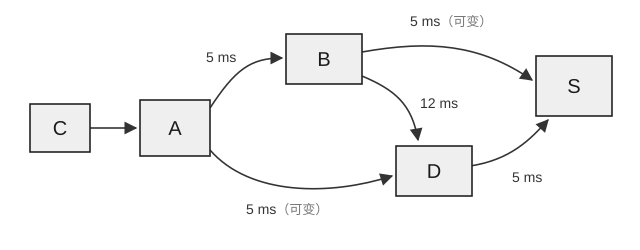

32. 信息在外存空间中的排列也会影响存取等待时间。考虑几条逻辑记录 A、B、C、…、J，它们被存放于磁盘上，每个磁道存放 10 条记录，安排如表 1 所示。

表1 每个磁道存放 10 条记录

| 物理块 | 1 | 2 | 3 | 4 | 5 | 6 | 7 | 8 | 9 | 10 |
| :---: | :---: | :---: | :---: | :---: | :---: | :---: | :---: | :---: | :---: | :---: |
| 逻辑记录 | A | B | C | D | E | F | G | H | I | J |

假定要经常顺序处理这些记录，磁道旋转用时为 $20\text{ ms/转}$，处理程序读出每条记录后花 $4\text{ ms}$ 进行处理。考虑对信息的分布进行优化，如表 2 所示。相比之前的信息分布，优化后的时间缩短了（ ）。

表2 优化后磁道存放的 10 条记录

| 物理块 | 1 | 2 | 3 | 4 | 5 | 6 | 7 | 8 | 9 | 10 |
| :---: | :---: | :---: | :---: | :---: | :---: | :---: | :---: | :---: | :---: | :---: |
| 逻辑记录 | A | H | E | B | I | F | C | J | G | D |

(A) 60 ms 
(B) 104 ms 
(C) 144 ms 
(D) 204 ms

33. 如下图所示，网络采用数据报交换方式，每个数据报在到达路由器时均根据“该路由器到目的主机的当前最小路径时延”进行独立路由选择（当存在多条路径的时延相等时，优先选择经过路由器 B 的路径）。忽略路由器处理时延及主机 C 到路由器 A 的传输时延。

主机 C 在时刻 $t = 0, 1, 2\text{ ms}$ 依次向目的主机 S 发送三个等长数据报 P1、P2、P3。已知链路 A→D 的时延在 $t \in [2, 6]\text{ ms}$ 期间由 $5\text{ ms}$ 变为 $4\text{ ms}$，链路 B→S 的时延在 $t \in [4, 8]\text{ ms}$ 期间由 $5\text{ ms}$ 变为 $30\text{ ms}$，其余各条链路时延保持恒定。则 S 接收到这三个数据报的先后顺序是（ ）。

(A) P1、P2、P3 
(B) P1、P3、P2 
(C) P3、P1、P2 
(D) P2、P3、P1

34. 某信道的长度为 $1\text{ km}$，信道带宽为 $160\text{ MHz}$，信号功率为 $0.6\text{ W}$，噪声功率为 $0.0193\text{ W}$，信号在该信道中的传播速率为 $200000\text{ km/s}$。在该信道中，主机 A 向 B 连续传输一个 $6000\text{ bit}$ 的文件，则该链路上的比特数量的最大值是（ ）。

(A) 500 bit 
(B) 512 bit 
(C) 1024 bit 
(D) 4000 bit

35. 数据链路层采用 SR 协议传输数据，使用 $4\text{ bit}$ 给帧编号，接收窗口的尺寸取值为 5，发送窗口的尺寸取最大值，发送窗口内的起始序号为 0，数据帧的初始序号为 0。假设发送方已发送了 0~6 号数据帧，现已收到 1、3、5 号帧的确认，而 0、2、4 号数据帧依次超时，则此时发送方最多能发送的数据帧数量为（ ）。

(A) 8 
(B) 7 
(C) 5 
(D) 4
