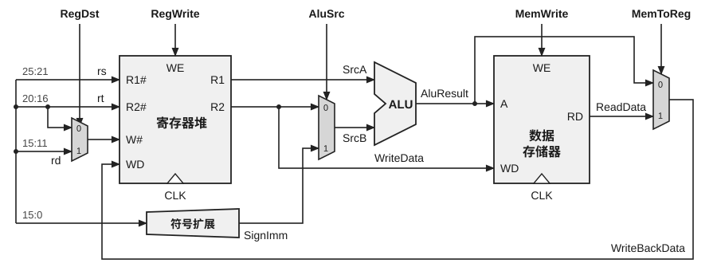

44. （12分）下图所示为单周期数据通路（一个时钟周期内完成一条指令），支持顺序取指，可执行 R 型运算指令及 lw/sw 访存指令。假设不考虑异常与冒险情况。

图中关键控制信号定义如下：

RegDst：选择写回目的寄存器为 rt (0) 或 rd (1)。

RegWrite：控制寄存器堆是否允许写回（1 允许，0 禁止）。

AluSrc：选择 ALU 第二操作数为 R[rt]（0）或符号扩展立即数 SignExtend(imm)（1）。

MemWrite：控制数据存储器是否执行写入（1 写入，0 禁止）。

MemToReg：选择写回数据源为内存读出数据（1）或 ALU 结果（0）。

该数据通路基于一种简化的指令集，仅包含两类指令：

① R 型指令：op(6)=000000 | rs(5) | rt(5) | rd(5) | shamt(5)=00000 | funct(6)；语义为 $R[rd] \leftarrow f(R[rs], R[rt])$。

② I 型指令：op(6) | rs(5) | rt(5) | imm(16)；lw 语义为 $R[rt] \leftarrow \text{Mem}[R[rs] + \text{SignExtend}(imm)]$，sw 语义为 $\text{Mem}[R[rs] + \text{SignExtend}(imm)] \leftarrow R[rt]$。

其中，rs/rt/rd 为 5 位寄存器编号（0 ~ 31），imm 为 16 位立即数，SignExtend(imm) 表示符号扩展至 32 位。寄存器堆的读操作为组合逻辑、写操作在时钟上升沿完成。ALU 功能说明：R 型指令由 funct 字段决定具体运算；lw/sw 指令中 ALU 固定执行加法用于地址计算。

请回答下列问题：

（1）在该单周期数据通路中，是否可以增加指令寄存器 IR？说明理由。

（2）对 R 型、lw、sw 三类指令，判断是否写寄存器堆/写数据存储器：给出 RegWrite、MemWrite 的取值（0 或 1）。

（3）对三类指令，分别确定：写回目的寄存器（rd/rt/无写回），并给出 RegDst 取值（0/1 或无关）；写回数据来源（ALU/Mem/无写回），并给出 MemToReg 取值（0/1 或无关）。

（4）对三类指令，分别确定 ALU 第二操作数选择：给出 AluSrc 取值 (0/1)，并说明 ALU 两个输入源（如 R[rs]、R[rt]、SignExtend(imm)）。

（5）若增加 addi 指令：$R[rt] \leftarrow R[rs] + \text{SignExtend}(imm)$，请给出上述 5 个控制信号的设置值及理由。

45. （8分）假设有两个生产者进程 A、B 和一个销售者进程 C，它们共享一个无限大的仓库。生产者每次循环生产一件产品，然后入库供销售者销售，销售者每次循环从仓库取出一件产品进行销售。如果不允许同时入库，也不允许边入库边出库，而且要求生产产品 A 和 B 的件数关系满足：$-n \leqslant \text{A 的件数} - \text{B 的件数} \leqslant m$，其中 $n, m$ 是正整数，但对仓库中产品 A 和 B 的件数无上述要求。用信号量机制写出 A、B、C 三个进程的工作流程。
