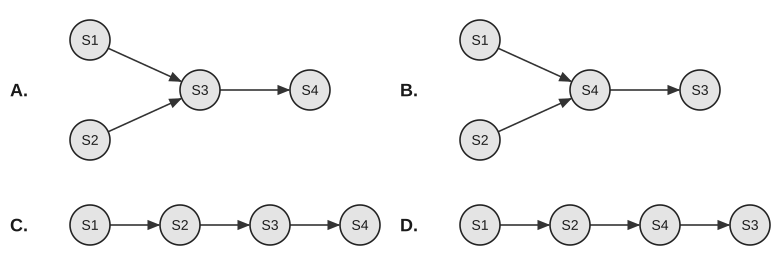

27. 某系统采用两级队列调度算法，其调度机制如下：第一级队列 $Q_1$ 采用时间片轮转调度算法，时间片大小为 $5\text{ ms}$；第二级队列 $Q_2$ 采用先来先服务调度算法。调度规则为：系统优先调度 $Q_1$ 中的进程，仅当 $Q_1$ 为空时才调度 $Q_2$；新创建的进程首先进入 $Q_1$；若进程在 $Q_1$ 中执行完一个时间片后仍未完成，则将其移至 $Q_2$。在调度 $Q_2$ 期间，若有新进程进入 $Q_1$，则立即中断 $Q_2$ 的调度，转而调度 $Q_1$。系统初始时 $Q_1$ 和 $Q_2$ 均为空。在 $t=0$ 时刻创建进程 $P_1$ 和 $P_2$，所需 CPU 时间分别为 $10\text{ ms}$ 和 $5\text{ ms}$；在 $t=6\text{ ms}$ 时刻创建进程 $P_3$，所需 CPU 时间为 $5\text{ ms}$。这三个进程的平均等待时间约为（ ）。

(A) $4\text{ ms}$ &nbsp;&nbsp;&nbsp;&nbsp; (B) $6\text{ ms}$ &nbsp;&nbsp;&nbsp;&nbsp; (C) $8\text{ ms}$ &nbsp;&nbsp;&nbsp;&nbsp; (D) $10\text{ ms}$

28. 对于下面的四条语句，（ ）是对应的前驱图。

```c
S1: a=x+y;
S2: b=z+1;
S3: c=a-b;
S4: w=c+1;
```



29. 如下程序在页式虚存系统中执行，程序代码位于虚空间 0 页中，$A$ 为 $128 \times 128$ 的数组，在虚空间以行为主序存放，每页存放 128 个数组元素。工作集大小为 2 个页框（开始时程序代码已在内存中，占 1 个页框），用 LRU 算法，下面两个对 $A$ 初始化的程序引起的页故障数约为（ ）。

程序1：

```c
for (j=1;j<=128;j++)
  for (i=1;i<=128;i++)
    A[i][j]=0;
```

程序2：

```c
for (i=1;i<=128;i++)
  for (j=1;j<=128;j++)
    A[i][j]=0;
```

(A) $128 \times 128$, 128 &nbsp;&nbsp;&nbsp;&nbsp; (B) $128, 128 \times 128$ &nbsp;&nbsp;&nbsp;&nbsp; (C) $64, 64 \times 64$ &nbsp;&nbsp;&nbsp;&nbsp; (D) $64 \times 64$, 64

30. 文件共享可以基于索引节点，也可以基于符号链。在下列关于这两种文件共享方式的说法中，正确的是（ ）。

(A) 采用索引节点的文件共享方式，文件增加的部分不能被共享

(B) 在索引节点中，设置有链接计数值 `count`，表示本索引节点被打开的次数

(C) 符号链接能够用于链接世界上任何地方的计算机中的文件，只需提供该文件所在机器的网络地址以及该机器中的文件路径即可

(D) 采用符号链接时，所有共享该文件的用户都拥有指向其索引节点的指针

31. 在下列 I/O 方式中，会导致用户进程进入阻塞态的是（ ）。

I. 程序直接控制 &nbsp;&nbsp;&nbsp;&nbsp; II. 中断控制方式 &nbsp;&nbsp;&nbsp;&nbsp; III. DMA 控制方式

(A) I、II &nbsp;&nbsp;&nbsp;&nbsp; (B) I、III &nbsp;&nbsp;&nbsp;&nbsp; (C) II、III &nbsp;&nbsp;&nbsp;&nbsp; (D) I、II、III
