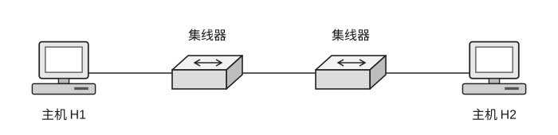

32. 下列关于磁盘高速缓存的说法中，错误的是（ ）。

(A) 磁盘高速缓存是指在内存中设置的一个缓冲区，用于保存某些盘块的副本

(B) 当出现访问磁盘的请求时，先查看磁盘高速缓存，如果盘块内容已在磁盘高速缓存中，就省去了启动磁盘的操作

(C) 设计磁盘高速缓存时，需考虑如何将磁盘高速缓存中的数据传输给请求进程

(D) 设计磁盘高速缓存时，需考虑采用什么样的置换策略以及已修改的盘块数据何时写回磁盘

33. 在某分组交换网中，各设备的发送速率相同，通信两端要经过 2 段链路。设报文长度为 $0.2\text{ MB}$，分组的首部长度为 $20\text{ B}$，传播时延和节点排队时间均可忽略不计；假设各设备的发送速率为 $s$，分组的数据载荷长度为 $x$，分组数量恰好为整数个，为使总时延最小，分组的数据载荷长度应约为（ ）。

(A) 1024B \quad (B) 2048B \quad (C) 3072B \quad (D) 4096B

34. 在下列关于香农定理和信噪比的说法中，正确的是（ ）。

(A) 在实际的传输环境中，信噪比是可以做到任意大的

(B) 对于一定的信噪比，码元的传输率越小就越容易出现接收时的判决错误

(C) 如果减小信噪比，那么码元的传输率就可以提高而不至于使判决错误的概率增大

(D) 香农公式的意义在于，只要信息传输率低于信道的极限信息传输率，就一定可以找到某种办法来实现无差错的传输

35. 主机 A、B 之间建立了一条 TCP 连接，发送窗口的大小是 3，序号范围是 $[0, 15]$，传输媒介保证在接收方能够按序收到分组。在某个时刻，接收方期望收到的下一个序号是 5，则发送窗口可能出现的序号组合有（ ）个。

(A) 2 \quad (B) 3 \quad (C) 4 \quad (D) 5

36. 如右图所示，主机 H1 通过 CSMA/CD 协议与主机 H2 进行通信，主机 H1 向主机 H2 发送 ARP 请求帧，数据帧的大小为 64B（最小帧长），且不考虑以太网帧的前导码，信道的数据传输速率为 $100\text{ Mb/s}$，信号传播速率为 $200\text{ m}/\mu\text{s}$，数据帧通过每个集线器时有 $0.48\ \mu\text{s}$ 的延迟，则主机 H1 和主机 H2 理论上的最远距离为（ ）。

(A) 512m \quad (B) 256m \quad (C) 416m \quad (D) 320m

37. 若将某个 “/17” 地址块划分为 9（不多也不少）个子块，则可能的最小子块中所包含的 IP 地址数量为（ ）。

(A) 126 \quad (B) 128 \quad (C) 2046 \quad (D) 2048
