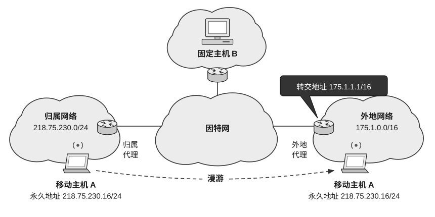

38. 右图给出了一个移动 IP 的示例，移动主机 A 的归属网络地址、外地网络地址、永久地址以及漫游到外地网络后从外地代理获得的一个属于该外地网络的转交地址都已在图中标注。假设图中的固定主机 B 要给处于外地网络的主机 A 发送一个 IP 数据报，则该 IP 数据报从主机 B 发送出来时的目的 IP 地址和从配置有归属代理的路由器转发出来时的目的 IP 地址分别是（ ）。

(A) 218.75.230.16, 175.1.1.1

(B) 175.1.1.1, 218.75.230.16

(C) 218.75.230.16, 0.0.0.0

(D) 255.255.255.255, 218.75.230.16

39. 在以下关于 IPv4 向 IPv6 过渡技术的叙述中，错误的是（ ）。

(A) 双协议栈方案是指在 IPv4 网络中将 IPv6 数据报封装后传输

(B) 双协议栈方案是指一个结点同时运行 IPv4 与 IPv6 两套协议栈

(C) 两台使用 IPv6 协议的主机通过 IPv4 网络通信时可采用隧道技术

(D) 隧道配置可分为路由器—路由器、主机—主机、主机—路由器或路由器—主机

40. 不考虑接收双方的容量限制，在下列关于 TCP 报文段的长度的理解中，正确的是（ ）。

(A) TCP 报文段的总长度有最小值，没有最大值

(B) TCP 报文段的总长度最小可以是零，最大值没有上限

(C) TCP 报文段的总长度最小不能是零，最大不能超过 65515B

(D) TCP 报文段的总长度最小可以是零，最大不能超过 65515B
