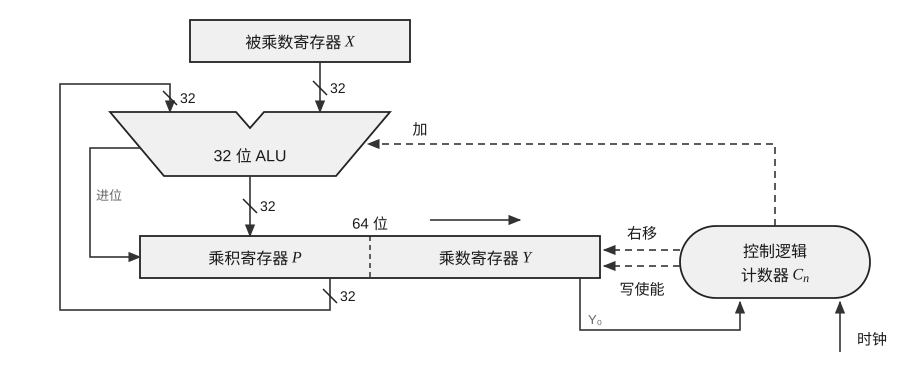

13. 下图所示为一个采用“移位+条件加法”实现的 32 位无符号整数乘法器。关于该结构的工作过程以及 32 位无符号乘法的溢出判定，下列说法中正确的是（ ）。

(A) 若乘数寄存器 $Y$ 的最高位为 1，则乘积寄存器 $P$ 初始化为 32 位全 1

(B) 一次乘法运算过程中，ALU 一定会执行 32 次加法

(C) 运算结束后，若乘积寄存器 $P$（高 32 位）不全为 0，则说明本次乘法发生溢出

(D) 运算结束后，若乘数寄存器 $Y$ 不全为 0，则说明本次乘法发生溢出

14. 某导弹系统有一个内置时钟，用计数器实现，每隔 0.1s 计数一次。0.1 的二进制数是一个无限循环序列：$0.00011[0011]\cdots$（方括号中的序列是无限循环的）。假定系统用一个 float 型变量 $x$ 表示 0.1，尾数采用就近舍入方式，则变量 $x$ 在机器中的表示是（ ）。

(A) 3DCC CCCCH 
(B) 3DCC CCCDH 
(C) 3BCC CCCCH 
(D) 3BCC CCDDH

15. 现代计算机通常采用以存储器为中心的工作方式来提高系统性能，在下列 I/O 控制方式中，（ ）可以实现以存储器为中心的工作方式。

(A) 中断方式 
(B) 程序查询方式 
(C) DMA 方式 
(D) 无条件查询方式

16. 下列关于磁盘术语的说法中，错误的是（ ）。

(A) 沿磁道方向单位长度记录的二进制信息位称为位密度，可以采用固定位置密度方式，这样磁盘不同柱面的磁道上存储的信息量是不一样的

(B) 沿磁盘半径方向单位长度的磁道数称为道密度，道密度是相邻磁道间距的倒数

(C) 传输一个扇区数据的时间只取决于扇区大小和磁盘所允许的最大转速

(D) 磁盘控制器是指用来控制磁盘/写以及控制磁盘和主存之间传输数据的部件

17. 某计算机的主存地址位数为 32 位，按字节编址。L1 data Cache 和 L1 code Cache 采用 8 路组相联方式，主存块大小为 64B，采用回写（Write Back）方式和随机替换策略。两种 Cache 的数据区都是 32KB，L1 Cache 总容量至少有（ ）。

(A) 530K 位 
(B) 531K 位 
(C) 533K 位 
(D) 534K 位
