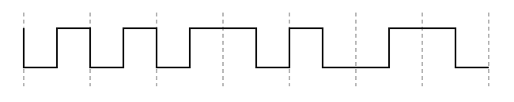

29. 在请求分页系统中，因为进程在运行时经常发生页面换入换出的情况，所以一个明显的事实是，页面换入换出所付出的开销将对系统性能产生重大影响，于是就有了相应的页面缓冲算法，其核心思想是在内存中设置相应的链表缓冲区。在下列有关页面缓冲算法的说法中，错误的是（）。

(A) 显著地降低了页面换入换出的频率，使磁盘 I/O 次数大为减少

(B) 因为页面缓冲算法使得换入换出的开销大幅减小，所以能让系统采用一种比较简单的置换策略，如先进先出算法

(C) 系统可以设置空闲页面链表并修改页面链表，这两个链表都设置在外存中

(D) 空闲页面链表是系统掌握的空闲物理块，修改页面链表是由已修改页面形成的链表

30. 在下列选项中，属于符号链接和硬链接实现文件共享时所共有的问题的是（）。

(A) 每次访问共享文件的开销很大

(B) 有可能出现空指针异常导致文件访问错误

(C) 要将一个目录中的所有文件都转储到磁带上时，可能对一个共享文件产生多份副本

(D) 以上说法均正确

31. 在以下关于 I/O 子系统的描述中，错误的是（）。

(A) I/O 子系统由 I/O 软件和 I/O 硬件两大部分组成

(B) I/O 软件分为用户空间的 I/O 软件和内核空间的 I/O 软件

(C) 内核空间的 I/O 软件包括设备无关软件、设备驱动程序和中断服务程序

(D) 直接控制 I/O 硬件设备的是中断服务程序，而非设备驱动程序

32. 提前读和延迟写是有效提高磁盘 I/O 速度的两种方法。在下列关于提前读和延迟写的说法中，错误的是（）。

(A) 若用户对文件进行访问时采用的是随机访问方式，则不存在提前读

(B) 提前读是通过减少磁盘 I/O 次数来等价地提高磁盘 I/O 速度的

(C) 若用户对文件进行写操作时采用的是随机访问方式，则不存在延迟写

(D) 延迟写是通过在内存中设置一个空闲缓冲区队列来实现的

33. 假定从站点 A 发送一个很短的分组到站点 B，站点 B 收到后立即发送很短的应答分组给站点 A（双方的发送时延均可忽略不计），站点 A 测量出往返时间 RTT，则（）。

(A) 该 RTT 的值就是站点 A 和站点 B 之间的传输介质的往返传播时延

(B) 该 RTT 的值有可能小于站点 A 和站点 B 之间的传输介质的往返传播时延

(C) 该 RTT 的值一定大于站点 A 和站点 B 之间的传输介质的往返传播时延

(D) 该 RTT 的值大于或等于站点 A 和站点 B 之间的传输介质的往返传播时延

34. 右图为一段差分曼彻斯特编码的信号波形，其编码的比特流是（）。

(A) 0001 101

(B) 0001 011

(C) 1011 110

(D) 1001 110
