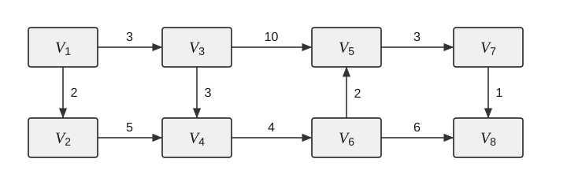

二、综合应用题：第 41—47 题，共 70 分。

41. （10分）如右图所示，请回答下列问题：

1）写出该图的邻接矩阵。

2）写出全部拓扑序列。

3）以 $V_1$ 为源点，以 $V_8$ 为终点，给出所有事件（和活动）允许发生的最早时间和最晚时间，并给出关键路径。

4）求 $V_1$ 到各点的最短路径和距离。

42. （13分）给定一个由正整数组成的数组 `nums` 和一个整数 $k$，计算并返回所有满足“子数组内元素乘积严格小于 $k$”的连续子数组的总数。

示例 1：输入：`nums=[10,5,2,6]`，$k=100$；输出：8。

解释：满足条件的 8 个子数组分别为 $[10]$、$[5]$、$[2]$、$[6]$、$[10,5]$、$[5,2]$、$[2,6]$、$[5,2,6]$。注意，$[10,5,2]$ 的乘积为 100，不满足严格小于的条件。

示例 2：输入：`nums=[1,2,3]`，$k=0$；输出：0。

解释：由于数组元素均为正整数，任何非空子数组的乘积至少为 1，不可能小于 0。

回答下列问题：

1）给出解决该问题的算法设计思想。

2）根据设计思想，采用 C 或 C++ 语言描述算法，关键之处给出注释。

3）分析所设计算法的时间复杂度和空间复杂度。

43. （12分）某计算机的主存地址空间大小为 64KB，按字节编址，Cache 采用 4 路组相联映射、LRU 替换算法和写回（write back）策略，数据 Cache 的大小为 4KB，主存与 Cache 之间交换的主存块大小为 64B。回答下列问题：

1）主存地址字段如何划分？要求说明每个字段的含义、位数及在主存地址中的位置。

2）Cache 的总容量有多少位？

3）若 Cache 初始为空，CPU 依次顺序从地址 0 号单元访问到 4344 号单元，共重复访问 16 次。Cache 存取时间为 20ns，主存存取时间为 200ns，试计算 CPU 的平均访存时间。

44. （11分）某计算机的中断系统有 5 个中断源，分别记为 1、2、3、4、5，各中断源的中断响应优先级为 $1 > 2 > 3 > 4 > 5$，中断处理优先级为 $1 > 4 > 5 > 2 > 3$。请回答下列问题：

1）设计各级中断服务程序的中断屏蔽字（假设 1 为屏蔽，0 为开放）。

2）若在运行用户程序时，中断源 2 和 4 同时发出中断请求，而在处理中断源 2 的过程中，中断源 1、3 和 5 同时发出中断请求，试说明此时 CPU 运行的具体情况，即响应和处理各个中断源的顺序。
