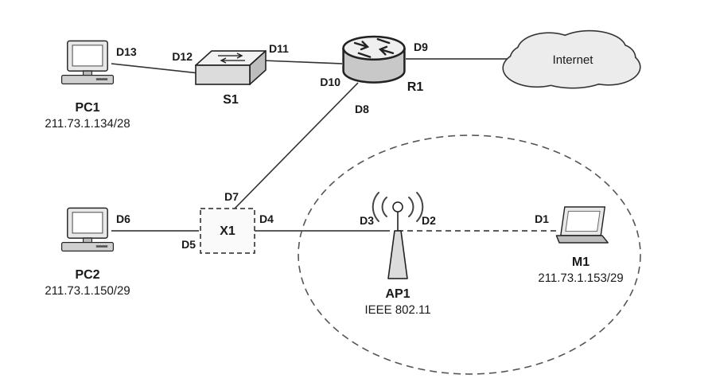

45.（7分）一名主修动物行为学、辅修计算机科学的学生参加了一个课题，调查花果山的猴子是否能够理解死锁概念。他找到一个峡谷，横跨峡谷拉了一根绳索（假设为南北方向），这样猴子就可攀着绳索越过峡谷。只要它们朝着相同的方向，同一时刻就可有多只猴子通过。然而，若在相反的方向上同时有猴子通过，则会发生死锁（这些猴子将卡在绳索中间，假设这些猴子无法在绳索上从另一只猴子身上翻过去）。如果一只猴子想越过峡谷，就必须看当前是否有其他猴子正在逆向通过。请用 P、V 操作来解决该问题。

46.（8分）某磁盘上的文件系统采用混合索引分配方式，文件 FCB 中共有 13 个地址项，第 0~9 个地址项为直接地址，第 10 个地址项为一次间接地址，第 11 个地址项为二次间接地址，第 12 个地址项为三次间接地址。每个盘块的大小为 512B，盘块号需要用 3B 来描述，而每个盘块最多存放 170 个盘块地址。请回答下列问题：

1）该文件系统支持的最大文件长度是多少？

2）如何将文件的字节偏移量 5000、15000、150000 转换为物理块号和块内偏移量？

3）假设某个文件的 FCB 已在内存中，但其他信息均在外存中，为了访问该文件中某个位置的内容，最少需要访问几次磁盘？最多需要访问几次磁盘？

47.（9分）下图是一个网络拓扑图，根据该图回答下列问题。

1）设备 X1 是交换机还是路由器？

2）M1 向 PC2 发送数据，PC2 收到的数据帧中的源 MAC 地址是什么？PC2 向 M1 返回数据，M1 收到的数据帧中的地址 3 是什么？

3）通常把子网内地址中的第一个 IP 地址分配给默认网关，则 PC1 所在子网的默认网关是哪个？该子网还有多少个空闲的 IP 地址可供分配？给出分析过程。

4）路由表的结构如下，请给出 R1 的路由表，要求尽可能采用路由聚合以减少表项数。

| 目的网络 | 子网掩码（点分十进制数表示） | 接口 |
| :--- | :--- | :--- |
| | | |
