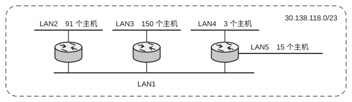

38. 一个自治系统分配到的 IP 地址块为 30.138.118.0/23，包括 5 个局域网，每个局域网的主机数量如下图所示，则在关于该自治系统的两种地址分配方案的说法中，正确的是（）。

| | 第一组分配方案 | 第二组分配方案 |
| :---: | :---: | :---: |
| LAN1 | 30.138.119.192/29 | 30.138.118.192/27 |
| LAN2 | 30.138.119.0/25 | 30.138.118.0/25 |
| LAN3 | 30.138.118.0/24 | 30.138.119.0/24 |
| LAN4 | 30.138.119.200/29 | 30.138.118.224/27 |
| LAN5 | 30.138.119.128/26 | 30.138.118.128/27 |

(A) 第一组方案合理，第二组方案不合理

(B) 第一组方案不合理，第二组方案合理

(C) 两组方案都合理

(D) 两组方案都不合理

39. 在下列关于 UDP 检验和的说法中，正确的是（）。

I. 如果发送方决定不使用检验和，就将检验和的值全置为 0。

II. 如果检验和的计算结果刚好为全 0，就将它设置为全 1。

III. 如果检验和的计算结果刚好为全 1，就将它保持为全 1。

(A) I、II 
(B) II、III 
(C) I、III 
(D) I、II、III

40. HTTP 服务器收到 GET 请求后执行相应的操作，这属于网络协议三要素中的（）。

(A) 透明 
(B) 时序 
(C) 语义 
(D) 语法

二、综合应用题：第 41-47 题，共 70 分。

41.（10分）假设有一批需要实时处理的数据元素组成的集合 $S$，实时处理开始后，每间隔 1s 会收到一个新的数据元素加入 $S$。现要求在每次接收一个新元素前，找出 $S$ 中现有的最小元素并将其输出（即从 $S$ 中删除）。

1）试选择或构造一种合适的数据结构并设计算法，尽可能高效地完成上述任务。

2）例如集合 $S = \{59, 31, 29, 18, 78, 26, 48, 10, 65, 35\}$，新接收的数据为 39、12。请以此为例描述算法的执行过程。
