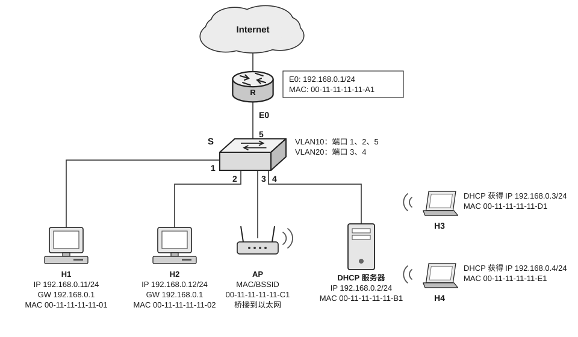

47. （9分）某局域网拓扑如下图所示。R 为支持 NAT 功能的路由器，S 为支持 IEEE 802.1Q 标准的 100Base-T 以太网交换机，AP 为工作于桥接模式的 802.11 无线接入点。各设备及接口的 IP 地址、MAC 地址已在图中标注。交换机 S 划分 VLAN10（端口 1、2、5）与 VLAN20（端口 3、4）；H1、H2 分别接入端口 1、2 且默认网关（GW）均配置为 192.168.0.1；AP 接入端口 3；DHCP 服务器接入端口 4；H3、H4 已通过 DHCP 获取 IPv4 地址并接入网络。请回答下列问题：

1）VLAN10 与 VLAN20 是否属于同一广播域？H1 发出的以太网广播帧能否到达 H3？

2）H1 在浏览器输入域名 www.s.com 访问 Internet 中的 Web 服务器，按“主机侧网络通信过程”写出从应用层到链路层依次发生的关键步骤（需包含 DNS 解析是否必需、ARP 解析对象、网络层下一跳地址以及以太网帧目的 MAC 地址）。

3）H1 与 Web 服务器分属不同网络（H1 在私网，Web 服务器在公网），需经路由器 R 转发并进行 NAT 转换。请结合拓扑说明：① H1 构造的以太网帧在 VLAN10 内的转发路径；② R 完成 NAT 转换后，离开 R 的以太网帧的目的 MAC 地址是什么？

4）H1 首次访问时的现象为：能 ping 通默认网关 192.168.0.1，浏览器已解析出 Web 服务器的公网 IP 地址，但 HTTP 请求持续超时。现给出如下可能的故障选项：① R 的 NAT 转换规则配置错误（例如未放行 HTTP 流量）；② H1 的默认网关配置错误（例如非 192.168.0.1）；③ DNS 服务器地址配置错误。请选择最可能的选项，并说明理由。已知 R 的接口配置、路由表、NAT 功能及 VLAN 间路由均正确。
