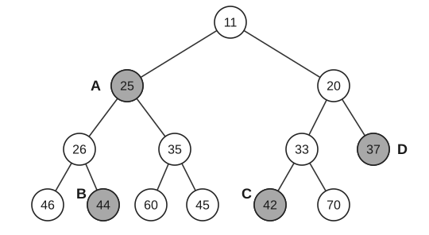

8. 设有一棵包含 $n$ 个结点的 AVL 树。对该树执行一次关键字删除操作，并在失衡时进行必要的平衡调整。关于此次删除操作过程中可能发生的旋转次数，下列叙述中正确的是（ ）。

(A) 至多发生 1 次旋转

(B) 至多发生 2 次旋转

(C) 最坏情况下可能需要 $O(\log n)$ 次旋转

(D) 与插入操作相同，最坏情况下恰好需要 2 次旋转

9. 散列表的装填因子 $\alpha$ 可以大于或等于 1 的情况仅发生在使用（ ）法处理冲突时。

(A) 线性探测 
(B) 二次探测 
(C) 双散列 
(D) 链地址

10. 如果从下图的堆中删除值为 11 的结点，那么值为 70 的结点将出现在图中的（ ）位置。

(A) A 
(B) B 
(C) C 
(D) D

11. 外部排序过程中的主要开销是 I/O 操作，因此可以采取一些措施来缩短 I/O 时间，则下列说法中正确的是（ ）。

(A) 使用置换-选择排序是为了通过减小初始归并段的长度来减少元素之间的比较次数

(B) 使用败者树可以优化置换-选择排序来减少元素之间的比较次数

(C) 败者树是为了增大归并路数，败者树的路数越多，排序时间就越短

(D) 构建的最佳归并树和哈夫曼树一样，只有度为 0 和 2 的结点

12. 冯·诺依曼机可以区分指令和数据的部件是（ ）。

(A) 总线 
(B) 控制器 
(C) 控制存储器 
(D) 运算器

13. 在下列关于补码和浮点数运算的说法中，正确的是（ ）。

I. 定点补码运算时，其符号位不参与运算。

II. 浮点运算可由阶码运算和尾数运算两部分组成。

III. 阶码在乘除运算时只进行加、减操作。

IV. 浮点数的正负由阶码的正负符号决定。

V. 尾数只进行乘除运算。

(A) I、II 和 III 
(B) I、II 和 V 
(C) II、III 和 IV 
(D) II 和 III
