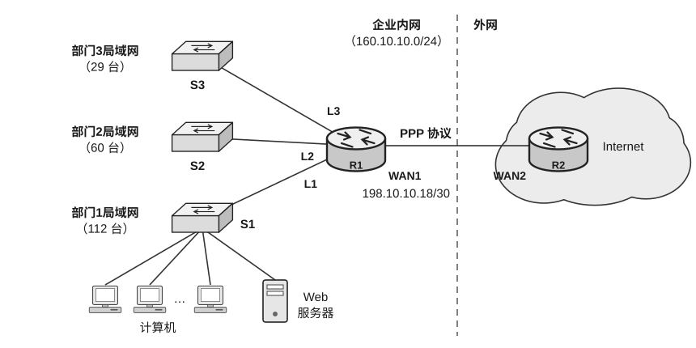

47. （9分）某企业网络的拓扑结构如下图所示。该企业的3个部门分别使用以太网交换机S1、S2、S3组建局域网，3个部门的局域网均连接到核心路由器R1上，并经路由器R2接入Internet。路由器R1的对外接口WAN1与Internet的路由器R2接口WAN2相连，链路层协议采用PPP，企业内网的网络设备之间互连均使用以太网技术。已知分配给企业内网的IP地址块为160.10.10.0/24，部门1-3的计算机数量分别为112台、60台、29台，其中部门1的计算机中有一台是对外提供服务的Web服务器，各部门的计算机均需访问Internet。回答下列问题。

1）请为3个部门分配IP地址，用CIDR表示，并给出部门1的计算机的默认网关地址（要求尽可能节省IP地址以留作扩展，且部门1-3按地址值从小到大分配）。

2）已知路由器 R1 接口 WAN1 的 IP 地址和子网掩码用 CIDR 表示为 198.10.10.18/30，请给出路由器 R2 接口 WAN2 的 IP 地址和子网掩码（用 CIDR 表示），并给出计算过程。

3）要确保该企业网络能正常访问 Internet，则路由器 R2 中至少应该有哪些路由表项？要求尽可能地进行路由聚合以减少表项数，路由表的格式如下所示。

| 目的网络 | 子网掩码（点分十进制表示） |
| :---: | :---: |
| … | … |

4）假设 Internet 中的某主机向该企业部门 1 中的 Web 服务器发出了 1 个请求报文，该报文所对应的 IP 分组在从路由器 R2 到 Web 服务器的转发过程中，需要经过几次 ARP 地址解析？说明理由（假设此时所有设备的 ARP 缓存均初始为空）。
