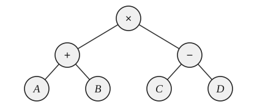

# 2027 王道 408 冲刺模拟试卷（八）

考试时间 180 分钟 满分 150 分

一、单项选择题：第 1–40 题，每题 2 分，共 80 分。在题目给出的四个选项中，只有一个选项最符合试题要求。

1. 假设有一个不带头结点的链式队列 $Q$，其队头指针和队尾指针分别为 `front` 和 `rear`，新进队的元素结点为 $s$，则进队操作是（ ）。

(A) Q.front=s; Q.front=Q.front->link;

(B) s->link=Q.front; Q.front=s;

(C) s->link=Q.rear; Q.rear=s;

(D) Q.rear->link=s; s->link=NULL; Q.rear=s;

2. 栈初始为空，将中缀表达式 $a - (b \times c + d / e)$ 转化为等价的后缀表达式，运算符栈中元素最多时有（ ）个。

(A) 2          (B) 3          (C) 4          (D) 5

3. 对于一个有 10 个顶点的无向图，可用一个 $10 \times 10$ 阶对称矩阵 $A$ 来存储图中任意两个顶点之间的最短距离。矩阵元素 $a_{ij}$ ($1 \leqslant i, j \leqslant 10$) 存储的是 $i$ 号和 $j$ 号顶点之间的最短距离，现用一个一维数组 $B$ 来对矩阵 $A$ 进行压缩存储，$B[0]$ 存储的是 $A[1][1]$，$B[1]$ 存储的是 $A[1][2]$，则 $B[35]$ 存储的是（ ）顶点之间的最短距离。

(A) 4 号和 6 号 (B) 4 号和 7 号 (C) 6 号和 5 号 (D) 6 号和 7 号

4. 已知字符串 $S$ 为 “aabaabcabc”，模式串 $T$ 为 “aaaabc”。使用 $\text{nextval}$ 优化后的 KMP 算法进行匹配，匹配到 $i=2$ 且 $j=2$ 时，失配 ($S[i] \neq T[j]$)。则下次开始匹配时，$i$ 和 $j$ 分别是（ ）。

(A) 2 和 2          (B) 2 和 1          (C) 3 和 0          (D) 3 和 2

5. 设有一棵表达式树，其叶结点为操作数，内部结点为运算符，结构如图所示。关于该表达式树及其相关性质，下列叙述中正确的是（ ）。

(A) 该表达式树所对应的表达式（按通常的运算优先级）可表示为 $A + B \times C - D$

(B) 对任意表达式树进行中序遍历，均无法直接得到语法正确的中缀表达式

(C) 任意表达式树的非叶结点的度均为 2

(D) 若一棵表达式树仅包含二元运算符“+”与“-”，且运算符结点数为 $n$，则操作数（叶）结点数为 $n+1$
