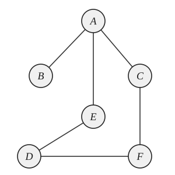

6. 如图所示，若从顶点 $A$ 出发进行遍历，则下列序列中既不是深度优先遍历又不是广度优先遍历的序列为（）。

(A) $A, B, C, E, F, D$ \quad (B) $A, B, E, C, D, F$ \quad (C) $A, E, D, F, C, B$ \quad (D) $A, E, D, C, B, F$

7. 在下列关于连通图的 BFS 和 DFS 生成树的高度的说法中，正确的是（）。

(A) BFS 生成树的高度小于 DFS 生成树的高度

(B) BFS 生成树的高度小于或等于 DFS 生成树的高度

(C) BFS 生成树的高度大于 DFS 生成树的高度

(D) BFS 生成树的高度大于或等于 DFS 生成树的高度

8. 在有 15 个结点的平衡二叉树上，查找关键字为 28（存在该结点）的结点，则依次比较的关键字有可能是（）。

(A) 30, 36

(B) 38, 48, 28

(C) 48, 18, 38, 28

(D) 60, 20, 50, 40, 38, 28

9. 设有一棵初始为空的红黑树 $T$，所有空指针均视为黑色 NIL 叶结点。依次插入关键字 41，38，31，12，19，8（新结点初始为红色），插入完成后，下列说法中正确的是（）。

(A) 根结点为 38，且为黑色

(B) 插入 19 时仅发生一次左旋操作

(C) 插入 8 后，该树的黑高（从根到任一 NIL 叶结点的路径上黑结点数，不包括根）为 3

(D) 最终树中不存在任何红色非叶结点

10. 散列表的地址范围为 $0 \sim 17$，散列函数为 $H(k) = k \pmod{17}$。采用线性探测法处理冲突，将关键字序列 26，25，72，38，8，18，59 依次存储到散列表中。元素 59 存放在散列表中的地址是（）。

(A) 8 \quad (B) 9 \quad (C) 10 \quad (D) 11

11. 在最好情况下，时间复杂度可以达到线性时间的排序算法是（）。

① 冒泡排序 ② 堆排序 ③ 快速排序 ④ 归并排序 ⑤ 直接插入排序

(A) ① \quad (B) ①⑤ \quad (C) ④⑤ \quad (D) ②③

12. 某计算机按字节编址，采用小端方式存储信息。其中，某指令的一个操作数为 16 位，该操作数采用基址寻址方式，指令中的形式地址（用补码表示）为 FF00H，当前基址寄存器的内容为 C000 0000H，则该操作数的 LSB 中存放的地址是（）。

(A) BFFF FF00H \quad (B) BFFF FF01H

(C) C000 FF00H \quad (D) C000 FF01H
